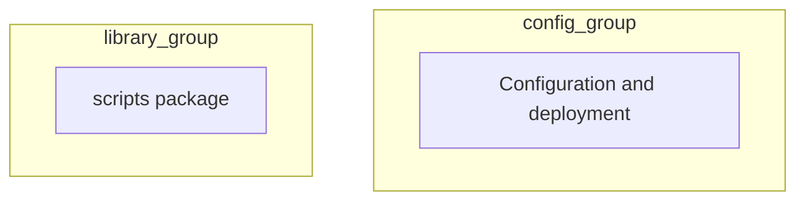

# Architecture report: PatrickJS/awesome-cursorrules

> Automated static analysis. **Observed** = directly seen in files/imports/AST; **Inferred** = interpretation from that evidence. Repository code was not executed.

## 1. Repository at a glance

| Item | Value |
| --- | --- |
| Repository | PatrickJS/awesome-cursorrules |
| Description | 📄  Configuration files that enhance Cursor AI editor experience with custom rules and behaviors |
| Language | JavaScript |
| Stars | 41158 |
| Licence | CC0-1.0 |
| Analysed commit / branch | b044f956f021b6e8877f16781bcfc466a6a120e9 / main |
| Framework(s) | None detected |
| Files analysed | 289 |
| Components | 2 |

## 2. Architecture in one minute

PatrickJS/awesome-cursorrules - 📄  Configuration files that enhance Cursor AI editor experience with custom rules and behaviors. This repository was analysed statically from 289 file(s) (0 Python). Detected technologies (observed from imports/manifests): GitHub Actions. Files are grouped into 2 component(s): Configuration and deployment, scripts package. Findings below distinguish observed facts from inferred interpretation.

## 3. High-level block diagram

## 4. Main components

### Configuration and deployment (`config`)

- **Kind:** config
- **Status:** Observed
- **Confidence:** 0.85
- **Responsibility:** Groups 1 file(s) under configuration and deployment (observed from repository paths and static analysis).
- **Paths:** `package.json`
- **Evidence:** [package.json](https://github.com/PatrickJS/awesome-cursorrules/blob/b044f956f021b6e8877f16781bcfc466a6a120e9/package.json)

### scripts package (`scripts`)

- **Kind:** library
- **Status:** Observed
- **Confidence:** 0.85
- **Responsibility:** Groups 19 file(s) under scripts package (observed from repository paths and static analysis).
- **Paths:** `scripts/check-awesome-list.mjs`, `scripts/check-awesome-list.test.mjs`, `scripts/check-issue-template-policy.mjs`, `scripts/check-pr-author.mjs`, `scripts/check-pr-author.test.mjs`, `scripts/check-readme-hygiene.mjs`, `scripts/check-repo-concerns.test.mjs`, `scripts/check-repo-hygiene.mjs`, `scripts/check-repo-hygiene.test.mjs`, `scripts/check-repo-security.mjs`, `scripts/check-repo-security.test.mjs`, `scripts/check-rule-hygiene.mjs`, `scripts/cleanup-legacy-artifacts.mjs`, `scripts/cleanup-legacy-artifacts.test.mjs`, `scripts/convert-readme-links.mjs`, `scripts/convert-readme-links.test.mjs`, `scripts/repo-config.mjs`, `scripts/repo-config.test.mjs`, `scripts/workflow-security.test.mjs`
- **Evidence:** [scripts/check-awesome-list.mjs](https://github.com/PatrickJS/awesome-cursorrules/blob/b044f956f021b6e8877f16781bcfc466a6a120e9/scripts/check-awesome-list.mjs); [scripts/check-awesome-list.test.mjs](https://github.com/PatrickJS/awesome-cursorrules/blob/b044f956f021b6e8877f16781bcfc466a6a120e9/scripts/check-awesome-list.test.mjs); [scripts/check-issue-template-policy.mjs](https://github.com/PatrickJS/awesome-cursorrules/blob/b044f956f021b6e8877f16781bcfc466a6a120e9/scripts/check-issue-template-policy.mjs); [scripts/check-pr-author.mjs](https://github.com/PatrickJS/awesome-cursorrules/blob/b044f956f021b6e8877f16781bcfc466a6a120e9/scripts/check-pr-author.mjs); [scripts/check-pr-author.test.mjs](https://github.com/PatrickJS/awesome-cursorrules/blob/b044f956f021b6e8877f16781bcfc466a6a120e9/scripts/check-pr-author.test.mjs); [scripts/check-readme-hygiene.mjs](https://github.com/PatrickJS/awesome-cursorrules/blob/b044f956f021b6e8877f16781bcfc466a6a120e9/scripts/check-readme-hygiene.mjs); [scripts/check-repo-concerns.test.mjs](https://github.com/PatrickJS/awesome-cursorrules/blob/b044f956f021b6e8877f16781bcfc466a6a120e9/scripts/check-repo-concerns.test.mjs); [scripts/check-repo-hygiene.mjs](https://github.com/PatrickJS/awesome-cursorrules/blob/b044f956f021b6e8877f16781bcfc466a6a120e9/scripts/check-repo-hygiene.mjs)

## 5. Execution flow

No entry point was observed; the startup flow below is therefore limited.

Representative flow (derived from observed entry points and the import graph; steps beyond the entry point are **Inferred**):

1. Execution starts at an observed entry point listed above, if present.
2. No internal import relationships between components were observed.

## 6. Project structure

### `(root)`

- `.gitignore` - other (52 bytes)
- `LICENSE` - docs (6555 bytes)
- `README.md` - docs (51862 bytes)
- `code-of-conduct.md` - docs (3250 bytes)
- `contributing.md` - docs (3029 bytes)
- `package.json` - manifest (978 bytes)

### `.github`

- `.github/CODEOWNERS` - other (159 bytes)
- `.github/FUNDING.yml` - config (931 bytes)
- `.github/ISSUE_TEMPLATE/config.yml` - config (264 bytes)
- `.github/ISSUE_TEMPLATE/repository_maintenance.yml` - config (1204 bytes)
- `.github/ISSUE_TEMPLATE/rule_request.yml` - config (1818 bytes)
- `.github/pull_request_template.md` - docs (1540 bytes)
- `.github/workflows/main.yml` - ci, YAML (12927 bytes)

### `rules`

- `rules/ai-agent-specialist.mdc` - other (2516 bytes)
- `rules/alpha-skills-quant-factor-research.mdc` - other (1208 bytes)
- `rules/android-jetpack-compose-cursorrules-prompt-file.mdc` - other (2817 bytes)
- `rules/angular-novo-elements-cursorrules-prompt-file.mdc` - other (6280 bytes)
- `rules/angular-typescript-cursorrules-prompt-file.mdc` - other (1465 bytes)
- `rules/ankra-cli.mdc` - other (7084 bytes)
- `rules/anti-overengineering.mdc` - other (584 bytes)
- `rules/anti-sycophancy-code-discipline-cursorrules-prompt-file.mdc` - other (4206 bytes)
- `rules/ascii-simulation-game-cursorrules-prompt-file.mdc` - other (4817 bytes)
- `rules/aspnet-abp-cursorrules-prompt-file.mdc` - other (6335 bytes)
- `rules/astro-typescript-cursorrules-prompt-file.mdc` - other (2594 bytes)
- `rules/automl-hyperparameter-optimization.mdc` - other (2941 bytes)
- `rules/beefreeSDK-nocode-content-editor-cursorrules-prompt-file.mdc` - other (16561 bytes)
- `rules/beefreeSDK.mdc` - other (16768 bytes)
- `rules/blender-python-addon.mdc` - other (2491 bytes)
- `rules/chrome-extension-dev-js-typescript-cursorrules-pro.mdc` - other (3988 bytes)
- `rules/clean-code.mdc` - other (1847 bytes)
- `rules/cloudflare-email-telegram-cursorrules-prompt-file.mdc` - other (2775 bytes)
- `rules/cloudflare-workers-hono-angular-saas-cursorrules-prompt-file.mdc` - other (4574 bytes)
- `rules/code-guidelines-cursorrules-prompt-file.mdc` - other (2937 bytes)
- `rules/code-pair-interviews.mdc` - other (2015 bytes)
- `rules/code-style-consistency-cursorrules-prompt-file.mdc` - other (6370 bytes)
- `rules/codequality.mdc` - other (1442 bytes)
- `rules/convex-cursorrules-prompt-file.mdc` - other (30749 bytes)
- `rules/cpp-programming-guidelines-cursorrules-prompt-file.mdc` - other (4930 bytes)
- `rules/cpp.mdc` - other (5064 bytes)
- `rules/cursor-ai-react-typescript-shadcn-ui-cursorrules-p.mdc` - other (781 bytes)
- `rules/cursor-rules-pack-v2-cursorrules-prompt-file.mdc` - other (2686 bytes)
- `rules/cursorrules-cursor-ai-nextjs-14-tailwind-seo-setup.mdc` - other (5714 bytes)
- `rules/cursorrules-cursor-ai-wordpress-draft-macos-prompt.mdc` - other (688 bytes)
- `rules/cypress-accessibility-testing-cursorrules-prompt-file.mdc` - other (3270 bytes)
- `rules/cypress-api-testing-cursorrules-prompt-file.mdc` - other (3402 bytes)
- `rules/cypress-defect-tracking-cursorrules-prompt-file.mdc` - other (6369 bytes)
- `rules/cypress-e2e-testing-cursorrules-prompt-file.mdc` - other (3096 bytes)
- `rules/cypress-integration-testing-cursorrules-prompt-file.mdc` - other (6756 bytes)
- `rules/database.mdc` - other (2069 bytes)
- `rules/deno-integration-techniques-cursorrules-prompt-fil.mdc` - other (838 bytes)
- `rules/docker.mdc` - other (1291 bytes)
- `rules/dragonruby-best-practices-cursorrules-prompt-file.mdc` - other (1292 bytes)
- `rules/drupal-11-cursorrules-prompt-file.mdc` - other (7222 bytes)
- `rules/elixir-engineer-guidelines-cursorrules-prompt-file.mdc` - other (791 bytes)
- `rules/elixir-phoenix-docker-setup-cursorrules-prompt-fil.mdc` - other (2176 bytes)
- `rules/embedded-stm32-hal.mdc` - other (2432 bytes)
- `rules/engineering-ticket-template-cursorrules-prompt-file.mdc` - other (9968 bytes)
- `rules/es-module-nodejs-guidelines-cursorrules-prompt-fil.mdc` - other (1029 bytes)
- `rules/fastapi-production-architecture-cursorrules-prompt-file.mdc` - other (8269 bytes)
- `rules/fastapi.mdc` - other (2153 bytes)
- `rules/flutter-app-expert-cursorrules-prompt-file.mdc` - other (2965 bytes)
- `rules/flutter-development-guidelines-cursorrules-prompt-file.mdc` - other (2424 bytes)
- `rules/flutter-riverpod-cursorrules-prompt-file.mdc` - other (7959 bytes)
- `rules/fortran.mdc` - other (3007 bytes)
- `rules/gamemaker-gml.mdc` - other (2377 bytes)
- `rules/gherkin-style-testing-cursorrules-prompt-file.mdc` - other (4206 bytes)
- `rules/git-conventional-commit-messages.mdc` - other (4485 bytes)
- `rules/gitflow.mdc` - other (2636 bytes)
- `rules/github-code-quality-cursorrules-prompt-file.mdc` - other (3492 bytes)
- `rules/github-cursorrules-prompt-file-instructions.mdc` - other (12718 bytes)
- `rules/go-backend-scalability-cursorrules-prompt-file.mdc` - other (5327 bytes)
- `rules/go-servemux-rest-api-cursorrules-prompt-file.mdc` - other (2101 bytes)
- `rules/go-temporal-dsl-prompt-file.mdc` - other (118 bytes)
- `rules/go.mdc` - other (1236 bytes)
- `rules/google-adk.mdc` - other (2293 bytes)
- `rules/graphical-apps-development-cursorrules-prompt-file.mdc` - other (3000 bytes)
- `rules/harmony-arkts.mdc` - other (2201 bytes)
- `rules/helium-mcp-cursorrules-prompt-file.mdc` - other (4467 bytes)
- `rules/hol-hedera-typescript-cursorrules-prompt-file.mdc` - other (7501 bytes)
- `rules/how-to-documentation-cursorrules-prompt-file.mdc` - other (4575 bytes)
- `rules/html-tailwind-css-javascript-cursorrules-prompt-fi.mdc` - other (1380 bytes)
- `rules/htmx-basic-cursorrules-prompt-file.mdc` - other (923 bytes)
- `rules/htmx-django-cursorrules-prompt-file.mdc` - other (1206 bytes)
- `rules/htmx-flask-cursorrules-prompt-file.mdc` - other (1077 bytes)
- `rules/htmx-go-basic-cursorrules-prompt-file.mdc` - other (1026 bytes)
- `rules/htmx-go-fiber-cursorrules-prompt-file.mdc` - other (1161 bytes)
- `rules/java-general-purpose-cursorrules-prompt-file.mdc` - other (6499 bytes)
- `rules/java-springboot-jpa-cursorrules-prompt-file.mdc` - other (4880 bytes)
- `rules/javascript-astro-tailwind-css-cursorrules-prompt-f.mdc` - other (4754 bytes)
- `rules/javascript-chrome-apis-cursorrules-prompt-file.mdc` - other (692 bytes)
- `rules/javascript-typescript-code-quality-cursorrules-pro.mdc` - other (3169 bytes)
- `rules/jest-unit-testing-cursorrules-prompt-file.mdc` - other (3883 bytes)
- `rules/knative-istio-typesense-gpu-cursorrules-prompt-fil.mdc` - other (3230 bytes)
- `rules/kotlin-ktor-development-cursorrules-prompt-file.mdc` - other (9319 bytes)
- `rules/kotlin-springboot-best-practices-cursorrules-prompt-file.mdc` - other (7241 bytes)
- `rules/kubernetes-mkdocs-documentation-cursorrules-prompt.mdc` - other (957 bytes)
- `rules/kubestellar-console.mdc` - other (2319 bytes)
- `rules/landing-page-image-quality-cursorrules-prompt-file.mdc` - other (1816 bytes)
- `rules/laravel-php-83-cursorrules-prompt-file.mdc` - other (1927 bytes)
- `rules/laravel-tall-stack-best-practices-cursorrules-prom.mdc` - other (5168 bytes)
- `rules/linux-nvidia-cuda-python-cursorrules-prompt-file.mdc` - other (2182 bytes)
- `rules/manifest-yaml-cursorrules-prompt-file.mdc` - other (3036 bytes)
- `rules/medusa-cursorrules.mdc` - other (1800 bytes)
- `rules/medusa.mdc` - other (1941 bytes)
- `rules/momen-cursurrules-prompt-file.mdc` - other (15978 bytes)
- `rules/nativescript-cursorrules-prompt-file.mdc` - other (961 bytes)
- `rules/nativescript.mdc` - other (3225 bytes)
- `rules/nestjs-anti-hallucination-cursorrules-prompt-file.mdc` - other (7276 bytes)
- `rules/netlify-official-cursorrules-prompt-file.mdc` - other (39701 bytes)
- `rules/network-troubleshoot.mdc` - other (7931 bytes)
- `rules/next-type-llm.mdc` - other (2750 bytes)
- `rules/nextjs-app-router-cursorrules-prompt-file.mdc` - other (1032 bytes)
- `rules/nextjs-material-ui-tailwind-css-cursorrules-prompt.mdc` - other (1480 bytes)
- `rules/nextjs-react-tailwind-cursorrules-prompt-file.mdc` - other (4192 bytes)
- `rules/nextjs-react-typescript-cursorrules-prompt-file.mdc` - other (3996 bytes)
- `rules/nextjs-seo-dev-cursorrules-prompt-file.mdc` - other (2196 bytes)
- `rules/nextjs-supabase-shadcn-pwa-cursorrules-prompt-file.mdc` - other (6573 bytes)
- `rules/nextjs-supabase-todo-app-cursorrules-prompt-file.mdc` - other (280 bytes)
- `rules/nextjs-tailwind-typescript-apps-cursorrules-prompt.mdc` - other (1449 bytes)
- `rules/nextjs-tanstack-query-cursorrules-prompt-file.mdc` - other (7735 bytes)
- `rules/nextjs-tanstack-query.mdc` - other (3541 bytes)
- `rules/nextjs-typescript-app-cursorrules-prompt-file.mdc` - other (317 bytes)
- `rules/nextjs-typescript-cursorrules-prompt-file.mdc` - other (2712 bytes)
- `rules/nextjs-typescript-tailwind-cursorrules-prompt-file.mdc` - other (2679 bytes)
- `rules/nextjs-vercel-supabase-cursorrules-prompt-file.mdc` - other (7792 bytes)
- `rules/nextjs-vercel-typescript-cursorrules-prompt-file.mdc` - other (5572 bytes)
- `rules/nextjs.mdc` - other (1740 bytes)
- `rules/nextjs15-react19-vercelai-tailwind-cursorrules-prompt-file.mdc` - other (2879 bytes)
- `rules/nextjs15-supabase-cursorrules-prompt-file.mdc` - other (4651 bytes)
- `rules/node-express.mdc` - other (2172 bytes)
- `rules/nodejs-mongodb-cursorrules-prompt-file-tutorial.mdc` - other (2111 bytes)
- `rules/nodejs-mongodb-jwt-express-react-cursorrules-promp.mdc` - other (2180 bytes)
- `rules/optimize-dry-solid-principles-cursorrules-prompt-f.mdc` - other (775 bytes)
- `rules/optimize-rell-blockchain-code-cursorrules-prompt-f.mdc` - other (1607 bytes)
- `rules/pandas-scikit-learn-guide-cursorrules-prompt-file.mdc` - other (2840 bytes)
- `rules/plasticode-telegram-api-cursorrules-prompt-file.mdc` - other (750 bytes)
- `rules/playwright-accessibility-testing-cursorrules-prompt-file.mdc` - other (3887 bytes)
- `rules/playwright-api-testing-cursorrules-prompt-file.mdc` - other (3047 bytes)
- `rules/playwright-defect-tracking-cursorrules-prompt-file.mdc` - other (4123 bytes)
- `rules/playwright-e2e-testing-cursorrules-prompt-file.mdc` - other (3569 bytes)
- `rules/playwright-integration-testing-cursorrules-prompt-file.mdc` - other (7306 bytes)
- `rules/postgresql.mdc` - other (1412 bytes)
- `rules/pr-review-cursorrules-prompt-file.mdc` - other (4457 bytes)
- `rules/pr-template-cursorrules-prompt-file.mdc` - other (5170 bytes)
- `rules/project-epic-template-cursorrules-prompt-file.mdc` - other (9743 bytes)
- `rules/py-fast-api.mdc` - other (3755 bytes)
- `rules/pyqt6-eeg-processing-cursorrules-prompt-file.mdc` - other (3158 bytes)
- `rules/pyspark-etl-best-practices-cursorrules-prompt-file.mdc` - other (13538 bytes)
- `rules/python--typescript-guide-cursorrules-prompt-file.mdc` - other (1146 bytes)
- `rules/python-312-fastapi-best-practices-cursorrules-prom.mdc` - other (1579 bytes)
- `rules/python-containerization-cursorrules-prompt-file.mdc` - other (301 bytes)
- `rules/python-cursorrules-prompt-file-best-practices.mdc` - other (1959 bytes)
- `rules/python-developer-cursorrules-prompt-file.mdc` - other (421 bytes)
- `rules/python-django-best-practices-cursorrules-prompt-fi.mdc` - other (3636 bytes)
- `rules/python-fastapi-best-practices-cursorrules-prompt-f.mdc` - other (2601 bytes)
- `rules/python-fastapi-cursorrules-prompt-file.mdc` - other (1092 bytes)
- `rules/python-fastapi-scalable-api-cursorrules-prompt-fil.mdc` - other (4698 bytes)
- `rules/python-flask-json-guide-cursorrules-prompt-file.mdc` - other (746 bytes)
- `rules/python-github-setup-cursorrules-prompt-file.mdc` - other (4828 bytes)
- `rules/python-llm-ml-workflow-cursorrules-prompt-file.mdc` - other (7205 bytes)
- `rules/python-projects-guide-cursorrules-prompt-file.mdc` - other (1097 bytes)
- `rules/python.mdc` - other (3393 bytes)
- `rules/pytorch-scikit-learn-cursorrules-prompt-file.mdc` - other (4957 bytes)
- `rules/qa-bug-report-cursorrules-prompt-file.mdc` - other (5761 bytes)
- `rules/qwik-basic-cursorrules-prompt-file.mdc` - other (1279 bytes)
- `rules/qwik-tailwind-cursorrules-prompt-file.mdc` - other (1424 bytes)
- `rules/r-cursorrules-prompt-file-best-practices.mdc` - other (7920 bytes)
- `rules/rails-cursorrules-prompt-file.mdc` - other (738 bytes)
- `rules/react-chakra-ui-cursorrules-prompt-file.mdc` - other (1196 bytes)
- `rules/react-components-creation-cursorrules-prompt-file.mdc` - other (1671 bytes)
- `rules/react-formengine-ai-form-builder-cursorrules-prompt-file.mdc` - other (6472 bytes)
- `rules/react-graphql-apollo-client-cursorrules-prompt-file.mdc` - other (1179 bytes)
- `rules/react-mobx-cursorrules-prompt-file.mdc` - other (1115 bytes)
- `rules/react-native-expo-cursorrules-prompt-file.mdc` - other (997 bytes)
- `rules/react-native-expo-router-typescript-windows-cursorrules-prompt-file.mdc` - other (2717 bytes)
- `rules/react-nextjs-ui-development-cursorrules-prompt-fil.mdc` - other (1415 bytes)
- `rules/react-query-cursorrules-prompt-file.mdc` - other (1133 bytes)
- `rules/react-redux-typescript-cursorrules-prompt-file.mdc` - other (1156 bytes)
- `rules/react-router-v7.mdc` - other (2284 bytes)
- `rules/react-styled-components-cursorrules-prompt-file.mdc` - other (1193 bytes)
- `rules/react-tanstack-router-query-cursorrules-prompt-file.mdc` - other (8113 bytes)
- `rules/react-tanstack-router-query.mdc` - other (3659 bytes)
- `rules/react-typescript-nextjs-nodejs-cursorrules-prompt-.mdc` - other (4645 bytes)
- `rules/react-typescript-symfony-cursorrules-prompt-file.mdc` - other (584 bytes)
- `rules/react-zustand-cursorrules-prompt-file.mdc` - other (5441 bytes)
- `rules/react.mdc` - other (2324 bytes)
- `rules/readme-best-practices-cursorrules-prompt-file.mdc` - other (1067 bytes)
- `rules/ros-ros2.mdc` - other (2143 bytes)
- `rules/rtl-right-to-left-i18n-cursorrules-prompt-file.mdc` - other (2253 bytes)
- `rules/rust-general.mdc` - other (2218 bytes)
- `rules/rust.mdc` - other (4240 bytes)
- `rules/salesforce-apex-cursorrules-prompt-file.mdc` - other (3626 bytes)
- `rules/scala-kafka-cursorrules-prompt-file.mdc` - other (4668 bytes)
- `rules/security-devsecops-ssdls-appsec.mdc` - other (2618 bytes)
- `rules/semiotic-react-dataviz-cursorrules-prompt-file.mdc` - other (28491 bytes)
- `rules/shopify-theme-dev-liquid.mdc` - other (3916 bytes)
- `rules/snowflake-cortex-ai-cursorrules-prompt-file.mdc` - other (7281 bytes)
- `rules/snowflake-data-engineering-cursorrules-prompt-file.mdc` - other (8333 bytes)
- `rules/snowflake-snowpark-dbt-cursorrules-prompt-file.mdc` - other (6980 bytes)
- `rules/solana-wallet-aware.mdc` - other (3446 bytes)
- `rules/solidity-foundry-cursorrules-prompt-file.mdc` - other (7946 bytes)
- `rules/solidity-hardhat-cursorrules-prompt-file.mdc` - other (5355 bytes)
- `rules/solidity-react-blockchain-apps-cursorrules-prompt-.mdc` - other (843 bytes)
- `rules/solidjs-basic-cursorrules-prompt-file.mdc` - other (1115 bytes)
- `rules/solidjs-tailwind-cursorrules-prompt-file.mdc` - other (1251 bytes)
- `rules/solidjs-typescript-cursorrules-prompt-file.mdc` - other (1152 bytes)
- `rules/svelte-5-vs-svelte-4-cursorrules-prompt-file.mdc` - other (2529 bytes)
- `rules/svelte.mdc` - other (2149 bytes)
- `rules/sveltekit-restful-api-tailwind-css-cursorrules-pro.mdc` - other (3533 bytes)
- `rules/sveltekit-tailwindcss-typescript-cursorrules-promp.mdc` - other (5196 bytes)
- `rules/sveltekit-typescript-guide-cursorrules-prompt-file.mdc` - other (769 bytes)
- `rules/swift-uikit-cursorrules-prompt-file.mdc` - other (23894 bytes)
- `rules/swiftui-guidelines-cursorrules-prompt-file.mdc` - other (4413 bytes)
- `rules/tailwind-css-nextjs-guide-cursorrules-prompt-file.mdc` - other (4566 bytes)
- `rules/tailwind-react-firebase-cursorrules-prompt-file.mdc` - other (3859 bytes)
- `rules/tailwind-shadcn-ui-integration-cursorrules-prompt-.mdc` - other (1215 bytes)
- `rules/tailwind.mdc` - other (2186 bytes)
- `rules/tanstack-query-v5-cursorrules-prompt-file.mdc` - other (6471 bytes)
- `rules/tanstack-query.mdc` - other (3554 bytes)
- `rules/tanstack-router-react-cursorrules-prompt-file.mdc` - other (6018 bytes)
- `rules/tanstack-router.mdc` - other (3282 bytes)
- `rules/tanstack-start-cursorrules-prompt-file.mdc` - other (7251 bytes)
- `rules/tanstack-start.mdc` - other (3705 bytes)
- `rules/tauri-svelte-typescript-guide-cursorrules-prompt-f.mdc` - other (3880 bytes)
- `rules/temporal-python-cursorrules.mdc` - other (3160 bytes)
- `rules/tensorflow-deep-learning.mdc` - other (2473 bytes)
- `rules/testrail-test-case-cursorrules-prompt-file.mdc` - other (9799 bytes)
- `rules/tokrepo-agent-discovery-cursorrules-prompt-file.mdc` - other (3577 bytes)
- `rules/toss-style-design-system.mdc` - other (2736 bytes)
- `rules/typescript-axios-cursorrules-prompt-file.mdc` - other (249 bytes)
- `rules/typescript-clasp-cursorrules-prompt-file.mdc` - other (2762 bytes)
- `rules/typescript-code-convention-cursorrules-prompt-file.mdc` - other (556 bytes)
- `rules/typescript-expo-jest-detox-cursorrules-prompt-file.mdc` - other (612 bytes)
- `rules/typescript-llm-tech-stack-cursorrules-prompt-file.mdc` - other (2847 bytes)
- `rules/typescript-nestjs-best-practices-cursorrules-promp.mdc` - other (4389 bytes)
- `rules/typescript-nextjs-cursorrules-prompt-file.mdc` - other (2550 bytes)
- `rules/typescript-nextjs-react-cursorrules-prompt-file.mdc` - other (504 bytes)
- `rules/typescript-nextjs-react-tailwind-supabase-cursorru.mdc` - other (292 bytes)
- `rules/typescript-nextjs-supabase-cursorrules-prompt-file.mdc` - other (3015 bytes)
- `rules/typescript-nodejs-nextjs-ai-cursorrules-prompt-fil.mdc` - other (514 bytes)
- `rules/typescript-nodejs-nextjs-app-cursorrules-prompt-fi.mdc` - other (2473 bytes)
- `rules/typescript-nodejs-nextjs-react-ui-css-cursorrules-.mdc` - other (1944 bytes)
- `rules/typescript-nodejs-react-vite-cursorrules-prompt-fi.mdc` - other (1742 bytes)
- `rules/typescript-react-cursorrules-prompt-file.mdc` - other (1192 bytes)
- `rules/typescript-react-nextjs-cloudflare-cursorrules-pro.mdc` - other (2124 bytes)
- `rules/typescript-react-nextui-supabase-cursorrules-promp.mdc` - other (2175 bytes)
- `rules/typescript-shadcn-ui-nextjs-cursorrules-prompt-fil.mdc` - other (2141 bytes)
- `rules/typescript-vite-tailwind-cursorrules-prompt-file.mdc` - other (3368 bytes)
- `rules/typescript-vuejs-cursorrules-prompt-file.mdc` - other (344 bytes)
- `rules/typescript-zod-tailwind-nextjs-cursorrules-prompt-.mdc` - other (2322 bytes)
- `rules/typescript.mdc` - other (2067 bytes)
- `rules/typo3cms-extension-cursorrules-prompt-file.mdc` - other (3746 bytes)
- `rules/uikit-guidelines-cursorrules-prompt-file.mdc` - other (1913 bytes)
- `rules/unity-cursor-ai-c-cursorrules-prompt-file.mdc` - other (829 bytes)
- `rules/vercel-deployment-cursorrules-prompt-file.mdc` - other (5908 bytes)
- `rules/vercel-deployment.mdc` - other (3884 bytes)
- `rules/vitest-unit-testing-cursorrules-prompt-file.mdc` - other (4345 bytes)
- `rules/vscode-extension-dev-typescript-cursorrules-prompt-file.mdc` - other (5261 bytes)
- `rules/vue-3-nuxt-3-development-cursorrules-prompt-file.mdc` - other (2092 bytes)
- `rules/vue-3-nuxt-3-typescript-cursorrules-prompt-file.mdc` - other (753 bytes)
- `rules/vue-claude-stack.mdc` - other (2473 bytes)
- `rules/vue-pinia-cursorrules-prompt-file.mdc` - other (5521 bytes)
- `rules/vue.mdc` - other (2189 bytes)
- `rules/vue3-composition-api-cursorrules-prompt-file.mdc` - other (1067 bytes)
- `rules/web-app-optimization-cursorrules-prompt-file.mdc` - other (7270 bytes)
- `rules/webassembly-z80-cellular-automata-cursorrules-prom.mdc` - other (8650 bytes)
- `rules/wordpress-claude-stack.mdc` - other (3110 bytes)
- `rules/wordpress-php-guzzle-gutenberg-cursorrules-prompt-.mdc` - other (633 bytes)
- `rules/xian-smart-contracts-cursor-rules-prompt-file.mdc` - other (19092 bytes)
- `rules/xray-test-case-cursorrules-prompt-file.mdc` - other (4470 bytes)

### `scripts`

- `scripts/check-awesome-list.mjs` - source, JavaScript (6349 bytes)
- `scripts/check-awesome-list.test.mjs` - source, JavaScript (3852 bytes)
- `scripts/check-issue-template-policy.mjs` - source, JavaScript (322 bytes)
- `scripts/check-pr-author.mjs` - source, JavaScript (4148 bytes)
- `scripts/check-pr-author.test.mjs` - source, JavaScript (3418 bytes)
- `scripts/check-readme-hygiene.mjs` - source, JavaScript (322 bytes)
- `scripts/check-repo-concerns.test.mjs` - source, JavaScript (4861 bytes)
- `scripts/check-repo-hygiene.mjs` - source, JavaScript (38609 bytes)
- `scripts/check-repo-hygiene.test.mjs` - source, JavaScript (16580 bytes)
- `scripts/check-repo-security.mjs` - source, JavaScript (324 bytes)
- `scripts/check-repo-security.test.mjs` - source, JavaScript (22316 bytes)
- `scripts/check-rule-hygiene.mjs` - source, JavaScript (321 bytes)
- `scripts/cleanup-legacy-artifacts.mjs` - source, JavaScript (2078 bytes)
- `scripts/cleanup-legacy-artifacts.test.mjs` - source, JavaScript (1752 bytes)
- `scripts/convert-readme-links.mjs` - source, JavaScript (2006 bytes)
- `scripts/convert-readme-links.test.mjs` - source, JavaScript (4069 bytes)
- `scripts/repo-config.mjs` - source, JavaScript (690 bytes)
- `scripts/repo-config.test.mjs` - source, JavaScript (929 bytes)
- `scripts/workflow-security.test.mjs` - source, JavaScript (8824 bytes)

## 7. Key dependencies and integrations

| Name | Category | Status | Confidence | Evidence |
| --- | --- | --- | --- | --- |
| GitHub Actions | ci | Observed | 0.85 | [.github/workflows/main.yml](https://github.com/PatrickJS/awesome-cursorrules/blob/b044f956f021b6e8877f16781bcfc466a6a120e9/.github/workflows/main.yml) |

## 8. Data and state

No database, cache, queue, or persistent-state usage was observed in the analysed files. State handling, if any, may be in-memory or in files that were not analysed.

## 9. Configuration and deployment clues

- `.github/FUNDING.yml` (config)
- `.github/ISSUE_TEMPLATE/config.yml` (config)
- `.github/ISSUE_TEMPLATE/repository_maintenance.yml` (config)
- `.github/ISSUE_TEMPLATE/rule_request.yml` (config)
- `.github/workflows/main.yml` (ci)
- `package.json` (manifest)

## 10. Design observations

- No strong design patterns could be established from the available evidence.

These observations are interpretations (**Inferred**) of the observed structure, not guarantees about runtime design.

## 11. Limitations and unknowns

- Static analysis only: repository code was not executed, installed, or imported at runtime.
- Components and relationships are inferred from file paths, imports, and AST structure; runtime behaviour, dynamic imports, and reflection may not be visible.
- 1 file(s) were skipped during inventory (1 x lockfile excluded).
- No clear application entry point was observed in the analysed files.
- Repository text was treated as untrusted data; no instructions found in repository files were followed, and likely secret values were redacted/excluded.
- JavaScript and TypeScript files were inventoried from paths and package manifests. They were not parsed with a full language AST, and repository code was not executed.

## 12. Source references

- [.github/workflows/main.yml](https://github.com/PatrickJS/awesome-cursorrules/blob/b044f956f021b6e8877f16781bcfc466a6a120e9/.github/workflows/main.yml)
- [package.json](https://github.com/PatrickJS/awesome-cursorrules/blob/b044f956f021b6e8877f16781bcfc466a6a120e9/package.json)
- [scripts/check-awesome-list.mjs](https://github.com/PatrickJS/awesome-cursorrules/blob/b044f956f021b6e8877f16781bcfc466a6a120e9/scripts/check-awesome-list.mjs)
- [scripts/check-awesome-list.test.mjs](https://github.com/PatrickJS/awesome-cursorrules/blob/b044f956f021b6e8877f16781bcfc466a6a120e9/scripts/check-awesome-list.test.mjs)
- [scripts/check-issue-template-policy.mjs](https://github.com/PatrickJS/awesome-cursorrules/blob/b044f956f021b6e8877f16781bcfc466a6a120e9/scripts/check-issue-template-policy.mjs)
- [scripts/check-pr-author.mjs](https://github.com/PatrickJS/awesome-cursorrules/blob/b044f956f021b6e8877f16781bcfc466a6a120e9/scripts/check-pr-author.mjs)
- [scripts/check-pr-author.test.mjs](https://github.com/PatrickJS/awesome-cursorrules/blob/b044f956f021b6e8877f16781bcfc466a6a120e9/scripts/check-pr-author.test.mjs)
- [scripts/check-readme-hygiene.mjs](https://github.com/PatrickJS/awesome-cursorrules/blob/b044f956f021b6e8877f16781bcfc466a6a120e9/scripts/check-readme-hygiene.mjs)
- [scripts/check-repo-concerns.test.mjs](https://github.com/PatrickJS/awesome-cursorrules/blob/b044f956f021b6e8877f16781bcfc466a6a120e9/scripts/check-repo-concerns.test.mjs)
- [scripts/check-repo-hygiene.mjs](https://github.com/PatrickJS/awesome-cursorrules/blob/b044f956f021b6e8877f16781bcfc466a6a120e9/scripts/check-repo-hygiene.mjs)
