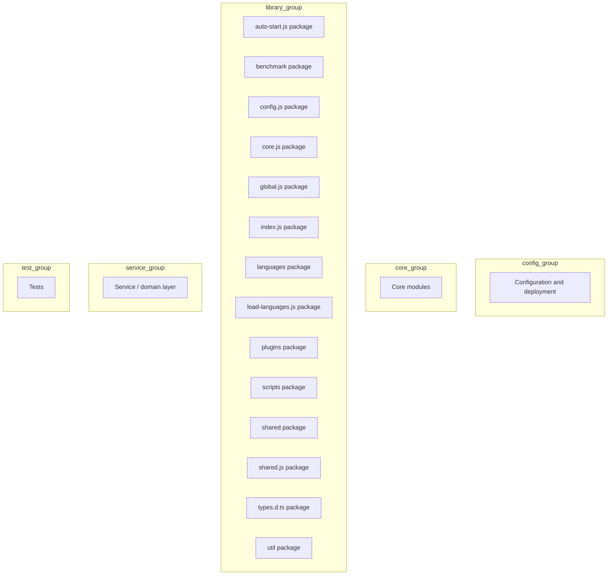

# Architecture report: PrismJS/prism

> Automated static analysis. **Observed** = directly seen in files/imports/AST; **Inferred** = interpretation from that evidence. Repository code was not executed.

## 1. Repository at a glance

| Item | Value |
| --- | --- |
| Repository | PrismJS/prism |
| Description | Lightweight, robust, elegant syntax highlighting. |
| Language | JavaScript |
| Stars | 13068 |
| Licence | MIT |
| Analysed commit / branch | 59759136a1da88be0c54d98ed3152ec8135ce905 / v2 |
| Framework(s) | None detected |
| Files analysed | 800 |
| Components | 18 |

## 2. Architecture in one minute

PrismJS/prism - Lightweight, robust, elegant syntax highlighting.. This repository was analysed statically from 800 file(s) (0 Python). Detected technologies (observed from imports/manifests): GitHub Actions, TypeScript. Files are grouped into 18 component(s): auto-start.js package, benchmark package, Configuration and deployment, config.js package, Core modules, core.js package, global.js package, index.js package. Findings below distinguish observed facts from inferred interpretation.

## 3. High-level block diagram

## 4. Main components

### auto-start.js package (`auto_start_js`)

- **Kind:** library
- **Status:** Observed
- **Confidence:** 0.85
- **Responsibility:** Groups 1 file(s) under auto-start.js package (observed from repository paths and static analysis).
- **Paths:** `src/auto-start.js`
- **Evidence:** [src/auto-start.js](https://github.com/PrismJS/prism/blob/59759136a1da88be0c54d98ed3152ec8135ce905/src/auto-start.js)

### benchmark package (`benchmark`)

- **Kind:** library
- **Status:** Observed
- **Confidence:** 0.85
- **Responsibility:** Groups 2 file(s) under benchmark package (observed from repository paths and static analysis).
- **Paths:** `benchmark/benchmark.js`, `benchmark/config.js`
- **Evidence:** [benchmark/benchmark.js](https://github.com/PrismJS/prism/blob/59759136a1da88be0c54d98ed3152ec8135ce905/benchmark/benchmark.js); [benchmark/config.js](https://github.com/PrismJS/prism/blob/59759136a1da88be0c54d98ed3152ec8135ce905/benchmark/config.js)

### Configuration and deployment (`config`)

- **Kind:** config
- **Status:** Observed
- **Confidence:** 0.85
- **Responsibility:** Groups 3 file(s) under configuration and deployment (observed from repository paths and static analysis).
- **Paths:** `composer.json`, `package.json`, `src/components.json`
- **Evidence:** [composer.json](https://github.com/PrismJS/prism/blob/59759136a1da88be0c54d98ed3152ec8135ce905/composer.json); [package.json](https://github.com/PrismJS/prism/blob/59759136a1da88be0c54d98ed3152ec8135ce905/package.json); [src/components.json](https://github.com/PrismJS/prism/blob/59759136a1da88be0c54d98ed3152ec8135ce905/src/components.json)

### config.js package (`config_js`)

- **Kind:** library
- **Status:** Observed
- **Confidence:** 0.85
- **Responsibility:** Groups 1 file(s) under config.js package (observed from repository paths and static analysis).
- **Paths:** `src/config.js`
- **Evidence:** [src/config.js](https://github.com/PrismJS/prism/blob/59759136a1da88be0c54d98ed3152ec8135ce905/src/config.js)

### Core modules (`core`)

- **Kind:** core
- **Status:** Observed
- **Confidence:** 0.85
- **Responsibility:** Groups 1 file(s) under core modules (observed from repository paths and static analysis).
- **Paths:** `eslint.config.mjs`
- **Evidence:** [eslint.config.mjs](https://github.com/PrismJS/prism/blob/59759136a1da88be0c54d98ed3152ec8135ce905/eslint.config.mjs)

### core.js package (`core_js`)

- **Kind:** library
- **Status:** Observed
- **Confidence:** 0.85
- **Responsibility:** Groups 1 file(s) under core.js package (observed from repository paths and static analysis).
- **Paths:** `src/core.js`
- **Evidence:** [src/core.js](https://github.com/PrismJS/prism/blob/59759136a1da88be0c54d98ed3152ec8135ce905/src/core.js)

### global.js package (`global_js`)

- **Kind:** library
- **Status:** Observed
- **Confidence:** 0.85
- **Responsibility:** Groups 1 file(s) under global.js package (observed from repository paths and static analysis).
- **Paths:** `src/global.js`
- **Evidence:** [src/global.js](https://github.com/PrismJS/prism/blob/59759136a1da88be0c54d98ed3152ec8135ce905/src/global.js)

### index.js package (`index_js`)

- **Kind:** library
- **Status:** Observed
- **Confidence:** 0.85
- **Responsibility:** Groups 1 file(s) under index.js package (observed from repository paths and static analysis).
- **Paths:** `src/index.js`
- **Evidence:** [src/index.js](https://github.com/PrismJS/prism/blob/59759136a1da88be0c54d98ed3152ec8135ce905/src/index.js)

### languages package (`languages`)

- **Kind:** library
- **Status:** Observed
- **Confidence:** 0.85
- **Responsibility:** Groups 309 file(s) under languages package (observed from repository paths and static analysis).
- **Paths:** `src/languages/abap.js`, `src/languages/abnf.js`, `src/languages/actionscript.js`, `src/languages/ada.js`, `src/languages/agda.js`, `src/languages/al.js`, `src/languages/antlr4.js`, `src/languages/apacheconf.js`, `src/languages/apex.js`, `src/languages/apl.js`, `src/languages/applescript.js`, `src/languages/aql.js`, `src/languages/arduino.js`, `src/languages/arff.js`, `src/languages/armasm.js`, `src/languages/arturo.js`, `src/languages/asciidoc.js`, `src/languages/asm6502.js`, `src/languages/asmatmel.js`, `src/languages/aspnet.js`, `src/languages/autohotkey.js`, `src/languages/autoit.js`, `src/languages/avisynth.js`, `src/languages/avro-idl.js`, `src/languages/awk.js`, `src/languages/bash.js`, `src/languages/basic.js`, `src/languages/batch.js`, `src/languages/bbcode.js`, `src/languages/bbj.js`, `src/languages/bicep.js`, `src/languages/birb.js`, `src/languages/bison.js`, `src/languages/bnf.js`, `src/languages/bqn.js`, `src/languages/brainfuck.js`, `src/languages/brightscript.js`, `src/languages/bro.js`, `src/languages/bsl.js`, `src/languages/c.js`, `src/languages/cfscript.js`, `src/languages/chaiscript.js`, `src/languages/cil.js`, `src/languages/cilkc.js`, `src/languages/cilkcpp.js`, `src/languages/clike.js`, `src/languages/clojure.js`, `src/languages/cmake.js`, `src/languages/cobol.js`, `src/languages/coffeescript.js`, `src/languages/concurnas.js`, `src/languages/cooklang.js`, `src/languages/coq.js`, `src/languages/cpp.js`, `src/languages/crystal.js`, `src/languages/csharp.js`, `src/languages/cshtml.js`, `src/languages/csp.js`, `src/languages/css-extras.js`, `src/languages/css-selector.js`, `src/languages/css.js`, `src/languages/csv.js`, `src/languages/cue.js`, `src/languages/cypher.js`, `src/languages/d.js`, `src/languages/dart.js`, `src/languages/dataweave.js`, `src/languages/dax.js`, `src/languages/dhall.js`, `src/languages/diff.js`, `src/languages/django.js`, `src/languages/dns-zone-file.js`, `src/languages/docker.js`, `src/languages/dot.js`, `src/languages/dotenv.js`, `src/languages/ebnf.js`, `src/languages/editorconfig.js`, `src/languages/eiffel.js`, `src/languages/ejs.js`, `src/languages/elixir.js`, `src/languages/elm.js`, `src/languages/erb.js`, `src/languages/erlang.js`, `src/languages/etlua.js`, `src/languages/excel-formula.js`, `src/languages/factor.js`, `src/languages/false.js`, `src/languages/firestore-security-rules.js`, `src/languages/flow.js`, `src/languages/fortran.js`, `src/languages/fsharp.js`, `src/languages/ftl.js`, `src/languages/gap.js`, `src/languages/gcode.js`, `src/languages/gdscript.js`, `src/languages/gedcom.js`, `src/languages/gettext.js`, `src/languages/gherkin.js`, `src/languages/git.js`, `src/languages/glsl.js`, `src/languages/gml.js`, `src/languages/gn.js`, `src/languages/go-module.js`, `src/languages/go.js`, `src/languages/gradle.js`, `src/languages/graphql.js`, `src/languages/groovy.js`, `src/languages/haml.js`, `src/languages/handlebars.js`, `src/languages/haskell.js`, `src/languages/haxe.js`, `src/languages/hcl.js`, `src/languages/hlsl.js`, `src/languages/hoon.js`, `src/languages/hpkp.js`, `src/languages/hsts.js`, `src/languages/http.js`, `src/languages/ichigojam.js`, `src/languages/icon.js`, `src/languages/icu-message-format.js`, `src/languages/idris.js`, `src/languages/iecst.js`, `src/languages/ignore.js`, `src/languages/inform7.js`, `src/languages/ini.js`, `src/languages/io.js`, `src/languages/j.js`, `src/languages/java.js`, `src/languages/javadoc.js`, `src/languages/javadoclike.js`, `src/languages/javascript.js`, `src/languages/javastacktrace.js`, `src/languages/jexl.js`, `src/languages/jolie.js`, `src/languages/jq.js`, `src/languages/js-templates.js`, `src/languages/jsdoc.js`, `src/languages/json.js`, `src/languages/json5.js`, `src/languages/jsonp.js`, `src/languages/jsstacktrace.js`, `src/languages/jsx.js`, `src/languages/julia.js`, `src/languages/keepalived.js`, `src/languages/keyman.js`, `src/languages/kotlin.js`, `src/languages/kumir.js`, `src/languages/kusto.js`, `src/languages/latex.js`, `src/languages/latte.js`, `src/languages/less.js`, `src/languages/lilypond.js`, `src/languages/linker-script.js`, `src/languages/liquid.js`, `src/languages/lisp.js`, `src/languages/livescript.js`, `src/languages/llvm.js`, `src/languages/log.js`, `src/languages/lolcode.js`, `src/languages/lua.js`, `src/languages/magik.js`, `src/languages/magma.js`, `src/languages/makefile.js`, `src/languages/markdown.js`, `src/languages/markup.js`, `src/languages/mata.js`, `src/languages/matlab.js`, `src/languages/maxscript.js`, `src/languages/mel.js`, `src/languages/mermaid.js`, `src/languages/metafont.js`, `src/languages/mikrotik.js`, `src/languages/mizar.js`, `src/languages/mongodb.js`, `src/languages/monkey.js`, `src/languages/moonscript.js`, `src/languages/n1ql.js`, `src/languages/n4js.js`, `src/languages/nand2tetris-hdl.js`, `src/languages/naniscript.js`, `src/languages/nasm.js`, `src/languages/neon.js`, `src/languages/nevod.js`, `src/languages/nginx.js`, `src/languages/nim.js`, `src/languages/nix.js`, `src/languages/nlpplus-dict.js`, `src/languages/nlpplus-kbb.js`, `src/languages/nlpplus-seq.js`, `src/languages/nlpplus-tree.js`, `src/languages/nlpplus.js`, `src/languages/nsis.js`, `src/languages/objectivec.js`, `src/languages/ocaml.js`, `src/languages/odin.js`, `src/languages/opencl-extensions.js`, `src/languages/opencl.js`, `src/languages/openqasm.js`, `src/languages/oz.js`, `src/languages/parigp.js`, `src/languages/parser.js`, `src/languages/pascal.js`, `src/languages/pascaligo.js`, `src/languages/pcaxis.js`, `src/languages/peoplecode.js`, `src/languages/perl.js`, `src/languages/php-extras.js`, `src/languages/php.js`, `src/languages/phpdoc.js`, `src/languages/plain.js`, `src/languages/plant-uml.js`, `src/languages/plsql.js`, `src/languages/powerquery.js`, `src/languages/powershell.js`, `src/languages/processing.js`, `src/languages/prolog.js`, `src/languages/promql.js`, `src/languages/properties.js`, `src/languages/protobuf.js`, `src/languages/prql.js`, `src/languages/psl.js`, `src/languages/pug.js`, `src/languages/puppet.js`, `src/languages/pure.js`, `src/languages/purebasic.js`, `src/languages/purescript.js`, `src/languages/python.js`, `src/languages/q.js`, `src/languages/qml.js`, `src/languages/qore.js`, `src/languages/qsharp.js`, `src/languages/r.js`, `src/languages/racket.js`, `src/languages/reason.js`, `src/languages/regex.js`, `src/languages/rego.js`, `src/languages/renpy.js`, `src/languages/rescript.js`, `src/languages/rest.js`, `src/languages/rip.js`, `src/languages/roboconf.js`, `src/languages/robotframework.js`, `src/languages/ruby.js`, `src/languages/rust.js`, `src/languages/sas.js`, `src/languages/sass.js`, `src/languages/scala.js`, `src/languages/scheme.js`, `src/languages/scss.js`, `src/languages/shell-session.js`, `src/languages/smali.js`, `src/languages/smalltalk.js`, `src/languages/smarty.js`, `src/languages/sml.js`, `src/languages/solidity.js`, `src/languages/solution-file.js`, `src/languages/soml.js`, `src/languages/soy.js`, `src/languages/sparql.js`, `src/languages/splunk-spl.js`, `src/languages/sqf.js`, `src/languages/sql.js`, `src/languages/squirrel.js`, `src/languages/stan.js`, `src/languages/stata.js`, `src/languages/stylus.js`, `src/languages/supercollider.js`, `src/languages/swift.js`, `src/languages/systemd.js`, `src/languages/t4-cs.js`, `src/languages/t4-vb.js`, `src/languages/tap.js`, `src/languages/tcl.js`, `src/languages/textile.js`, `src/languages/toml.js`, `src/languages/treeview.js`, `src/languages/tremor.js`, `src/languages/tsx.js`, `src/languages/tt2.js`, `src/languages/turtle.js`, `src/languages/twig.js`, `src/languages/typescript.js`, `src/languages/typoscript.js`, `src/languages/unrealscript.js`, `src/languages/uorazor.js`, `src/languages/uri.js`, `src/languages/v.js`, `src/languages/vala.js`, `src/languages/vbnet.js`, `src/languages/velocity.js`, `src/languages/verilog.js`, `src/languages/vhdl.js`, `src/languages/vim.js`, `src/languages/visual-basic.js`, `src/languages/warpscript.js`, `src/languages/wasm.js`, `src/languages/web-idl.js`, `src/languages/wgsl.js`, `src/languages/wiki.js`, `src/languages/wolfram.js`, `src/languages/wren.js`, `src/languages/xeora.js`, `src/languages/xml-doc.js`, `src/languages/xml.js`, `src/languages/xojo.js`, `src/languages/xquery.js`, `src/languages/yaml.js`, `src/languages/yang.js`, `src/languages/zig.js`
- **Evidence:** [src/languages/abap.js](https://github.com/PrismJS/prism/blob/59759136a1da88be0c54d98ed3152ec8135ce905/src/languages/abap.js); [src/languages/abnf.js](https://github.com/PrismJS/prism/blob/59759136a1da88be0c54d98ed3152ec8135ce905/src/languages/abnf.js); [src/languages/actionscript.js](https://github.com/PrismJS/prism/blob/59759136a1da88be0c54d98ed3152ec8135ce905/src/languages/actionscript.js); [src/languages/ada.js](https://github.com/PrismJS/prism/blob/59759136a1da88be0c54d98ed3152ec8135ce905/src/languages/ada.js); [src/languages/agda.js](https://github.com/PrismJS/prism/blob/59759136a1da88be0c54d98ed3152ec8135ce905/src/languages/agda.js); [src/languages/al.js](https://github.com/PrismJS/prism/blob/59759136a1da88be0c54d98ed3152ec8135ce905/src/languages/al.js); [src/languages/antlr4.js](https://github.com/PrismJS/prism/blob/59759136a1da88be0c54d98ed3152ec8135ce905/src/languages/antlr4.js); [src/languages/apacheconf.js](https://github.com/PrismJS/prism/blob/59759136a1da88be0c54d98ed3152ec8135ce905/src/languages/apacheconf.js)

### load-languages.js package (`load_languages_js`)

- **Kind:** library
- **Status:** Observed
- **Confidence:** 0.85
- **Responsibility:** Groups 1 file(s) under load-languages.js package (observed from repository paths and static analysis).
- **Paths:** `src/load-languages.js`
- **Evidence:** [src/load-languages.js](https://github.com/PrismJS/prism/blob/59759136a1da88be0c54d98ed3152ec8135ce905/src/load-languages.js)

### plugins package (`plugins`)

- **Kind:** library
- **Status:** Observed
- **Confidence:** 0.85
- **Responsibility:** Groups 27 file(s) under plugins package (observed from repository paths and static analysis).
- **Paths:** `src/plugins/autolinker/autolinker.js`, `src/plugins/autoloader/autoloader.js`, `src/plugins/autoloader/demo.js`, `src/plugins/command-line/command-line.js`, `src/plugins/copy-to-clipboard/copy-to-clipboard.js`, `src/plugins/custom-class/custom-class.js`, `src/plugins/data-uri-highlight/data-uri-highlight.js`, `src/plugins/download-button/download-button.js`, `src/plugins/file-highlight/file-highlight.js`, `src/plugins/filter-highlight-all/demo.js`, `src/plugins/filter-highlight-all/filter-highlight-all.js`, `src/plugins/highlight-keywords/highlight-keywords.js`, `src/plugins/inline-color/inline-color.js`, `src/plugins/jsonp-highlight/demo.js`, `src/plugins/jsonp-highlight/jsonp-highlight.js`, `src/plugins/keep-markup/keep-markup.js`, `src/plugins/line-highlight/line-highlight.js`, `src/plugins/line-numbers/line-numbers.js`, `src/plugins/match-braces/match-braces.js`, `src/plugins/normalize-whitespace/normalize-whitespace.js`, `src/plugins/previewers/previewers.js`, `src/plugins/show-invisibles/show-invisibles.js`, `src/plugins/show-language/show-language.js`, `src/plugins/toolbar/demo.js`, `src/plugins/toolbar/toolbar.js`, `src/plugins/treeview-icons/treeview-icons.js`, `src/plugins/unescaped-markup/unescaped-markup.js`
- **Evidence:** [src/plugins/autolinker/autolinker.js](https://github.com/PrismJS/prism/blob/59759136a1da88be0c54d98ed3152ec8135ce905/src/plugins/autolinker/autolinker.js); [src/plugins/autoloader/autoloader.js](https://github.com/PrismJS/prism/blob/59759136a1da88be0c54d98ed3152ec8135ce905/src/plugins/autoloader/autoloader.js); [src/plugins/autoloader/demo.js](https://github.com/PrismJS/prism/blob/59759136a1da88be0c54d98ed3152ec8135ce905/src/plugins/autoloader/demo.js); [src/plugins/command-line/command-line.js](https://github.com/PrismJS/prism/blob/59759136a1da88be0c54d98ed3152ec8135ce905/src/plugins/command-line/command-line.js); [src/plugins/copy-to-clipboard/copy-to-clipboard.js](https://github.com/PrismJS/prism/blob/59759136a1da88be0c54d98ed3152ec8135ce905/src/plugins/copy-to-clipboard/copy-to-clipboard.js); [src/plugins/custom-class/custom-class.js](https://github.com/PrismJS/prism/blob/59759136a1da88be0c54d98ed3152ec8135ce905/src/plugins/custom-class/custom-class.js); [src/plugins/data-uri-highlight/data-uri-highlight.js](https://github.com/PrismJS/prism/blob/59759136a1da88be0c54d98ed3152ec8135ce905/src/plugins/data-uri-highlight/data-uri-highlight.js); [src/plugins/download-button/download-button.js](https://github.com/PrismJS/prism/blob/59759136a1da88be0c54d98ed3152ec8135ce905/src/plugins/download-button/download-button.js)

### scripts package (`scripts`)

- **Kind:** library
- **Status:** Observed
- **Confidence:** 0.85
- **Responsibility:** Groups 4 file(s) under scripts package (observed from repository paths and static analysis).
- **Paths:** `scripts/build.js`, `scripts/create-changelog.js`, `scripts/linkify-changelog.js`, `scripts/tasks.js`
- **Evidence:** [scripts/build.js](https://github.com/PrismJS/prism/blob/59759136a1da88be0c54d98ed3152ec8135ce905/scripts/build.js); [scripts/create-changelog.js](https://github.com/PrismJS/prism/blob/59759136a1da88be0c54d98ed3152ec8135ce905/scripts/create-changelog.js); [scripts/linkify-changelog.js](https://github.com/PrismJS/prism/blob/59759136a1da88be0c54d98ed3152ec8135ce905/scripts/linkify-changelog.js); [scripts/tasks.js](https://github.com/PrismJS/prism/blob/59759136a1da88be0c54d98ed3152ec8135ce905/scripts/tasks.js)

### Service / domain layer (`service_layer`)

- **Kind:** service
- **Status:** Observed
- **Confidence:** 0.85
- **Responsibility:** Groups 20 file(s) under service / domain layer (observed from repository paths and static analysis).
- **Paths:** `src/core/classes/component-registry.js`, `src/core/classes/hooks.js`, `src/core/classes/language-registry.js`, `src/core/classes/language.js`, `src/core/classes/list.js`, `src/core/classes/plugin-registry.js`, `src/core/classes/plugin.js`, `src/core/classes/prism.js`, `src/core/classes/token.js`, `src/core/highlight-all.js`, `src/core/highlight-element.js`, `src/core/highlight.js`, `src/core/linked-list.js`, `src/core/prism.js`, `src/core/registry.js`, `src/core/stringify.js`, `src/core/tokenize/embed.js`, `src/core/tokenize/match.js`, `src/core/tokenize/tokenize.js`, `src/core/tokenize/util.js`
- **Evidence:** [src/core/classes/component-registry.js](https://github.com/PrismJS/prism/blob/59759136a1da88be0c54d98ed3152ec8135ce905/src/core/classes/component-registry.js); [src/core/classes/hooks.js](https://github.com/PrismJS/prism/blob/59759136a1da88be0c54d98ed3152ec8135ce905/src/core/classes/hooks.js); [src/core/classes/language-registry.js](https://github.com/PrismJS/prism/blob/59759136a1da88be0c54d98ed3152ec8135ce905/src/core/classes/language-registry.js); [src/core/classes/language.js](https://github.com/PrismJS/prism/blob/59759136a1da88be0c54d98ed3152ec8135ce905/src/core/classes/language.js); [src/core/classes/list.js](https://github.com/PrismJS/prism/blob/59759136a1da88be0c54d98ed3152ec8135ce905/src/core/classes/list.js); [src/core/classes/plugin-registry.js](https://github.com/PrismJS/prism/blob/59759136a1da88be0c54d98ed3152ec8135ce905/src/core/classes/plugin-registry.js); [src/core/classes/plugin.js](https://github.com/PrismJS/prism/blob/59759136a1da88be0c54d98ed3152ec8135ce905/src/core/classes/plugin.js); [src/core/classes/prism.js](https://github.com/PrismJS/prism/blob/59759136a1da88be0c54d98ed3152ec8135ce905/src/core/classes/prism.js)

### shared package (`shared`)

- **Kind:** library
- **Status:** Observed
- **Confidence:** 0.85
- **Responsibility:** Groups 8 file(s) under shared package (observed from repository paths and static analysis).
- **Paths:** `src/shared/dom-util.js`, `src/shared/languages/patterns.js`, `src/shared/languages/t4-templating.js`, `src/shared/meta/alias-data.js`, `src/shared/meta/all-languages-data.js`, `src/shared/meta/title-data.js`, `src/shared/tokenize-strings.js`, `src/shared/util.js`
- **Evidence:** [src/shared/dom-util.js](https://github.com/PrismJS/prism/blob/59759136a1da88be0c54d98ed3152ec8135ce905/src/shared/dom-util.js); [src/shared/languages/patterns.js](https://github.com/PrismJS/prism/blob/59759136a1da88be0c54d98ed3152ec8135ce905/src/shared/languages/patterns.js); [src/shared/languages/t4-templating.js](https://github.com/PrismJS/prism/blob/59759136a1da88be0c54d98ed3152ec8135ce905/src/shared/languages/t4-templating.js); [src/shared/meta/alias-data.js](https://github.com/PrismJS/prism/blob/59759136a1da88be0c54d98ed3152ec8135ce905/src/shared/meta/alias-data.js); [src/shared/meta/all-languages-data.js](https://github.com/PrismJS/prism/blob/59759136a1da88be0c54d98ed3152ec8135ce905/src/shared/meta/all-languages-data.js); [src/shared/meta/title-data.js](https://github.com/PrismJS/prism/blob/59759136a1da88be0c54d98ed3152ec8135ce905/src/shared/meta/title-data.js); [src/shared/tokenize-strings.js](https://github.com/PrismJS/prism/blob/59759136a1da88be0c54d98ed3152ec8135ce905/src/shared/tokenize-strings.js); [src/shared/util.js](https://github.com/PrismJS/prism/blob/59759136a1da88be0c54d98ed3152ec8135ce905/src/shared/util.js)

### shared.js package (`shared_js`)

- **Kind:** library
- **Status:** Observed
- **Confidence:** 0.85
- **Responsibility:** Groups 1 file(s) under shared.js package (observed from repository paths and static analysis).
- **Paths:** `src/shared.js`
- **Evidence:** [src/shared.js](https://github.com/PrismJS/prism/blob/59759136a1da88be0c54d98ed3152ec8135ce905/src/shared.js)

### Tests (`tests`)

- **Kind:** test
- **Status:** Observed
- **Confidence:** 0.85
- **Responsibility:** Groups 328 file(s) under tests (observed from repository paths and static analysis).
- **Paths:** `tests/components-test.js`, `tests/core/__snapshots__/embedding.js.snap`, `tests/core/document-ready.js`, `tests/core/embedding.js`, `tests/core/greedy.js`, `tests/core/highlight-all.js`, `tests/core/hooks.js`, `tests/core/registry.js`, `tests/core/token-stream.js`, `tests/coverage.js`, `tests/helper/args.js`, `tests/helper/prism-dom-util.js`, `tests/helper/prism-loader.js`, `tests/helper/snapshot.js`, `tests/helper/test-case.js`, `tests/helper/test-discovery.js`, `tests/helper/token-stream-transformer.js`, `tests/helper/util.js`, `tests/identifier-test.js`, `tests/languages/abap/comment_feature.test`, `tests/languages/abap/eol-comment_feature.test`, `tests/languages/abap/keyword_feature.test`, `tests/languages/abap/number_feature.test`, `tests/languages/abap/operator_feature.test`, `tests/languages/abap/string-template_feature.test`, `tests/languages/abap/string_feature.test`, `tests/languages/abnf/comment_feature.test`, `tests/languages/abnf/core-rule_feature.test`, `tests/languages/abnf/definition_feature.test`, `tests/languages/abnf/operator_feature.test`, `tests/languages/abnf/punctuation_feature.test`, `tests/languages/abnf/range_feature.test`, `tests/languages/abnf/repetition_feature.test`, `tests/languages/abnf/rule_feature.test`, `tests/languages/abnf/string_feature.test`, `tests/languages/abnf/terminal_feature.test`, `tests/languages/actionscript/keyword_feature.test`, `tests/languages/actionscript/operator_feature.test`, `tests/languages/ada/attribute_feature.test`, `tests/languages/ada/boolean_feature.test`, `tests/languages/ada/char_feature.test`, `tests/languages/ada/comment_feature.test`, `tests/languages/ada/keyword_feature.test`, `tests/languages/ada/number_feature.test`, `tests/languages/ada/operator_feature.test`, `tests/languages/ada/punctuation_feature.test`, `tests/languages/ada/string_feature.test`, `tests/languages/ada/variable_feature.test`, `tests/languages/agda/comment_feature.test`, `tests/languages/agda/data_feature.test`, `tests/languages/agda/function_feature.test`, `tests/languages/agda/module_feature.test`, `tests/languages/agda/record_feature.test`, `tests/languages/al/boolean_feature.test`, `tests/languages/al/class-name_feature.test`, `tests/languages/al/comment_feature.test`, `tests/languages/al/function_feature.test`, `tests/languages/al/keyword_feature.test`, `tests/languages/al/operator_feature.test`, `tests/languages/al/string_feature.test`, `tests/languages/al/variable_feature.test`, `tests/languages/antlr4/action_feature.test`, `tests/languages/antlr4/annotation_feature.test`, `tests/languages/antlr4/character-class_feature.test`, `tests/languages/antlr4/command_feature.test`, `tests/languages/antlr4/comment_feature.test`, `tests/languages/antlr4/definition_feature.test`, `tests/languages/antlr4/keyword_feature.test`, `tests/languages/antlr4/label_feature.test`, `tests/languages/antlr4/operator_feature.test`, `tests/languages/antlr4/string_feature.test`, `tests/languages/apacheconf/comment_feature.test`, `tests/languages/apacheconf/directive-block_feature.test`, `tests/languages/apacheconf/directive-flags_feature.test`, `tests/languages/apacheconf/directive-inline_feature.test`, `tests/languages/apacheconf/regex_feature.test`, `tests/languages/apacheconf/string_feature.test`, `tests/languages/apacheconf/variable_feature.test`, `tests/languages/apex/annotation_feature.test`, `tests/languages/apex/boolean_feature.test`, `tests/languages/apex/class-name_feature.test`, `tests/languages/apex/comment_feature.test`, `tests/languages/apex/number_feature.test`, `tests/languages/apex/operator_feature.test`, `tests/languages/apex/punctuation_feature.test`, `tests/languages/apex/sql_feature.test`, `tests/languages/apex/string_feature.test`, `tests/languages/apex/trigger_feature.test`, `tests/languages/apl/assignment_feature.test`, `tests/languages/apl/comment_feature.test`, `tests/languages/apl/constant_feature.test`, `tests/languages/apl/dfn_feature.test`, `tests/languages/apl/dyadic-operator_feature.test`, `tests/languages/apl/function_feature.test`, `tests/languages/apl/monadic-operator_feature.test`, `tests/languages/apl/number_feature.test`, `tests/languages/apl/statement_feature.test`, `tests/languages/apl/string_feature.test`, `tests/languages/apl/system-function_feature.test`, `tests/languages/applescript/class-name_feature.test`, `tests/languages/applescript/comment_feature.test`, `tests/languages/applescript/keyword_feature.test`, `tests/languages/applescript/number_feature.test`, `tests/languages/applescript/operator_feature.test`, `tests/languages/applescript/punctuation_feature.test`, `tests/languages/applescript/string_feature.test`, `tests/languages/aql/boolean_feature.test`, `tests/languages/aql/comment_feature.test`, `tests/languages/aql/identifier_feature.test`, `tests/languages/aql/keyword_feature.test`, `tests/languages/aql/number_feature.test`, `tests/languages/aql/operator_feature.test`, `tests/languages/aql/property_feature.test`, `tests/languages/aql/string_feature.test`, `tests/languages/aql/variable_feature.test`, `tests/languages/arduino/builtin_feature.test`, `tests/languages/arduino/constant_feature.test`, `tests/languages/arduino/keyword_feature.test`, `tests/languages/arff/comment_feature.test`, `tests/languages/arff/keyword_feature.test`, `tests/languages/arff/number_feature.test`, `tests/languages/arff/string_feature.test`, `tests/languages/armasm/boolean_feature.test`, `tests/languages/armasm/char_feature.test`, `tests/languages/armasm/comment_feature.test`, `tests/languages/armasm/directives_feature.test`, `tests/languages/armasm/instruction_feature.test`, `tests/languages/armasm/number_feature.test`, `tests/languages/armasm/operator_feature.test`, `tests/languages/armasm/punctuation_feature.test`, `tests/languages/armasm/string_feature.test`, `tests/languages/armasm/variable_feature.test`, `tests/languages/armasm/version-symbol_feature.test`, `tests/languages/arturo!+bash/sh-string_feature.test`, `tests/languages/arturo!+css/css-string_feature.test`, `tests/languages/arturo!+javascript/js-string_feature.test`, `tests/languages/arturo!+markdown/md-string_feature.test`, `tests/languages/arturo!+markup/html-string_feature.test`, `tests/languages/arturo!+sql/sql-string_feature.test`, `tests/languages/arturo/boolean_feature.test`, `tests/languages/arturo/builtin-function_feature.test`, `tests/languages/arturo/character_feature.test`, `tests/languages/arturo/color_feature.test`, `tests/languages/arturo/comment_feature.test`, `tests/languages/arturo/label_feature.test`, `tests/languages/arturo/literal_feature.test`, `tests/languages/arturo/multistring_feature.test`, `tests/languages/arturo/number_feature.test`, `tests/languages/arturo/predicate_feature.test`, `tests/languages/arturo/punctuation_feature.test`, `tests/languages/arturo/regex_feature.test`, `tests/languages/arturo/string_feature.test`, `tests/languages/arturo/sugar_feature.test`, `tests/languages/arturo/symbol_feature.test`, `tests/languages/arturo/type_feature.test`, `tests/languages/asciidoc/admonition_feature.test`, `tests/languages/asciidoc/attribute-entry_feature.test`, `tests/languages/asciidoc/attributes_feature.test`, `tests/languages/asciidoc/callout_feature.test`, `tests/languages/asciidoc/comment-block_feature.test`, `tests/languages/asciidoc/comment_feature.test`, `tests/languages/asciidoc/entity_feature.html.test`, `tests/languages/asciidoc/entity_feature.test`, `tests/languages/asciidoc/hr_feature.test`, `tests/languages/asciidoc/indented-block_feature.test`, `tests/languages/asciidoc/inline_feature.test`, `tests/languages/asciidoc/issue3480.test`, `tests/languages/asciidoc/line-continuation_feature.test`, `tests/languages/asciidoc/list-label_feature.test`, `tests/languages/asciidoc/list-punctuation_feature.test`, `tests/languages/asciidoc/literal-block_feature.test`, `tests/languages/asciidoc/macro_feature.test`, `tests/languages/asciidoc/other-block_feature.test`, `tests/languages/asciidoc/page-break_feature.test`, `tests/languages/asciidoc/passthrough-block_feature.test`, `tests/languages/asciidoc/replacement_feature.test`, `tests/languages/asciidoc/table_feature.test`, `tests/languages/asciidoc/title_feature.test`, `tests/languages/asm6502/comment_feature.test`, `tests/languages/asm6502/directive_feature.test`, `tests/languages/asm6502/number_feature.test`, `tests/languages/asm6502/opcode_feature.test`, `tests/languages/asm6502/punctuation_feature.test`, `tests/languages/asm6502/register_feature.test`, `tests/languages/asm6502/string_feature.test`, `tests/languages/asmatmel/comment_feature.test`, `tests/languages/asmatmel/constant_feature.test`, `tests/languages/asmatmel/directive_feature.test`, `tests/languages/asmatmel/number_feature.test`, `tests/languages/asmatmel/opcode_feature.test`, `tests/languages/asmatmel/operator_feature.test`, `tests/languages/asmatmel/register_feature.test`, `tests/languages/asmatmel/string_feature.test`, `tests/languages/aspnet/comment_feature.test`, `tests/languages/aspnet/page-directive_feature.test`, `tests/languages/autohotkey/boolean_feature.test`, `tests/languages/autohotkey/builtin_feature.test`, `tests/languages/autohotkey/command_feature.test`, `tests/languages/autohotkey/comment_feature.test`, `tests/languages/autohotkey/constant_feature.test`, `tests/languages/autohotkey/directive_feature.test`, `tests/languages/autohotkey/function_feature.test`, `tests/languages/autohotkey/issue2911.test`, `tests/languages/autohotkey/keyword_feature.test`, `tests/languages/autohotkey/number_feature.test`, `tests/languages/autohotkey/operator_feature.test`, `tests/languages/autohotkey/string_feature.test`, `tests/languages/autohotkey/symbol_feature.test`, `tests/languages/autohotkey/tag_feature.test`, `tests/languages/autohotkey/variable_feature.test`, `tests/languages/autoit/boolean_feature.test`, `tests/languages/autoit/comment_feature.test`, `tests/languages/autoit/directive_feature.test`, `tests/languages/autoit/function_feature.test`, `tests/languages/autoit/keyword_feature.test`, `tests/languages/autoit/number_feature.test`, `tests/languages/autoit/operator_feature.test`, `tests/languages/autoit/string_feature.test`, `tests/languages/autoit/url_feature.test`, `tests/languages/autoit/variable_feature.test`, `tests/languages/avisynth/clipproperties_feature.test`, `tests/languages/avisynth/comments_strings_predefines_feature.test`, `tests/languages/avisynth/intenalfuncs_feature.test`, `tests/languages/avisynth/internalfilters_feature.test`, `tests/languages/avisynth/keywords_constants_bools_last_feature.test`, `tests/languages/avisynth/operators_numbers_punctuation.test`, `tests/languages/avisynth/types_arguments_feature.test`, `tests/languages/avisynth/userfunctions_feature.test`, `tests/languages/avro-idl/annotation_feature.test`, `tests/languages/avro-idl/class-name_feature.test`, `tests/languages/avro-idl/comment_feature.test`, `tests/languages/avro-idl/function_feature.test`, `tests/languages/avro-idl/keyword_feature.test`, `tests/languages/avro-idl/number_feature.test`, `tests/languages/avro-idl/operator_feature.test`, `tests/languages/avro-idl/punctuation_feature.test`, `tests/languages/avro-idl/string_feature.test`, `tests/languages/awk/comment_feature.test`, `tests/languages/awk/hashbang_feature.test`, `tests/languages/awk/keyword_feature.test`, `tests/languages/awk/number_feature.test`, `tests/languages/awk/operator_feature.test`, `tests/languages/awk/punctuation_feature.test`, `tests/languages/awk/regex_feature.test`, `tests/languages/awk/string_feature.test`, `tests/languages/awk/variable_feature.test`, `tests/languages/bash/arithmetic_environment_feature.test`, `tests/languages/bash/assign-left_feature.test`, `tests/languages/bash/builtin_feature.test`, `tests/languages/bash/command_substitution_feature.test`, `tests/languages/bash/comment_feature.test`, `tests/languages/bash/entities_in_strings_feature.test`, `tests/languages/bash/environment_feature.test`, `tests/languages/bash/for-or-select_feature.test`, `tests/languages/bash/function-name_feature.test`, `tests/languages/bash/function_feature.test`, `tests/languages/bash/heredoc_command_feature.test`, `tests/languages/bash/issue2436.test`, `tests/languages/bash/keyword_feature.test`, `tests/languages/bash/operator_feature.test`, `tests/languages/bash/parameter_feature.test`, `tests/languages/bash/shebang_feature.test`, `tests/languages/bash/string_feature.test`, `tests/languages/bash/variable_feature.test`, `tests/languages/bash/variable_operator_feature.test`, `tests/languages/basic/comment_feature.test`, `tests/languages/basic/function_feature.test`, `tests/languages/basic/keyword_feature.test`, `tests/languages/basic/number_feature.test`, `tests/languages/basic/operator_feature.test`, `tests/languages/basic/punctuation_feature.test`, `tests/languages/basic/string_feature.test`, `tests/languages/batch/command_feature.test`, `tests/languages/batch/comment_feature.test`, `tests/languages/batch/label_feature.test`, `tests/languages/batch/string_feature.test`, `tests/languages/bbcode/tag_feature.test`, `tests/languages/bbj/boolean_feature.test`, `tests/languages/bbj/comment_feature.test`, `tests/languages/bbj/keyword_feature.test`, `tests/languages/bbj/number_feature.test`, `tests/languages/bbj/operator_feature.test`, `tests/languages/bbj/punctuation_feature.test`, `tests/languages/bbj/string_feature.test`, `tests/languages/bicep/boolean_feature.test`, `tests/languages/bicep/comment_feature.test`, `tests/languages/bicep/datatype_feature.test`, `tests/languages/bicep/decorator_feature.test`, `tests/languages/bicep/function_feature.test`, `tests/languages/bicep/keyword_feature.test`, `tests/languages/bicep/number_feature.test`, `tests/languages/bicep/operator_feature.test`, `tests/languages/bicep/property_feature.test`, `tests/languages/bicep/string_feature.test`, `tests/languages/bicep/var_feature.test`, `tests/languages/birb/class-name_feature.test`, `tests/languages/birb/function_feature.test`, `tests/languages/birb/keyword_feature.test`, `tests/languages/birb/metadata_feature.test`, `tests/languages/birb/operator_feature.test`, `tests/languages/birb/string_feature.test`, `tests/languages/bison/c_feature.test`, `tests/languages/bison/char_feature.test`, `tests/languages/bison/comment_feature.test`, `tests/languages/bison/keyword_feature.test`, `tests/languages/bison/number_feature.test`, `tests/languages/bison/property_feature.test`, `tests/languages/bison/string_feature.test`, `tests/languages/bnf/definition_feature.test`, `tests/languages/bnf/operator_feature.test`, `tests/languages/bnf/rule_feature.test`, `tests/languages/bnf/string_featrue.test`, `tests/languages/bqn/comments.test`, `tests/languages/bqn/namespace.test`, `tests/languages/bqn/strings.test`, `tests/languages/bqn/system-functions.test`, `tests/languages/bqn/tokens.test`, `tests/languages/bqn/words.test`, `tests/languages/brainfuck/all_feature.test`, `tests/languages/brightscript/boolean_feature.test`, `tests/languages/brightscript/class-name_feature.test`, `tests/languages/brightscript/comment_feature.test`, `tests/languages/brightscript/constant_feature.test`, `tests/languages/brightscript/directive-statement_feature.test`, `tests/languages/brightscript/keyword_feature.test`, `tests/languages/brightscript/number_feature.test`, `tests/languages/brightscript/operator_feature.test`, `tests/languages/brightscript/property_feature.test`
- **Evidence:** [tests/components-test.js](https://github.com/PrismJS/prism/blob/59759136a1da88be0c54d98ed3152ec8135ce905/tests/components-test.js); [tests/core/__snapshots__/embedding.js.snap](https://github.com/PrismJS/prism/blob/59759136a1da88be0c54d98ed3152ec8135ce905/tests/core/__snapshots__/embedding.js.snap); [tests/core/document-ready.js](https://github.com/PrismJS/prism/blob/59759136a1da88be0c54d98ed3152ec8135ce905/tests/core/document-ready.js); [tests/core/embedding.js](https://github.com/PrismJS/prism/blob/59759136a1da88be0c54d98ed3152ec8135ce905/tests/core/embedding.js); [tests/core/greedy.js](https://github.com/PrismJS/prism/blob/59759136a1da88be0c54d98ed3152ec8135ce905/tests/core/greedy.js); [tests/core/highlight-all.js](https://github.com/PrismJS/prism/blob/59759136a1da88be0c54d98ed3152ec8135ce905/tests/core/highlight-all.js); [tests/core/hooks.js](https://github.com/PrismJS/prism/blob/59759136a1da88be0c54d98ed3152ec8135ce905/tests/core/hooks.js); [tests/core/registry.js](https://github.com/PrismJS/prism/blob/59759136a1da88be0c54d98ed3152ec8135ce905/tests/core/registry.js)

### types.d.ts package (`types_d_ts`)

- **Kind:** library
- **Status:** Observed
- **Confidence:** 0.85
- **Responsibility:** Groups 1 file(s) under types.d.ts package (observed from repository paths and static analysis).
- **Paths:** `src/types.d.ts`
- **Evidence:** [src/types.d.ts](https://github.com/PrismJS/prism/blob/59759136a1da88be0c54d98ed3152ec8135ce905/src/types.d.ts)

### util package (`util`)

- **Kind:** library
- **Status:** Observed
- **Confidence:** 0.85
- **Responsibility:** Groups 11 file(s) under util package (observed from repository paths and static analysis).
- **Paths:** `src/util/async.js`, `src/util/combine-callbacks.js`, `src/util/extend.js`, `src/util/grammar-patch.js`, `src/util/insert.js`, `src/util/iterables.js`, `src/util/language-id.js`, `src/util/language-util.js`, `src/util/objects.js`, `src/util/token-stream.js`, `src/util/without-tokenize.js`
- **Evidence:** [src/util/async.js](https://github.com/PrismJS/prism/blob/59759136a1da88be0c54d98ed3152ec8135ce905/src/util/async.js); [src/util/combine-callbacks.js](https://github.com/PrismJS/prism/blob/59759136a1da88be0c54d98ed3152ec8135ce905/src/util/combine-callbacks.js); [src/util/extend.js](https://github.com/PrismJS/prism/blob/59759136a1da88be0c54d98ed3152ec8135ce905/src/util/extend.js); [src/util/grammar-patch.js](https://github.com/PrismJS/prism/blob/59759136a1da88be0c54d98ed3152ec8135ce905/src/util/grammar-patch.js); [src/util/insert.js](https://github.com/PrismJS/prism/blob/59759136a1da88be0c54d98ed3152ec8135ce905/src/util/insert.js); [src/util/iterables.js](https://github.com/PrismJS/prism/blob/59759136a1da88be0c54d98ed3152ec8135ce905/src/util/iterables.js); [src/util/language-id.js](https://github.com/PrismJS/prism/blob/59759136a1da88be0c54d98ed3152ec8135ce905/src/util/language-id.js); [src/util/language-util.js](https://github.com/PrismJS/prism/blob/59759136a1da88be0c54d98ed3152ec8135ce905/src/util/language-util.js)

## 5. Execution flow

**Observed** entry point(s):

- [src/index.js](https://github.com/PrismJS/prism/blob/59759136a1da88be0c54d98ed3152ec8135ce905/src/index.js)

Representative flow (derived from observed entry points and the import graph; steps beyond the entry point are **Inferred**):

1. Execution starts at an observed entry point listed above, if present.
2. No internal import relationships between components were observed.

## 6. Project structure

### `(root)`

- `.editorconfig` - config (209 bytes)
- `.gitattributes` - other (12 bytes)
- `.gitignore` - other (107 bytes)
- `.jsdoc.json` - config (1128 bytes)
- `.npmignore` - other (321 bytes)
- `.prettierignore` - other (112 bytes)
- `.prettierrc.js` - source, JavaScript (1207 bytes)
- `CNAME` - other (11 bytes)
- `LICENSE` - docs (1066 bytes)
- `MAINTAINERS.md` - docs (471 bytes)
- `README.md` - docs (3788 bytes)
- `SECURITY.md` - docs (3291 bytes)
- `_headers` - other (35 bytes)
- `composer.json` - config (344 bytes)
- `eslint.config.mjs` - source, JavaScript (7687 bytes)
- `package.json` - manifest (3590 bytes)

### `.github`

- `.github/ISSUE_TEMPLATE/bug_report.md` - docs (847 bytes)
- `.github/ISSUE_TEMPLATE/config.yml` - config (217 bytes)
- `.github/ISSUE_TEMPLATE/feature_request.md` - docs (440 bytes)
- `.github/ISSUE_TEMPLATE/highlighting-bug-report.md` - docs (1035 bytes)
- `.github/ISSUE_TEMPLATE/new-language-request.md` - docs (299 bytes)
- `.github/dependabot.yml` - config (118 bytes)
- `.github/workflows/autofix.yml` - ci, YAML (434 bytes)
- `.github/workflows/test.yml` - ci, YAML (1309 bytes)
- `.github/workflows/website-rebuild.yml` - ci, YAML (281 bytes)

### `.husky`

- `.husky/pre-commit` - other (16 bytes)

### `.vscode`

- `.vscode/settings.json` - config (149 bytes)

### `benchmark`

- `benchmark/benchmark.js` - source, JavaScript (13508 bytes)
- `benchmark/config.js` - source, JavaScript (2972 bytes)

### `scripts`

- `scripts/build.js` - source, JavaScript (13648 bytes)
- `scripts/create-changelog.js` - source, JavaScript (11039 bytes)
- `scripts/linkify-changelog.js` - source, JavaScript (503 bytes)
- `scripts/tasks.js` - source, JavaScript (1694 bytes)

### `src`

- `src/auto-start.js` - source, JavaScript (101 bytes)
- `src/components.json` - config (27571 bytes)
- `src/config.js` - source, JavaScript (2038 bytes)
- `src/core.js` - source, JavaScript (90 bytes)
- `src/core/classes/component-registry.js` - source, JavaScript (5143 bytes)
- `src/core/classes/hooks.js` - source, JavaScript (3274 bytes)
- `src/core/classes/language-registry.js` - source, JavaScript (6104 bytes)
- `src/core/classes/language.js` - source, JavaScript (6369 bytes)
- `src/core/classes/list.js` - source, JavaScript (458 bytes)
- `src/core/classes/plugin-registry.js` - source, JavaScript (1219 bytes)
- `src/core/classes/plugin.js` - source, JavaScript (1181 bytes)
- `src/core/classes/prism.js` - source, JavaScript (3971 bytes)
- `src/core/classes/token.js` - source, JavaScript (1972 bytes)
- `src/core/highlight-all.js` - source, JavaScript (1623 bytes)
- `src/core/highlight-element.js` - source, JavaScript (3651 bytes)
- `src/core/highlight.js` - source, JavaScript (1569 bytes)
- `src/core/linked-list.js` - source, JavaScript (2207 bytes)
- `src/core/prism.js` - source, JavaScript (766 bytes)
- `src/core/registry.js` - source, JavaScript (6280 bytes)
- `src/core/stringify.js` - source, JavaScript (1635 bytes)
- `src/core/tokenize/embed.js` - source, JavaScript (7228 bytes)
- `src/core/tokenize/match.js` - source, JavaScript (7654 bytes)
- `src/core/tokenize/tokenize.js` - source, JavaScript (1827 bytes)
- `src/core/tokenize/util.js` - source, JavaScript (1677 bytes)
- `src/global.js` - source, JavaScript (474 bytes)
- `src/index.js` - source, JavaScript (210 bytes)
- `src/languages/abap.js` - source, JavaScript (8798 bytes)
- `src/languages/abnf.js` - source, JavaScript (1343 bytes)
- `src/languages/actionscript.js` - source, JavaScript (1020 bytes)
- `src/languages/ada.js` - source, JavaScript (1110 bytes)
- `src/languages/agda.js` - source, JavaScript (911 bytes)
- `src/languages/al.js` - source, JavaScript (2963 bytes)
- `src/languages/antlr4.js` - source, JavaScript (1710 bytes)
- `src/languages/apacheconf.js` - source, JavaScript (8569 bytes)
- `src/languages/apex.js` - source, JavaScript (2916 bytes)
- `src/languages/apl.js` - source, JavaScript (1018 bytes)
- `src/languages/applescript.js` - source, JavaScript (1971 bytes)
- `src/languages/aql.js` - source, JavaScript (1447 bytes)
- `src/languages/arduino.js` - source, JavaScript (4047 bytes)
- `src/languages/arff.js` - source, JavaScript (325 bytes)
- `src/languages/armasm.js` - source, JavaScript (1573 bytes)
- `src/languages/arturo.js` - source, JavaScript (3878 bytes)
- `src/languages/asciidoc.js` - source, JavaScript (8541 bytes)
- `src/languages/asm6502.js` - source, JavaScript (1089 bytes)
- `src/languages/asmatmel.js` - source, JavaScript (2023 bytes)
- `src/languages/aspnet.js` - source, JavaScript (1731 bytes)
- `src/languages/autohotkey.js` - source, JavaScript (9240 bytes)
- `src/languages/autoit.js` - source, JavaScript (1197 bytes)
- `src/languages/avisynth.js` - source, JavaScript (7790 bytes)
- `src/languages/avro-idl.js` - source, JavaScript (1440 bytes)
- `src/languages/awk.js` - source, JavaScript (911 bytes)
- `src/languages/bash.js` - source, JavaScript (9496 bytes)
- `src/languages/basic.js` - source, JavaScript (2010 bytes)
- `src/languages/batch.js` - source, JavaScript (2696 bytes)
- `src/languages/bbcode.js` - source, JavaScript (699 bytes)
- `src/languages/bbj.js` - source, JavaScript (1032 bytes)
- `src/languages/bicep.js` - source, JavaScript (1985 bytes)
- `src/languages/birb.js` - source, JavaScript (878 bytes)
- `src/languages/bison.js` - source, JavaScript (1162 bytes)
- `src/languages/bnf.js` - source, JavaScript (458 bytes)
- `src/languages/bqn.js` - source, JavaScript (1710 bytes)
- `src/languages/brainfuck.js` - source, JavaScript (410 bytes)
- `src/languages/brightscript.js` - source, JavaScript (1324 bytes)
- `src/languages/bro.js` - source, JavaScript (1356 bytes)
- `src/languages/bsl.js` - source, JavaScript (2719 bytes)
- `src/languages/c.js` - source, JavaScript (3330 bytes)
- `src/languages/cfscript.js` - source, JavaScript (1662 bytes)
- `src/languages/chaiscript.js` - source, JavaScript (1984 bytes)
- `src/languages/cil.js` - source, JavaScript (2338 bytes)
- `src/languages/cilkc.js` - source, JavaScript (346 bytes)
- `src/languages/cilkcpp.js` - source, JavaScript (368 bytes)
- `src/languages/clike.js` - source, JavaScript (971 bytes)
- `src/languages/clojure.js` - source, JavaScript (3405 bytes)
- `src/languages/cmake.js` - source, JavaScript (10741 bytes)
- `src/languages/cobol.js` - source, JavaScript (5567 bytes)
- `src/languages/coffeescript.js` - source, JavaScript (2293 bytes)
- `src/languages/concurnas.js` - source, JavaScript (2209 bytes)
- `src/languages/cooklang.js` - source, JavaScript (3135 bytes)
- `src/languages/coq.js` - source, JavaScript (3574 bytes)
- `src/languages/cpp.js` - source, JavaScript (4516 bytes)
- `src/languages/crystal.js` - source, JavaScript (1960 bytes)
- `src/languages/csharp.js` - source, JavaScript (14511 bytes)
- `src/languages/cshtml.js` - source, JavaScript (7729 bytes)
- `src/languages/csp.js` - source, JavaScript (2035 bytes)
- `src/languages/css-extras.js` - source, JavaScript (2663 bytes)
- `src/languages/css-selector.js` - source, JavaScript (1665 bytes)
- `src/languages/css.js` - source, JavaScript (2171 bytes)
- `src/languages/csv.js` - source, JavaScript (237 bytes)
- `src/languages/cue.js` - source, JavaScript (3144 bytes)
- `src/languages/cypher.js` - source, JavaScript (1488 bytes)
- `src/languages/d.js` - source, JavaScript (3632 bytes)
- `src/languages/dart.js` - source, JavaScript (2470 bytes)
- `src/languages/dataweave.js` - source, JavaScript (1133 bytes)
- `src/languages/dax.js` - source, JavaScript (3655 bytes)
- `src/languages/dhall.js` - source, JavaScript (2377 bytes)
- `src/languages/diff.js` - source, JavaScript (1677 bytes)
- `src/languages/django.js` - source, JavaScript (1357 bytes)
- `src/languages/dns-zone-file.js` - source, JavaScript (1145 bytes)
- `src/languages/docker.js` - source, JavaScript (3153 bytes)
- `src/languages/dot.js` - source, JavaScript (1941 bytes)
- `src/languages/dotenv.js` - source, JavaScript (2606 bytes)
- `src/languages/ebnf.js` - source, JavaScript (566 bytes)
- `src/languages/editorconfig.js` - source, JavaScript (669 bytes)
- `src/languages/eiffel.js` - source, JavaScript (1414 bytes)
- `src/languages/ejs.js` - source, JavaScript (653 bytes)
- `src/languages/elixir.js` - source, JavaScript (3045 bytes)
- `src/languages/elm.js` - source, JavaScript (2211 bytes)
- `src/languages/erb.js` - source, JavaScript (529 bytes)
- `src/languages/erlang.js` - source, JavaScript (1185 bytes)
- `src/languages/etlua.js` - source, JavaScript (430 bytes)
- `src/languages/excel-formula.js` - source, JavaScript (1841 bytes)
- `src/languages/factor.js` - source, JavaScript (19779 bytes)
- `src/languages/false.js` - source, JavaScript (740 bytes)
- `src/languages/firestore-security-rules.js` - source, JavaScript (1180 bytes)
- `src/languages/flow.js` - source, JavaScript (1252 bytes)
- `src/languages/fortran.js` - source, JavaScript (1650 bytes)
- `src/languages/fsharp.js` - source, JavaScript (2921 bytes)
- `src/languages/ftl.js` - source, JavaScript (3111 bytes)
- `src/languages/gap.js` - source, JavaScript (1504 bytes)
- `src/languages/gcode.js` - source, JavaScript (395 bytes)
- `src/languages/gdscript.js` - source, JavaScript (1338 bytes)
- `src/languages/gedcom.js` - source, JavaScript (845 bytes)
- `src/languages/gettext.js` - source, JavaScript (819 bytes)
- `src/languages/gherkin.js` - source, JavaScript (10596 bytes)
- `src/languages/git.js` - source, JavaScript (1788 bytes)
- `src/languages/glsl.js` - source, JavaScript (1220 bytes)
- `src/languages/gml.js` - source, JavaScript (8333 bytes)
- `src/languages/gn.js` - source, JavaScript (1511 bytes)
- `src/languages/go-module.js` - source, JavaScript (655 bytes)
- `src/languages/go.js` - source, JavaScript (1327 bytes)
- `src/languages/gradle.js` - source, JavaScript (1791 bytes)
- `src/languages/graphql.js` - source, JavaScript (5716 bytes)
- `src/languages/groovy.js` - source, JavaScript (2258 bytes)
- `src/languages/haml.js` - source, JavaScript (3715 bytes)
- `src/languages/handlebars.js` - source, JavaScript (962 bytes)
- `src/languages/haskell.js` - source, JavaScript (4218 bytes)
- `src/languages/haxe.js` - source, JavaScript (2335 bytes)
- `src/languages/hcl.js` - source, JavaScript (1938 bytes)
- `src/languages/hlsl.js` - source, JavaScript (2499 bytes)
- `src/languages/hoon.js` - source, JavaScript (643 bytes)
- `src/languages/hpkp.js` - source, JavaScript (438 bytes)
- `src/languages/hsts.js` - source, JavaScript (394 bytes)
- `src/languages/http.js` - source, JavaScript (4270 bytes)
- `src/languages/ichigojam.js` - source, JavaScript (1040 bytes)
- `src/languages/icon.js` - source, JavaScript (1123 bytes)
- `src/languages/icu-message-format.js` - source, JavaScript (4063 bytes)
- `src/languages/idris.js` - source, JavaScript (1290 bytes)
- `src/languages/iecst.js` - source, JavaScript (1588 bytes)
- `src/languages/ignore.js` - source, JavaScript (460 bytes)
- `src/languages/inform7.js` - source, JavaScript (3966 bytes)
- `src/languages/ini.js` - source, JavaScript (1056 bytes)
- `src/languages/io.js` - source, JavaScript (1920 bytes)
- `src/languages/j.js` - source, JavaScript (1119 bytes)
- `src/languages/java.js` - source, JavaScript (4863 bytes)
- `src/languages/javadoc.js` - source, JavaScript (2542 bytes)
- `src/languages/javadoclike.js` - source, JavaScript (495 bytes)
- `src/languages/javascript.js` - source, JavaScript (7513 bytes)
- `src/languages/javastacktrace.js` - source, JavaScript (4673 bytes)
- `src/languages/jexl.js` - source, JavaScript (698 bytes)
- `src/languages/jolie.js` - source, JavaScript (1902 bytes)
- `src/languages/jq.js` - source, JavaScript (1717 bytes)
- `src/languages/js-templates.js` - source, JavaScript (2241 bytes)
- `src/languages/jsdoc.js` - source, JavaScript (2455 bytes)
- `src/languages/json.js` - source, JavaScript (713 bytes)
- `src/languages/json5.js` - source, JavaScript (635 bytes)
- `src/languages/jsonp.js` - source, JavaScript (346 bytes)
- `src/languages/jsstacktrace.js` - source, JavaScript (1126 bytes)
- `src/languages/jsx.js` - source, JavaScript (5351 bytes)
- `src/languages/julia.js` - source, JavaScript (1982 bytes)
- `src/languages/keepalived.js` - source, JavaScript (6064 bytes)
- `src/languages/keyman.js` - source, JavaScript (1459 bytes)
- `src/languages/kotlin.js` - source, JavaScript (2714 bytes)
- `src/languages/kumir.js` - source, JavaScript (3383 bytes)
- `src/languages/kusto.js` - source, JavaScript (1873 bytes)
- `src/languages/latex.js` - source, JavaScript (1790 bytes)
- `src/languages/latte.js` - source, JavaScript (1761 bytes)
- `src/languages/less.js` - source, JavaScript (1565 bytes)
- `src/languages/lilypond.js` - source, JavaScript (1993 bytes)
- `src/languages/linker-script.js` - source, JavaScript (676 bytes)
- `src/languages/liquid.js` - source, JavaScript (2484 bytes)
- `src/languages/lisp.js` - source, JavaScript (5171 bytes)
- `src/languages/livescript.js` - source, JavaScript (3082 bytes)
- `src/languages/llvm.js` - source, JavaScript (710 bytes)
- `src/languages/log.js` - source, JavaScript (3722 bytes)
- `src/languages/lolcode.js` - source, JavaScript (1524 bytes)
- `src/languages/lua.js` - source, JavaScript (871 bytes)
- `src/languages/magik.js` - source, JavaScript (4257 bytes)
- `src/languages/magma.js` - source, JavaScript (1443 bytes)
- `src/languages/makefile.js` - source, JavaScript (1203 bytes)
- `src/languages/markdown.js` - source, JavaScript (9384 bytes)
- `src/languages/markup.js` - source, JavaScript (2985 bytes)
- `src/languages/mata.js` - source, JavaScript (1591 bytes)
- `src/languages/matlab.js` - source, JavaScript (639 bytes)
- `src/languages/maxscript.js` - source, JavaScript (2525 bytes)
- `src/languages/mel.js` - source, JavaScript (1127 bytes)
- `src/languages/mermaid.js` - source, JavaScript (3342 bytes)
- `src/languages/metafont.js` - source, JavaScript (5292 bytes)
- `src/languages/mikrotik.js` - source, JavaScript (21155 bytes)
- `src/languages/mizar.js` - source, JavaScript (1192 bytes)
- `src/languages/mongodb.js` - source, JavaScript (5189 bytes)
- `src/languages/monkey.js` - source, JavaScript (1112 bytes)
- `src/languages/moonscript.js` - source, JavaScript (2399 bytes)
- `src/languages/n1ql.js` - source, JavaScript (2242 bytes)
- `src/languages/n4js.js` - source, JavaScript (908 bytes)
- `src/languages/nand2tetris-hdl.js` - source, JavaScript (397 bytes)
- `src/languages/naniscript.js` - source, JavaScript (3715 bytes)
- `src/languages/nasm.js` - source, JavaScript (909 bytes)
- `src/languages/neon.js` - source, JavaScript (1318 bytes)
- `src/languages/nevod.js` - source, JavaScript (2810 bytes)
- `src/languages/nginx.js` - source, JavaScript (1228 bytes)
- `src/languages/nim.js` - source, JavaScript (2041 bytes)
- `src/languages/nix.js` - source, JavaScript (1548 bytes)
- `src/languages/nlpplus-dict.js` - source, JavaScript (1594 bytes)
- `src/languages/nlpplus-kbb.js` - source, JavaScript (1373 bytes)
- `src/languages/nlpplus-seq.js` - source, JavaScript (1062 bytes)
- `src/languages/nlpplus-tree.js` - source, JavaScript (2124 bytes)
- `src/languages/nlpplus.js` - source, JavaScript (7600 bytes)
- `src/languages/nsis.js` - source, JavaScript (4930 bytes)
- `src/languages/objectivec.js` - source, JavaScript (795 bytes)
- `src/languages/ocaml.js` - source, JavaScript (1823 bytes)
- `src/languages/odin.js` - source, JavaScript (2343 bytes)
- `src/languages/opencl-extensions.js` - source, JavaScript (8729 bytes)
- `src/languages/opencl.js` - source, JavaScript (2736 bytes)
- `src/languages/openqasm.js` - source, JavaScript (1042 bytes)
- `src/languages/oz.js` - source, JavaScript (1057 bytes)
- `src/languages/parigp.js` - source, JavaScript (1395 bytes)
- `src/languages/parser.js` - source, JavaScript (2140 bytes)
- `src/languages/pascal.js` - source, JavaScript (2702 bytes)
- `src/languages/pascaligo.js` - source, JavaScript (1993 bytes)
- `src/languages/pcaxis.js` - source, JavaScript (1210 bytes)
- `src/languages/peoplecode.js` - source, JavaScript (1606 bytes)
- `src/languages/perl.js` - source, JavaScript (4625 bytes)
- `src/languages/php-extras.js` - source, JavaScript (472 bytes)
- `src/languages/php.js` - source, JavaScript (9977 bytes)
- `src/languages/phpdoc.js` - source, JavaScript (891 bytes)
- `src/languages/plain.js` - source, JavaScript (148 bytes)
- `src/languages/plant-uml.js` - source, JavaScript (3233 bytes)
- `src/languages/plsql.js` - source, JavaScript (3179 bytes)
- `src/languages/powerquery.js` - source, JavaScript (2380 bytes)
- `src/languages/powershell.js` - source, JavaScript (3232 bytes)
- `src/languages/processing.js` - source, JavaScript (786 bytes)
- `src/languages/prolog.js` - source, JavaScript (783 bytes)
- `src/languages/promql.js` - source, JavaScript (2815 bytes)
- `src/languages/properties.js` - source, JavaScript (462 bytes)
- `src/languages/protobuf.js` - source, JavaScript (1395 bytes)
- `src/languages/prql.js` - source, JavaScript (2831 bytes)
- `src/languages/psl.js` - source, JavaScript (3457 bytes)
- `src/languages/pug.js` - source, JavaScript (4944 bytes)
- `src/languages/puppet.js` - source, JavaScript (4089 bytes)
- `src/languages/pure.js` - source, JavaScript (4485 bytes)
- `src/languages/purebasic.js` - source, JavaScript (3379 bytes)
- `src/languages/purescript.js` - source, JavaScript (3029 bytes)
- `src/languages/python.js` - source, JavaScript (2548 bytes)
- `src/languages/q.js` - source, JavaScript (2936 bytes)
- `src/languages/qml.js` - source, JavaScript (2045 bytes)
- `src/languages/qore.js` - source, JavaScript (1304 bytes)
- `src/languages/qsharp.js` - source, JavaScript (4490 bytes)
- `src/languages/r.js` - source, JavaScript (784 bytes)
- `src/languages/racket.js` - source, JavaScript (602 bytes)
- `src/languages/reason.js` - source, JavaScript (1273 bytes)
- `src/languages/regex.js` - source, JavaScript (2592 bytes)
- `src/languages/rego.js` - source, JavaScript (917 bytes)
- `src/languages/renpy.js` - source, JavaScript (4462 bytes)
- `src/languages/rescript.js` - source, JavaScript (1977 bytes)
- `src/languages/rest.js` - source, JavaScript (5150 bytes)
- `src/languages/rip.js` - source, JavaScript (1028 bytes)
- `src/languages/roboconf.js` - source, JavaScript (681 bytes)
- `src/languages/robotframework.js` - source, JavaScript (2614 bytes)
- `src/languages/ruby.js` - source, JavaScript (5385 bytes)
- `src/languages/rust.js` - source, JavaScript (3829 bytes)
- `src/languages/sas.js` - source, JavaScript (10963 bytes)
- `src/languages/sass.js` - source, JavaScript (1892 bytes)
- `src/languages/scala.js` - source, JavaScript (1772 bytes)
- `src/languages/scheme.js` - source, JavaScript (6341 bytes)
- `src/languages/scss.js` - source, JavaScript (2554 bytes)
- `src/languages/shell-session.js` - source, JavaScript (1900 bytes)
- `src/languages/smali.js` - source, JavaScript (2241 bytes)
- `src/languages/smalltalk.js` - source, JavaScript (922 bytes)
- `src/languages/smarty.js` - source, JavaScript (2493 bytes)
- `src/languages/sml.js` - source, JavaScript (2381 bytes)
- `src/languages/solidity.js` - source, JavaScript (1544 bytes)
- `src/languages/solution-file.js` - source, JavaScript (1165 bytes)
- `src/languages/soml.js` - source, JavaScript (3037 bytes)
- `src/languages/soy.js` - source, JavaScript (2242 bytes)
- `src/languages/sparql.js` - source, JavaScript (1124 bytes)
- `src/languages/splunk-spl.js` - source, JavaScript (2022 bytes)
- `src/languages/sqf.js` - source, JavaScript (33693 bytes)
- `src/languages/sql.js` - source, JavaScript (3578 bytes)
- `src/languages/squirrel.js` - source, JavaScript (1527 bytes)
- `src/languages/stan.js` - source, JavaScript (2313 bytes)
- `src/languages/stata.js` - source, JavaScript (2267 bytes)
- `src/languages/stylus.js` - source, JavaScript (5550 bytes)
- `src/languages/supercollider.js` - source, JavaScript (1081 bytes)
- `src/languages/swift.js` - source, JavaScript (4727 bytes)
- `src/languages/systemd.js` - source, JavaScript (1974 bytes)
- `src/languages/t4-cs.js` - source, JavaScript (275 bytes)
- `src/languages/t4-vb.js` - source, JavaScript (257 bytes)
- `src/languages/tap.js` - source, JavaScript (660 bytes)
- `src/languages/tcl.js` - source, JavaScript (1846 bytes)
- `src/languages/textile.js` - source, JavaScript (8437 bytes)
- `src/languages/toml.js` - source, JavaScript (1657 bytes)
- `src/languages/treeview.js` - source, JavaScript (2209 bytes)
- `src/languages/tremor.js` - source, JavaScript (2161 bytes)
- `src/languages/tsx.js` - source, JavaScript (857 bytes)
- `src/languages/tt2.js` - source, JavaScript (1506 bytes)
- `src/languages/turtle.js` - source, JavaScript (1261 bytes)
- `src/languages/twig.js` - source, JavaScript (1103 bytes)
- `src/languages/typescript.js` - source, JavaScript (2270 bytes)
- `src/languages/typoscript.js` - source, JavaScript (2388 bytes)
- `src/languages/unrealscript.js` - source, JavaScript (2126 bytes)
- `src/languages/uorazor.js` - source, JavaScript (2738 bytes)
- `src/languages/uri.js` - source, JavaScript (2150 bytes)
- `src/languages/v.js` - source, JavaScript (2560 bytes)
- `src/languages/vala.js` - source, JavaScript (2767 bytes)
- `src/languages/vbnet.js` - source, JavaScript (2209 bytes)
- `src/languages/velocity.js` - source, JavaScript (1959 bytes)
- `src/languages/verilog.js` - source, JavaScript (2581 bytes)
- `src/languages/vhdl.js` - source, JavaScript (1480 bytes)
- `src/languages/vim.js` - source, JavaScript (14348 bytes)
- `src/languages/visual-basic.js` - source, JavaScript (2055 bytes)
- `src/languages/warpscript.js` - source, JavaScript (1026 bytes)
- `src/languages/wasm.js` - source, JavaScript (1466 bytes)
- `src/languages/web-idl.js` - source, JavaScript (3214 bytes)
- `src/languages/wgsl.js` - source, JavaScript (3940 bytes)
- `src/languages/wiki.js` - source, JavaScript (2053 bytes)
- `src/languages/wolfram.js` - source, JavaScript (1047 bytes)
- `src/languages/wren.js` - source, JavaScript (2737 bytes)
- `src/languages/xeora.js` - source, JavaScript (2643 bytes)
- `src/languages/xml-doc.js` - source, JavaScript (479 bytes)
- `src/languages/xml.js` - source, JavaScript (2129 bytes)
- `src/languages/xojo.js` - source, JavaScript (1303 bytes)
- `src/languages/xquery.js` - source, JavaScript (6762 bytes)
- `src/languages/yaml.js` - source, JavaScript (3340 bytes)
- `src/languages/yang.js` - source, JavaScript (596 bytes)
- `src/languages/zig.js` - source, JavaScript (3956 bytes)
- `src/load-languages.js` - source, JavaScript (2222 bytes)
- `src/plugins/autolinker/README.md` - docs (1200 bytes)
- `src/plugins/autolinker/autolinker.css` - other (30 bytes)
- `src/plugins/autolinker/autolinker.js` - source, JavaScript (1513 bytes)
- `src/plugins/autoloader/README.md` - docs (3863 bytes)
- `src/plugins/autoloader/autoloader.js` - source, JavaScript (6631 bytes)
- `src/plugins/autoloader/demo.js` - source, JavaScript (1744 bytes)
- `src/plugins/command-line/README.md` - docs (7102 bytes)
- `src/plugins/command-line/command-line.css` - other (949 bytes)
- `src/plugins/command-line/command-line.js` - source, JavaScript (8606 bytes)
- `src/plugins/copy-to-clipboard/README.md` - docs (6390 bytes)
- `src/plugins/copy-to-clipboard/copy-to-clipboard.js` - source, JavaScript (4494 bytes)
- `src/plugins/custom-class/README.md` - docs (5072 bytes)
- `src/plugins/custom-class/custom-class.js` - source, JavaScript (2204 bytes)
- `src/plugins/data-uri-highlight/README.md` - docs (1180 bytes)
- `src/plugins/data-uri-highlight/data-uri-highlight.js` - source, JavaScript (1202 bytes)
- `src/plugins/download-button/README.md` - docs (945 bytes)
- `src/plugins/download-button/download-button.js` - source, JavaScript (918 bytes)
- `src/plugins/file-highlight/README.md` - docs (2040 bytes)
- `src/plugins/file-highlight/file-highlight.js` - source, JavaScript (5440 bytes)
- `src/plugins/filter-highlight-all/README.md` - docs (3920 bytes)
- `src/plugins/filter-highlight-all/demo.js` - source, JavaScript (364 bytes)
- `src/plugins/filter-highlight-all/filter-highlight-all.js` - source, JavaScript (3802 bytes)
- `src/plugins/highlight-keywords/README.md` - docs (1353 bytes)
- `src/plugins/highlight-keywords/highlight-keywords.js` - source, JavaScript (381 bytes)
- `src/plugins/inline-color/README.md` - docs (669 bytes)
- `src/plugins/inline-color/inline-color.css` - other (1060 bytes)
- `src/plugins/inline-color/inline-color.js` - source, JavaScript (3134 bytes)
- `src/plugins/jsonp-highlight/README.md` - docs (5526 bytes)
- `src/plugins/jsonp-highlight/demo.js` - source, JavaScript (264 bytes)
- `src/plugins/jsonp-highlight/jsonp-highlight.js` - source, JavaScript (9648 bytes)
- `src/plugins/keep-markup/README.md` - docs (2077 bytes)
- `src/plugins/keep-markup/keep-markup.js` - source, JavaScript (4872 bytes)
- `src/plugins/line-highlight/README.md` - docs (2833 bytes)
- `src/plugins/line-highlight/line-highlight.css` - other (1548 bytes)
- `src/plugins/line-highlight/line-highlight.js` - source, JavaScript (11456 bytes)
- `src/plugins/line-numbers/README.md` - docs (2250 bytes)
- `src/plugins/line-numbers/line-numbers.css` - other (763 bytes)
- `src/plugins/line-numbers/line-numbers.js` - source, JavaScript (7572 bytes)
- `src/plugins/match-braces/README.md` - docs (1616 bytes)
- `src/plugins/match-braces/match-braces.css` - other (815 bytes)
- `src/plugins/match-braces/match-braces.js` - source, JavaScript (5385 bytes)
- `src/plugins/normalize-whitespace/README.md` - docs (3955 bytes)
- `src/plugins/normalize-whitespace/demo.md` - docs (799 bytes)
- `src/plugins/normalize-whitespace/normalize-whitespace.js` - source, JavaScript (5701 bytes)
- `src/plugins/previewers/README.md` - docs (6484 bytes)
- `src/plugins/previewers/previewers.css` - other (5067 bytes)
- `src/plugins/previewers/previewers.js` - source, JavaScript (19361 bytes)
- `src/plugins/show-invisibles/README.md` - docs (324 bytes)
- `src/plugins/show-invisibles/show-invisibles.css` - other (456 bytes)
- `src/plugins/show-invisibles/show-invisibles.js` - source, JavaScript (590 bytes)
- `src/plugins/show-language/README.md` - docs (712 bytes)
- `src/plugins/show-language/show-language.js` - source, JavaScript (883 bytes)
- `src/plugins/toolbar/README.md` - docs (4186 bytes)
- `src/plugins/toolbar/demo.js` - source, JavaScript (902 bytes)
- `src/plugins/toolbar/toolbar.css` - other (1573 bytes)
- `src/plugins/toolbar/toolbar.js` - source, JavaScript (5167 bytes)
- `src/plugins/treeview-icons/README.md` - docs (1287 bytes)
- `src/plugins/treeview-icons/icons/archive.svg` - other (748 bytes)
- `src/plugins/treeview-icons/icons/audio.svg` - other (863 bytes)
- `src/plugins/treeview-icons/icons/code.svg` - other (858 bytes)
- `src/plugins/treeview-icons/icons/excel.svg` - other (687 bytes)
- `src/plugins/treeview-icons/icons/file.svg` - other (388 bytes)
- `src/plugins/treeview-icons/icons/folder.svg` - other (453 bytes)
- `src/plugins/treeview-icons/icons/image.svg` - other (529 bytes)
- `src/plugins/treeview-icons/icons/pdf.svg` - other (1155 bytes)
- `src/plugins/treeview-icons/icons/powerpoint.svg` - other (611 bytes)
- `src/plugins/treeview-icons/icons/text.svg` - other (708 bytes)
- `src/plugins/treeview-icons/icons/video.svg` - other (593 bytes)
- `src/plugins/treeview-icons/icons/word.svg` - other (696 bytes)
- `src/plugins/treeview-icons/treeview-icons.css` - other (8699 bytes)
- `src/plugins/treeview-icons/treeview-icons.js` - source, JavaScript (278 bytes)
- `src/plugins/unescaped-markup/README.md` - docs (4924 bytes)
- `src/plugins/unescaped-markup/unescaped-markup.css` - other (365 bytes)
- `src/plugins/unescaped-markup/unescaped-markup.js` - source, JavaScript (1807 bytes)
- `src/shared.js` - source, JavaScript (288 bytes)
- `src/shared/dom-util.js` - source, JavaScript (2677 bytes)
- `src/shared/languages/patterns.js` - source, JavaScript (697 bytes)
- `src/shared/languages/t4-templating.js` - source, JavaScript (1226 bytes)
- `src/shared/meta/alias-data.js` - source, JavaScript (352 bytes)
- `src/shared/meta/all-languages-data.js` - source, JavaScript (222 bytes)
- `src/shared/meta/title-data.js` - source, JavaScript (1086 bytes)
- `src/shared/tokenize-strings.js` - source, JavaScript (1246 bytes)
- `src/shared/util.js` - source, JavaScript (1662 bytes)
- `src/themes/coy.css` - other (4042 bytes)
- `src/themes/dark.css` - other (2151 bytes)
- `src/themes/funky.css` - other (2098 bytes)
- `src/themes/okaidia.css` - other (1860 bytes)
- `src/themes/prism.css` - other (2371 bytes)
- `src/themes/solarizedlight.css` - other (2596 bytes)
- `src/themes/tomorrow.css` - other (1798 bytes)
- `src/themes/twilight.css` - other (3676 bytes)
- `src/types.d.ts` - source, TypeScript (9879 bytes)
- `src/util/async.js` - source, JavaScript (2710 bytes)
- `src/util/combine-callbacks.js` - source, JavaScript (266 bytes)
- `src/util/extend.js` - source, JavaScript (2849 bytes)
- `src/util/grammar-patch.js` - source, JavaScript (2119 bytes)
- `src/util/insert.js` - source, JavaScript (2589 bytes)
- `src/util/iterables.js` - source, JavaScript (1578 bytes)
- `src/util/language-id.js` - source, JavaScript (972 bytes)
- `src/util/language-util.js` - source, JavaScript (139 bytes)
- `src/util/objects.js` - source, JavaScript (3764 bytes)
- `src/util/token-stream.js` - source, JavaScript (5741 bytes)
- `src/util/without-tokenize.js` - source, JavaScript (284 bytes)

### `tests`

- `tests/components-test.js` - test, JavaScript (5242 bytes)
- `tests/core/__snapshots__/embedding.js.snap` - test (8266 bytes)
- `tests/core/document-ready.js` - test, JavaScript (1638 bytes)
- `tests/core/embedding.js` - test, JavaScript (4571 bytes)
- `tests/core/greedy.js` - test, JavaScript (2530 bytes)
- `tests/core/highlight-all.js` - test, JavaScript (893 bytes)
- `tests/core/hooks.js` - test, JavaScript (885 bytes)
- `tests/core/registry.js` - test, JavaScript (17556 bytes)
- `tests/core/token-stream.js` - test, JavaScript (6335 bytes)
- `tests/coverage.js` - test, JavaScript (8151 bytes)
- `tests/helper/args.js` - test, JavaScript (325 bytes)
- `tests/helper/prism-dom-util.js` - test, JavaScript (2777 bytes)
- `tests/helper/prism-loader.js` - test, JavaScript (4408 bytes)
- `tests/helper/snapshot.js` - test, JavaScript (424 bytes)
- `tests/helper/test-case.js` - test, JavaScript (12294 bytes)
- `tests/helper/test-discovery.js` - test, JavaScript (2538 bytes)
- `tests/helper/token-stream-transformer.js` - test, JavaScript (13872 bytes)
- `tests/helper/util.js` - test, JavaScript (3186 bytes)
- `tests/identifier-test.js` - test, JavaScript (5410 bytes)
- `tests/languages/abap/comment_feature.test` - test (201 bytes)
- `tests/languages/abap/eol-comment_feature.test` - test (215 bytes)
- `tests/languages/abap/keyword_feature.test` - test (31764 bytes)
- `tests/languages/abap/number_feature.test` - test (224 bytes)
- `tests/languages/abap/operator_feature.test` - test (902 bytes)
- `tests/languages/abap/string-template_feature.test` - test (539 bytes)
- `tests/languages/abap/string_feature.test` - test (330 bytes)
- `tests/languages/abnf/comment_feature.test` - test (192 bytes)
- `tests/languages/abnf/core-rule_feature.test` - test (774 bytes)
- `tests/languages/abnf/definition_feature.test` - test (378 bytes)
- `tests/languages/abnf/operator_feature.test` - test (203 bytes)
- `tests/languages/abnf/punctuation_feature.test` - test (235 bytes)
- `tests/languages/abnf/range_feature.test` - test (254 bytes)
- `tests/languages/abnf/repetition_feature.test` - test (375 bytes)
- `tests/languages/abnf/rule_feature.test` - test (274 bytes)
- `tests/languages/abnf/string_feature.test` - test (383 bytes)
- `tests/languages/abnf/terminal_feature.test` - test (307 bytes)
- `tests/languages/actionscript/keyword_feature.test` - test (2895 bytes)
- `tests/languages/actionscript/operator_feature.test` - test (1107 bytes)
- `tests/languages/ada/attribute_feature.test` - test (264 bytes)
- `tests/languages/ada/boolean_feature.test` - test (201 bytes)
- `tests/languages/ada/char_feature.test` - test (186 bytes)
- `tests/languages/ada/comment_feature.test` - test (207 bytes)
- `tests/languages/ada/keyword_feature.test` - test (2436 bytes)
- `tests/languages/ada/number_feature.test` - test (368 bytes)
- `tests/languages/ada/operator_feature.test` - test (492 bytes)
- `tests/languages/ada/punctuation_feature.test` - test (235 bytes)
- `tests/languages/ada/string_feature.test` - test (216 bytes)
- `tests/languages/ada/variable_feature.test` - test (212 bytes)
- `tests/languages/agda/comment_feature.test` - test (411 bytes)
- `tests/languages/agda/data_feature.test` - test (769 bytes)
- `tests/languages/agda/function_feature.test` - test (1498 bytes)
- `tests/languages/agda/module_feature.test` - test (1155 bytes)
- `tests/languages/agda/record_feature.test` - test (761 bytes)
- `tests/languages/al/boolean_feature.test` - test (246 bytes)
- `tests/languages/al/class-name_feature.test` - test (4559 bytes)
- `tests/languages/al/comment_feature.test` - test (253 bytes)
- `tests/languages/al/function_feature.test` - test (2018 bytes)
- `tests/languages/al/keyword_feature.test` - test (3543 bytes)
- `tests/languages/al/operator_feature.test` - test (892 bytes)
- `tests/languages/al/string_feature.test` - test (283 bytes)
- `tests/languages/al/variable_feature.test` - test (363 bytes)
- `tests/languages/antlr4/action_feature.test` - test (1236 bytes)
- `tests/languages/antlr4/annotation_feature.test` - test (361 bytes)
- `tests/languages/antlr4/character-class_feature.test` - test (916 bytes)
- `tests/languages/antlr4/command_feature.test` - test (4295 bytes)
- `tests/languages/antlr4/comment_feature.test` - test (226 bytes)
- `tests/languages/antlr4/definition_feature.test` - test (501 bytes)
- `tests/languages/antlr4/keyword_feature.test` - test (576 bytes)
- `tests/languages/antlr4/label_feature.test` - test (744 bytes)
- `tests/languages/antlr4/operator_feature.test` - test (344 bytes)
- `tests/languages/antlr4/string_feature.test` - test (244 bytes)
- `tests/languages/apacheconf/comment_feature.test` - test (370 bytes)
- `tests/languages/apacheconf/directive-block_feature.test` - test (9557 bytes)
- `tests/languages/apacheconf/directive-flags_feature.test` - test (283 bytes)
- `tests/languages/apacheconf/directive-inline_feature.test` - test (35240 bytes)
- `tests/languages/apacheconf/regex_feature.test` - test (223 bytes)
- `tests/languages/apacheconf/string_feature.test` - test (370 bytes)
- `tests/languages/apacheconf/variable_feature.test` - test (266 bytes)
- `tests/languages/apex/annotation_feature.test` - test (302 bytes)
- `tests/languages/apex/boolean_feature.test` - test (123 bytes)
- `tests/languages/apex/class-name_feature.test` - test (7027 bytes)
- `tests/languages/apex/comment_feature.test` - test (157 bytes)
- `tests/languages/apex/number_feature.test` - test (195 bytes)
- `tests/languages/apex/operator_feature.test` - test (1008 bytes)
- `tests/languages/apex/punctuation_feature.test` - test (299 bytes)
- `tests/languages/apex/sql_feature.test` - test (938 bytes)
- `tests/languages/apex/string_feature.test` - test (185 bytes)
- `tests/languages/apex/trigger_feature.test` - test (863 bytes)
- `tests/languages/apl/assignment_feature.test` - test (239 bytes)
- `tests/languages/apl/comment_feature.test` - test (272 bytes)
- `tests/languages/apl/constant_feature.test` - test (278 bytes)
- `tests/languages/apl/dfn_feature.test` - test (442 bytes)
- `tests/languages/apl/dyadic-operator_feature.test` - test (477 bytes)
- `tests/languages/apl/function_feature.test` - test (1668 bytes)
- `tests/languages/apl/monadic-operator_feature.test` - test (443 bytes)
- `tests/languages/apl/number_feature.test` - test (420 bytes)
- `tests/languages/apl/statement_feature.test` - test (209 bytes)
- `tests/languages/apl/string_feature.test` - test (240 bytes)
- `tests/languages/apl/system-function_feature.test` - test (309 bytes)
- `tests/languages/applescript/class-name_feature.test` - test (2229 bytes)
- `tests/languages/applescript/comment_feature.test` - test (405 bytes)
- `tests/languages/applescript/keyword_feature.test` - test (2742 bytes)
- `tests/languages/applescript/number_feature.test` - test (258 bytes)
- `tests/languages/applescript/operator_feature.test` - test (2536 bytes)
- `tests/languages/applescript/punctuation_feature.test` - test (347 bytes)
- `tests/languages/applescript/string_feature.test` - test (206 bytes)
- `tests/languages/aql/boolean_feature.test` - test (170 bytes)
- `tests/languages/aql/comment_feature.test` - test (263 bytes)
- `tests/languages/aql/identifier_feature.test` - test (134 bytes)
- `tests/languages/aql/keyword_feature.test` - test (1683 bytes)
- `tests/languages/aql/number_feature.test` - test (448 bytes)
- `tests/languages/aql/operator_feature.test` - test (895 bytes)
- `tests/languages/aql/property_feature.test` - test (2893 bytes)
- `tests/languages/aql/string_feature.test` - test (805 bytes)
- `tests/languages/aql/variable_feature.test` - test (520 bytes)
- `tests/languages/arduino/builtin_feature.test` - test (12387 bytes)
- `tests/languages/arduino/constant_feature.test` - test (822 bytes)
- `tests/languages/arduino/keyword_feature.test` - test (1067 bytes)
- `tests/languages/arff/comment_feature.test` - test (285 bytes)
- `tests/languages/arff/keyword_feature.test` - test (285 bytes)
- `tests/languages/arff/number_feature.test` - test (192 bytes)
- `tests/languages/arff/string_feature.test` - test (294 bytes)
- `tests/languages/armasm/boolean_feature.test` - test (114 bytes)
- `tests/languages/armasm/char_feature.test` - test (80 bytes)
- `tests/languages/armasm/comment_feature.test` - test (95 bytes)
- `tests/languages/armasm/directives_feature.test` - test (2483 bytes)
- `tests/languages/armasm/instruction_feature.test` - test (7041 bytes)
- `tests/languages/armasm/number_feature.test` - test (596 bytes)
- `tests/languages/armasm/operator_feature.test` - test (650 bytes)
- `tests/languages/armasm/punctuation_feature.test` - test (184 bytes)
- `tests/languages/armasm/string_feature.test` - test (421 bytes)
- `tests/languages/armasm/variable_feature.test` - test (572 bytes)
- `tests/languages/armasm/version-symbol_feature.test` - test (193 bytes)
- `tests/languages/arturo!+bash/sh-string_feature.test` - test (345 bytes)
- `tests/languages/arturo!+css/css-string_feature.test` - test (441 bytes)
- `tests/languages/arturo!+javascript/js-string_feature.test` - test (371 bytes)
- `tests/languages/arturo!+markdown/md-string_feature.test` - test (318 bytes)
- `tests/languages/arturo!+markup/html-string_feature.test` - test (475 bytes)
- `tests/languages/arturo!+sql/sql-string_feature.test` - test (383 bytes)
- `tests/languages/arturo/boolean_feature.test` - test (231 bytes)
- `tests/languages/arturo/builtin-function_feature.test` - test (9748 bytes)
- `tests/languages/arturo/character_feature.test` - test (171 bytes)
- `tests/languages/arturo/color_feature.test` - test (191 bytes)
- `tests/languages/arturo/comment_feature.test` - test (191 bytes)
- `tests/languages/arturo/label_feature.test` - test (213 bytes)
- `tests/languages/arturo/literal_feature.test` - test (176 bytes)
- `tests/languages/arturo/multistring_feature.test` - test (317 bytes)
- `tests/languages/arturo/number_feature.test` - test (285 bytes)
- `tests/languages/arturo/predicate_feature.test` - test (2905 bytes)
- `tests/languages/arturo/punctuation_feature.test` - test (251 bytes)
- `tests/languages/arturo/regex_feature.test` - test (169 bytes)
- `tests/languages/arturo/string_feature.test` - test (175 bytes)
- `tests/languages/arturo/sugar_feature.test` - test (239 bytes)
- `tests/languages/arturo/symbol_feature.test` - test (228 bytes)
- `tests/languages/arturo/type_feature.test` - test (162 bytes)
- `tests/languages/asciidoc/admonition_feature.test` - test (460 bytes)
- `tests/languages/asciidoc/attribute-entry_feature.test` - test (1006 bytes)
- `tests/languages/asciidoc/attributes_feature.test` - test (9311 bytes)
- `tests/languages/asciidoc/callout_feature.test` - test (608 bytes)
- `tests/languages/asciidoc/comment-block_feature.test` - test (283 bytes)
- `tests/languages/asciidoc/comment_feature.test` - test (601 bytes)
- `tests/languages/asciidoc/entity_feature.html.test` - test (195 bytes)
- `tests/languages/asciidoc/entity_feature.test` - test (916 bytes)
- `tests/languages/asciidoc/hr_feature.test` - test (195 bytes)
- `tests/languages/asciidoc/indented-block_feature.test` - test (599 bytes)
- `tests/languages/asciidoc/inline_feature.test` - test (11872 bytes)
- `tests/languages/asciidoc/issue3480.test` - test (32194 bytes)
- `tests/languages/asciidoc/line-continuation_feature.test` - test (319 bytes)
- `tests/languages/asciidoc/list-label_feature.test` - test (1240 bytes)
- `tests/languages/asciidoc/list-punctuation_feature.test` - test (1673 bytes)
- `tests/languages/asciidoc/literal-block_feature.test` - test (959 bytes)
- `tests/languages/asciidoc/macro_feature.test` - test (5621 bytes)
- `tests/languages/asciidoc/other-block_feature.test` - test (829 bytes)
- `tests/languages/asciidoc/page-break_feature.test` - test (226 bytes)
- `tests/languages/asciidoc/passthrough-block_feature.test` - test (633 bytes)
- `tests/languages/asciidoc/replacement_feature.test` - test (1040 bytes)
- `tests/languages/asciidoc/table_feature.test` - test (1778 bytes)
- `tests/languages/asciidoc/title_feature.test` - test (1135 bytes)
- `tests/languages/asm6502/comment_feature.test` - test (146 bytes)
- `tests/languages/asm6502/directive_feature.test` - test (134 bytes)
- `tests/languages/asm6502/number_feature.test` - test (366 bytes)
- `tests/languages/asm6502/opcode_feature.test` - test (2931 bytes)
- `tests/languages/asm6502/punctuation_feature.test` - test (158 bytes)
- `tests/languages/asm6502/register_feature.test` - test (283 bytes)
- `tests/languages/asm6502/string_feature.test` - test (160 bytes)
- `tests/languages/asmatmel/comment_feature.test` - test (198 bytes)
- `tests/languages/asmatmel/constant_feature.test` - test (1429 bytes)
- `tests/languages/asmatmel/directive_feature.test` - test (186 bytes)
- `tests/languages/asmatmel/number_feature.test` - test (308 bytes)
- `tests/languages/asmatmel/opcode_feature.test` - test (231 bytes)
- `tests/languages/asmatmel/operator_feature.test` - test (1210 bytes)
- `tests/languages/asmatmel/register_feature.test` - test (751 bytes)
- `tests/languages/asmatmel/string_feature.test` - test (212 bytes)
- `tests/languages/aspnet/comment_feature.test` - test (294 bytes)
- `tests/languages/aspnet/page-directive_feature.test` - test (1729 bytes)
- `tests/languages/autohotkey/boolean_feature.test` - test (200 bytes)
- `tests/languages/autohotkey/builtin_feature.test` - test (3039 bytes)
- `tests/languages/autohotkey/command_feature.test` - test (7512 bytes)
- `tests/languages/autohotkey/comment_feature.test` - test (527 bytes)
- `tests/languages/autohotkey/constant_feature.test` - test (6480 bytes)
- `tests/languages/autohotkey/directive_feature.test` - test (1732 bytes)
- `tests/languages/autohotkey/function_feature.test` - test (365 bytes)
- `tests/languages/autohotkey/issue2911.test` - test (846 bytes)
- `tests/languages/autohotkey/keyword_feature.test` - test (9587 bytes)
- `tests/languages/autohotkey/number_feature.test` - test (326 bytes)
- `tests/languages/autohotkey/operator_feature.test` - test (1153 bytes)
- `tests/languages/autohotkey/string_feature.test` - test (242 bytes)
- `tests/languages/autohotkey/symbol_feature.test` - test (5662 bytes)
- `tests/languages/autohotkey/tag_feature.test` - test (490 bytes)
- `tests/languages/autohotkey/variable_feature.test` - test (214 bytes)
- `tests/languages/autoit/boolean_feature.test` - test (201 bytes)
- `tests/languages/autoit/comment_feature.test` - test (689 bytes)
- `tests/languages/autoit/directive_feature.test` - test (440 bytes)
- `tests/languages/autoit/function_feature.test` - test (386 bytes)
- `tests/languages/autoit/keyword_feature.test` - test (1312 bytes)
- `tests/languages/autoit/number_feature.test` - test (328 bytes)
- `tests/languages/autoit/operator_feature.test` - test (609 bytes)
- `tests/languages/autoit/string_feature.test` - test (652 bytes)
- `tests/languages/autoit/url_feature.test` - test (298 bytes)
- `tests/languages/autoit/variable_feature.test` - test (343 bytes)
- `tests/languages/avisynth/clipproperties_feature.test` - test (2629 bytes)
- `tests/languages/avisynth/comments_strings_predefines_feature.test` - test (2796 bytes)
- `tests/languages/avisynth/intenalfuncs_feature.test` - test (8957 bytes)
- `tests/languages/avisynth/internalfilters_feature.test` - test (10121 bytes)
- `tests/languages/avisynth/keywords_constants_bools_last_feature.test` - test (1420 bytes)
- `tests/languages/avisynth/operators_numbers_punctuation.test` - test (1458 bytes)
- `tests/languages/avisynth/types_arguments_feature.test` - test (2746 bytes)
- `tests/languages/avisynth/userfunctions_feature.test` - test (1071 bytes)
- `tests/languages/avro-idl/annotation_feature.test` - test (1692 bytes)
- `tests/languages/avro-idl/class-name_feature.test` - test (1084 bytes)
- `tests/languages/avro-idl/comment_feature.test` - test (199 bytes)
- `tests/languages/avro-idl/function_feature.test` - test (1092 bytes)
- `tests/languages/avro-idl/keyword_feature.test` - test (1664 bytes)
- `tests/languages/avro-idl/number_feature.test` - test (590 bytes)
- `tests/languages/avro-idl/operator_feature.test` - test (80 bytes)
- `tests/languages/avro-idl/punctuation_feature.test` - test (359 bytes)
- `tests/languages/avro-idl/string_feature.test` - test (176 bytes)
- `tests/languages/awk/comment_feature.test` - test (105 bytes)
- `tests/languages/awk/hashbang_feature.test` - test (106 bytes)
- `tests/languages/awk/keyword_feature.test` - test (832 bytes)
- `tests/languages/awk/number_feature.test` - test (172 bytes)
- `tests/languages/awk/operator_feature.test` - test (859 bytes)
- `tests/languages/awk/punctuation_feature.test` - test (259 bytes)
- `tests/languages/awk/regex_feature.test` - test (177 bytes)
- `tests/languages/awk/string_feature.test` - test (152 bytes)
- `tests/languages/awk/variable_feature.test` - test (178 bytes)
- `tests/languages/bash/arithmetic_environment_feature.test` - test (925 bytes)
- `tests/languages/bash/assign-left_feature.test` - test (462 bytes)
- `tests/languages/bash/builtin_feature.test` - test (1488 bytes)
- `tests/languages/bash/command_substitution_feature.test` - test (753 bytes)
- `tests/languages/bash/comment_feature.test` - test (336 bytes)
- `tests/languages/bash/entities_in_strings_feature.test` - test (1168 bytes)
- `tests/languages/bash/environment_feature.test` - test (5455 bytes)
- `tests/languages/bash/for-or-select_feature.test` - test (593 bytes)
- `tests/languages/bash/function-name_feature.test` - test (1072 bytes)
- `tests/languages/bash/function_feature.test` - test (7627 bytes)
- `tests/languages/bash/heredoc_command_feature.test` - test (385 bytes)
- `tests/languages/bash/issue2436.test` - test (953 bytes)
- `tests/languages/bash/keyword_feature.test` - test (677 bytes)
- `tests/languages/bash/operator_feature.test` - test (3616 bytes)
- `tests/languages/bash/parameter_feature.test` - test (641 bytes)
- `tests/languages/bash/shebang_feature.test` - test (244 bytes)
- `tests/languages/bash/string_feature.test` - test (1640 bytes)
- `tests/languages/bash/variable_feature.test` - test (521 bytes)
- `tests/languages/bash/variable_operator_feature.test` - test (1093 bytes)
- `tests/languages/basic/comment_feature.test` - test (240 bytes)
- `tests/languages/basic/function_feature.test` - test (4922 bytes)
- `tests/languages/basic/keyword_feature.test` - test (3307 bytes)
- `tests/languages/basic/number_feature.test` - test (290 bytes)
- `tests/languages/basic/operator_feature.test` - test (566 bytes)
- `tests/languages/basic/punctuation_feature.test` - test (183 bytes)
- `tests/languages/basic/string_feature.test` - test (210 bytes)
- `tests/languages/batch/command_feature.test` - test (2410 bytes)
- `tests/languages/batch/comment_feature.test` - test (295 bytes)
- `tests/languages/batch/label_feature.test` - test (280 bytes)
- `tests/languages/batch/string_feature.test` - test (503 bytes)
- `tests/languages/bbcode/tag_feature.test` - test (3426 bytes)
- `tests/languages/bbj/boolean_feature.test` - test (218 bytes)
- `tests/languages/bbj/comment_feature.test` - test (703 bytes)
- `tests/languages/bbj/keyword_feature.test` - test (2454 bytes)
- `tests/languages/bbj/number_feature.test` - test (272 bytes)
- `tests/languages/bbj/operator_feature.test` - test (394 bytes)
- `tests/languages/bbj/punctuation_feature.test` - test (208 bytes)
- `tests/languages/bbj/string_feature.test` - test (498 bytes)
- `tests/languages/bicep/boolean_feature.test` - test (189 bytes)
- `tests/languages/bicep/comment_feature.test` - test (268 bytes)
- `tests/languages/bicep/datatype_feature.test` - test (1067 bytes)
- `tests/languages/bicep/decorator_feature.test` - test (1497 bytes)
- `tests/languages/bicep/function_feature.test` - test (1437 bytes)
- `tests/languages/bicep/keyword_feature.test` - test (1658 bytes)
- `tests/languages/bicep/number_feature.test` - test (1164 bytes)
- `tests/languages/bicep/operator_feature.test` - test (1250 bytes)
- `tests/languages/bicep/property_feature.test` - test (404 bytes)
- `tests/languages/bicep/string_feature.test` - test (1477 bytes)
- `tests/languages/bicep/var_feature.test` - test (654 bytes)
- `tests/languages/birb/class-name_feature.test` - test (1114 bytes)
- `tests/languages/birb/function_feature.test` - test (477 bytes)
- `tests/languages/birb/keyword_feature.test` - test (1429 bytes)
- `tests/languages/birb/metadata_feature.test` - test (185 bytes)
- `tests/languages/birb/operator_feature.test` - test (856 bytes)
- `tests/languages/birb/string_feature.test` - test (437 bytes)
- `tests/languages/bison/c_feature.test` - test (1765 bytes)
- `tests/languages/bison/char_feature.test` - test (105 bytes)
- `tests/languages/bison/comment_feature.test` - test (404 bytes)
- `tests/languages/bison/keyword_feature.test` - test (373 bytes)
- `tests/languages/bison/number_feature.test` - test (396 bytes)
- `tests/languages/bison/property_feature.test` - test (384 bytes)
- `tests/languages/bison/string_feature.test` - test (453 bytes)
- `tests/languages/bnf/definition_feature.test` - test (274 bytes)
- `tests/languages/bnf/operator_feature.test` - test (407 bytes)
- `tests/languages/bnf/rule_feature.test` - test (307 bytes)
- `tests/languages/bnf/string_featrue.test` - test (300 bytes)
- `tests/languages/bqn/comments.test` - test (2548 bytes)
- `tests/languages/bqn/namespace.test` - test (1026 bytes)
- `tests/languages/bqn/strings.test` - test (1626 bytes)
- `tests/languages/bqn/system-functions.test` - test (1085 bytes)
- `tests/languages/bqn/tokens.test` - test (3475 bytes)
- `tests/languages/bqn/words.test` - test (1602 bytes)
- `tests/languages/brainfuck/all_feature.test` - test (380 bytes)
- `tests/languages/brightscript/boolean_feature.test` - test (190 bytes)
- `tests/languages/brightscript/class-name_feature.test` - test (597 bytes)
- `tests/languages/brightscript/comment_feature.test` - test (224 bytes)
- `tests/languages/brightscript/constant_feature.test` - test (171 bytes)
- `tests/languages/brightscript/directive-statement_feature.test` - test (1212 bytes)
- `tests/languages/brightscript/keyword_feature.test` - test (694 bytes)
- `tests/languages/brightscript/number_feature.test` - test (359 bytes)
- `tests/languages/brightscript/operator_feature.test` - test (829 bytes)
- `tests/languages/brightscript/property_feature.test` - test (678 bytes)

## 7. Key dependencies and integrations

| Name | Category | Status | Confidence | Evidence |
| --- | --- | --- | --- | --- |
| GitHub Actions | ci | Observed | 0.90 | [.github/workflows/autofix.yml](https://github.com/PrismJS/prism/blob/59759136a1da88be0c54d98ed3152ec8135ce905/.github/workflows/autofix.yml); [.github/workflows/test.yml](https://github.com/PrismJS/prism/blob/59759136a1da88be0c54d98ed3152ec8135ce905/.github/workflows/test.yml); [.github/workflows/website-rebuild.yml](https://github.com/PrismJS/prism/blob/59759136a1da88be0c54d98ed3152ec8135ce905/.github/workflows/website-rebuild.yml) |
| TypeScript | tooling | Observed | 0.85 | [package.json:117](https://github.com/PrismJS/prism/blob/59759136a1da88be0c54d98ed3152ec8135ce905/package.json#L117) |

## 8. Data and state

No database, cache, queue, or persistent-state usage was observed in the analysed files. State handling, if any, may be in-memory or in files that were not analysed.

## 9. Configuration and deployment clues

- `.editorconfig` (config)
- `.github/ISSUE_TEMPLATE/config.yml` (config)
- `.github/dependabot.yml` (config)
- `.github/workflows/autofix.yml` (ci)
- `.github/workflows/test.yml` (ci)
- `.github/workflows/website-rebuild.yml` (ci)
- `.jsdoc.json` (config)
- `.vscode/settings.json` (config)
- `composer.json` (config)
- `package.json` (manifest)
- `src/components.json` (config)

## 10. Design observations

- Service/domain code is distinct from entry and data code, suggesting layered separation (Inferred).
- Tests are present alongside source code (Observed from test file paths).

These observations are interpretations (**Inferred**) of the observed structure, not guarantees about runtime design.

## 11. Limitations and unknowns

- Static analysis only: repository code was not executed, installed, or imported at runtime.
- Components and relationships are inferred from file paths, imports, and AST structure; runtime behaviour, dynamic imports, and reflection may not be visible.
- No clear application entry point was observed in the analysed files.
- Repository text was treated as untrusted data; no instructions found in repository files were followed, and likely secret values were redacted/excluded.
- JavaScript and TypeScript files were inventoried from paths and package manifests. They were not parsed with a full language AST, and repository code was not executed.

## 12. Source references

- [.github/workflows/autofix.yml](https://github.com/PrismJS/prism/blob/59759136a1da88be0c54d98ed3152ec8135ce905/.github/workflows/autofix.yml)
- [.github/workflows/test.yml](https://github.com/PrismJS/prism/blob/59759136a1da88be0c54d98ed3152ec8135ce905/.github/workflows/test.yml)
- [.github/workflows/website-rebuild.yml](https://github.com/PrismJS/prism/blob/59759136a1da88be0c54d98ed3152ec8135ce905/.github/workflows/website-rebuild.yml)
- [benchmark/benchmark.js](https://github.com/PrismJS/prism/blob/59759136a1da88be0c54d98ed3152ec8135ce905/benchmark/benchmark.js)
- [benchmark/config.js](https://github.com/PrismJS/prism/blob/59759136a1da88be0c54d98ed3152ec8135ce905/benchmark/config.js)
- [composer.json](https://github.com/PrismJS/prism/blob/59759136a1da88be0c54d98ed3152ec8135ce905/composer.json)
- [eslint.config.mjs](https://github.com/PrismJS/prism/blob/59759136a1da88be0c54d98ed3152ec8135ce905/eslint.config.mjs)
- [package.json](https://github.com/PrismJS/prism/blob/59759136a1da88be0c54d98ed3152ec8135ce905/package.json)
- [package.json:117](https://github.com/PrismJS/prism/blob/59759136a1da88be0c54d98ed3152ec8135ce905/package.json#L117)
- [scripts/build.js](https://github.com/PrismJS/prism/blob/59759136a1da88be0c54d98ed3152ec8135ce905/scripts/build.js)
- [scripts/create-changelog.js](https://github.com/PrismJS/prism/blob/59759136a1da88be0c54d98ed3152ec8135ce905/scripts/create-changelog.js)
- [scripts/linkify-changelog.js](https://github.com/PrismJS/prism/blob/59759136a1da88be0c54d98ed3152ec8135ce905/scripts/linkify-changelog.js)
- [scripts/tasks.js](https://github.com/PrismJS/prism/blob/59759136a1da88be0c54d98ed3152ec8135ce905/scripts/tasks.js)
- [src/auto-start.js](https://github.com/PrismJS/prism/blob/59759136a1da88be0c54d98ed3152ec8135ce905/src/auto-start.js)
- [src/components.json](https://github.com/PrismJS/prism/blob/59759136a1da88be0c54d98ed3152ec8135ce905/src/components.json)
- [src/config.js](https://github.com/PrismJS/prism/blob/59759136a1da88be0c54d98ed3152ec8135ce905/src/config.js)
- [src/core.js](https://github.com/PrismJS/prism/blob/59759136a1da88be0c54d98ed3152ec8135ce905/src/core.js)
- [src/core/classes/component-registry.js](https://github.com/PrismJS/prism/blob/59759136a1da88be0c54d98ed3152ec8135ce905/src/core/classes/component-registry.js)
- [src/core/classes/hooks.js](https://github.com/PrismJS/prism/blob/59759136a1da88be0c54d98ed3152ec8135ce905/src/core/classes/hooks.js)
- [src/core/classes/language-registry.js](https://github.com/PrismJS/prism/blob/59759136a1da88be0c54d98ed3152ec8135ce905/src/core/classes/language-registry.js)
- [src/core/classes/language.js](https://github.com/PrismJS/prism/blob/59759136a1da88be0c54d98ed3152ec8135ce905/src/core/classes/language.js)
- [src/core/classes/list.js](https://github.com/PrismJS/prism/blob/59759136a1da88be0c54d98ed3152ec8135ce905/src/core/classes/list.js)
- [src/core/classes/plugin-registry.js](https://github.com/PrismJS/prism/blob/59759136a1da88be0c54d98ed3152ec8135ce905/src/core/classes/plugin-registry.js)
- [src/core/classes/plugin.js](https://github.com/PrismJS/prism/blob/59759136a1da88be0c54d98ed3152ec8135ce905/src/core/classes/plugin.js)
- [src/core/classes/prism.js](https://github.com/PrismJS/prism/blob/59759136a1da88be0c54d98ed3152ec8135ce905/src/core/classes/prism.js)
- [src/global.js](https://github.com/PrismJS/prism/blob/59759136a1da88be0c54d98ed3152ec8135ce905/src/global.js)
- [src/index.js](https://github.com/PrismJS/prism/blob/59759136a1da88be0c54d98ed3152ec8135ce905/src/index.js)
- [src/languages/abap.js](https://github.com/PrismJS/prism/blob/59759136a1da88be0c54d98ed3152ec8135ce905/src/languages/abap.js)
- [src/languages/abnf.js](https://github.com/PrismJS/prism/blob/59759136a1da88be0c54d98ed3152ec8135ce905/src/languages/abnf.js)
- [src/languages/actionscript.js](https://github.com/PrismJS/prism/blob/59759136a1da88be0c54d98ed3152ec8135ce905/src/languages/actionscript.js)
- [src/languages/ada.js](https://github.com/PrismJS/prism/blob/59759136a1da88be0c54d98ed3152ec8135ce905/src/languages/ada.js)
- [src/languages/agda.js](https://github.com/PrismJS/prism/blob/59759136a1da88be0c54d98ed3152ec8135ce905/src/languages/agda.js)
- [src/languages/al.js](https://github.com/PrismJS/prism/blob/59759136a1da88be0c54d98ed3152ec8135ce905/src/languages/al.js)
- [src/languages/antlr4.js](https://github.com/PrismJS/prism/blob/59759136a1da88be0c54d98ed3152ec8135ce905/src/languages/antlr4.js)
- [src/languages/apacheconf.js](https://github.com/PrismJS/prism/blob/59759136a1da88be0c54d98ed3152ec8135ce905/src/languages/apacheconf.js)
- [src/load-languages.js](https://github.com/PrismJS/prism/blob/59759136a1da88be0c54d98ed3152ec8135ce905/src/load-languages.js)
- [src/plugins/autolinker/autolinker.js](https://github.com/PrismJS/prism/blob/59759136a1da88be0c54d98ed3152ec8135ce905/src/plugins/autolinker/autolinker.js)
- [src/plugins/autoloader/autoloader.js](https://github.com/PrismJS/prism/blob/59759136a1da88be0c54d98ed3152ec8135ce905/src/plugins/autoloader/autoloader.js)
- [src/plugins/autoloader/demo.js](https://github.com/PrismJS/prism/blob/59759136a1da88be0c54d98ed3152ec8135ce905/src/plugins/autoloader/demo.js)
- [src/plugins/command-line/command-line.js](https://github.com/PrismJS/prism/blob/59759136a1da88be0c54d98ed3152ec8135ce905/src/plugins/command-line/command-line.js)
- [src/plugins/copy-to-clipboard/copy-to-clipboard.js](https://github.com/PrismJS/prism/blob/59759136a1da88be0c54d98ed3152ec8135ce905/src/plugins/copy-to-clipboard/copy-to-clipboard.js)
- [src/plugins/custom-class/custom-class.js](https://github.com/PrismJS/prism/blob/59759136a1da88be0c54d98ed3152ec8135ce905/src/plugins/custom-class/custom-class.js)
- [src/plugins/data-uri-highlight/data-uri-highlight.js](https://github.com/PrismJS/prism/blob/59759136a1da88be0c54d98ed3152ec8135ce905/src/plugins/data-uri-highlight/data-uri-highlight.js)
- [src/plugins/download-button/download-button.js](https://github.com/PrismJS/prism/blob/59759136a1da88be0c54d98ed3152ec8135ce905/src/plugins/download-button/download-button.js)
- [src/shared.js](https://github.com/PrismJS/prism/blob/59759136a1da88be0c54d98ed3152ec8135ce905/src/shared.js)
- [src/shared/dom-util.js](https://github.com/PrismJS/prism/blob/59759136a1da88be0c54d98ed3152ec8135ce905/src/shared/dom-util.js)
- [src/shared/languages/patterns.js](https://github.com/PrismJS/prism/blob/59759136a1da88be0c54d98ed3152ec8135ce905/src/shared/languages/patterns.js)
- [src/shared/languages/t4-templating.js](https://github.com/PrismJS/prism/blob/59759136a1da88be0c54d98ed3152ec8135ce905/src/shared/languages/t4-templating.js)
- [src/shared/meta/alias-data.js](https://github.com/PrismJS/prism/blob/59759136a1da88be0c54d98ed3152ec8135ce905/src/shared/meta/alias-data.js)
- [src/shared/meta/all-languages-data.js](https://github.com/PrismJS/prism/blob/59759136a1da88be0c54d98ed3152ec8135ce905/src/shared/meta/all-languages-data.js)
- [src/shared/meta/title-data.js](https://github.com/PrismJS/prism/blob/59759136a1da88be0c54d98ed3152ec8135ce905/src/shared/meta/title-data.js)
- [src/shared/tokenize-strings.js](https://github.com/PrismJS/prism/blob/59759136a1da88be0c54d98ed3152ec8135ce905/src/shared/tokenize-strings.js)
- [src/shared/util.js](https://github.com/PrismJS/prism/blob/59759136a1da88be0c54d98ed3152ec8135ce905/src/shared/util.js)
- [src/types.d.ts](https://github.com/PrismJS/prism/blob/59759136a1da88be0c54d98ed3152ec8135ce905/src/types.d.ts)
- [src/util/async.js](https://github.com/PrismJS/prism/blob/59759136a1da88be0c54d98ed3152ec8135ce905/src/util/async.js)
- [src/util/combine-callbacks.js](https://github.com/PrismJS/prism/blob/59759136a1da88be0c54d98ed3152ec8135ce905/src/util/combine-callbacks.js)
- [src/util/extend.js](https://github.com/PrismJS/prism/blob/59759136a1da88be0c54d98ed3152ec8135ce905/src/util/extend.js)
- [src/util/grammar-patch.js](https://github.com/PrismJS/prism/blob/59759136a1da88be0c54d98ed3152ec8135ce905/src/util/grammar-patch.js)
- [src/util/insert.js](https://github.com/PrismJS/prism/blob/59759136a1da88be0c54d98ed3152ec8135ce905/src/util/insert.js)
- [src/util/iterables.js](https://github.com/PrismJS/prism/blob/59759136a1da88be0c54d98ed3152ec8135ce905/src/util/iterables.js)
- [src/util/language-id.js](https://github.com/PrismJS/prism/blob/59759136a1da88be0c54d98ed3152ec8135ce905/src/util/language-id.js)
- [src/util/language-util.js](https://github.com/PrismJS/prism/blob/59759136a1da88be0c54d98ed3152ec8135ce905/src/util/language-util.js)
- [tests/components-test.js](https://github.com/PrismJS/prism/blob/59759136a1da88be0c54d98ed3152ec8135ce905/tests/components-test.js)
- [tests/core/__snapshots__/embedding.js.snap](https://github.com/PrismJS/prism/blob/59759136a1da88be0c54d98ed3152ec8135ce905/tests/core/__snapshots__/embedding.js.snap)
- [tests/core/document-ready.js](https://github.com/PrismJS/prism/blob/59759136a1da88be0c54d98ed3152ec8135ce905/tests/core/document-ready.js)
- [tests/core/embedding.js](https://github.com/PrismJS/prism/blob/59759136a1da88be0c54d98ed3152ec8135ce905/tests/core/embedding.js)
- [tests/core/greedy.js](https://github.com/PrismJS/prism/blob/59759136a1da88be0c54d98ed3152ec8135ce905/tests/core/greedy.js)
- [tests/core/highlight-all.js](https://github.com/PrismJS/prism/blob/59759136a1da88be0c54d98ed3152ec8135ce905/tests/core/highlight-all.js)
- [tests/core/hooks.js](https://github.com/PrismJS/prism/blob/59759136a1da88be0c54d98ed3152ec8135ce905/tests/core/hooks.js)
- [tests/core/registry.js](https://github.com/PrismJS/prism/blob/59759136a1da88be0c54d98ed3152ec8135ce905/tests/core/registry.js)
