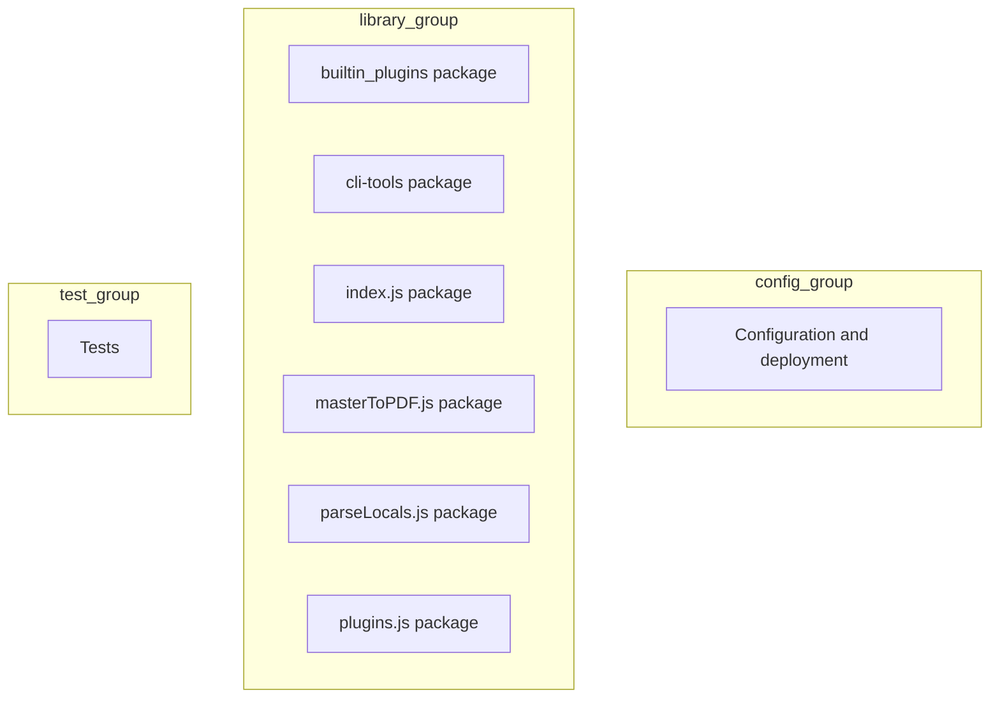

# Architecture report: RelaxedJS/ReLaXed

> Automated static analysis. **Observed** = directly seen in files/imports/AST; **Inferred** = interpretation from that evidence. Repository code was not executed.

## 1. Repository at a glance

| Item | Value |
| --- | --- |
| Repository | RelaxedJS/ReLaXed |
| Description | Create PDF documents using web technologies |
| Language | JavaScript |
| Stars | 11789 |
| Licence | ISC |
| Analysed commit / branch | 9e31cd446150afcaa1f2be1df09870ad4b444bfa / master |
| Framework(s) | None detected |
| Files analysed | 65 |
| Components | 8 |

## 2. Architecture in one minute

RelaxedJS/ReLaXed - Create PDF documents using web technologies. This repository was analysed statically from 65 file(s) (0 Python). Detected technologies (observed from imports/manifests): GitHub Actions. Files are grouped into 8 component(s): builtin_plugins package, cli-tools package, Configuration and deployment, index.js package, masterToPDF.js package, parseLocals.js package, plugins.js package, Tests. Findings below distinguish observed facts from inferred interpretation.

## 3. High-level block diagram

## 4. Main components

### builtin_plugins package (`builtin_plugins`)

- **Kind:** library
- **Status:** Observed
- **Confidence:** 0.85
- **Responsibility:** Groups 10 file(s) under builtin_plugins package (observed from repository paths and static analysis).
- **Paths:** `src/builtin_plugins/chartjs/index.js`, `src/builtin_plugins/flowchart/index.js`, `src/builtin_plugins/index.js`, `src/builtin_plugins/katex/index.js`, `src/builtin_plugins/markdown/index.js`, `src/builtin_plugins/mathjax/index.js`, `src/builtin_plugins/mermaid/index.js`, `src/builtin_plugins/scss/index.js`, `src/builtin_plugins/table/index.js`, `src/builtin_plugins/vegalite/index.js`
- **Evidence:** [src/builtin_plugins/chartjs/index.js](https://github.com/RelaxedJS/ReLaXed/blob/9e31cd446150afcaa1f2be1df09870ad4b444bfa/src/builtin_plugins/chartjs/index.js); [src/builtin_plugins/flowchart/index.js](https://github.com/RelaxedJS/ReLaXed/blob/9e31cd446150afcaa1f2be1df09870ad4b444bfa/src/builtin_plugins/flowchart/index.js); [src/builtin_plugins/index.js](https://github.com/RelaxedJS/ReLaXed/blob/9e31cd446150afcaa1f2be1df09870ad4b444bfa/src/builtin_plugins/index.js); [src/builtin_plugins/katex/index.js](https://github.com/RelaxedJS/ReLaXed/blob/9e31cd446150afcaa1f2be1df09870ad4b444bfa/src/builtin_plugins/katex/index.js); [src/builtin_plugins/markdown/index.js](https://github.com/RelaxedJS/ReLaXed/blob/9e31cd446150afcaa1f2be1df09870ad4b444bfa/src/builtin_plugins/markdown/index.js); [src/builtin_plugins/mathjax/index.js](https://github.com/RelaxedJS/ReLaXed/blob/9e31cd446150afcaa1f2be1df09870ad4b444bfa/src/builtin_plugins/mathjax/index.js); [src/builtin_plugins/mermaid/index.js](https://github.com/RelaxedJS/ReLaXed/blob/9e31cd446150afcaa1f2be1df09870ad4b444bfa/src/builtin_plugins/mermaid/index.js); [src/builtin_plugins/scss/index.js](https://github.com/RelaxedJS/ReLaXed/blob/9e31cd446150afcaa1f2be1df09870ad4b444bfa/src/builtin_plugins/scss/index.js)

### cli-tools package (`cli_tools`)

- **Kind:** library
- **Status:** Observed
- **Confidence:** 0.85
- **Responsibility:** Groups 2 file(s) under cli-tools package (observed from repository paths and static analysis).
- **Paths:** `src/cli-tools/pdf2gif.js`, `src/cli-tools/pretty-pdf-thumbnail.js`
- **Evidence:** [src/cli-tools/pdf2gif.js](https://github.com/RelaxedJS/ReLaXed/blob/9e31cd446150afcaa1f2be1df09870ad4b444bfa/src/cli-tools/pdf2gif.js); [src/cli-tools/pretty-pdf-thumbnail.js](https://github.com/RelaxedJS/ReLaXed/blob/9e31cd446150afcaa1f2be1df09870ad4b444bfa/src/cli-tools/pretty-pdf-thumbnail.js)

### Configuration and deployment (`config`)

- **Kind:** config
- **Status:** Observed
- **Confidence:** 0.85
- **Responsibility:** Groups 1 file(s) under configuration and deployment (observed from repository paths and static analysis).
- **Paths:** `package.json`
- **Evidence:** [package.json](https://github.com/RelaxedJS/ReLaXed/blob/9e31cd446150afcaa1f2be1df09870ad4b444bfa/package.json)

### index.js package (`index_js`)

- **Kind:** library
- **Status:** Observed
- **Confidence:** 0.85
- **Responsibility:** Groups 1 file(s) under index.js package (observed from repository paths and static analysis).
- **Paths:** `src/index.js`
- **Evidence:** [src/index.js](https://github.com/RelaxedJS/ReLaXed/blob/9e31cd446150afcaa1f2be1df09870ad4b444bfa/src/index.js)

### masterToPDF.js package (`mastertopdf_js`)

- **Kind:** library
- **Status:** Observed
- **Confidence:** 0.85
- **Responsibility:** Groups 1 file(s) under mastertopdf.js package (observed from repository paths and static analysis).
- **Paths:** `src/masterToPDF.js`
- **Evidence:** [src/masterToPDF.js](https://github.com/RelaxedJS/ReLaXed/blob/9e31cd446150afcaa1f2be1df09870ad4b444bfa/src/masterToPDF.js)

### parseLocals.js package (`parselocals_js`)

- **Kind:** library
- **Status:** Observed
- **Confidence:** 0.85
- **Responsibility:** Groups 1 file(s) under parselocals.js package (observed from repository paths and static analysis).
- **Paths:** `src/parseLocals.js`
- **Evidence:** [src/parseLocals.js](https://github.com/RelaxedJS/ReLaXed/blob/9e31cd446150afcaa1f2be1df09870ad4b444bfa/src/parseLocals.js)

### plugins.js package (`plugins_js`)

- **Kind:** library
- **Status:** Observed
- **Confidence:** 0.85
- **Responsibility:** Groups 1 file(s) under plugins.js package (observed from repository paths and static analysis).
- **Paths:** `src/plugins.js`
- **Evidence:** [src/plugins.js](https://github.com/RelaxedJS/ReLaXed/blob/9e31cd446150afcaa1f2be1df09870ad4b444bfa/src/plugins.js)

### Tests (`tests`)

- **Kind:** test
- **Status:** Observed
- **Confidence:** 0.85
- **Responsibility:** Groups 35 file(s) under tests (observed from repository paths and static analysis).
- **Paths:** `test/samples/interactive_example/diagrams/diagram.mermaid`, `test/samples/interactive_example/diagrams/diagram.svg`, `test/samples/interactive_example/diagrams/plot.svg`, `test/samples/interactive_example/diagrams/plot.vegalite.json`, `test/samples/interactive_example/master.pug`, `test/samples/interactive_example/report.scss`, `test/samples/pug/absolute_path/master.pug`, `test/samples/pug/basic_example/master.pug`, `test/samples/pug/data_locals/master.pug`, `test/samples/pug/data_locals_file/data.json`, `test/samples/pug/data_locals_file/master.pug`, `test/samples/pug/data_require/data.json`, `test/samples/pug/data_require/master.pug`, `test/samples/pug/error/master.pug`, `test/samples/pug/header_and_footer/master.pug`, `test/samples/pug/katex/config.yml`, `test/samples/pug/katex/master.pug`, `test/samples/pug/letter/letter.scss`, `test/samples/pug/letter/master.pug`, `test/samples/pug/letter/relaxed-uni-logo.svg`, `test/samples/pug/letter/signature.svg`, `test/samples/pug/local_plugin/config.yml`, `test/samples/pug/local_plugin/master.pug`, `test/samples/pug/local_plugin/say-my-name.plugin.js`, `test/samples/pug/mathjax/config.yml`, `test/samples/pug/mathjax/master.pug`, `test/samples/pug/utf8-characters/master.pug`, `test/samples/special_renderings/chartjs/donut.chart.js`, `test/samples/special_renderings/htable_csv/diff.txt`, `test/samples/special_renderings/htable_csv/expected.pug`, `test/samples/special_renderings/htable_csv/sample.md.htable.csv`, `test/samples/special_renderings/table_csv/diff.txt`, `test/samples/special_renderings/table_csv/expected.pug`, `test/samples/special_renderings/table_csv/sample.md.table.csv`, `test/test.js`
- **Evidence:** [test/samples/interactive_example/diagrams/diagram.mermaid](https://github.com/RelaxedJS/ReLaXed/blob/9e31cd446150afcaa1f2be1df09870ad4b444bfa/test/samples/interactive_example/diagrams/diagram.mermaid); [test/samples/interactive_example/diagrams/diagram.svg](https://github.com/RelaxedJS/ReLaXed/blob/9e31cd446150afcaa1f2be1df09870ad4b444bfa/test/samples/interactive_example/diagrams/diagram.svg); [test/samples/interactive_example/diagrams/plot.svg](https://github.com/RelaxedJS/ReLaXed/blob/9e31cd446150afcaa1f2be1df09870ad4b444bfa/test/samples/interactive_example/diagrams/plot.svg); [test/samples/interactive_example/diagrams/plot.vegalite.json](https://github.com/RelaxedJS/ReLaXed/blob/9e31cd446150afcaa1f2be1df09870ad4b444bfa/test/samples/interactive_example/diagrams/plot.vegalite.json); [test/samples/interactive_example/master.pug](https://github.com/RelaxedJS/ReLaXed/blob/9e31cd446150afcaa1f2be1df09870ad4b444bfa/test/samples/interactive_example/master.pug); [test/samples/interactive_example/report.scss](https://github.com/RelaxedJS/ReLaXed/blob/9e31cd446150afcaa1f2be1df09870ad4b444bfa/test/samples/interactive_example/report.scss); [test/samples/pug/absolute_path/master.pug](https://github.com/RelaxedJS/ReLaXed/blob/9e31cd446150afcaa1f2be1df09870ad4b444bfa/test/samples/pug/absolute_path/master.pug); [test/samples/pug/basic_example/master.pug](https://github.com/RelaxedJS/ReLaXed/blob/9e31cd446150afcaa1f2be1df09870ad4b444bfa/test/samples/pug/basic_example/master.pug)

## 5. Execution flow

**Observed** entry point(s):

- [src/builtin_plugins/chartjs/index.js](https://github.com/RelaxedJS/ReLaXed/blob/9e31cd446150afcaa1f2be1df09870ad4b444bfa/src/builtin_plugins/chartjs/index.js)
- [src/builtin_plugins/flowchart/index.js](https://github.com/RelaxedJS/ReLaXed/blob/9e31cd446150afcaa1f2be1df09870ad4b444bfa/src/builtin_plugins/flowchart/index.js)
- [src/builtin_plugins/index.js](https://github.com/RelaxedJS/ReLaXed/blob/9e31cd446150afcaa1f2be1df09870ad4b444bfa/src/builtin_plugins/index.js)
- [src/builtin_plugins/katex/index.js](https://github.com/RelaxedJS/ReLaXed/blob/9e31cd446150afcaa1f2be1df09870ad4b444bfa/src/builtin_plugins/katex/index.js)
- [src/builtin_plugins/markdown/index.js](https://github.com/RelaxedJS/ReLaXed/blob/9e31cd446150afcaa1f2be1df09870ad4b444bfa/src/builtin_plugins/markdown/index.js)
- [src/builtin_plugins/mathjax/index.js](https://github.com/RelaxedJS/ReLaXed/blob/9e31cd446150afcaa1f2be1df09870ad4b444bfa/src/builtin_plugins/mathjax/index.js)
- [src/builtin_plugins/mermaid/index.js](https://github.com/RelaxedJS/ReLaXed/blob/9e31cd446150afcaa1f2be1df09870ad4b444bfa/src/builtin_plugins/mermaid/index.js)
- [src/builtin_plugins/scss/index.js](https://github.com/RelaxedJS/ReLaXed/blob/9e31cd446150afcaa1f2be1df09870ad4b444bfa/src/builtin_plugins/scss/index.js)
- [src/cli-tools/pdf2gif.js](https://github.com/RelaxedJS/ReLaXed/blob/9e31cd446150afcaa1f2be1df09870ad4b444bfa/src/cli-tools/pdf2gif.js)
- [src/cli-tools/pretty-pdf-thumbnail.js](https://github.com/RelaxedJS/ReLaXed/blob/9e31cd446150afcaa1f2be1df09870ad4b444bfa/src/cli-tools/pretty-pdf-thumbnail.js)
- [src/index.js](https://github.com/RelaxedJS/ReLaXed/blob/9e31cd446150afcaa1f2be1df09870ad4b444bfa/src/index.js)
- [src/masterToPDF.js](https://github.com/RelaxedJS/ReLaXed/blob/9e31cd446150afcaa1f2be1df09870ad4b444bfa/src/masterToPDF.js)

Representative flow (derived from observed entry points and the import graph; steps beyond the entry point are **Inferred**):

1. Execution starts at an observed entry point listed above, if present.
2. No internal import relationships between components were observed.

## 6. Project structure

### `(root)`

- `.gitignore` - other (1205 bytes)
- `.npmignore` - other (123 bytes)
- `.travis.yml` - ci, YAML (205 bytes)
- `LICENCE.txt` - docs (740 bytes)
- `README.md` - docs (11306 bytes)
- `changelog.md` - docs (1549 bytes)
- `package.json` - manifest (1207 bytes)

### `.github`

- `.github/workflows/npmpublish.yml` - ci, YAML (994 bytes)

### `src`

- `src/builtin_plugins/chartjs/index.js` - source, JavaScript (1194 bytes)
- `src/builtin_plugins/chartjs/template.pug` - other (794 bytes)
- `src/builtin_plugins/flowchart/index.js` - source, JavaScript (1349 bytes)
- `src/builtin_plugins/flowchart/template.pug` - other (600 bytes)
- `src/builtin_plugins/index.js` - source, JavaScript (780 bytes)
- `src/builtin_plugins/katex/head.html` - other (210 bytes)
- `src/builtin_plugins/katex/index.js` - source, JavaScript (311 bytes)
- `src/builtin_plugins/markdown/index.js` - source, JavaScript (969 bytes)
- `src/builtin_plugins/mathjax/index.js` - source, JavaScript (455 bytes)
- `src/builtin_plugins/mermaid/index.js` - source, JavaScript (839 bytes)
- `src/builtin_plugins/mermaid/template.pug` - other (112 bytes)
- `src/builtin_plugins/scss/index.js` - source, JavaScript (304 bytes)
- `src/builtin_plugins/table/index.js` - source, JavaScript (1523 bytes)
- `src/builtin_plugins/table/template.pug` - other (119 bytes)
- `src/builtin_plugins/vegalite/index.js` - source, JavaScript (856 bytes)
- `src/builtin_plugins/vegalite/template.pug` - other (271 bytes)
- `src/cli-tools/pdf2gif.js` - source, JavaScript (1161 bytes)
- `src/cli-tools/pretty-pdf-thumbnail.js` - source, JavaScript (1136 bytes)
- `src/index.js` - source, JavaScript (7828 bytes)
- `src/masterToPDF.js` - source, JavaScript (5628 bytes)
- `src/parseLocals.js` - source, JavaScript (1136 bytes)
- `src/plugins.js` - source, JavaScript (5410 bytes)

### `test`

- `test/samples/interactive_example/diagrams/diagram.mermaid` - test (100 bytes)
- `test/samples/interactive_example/diagrams/diagram.svg` - test (10023 bytes)
- `test/samples/interactive_example/diagrams/plot.svg` - test (10672 bytes)
- `test/samples/interactive_example/diagrams/plot.vegalite.json` - test (603 bytes)
- `test/samples/interactive_example/master.pug` - test (5500 bytes)
- `test/samples/interactive_example/report.scss` - test (2518 bytes)
- `test/samples/pug/absolute_path/master.pug` - test (62 bytes)
- `test/samples/pug/basic_example/master.pug` - test (122 bytes)
- `test/samples/pug/data_locals/master.pug` - test (192 bytes)
- `test/samples/pug/data_locals_file/data.json` - test (50 bytes)
- `test/samples/pug/data_locals_file/master.pug` - test (192 bytes)
- `test/samples/pug/data_require/data.json` - test (50 bytes)
- `test/samples/pug/data_require/master.pug` - test (256 bytes)
- `test/samples/pug/error/master.pug` - test (19 bytes)
- `test/samples/pug/header_and_footer/master.pug` - test (929 bytes)
- `test/samples/pug/katex/config.yml` - test (19 bytes)
- `test/samples/pug/katex/master.pug` - test (210 bytes)
- `test/samples/pug/letter/letter.scss` - test (451 bytes)
- `test/samples/pug/letter/master.pug` - test (1536 bytes)
- `test/samples/pug/letter/relaxed-uni-logo.svg` - test (33396 bytes)
- `test/samples/pug/letter/signature.svg` - test (5976 bytes)
- `test/samples/pug/local_plugin/config.yml` - test (49 bytes)
- `test/samples/pug/local_plugin/master.pug` - test (335 bytes)
- `test/samples/pug/local_plugin/say-my-name.plugin.js` - test, JavaScript (304 bytes)
- `test/samples/pug/mathjax/config.yml` - test (21 bytes)
- `test/samples/pug/mathjax/master.pug` - test (204 bytes)
- `test/samples/pug/utf8-characters/master.pug` - test (187 bytes)
- `test/samples/special_renderings/chartjs/donut.chart.js` - test, JavaScript (317 bytes)
- `test/samples/special_renderings/htable_csv/diff.txt` - test (375 bytes)
- `test/samples/special_renderings/htable_csv/expected.pug` - test (231 bytes)
- `test/samples/special_renderings/htable_csv/sample.md.htable.csv` - test (36 bytes)
- `test/samples/special_renderings/table_csv/diff.txt` - test (291 bytes)
- `test/samples/special_renderings/table_csv/expected.pug` - test (183 bytes)
- `test/samples/special_renderings/table_csv/sample.md.table.csv` - test (27 bytes)
- `test/test.js` - test, JavaScript (7147 bytes)

## 7. Key dependencies and integrations

| Name | Category | Status | Confidence | Evidence |
| --- | --- | --- | --- | --- |
| GitHub Actions | ci | Observed | 0.85 | [.github/workflows/npmpublish.yml](https://github.com/RelaxedJS/ReLaXed/blob/9e31cd446150afcaa1f2be1df09870ad4b444bfa/.github/workflows/npmpublish.yml) |

## 8. Data and state

No database, cache, queue, or persistent-state usage was observed in the analysed files. State handling, if any, may be in-memory or in files that were not analysed.

## 9. Configuration and deployment clues

- `.github/workflows/npmpublish.yml` (ci)
- `.travis.yml` (ci)
- `package.json` (manifest)

## 10. Design observations

- Tests are present alongside source code (Observed from test file paths).

These observations are interpretations (**Inferred**) of the observed structure, not guarantees about runtime design.

## 11. Limitations and unknowns

- Static analysis only: repository code was not executed, installed, or imported at runtime.
- Components and relationships are inferred from file paths, imports, and AST structure; runtime behaviour, dynamic imports, and reflection may not be visible.
- No clear application entry point was observed in the analysed files.
- Repository text was treated as untrusted data; no instructions found in repository files were followed, and likely secret values were redacted/excluded.
- JavaScript and TypeScript files were inventoried from paths and package manifests. They were not parsed with a full language AST, and repository code was not executed.

## 12. Source references

- [.github/workflows/npmpublish.yml](https://github.com/RelaxedJS/ReLaXed/blob/9e31cd446150afcaa1f2be1df09870ad4b444bfa/.github/workflows/npmpublish.yml)
- [package.json](https://github.com/RelaxedJS/ReLaXed/blob/9e31cd446150afcaa1f2be1df09870ad4b444bfa/package.json)
- [src/builtin_plugins/chartjs/index.js](https://github.com/RelaxedJS/ReLaXed/blob/9e31cd446150afcaa1f2be1df09870ad4b444bfa/src/builtin_plugins/chartjs/index.js)
- [src/builtin_plugins/flowchart/index.js](https://github.com/RelaxedJS/ReLaXed/blob/9e31cd446150afcaa1f2be1df09870ad4b444bfa/src/builtin_plugins/flowchart/index.js)
- [src/builtin_plugins/index.js](https://github.com/RelaxedJS/ReLaXed/blob/9e31cd446150afcaa1f2be1df09870ad4b444bfa/src/builtin_plugins/index.js)
- [src/builtin_plugins/katex/index.js](https://github.com/RelaxedJS/ReLaXed/blob/9e31cd446150afcaa1f2be1df09870ad4b444bfa/src/builtin_plugins/katex/index.js)
- [src/builtin_plugins/markdown/index.js](https://github.com/RelaxedJS/ReLaXed/blob/9e31cd446150afcaa1f2be1df09870ad4b444bfa/src/builtin_plugins/markdown/index.js)
- [src/builtin_plugins/mathjax/index.js](https://github.com/RelaxedJS/ReLaXed/blob/9e31cd446150afcaa1f2be1df09870ad4b444bfa/src/builtin_plugins/mathjax/index.js)
- [src/builtin_plugins/mermaid/index.js](https://github.com/RelaxedJS/ReLaXed/blob/9e31cd446150afcaa1f2be1df09870ad4b444bfa/src/builtin_plugins/mermaid/index.js)
- [src/builtin_plugins/scss/index.js](https://github.com/RelaxedJS/ReLaXed/blob/9e31cd446150afcaa1f2be1df09870ad4b444bfa/src/builtin_plugins/scss/index.js)
- [src/cli-tools/pdf2gif.js](https://github.com/RelaxedJS/ReLaXed/blob/9e31cd446150afcaa1f2be1df09870ad4b444bfa/src/cli-tools/pdf2gif.js)
- [src/cli-tools/pretty-pdf-thumbnail.js](https://github.com/RelaxedJS/ReLaXed/blob/9e31cd446150afcaa1f2be1df09870ad4b444bfa/src/cli-tools/pretty-pdf-thumbnail.js)
- [src/index.js](https://github.com/RelaxedJS/ReLaXed/blob/9e31cd446150afcaa1f2be1df09870ad4b444bfa/src/index.js)
- [src/masterToPDF.js](https://github.com/RelaxedJS/ReLaXed/blob/9e31cd446150afcaa1f2be1df09870ad4b444bfa/src/masterToPDF.js)
- [src/parseLocals.js](https://github.com/RelaxedJS/ReLaXed/blob/9e31cd446150afcaa1f2be1df09870ad4b444bfa/src/parseLocals.js)
- [src/plugins.js](https://github.com/RelaxedJS/ReLaXed/blob/9e31cd446150afcaa1f2be1df09870ad4b444bfa/src/plugins.js)
- [test/samples/interactive_example/diagrams/diagram.mermaid](https://github.com/RelaxedJS/ReLaXed/blob/9e31cd446150afcaa1f2be1df09870ad4b444bfa/test/samples/interactive_example/diagrams/diagram.mermaid)
- [test/samples/interactive_example/diagrams/diagram.svg](https://github.com/RelaxedJS/ReLaXed/blob/9e31cd446150afcaa1f2be1df09870ad4b444bfa/test/samples/interactive_example/diagrams/diagram.svg)
- [test/samples/interactive_example/diagrams/plot.svg](https://github.com/RelaxedJS/ReLaXed/blob/9e31cd446150afcaa1f2be1df09870ad4b444bfa/test/samples/interactive_example/diagrams/plot.svg)
- [test/samples/interactive_example/diagrams/plot.vegalite.json](https://github.com/RelaxedJS/ReLaXed/blob/9e31cd446150afcaa1f2be1df09870ad4b444bfa/test/samples/interactive_example/diagrams/plot.vegalite.json)
- [test/samples/interactive_example/master.pug](https://github.com/RelaxedJS/ReLaXed/blob/9e31cd446150afcaa1f2be1df09870ad4b444bfa/test/samples/interactive_example/master.pug)
- [test/samples/interactive_example/report.scss](https://github.com/RelaxedJS/ReLaXed/blob/9e31cd446150afcaa1f2be1df09870ad4b444bfa/test/samples/interactive_example/report.scss)
- [test/samples/pug/absolute_path/master.pug](https://github.com/RelaxedJS/ReLaXed/blob/9e31cd446150afcaa1f2be1df09870ad4b444bfa/test/samples/pug/absolute_path/master.pug)
- [test/samples/pug/basic_example/master.pug](https://github.com/RelaxedJS/ReLaXed/blob/9e31cd446150afcaa1f2be1df09870ad4b444bfa/test/samples/pug/basic_example/master.pug)
