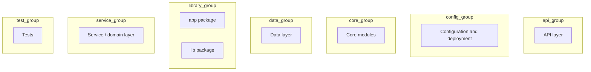

# Architecture report: ShareDropio/sharedrop

> Automated static analysis. **Observed** = directly seen in files/imports/AST; **Inferred** = interpretation from that evidence. Repository code was not executed.

## 1. Repository at a glance

| Item | Value |
| --- | --- |
| Repository | ShareDropio/sharedrop |
| Description | Easy P2P file transfer powered by WebRTC - inspired by Apple AirDrop |
| Language | JavaScript |
| Stars | 10768 |
| Licence | MIT |
| Analysed commit / branch | 2b6a9fe5e6cada786d1a1f319612537305b204c7 / master |
| Framework(s) | Express |
| Files analysed | 123 |
| Components | 8 |

## 2. Architecture in one minute

ShareDropio/sharedrop - Easy P2P file transfer powered by WebRTC - inspired by Apple AirDrop. This repository was analysed statically from 123 file(s) (0 Python). Detected technologies (observed from imports/manifests): Express, Docker. Files are grouped into 8 component(s): API layer, app package, Configuration and deployment, Core modules, Data layer, lib package, Service / domain layer, Tests. Findings below distinguish observed facts from inferred interpretation.

## 3. High-level block diagram

## 4. Main components

### API layer (`api_layer`)

- **Kind:** api
- **Status:** Observed
- **Confidence:** 0.85
- **Responsibility:** Groups 6 file(s) under api layer (observed from repository paths and static analysis).
- **Paths:** `app/controllers/application.js`, `app/controllers/index.js`, `app/routes/application.js`, `app/routes/error.js`, `app/routes/index.js`, `app/routes/room.js`
- **Evidence:** [app/controllers/application.js](https://github.com/ShareDropio/sharedrop/blob/2b6a9fe5e6cada786d1a1f319612537305b204c7/app/controllers/application.js); [app/controllers/index.js](https://github.com/ShareDropio/sharedrop/blob/2b6a9fe5e6cada786d1a1f319612537305b204c7/app/controllers/index.js); [app/routes/application.js](https://github.com/ShareDropio/sharedrop/blob/2b6a9fe5e6cada786d1a1f319612537305b204c7/app/routes/application.js); [app/routes/error.js](https://github.com/ShareDropio/sharedrop/blob/2b6a9fe5e6cada786d1a1f319612537305b204c7/app/routes/error.js); [app/routes/index.js](https://github.com/ShareDropio/sharedrop/blob/2b6a9fe5e6cada786d1a1f319612537305b204c7/app/routes/index.js); [app/routes/room.js](https://github.com/ShareDropio/sharedrop/blob/2b6a9fe5e6cada786d1a1f319612537305b204c7/app/routes/room.js)

### app package (`app`)

- **Kind:** library
- **Status:** Observed
- **Confidence:** 0.85
- **Responsibility:** Groups 12 file(s) under app package (observed from repository paths and static analysis).
- **Paths:** `app/app.js`, `app/components/circular-progress.js`, `app/components/file-field.js`, `app/components/modal-dialog.js`, `app/components/peer-avatar.js`, `app/components/peer-widget.js`, `app/components/popover-confirm.js`, `app/components/room-url.js`, `app/components/user-widget.js`, `app/helpers/is-equal.js`, `app/initializers/prerequisites.js`, `app/router.js`
- **Evidence:** [app/app.js](https://github.com/ShareDropio/sharedrop/blob/2b6a9fe5e6cada786d1a1f319612537305b204c7/app/app.js); [app/components/circular-progress.js](https://github.com/ShareDropio/sharedrop/blob/2b6a9fe5e6cada786d1a1f319612537305b204c7/app/components/circular-progress.js); [app/components/file-field.js](https://github.com/ShareDropio/sharedrop/blob/2b6a9fe5e6cada786d1a1f319612537305b204c7/app/components/file-field.js); [app/components/modal-dialog.js](https://github.com/ShareDropio/sharedrop/blob/2b6a9fe5e6cada786d1a1f319612537305b204c7/app/components/modal-dialog.js); [app/components/peer-avatar.js](https://github.com/ShareDropio/sharedrop/blob/2b6a9fe5e6cada786d1a1f319612537305b204c7/app/components/peer-avatar.js); [app/components/peer-widget.js](https://github.com/ShareDropio/sharedrop/blob/2b6a9fe5e6cada786d1a1f319612537305b204c7/app/components/peer-widget.js); [app/components/popover-confirm.js](https://github.com/ShareDropio/sharedrop/blob/2b6a9fe5e6cada786d1a1f319612537305b204c7/app/components/popover-confirm.js); [app/components/room-url.js](https://github.com/ShareDropio/sharedrop/blob/2b6a9fe5e6cada786d1a1f319612537305b204c7/app/components/room-url.js)

### Configuration and deployment (`config`)

- **Kind:** config
- **Status:** Observed
- **Confidence:** 0.85
- **Responsibility:** Groups 8 file(s) under configuration and deployment (observed from repository paths and static analysis).
- **Paths:** `Dockerfile`, `config/dotenv.js`, `config/environment.js`, `config/optional-features.json`, `config/targets.js`, `firebase_rules.json`, `lib/google-analytics/package.json`, `package.json`
- **Evidence:** [Dockerfile](https://github.com/ShareDropio/sharedrop/blob/2b6a9fe5e6cada786d1a1f319612537305b204c7/Dockerfile); [config/dotenv.js](https://github.com/ShareDropio/sharedrop/blob/2b6a9fe5e6cada786d1a1f319612537305b204c7/config/dotenv.js); [config/environment.js](https://github.com/ShareDropio/sharedrop/blob/2b6a9fe5e6cada786d1a1f319612537305b204c7/config/environment.js); [config/optional-features.json](https://github.com/ShareDropio/sharedrop/blob/2b6a9fe5e6cada786d1a1f319612537305b204c7/config/optional-features.json); [config/targets.js](https://github.com/ShareDropio/sharedrop/blob/2b6a9fe5e6cada786d1a1f319612537305b204c7/config/targets.js); [firebase_rules.json](https://github.com/ShareDropio/sharedrop/blob/2b6a9fe5e6cada786d1a1f319612537305b204c7/firebase_rules.json); [lib/google-analytics/package.json](https://github.com/ShareDropio/sharedrop/blob/2b6a9fe5e6cada786d1a1f319612537305b204c7/lib/google-analytics/package.json); [package.json](https://github.com/ShareDropio/sharedrop/blob/2b6a9fe5e6cada786d1a1f319612537305b204c7/package.json)

### Core modules (`core`)

- **Kind:** core
- **Status:** Observed
- **Confidence:** 0.85
- **Responsibility:** Groups 5 file(s) under core modules (observed from repository paths and static analysis).
- **Paths:** `ember-cli-build.js`, `newrelic.js`, `prettier.config.js`, `server.js`, `testem.js`
- **Evidence:** [ember-cli-build.js](https://github.com/ShareDropio/sharedrop/blob/2b6a9fe5e6cada786d1a1f319612537305b204c7/ember-cli-build.js); [newrelic.js](https://github.com/ShareDropio/sharedrop/blob/2b6a9fe5e6cada786d1a1f319612537305b204c7/newrelic.js); [prettier.config.js](https://github.com/ShareDropio/sharedrop/blob/2b6a9fe5e6cada786d1a1f319612537305b204c7/prettier.config.js); [server.js](https://github.com/ShareDropio/sharedrop/blob/2b6a9fe5e6cada786d1a1f319612537305b204c7/server.js); [testem.js](https://github.com/ShareDropio/sharedrop/blob/2b6a9fe5e6cada786d1a1f319612537305b204c7/testem.js)

### Data layer (`data_layer`)

- **Kind:** data
- **Status:** Observed
- **Confidence:** 0.85
- **Responsibility:** Groups 2 file(s) under data layer (observed from repository paths and static analysis).
- **Paths:** `app/models/peer.js`, `app/models/user.js`
- **Evidence:** [app/models/peer.js](https://github.com/ShareDropio/sharedrop/blob/2b6a9fe5e6cada786d1a1f319612537305b204c7/app/models/peer.js); [app/models/user.js](https://github.com/ShareDropio/sharedrop/blob/2b6a9fe5e6cada786d1a1f319612537305b204c7/app/models/user.js)

### lib package (`lib`)

- **Kind:** library
- **Status:** Observed
- **Confidence:** 0.85
- **Responsibility:** Groups 1 file(s) under lib package (observed from repository paths and static analysis).
- **Paths:** `lib/google-analytics/index.js`
- **Evidence:** [lib/google-analytics/index.js](https://github.com/ShareDropio/sharedrop/blob/2b6a9fe5e6cada786d1a1f319612537305b204c7/lib/google-analytics/index.js)

### Service / domain layer (`service_layer`)

- **Kind:** service
- **Status:** Observed
- **Confidence:** 0.85
- **Responsibility:** Groups 5 file(s) under service / domain layer (observed from repository paths and static analysis).
- **Paths:** `app/services/analytics.js`, `app/services/avatar.js`, `app/services/file.js`, `app/services/room.js`, `app/services/web-rtc.js`
- **Evidence:** [app/services/analytics.js](https://github.com/ShareDropio/sharedrop/blob/2b6a9fe5e6cada786d1a1f319612537305b204c7/app/services/analytics.js); [app/services/avatar.js](https://github.com/ShareDropio/sharedrop/blob/2b6a9fe5e6cada786d1a1f319612537305b204c7/app/services/avatar.js); [app/services/file.js](https://github.com/ShareDropio/sharedrop/blob/2b6a9fe5e6cada786d1a1f319612537305b204c7/app/services/file.js); [app/services/room.js](https://github.com/ShareDropio/sharedrop/blob/2b6a9fe5e6cada786d1a1f319612537305b204c7/app/services/room.js); [app/services/web-rtc.js](https://github.com/ShareDropio/sharedrop/blob/2b6a9fe5e6cada786d1a1f319612537305b204c7/app/services/web-rtc.js)

### Tests (`tests`)

- **Kind:** test
- **Status:** Observed
- **Confidence:** 0.85
- **Responsibility:** Groups 5 file(s) under tests (observed from repository paths and static analysis).
- **Paths:** `tests/helpers/.gitkeep`, `tests/index.html`, `tests/integration/.gitkeep`, `tests/test-helper.js`, `tests/unit/.gitkeep`
- **Evidence:** [tests/helpers/.gitkeep](https://github.com/ShareDropio/sharedrop/blob/2b6a9fe5e6cada786d1a1f319612537305b204c7/tests/helpers/.gitkeep); [tests/index.html](https://github.com/ShareDropio/sharedrop/blob/2b6a9fe5e6cada786d1a1f319612537305b204c7/tests/index.html); [tests/integration/.gitkeep](https://github.com/ShareDropio/sharedrop/blob/2b6a9fe5e6cada786d1a1f319612537305b204c7/tests/integration/.gitkeep); [tests/test-helper.js](https://github.com/ShareDropio/sharedrop/blob/2b6a9fe5e6cada786d1a1f319612537305b204c7/tests/test-helper.js); [tests/unit/.gitkeep](https://github.com/ShareDropio/sharedrop/blob/2b6a9fe5e6cada786d1a1f319612537305b204c7/tests/unit/.gitkeep)

## 5. Execution flow

**Observed** entry point(s):

- [app/app.js](https://github.com/ShareDropio/sharedrop/blob/2b6a9fe5e6cada786d1a1f319612537305b204c7/app/app.js)
- [app/controllers/index.js](https://github.com/ShareDropio/sharedrop/blob/2b6a9fe5e6cada786d1a1f319612537305b204c7/app/controllers/index.js)
- [app/routes/index.js](https://github.com/ShareDropio/sharedrop/blob/2b6a9fe5e6cada786d1a1f319612537305b204c7/app/routes/index.js)
- [lib/google-analytics/index.js](https://github.com/ShareDropio/sharedrop/blob/2b6a9fe5e6cada786d1a1f319612537305b204c7/lib/google-analytics/index.js)
- [server.js](https://github.com/ShareDropio/sharedrop/blob/2b6a9fe5e6cada786d1a1f319612537305b204c7/server.js)

Representative flow (derived from observed entry points and the import graph; steps beyond the entry point are **Inferred**):

1. Execution starts at an observed entry point listed above, if present.
2. No internal import relationships between components were observed.

## 6. Project structure

### `(root)`

- `.editorconfig` - config (367 bytes)
- `.ember-cli` - other (280 bytes)
- `.env.sample` - config (180 bytes)
- `.eslintignore` - other (240 bytes)
- `.eslintrc.js` - source, JavaScript (1488 bytes)
- `.gitignore` - other (369 bytes)
- `.prettierignore` - other (139 bytes)
- `.template-lintrc.js` - source, JavaScript (208 bytes)
- `.travis.yml` - ci, YAML (306 bytes)
- `.watchmanconfig` - other (49 bytes)
- `Dockerfile` - container (190 bytes)
- `LICENSE` - docs (1078 bytes)
- `Procfile` - other (20 bytes)
- `Procfile.dev` - other (48 bytes)
- `README.md` - docs (3323 bytes)
- `ember-cli-build.js` - source, JavaScript (1266 bytes)
- `firebase_rules.json` - config (1051 bytes)
- `newrelic.js` - source, JavaScript (535 bytes)
- `package.json` - manifest (2978 bytes)
- `prettier.config.js` - source, JavaScript (255 bytes)
- `server.js` - source, JavaScript (2446 bytes)
- `sharedrop.crx` - other (318 bytes)
- `testem.js` - source, JavaScript (574 bytes)

### `app`

- `app/app.js` - source, JavaScript (652 bytes)
- `app/components/circular-progress.hbs` - other (148 bytes)
- `app/components/circular-progress.js` - source, JavaScript (636 bytes)
- `app/components/file-field.js` - source, JavaScript (655 bytes)
- `app/components/modal-dialog.js` - source, JavaScript (257 bytes)
- `app/components/peer-avatar.js` - source, JavaScript (3433 bytes)
- `app/components/peer-widget.js` - source, JavaScript (4019 bytes)
- `app/components/popover-confirm.js` - source, JavaScript (617 bytes)
- `app/components/room-url.js` - source, JavaScript (463 bytes)
- `app/components/user-widget.js` - source, JavaScript (147 bytes)
- `app/controllers/application.js` - source, JavaScript (821 bytes)
- `app/controllers/index.js` - source, JavaScript (6497 bytes)
- `app/helpers/is-equal.js` - source, JavaScript (145 bytes)
- `app/index.html` - other (1268 bytes)
- `app/initializers/prerequisites.js` - source, JavaScript (2365 bytes)
- `app/models/peer.js` - source, JavaScript (1491 bytes)
- `app/models/user.js` - source, JavaScript (316 bytes)
- `app/router.js` - source, JavaScript (354 bytes)
- `app/routes/application.js` - source, JavaScript (445 bytes)
- `app/routes/error.js` - source, JavaScript (314 bytes)
- `app/routes/index.js` - source, JavaScript (2782 bytes)
- `app/routes/room.js` - source, JavaScript (897 bytes)
- `app/services/analytics.js` - source, JavaScript (170 bytes)
- `app/services/avatar.js` - source, JavaScript (2302 bytes)
- `app/services/file.js` - source, JavaScript (4206 bytes)
- `app/services/room.js` - source, JavaScript (2509 bytes)
- `app/services/web-rtc.js` - source, JavaScript (8772 bytes)
- `app/styles/app.sass` - other (309 bytes)
- `app/styles/base/_element_defaults.sass` - other (378 bytes)
- `app/styles/base/_glyphicons_filetypes.sass` - other (7411 bytes)
- `app/styles/base/_mixins.sass` - other (437 bytes)
- `app/styles/base/_reset.sass` - other (967 bytes)
- `app/styles/base/_variables.sass` - other (75 bytes)
- `app/styles/layout/_content.sass` - other (445 bytes)
- `app/styles/layout/_footer.sass` - other (754 bytes)
- `app/styles/layout/_header.sass` - other (1165 bytes)
- `app/styles/layout/_media.sass` - other (1474 bytes)
- `app/styles/modules/_modal.sass` - other (1332 bytes)
- `app/styles/modules/_modules.sass` - other (975 bytes)
- `app/styles/modules/_popover.sass` - other (1280 bytes)
- `app/styles/modules/_users.sass` - other (3930 bytes)
- `app/templates/about-app.hbs` - other (2330 bytes)
- `app/templates/about-room.hbs` - other (896 bytes)
- `app/templates/about-you.hbs` - other (94 bytes)
- `app/templates/application.hbs` - other (1402 bytes)
- `app/templates/components/modal-dialog.hbs` - other (199 bytes)
- `app/templates/components/peer-widget.hbs` - other (2502 bytes)
- `app/templates/components/popover-confirm.hbs` - other (454 bytes)
- `app/templates/components/user-widget.hbs` - other (259 bytes)
- `app/templates/errors/browser-unsupported.hbs` - other (196 bytes)
- `app/templates/errors/filesystem-unavailable.hbs` - other (211 bytes)
- `app/templates/errors/popovers/connection-failed.hbs` - other (72 bytes)
- `app/templates/errors/popovers/multiple-files.hbs` - other (134 bytes)
- `app/templates/index.hbs` - other (874 bytes)

### `config`

- `config/dotenv.js` - source, JavaScript (233 bytes)
- `config/environment.js` - source, JavaScript (1302 bytes)
- `config/optional-features.json` - config (153 bytes)
- `config/targets.js` - source, JavaScript (193 bytes)

### `lib`

- `lib/google-analytics/index.js` - source, JavaScript (572 bytes)
- `lib/google-analytics/package.json` - manifest (72 bytes)

### `public`

- `public/.gitkeep` - other (0 bytes)
- `public/.well-known/brave-rewards-verification.txt` - docs (147 bytes)
- `public/assets/fonts/glyphicons/glyphicons-filetypes-regular.svg` - other (95079 bytes)
- `public/assets/images/avatars/102.svg` - other (8112 bytes)
- `public/assets/images/avatars/109.svg` - other (4232 bytes)
- `public/assets/images/avatars/112.svg` - other (4043 bytes)
- `public/assets/images/avatars/23.svg` - other (4415 bytes)
- `public/assets/images/avatars/36.svg` - other (3505 bytes)
- `public/assets/images/avatars/37.svg` - other (3311 bytes)
- `public/assets/images/avatars/38.svg` - other (3798 bytes)
- `public/assets/images/avatars/40.svg` - other (5049 bytes)
- `public/assets/images/avatars/46.svg` - other (2809 bytes)
- `public/assets/images/avatars/50.svg` - other (4309 bytes)
- `public/assets/images/avatars/51.svg` - other (8705 bytes)
- `public/assets/images/avatars/52.svg` - other (4799 bytes)
- `public/assets/images/avatars/59.svg` - other (6652 bytes)
- `public/assets/images/avatars/61.svg` - other (4574 bytes)
- `public/assets/images/avatars/62.svg` - other (8131 bytes)
- `public/assets/images/avatars/63.svg` - other (4340 bytes)
- `public/assets/images/avatars/64.svg` - other (4056 bytes)
- `public/assets/images/avatars/65.svg` - other (5684 bytes)
- `public/assets/images/avatars/66.svg` - other (6160 bytes)
- `public/assets/images/avatars/67.svg` - other (10175 bytes)
- `public/assets/images/avatars/68.svg` - other (7996 bytes)
- `public/assets/images/avatars/71.svg` - other (7762 bytes)
- `public/assets/images/avatars/74.svg` - other (5316 bytes)
- `public/assets/images/avatars/86.svg` - other (4020 bytes)
- `public/assets/images/avatars/87.svg` - other (4080 bytes)
- `public/assets/images/avatars/95.svg` - other (7727 bytes)
- `public/assets/images/github.svg` - other (1071 bytes)
- `public/assets/images/select-arrow.svg` - other (282 bytes)
- `public/assets/images/sharedrop-light.svg` - other (7799 bytes)
- `public/assets/images/sharedrop.svg` - other (9836 bytes)
- `public/crossdomain.xml` - other (585 bytes)
- `public/robots.txt` - docs (51 bytes)

### `tests`

- `tests/helpers/.gitkeep` - test (0 bytes)
- `tests/index.html` - test (1060 bytes)
- `tests/integration/.gitkeep` - test (0 bytes)
- `tests/test-helper.js` - test, JavaScript (255 bytes)
- `tests/unit/.gitkeep` - test (0 bytes)

## 7. Key dependencies and integrations

| Name | Category | Status | Confidence | Evidence |
| --- | --- | --- | --- | --- |
| Express | framework | Observed | 0.85 | [package.json:77](https://github.com/ShareDropio/sharedrop/blob/2b6a9fe5e6cada786d1a1f319612537305b204c7/package.json#L77) |
| Docker | tooling | Observed | 0.85 | [Dockerfile](https://github.com/ShareDropio/sharedrop/blob/2b6a9fe5e6cada786d1a1f319612537305b204c7/Dockerfile) |

## 8. Data and state

- Data component `data_layer` (Observed): Groups 2 file(s) under data layer (observed from repository paths and static analysis).

## 9. Configuration and deployment clues

- `.editorconfig` (config)
- `.env.sample` (config)
- `.travis.yml` (ci)
- `Dockerfile` (container)
- `config/optional-features.json` (config)
- `firebase_rules.json` (config)
- `lib/google-analytics/package.json` (manifest)
- `package.json` (manifest)

Environment variable *names* seen in example env files (values never recorded):

- `.env.sample`: `FIREBASE_SECRET`, `FIREBASE_URL`, `GOOGLE_ANALYTICS_ID`, `NEW_RELIC_ENABLED`, `NEW_RELIC_LICENSE_KEY`, `PORT`, `SECRET`

## 10. Design observations

- An entry/API layer is separated from other code (Inferred from paths and decorators).
- Data-related code is grouped separately, suggesting a data-layer boundary (Inferred).
- Service/domain code is distinct from entry and data code, suggesting layered separation (Inferred).
- Tests are present alongside source code (Observed from test file paths).

These observations are interpretations (**Inferred**) of the observed structure, not guarantees about runtime design.

## 11. Limitations and unknowns

- Static analysis only: repository code was not executed, installed, or imported at runtime.
- Components and relationships are inferred from file paths, imports, and AST structure; runtime behaviour, dynamic imports, and reflection may not be visible.
- 2 file(s) were skipped during inventory (2 x vendored/generated directory excluded).
- No clear application entry point was observed in the analysed files.
- Repository text was treated as untrusted data; no instructions found in repository files were followed, and likely secret values were redacted/excluded.
- JavaScript and TypeScript files were inventoried from paths and package manifests. They were not parsed with a full language AST, and repository code was not executed.

## 12. Source references

- [Dockerfile](https://github.com/ShareDropio/sharedrop/blob/2b6a9fe5e6cada786d1a1f319612537305b204c7/Dockerfile)
- [app/app.js](https://github.com/ShareDropio/sharedrop/blob/2b6a9fe5e6cada786d1a1f319612537305b204c7/app/app.js)
- [app/components/circular-progress.js](https://github.com/ShareDropio/sharedrop/blob/2b6a9fe5e6cada786d1a1f319612537305b204c7/app/components/circular-progress.js)
- [app/components/file-field.js](https://github.com/ShareDropio/sharedrop/blob/2b6a9fe5e6cada786d1a1f319612537305b204c7/app/components/file-field.js)
- [app/components/modal-dialog.js](https://github.com/ShareDropio/sharedrop/blob/2b6a9fe5e6cada786d1a1f319612537305b204c7/app/components/modal-dialog.js)
- [app/components/peer-avatar.js](https://github.com/ShareDropio/sharedrop/blob/2b6a9fe5e6cada786d1a1f319612537305b204c7/app/components/peer-avatar.js)
- [app/components/peer-widget.js](https://github.com/ShareDropio/sharedrop/blob/2b6a9fe5e6cada786d1a1f319612537305b204c7/app/components/peer-widget.js)
- [app/components/popover-confirm.js](https://github.com/ShareDropio/sharedrop/blob/2b6a9fe5e6cada786d1a1f319612537305b204c7/app/components/popover-confirm.js)
- [app/components/room-url.js](https://github.com/ShareDropio/sharedrop/blob/2b6a9fe5e6cada786d1a1f319612537305b204c7/app/components/room-url.js)
- [app/controllers/application.js](https://github.com/ShareDropio/sharedrop/blob/2b6a9fe5e6cada786d1a1f319612537305b204c7/app/controllers/application.js)
- [app/controllers/index.js](https://github.com/ShareDropio/sharedrop/blob/2b6a9fe5e6cada786d1a1f319612537305b204c7/app/controllers/index.js)
- [app/models/peer.js](https://github.com/ShareDropio/sharedrop/blob/2b6a9fe5e6cada786d1a1f319612537305b204c7/app/models/peer.js)
- [app/models/user.js](https://github.com/ShareDropio/sharedrop/blob/2b6a9fe5e6cada786d1a1f319612537305b204c7/app/models/user.js)
- [app/routes/application.js](https://github.com/ShareDropio/sharedrop/blob/2b6a9fe5e6cada786d1a1f319612537305b204c7/app/routes/application.js)
- [app/routes/error.js](https://github.com/ShareDropio/sharedrop/blob/2b6a9fe5e6cada786d1a1f319612537305b204c7/app/routes/error.js)
- [app/routes/index.js](https://github.com/ShareDropio/sharedrop/blob/2b6a9fe5e6cada786d1a1f319612537305b204c7/app/routes/index.js)
- [app/routes/room.js](https://github.com/ShareDropio/sharedrop/blob/2b6a9fe5e6cada786d1a1f319612537305b204c7/app/routes/room.js)
- [app/services/analytics.js](https://github.com/ShareDropio/sharedrop/blob/2b6a9fe5e6cada786d1a1f319612537305b204c7/app/services/analytics.js)
- [app/services/avatar.js](https://github.com/ShareDropio/sharedrop/blob/2b6a9fe5e6cada786d1a1f319612537305b204c7/app/services/avatar.js)
- [app/services/file.js](https://github.com/ShareDropio/sharedrop/blob/2b6a9fe5e6cada786d1a1f319612537305b204c7/app/services/file.js)
- [app/services/room.js](https://github.com/ShareDropio/sharedrop/blob/2b6a9fe5e6cada786d1a1f319612537305b204c7/app/services/room.js)
- [app/services/web-rtc.js](https://github.com/ShareDropio/sharedrop/blob/2b6a9fe5e6cada786d1a1f319612537305b204c7/app/services/web-rtc.js)
- [config/dotenv.js](https://github.com/ShareDropio/sharedrop/blob/2b6a9fe5e6cada786d1a1f319612537305b204c7/config/dotenv.js)
- [config/environment.js](https://github.com/ShareDropio/sharedrop/blob/2b6a9fe5e6cada786d1a1f319612537305b204c7/config/environment.js)
- [config/optional-features.json](https://github.com/ShareDropio/sharedrop/blob/2b6a9fe5e6cada786d1a1f319612537305b204c7/config/optional-features.json)
- [config/targets.js](https://github.com/ShareDropio/sharedrop/blob/2b6a9fe5e6cada786d1a1f319612537305b204c7/config/targets.js)
- [ember-cli-build.js](https://github.com/ShareDropio/sharedrop/blob/2b6a9fe5e6cada786d1a1f319612537305b204c7/ember-cli-build.js)
- [firebase_rules.json](https://github.com/ShareDropio/sharedrop/blob/2b6a9fe5e6cada786d1a1f319612537305b204c7/firebase_rules.json)
- [lib/google-analytics/index.js](https://github.com/ShareDropio/sharedrop/blob/2b6a9fe5e6cada786d1a1f319612537305b204c7/lib/google-analytics/index.js)
- [lib/google-analytics/package.json](https://github.com/ShareDropio/sharedrop/blob/2b6a9fe5e6cada786d1a1f319612537305b204c7/lib/google-analytics/package.json)
- [newrelic.js](https://github.com/ShareDropio/sharedrop/blob/2b6a9fe5e6cada786d1a1f319612537305b204c7/newrelic.js)
- [package.json](https://github.com/ShareDropio/sharedrop/blob/2b6a9fe5e6cada786d1a1f319612537305b204c7/package.json)
- [package.json:77](https://github.com/ShareDropio/sharedrop/blob/2b6a9fe5e6cada786d1a1f319612537305b204c7/package.json#L77)
- [prettier.config.js](https://github.com/ShareDropio/sharedrop/blob/2b6a9fe5e6cada786d1a1f319612537305b204c7/prettier.config.js)
- [server.js](https://github.com/ShareDropio/sharedrop/blob/2b6a9fe5e6cada786d1a1f319612537305b204c7/server.js)
- [testem.js](https://github.com/ShareDropio/sharedrop/blob/2b6a9fe5e6cada786d1a1f319612537305b204c7/testem.js)
- [tests/helpers/.gitkeep](https://github.com/ShareDropio/sharedrop/blob/2b6a9fe5e6cada786d1a1f319612537305b204c7/tests/helpers/.gitkeep)
- [tests/index.html](https://github.com/ShareDropio/sharedrop/blob/2b6a9fe5e6cada786d1a1f319612537305b204c7/tests/index.html)
- [tests/integration/.gitkeep](https://github.com/ShareDropio/sharedrop/blob/2b6a9fe5e6cada786d1a1f319612537305b204c7/tests/integration/.gitkeep)
- [tests/test-helper.js](https://github.com/ShareDropio/sharedrop/blob/2b6a9fe5e6cada786d1a1f319612537305b204c7/tests/test-helper.js)
- [tests/unit/.gitkeep](https://github.com/ShareDropio/sharedrop/blob/2b6a9fe5e6cada786d1a1f319612537305b204c7/tests/unit/.gitkeep)
