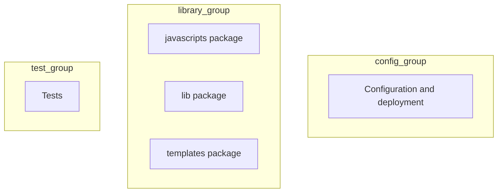

# Architecture report: Shopify/dashing

> Automated static analysis. **Observed** = directly seen in files/imports/AST; **Inferred** = interpretation from that evidence. Repository code was not executed.

## 1. Repository at a glance

| Item | Value |
| --- | --- |
| Repository | Shopify/dashing |
| Description | The exceptionally handsome dashboard framework in Ruby and Coffeescript. |
| Language | JavaScript |
| Stars | 10893 |
| Licence | MIT |
| Analysed commit / branch | bc1c106e42d52d3bfc042cba7bb0181d09413068 / master |
| Framework(s) | None detected |
| Files analysed | 73 |
| Components | 5 |

## 2. Architecture in one minute

Shopify/dashing - The exceptionally handsome dashboard framework in Ruby and Coffeescript.. This repository was analysed statically from 73 file(s) (0 Python). Detected technologies (observed from imports/manifests): no known frameworks/libraries. Files are grouped into 5 component(s): Configuration and deployment, javascripts package, lib package, templates package, Tests. Findings below distinguish observed facts from inferred interpretation.

## 3. High-level block diagram

## 4. Main components

### Configuration and deployment (`config`)

- **Kind:** config
- **Status:** Observed
- **Confidence:** 0.85
- **Responsibility:** Groups 1 file(s) under configuration and deployment (observed from repository paths and static analysis).
- **Paths:** `shipit.rubygems.yml`
- **Evidence:** [shipit.rubygems.yml](https://github.com/Shopify/dashing/blob/bc1c106e42d52d3bfc042cba7bb0181d09413068/shipit.rubygems.yml)

### javascripts package (`javascripts`)

- **Kind:** library
- **Status:** Observed
- **Confidence:** 0.85
- **Responsibility:** Groups 3 file(s) under javascripts package (observed from repository paths and static analysis).
- **Paths:** `javascripts/batman.jquery.js`, `javascripts/es5-shim.js`, `javascripts/jquery.js`
- **Evidence:** [javascripts/batman.jquery.js](https://github.com/Shopify/dashing/blob/bc1c106e42d52d3bfc042cba7bb0181d09413068/javascripts/batman.jquery.js); [javascripts/es5-shim.js](https://github.com/Shopify/dashing/blob/bc1c106e42d52d3bfc042cba7bb0181d09413068/javascripts/es5-shim.js); [javascripts/jquery.js](https://github.com/Shopify/dashing/blob/bc1c106e42d52d3bfc042cba7bb0181d09413068/javascripts/jquery.js)

### lib package (`lib`)

- **Kind:** library
- **Status:** Observed
- **Confidence:** 0.85
- **Responsibility:** Groups 4 file(s) under lib package (observed from repository paths and static analysis).
- **Paths:** `lib/dashing.rb`, `lib/dashing/app.rb`, `lib/dashing/cli.rb`, `lib/dashing/downloader.rb`
- **Evidence:** [lib/dashing.rb](https://github.com/Shopify/dashing/blob/bc1c106e42d52d3bfc042cba7bb0181d09413068/lib/dashing.rb); [lib/dashing/app.rb](https://github.com/Shopify/dashing/blob/bc1c106e42d52d3bfc042cba7bb0181d09413068/lib/dashing/app.rb); [lib/dashing/cli.rb](https://github.com/Shopify/dashing/blob/bc1c106e42d52d3bfc042cba7bb0181d09413068/lib/dashing/cli.rb); [lib/dashing/downloader.rb](https://github.com/Shopify/dashing/blob/bc1c106e42d52d3bfc042cba7bb0181d09413068/lib/dashing/downloader.rb)

### templates package (`templates`)

- **Kind:** library
- **Status:** Observed
- **Confidence:** 0.85
- **Responsibility:** Groups 7 file(s) under templates package (observed from repository paths and static analysis).
- **Paths:** `templates/job/%name%.rb`, `templates/project/assets/javascripts/d3-3.2.8.js`, `templates/project/assets/javascripts/jquery.knob.js`, `templates/project/jobs/buzzwords.rb`, `templates/project/jobs/convergence.rb`, `templates/project/jobs/sample.rb`, `templates/project/jobs/twitter.rb`
- **Evidence:** [templates/job/%name%.rb](https://github.com/Shopify/dashing/blob/bc1c106e42d52d3bfc042cba7bb0181d09413068/templates/job/%25name%25.rb); [templates/project/assets/javascripts/d3-3.2.8.js](https://github.com/Shopify/dashing/blob/bc1c106e42d52d3bfc042cba7bb0181d09413068/templates/project/assets/javascripts/d3-3.2.8.js); [templates/project/assets/javascripts/jquery.knob.js](https://github.com/Shopify/dashing/blob/bc1c106e42d52d3bfc042cba7bb0181d09413068/templates/project/assets/javascripts/jquery.knob.js); [templates/project/jobs/buzzwords.rb](https://github.com/Shopify/dashing/blob/bc1c106e42d52d3bfc042cba7bb0181d09413068/templates/project/jobs/buzzwords.rb); [templates/project/jobs/convergence.rb](https://github.com/Shopify/dashing/blob/bc1c106e42d52d3bfc042cba7bb0181d09413068/templates/project/jobs/convergence.rb); [templates/project/jobs/sample.rb](https://github.com/Shopify/dashing/blob/bc1c106e42d52d3bfc042cba7bb0181d09413068/templates/project/jobs/sample.rb); [templates/project/jobs/twitter.rb](https://github.com/Shopify/dashing/blob/bc1c106e42d52d3bfc042cba7bb0181d09413068/templates/project/jobs/twitter.rb)

### Tests (`tests`)

- **Kind:** test
- **Status:** Observed
- **Confidence:** 0.85
- **Responsibility:** Groups 4 file(s) under tests (observed from repository paths and static analysis).
- **Paths:** `test/app_test.rb`, `test/cli_test.rb`, `test/downloader_test.rb`, `test/test_helper.rb`
- **Evidence:** [test/app_test.rb](https://github.com/Shopify/dashing/blob/bc1c106e42d52d3bfc042cba7bb0181d09413068/test/app_test.rb); [test/cli_test.rb](https://github.com/Shopify/dashing/blob/bc1c106e42d52d3bfc042cba7bb0181d09413068/test/cli_test.rb); [test/downloader_test.rb](https://github.com/Shopify/dashing/blob/bc1c106e42d52d3bfc042cba7bb0181d09413068/test/downloader_test.rb); [test/test_helper.rb](https://github.com/Shopify/dashing/blob/bc1c106e42d52d3bfc042cba7bb0181d09413068/test/test_helper.rb)

## 5. Execution flow

No entry point was observed; the startup flow below is therefore limited.

Representative flow (derived from observed entry points and the import graph; steps beyond the entry point are **Inferred**):

1. Execution starts at an observed entry point listed above, if present.
2. No internal import relationships between components were observed.

## 6. Project structure

### `(root)`

- `.gitignore` - other (76 bytes)
- `.travis.yml` - ci, YAML (71 bytes)
- `CONTRIBUTING.md` - docs (924 bytes)
- `Gemfile` - other (38 bytes)
- `MIT-LICENSE` - other (1051 bytes)
- `README.md` - docs (660 bytes)
- `Rakefile` - other (221 bytes)
- `dashing.gemspec` - other (1719 bytes)
- `shipit.rubygems.yml` - config (34 bytes)

### `bin`

- `bin/dashing` - other (282 bytes)

### `javascripts`

- `javascripts/batman.jquery.js` - source, JavaScript (4726 bytes)
- `javascripts/dashing.coffee` - other (3706 bytes)
- `javascripts/es5-shim.js` - source, JavaScript (36756 bytes)
- `javascripts/jquery.js` - source, JavaScript (94840 bytes)

### `lib`

- `lib/dashing.rb` - source, Ruby (92 bytes)
- `lib/dashing/app.rb` - source, Ruby (4641 bytes)
- `lib/dashing/cli.rb` - source, Ruby (3466 bytes)
- `lib/dashing/downloader.rb` - source, Ruby (298 bytes)

### `templates`

- `templates/dashboard/%name%.erb.tt` - other (174 bytes)
- `templates/job/%name%.rb` - source, Ruby (180 bytes)
- `templates/project/.gitignore` - other (22 bytes)
- `templates/project/Gemfile` - other (122 bytes)
- `templates/project/README.md` - docs (65 bytes)
- `templates/project/assets/javascripts/application.coffee` - other (869 bytes)
- `templates/project/assets/javascripts/d3-3.2.8.js` - source, JavaScript (143169 bytes)
- `templates/project/assets/javascripts/dashing.gridster.coffee` - other (1242 bytes)
- `templates/project/assets/javascripts/jquery.knob.js` - source, JavaScript (20009 bytes)
- `templates/project/assets/stylesheets/application.scss` - other (4978 bytes)
- `templates/project/assets/stylesheets/font-awesome.css` - other (33239 bytes)
- `templates/project/config.ru` - other (342 bytes)
- `templates/project/dashboards/layout.erb` - other (1057 bytes)
- `templates/project/dashboards/sample.erb` - other (1418 bytes)
- `templates/project/dashboards/sampletv.erb` - other (2627 bytes)
- `templates/project/jobs/buzzwords.rb` - source, Ruby (433 bytes)
- `templates/project/jobs/convergence.rb` - source, Ruby (281 bytes)
- `templates/project/jobs/sample.rb` - source, Ruby (402 bytes)
- `templates/project/jobs/twitter.rb` - source, Ruby (883 bytes)
- `templates/project/lib/.empty_directory` - other (16 bytes)
- `templates/project/public/404.html` - other (683 bytes)
- `templates/project/widgets/clock/clock.coffee` - other (389 bytes)
- `templates/project/widgets/clock/clock.html` - other (53 bytes)
- `templates/project/widgets/clock/clock.scss` - other (453 bytes)
- `templates/project/widgets/comments/comments.coffee` - other (591 bytes)
- `templates/project/widgets/comments/comments.html` - other (289 bytes)
- `templates/project/widgets/comments/comments.scss` - other (750 bytes)
- `templates/project/widgets/graph/graph.coffee` - other (1137 bytes)
- `templates/project/widgets/graph/graph.html` - other (183 bytes)
- `templates/project/widgets/graph/graph.scss` - other (1223 bytes)
- `templates/project/widgets/iframe/iframe.coffee` - other (320 bytes)
- `templates/project/widgets/iframe/iframe.html` - other (52 bytes)
- `templates/project/widgets/iframe/iframe.scss` - other (109 bytes)
- `templates/project/widgets/image/image.coffee` - other (319 bytes)
- `templates/project/widgets/image/image.html` - other (73 bytes)
- `templates/project/widgets/image/image.scss` - other (453 bytes)
- `templates/project/widgets/list/list.coffee` - other (158 bytes)
- `templates/project/widgets/list/list.html` - other (493 bytes)
- `templates/project/widgets/list/list.scss` - other (1134 bytes)
- `templates/project/widgets/meter/meter.coffee` - other (387 bytes)
- `templates/project/widgets/meter/meter.html` - other (442 bytes)
- `templates/project/widgets/meter/meter.scss` - other (819 bytes)
- `templates/project/widgets/number/number.coffee` - other (733 bytes)
- `templates/project/widgets/number/number.html` - other (343 bytes)
- `templates/project/widgets/number/number.scss` - other (846 bytes)
- `templates/project/widgets/text/text.coffee` - other (42 bytes)
- `templates/project/widgets/text/text.html` - other (175 bytes)
- `templates/project/widgets/text/text.scss` - other (732 bytes)
- `templates/widget/%name%/%name%.coffee.tt` - other (347 bytes)
- `templates/widget/%name%/%name%.html` - other (29 bytes)
- `templates/widget/%name%/%name%.scss.tt` - other (48 bytes)

### `test`

- `test/app_test.rb` - test, Ruby (4695 bytes)
- `test/cli_test.rb` - test, Ruby (4859 bytes)
- `test/downloader_test.rb` - test, Ruby (715 bytes)
- `test/test_helper.rb` - test, Ruby (882 bytes)

## 7. Key dependencies and integrations

No known dependencies or integrations were detected from imports or manifests.

## 8. Data and state

No database, cache, queue, or persistent-state usage was observed in the analysed files. State handling, if any, may be in-memory or in files that were not analysed.

## 9. Configuration and deployment clues

- `.travis.yml` (ci)
- `shipit.rubygems.yml` (config)

## 10. Design observations

- Tests are present alongside source code (Observed from test file paths).

These observations are interpretations (**Inferred**) of the observed structure, not guarantees about runtime design.

## 11. Limitations and unknowns

- Static analysis only: repository code was not executed, installed, or imported at runtime.
- Components and relationships are inferred from file paths, imports, and AST structure; runtime behaviour, dynamic imports, and reflection may not be visible.
- 1 file(s) were skipped during inventory (1 x generated/minified file excluded).
- No clear application entry point was observed in the analysed files.
- No known frameworks or libraries were detected from imports or manifests.
- Repository text was treated as untrusted data; no instructions found in repository files were followed, and likely secret values were redacted/excluded.
- JavaScript and TypeScript files were inventoried from paths and package manifests. They were not parsed with a full language AST, and repository code was not executed.
- The GitHub repository was marked archived at selection time.

## 12. Source references

- [javascripts/batman.jquery.js](https://github.com/Shopify/dashing/blob/bc1c106e42d52d3bfc042cba7bb0181d09413068/javascripts/batman.jquery.js)
- [javascripts/es5-shim.js](https://github.com/Shopify/dashing/blob/bc1c106e42d52d3bfc042cba7bb0181d09413068/javascripts/es5-shim.js)
- [javascripts/jquery.js](https://github.com/Shopify/dashing/blob/bc1c106e42d52d3bfc042cba7bb0181d09413068/javascripts/jquery.js)
- [lib/dashing.rb](https://github.com/Shopify/dashing/blob/bc1c106e42d52d3bfc042cba7bb0181d09413068/lib/dashing.rb)
- [lib/dashing/app.rb](https://github.com/Shopify/dashing/blob/bc1c106e42d52d3bfc042cba7bb0181d09413068/lib/dashing/app.rb)
- [lib/dashing/cli.rb](https://github.com/Shopify/dashing/blob/bc1c106e42d52d3bfc042cba7bb0181d09413068/lib/dashing/cli.rb)
- [lib/dashing/downloader.rb](https://github.com/Shopify/dashing/blob/bc1c106e42d52d3bfc042cba7bb0181d09413068/lib/dashing/downloader.rb)
- [shipit.rubygems.yml](https://github.com/Shopify/dashing/blob/bc1c106e42d52d3bfc042cba7bb0181d09413068/shipit.rubygems.yml)
- [templates/job/%name%.rb](https://github.com/Shopify/dashing/blob/bc1c106e42d52d3bfc042cba7bb0181d09413068/templates/job/%25name%25.rb)
- [templates/project/assets/javascripts/d3-3.2.8.js](https://github.com/Shopify/dashing/blob/bc1c106e42d52d3bfc042cba7bb0181d09413068/templates/project/assets/javascripts/d3-3.2.8.js)
- [templates/project/assets/javascripts/jquery.knob.js](https://github.com/Shopify/dashing/blob/bc1c106e42d52d3bfc042cba7bb0181d09413068/templates/project/assets/javascripts/jquery.knob.js)
- [templates/project/jobs/buzzwords.rb](https://github.com/Shopify/dashing/blob/bc1c106e42d52d3bfc042cba7bb0181d09413068/templates/project/jobs/buzzwords.rb)
- [templates/project/jobs/convergence.rb](https://github.com/Shopify/dashing/blob/bc1c106e42d52d3bfc042cba7bb0181d09413068/templates/project/jobs/convergence.rb)
- [templates/project/jobs/sample.rb](https://github.com/Shopify/dashing/blob/bc1c106e42d52d3bfc042cba7bb0181d09413068/templates/project/jobs/sample.rb)
- [templates/project/jobs/twitter.rb](https://github.com/Shopify/dashing/blob/bc1c106e42d52d3bfc042cba7bb0181d09413068/templates/project/jobs/twitter.rb)
- [test/app_test.rb](https://github.com/Shopify/dashing/blob/bc1c106e42d52d3bfc042cba7bb0181d09413068/test/app_test.rb)
- [test/cli_test.rb](https://github.com/Shopify/dashing/blob/bc1c106e42d52d3bfc042cba7bb0181d09413068/test/cli_test.rb)
- [test/downloader_test.rb](https://github.com/Shopify/dashing/blob/bc1c106e42d52d3bfc042cba7bb0181d09413068/test/downloader_test.rb)
- [test/test_helper.rb](https://github.com/Shopify/dashing/blob/bc1c106e42d52d3bfc042cba7bb0181d09413068/test/test_helper.rb)
