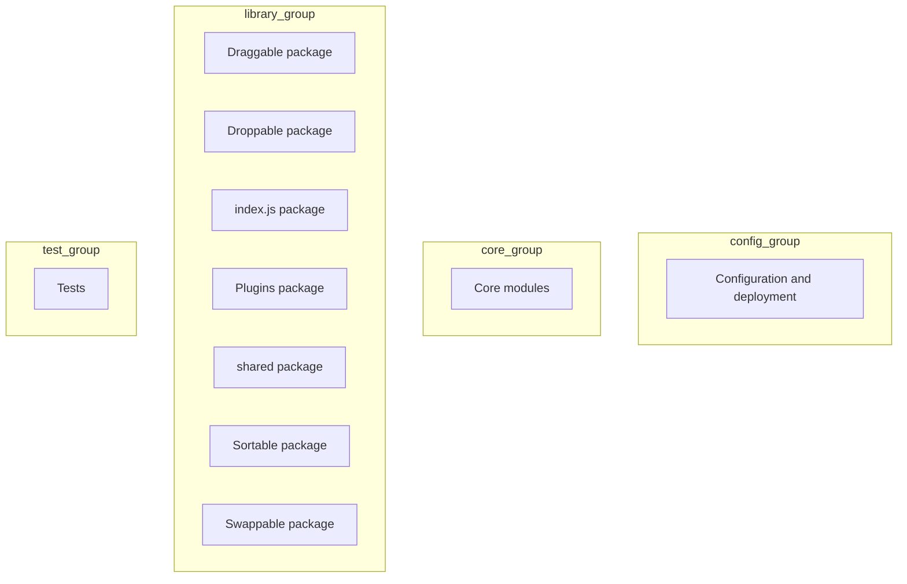

# Architecture report: Shopify/draggable

> Automated static analysis. **Observed** = directly seen in files/imports/AST; **Inferred** = interpretation from that evidence. Repository code was not executed.

## 1. Repository at a glance

| Item | Value |
| --- | --- |
| Repository | Shopify/draggable |
| Description | The JavaScript Drag & Drop library your grandparents warned you about. |
| Language | JavaScript |
| Stars | 18456 |
| Licence | MIT |
| Analysed commit / branch | 8a1eed57f3ab2dff9371e8ce60fb39ac85871e8d / main |
| Framework(s) | None detected |
| Files analysed | 347 |
| Components | 10 |

## 2. Architecture in one minute

Shopify/draggable - The JavaScript Drag & Drop library your grandparents warned you about.. This repository was analysed statically from 347 file(s) (0 Python). Detected technologies (observed from imports/manifests): GitHub Actions, Jest, TypeScript, webpack. Files are grouped into 10 component(s): Configuration and deployment, Core modules, Draggable package, Droppable package, index.js package, Plugins package, shared package, Sortable package. Findings below distinguish observed facts from inferred interpretation.

## 3. High-level block diagram

## 4. Main components

### Configuration and deployment (`config`)

- **Kind:** config
- **Status:** Observed
- **Confidence:** 0.85
- **Responsibility:** Groups 4 file(s) under configuration and deployment (observed from repository paths and static analysis).
- **Paths:** `config/typescript/rollup-plugin-includepaths.d.ts`, `esdoc.json`, `package.json`, `tsconfig.json`
- **Evidence:** [config/typescript/rollup-plugin-includepaths.d.ts](https://github.com/Shopify/draggable/blob/8a1eed57f3ab2dff9371e8ce60fb39ac85871e8d/config/typescript/rollup-plugin-includepaths.d.ts); [esdoc.json](https://github.com/Shopify/draggable/blob/8a1eed57f3ab2dff9371e8ce60fb39ac85871e8d/esdoc.json); [package.json](https://github.com/Shopify/draggable/blob/8a1eed57f3ab2dff9371e8ce60fb39ac85871e8d/package.json); [tsconfig.json](https://github.com/Shopify/draggable/blob/8a1eed57f3ab2dff9371e8ce60fb39ac85871e8d/tsconfig.json)

### Core modules (`core`)

- **Kind:** core
- **Status:** Observed
- **Confidence:** 0.85
- **Responsibility:** Groups 5 file(s) under core modules (observed from repository paths and static analysis).
- **Paths:** `babel.config.js`, `index.d.ts`, `jest.config.js`, `rollup.config.ts`, `rollup.development.config.ts`
- **Evidence:** [babel.config.js](https://github.com/Shopify/draggable/blob/8a1eed57f3ab2dff9371e8ce60fb39ac85871e8d/babel.config.js); [index.d.ts](https://github.com/Shopify/draggable/blob/8a1eed57f3ab2dff9371e8ce60fb39ac85871e8d/index.d.ts); [jest.config.js](https://github.com/Shopify/draggable/blob/8a1eed57f3ab2dff9371e8ce60fb39ac85871e8d/jest.config.js); [rollup.config.ts](https://github.com/Shopify/draggable/blob/8a1eed57f3ab2dff9371e8ce60fb39ac85871e8d/rollup.config.ts); [rollup.development.config.ts](https://github.com/Shopify/draggable/blob/8a1eed57f3ab2dff9371e8ce60fb39ac85871e8d/rollup.development.config.ts)

### Draggable package (`draggable`)

- **Kind:** library
- **Status:** Observed
- **Confidence:** 0.85
- **Responsibility:** Groups 32 file(s) under draggable package (observed from repository paths and static analysis).
- **Paths:** `src/Draggable/DragEvent/DragEvent.ts`, `src/Draggable/DragEvent/index.ts`, `src/Draggable/Draggable.js`, `src/Draggable/DraggableEvent/DraggableEvent.ts`, `src/Draggable/DraggableEvent/index.ts`, `src/Draggable/Emitter/Emitter.ts`, `src/Draggable/Emitter/index.ts`, `src/Draggable/Plugins/Announcement/Announcement.js`, `src/Draggable/Plugins/Announcement/index.js`, `src/Draggable/Plugins/Focusable/Focusable.js`, `src/Draggable/Plugins/Focusable/index.js`, `src/Draggable/Plugins/Mirror/Mirror.js`, `src/Draggable/Plugins/Mirror/MirrorEvent/MirrorEvent.ts`, `src/Draggable/Plugins/Mirror/MirrorEvent/index.ts`, `src/Draggable/Plugins/Mirror/index.js`, `src/Draggable/Plugins/Scrollable/Scrollable.js`, `src/Draggable/Plugins/Scrollable/index.js`, `src/Draggable/Plugins/index.js`, `src/Draggable/Sensors/DragSensor/DragSensor.js`, `src/Draggable/Sensors/DragSensor/index.js`, `src/Draggable/Sensors/ForceTouchSensor/ForceTouchSensor.js`, `src/Draggable/Sensors/ForceTouchSensor/index.js`, `src/Draggable/Sensors/MouseSensor/MouseSensor.js`, `src/Draggable/Sensors/MouseSensor/index.js`, `src/Draggable/Sensors/Sensor/Sensor.js`, `src/Draggable/Sensors/Sensor/index.js`, `src/Draggable/Sensors/SensorEvent/SensorEvent.ts`, `src/Draggable/Sensors/SensorEvent/index.ts`, `src/Draggable/Sensors/TouchSensor/TouchSensor.js`, `src/Draggable/Sensors/TouchSensor/index.js`, `src/Draggable/Sensors/index.js`, `src/Draggable/index.js`
- **Evidence:** [src/Draggable/DragEvent/DragEvent.ts](https://github.com/Shopify/draggable/blob/8a1eed57f3ab2dff9371e8ce60fb39ac85871e8d/src/Draggable/DragEvent/DragEvent.ts); [src/Draggable/DragEvent/index.ts](https://github.com/Shopify/draggable/blob/8a1eed57f3ab2dff9371e8ce60fb39ac85871e8d/src/Draggable/DragEvent/index.ts); [src/Draggable/Draggable.js](https://github.com/Shopify/draggable/blob/8a1eed57f3ab2dff9371e8ce60fb39ac85871e8d/src/Draggable/Draggable.js); [src/Draggable/DraggableEvent/DraggableEvent.ts](https://github.com/Shopify/draggable/blob/8a1eed57f3ab2dff9371e8ce60fb39ac85871e8d/src/Draggable/DraggableEvent/DraggableEvent.ts); [src/Draggable/DraggableEvent/index.ts](https://github.com/Shopify/draggable/blob/8a1eed57f3ab2dff9371e8ce60fb39ac85871e8d/src/Draggable/DraggableEvent/index.ts); [src/Draggable/Emitter/Emitter.ts](https://github.com/Shopify/draggable/blob/8a1eed57f3ab2dff9371e8ce60fb39ac85871e8d/src/Draggable/Emitter/Emitter.ts); [src/Draggable/Emitter/index.ts](https://github.com/Shopify/draggable/blob/8a1eed57f3ab2dff9371e8ce60fb39ac85871e8d/src/Draggable/Emitter/index.ts); [src/Draggable/Plugins/Announcement/Announcement.js](https://github.com/Shopify/draggable/blob/8a1eed57f3ab2dff9371e8ce60fb39ac85871e8d/src/Draggable/Plugins/Announcement/Announcement.js)

### Droppable package (`droppable`)

- **Kind:** library
- **Status:** Observed
- **Confidence:** 0.85
- **Responsibility:** Groups 4 file(s) under droppable package (observed from repository paths and static analysis).
- **Paths:** `src/Droppable/Droppable.js`, `src/Droppable/DroppableEvent/DroppableEvent.ts`, `src/Droppable/DroppableEvent/index.ts`, `src/Droppable/index.js`
- **Evidence:** [src/Droppable/Droppable.js](https://github.com/Shopify/draggable/blob/8a1eed57f3ab2dff9371e8ce60fb39ac85871e8d/src/Droppable/Droppable.js); [src/Droppable/DroppableEvent/DroppableEvent.ts](https://github.com/Shopify/draggable/blob/8a1eed57f3ab2dff9371e8ce60fb39ac85871e8d/src/Droppable/DroppableEvent/DroppableEvent.ts); [src/Droppable/DroppableEvent/index.ts](https://github.com/Shopify/draggable/blob/8a1eed57f3ab2dff9371e8ce60fb39ac85871e8d/src/Droppable/DroppableEvent/index.ts); [src/Droppable/index.js](https://github.com/Shopify/draggable/blob/8a1eed57f3ab2dff9371e8ce60fb39ac85871e8d/src/Droppable/index.js)

### index.js package (`index_js`)

- **Kind:** library
- **Status:** Observed
- **Confidence:** 0.85
- **Responsibility:** Groups 1 file(s) under index.js package (observed from repository paths and static analysis).
- **Paths:** `src/index.js`
- **Evidence:** [src/index.js](https://github.com/Shopify/draggable/blob/8a1eed57f3ab2dff9371e8ce60fb39ac85871e8d/src/index.js)

### Plugins package (`plugins`)

- **Kind:** library
- **Status:** Observed
- **Confidence:** 0.85
- **Responsibility:** Groups 15 file(s) under plugins package (observed from repository paths and static analysis).
- **Paths:** `src/Plugins/Collidable/Collidable.js`, `src/Plugins/Collidable/CollidableEvent/CollidableEvent.ts`, `src/Plugins/Collidable/CollidableEvent/index.ts`, `src/Plugins/Collidable/index.js`, `src/Plugins/ResizeMirror/ResizeMirror.ts`, `src/Plugins/ResizeMirror/index.ts`, `src/Plugins/Snappable/Snappable.js`, `src/Plugins/Snappable/SnappableEvent/SnappableEvent.ts`, `src/Plugins/Snappable/SnappableEvent/index.ts`, `src/Plugins/Snappable/index.js`, `src/Plugins/SortAnimation/SortAnimation.js`, `src/Plugins/SortAnimation/index.js`, `src/Plugins/SwapAnimation/SwapAnimation.ts`, `src/Plugins/SwapAnimation/index.ts`, `src/Plugins/index.js`
- **Evidence:** [src/Plugins/Collidable/Collidable.js](https://github.com/Shopify/draggable/blob/8a1eed57f3ab2dff9371e8ce60fb39ac85871e8d/src/Plugins/Collidable/Collidable.js); [src/Plugins/Collidable/CollidableEvent/CollidableEvent.ts](https://github.com/Shopify/draggable/blob/8a1eed57f3ab2dff9371e8ce60fb39ac85871e8d/src/Plugins/Collidable/CollidableEvent/CollidableEvent.ts); [src/Plugins/Collidable/CollidableEvent/index.ts](https://github.com/Shopify/draggable/blob/8a1eed57f3ab2dff9371e8ce60fb39ac85871e8d/src/Plugins/Collidable/CollidableEvent/index.ts); [src/Plugins/Collidable/index.js](https://github.com/Shopify/draggable/blob/8a1eed57f3ab2dff9371e8ce60fb39ac85871e8d/src/Plugins/Collidable/index.js); [src/Plugins/ResizeMirror/ResizeMirror.ts](https://github.com/Shopify/draggable/blob/8a1eed57f3ab2dff9371e8ce60fb39ac85871e8d/src/Plugins/ResizeMirror/ResizeMirror.ts); [src/Plugins/ResizeMirror/index.ts](https://github.com/Shopify/draggable/blob/8a1eed57f3ab2dff9371e8ce60fb39ac85871e8d/src/Plugins/ResizeMirror/index.ts); [src/Plugins/Snappable/Snappable.js](https://github.com/Shopify/draggable/blob/8a1eed57f3ab2dff9371e8ce60fb39ac85871e8d/src/Plugins/Snappable/Snappable.js); [src/Plugins/Snappable/SnappableEvent/SnappableEvent.ts](https://github.com/Shopify/draggable/blob/8a1eed57f3ab2dff9371e8ce60fb39ac85871e8d/src/Plugins/Snappable/SnappableEvent/SnappableEvent.ts)

### shared package (`shared`)

- **Kind:** library
- **Status:** Observed
- **Confidence:** 0.85
- **Responsibility:** Groups 16 file(s) under shared package (observed from repository paths and static analysis).
- **Paths:** `src/shared/AbstractEvent/AbstractEvent.ts`, `src/shared/AbstractEvent/index.ts`, `src/shared/AbstractPlugin/AbstractPlugin.ts`, `src/shared/AbstractPlugin/index.ts`, `src/shared/types.ts`, `src/shared/utils/closest/closest.ts`, `src/shared/utils/closest/index.ts`, `src/shared/utils/decorators/AutoBind.ts`, `src/shared/utils/decorators/index.ts`, `src/shared/utils/distance/distance.ts`, `src/shared/utils/distance/index.ts`, `src/shared/utils/index.ts`, `src/shared/utils/requestNextAnimationFrame/index.ts`, `src/shared/utils/requestNextAnimationFrame/requestNextAnimationFrame.ts`, `src/shared/utils/touchCoords/index.ts`, `src/shared/utils/touchCoords/touchCoords.ts`
- **Evidence:** [src/shared/AbstractEvent/AbstractEvent.ts](https://github.com/Shopify/draggable/blob/8a1eed57f3ab2dff9371e8ce60fb39ac85871e8d/src/shared/AbstractEvent/AbstractEvent.ts); [src/shared/AbstractEvent/index.ts](https://github.com/Shopify/draggable/blob/8a1eed57f3ab2dff9371e8ce60fb39ac85871e8d/src/shared/AbstractEvent/index.ts); [src/shared/AbstractPlugin/AbstractPlugin.ts](https://github.com/Shopify/draggable/blob/8a1eed57f3ab2dff9371e8ce60fb39ac85871e8d/src/shared/AbstractPlugin/AbstractPlugin.ts); [src/shared/AbstractPlugin/index.ts](https://github.com/Shopify/draggable/blob/8a1eed57f3ab2dff9371e8ce60fb39ac85871e8d/src/shared/AbstractPlugin/index.ts); [src/shared/types.ts](https://github.com/Shopify/draggable/blob/8a1eed57f3ab2dff9371e8ce60fb39ac85871e8d/src/shared/types.ts); [src/shared/utils/closest/closest.ts](https://github.com/Shopify/draggable/blob/8a1eed57f3ab2dff9371e8ce60fb39ac85871e8d/src/shared/utils/closest/closest.ts); [src/shared/utils/closest/index.ts](https://github.com/Shopify/draggable/blob/8a1eed57f3ab2dff9371e8ce60fb39ac85871e8d/src/shared/utils/closest/index.ts); [src/shared/utils/decorators/AutoBind.ts](https://github.com/Shopify/draggable/blob/8a1eed57f3ab2dff9371e8ce60fb39ac85871e8d/src/shared/utils/decorators/AutoBind.ts)

### Sortable package (`sortable`)

- **Kind:** library
- **Status:** Observed
- **Confidence:** 0.85
- **Responsibility:** Groups 4 file(s) under sortable package (observed from repository paths and static analysis).
- **Paths:** `src/Sortable/Sortable.js`, `src/Sortable/SortableEvent/SortableEvent.ts`, `src/Sortable/SortableEvent/index.ts`, `src/Sortable/index.js`
- **Evidence:** [src/Sortable/Sortable.js](https://github.com/Shopify/draggable/blob/8a1eed57f3ab2dff9371e8ce60fb39ac85871e8d/src/Sortable/Sortable.js); [src/Sortable/SortableEvent/SortableEvent.ts](https://github.com/Shopify/draggable/blob/8a1eed57f3ab2dff9371e8ce60fb39ac85871e8d/src/Sortable/SortableEvent/SortableEvent.ts); [src/Sortable/SortableEvent/index.ts](https://github.com/Shopify/draggable/blob/8a1eed57f3ab2dff9371e8ce60fb39ac85871e8d/src/Sortable/SortableEvent/index.ts); [src/Sortable/index.js](https://github.com/Shopify/draggable/blob/8a1eed57f3ab2dff9371e8ce60fb39ac85871e8d/src/Sortable/index.js)

### Swappable package (`swappable`)

- **Kind:** library
- **Status:** Observed
- **Confidence:** 0.85
- **Responsibility:** Groups 4 file(s) under swappable package (observed from repository paths and static analysis).
- **Paths:** `src/Swappable/Swappable.js`, `src/Swappable/SwappableEvent/SwappableEvent.ts`, `src/Swappable/SwappableEvent/index.ts`, `src/Swappable/index.js`
- **Evidence:** [src/Swappable/Swappable.js](https://github.com/Shopify/draggable/blob/8a1eed57f3ab2dff9371e8ce60fb39ac85871e8d/src/Swappable/Swappable.js); [src/Swappable/SwappableEvent/SwappableEvent.ts](https://github.com/Shopify/draggable/blob/8a1eed57f3ab2dff9371e8ce60fb39ac85871e8d/src/Swappable/SwappableEvent/SwappableEvent.ts); [src/Swappable/SwappableEvent/index.ts](https://github.com/Shopify/draggable/blob/8a1eed57f3ab2dff9371e8ce60fb39ac85871e8d/src/Swappable/SwappableEvent/index.ts); [src/Swappable/index.js](https://github.com/Shopify/draggable/blob/8a1eed57f3ab2dff9371e8ce60fb39ac85871e8d/src/Swappable/index.js)

### Tests (`tests`)

- **Kind:** test
- **Status:** Observed
- **Confidence:** 0.85
- **Responsibility:** Groups 31 file(s) under tests (observed from repository paths and static analysis).
- **Paths:** `src/Draggable/DragEvent/tests/DragEvent.test.ts`, `src/Draggable/Emitter/tests/Emitter.test.ts`, `src/Draggable/Plugins/Focusable/tests/Focusable.test.js`, `src/Draggable/Plugins/Mirror/tests/Mirror.test.js`, `src/Draggable/Sensors/DragSensor/tests/DragSensor.test.js`, `src/Draggable/Sensors/MouseSensor/tests/MouseSensor.test.js`, `src/Draggable/Sensors/Sensor/tests/Sensor.test.js`, `src/Draggable/Sensors/TouchSensor/tests/TouchSensor.test.js`, `src/Draggable/tests/Draggable.test.js`, `src/Droppable/tests/Droppable.test.js`, `src/Plugins/ResizeMirror/tests/ResizeMirror.test.ts`, `src/Sortable/tests/Sortable.test.js`, `src/Swappable/tests/Swappable.test.js`, `src/shared/AbstractEvent/tests/AbstractEvent.test.ts`, `src/shared/utils/closest/tests/closest.test.ts`, `test/environment.ts`, `test/helper.ts`, `test/helpers/constants.ts`, `test/helpers/environment.ts`, `test/helpers/event.ts`, `test/helpers/index.ts`, `test/helpers/module.ts`, `test/helpers/plugin.ts`, `test/helpers/sensor.ts`, `test/matchers/dom-event.ts`, `test/matchers/event.ts`, `test/matchers/index.ts`, `test/matchers/order.ts`, `test/matchers/sensor.ts`, `test/matchers/utils.ts`, `test/setup.ts`
- **Evidence:** [src/Draggable/DragEvent/tests/DragEvent.test.ts](https://github.com/Shopify/draggable/blob/8a1eed57f3ab2dff9371e8ce60fb39ac85871e8d/src/Draggable/DragEvent/tests/DragEvent.test.ts); [src/Draggable/Emitter/tests/Emitter.test.ts](https://github.com/Shopify/draggable/blob/8a1eed57f3ab2dff9371e8ce60fb39ac85871e8d/src/Draggable/Emitter/tests/Emitter.test.ts); [src/Draggable/Plugins/Focusable/tests/Focusable.test.js](https://github.com/Shopify/draggable/blob/8a1eed57f3ab2dff9371e8ce60fb39ac85871e8d/src/Draggable/Plugins/Focusable/tests/Focusable.test.js); [src/Draggable/Plugins/Mirror/tests/Mirror.test.js](https://github.com/Shopify/draggable/blob/8a1eed57f3ab2dff9371e8ce60fb39ac85871e8d/src/Draggable/Plugins/Mirror/tests/Mirror.test.js); [src/Draggable/Sensors/DragSensor/tests/DragSensor.test.js](https://github.com/Shopify/draggable/blob/8a1eed57f3ab2dff9371e8ce60fb39ac85871e8d/src/Draggable/Sensors/DragSensor/tests/DragSensor.test.js); [src/Draggable/Sensors/MouseSensor/tests/MouseSensor.test.js](https://github.com/Shopify/draggable/blob/8a1eed57f3ab2dff9371e8ce60fb39ac85871e8d/src/Draggable/Sensors/MouseSensor/tests/MouseSensor.test.js); [src/Draggable/Sensors/Sensor/tests/Sensor.test.js](https://github.com/Shopify/draggable/blob/8a1eed57f3ab2dff9371e8ce60fb39ac85871e8d/src/Draggable/Sensors/Sensor/tests/Sensor.test.js); [src/Draggable/Sensors/TouchSensor/tests/TouchSensor.test.js](https://github.com/Shopify/draggable/blob/8a1eed57f3ab2dff9371e8ce60fb39ac85871e8d/src/Draggable/Sensors/TouchSensor/tests/TouchSensor.test.js)

## 5. Execution flow

**Observed** entry point(s):

- [examples/tools/index.js](https://github.com/Shopify/draggable/blob/8a1eed57f3ab2dff9371e8ce60fb39ac85871e8d/examples/tools/index.js)
- [src/Draggable/DragEvent/index.ts](https://github.com/Shopify/draggable/blob/8a1eed57f3ab2dff9371e8ce60fb39ac85871e8d/src/Draggable/DragEvent/index.ts)
- [src/Draggable/DraggableEvent/index.ts](https://github.com/Shopify/draggable/blob/8a1eed57f3ab2dff9371e8ce60fb39ac85871e8d/src/Draggable/DraggableEvent/index.ts)
- [src/Draggable/Emitter/index.ts](https://github.com/Shopify/draggable/blob/8a1eed57f3ab2dff9371e8ce60fb39ac85871e8d/src/Draggable/Emitter/index.ts)
- [src/Draggable/Plugins/index.js](https://github.com/Shopify/draggable/blob/8a1eed57f3ab2dff9371e8ce60fb39ac85871e8d/src/Draggable/Plugins/index.js)
- [src/Draggable/Sensors/index.js](https://github.com/Shopify/draggable/blob/8a1eed57f3ab2dff9371e8ce60fb39ac85871e8d/src/Draggable/Sensors/index.js)
- [src/Draggable/index.js](https://github.com/Shopify/draggable/blob/8a1eed57f3ab2dff9371e8ce60fb39ac85871e8d/src/Draggable/index.js)
- [src/Droppable/DroppableEvent/index.ts](https://github.com/Shopify/draggable/blob/8a1eed57f3ab2dff9371e8ce60fb39ac85871e8d/src/Droppable/DroppableEvent/index.ts)
- [src/Droppable/index.js](https://github.com/Shopify/draggable/blob/8a1eed57f3ab2dff9371e8ce60fb39ac85871e8d/src/Droppable/index.js)
- [src/Plugins/Collidable/index.js](https://github.com/Shopify/draggable/blob/8a1eed57f3ab2dff9371e8ce60fb39ac85871e8d/src/Plugins/Collidable/index.js)
- [src/Plugins/ResizeMirror/index.ts](https://github.com/Shopify/draggable/blob/8a1eed57f3ab2dff9371e8ce60fb39ac85871e8d/src/Plugins/ResizeMirror/index.ts)
- [src/Plugins/Snappable/index.js](https://github.com/Shopify/draggable/blob/8a1eed57f3ab2dff9371e8ce60fb39ac85871e8d/src/Plugins/Snappable/index.js)

Representative flow (derived from observed entry points and the import graph; steps beyond the entry point are **Inferred**):

1. Execution starts at an observed entry point listed above, if present.
2. No internal import relationships between components were observed.

## 6. Project structure

### `(root)`

- `.editorconfig` - config (396 bytes)
- `.eslintignore` - other (7 bytes)
- `.eslintrc.js` - source, JavaScript (487 bytes)
- `.gitignore` - other (405 bytes)
- `.nvmrc` - other (9 bytes)
- `.prettierignore` - other (7 bytes)
- `.prettierrc` - other (27 bytes)
- `AUTHORS` - other (197 bytes)
- `CHANGELOG.md` - docs (12138 bytes)
- `CODE_OF_CONDUCT.md` - docs (3228 bytes)
- `CONTRIBUTING.md` - docs (3143 bytes)
- `LICENSE.md` - docs (1072 bytes)
- `README.md` - docs (7623 bytes)
- `babel.config.js` - source, JavaScript (1858 bytes)
- `esdoc.json` - config (184 bytes)
- `index.d.ts` - source, TypeScript (15715 bytes)
- `jest.config.js` - source, JavaScript (591 bytes)
- `package.json` - manifest (3305 bytes)
- `rollup.config.ts` - source, TypeScript (2083 bytes)
- `rollup.development.config.ts` - source, TypeScript (275 bytes)
- `tsconfig.json` - config (541 bytes)

### `.changeset`

- `.changeset/README.md` - docs (510 bytes)
- `.changeset/config.json` - config (307 bytes)

### `.github`

- `.github/.probots.yml` - config (17 bytes)
- `.github/ISSUE_TEMPLATE.md` - docs (1071 bytes)
- `.github/PULL_REQUEST_TEMPLATE.md` - docs (674 bytes)
- `.github/dependabot.yaml` - config (114 bytes)
- `.github/workflows/changelog.yml` - ci, YAML (758 bytes)
- `.github/workflows/ci.yml` - ci, YAML (935 bytes)
- `.github/workflows/cla.yml` - ci, YAML (618 bytes)
- `.github/workflows/release.yml` - ci, YAML (1090 bytes)
- `.github/workflows/snapit.yml` - ci, YAML (6939 bytes)

### `.vscode`

- `.vscode/extensions.json` - config (123 bytes)
- `.vscode/launch.json` - config (304 bytes)
- `.vscode/settings.json` - config (551 bytes)

### `config`

- `config/typescript/rollup-plugin-includepaths.d.ts` - source, TypeScript (226 bytes)

### `doc`

- `doc/typescript.md` - docs (1426 bytes)

### `examples`

- `examples/.babelrc` - other (194 bytes)
- `examples/.browserslistrc` - other (20 bytes)
- `examples/.editorconfig` - config (525 bytes)
- `examples/.eslintignore` - other (52 bytes)
- `examples/.eslintrc.js` - source, JavaScript (860 bytes)
- `examples/.gitignore` - other (417 bytes)
- `examples/.nvmrc` - other (9 bytes)
- `examples/.prettierignore` - other (93 bytes)
- `examples/.prettierrc` - other (127 bytes)
- `examples/.stylelintignore` - other (93 bytes)
- `examples/.stylelintrc` - other (920 bytes)
- `examples/.vscode/extensions.json` - config (381 bytes)
- `examples/.vscode/settings.json` - config (564 bytes)
- `examples/README.md` - docs (7052 bytes)
- `examples/package.json` - manifest (2577 bytes)
- `examples/postcss.config.js` - source, JavaScript (257 bytes)
- `examples/src/components/Analytics/index.js` - source, JavaScript (955 bytes)
- `examples/src/components/Block/Block.html` - other (1378 bytes)
- `examples/src/components/Block/Block.scss` - other (661 bytes)
- `examples/src/components/Block/variants.scss` - other (3174 bytes)
- `examples/src/components/Brand/Brand.html` - other (265 bytes)
- `examples/src/components/Brand/Brand.scss` - other (1204 bytes)
- `examples/src/components/Brand/Logo.html` - other (1747 bytes)
- `examples/src/components/Brand/Wordmark.html` - other (4636 bytes)
- `examples/src/components/Brand/keyframes.scss` - other (1153 bytes)
- `examples/src/components/Brand/props.scss` - other (640 bytes)
- `examples/src/components/Button/Button.scss` - other (1442 bytes)
- `examples/src/components/Button/variants.scss` - other (615 bytes)
- `examples/src/components/Document/Favicon.html` - other (719 bytes)
- `examples/src/components/Document/Head.html` - other (1747 bytes)
- `examples/src/components/Document/SocialShare.html` - other (824 bytes)
- `examples/src/components/GridOverlay/GridOverlay.scss` - other (2143 bytes)
- `examples/src/components/Hamburger/Hamburger.html` - other (198 bytes)
- `examples/src/components/Hamburger/Hamburger.scss` - other (1766 bytes)
- `examples/src/components/Hamburger/keyframes.scss` - other (1359 bytes)
- `examples/src/components/Hamburger/props.scss` - other (348 bytes)
- `examples/src/components/Handle/DragHandle.scss` - other (592 bytes)
- `examples/src/components/Handle/NopeHandle.scss` - other (592 bytes)
- `examples/src/components/Handle/props.scss` - other (295 bytes)
- `examples/src/components/Heading/Heading.scss` - other (150 bytes)
- `examples/src/components/Heading/props.scss` - other (2271 bytes)
- `examples/src/components/Heading/variants.scss` - other (389 bytes)
- `examples/src/components/Link/Link.scss` - other (817 bytes)
- `examples/src/components/Main/Main.scss` - other (655 bytes)
- `examples/src/components/Main/props.scss` - other (196 bytes)
- `examples/src/components/MobileNav/index.js` - source, JavaScript (1807 bytes)
- `examples/src/components/MobileNav/props.scss` - other (96 bytes)
- `examples/src/components/Navigation/NavList.html` - other (1283 bytes)
- `examples/src/components/Navigation/Navigation.html` - other (249 bytes)
- `examples/src/components/Navigation/Navigation.scss` - other (1565 bytes)
- `examples/src/components/Page/Page.scss` - other (1506 bytes)
- `examples/src/components/PageHeader/PageHeader.html` - other (546 bytes)
- `examples/src/components/PageHeader/PageHeader.scss` - other (600 bytes)
- `examples/src/components/PaperStack/PaperStack.scss` - other (2917 bytes)
- `examples/src/components/PaperStack/PaperStackItem.html` - other (853 bytes)
- `examples/src/components/PaperStack/props.scss` - other (2725 bytes)
- `examples/src/components/PaperStack/variants.scss` - other (1522 bytes)
- `examples/src/components/Patterns/Patterns.scss` - other (851 bytes)
- `examples/src/components/Patterns/keyframes.scss` - other (281 bytes)
- `examples/src/components/Patterns/props.scss` - other (928 bytes)
- `examples/src/components/PillSwitch/PillSwitch.html` - other (340 bytes)
- `examples/src/components/PillSwitch/PillSwitch.scss` - other (2347 bytes)
- `examples/src/components/PillSwitch/props.scss` - other (1393 bytes)
- `examples/src/components/PillSwitch/variants.scss` - other (558 bytes)
- `examples/src/components/Plate/Plate.html` - other (1187 bytes)
- `examples/src/components/Plate/Plate.scss` - other (1008 bytes)
- `examples/src/components/Plate/index.js` - source, JavaScript (3078 bytes)
- `examples/src/components/Plate/keyframes.scss` - other (1116 bytes)
- `examples/src/components/Plate/props.scss` - other (66 bytes)
- `examples/src/components/Plate/variants.scss` - other (3293 bytes)
- `examples/src/components/Sidebar/Sidebar.html` - other (1304 bytes)
- `examples/src/components/Sidebar/Sidebar.scss` - other (2075 bytes)
- `examples/src/components/StackedList/StackedList.scss` - other (4187 bytes)
- `examples/src/components/StackedList/StackedListItem.html` - other (972 bytes)
- `examples/src/components/StackedList/props.scss` - other (1564 bytes)
- `examples/src/components/StackedList/variants.scss` - other (5789 bytes)
- `examples/src/components/Svg/Svg.scss` - other (273 bytes)
- `examples/src/content/Draggable/DragEvents/DragEvents.html` - other (192 bytes)
- `examples/src/content/Draggable/DragEvents/DragEvents.scss` - other (66 bytes)
- `examples/src/content/Draggable/DragEvents/index.js` - source, JavaScript (3406 bytes)
- `examples/src/content/Droppable/UniqueDropzone/UniqueDropzone.html` - other (2217 bytes)
- `examples/src/content/Droppable/UniqueDropzone/UniqueDropzone.scss` - other (3314 bytes)
- `examples/src/content/Droppable/UniqueDropzone/index.js` - source, JavaScript (803 bytes)
- `examples/src/content/Home/Home.html` - other (422 bytes)
- `examples/src/content/Home/Home.scss` - other (54 bytes)
- `examples/src/content/Home/index.js` - source, JavaScript (953 bytes)
- `examples/src/content/Plugins/Collidable/Collidable.html` - other (1192 bytes)
- `examples/src/content/Plugins/Collidable/Collidable.scss` - other (4066 bytes)
- `examples/src/content/Plugins/Collidable/index.js` - source, JavaScript (1313 bytes)
- `examples/src/content/Plugins/Collidable/props.scss` - other (1238 bytes)
- `examples/src/content/Plugins/Snappable/Snappable.html` - other (2217 bytes)
- `examples/src/content/Plugins/Snappable/Snappable.scss` - other (433 bytes)
- `examples/src/content/Plugins/Snappable/index.js` - source, JavaScript (706 bytes)
- `examples/src/content/Plugins/SortAnimation/SortAnimation.html` - other (785 bytes)
- `examples/src/content/Plugins/SortAnimation/SortAnimation.scss` - other (852 bytes)
- `examples/src/content/Plugins/SortAnimation/index.js` - source, JavaScript (572 bytes)
- `examples/src/content/Plugins/SwapAnimation/SwapAnimation.html` - other (734 bytes)
- `examples/src/content/Plugins/SwapAnimation/SwapAnimation.scss` - other (852 bytes)
- `examples/src/content/Plugins/SwapAnimation/index.js` - source, JavaScript (579 bytes)
- `examples/src/content/Sortable/MultipleContainers/MultipleContainers.html` - other (2390 bytes)
- `examples/src/content/Sortable/MultipleContainers/MultipleContainers.scss` - other (1067 bytes)
- `examples/src/content/Sortable/MultipleContainers/index.js` - source, JavaScript (1674 bytes)
- `examples/src/content/Sortable/SimpleList/SimpleList.html` - other (1379 bytes)
- `examples/src/content/Sortable/SimpleList/SimpleList.scss` - other (270 bytes)
- `examples/src/content/Sortable/SimpleList/index.js` - source, JavaScript (525 bytes)
- `examples/src/content/Sortable/Transformed/Transformed.html` - other (563 bytes)
- `examples/src/content/Sortable/Transformed/Transformed.scss` - other (68 bytes)
- `examples/src/content/Sortable/Transformed/index.js` - source, JavaScript (525 bytes)
- `examples/src/content/Swappable/Flexbox/Flexbox.html` - other (625 bytes)
- `examples/src/content/Swappable/Flexbox/Flexbox.scss` - other (1968 bytes)
- `examples/src/content/Swappable/Flexbox/index.js` - source, JavaScript (477 bytes)
- `examples/src/content/Swappable/Floated/Floated.html` - other (706 bytes)
- `examples/src/content/Swappable/Floated/Floated.scss` - other (1964 bytes)
- `examples/src/content/Swappable/Floated/index.js` - source, JavaScript (477 bytes)
- `examples/src/content/Swappable/GridLayout/GridLayout.html` - other (961 bytes)
- `examples/src/content/Swappable/GridLayout/GridLayout.scss` - other (1082 bytes)
- `examples/src/content/Swappable/GridLayout/index.js` - source, JavaScript (565 bytes)
- `examples/src/content/index.js` - source, JavaScript (994 bytes)
- `examples/src/scripts/examples-app.js` - source, JavaScript (675 bytes)
- `examples/src/scripts/utils/debounce.js` - source, JavaScript (337 bytes)
- `examples/src/scripts/utils/flip-sign.js` - source, JavaScript (207 bytes)
- `examples/src/styles/examples-app.scss` - other (1787 bytes)
- `examples/src/styles/examples-theme/_border.scss` - other (137 bytes)
- `examples/src/styles/examples-theme/_breakpoint.scss` - other (407 bytes)
- `examples/src/styles/examples-theme/_color.scss` - other (449 bytes)
- `examples/src/styles/examples-theme/_cursor.scss` - other (909 bytes)
- `examples/src/styles/examples-theme/_duration.scss` - other (151 bytes)
- `examples/src/styles/examples-theme/_easing.scss` - other (228 bytes)
- `examples/src/styles/examples-theme/_font-stack.scss` - other (415 bytes)
- `examples/src/styles/examples-theme/_layout-length.scss` - other (250 bytes)
- `examples/src/styles/examples-theme/_spacing.scss` - other (389 bytes)
- `examples/src/styles/examples-theme/_type-scale.scss` - other (995 bytes)
- `examples/src/styles/examples-theme/_z-index.scss` - other (167 bytes)
- `examples/src/styles/examples-theme/examples-theme.scss` - other (1085 bytes)
- `examples/src/styles/reset.scss` - other (4676 bytes)
- `examples/src/styles/utils/global/_animation.scss` - other (1149 bytes)
- `examples/src/styles/utils/global/_layout.scss` - other (301 bytes)
- `examples/src/styles/utils/global/_typography.scss` - other (608 bytes)
- `examples/src/styles/utils/global/global-utils.scss` - other (102 bytes)
- `examples/src/styles/utils/shared/animation.scss` - other (126 bytes)
- `examples/src/styles/utils/shared/functions.scss` - other (1196 bytes)
- `examples/src/styles/utils/shared/layout.scss` - other (4731 bytes)
- `examples/src/styles/utils/shared/typography.scss` - other (626 bytes)
- `examples/src/views/collidable.html` - other (843 bytes)
- `examples/src/views/data-pages.json` - config (576 bytes)
- `examples/src/views/drag-events.html` - other (824 bytes)
- `examples/src/views/flexbox.html` - other (836 bytes)
- `examples/src/views/floated.html` - other (813 bytes)
- `examples/src/views/grid-layout.html` - other (851 bytes)
- `examples/src/views/index.html` - other (733 bytes)
- `examples/src/views/multiple-containers.html` - other (843 bytes)
- `examples/src/views/simple-list.html` - other (798 bytes)
- `examples/src/views/snappable.html` - other (824 bytes)
- `examples/src/views/sort-animation.html` - other (815 bytes)
- `examples/src/views/swap-animation.html` - other (820 bytes)
- `examples/src/views/templates/document.html` - other (449 bytes)
- `examples/src/views/transformed.html` - other (863 bytes)
- `examples/src/views/unique-dropzone.html` - other (864 bytes)
- `examples/tools/index.js` - source, JavaScript (325 bytes)
- `examples/tools/server.js` - source, JavaScript (377 bytes)
- `examples/tools/tasks/index.js` - source, JavaScript (227 bytes)
- `examples/tools/tasks/scripts.js` - source, JavaScript (342 bytes)
- `examples/tools/tasks/styles.js` - source, JavaScript (665 bytes)
- `examples/tools/tasks/views.js` - source, JavaScript (941 bytes)
- `examples/tools/watch.js` - source, JavaScript (747 bytes)
- `examples/tools/webpack.config.js` - source, JavaScript (1250 bytes)
- `examples/tools/webpack.plugins.js` - source, JavaScript (408 bytes)

### `src`

- `src/Draggable/DragEvent/DragEvent.ts` - source, TypeScript (5963 bytes)
- `src/Draggable/DragEvent/README.md` - docs (6674 bytes)
- `src/Draggable/DragEvent/index.ts` - source, TypeScript (29 bytes)
- `src/Draggable/DragEvent/tests/DragEvent.test.ts` - test, TypeScript (9830 bytes)
- `src/Draggable/Draggable.js` - source, JavaScript (20493 bytes)
- `src/Draggable/DraggableEvent/DraggableEvent.ts` - source, TypeScript (1062 bytes)
- `src/Draggable/DraggableEvent/README.md` - docs (1905 bytes)
- `src/Draggable/DraggableEvent/index.ts` - source, TypeScript (34 bytes)
- `src/Draggable/Emitter/Emitter.ts` - source, TypeScript (1873 bytes)
- `src/Draggable/Emitter/index.ts` - source, TypeScript (35 bytes)
- `src/Draggable/Emitter/tests/Emitter.test.ts` - test, TypeScript (2289 bytes)
- `src/Draggable/Plugins/Announcement/Announcement.js` - source, JavaScript (3985 bytes)
- `src/Draggable/Plugins/Announcement/README.md` - docs (2030 bytes)
- `src/Draggable/Plugins/Announcement/index.js` - source, JavaScript (116 bytes)
- `src/Draggable/Plugins/Focusable/Focusable.js` - source, JavaScript (3122 bytes)
- `src/Draggable/Plugins/Focusable/README.md` - docs (499 bytes)
- `src/Draggable/Plugins/Focusable/index.js` - source, JavaScript (64 bytes)
- `src/Draggable/Plugins/Focusable/tests/Focusable.test.js` - test, JavaScript (2656 bytes)
- `src/Draggable/Plugins/Mirror/Mirror.js` - source, JavaScript (15683 bytes)
- `src/Draggable/Plugins/Mirror/MirrorEvent/MirrorEvent.ts` - source, TypeScript (5193 bytes)
- `src/Draggable/Plugins/Mirror/MirrorEvent/README.md` - docs (5490 bytes)
- `src/Draggable/Plugins/Mirror/MirrorEvent/index.ts` - source, TypeScript (31 bytes)
- `src/Draggable/Plugins/Mirror/README.md` - docs (3718 bytes)
- `src/Draggable/Plugins/Mirror/index.js` - source, JavaScript (98 bytes)
- `src/Draggable/Plugins/Mirror/tests/Mirror.test.js` - test, JavaScript (14787 bytes)
- `src/Draggable/Plugins/README.md` - docs (176 bytes)
- `src/Draggable/Plugins/Scrollable/README.md` - docs (1402 bytes)
- `src/Draggable/Plugins/Scrollable/Scrollable.js` - source, JavaScript (8832 bytes)
- `src/Draggable/Plugins/Scrollable/index.js` - source, JavaScript (110 bytes)
- `src/Draggable/Plugins/index.js` - source, JavaScript (353 bytes)
- `src/Draggable/README.md` - docs (10373 bytes)
- `src/Draggable/Sensors/DragSensor/DragSensor.js` - source, JavaScript (6929 bytes)
- `src/Draggable/Sensors/DragSensor/README.md` - docs (1218 bytes)
- `src/Draggable/Sensors/DragSensor/index.js` - source, JavaScript (67 bytes)
- `src/Draggable/Sensors/DragSensor/tests/DragSensor.test.js` - test, JavaScript (6387 bytes)
- `src/Draggable/Sensors/ForceTouchSensor/ForceTouchSensor.js` - source, JavaScript (6686 bytes)
- `src/Draggable/Sensors/ForceTouchSensor/README.md` - docs (1373 bytes)
- `src/Draggable/Sensors/ForceTouchSensor/index.js` - source, JavaScript (85 bytes)
- `src/Draggable/Sensors/MouseSensor/MouseSensor.js` - source, JavaScript (6750 bytes)
- `src/Draggable/Sensors/MouseSensor/README.md` - docs (965 bytes)
- `src/Draggable/Sensors/MouseSensor/index.js` - source, JavaScript (70 bytes)
- `src/Draggable/Sensors/MouseSensor/tests/MouseSensor.test.js` - test, JavaScript (11639 bytes)
- `src/Draggable/Sensors/README.md` - docs (357 bytes)
- `src/Draggable/Sensors/Sensor/README.md` - docs (1088 bytes)
- `src/Draggable/Sensors/Sensor/Sensor.js` - source, JavaScript (3502 bytes)
- `src/Draggable/Sensors/Sensor/index.js` - source, JavaScript (55 bytes)
- `src/Draggable/Sensors/Sensor/tests/Sensor.test.js` - test, JavaScript (3339 bytes)
- `src/Draggable/Sensors/SensorEvent/README.md` - docs (2777 bytes)
- `src/Draggable/Sensors/SensorEvent/SensorEvent.ts` - source, TypeScript (2569 bytes)
- `src/Draggable/Sensors/SensorEvent/index.ts` - source, TypeScript (31 bytes)
- `src/Draggable/Sensors/TouchSensor/README.md` - docs (965 bytes)
- `src/Draggable/Sensors/TouchSensor/TouchSensor.js` - source, JavaScript (7321 bytes)
- `src/Draggable/Sensors/TouchSensor/index.js` - source, JavaScript (70 bytes)
- `src/Draggable/Sensors/TouchSensor/tests/TouchSensor.test.js` - test, JavaScript (9206 bytes)
- `src/Draggable/Sensors/index.js` - source, JavaScript (300 bytes)
- `src/Draggable/index.js` - source, JavaScript (182 bytes)
- `src/Draggable/tests/Draggable.test.js` - test, JavaScript (31255 bytes)
- `src/Droppable/Droppable.js` - source, JavaScript (8413 bytes)
- `src/Droppable/DroppableEvent/DroppableEvent.ts` - source, TypeScript (3059 bytes)
- `src/Droppable/DroppableEvent/README.md` - docs (2987 bytes)
- `src/Droppable/DroppableEvent/index.ts` - source, TypeScript (34 bytes)
- `src/Droppable/README.md` - docs (4592 bytes)
- `src/Droppable/index.js` - source, JavaScript (98 bytes)
- `src/Droppable/tests/Droppable.test.js` - test, JavaScript (6568 bytes)
- `src/Plugins/Collidable/Collidable.js` - source, JavaScript (4630 bytes)
- `src/Plugins/Collidable/CollidableEvent/CollidableEvent.ts` - source, TypeScript (1891 bytes)
- `src/Plugins/Collidable/CollidableEvent/README.md` - docs (2206 bytes)
- `src/Plugins/Collidable/CollidableEvent/index.ts` - source, TypeScript (35 bytes)
- `src/Plugins/Collidable/README.md` - docs (2859 bytes)
- `src/Plugins/Collidable/index.js` - source, JavaScript (102 bytes)
- `src/Plugins/README.md` - docs (11 bytes)
- `src/Plugins/ResizeMirror/README.md` - docs (2386 bytes)
- `src/Plugins/ResizeMirror/ResizeMirror.ts` - source, TypeScript (4066 bytes)
- `src/Plugins/ResizeMirror/index.ts` - source, TypeScript (116 bytes)
- `src/Plugins/ResizeMirror/tests/ResizeMirror.test.ts` - test, TypeScript (5012 bytes)
- `src/Plugins/Snappable/README.md` - docs (2215 bytes)
- `src/Plugins/Snappable/Snappable.js` - source, JavaScript (4583 bytes)
- `src/Plugins/Snappable/SnappableEvent/README.md` - docs (1990 bytes)
- `src/Plugins/Snappable/SnappableEvent/SnappableEvent.ts` - source, TypeScript (1130 bytes)
- `src/Plugins/Snappable/SnappableEvent/index.ts` - source, TypeScript (34 bytes)
- `src/Plugins/Snappable/index.js` - source, JavaScript (98 bytes)
- `src/Plugins/SortAnimation/README.md` - docs (2857 bytes)
- `src/Plugins/SortAnimation/SortAnimation.js` - source, JavaScript (4355 bytes)
- `src/Plugins/SortAnimation/index.js` - source, JavaScript (119 bytes)
- `src/Plugins/SwapAnimation/README.md` - docs (2842 bytes)
- `src/Plugins/SwapAnimation/SwapAnimation.ts` - source, TypeScript (4100 bytes)
- `src/Plugins/SwapAnimation/index.ts` - source, TypeScript (119 bytes)
- `src/Plugins/index.js` - source, JavaScript (435 bytes)
- `src/Sortable/README.md` - docs (3323 bytes)
- `src/Sortable/Sortable.js` - source, JavaScript (8685 bytes)
- `src/Sortable/SortableEvent/README.md` - docs (4746 bytes)
- `src/Sortable/SortableEvent/SortableEvent.ts` - source, TypeScript (4840 bytes)
- `src/Sortable/SortableEvent/index.ts` - source, TypeScript (33 bytes)
- `src/Sortable/index.js` - source, JavaScript (94 bytes)
- `src/Sortable/tests/Sortable.test.js` - test, JavaScript (8576 bytes)
- `src/Swappable/README.md` - docs (2829 bytes)
- `src/Swappable/Swappable.js` - source, JavaScript (4418 bytes)
- `src/Swappable/SwappableEvent/README.md` - docs (3561 bytes)
- `src/Swappable/SwappableEvent/SwappableEvent.ts` - source, TypeScript (2582 bytes)
- `src/Swappable/SwappableEvent/index.ts` - source, TypeScript (34 bytes)
- `src/Swappable/index.js` - source, JavaScript (98 bytes)
- `src/Swappable/tests/Swappable.test.js` - test, JavaScript (7093 bytes)
- `src/index.js` - source, JavaScript (484 bytes)
- `src/shared/AbstractEvent/AbstractEvent.ts` - source, TypeScript (1704 bytes)
- `src/shared/AbstractEvent/README.md` - docs (1249 bytes)
- `src/shared/AbstractEvent/index.ts` - source, TypeScript (58 bytes)
- `src/shared/AbstractEvent/tests/AbstractEvent.test.ts` - test, TypeScript (1035 bytes)
- `src/shared/AbstractPlugin/AbstractPlugin.ts` - source, TypeScript (618 bytes)
- `src/shared/AbstractPlugin/README.md` - docs (321 bytes)
- `src/shared/AbstractPlugin/index.ts` - source, TypeScript (60 bytes)
- `src/shared/README.md` - docs (10 bytes)
- `src/shared/types.ts` - source, TypeScript (64 bytes)
- `src/shared/utils/README.md` - docs (9 bytes)
- `src/shared/utils/closest/README.md` - docs (11 bytes)
- `src/shared/utils/closest/closest.ts` - source, TypeScript (1993 bytes)
- `src/shared/utils/closest/index.ts` - source, TypeScript (58 bytes)
- `src/shared/utils/closest/tests/closest.test.ts` - test, TypeScript (1926 bytes)
- `src/shared/utils/decorators/AutoBind.ts` - source, TypeScript (425 bytes)
- `src/shared/utils/decorators/index.ts` - source, TypeScript (37 bytes)
- `src/shared/utils/distance/distance.ts` - source, TypeScript (450 bytes)
- `src/shared/utils/distance/index.ts` - source, TypeScript (61 bytes)
- `src/shared/utils/index.ts` - source, TypeScript (269 bytes)
- `src/shared/utils/requestNextAnimationFrame/README.md` - docs (140 bytes)
- `src/shared/utils/requestNextAnimationFrame/index.ts` - source, TypeScript (112 bytes)
- `src/shared/utils/requestNextAnimationFrame/requestNextAnimationFrame.ts` - source, TypeScript (158 bytes)
- `src/shared/utils/touchCoords/index.ts` - source, TypeScript (70 bytes)
- `src/shared/utils/touchCoords/touchCoords.ts` - source, TypeScript (349 bytes)

### `test`

- `test/environment.ts` - test, TypeScript (1002 bytes)
- `test/helper.ts` - test, TypeScript (27 bytes)
- `test/helpers/constants.ts` - test, TypeScript (251 bytes)
- `test/helpers/environment.ts` - test, TypeScript (853 bytes)
- `test/helpers/event.ts` - test, TypeScript (522 bytes)
- `test/helpers/index.ts` - test, TypeScript (163 bytes)
- `test/helpers/module.ts` - test, TypeScript (847 bytes)
- `test/helpers/plugin.ts` - test, TypeScript (388 bytes)
- `test/helpers/sensor.ts` - test, TypeScript (2309 bytes)
- `test/matchers/dom-event.ts` - test, TypeScript (678 bytes)
- `test/matchers/event.ts` - test, TypeScript (2495 bytes)
- `test/matchers/index.ts` - test, TypeScript (77 bytes)
- `test/matchers/order.ts` - test, TypeScript (860 bytes)
- `test/matchers/sensor.ts` - test, TypeScript (1463 bytes)
- `test/matchers/utils.ts` - test, TypeScript (94 bytes)
- `test/setup.ts` - test, TypeScript (220 bytes)

## 7. Key dependencies and integrations

| Name | Category | Status | Confidence | Evidence |
| --- | --- | --- | --- | --- |
| GitHub Actions | ci | Observed | 0.90 | [.github/workflows/changelog.yml](https://github.com/Shopify/draggable/blob/8a1eed57f3ab2dff9371e8ce60fb39ac85871e8d/.github/workflows/changelog.yml); [.github/workflows/ci.yml](https://github.com/Shopify/draggable/blob/8a1eed57f3ab2dff9371e8ce60fb39ac85871e8d/.github/workflows/ci.yml); [.github/workflows/cla.yml](https://github.com/Shopify/draggable/blob/8a1eed57f3ab2dff9371e8ce60fb39ac85871e8d/.github/workflows/cla.yml); [.github/workflows/release.yml](https://github.com/Shopify/draggable/blob/8a1eed57f3ab2dff9371e8ce60fb39ac85871e8d/.github/workflows/release.yml) |
| Jest | tooling | Observed | 0.85 | [package.json:38](https://github.com/Shopify/draggable/blob/8a1eed57f3ab2dff9371e8ce60fb39ac85871e8d/package.json#L38) |
| TypeScript | tooling | Observed | 0.85 | [package.json:39](https://github.com/Shopify/draggable/blob/8a1eed57f3ab2dff9371e8ce60fb39ac85871e8d/package.json#L39) |
| webpack | tooling | Observed | 0.85 | [examples/package.json:68](https://github.com/Shopify/draggable/blob/8a1eed57f3ab2dff9371e8ce60fb39ac85871e8d/examples/package.json#L68) |

## 8. Data and state

No database, cache, queue, or persistent-state usage was observed in the analysed files. State handling, if any, may be in-memory or in files that were not analysed.

## 9. Configuration and deployment clues

- `.changeset/config.json` (config)
- `.editorconfig` (config)
- `.github/.probots.yml` (config)
- `.github/dependabot.yaml` (config)
- `.github/workflows/changelog.yml` (ci)
- `.github/workflows/ci.yml` (ci)
- `.github/workflows/cla.yml` (ci)
- `.github/workflows/release.yml` (ci)
- `.github/workflows/snapit.yml` (ci)
- `.vscode/extensions.json` (config)
- `.vscode/launch.json` (config)
- `.vscode/settings.json` (config)
- `esdoc.json` (config)
- `examples/.editorconfig` (config)
- `examples/.vscode/extensions.json` (config)
- `examples/.vscode/settings.json` (config)
- `examples/package.json` (manifest)
- `examples/src/views/data-pages.json` (config)
- `package.json` (manifest)
- `tsconfig.json` (config)

## 10. Design observations

- Tests are present alongside source code (Observed from test file paths).

These observations are interpretations (**Inferred**) of the observed structure, not guarantees about runtime design.

## 11. Limitations and unknowns

- Static analysis only: repository code was not executed, installed, or imported at runtime.
- Components and relationships are inferred from file paths, imports, and AST structure; runtime behaviour, dynamic imports, and reflection may not be visible.
- No clear application entry point was observed in the analysed files.
- Repository text was treated as untrusted data; no instructions found in repository files were followed, and likely secret values were redacted/excluded.
- JavaScript and TypeScript files were inventoried from paths and package manifests. They were not parsed with a full language AST, and repository code was not executed.
- The GitHub repository was marked archived at selection time.

## 12. Source references

- [.github/workflows/changelog.yml](https://github.com/Shopify/draggable/blob/8a1eed57f3ab2dff9371e8ce60fb39ac85871e8d/.github/workflows/changelog.yml)
- [.github/workflows/ci.yml](https://github.com/Shopify/draggable/blob/8a1eed57f3ab2dff9371e8ce60fb39ac85871e8d/.github/workflows/ci.yml)
- [.github/workflows/cla.yml](https://github.com/Shopify/draggable/blob/8a1eed57f3ab2dff9371e8ce60fb39ac85871e8d/.github/workflows/cla.yml)
- [.github/workflows/release.yml](https://github.com/Shopify/draggable/blob/8a1eed57f3ab2dff9371e8ce60fb39ac85871e8d/.github/workflows/release.yml)
- [.github/workflows/snapit.yml](https://github.com/Shopify/draggable/blob/8a1eed57f3ab2dff9371e8ce60fb39ac85871e8d/.github/workflows/snapit.yml)
- [babel.config.js](https://github.com/Shopify/draggable/blob/8a1eed57f3ab2dff9371e8ce60fb39ac85871e8d/babel.config.js)
- [config/typescript/rollup-plugin-includepaths.d.ts](https://github.com/Shopify/draggable/blob/8a1eed57f3ab2dff9371e8ce60fb39ac85871e8d/config/typescript/rollup-plugin-includepaths.d.ts)
- [esdoc.json](https://github.com/Shopify/draggable/blob/8a1eed57f3ab2dff9371e8ce60fb39ac85871e8d/esdoc.json)
- [examples/package.json:68](https://github.com/Shopify/draggable/blob/8a1eed57f3ab2dff9371e8ce60fb39ac85871e8d/examples/package.json#L68)
- [examples/tools/index.js](https://github.com/Shopify/draggable/blob/8a1eed57f3ab2dff9371e8ce60fb39ac85871e8d/examples/tools/index.js)
- [index.d.ts](https://github.com/Shopify/draggable/blob/8a1eed57f3ab2dff9371e8ce60fb39ac85871e8d/index.d.ts)
- [jest.config.js](https://github.com/Shopify/draggable/blob/8a1eed57f3ab2dff9371e8ce60fb39ac85871e8d/jest.config.js)
- [package.json](https://github.com/Shopify/draggable/blob/8a1eed57f3ab2dff9371e8ce60fb39ac85871e8d/package.json)
- [package.json:38](https://github.com/Shopify/draggable/blob/8a1eed57f3ab2dff9371e8ce60fb39ac85871e8d/package.json#L38)
- [package.json:39](https://github.com/Shopify/draggable/blob/8a1eed57f3ab2dff9371e8ce60fb39ac85871e8d/package.json#L39)
- [rollup.config.ts](https://github.com/Shopify/draggable/blob/8a1eed57f3ab2dff9371e8ce60fb39ac85871e8d/rollup.config.ts)
- [rollup.development.config.ts](https://github.com/Shopify/draggable/blob/8a1eed57f3ab2dff9371e8ce60fb39ac85871e8d/rollup.development.config.ts)
- [src/Draggable/DragEvent/DragEvent.ts](https://github.com/Shopify/draggable/blob/8a1eed57f3ab2dff9371e8ce60fb39ac85871e8d/src/Draggable/DragEvent/DragEvent.ts)
- [src/Draggable/DragEvent/index.ts](https://github.com/Shopify/draggable/blob/8a1eed57f3ab2dff9371e8ce60fb39ac85871e8d/src/Draggable/DragEvent/index.ts)
- [src/Draggable/DragEvent/tests/DragEvent.test.ts](https://github.com/Shopify/draggable/blob/8a1eed57f3ab2dff9371e8ce60fb39ac85871e8d/src/Draggable/DragEvent/tests/DragEvent.test.ts)
- [src/Draggable/Draggable.js](https://github.com/Shopify/draggable/blob/8a1eed57f3ab2dff9371e8ce60fb39ac85871e8d/src/Draggable/Draggable.js)
- [src/Draggable/DraggableEvent/DraggableEvent.ts](https://github.com/Shopify/draggable/blob/8a1eed57f3ab2dff9371e8ce60fb39ac85871e8d/src/Draggable/DraggableEvent/DraggableEvent.ts)
- [src/Draggable/DraggableEvent/index.ts](https://github.com/Shopify/draggable/blob/8a1eed57f3ab2dff9371e8ce60fb39ac85871e8d/src/Draggable/DraggableEvent/index.ts)
- [src/Draggable/Emitter/Emitter.ts](https://github.com/Shopify/draggable/blob/8a1eed57f3ab2dff9371e8ce60fb39ac85871e8d/src/Draggable/Emitter/Emitter.ts)
- [src/Draggable/Emitter/index.ts](https://github.com/Shopify/draggable/blob/8a1eed57f3ab2dff9371e8ce60fb39ac85871e8d/src/Draggable/Emitter/index.ts)
- [src/Draggable/Emitter/tests/Emitter.test.ts](https://github.com/Shopify/draggable/blob/8a1eed57f3ab2dff9371e8ce60fb39ac85871e8d/src/Draggable/Emitter/tests/Emitter.test.ts)
- [src/Draggable/Plugins/Announcement/Announcement.js](https://github.com/Shopify/draggable/blob/8a1eed57f3ab2dff9371e8ce60fb39ac85871e8d/src/Draggable/Plugins/Announcement/Announcement.js)
- [src/Draggable/Plugins/Focusable/tests/Focusable.test.js](https://github.com/Shopify/draggable/blob/8a1eed57f3ab2dff9371e8ce60fb39ac85871e8d/src/Draggable/Plugins/Focusable/tests/Focusable.test.js)
- [src/Draggable/Plugins/Mirror/tests/Mirror.test.js](https://github.com/Shopify/draggable/blob/8a1eed57f3ab2dff9371e8ce60fb39ac85871e8d/src/Draggable/Plugins/Mirror/tests/Mirror.test.js)
- [src/Draggable/Plugins/index.js](https://github.com/Shopify/draggable/blob/8a1eed57f3ab2dff9371e8ce60fb39ac85871e8d/src/Draggable/Plugins/index.js)
- [src/Draggable/Sensors/DragSensor/tests/DragSensor.test.js](https://github.com/Shopify/draggable/blob/8a1eed57f3ab2dff9371e8ce60fb39ac85871e8d/src/Draggable/Sensors/DragSensor/tests/DragSensor.test.js)
- [src/Draggable/Sensors/MouseSensor/tests/MouseSensor.test.js](https://github.com/Shopify/draggable/blob/8a1eed57f3ab2dff9371e8ce60fb39ac85871e8d/src/Draggable/Sensors/MouseSensor/tests/MouseSensor.test.js)
- [src/Draggable/Sensors/Sensor/tests/Sensor.test.js](https://github.com/Shopify/draggable/blob/8a1eed57f3ab2dff9371e8ce60fb39ac85871e8d/src/Draggable/Sensors/Sensor/tests/Sensor.test.js)
- [src/Draggable/Sensors/TouchSensor/tests/TouchSensor.test.js](https://github.com/Shopify/draggable/blob/8a1eed57f3ab2dff9371e8ce60fb39ac85871e8d/src/Draggable/Sensors/TouchSensor/tests/TouchSensor.test.js)
- [src/Draggable/Sensors/index.js](https://github.com/Shopify/draggable/blob/8a1eed57f3ab2dff9371e8ce60fb39ac85871e8d/src/Draggable/Sensors/index.js)
- [src/Draggable/index.js](https://github.com/Shopify/draggable/blob/8a1eed57f3ab2dff9371e8ce60fb39ac85871e8d/src/Draggable/index.js)
- [src/Droppable/Droppable.js](https://github.com/Shopify/draggable/blob/8a1eed57f3ab2dff9371e8ce60fb39ac85871e8d/src/Droppable/Droppable.js)
- [src/Droppable/DroppableEvent/DroppableEvent.ts](https://github.com/Shopify/draggable/blob/8a1eed57f3ab2dff9371e8ce60fb39ac85871e8d/src/Droppable/DroppableEvent/DroppableEvent.ts)
- [src/Droppable/DroppableEvent/index.ts](https://github.com/Shopify/draggable/blob/8a1eed57f3ab2dff9371e8ce60fb39ac85871e8d/src/Droppable/DroppableEvent/index.ts)
- [src/Droppable/index.js](https://github.com/Shopify/draggable/blob/8a1eed57f3ab2dff9371e8ce60fb39ac85871e8d/src/Droppable/index.js)
- [src/Plugins/Collidable/Collidable.js](https://github.com/Shopify/draggable/blob/8a1eed57f3ab2dff9371e8ce60fb39ac85871e8d/src/Plugins/Collidable/Collidable.js)
- [src/Plugins/Collidable/CollidableEvent/CollidableEvent.ts](https://github.com/Shopify/draggable/blob/8a1eed57f3ab2dff9371e8ce60fb39ac85871e8d/src/Plugins/Collidable/CollidableEvent/CollidableEvent.ts)
- [src/Plugins/Collidable/CollidableEvent/index.ts](https://github.com/Shopify/draggable/blob/8a1eed57f3ab2dff9371e8ce60fb39ac85871e8d/src/Plugins/Collidable/CollidableEvent/index.ts)
- [src/Plugins/Collidable/index.js](https://github.com/Shopify/draggable/blob/8a1eed57f3ab2dff9371e8ce60fb39ac85871e8d/src/Plugins/Collidable/index.js)
- [src/Plugins/ResizeMirror/ResizeMirror.ts](https://github.com/Shopify/draggable/blob/8a1eed57f3ab2dff9371e8ce60fb39ac85871e8d/src/Plugins/ResizeMirror/ResizeMirror.ts)
- [src/Plugins/ResizeMirror/index.ts](https://github.com/Shopify/draggable/blob/8a1eed57f3ab2dff9371e8ce60fb39ac85871e8d/src/Plugins/ResizeMirror/index.ts)
- [src/Plugins/Snappable/Snappable.js](https://github.com/Shopify/draggable/blob/8a1eed57f3ab2dff9371e8ce60fb39ac85871e8d/src/Plugins/Snappable/Snappable.js)
- [src/Plugins/Snappable/SnappableEvent/SnappableEvent.ts](https://github.com/Shopify/draggable/blob/8a1eed57f3ab2dff9371e8ce60fb39ac85871e8d/src/Plugins/Snappable/SnappableEvent/SnappableEvent.ts)
- [src/Plugins/Snappable/index.js](https://github.com/Shopify/draggable/blob/8a1eed57f3ab2dff9371e8ce60fb39ac85871e8d/src/Plugins/Snappable/index.js)
- [src/Sortable/Sortable.js](https://github.com/Shopify/draggable/blob/8a1eed57f3ab2dff9371e8ce60fb39ac85871e8d/src/Sortable/Sortable.js)
- [src/Sortable/SortableEvent/SortableEvent.ts](https://github.com/Shopify/draggable/blob/8a1eed57f3ab2dff9371e8ce60fb39ac85871e8d/src/Sortable/SortableEvent/SortableEvent.ts)
- [src/Sortable/SortableEvent/index.ts](https://github.com/Shopify/draggable/blob/8a1eed57f3ab2dff9371e8ce60fb39ac85871e8d/src/Sortable/SortableEvent/index.ts)
- [src/Sortable/index.js](https://github.com/Shopify/draggable/blob/8a1eed57f3ab2dff9371e8ce60fb39ac85871e8d/src/Sortable/index.js)
- [src/Swappable/Swappable.js](https://github.com/Shopify/draggable/blob/8a1eed57f3ab2dff9371e8ce60fb39ac85871e8d/src/Swappable/Swappable.js)
- [src/Swappable/SwappableEvent/SwappableEvent.ts](https://github.com/Shopify/draggable/blob/8a1eed57f3ab2dff9371e8ce60fb39ac85871e8d/src/Swappable/SwappableEvent/SwappableEvent.ts)
- [src/Swappable/SwappableEvent/index.ts](https://github.com/Shopify/draggable/blob/8a1eed57f3ab2dff9371e8ce60fb39ac85871e8d/src/Swappable/SwappableEvent/index.ts)
- [src/Swappable/index.js](https://github.com/Shopify/draggable/blob/8a1eed57f3ab2dff9371e8ce60fb39ac85871e8d/src/Swappable/index.js)
- [src/index.js](https://github.com/Shopify/draggable/blob/8a1eed57f3ab2dff9371e8ce60fb39ac85871e8d/src/index.js)
- [src/shared/AbstractEvent/AbstractEvent.ts](https://github.com/Shopify/draggable/blob/8a1eed57f3ab2dff9371e8ce60fb39ac85871e8d/src/shared/AbstractEvent/AbstractEvent.ts)
- [src/shared/AbstractEvent/index.ts](https://github.com/Shopify/draggable/blob/8a1eed57f3ab2dff9371e8ce60fb39ac85871e8d/src/shared/AbstractEvent/index.ts)
- [src/shared/AbstractPlugin/AbstractPlugin.ts](https://github.com/Shopify/draggable/blob/8a1eed57f3ab2dff9371e8ce60fb39ac85871e8d/src/shared/AbstractPlugin/AbstractPlugin.ts)
- [src/shared/AbstractPlugin/index.ts](https://github.com/Shopify/draggable/blob/8a1eed57f3ab2dff9371e8ce60fb39ac85871e8d/src/shared/AbstractPlugin/index.ts)
- [src/shared/types.ts](https://github.com/Shopify/draggable/blob/8a1eed57f3ab2dff9371e8ce60fb39ac85871e8d/src/shared/types.ts)
- [src/shared/utils/closest/closest.ts](https://github.com/Shopify/draggable/blob/8a1eed57f3ab2dff9371e8ce60fb39ac85871e8d/src/shared/utils/closest/closest.ts)
- [src/shared/utils/closest/index.ts](https://github.com/Shopify/draggable/blob/8a1eed57f3ab2dff9371e8ce60fb39ac85871e8d/src/shared/utils/closest/index.ts)
- [src/shared/utils/decorators/AutoBind.ts](https://github.com/Shopify/draggable/blob/8a1eed57f3ab2dff9371e8ce60fb39ac85871e8d/src/shared/utils/decorators/AutoBind.ts)
- [tsconfig.json](https://github.com/Shopify/draggable/blob/8a1eed57f3ab2dff9371e8ce60fb39ac85871e8d/tsconfig.json)
