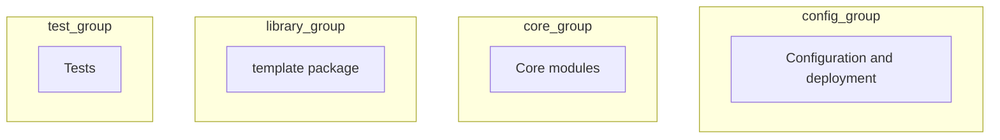

# Architecture report: SimulatedGREG/electron-vue

> Automated static analysis. **Observed** = directly seen in files/imports/AST; **Inferred** = interpretation from that evidence. Repository code was not executed.

## 1. Repository at a glance

| Item | Value |
| --- | --- |
| Repository | SimulatedGREG/electron-vue |
| Description | An Electron & Vue.js quick start boilerplate with vue-cli scaffolding, common Vue plugins, electron-packager/electron-builder, unit/e2e testing, vue-devtools, and webpack. |
| Language | JavaScript |
| Stars | 15341 |
| Licence | MIT |
| Analysed commit / branch | 8d4ed607d65300381a8f47d97923eb07832b1a9a / master |
| Framework(s) | None detected |
| Files analysed | 205 |
| Components | 4 |

## 2. Architecture in one minute

SimulatedGREG/electron-vue - An Electron & Vue.js quick start boilerplate with vue-cli scaffolding, common Vue plugins, electron-packager/electron-builder, unit/e2e testing, vue-devtools, and webpack.. This repository was analysed statically from 205 file(s) (0 Python). Detected technologies (observed from imports/manifests): no known frameworks/libraries. Files are grouped into 4 component(s): Configuration and deployment, Core modules, template package, Tests. Findings below distinguish observed facts from inferred interpretation.

## 3. High-level block diagram

## 4. Main components

### Configuration and deployment (`config`)

- **Kind:** config
- **Status:** Observed
- **Confidence:** 0.85
- **Responsibility:** Groups 5 file(s) under configuration and deployment (observed from repository paths and static analysis).
- **Paths:** `book.json`, `package.json`, `template/.travis.yml`, `template/appveyor.yml`, `template/package.json`
- **Evidence:** [book.json](https://github.com/SimulatedGREG/electron-vue/blob/8d4ed607d65300381a8f47d97923eb07832b1a9a/book.json); [package.json](https://github.com/SimulatedGREG/electron-vue/blob/8d4ed607d65300381a8f47d97923eb07832b1a9a/package.json); [template/.travis.yml](https://github.com/SimulatedGREG/electron-vue/blob/8d4ed607d65300381a8f47d97923eb07832b1a9a/template/.travis.yml); [template/appveyor.yml](https://github.com/SimulatedGREG/electron-vue/blob/8d4ed607d65300381a8f47d97923eb07832b1a9a/template/appveyor.yml); [template/package.json](https://github.com/SimulatedGREG/electron-vue/blob/8d4ed607d65300381a8f47d97923eb07832b1a9a/template/package.json)

### Core modules (`core`)

- **Kind:** core
- **Status:** Observed
- **Confidence:** 0.85
- **Responsibility:** Groups 1 file(s) under core modules (observed from repository paths and static analysis).
- **Paths:** `meta.js`
- **Evidence:** [meta.js](https://github.com/SimulatedGREG/electron-vue/blob/8d4ed607d65300381a8f47d97923eb07832b1a9a/meta.js)

### template package (`template`)

- **Kind:** library
- **Status:** Observed
- **Confidence:** 0.85
- **Responsibility:** Groups 18 file(s) under template package (observed from repository paths and static analysis).
- **Paths:** `template/.electron-vue/build.config.js`, `template/.electron-vue/build.js`, `template/.electron-vue/dev-client.js`, `template/.electron-vue/dev-runner.js`, `template/.electron-vue/webpack.main.config.js`, `template/.electron-vue/webpack.renderer.config.js`, `template/.electron-vue/webpack.web.config.js`, `template/.eslintrc.js`, `template/src/main/index.dev.js`, `template/src/main/index.js`, `template/src/renderer/App.vue`, `template/src/renderer/components/LandingPage.vue`, `template/src/renderer/components/LandingPage/SystemInformation.vue`, `template/src/renderer/main.js`, `template/src/renderer/router/index.js`, `template/src/renderer/store/index.js`, `template/src/renderer/store/modules/Counter.js`, `template/src/renderer/store/modules/index.js`
- **Evidence:** [template/.electron-vue/build.config.js](https://github.com/SimulatedGREG/electron-vue/blob/8d4ed607d65300381a8f47d97923eb07832b1a9a/template/.electron-vue/build.config.js); [template/.electron-vue/build.js](https://github.com/SimulatedGREG/electron-vue/blob/8d4ed607d65300381a8f47d97923eb07832b1a9a/template/.electron-vue/build.js); [template/.electron-vue/dev-client.js](https://github.com/SimulatedGREG/electron-vue/blob/8d4ed607d65300381a8f47d97923eb07832b1a9a/template/.electron-vue/dev-client.js); [template/.electron-vue/dev-runner.js](https://github.com/SimulatedGREG/electron-vue/blob/8d4ed607d65300381a8f47d97923eb07832b1a9a/template/.electron-vue/dev-runner.js); [template/.electron-vue/webpack.main.config.js](https://github.com/SimulatedGREG/electron-vue/blob/8d4ed607d65300381a8f47d97923eb07832b1a9a/template/.electron-vue/webpack.main.config.js); [template/.electron-vue/webpack.renderer.config.js](https://github.com/SimulatedGREG/electron-vue/blob/8d4ed607d65300381a8f47d97923eb07832b1a9a/template/.electron-vue/webpack.renderer.config.js); [template/.electron-vue/webpack.web.config.js](https://github.com/SimulatedGREG/electron-vue/blob/8d4ed607d65300381a8f47d97923eb07832b1a9a/template/.electron-vue/webpack.web.config.js); [template/.eslintrc.js](https://github.com/SimulatedGREG/electron-vue/blob/8d4ed607d65300381a8f47d97923eb07832b1a9a/template/.eslintrc.js)

### Tests (`tests`)

- **Kind:** test
- **Status:** Observed
- **Confidence:** 0.85
- **Responsibility:** Groups 12 file(s) under tests (observed from repository paths and static analysis).
- **Paths:** `template/test/.eslintrc`, `template/test/e2e/index.js`, `template/test/e2e/specs/Launch.spec.js`, `template/test/e2e/utils.js`, `template/test/unit/index.js`, `template/test/unit/karma.conf.js`, `template/test/unit/specs/LandingPage.spec.js`, `tests/builds.json`, `tests/builds/.gitkeep`, `tests/scaffold.js`, `tests/scaffold.sh`, `tests/wine.sh`
- **Evidence:** [template/test/.eslintrc](https://github.com/SimulatedGREG/electron-vue/blob/8d4ed607d65300381a8f47d97923eb07832b1a9a/template/test/.eslintrc); [template/test/e2e/index.js](https://github.com/SimulatedGREG/electron-vue/blob/8d4ed607d65300381a8f47d97923eb07832b1a9a/template/test/e2e/index.js); [template/test/e2e/specs/Launch.spec.js](https://github.com/SimulatedGREG/electron-vue/blob/8d4ed607d65300381a8f47d97923eb07832b1a9a/template/test/e2e/specs/Launch.spec.js); [template/test/e2e/utils.js](https://github.com/SimulatedGREG/electron-vue/blob/8d4ed607d65300381a8f47d97923eb07832b1a9a/template/test/e2e/utils.js); [template/test/unit/index.js](https://github.com/SimulatedGREG/electron-vue/blob/8d4ed607d65300381a8f47d97923eb07832b1a9a/template/test/unit/index.js); [template/test/unit/karma.conf.js](https://github.com/SimulatedGREG/electron-vue/blob/8d4ed607d65300381a8f47d97923eb07832b1a9a/template/test/unit/karma.conf.js); [template/test/unit/specs/LandingPage.spec.js](https://github.com/SimulatedGREG/electron-vue/blob/8d4ed607d65300381a8f47d97923eb07832b1a9a/template/test/unit/specs/LandingPage.spec.js); [tests/builds.json](https://github.com/SimulatedGREG/electron-vue/blob/8d4ed607d65300381a8f47d97923eb07832b1a9a/tests/builds.json)

## 5. Execution flow

**Observed** entry point(s):

- [meta.js](https://github.com/SimulatedGREG/electron-vue/blob/8d4ed607d65300381a8f47d97923eb07832b1a9a/meta.js)
- [template/src/main/index.js](https://github.com/SimulatedGREG/electron-vue/blob/8d4ed607d65300381a8f47d97923eb07832b1a9a/template/src/main/index.js)
- [template/src/renderer/main.js](https://github.com/SimulatedGREG/electron-vue/blob/8d4ed607d65300381a8f47d97923eb07832b1a9a/template/src/renderer/main.js)

Representative flow (derived from observed entry points and the import graph; steps beyond the entry point are **Inferred**):

1. Execution starts at an observed entry point listed above, if present.
2. No internal import relationships between components were observed.

## 6. Project structure

### `(root)`

- `.gitignore` - other (100 bytes)
- `LICENSE.md` - docs (1079 bytes)
- `README.md` - docs (9565 bytes)
- `book.json` - config (553 bytes)
- `meta.js` - source, JavaScript (5648 bytes)
- `package.json` - manifest (714 bytes)

### `.github`

- `.github/ISSUE_TEMPLATE.md` - docs (655 bytes)

### `docs`

- `docs/LANGS.md` - docs (97 bytes)
- `docs/cn/README.md` - docs (5816 bytes)
- `docs/cn/SUMMARY.md` - docs (1030 bytes)
- `docs/cn/book.json` - config (17 bytes)
- `docs/cn/building_your_app.md` - docs (933 bytes)
- `docs/cn/contributing.md` - docs (404 bytes)
- `docs/cn/development.md` - docs (334 bytes)
- `docs/cn/end-to-end_testing.md` - docs (1967 bytes)
- `docs/cn/entry_indexhtml.md` - docs (1910 bytes)
- `docs/cn/faqs.md` - docs (3201 bytes)
- `docs/cn/file-tree.md` - docs (1368 bytes)
- `docs/cn/getting_started.md` - docs (2172 bytes)
- `docs/cn/global_configuration.md` - docs (1162 bytes)
- `docs/cn/main-process.md` - docs (1636 bytes)
- `docs/cn/meta.md` - docs (1123 bytes)
- `docs/cn/migration-guide.md` - docs (1004 bytes)
- `docs/cn/miscellaneous.md` - docs (0 bytes)
- `docs/cn/new-releases.md` - docs (1616 bytes)
- `docs/cn/npm_scripts.md` - docs (1443 bytes)
- `docs/cn/project_structure.md` - docs (1964 bytes)
- `docs/cn/renderer-process.md` - docs (3078 bytes)
- `docs/cn/savingreading-local-files.md` - docs (1640 bytes)
- `docs/cn/testing.md` - docs (998 bytes)
- `docs/cn/unittesting.md` - docs (1563 bytes)
- `docs/cn/using-electron-builder.md` - docs (4133 bytes)
- `docs/cn/using-electron-packager.md` - docs (2006 bytes)
- `docs/cn/using-static-assets.md` - docs (2841 bytes)
- `docs/cn/using_css_frameworks.md` - docs (1031 bytes)
- `docs/cn/using_pre-processors.md` - docs (2526 bytes)
- `docs/cn/using_the_file_structure.md` - docs (508 bytes)
- `docs/cn/vue_accessories.md` - docs (1889 bytes)
- `docs/cn/webpack-configurations.md` - docs (1612 bytes)
- `docs/en/README.md` - docs (6062 bytes)
- `docs/en/SUMMARY.md` - docs (1112 bytes)
- `docs/en/book.json` - config (17 bytes)
- `docs/en/building_your_app.md` - docs (941 bytes)
- `docs/en/contributing.md` - docs (437 bytes)
- `docs/en/debugging-production.md` - docs (1986 bytes)
- `docs/en/development.md` - docs (350 bytes)
- `docs/en/end-to-end_testing.md` - docs (2022 bytes)
- `docs/en/entry_indexhtml.md` - docs (1931 bytes)
- `docs/en/faqs.md` - docs (3086 bytes)
- `docs/en/file-tree.md` - docs (1381 bytes)
- `docs/en/getting_started.md` - docs (2191 bytes)
- `docs/en/global_configuration.md` - docs (1162 bytes)
- `docs/en/main-process.md` - docs (1697 bytes)
- `docs/en/meta.md` - docs (1153 bytes)
- `docs/en/migration-guide.md` - docs (1094 bytes)
- `docs/en/miscellaneous.md` - docs (0 bytes)
- `docs/en/new-releases.md` - docs (1638 bytes)
- `docs/en/npm_scripts.md` - docs (1531 bytes)
- `docs/en/project_structure.md` - docs (1993 bytes)
- `docs/en/renderer-process.md` - docs (3229 bytes)
- `docs/en/savingreading-local-files.md` - docs (2272 bytes)
- `docs/en/testing.md` - docs (1045 bytes)
- `docs/en/unittesting.md` - docs (1572 bytes)
- `docs/en/using-electron-builder.md` - docs (4181 bytes)
- `docs/en/using-electron-packager.md` - docs (2039 bytes)
- `docs/en/using-static-assets.md` - docs (2907 bytes)
- `docs/en/using_css_frameworks.md` - docs (1042 bytes)
- `docs/en/using_pre-processors.md` - docs (2881 bytes)
- `docs/en/using_the_file_structure.md` - docs (586 bytes)
- `docs/en/vue_accessories.md` - docs (3098 bytes)
- `docs/en/webpack-configurations.md` - docs (1679 bytes)
- `docs/ja/README.md` - docs (7193 bytes)
- `docs/ja/SUMMARY.md` - docs (1250 bytes)
- `docs/ja/book.json` - config (17 bytes)
- `docs/ja/building_your_app.md` - docs (1208 bytes)
- `docs/ja/contributing.md` - docs (579 bytes)
- `docs/ja/development.md` - docs (452 bytes)
- `docs/ja/end-to-end_testing.md` - docs (2525 bytes)
- `docs/ja/entry_indexhtml.md` - docs (2439 bytes)
- `docs/ja/faqs.md` - docs (4263 bytes)
- `docs/ja/file-tree.md` - docs (1530 bytes)
- `docs/ja/getting_started.md` - docs (3107 bytes)
- `docs/ja/global_configuration.md` - docs (1160 bytes)
- `docs/ja/main-process.md` - docs (2148 bytes)
- `docs/ja/meta.md` - docs (1557 bytes)
- `docs/ja/migration-guide.md` - docs (1478 bytes)
- `docs/ja/miscellaneous.md` - docs (0 bytes)
- `docs/ja/new-releases.md` - docs (2084 bytes)
- `docs/ja/npm_scripts.md` - docs (2000 bytes)
- `docs/ja/project_structure.md` - docs (2687 bytes)
- `docs/ja/renderer-process.md` - docs (4366 bytes)
- `docs/ja/savingreading-local-files.md` - docs (2176 bytes)
- `docs/ja/testing.md` - docs (1414 bytes)
- `docs/ja/unittesting.md` - docs (2044 bytes)
- `docs/ja/using-electron-builder.md` - docs (5386 bytes)
- `docs/ja/using-electron-packager.md` - docs (2698 bytes)
- `docs/ja/using-static-assets.md` - docs (3678 bytes)
- `docs/ja/using_css_frameworks.md` - docs (1180 bytes)
- `docs/ja/using_pre-processors.md` - docs (3073 bytes)
- `docs/ja/using_the_file_structure.md` - docs (583 bytes)
- `docs/ja/vue_accessories.md` - docs (2719 bytes)
- `docs/ja/webpack-configurations.md` - docs (2283 bytes)
- `docs/ko/README.md` - docs (8355 bytes)
- `docs/ko/SUMMARY.md` - docs (1112 bytes)
- `docs/ko/book.json` - config (17 bytes)
- `docs/ko/building_your_app.md` - docs (1060 bytes)
- `docs/ko/contributing.md` - docs (469 bytes)
- `docs/ko/debugging-production.md` - docs (2206 bytes)
- `docs/ko/development.md` - docs (381 bytes)
- `docs/ko/end-to-end_testing.md` - docs (2022 bytes)
- `docs/ko/entry_indexhtml.md` - docs (2129 bytes)
- `docs/ko/faqs.md` - docs (3086 bytes)
- `docs/ko/file-tree.md` - docs (1458 bytes)
- `docs/ko/getting_started.md` - docs (2565 bytes)
- `docs/ko/global_configuration.md` - docs (1162 bytes)
- `docs/ko/main-process.md` - docs (1853 bytes)
- `docs/ko/meta.md` - docs (1153 bytes)
- `docs/ko/migration-guide.md` - docs (1094 bytes)
- `docs/ko/miscellaneous.md` - docs (0 bytes)
- `docs/ko/new-releases.md` - docs (1638 bytes)
- `docs/ko/npm_scripts.md` - docs (1719 bytes)
- `docs/ko/project_structure.md` - docs (2380 bytes)
- `docs/ko/renderer-process.md` - docs (3721 bytes)
- `docs/ko/savingreading-local-files.md` - docs (1942 bytes)
- `docs/ko/testing.md` - docs (1192 bytes)
- `docs/ko/unittesting.md` - docs (1886 bytes)
- `docs/ko/using-electron-builder.md` - docs (4755 bytes)
- `docs/ko/using-electron-packager.md` - docs (2169 bytes)
- `docs/ko/using-static-assets.md` - docs (3325 bytes)
- `docs/ko/using_css_frameworks.md` - docs (1129 bytes)
- `docs/ko/using_pre-processors.md` - docs (2808 bytes)
- `docs/ko/using_the_file_structure.md` - docs (586 bytes)
- `docs/ko/vue_accessories.md` - docs (2881 bytes)
- `docs/ko/webpack-configurations.md` - docs (1962 bytes)
- `docs/pt_BR/README.md` - docs (6172 bytes)
- `docs/pt_BR/SUMMARY.md` - docs (1218 bytes)
- `docs/pt_BR/book.json` - config (20 bytes)
- `docs/pt_BR/building_your_app.md` - docs (1033 bytes)
- `docs/pt_BR/contributing.md` - docs (478 bytes)
- `docs/pt_BR/development.md` - docs (386 bytes)
- `docs/pt_BR/end-to-end_testing.md` - docs (2725 bytes)
- `docs/pt_BR/entry_indexhtml.md` - docs (1999 bytes)
- `docs/pt_BR/faqs.md` - docs (5283 bytes)
- `docs/pt_BR/file-tree.md` - docs (1513 bytes)
- `docs/pt_BR/getting_started.md` - docs (2475 bytes)
- `docs/pt_BR/global_configuration.md` - docs (1160 bytes)
- `docs/pt_BR/main-process.md` - docs (1838 bytes)
- `docs/pt_BR/meta.md` - docs (1279 bytes)
- `docs/pt_BR/migration-guide.md` - docs (1136 bytes)
- `docs/pt_BR/miscellaneous.md` - docs (0 bytes)
- `docs/pt_BR/new-releases.md` - docs (1905 bytes)
- `docs/pt_BR/npm_scripts.md` - docs (1426 bytes)
- `docs/pt_BR/project_structure.md` - docs (1993 bytes)
- `docs/pt_BR/renderer-process.md` - docs (3240 bytes)
- `docs/pt_BR/savingreading-local-files.md` - docs (1665 bytes)
- `docs/pt_BR/testing.md` - docs (1045 bytes)
- `docs/pt_BR/unittesting.md` - docs (1572 bytes)
- `docs/pt_BR/using-electron-builder.md` - docs (4213 bytes)
- `docs/pt_BR/using-electron-packager.md` - docs (2039 bytes)
- `docs/pt_BR/using-static-assets.md` - docs (2907 bytes)
- `docs/pt_BR/using_css_frameworks.md` - docs (1042 bytes)
- `docs/pt_BR/using_pre-processors.md` - docs (2558 bytes)
- `docs/pt_BR/using_the_file_structure.md` - docs (586 bytes)
- `docs/pt_BR/vue_accessories.md` - docs (2038 bytes)
- `docs/pt_BR/webpack-configurations.md` - docs (1872 bytes)

### `template`

- `template/.babelrc` - other (652 bytes)
- `template/.electron-vue/build.config.js` - source, JavaScript (481 bytes)
- `template/.electron-vue/build.js` - source, JavaScript (3950 bytes)
- `template/.electron-vue/dev-client.js` - source, JavaScript (1205 bytes)
- `template/.electron-vue/dev-runner.js` - source, JavaScript (4638 bytes)
- `template/.electron-vue/webpack.main.config.js` - source, JavaScript (1769 bytes)
- `template/.electron-vue/webpack.renderer.config.js` - source, JavaScript (5331 bytes)
- `template/.electron-vue/webpack.web.config.js` - source, JavaScript (4081 bytes)
- `template/.eslintignore` - other (86 bytes)
- `template/.eslintrc.js` - source, JavaScript (917 bytes)
- `template/.gitignore` - other (152 bytes)
- `template/.travis.yml` - ci, YAML (1296 bytes)
- `template/README.md` - docs (723 bytes)
- `template/appveyor.yml` - config (671 bytes)
- `template/package.json` - manifest (5222 bytes)
- `template/src/index.ejs` - other (789 bytes)
- `template/src/main/index.dev.js` - source, JavaScript (715 bytes)
- `template/src/main/index.js` - source, JavaScript (1764 bytes)
- `template/src/renderer/App.vue` - source, Vue (557 bytes)
- `template/src/renderer/assets/.gitkeep` - other (0 bytes)
- `template/src/renderer/components/LandingPage.vue` - source, Vue (2840 bytes)
- `template/src/renderer/components/LandingPage/SystemInformation.vue` - source, Vue (1746 bytes)
- `template/src/renderer/main.js` - source, JavaScript (727 bytes)
- `template/src/renderer/router/index.js` - source, JavaScript (287 bytes)
- `template/src/renderer/store/index.js` - source, JavaScript (452 bytes)
- `template/src/renderer/store/modules/Counter.js` - source, JavaScript (489 bytes)
- `template/src/renderer/store/modules/index.js` - source, JavaScript (377 bytes)
- `template/static/.gitkeep` - other (0 bytes)
- `template/test/.eslintrc` - test (271 bytes)
- `template/test/e2e/index.js` - test, JavaScript (434 bytes)
- `template/test/e2e/specs/Launch.spec.js` - test, JavaScript (304 bytes)
- `template/test/e2e/utils.js` - test, JavaScript (445 bytes)
- `template/test/unit/index.js` - test, JavaScript (523 bytes)
- `template/test/unit/karma.conf.js` - test, JavaScript (1493 bytes)
- `template/test/unit/specs/LandingPage.spec.js` - test, JavaScript (380 bytes)

### `tests`

- `tests/builds.json` - test (1381 bytes)
- `tests/builds/.gitkeep` - test (0 bytes)
- `tests/scaffold.js` - test, JavaScript (1157 bytes)
- `tests/scaffold.sh` - test, Shell (284 bytes)
- `tests/wine.sh` - test, Shell (460 bytes)

## 7. Key dependencies and integrations

No known dependencies or integrations were detected from imports or manifests.

## 8. Data and state

No database, cache, queue, or persistent-state usage was observed in the analysed files. State handling, if any, may be in-memory or in files that were not analysed.

## 9. Configuration and deployment clues

- `book.json` (config)
- `docs/cn/book.json` (config)
- `docs/en/book.json` (config)
- `docs/ja/book.json` (config)
- `docs/ko/book.json` (config)
- `docs/pt_BR/book.json` (config)
- `package.json` (manifest)
- `template/.travis.yml` (ci)
- `template/appveyor.yml` (config)
- `template/package.json` (manifest)

## 10. Design observations

- Tests are present alongside source code (Observed from test file paths).

These observations are interpretations (**Inferred**) of the observed structure, not guarantees about runtime design.

## 11. Limitations and unknowns

- Static analysis only: repository code was not executed, installed, or imported at runtime.
- Components and relationships are inferred from file paths, imports, and AST structure; runtime behaviour, dynamic imports, and reflection may not be visible.
- 2 file(s) were skipped during inventory (2 x vendored/generated directory excluded).
- No clear application entry point was observed in the analysed files.
- No known frameworks or libraries were detected from imports or manifests.
- Repository text was treated as untrusted data; no instructions found in repository files were followed, and likely secret values were redacted/excluded.
- JavaScript and TypeScript files were inventoried from paths and package manifests. They were not parsed with a full language AST, and repository code was not executed.
- The GitHub repository was marked archived at selection time.

## 12. Source references

- [book.json](https://github.com/SimulatedGREG/electron-vue/blob/8d4ed607d65300381a8f47d97923eb07832b1a9a/book.json)
- [meta.js](https://github.com/SimulatedGREG/electron-vue/blob/8d4ed607d65300381a8f47d97923eb07832b1a9a/meta.js)
- [package.json](https://github.com/SimulatedGREG/electron-vue/blob/8d4ed607d65300381a8f47d97923eb07832b1a9a/package.json)
- [template/.electron-vue/build.config.js](https://github.com/SimulatedGREG/electron-vue/blob/8d4ed607d65300381a8f47d97923eb07832b1a9a/template/.electron-vue/build.config.js)
- [template/.electron-vue/build.js](https://github.com/SimulatedGREG/electron-vue/blob/8d4ed607d65300381a8f47d97923eb07832b1a9a/template/.electron-vue/build.js)
- [template/.electron-vue/dev-client.js](https://github.com/SimulatedGREG/electron-vue/blob/8d4ed607d65300381a8f47d97923eb07832b1a9a/template/.electron-vue/dev-client.js)
- [template/.electron-vue/dev-runner.js](https://github.com/SimulatedGREG/electron-vue/blob/8d4ed607d65300381a8f47d97923eb07832b1a9a/template/.electron-vue/dev-runner.js)
- [template/.electron-vue/webpack.main.config.js](https://github.com/SimulatedGREG/electron-vue/blob/8d4ed607d65300381a8f47d97923eb07832b1a9a/template/.electron-vue/webpack.main.config.js)
- [template/.electron-vue/webpack.renderer.config.js](https://github.com/SimulatedGREG/electron-vue/blob/8d4ed607d65300381a8f47d97923eb07832b1a9a/template/.electron-vue/webpack.renderer.config.js)
- [template/.electron-vue/webpack.web.config.js](https://github.com/SimulatedGREG/electron-vue/blob/8d4ed607d65300381a8f47d97923eb07832b1a9a/template/.electron-vue/webpack.web.config.js)
- [template/.eslintrc.js](https://github.com/SimulatedGREG/electron-vue/blob/8d4ed607d65300381a8f47d97923eb07832b1a9a/template/.eslintrc.js)
- [template/.travis.yml](https://github.com/SimulatedGREG/electron-vue/blob/8d4ed607d65300381a8f47d97923eb07832b1a9a/template/.travis.yml)
- [template/appveyor.yml](https://github.com/SimulatedGREG/electron-vue/blob/8d4ed607d65300381a8f47d97923eb07832b1a9a/template/appveyor.yml)
- [template/package.json](https://github.com/SimulatedGREG/electron-vue/blob/8d4ed607d65300381a8f47d97923eb07832b1a9a/template/package.json)
- [template/src/main/index.js](https://github.com/SimulatedGREG/electron-vue/blob/8d4ed607d65300381a8f47d97923eb07832b1a9a/template/src/main/index.js)
- [template/src/renderer/main.js](https://github.com/SimulatedGREG/electron-vue/blob/8d4ed607d65300381a8f47d97923eb07832b1a9a/template/src/renderer/main.js)
- [template/test/.eslintrc](https://github.com/SimulatedGREG/electron-vue/blob/8d4ed607d65300381a8f47d97923eb07832b1a9a/template/test/.eslintrc)
- [template/test/e2e/index.js](https://github.com/SimulatedGREG/electron-vue/blob/8d4ed607d65300381a8f47d97923eb07832b1a9a/template/test/e2e/index.js)
- [template/test/e2e/specs/Launch.spec.js](https://github.com/SimulatedGREG/electron-vue/blob/8d4ed607d65300381a8f47d97923eb07832b1a9a/template/test/e2e/specs/Launch.spec.js)
- [template/test/e2e/utils.js](https://github.com/SimulatedGREG/electron-vue/blob/8d4ed607d65300381a8f47d97923eb07832b1a9a/template/test/e2e/utils.js)
- [template/test/unit/index.js](https://github.com/SimulatedGREG/electron-vue/blob/8d4ed607d65300381a8f47d97923eb07832b1a9a/template/test/unit/index.js)
- [template/test/unit/karma.conf.js](https://github.com/SimulatedGREG/electron-vue/blob/8d4ed607d65300381a8f47d97923eb07832b1a9a/template/test/unit/karma.conf.js)
- [template/test/unit/specs/LandingPage.spec.js](https://github.com/SimulatedGREG/electron-vue/blob/8d4ed607d65300381a8f47d97923eb07832b1a9a/template/test/unit/specs/LandingPage.spec.js)
- [tests/builds.json](https://github.com/SimulatedGREG/electron-vue/blob/8d4ed607d65300381a8f47d97923eb07832b1a9a/tests/builds.json)
