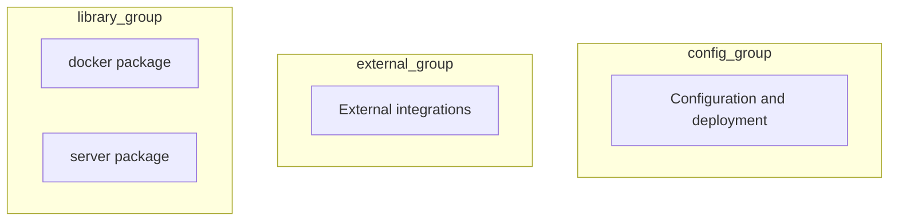

# Architecture report: SnapDrop/snapdrop

> Automated static analysis. **Observed** = directly seen in files/imports/AST; **Inferred** = interpretation from that evidence. Repository code was not executed.

## 1. Repository at a glance

| Item | Value |
| --- | --- |
| Repository | SnapDrop/snapdrop |
| Description | A Progressive Web App for local file sharing  |
| Language | JavaScript |
| Stars | 19711 |
| Licence | GPL-3.0 |
| Analysed commit / branch | b8b78cc22a672fd7c442f5a4866a8d9b0c05362e / master |
| Framework(s) | None detected |
| Files analysed | 23 |
| Components | 4 |

## 2. Architecture in one minute

SnapDrop/snapdrop - A Progressive Web App for local file sharing . This repository was analysed statically from 23 file(s) (0 Python). Detected technologies (observed from imports/manifests): Docker Compose. Files are grouped into 4 component(s): Configuration and deployment, docker package, External integrations, server package. Findings below distinguish observed facts from inferred interpretation.

## 3. High-level block diagram

## 4. Main components

### Configuration and deployment (`config`)

- **Kind:** config
- **Status:** Observed
- **Confidence:** 0.85
- **Responsibility:** Groups 3 file(s) under configuration and deployment (observed from repository paths and static analysis).
- **Paths:** `client/manifest.json`, `docker-compose.yml`, `server/package.json`
- **Evidence:** [client/manifest.json](https://github.com/SnapDrop/snapdrop/blob/b8b78cc22a672fd7c442f5a4866a8d9b0c05362e/client/manifest.json); [docker-compose.yml](https://github.com/SnapDrop/snapdrop/blob/b8b78cc22a672fd7c442f5a4866a8d9b0c05362e/docker-compose.yml); [server/package.json](https://github.com/SnapDrop/snapdrop/blob/b8b78cc22a672fd7c442f5a4866a8d9b0c05362e/server/package.json)

### docker package (`docker`)

- **Kind:** library
- **Status:** Observed
- **Confidence:** 0.85
- **Responsibility:** Groups 1 file(s) under docker package (observed from repository paths and static analysis).
- **Paths:** `docker/openssl/create.sh`
- **Evidence:** [docker/openssl/create.sh](https://github.com/SnapDrop/snapdrop/blob/b8b78cc22a672fd7c442f5a4866a8d9b0c05362e/docker/openssl/create.sh)

### External integrations (`external_integrations`)

- **Kind:** external
- **Status:** Observed
- **Confidence:** 0.85
- **Responsibility:** Groups 4 file(s) under external integrations (observed from repository paths and static analysis).
- **Paths:** `client/scripts/clipboard.js`, `client/scripts/network.js`, `client/scripts/ui.js`, `client/service-worker.js`
- **Evidence:** [client/scripts/clipboard.js](https://github.com/SnapDrop/snapdrop/blob/b8b78cc22a672fd7c442f5a4866a8d9b0c05362e/client/scripts/clipboard.js); [client/scripts/network.js](https://github.com/SnapDrop/snapdrop/blob/b8b78cc22a672fd7c442f5a4866a8d9b0c05362e/client/scripts/network.js); [client/scripts/ui.js](https://github.com/SnapDrop/snapdrop/blob/b8b78cc22a672fd7c442f5a4866a8d9b0c05362e/client/scripts/ui.js); [client/service-worker.js](https://github.com/SnapDrop/snapdrop/blob/b8b78cc22a672fd7c442f5a4866a8d9b0c05362e/client/service-worker.js)

### server package (`server`)

- **Kind:** library
- **Status:** Observed
- **Confidence:** 0.85
- **Responsibility:** Groups 1 file(s) under server package (observed from repository paths and static analysis).
- **Paths:** `server/index.js`
- **Evidence:** [server/index.js](https://github.com/SnapDrop/snapdrop/blob/b8b78cc22a672fd7c442f5a4866a8d9b0c05362e/server/index.js)

## 5. Execution flow

**Observed** entry point(s):

- [server/index.js](https://github.com/SnapDrop/snapdrop/blob/b8b78cc22a672fd7c442f5a4866a8d9b0c05362e/server/index.js)

Representative flow (derived from observed entry points and the import graph; steps beyond the entry point are **Inferred**):

1. Execution starts at an observed entry point listed above, if present.
2. No internal import relationships between components were observed.

## 6. Project structure

### `(root)`

- `.gitignore` - other (45 bytes)
- `LICENSE` - docs (35149 bytes)
- `README.md` - docs (1160 bytes)
- `docker-compose.yml` - container (681 bytes)

### `.github`

- `.github/FUNDING.yml` - config (634 bytes)

### `client`

- `client/images/safari-pinned-tab.svg` - other (15872 bytes)
- `client/index.html` - other (13466 bytes)
- `client/manifest.json` - config (1017 bytes)
- `client/scripts/clipboard.js` - source, JavaScript (1164 bytes)
- `client/scripts/network.js` - source, JavaScript (15452 bytes)
- `client/scripts/ui.js` - source, JavaScript (19810 bytes)
- `client/service-worker.js` - source, JavaScript (1290 bytes)
- `client/styles.css` - other (11447 bytes)

### `docker`

- `docker/fqdn.env` - other (14 bytes)
- `docker/nginx-with-openssl.Dockerfile` - other (49 bytes)
- `docker/nginx/default.conf` - other (1749 bytes)
- `docker/openssl/create.sh` - source, Shell (551 bytes)
- `docker/openssl/snapdropCA.cnf` - other (731 bytes)
- `docker/openssl/snapdropCert.cnf` - other (995 bytes)

### `docs`

- `docs/faq.md` - docs (4561 bytes)
- `docs/local-dev.md` - docs (2690 bytes)

### `server`

- `server/index.js` - source, JavaScript (8071 bytes)
- `server/package.json` - manifest (319 bytes)

## 7. Key dependencies and integrations

| Name | Category | Status | Confidence | Evidence |
| --- | --- | --- | --- | --- |
| Docker Compose | tooling | Observed | 0.85 | [docker-compose.yml](https://github.com/SnapDrop/snapdrop/blob/b8b78cc22a672fd7c442f5a4866a8d9b0c05362e/docker-compose.yml) |

## 8. Data and state

No database, cache, queue, or persistent-state usage was observed in the analysed files. State handling, if any, may be in-memory or in files that were not analysed.

## 9. Configuration and deployment clues

- `.github/FUNDING.yml` (config)
- `client/manifest.json` (config)
- `docker-compose.yml` (container)
- `server/package.json` (manifest)

## 10. Design observations

- External integrations appear isolated behind a boundary component (Inferred from imports/paths).

These observations are interpretations (**Inferred**) of the observed structure, not guarantees about runtime design.

## 11. Limitations and unknowns

- Static analysis only: repository code was not executed, installed, or imported at runtime.
- Components and relationships are inferred from file paths, imports, and AST structure; runtime behaviour, dynamic imports, and reflection may not be visible.
- 1 file(s) were skipped during inventory (1 x lockfile excluded).
- No clear application entry point was observed in the analysed files.
- Repository text was treated as untrusted data; no instructions found in repository files were followed, and likely secret values were redacted/excluded.
- JavaScript and TypeScript files were inventoried from paths and package manifests. They were not parsed with a full language AST, and repository code was not executed.

## 12. Source references

- [client/manifest.json](https://github.com/SnapDrop/snapdrop/blob/b8b78cc22a672fd7c442f5a4866a8d9b0c05362e/client/manifest.json)
- [client/scripts/clipboard.js](https://github.com/SnapDrop/snapdrop/blob/b8b78cc22a672fd7c442f5a4866a8d9b0c05362e/client/scripts/clipboard.js)
- [client/scripts/network.js](https://github.com/SnapDrop/snapdrop/blob/b8b78cc22a672fd7c442f5a4866a8d9b0c05362e/client/scripts/network.js)
- [client/scripts/ui.js](https://github.com/SnapDrop/snapdrop/blob/b8b78cc22a672fd7c442f5a4866a8d9b0c05362e/client/scripts/ui.js)
- [client/service-worker.js](https://github.com/SnapDrop/snapdrop/blob/b8b78cc22a672fd7c442f5a4866a8d9b0c05362e/client/service-worker.js)
- [docker-compose.yml](https://github.com/SnapDrop/snapdrop/blob/b8b78cc22a672fd7c442f5a4866a8d9b0c05362e/docker-compose.yml)
- [docker/openssl/create.sh](https://github.com/SnapDrop/snapdrop/blob/b8b78cc22a672fd7c442f5a4866a8d9b0c05362e/docker/openssl/create.sh)
- [server/index.js](https://github.com/SnapDrop/snapdrop/blob/b8b78cc22a672fd7c442f5a4866a8d9b0c05362e/server/index.js)
- [server/package.json](https://github.com/SnapDrop/snapdrop/blob/b8b78cc22a672fd7c442f5a4866a8d9b0c05362e/server/package.json)
