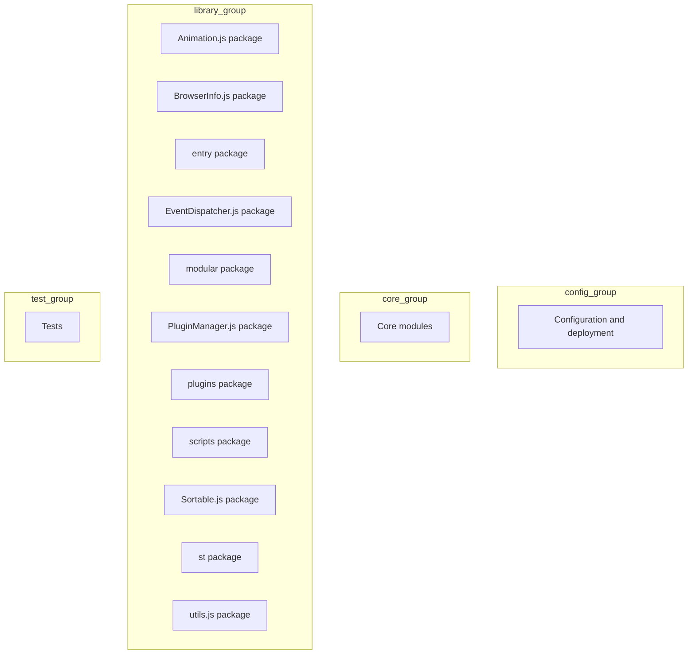

# Architecture report: SortableJS/Sortable

> Automated static analysis. **Observed** = directly seen in files/imports/AST; **Inferred** = interpretation from that evidence. Repository code was not executed.

## 1. Repository at a glance

| Item | Value |
| --- | --- |
| Repository | SortableJS/Sortable |
| Description | Reorderable drag-and-drop lists for modern browsers and touch devices. No jQuery or framework required. |
| Language | JavaScript |
| Stars | 31212 |
| Licence | MIT |
| Analysed commit / branch | 48b626bbc61afbb0f179730c1dd3cca3dcc8b788 / master |
| Framework(s) | None detected |
| Files analysed | 65 |
| Components | 14 |

## 2. Architecture in one minute

SortableJS/Sortable - Reorderable drag-and-drop lists for modern browsers and touch devices. No jQuery or framework required.. This repository was analysed statically from 65 file(s) (0 Python). Detected technologies (observed from imports/manifests): no known frameworks/libraries. Files are grouped into 14 component(s): Animation.js package, BrowserInfo.js package, Configuration and deployment, Core modules, entry package, EventDispatcher.js package, modular package, PluginManager.js package. Findings below distinguish observed facts from inferred interpretation.

## 3. High-level block diagram

## 4. Main components

### Animation.js package (`animation_js`)

- **Kind:** library
- **Status:** Observed
- **Confidence:** 0.85
- **Responsibility:** Groups 1 file(s) under animation.js package (observed from repository paths and static analysis).
- **Paths:** `src/Animation.js`
- **Evidence:** [src/Animation.js](https://github.com/SortableJS/Sortable/blob/48b626bbc61afbb0f179730c1dd3cca3dcc8b788/src/Animation.js)

### BrowserInfo.js package (`browserinfo_js`)

- **Kind:** library
- **Status:** Observed
- **Confidence:** 0.85
- **Responsibility:** Groups 1 file(s) under browserinfo.js package (observed from repository paths and static analysis).
- **Paths:** `src/BrowserInfo.js`
- **Evidence:** [src/BrowserInfo.js](https://github.com/SortableJS/Sortable/blob/48b626bbc61afbb0f179730c1dd3cca3dcc8b788/src/BrowserInfo.js)

### Configuration and deployment (`config`)

- **Kind:** config
- **Status:** Observed
- **Confidence:** 0.85
- **Responsibility:** Groups 2 file(s) under configuration and deployment (observed from repository paths and static analysis).
- **Paths:** `bower.json`, `package.json`
- **Evidence:** [bower.json](https://github.com/SortableJS/Sortable/blob/48b626bbc61afbb0f179730c1dd3cca3dcc8b788/bower.json); [package.json](https://github.com/SortableJS/Sortable/blob/48b626bbc61afbb0f179730c1dd3cca3dcc8b788/package.json)

### Core modules (`core`)

- **Kind:** core
- **Status:** Observed
- **Confidence:** 0.85
- **Responsibility:** Groups 2 file(s) under core modules (observed from repository paths and static analysis).
- **Paths:** `Sortable.js`, `babel.config.js`
- **Evidence:** [Sortable.js](https://github.com/SortableJS/Sortable/blob/48b626bbc61afbb0f179730c1dd3cca3dcc8b788/Sortable.js); [babel.config.js](https://github.com/SortableJS/Sortable/blob/48b626bbc61afbb0f179730c1dd3cca3dcc8b788/babel.config.js)

### entry package (`entry`)

- **Kind:** library
- **Status:** Observed
- **Confidence:** 0.85
- **Responsibility:** Groups 3 file(s) under entry package (observed from repository paths and static analysis).
- **Paths:** `entry/entry-complete.js`, `entry/entry-core.js`, `entry/entry-defaults.js`
- **Evidence:** [entry/entry-complete.js](https://github.com/SortableJS/Sortable/blob/48b626bbc61afbb0f179730c1dd3cca3dcc8b788/entry/entry-complete.js); [entry/entry-core.js](https://github.com/SortableJS/Sortable/blob/48b626bbc61afbb0f179730c1dd3cca3dcc8b788/entry/entry-core.js); [entry/entry-defaults.js](https://github.com/SortableJS/Sortable/blob/48b626bbc61afbb0f179730c1dd3cca3dcc8b788/entry/entry-defaults.js)

### EventDispatcher.js package (`eventdispatcher_js`)

- **Kind:** library
- **Status:** Observed
- **Confidence:** 0.85
- **Responsibility:** Groups 1 file(s) under eventdispatcher.js package (observed from repository paths and static analysis).
- **Paths:** `src/EventDispatcher.js`
- **Evidence:** [src/EventDispatcher.js](https://github.com/SortableJS/Sortable/blob/48b626bbc61afbb0f179730c1dd3cca3dcc8b788/src/EventDispatcher.js)

### modular package (`modular`)

- **Kind:** library
- **Status:** Observed
- **Confidence:** 0.85
- **Responsibility:** Groups 3 file(s) under modular package (observed from repository paths and static analysis).
- **Paths:** `modular/sortable.complete.esm.js`, `modular/sortable.core.esm.js`, `modular/sortable.esm.js`
- **Evidence:** [modular/sortable.complete.esm.js](https://github.com/SortableJS/Sortable/blob/48b626bbc61afbb0f179730c1dd3cca3dcc8b788/modular/sortable.complete.esm.js); [modular/sortable.core.esm.js](https://github.com/SortableJS/Sortable/blob/48b626bbc61afbb0f179730c1dd3cca3dcc8b788/modular/sortable.core.esm.js); [modular/sortable.esm.js](https://github.com/SortableJS/Sortable/blob/48b626bbc61afbb0f179730c1dd3cca3dcc8b788/modular/sortable.esm.js)

### PluginManager.js package (`pluginmanager_js`)

- **Kind:** library
- **Status:** Observed
- **Confidence:** 0.85
- **Responsibility:** Groups 1 file(s) under pluginmanager.js package (observed from repository paths and static analysis).
- **Paths:** `src/PluginManager.js`
- **Evidence:** [src/PluginManager.js](https://github.com/SortableJS/Sortable/blob/48b626bbc61afbb0f179730c1dd3cca3dcc8b788/src/PluginManager.js)

### plugins package (`plugins`)

- **Kind:** library
- **Status:** Observed
- **Confidence:** 0.85
- **Responsibility:** Groups 8 file(s) under plugins package (observed from repository paths and static analysis).
- **Paths:** `plugins/AutoScroll/AutoScroll.js`, `plugins/AutoScroll/index.js`, `plugins/MultiDrag/MultiDrag.js`, `plugins/MultiDrag/index.js`, `plugins/OnSpill/OnSpill.js`, `plugins/OnSpill/index.js`, `plugins/Swap/Swap.js`, `plugins/Swap/index.js`
- **Evidence:** [plugins/AutoScroll/AutoScroll.js](https://github.com/SortableJS/Sortable/blob/48b626bbc61afbb0f179730c1dd3cca3dcc8b788/plugins/AutoScroll/AutoScroll.js); [plugins/AutoScroll/index.js](https://github.com/SortableJS/Sortable/blob/48b626bbc61afbb0f179730c1dd3cca3dcc8b788/plugins/AutoScroll/index.js); [plugins/MultiDrag/MultiDrag.js](https://github.com/SortableJS/Sortable/blob/48b626bbc61afbb0f179730c1dd3cca3dcc8b788/plugins/MultiDrag/MultiDrag.js); [plugins/MultiDrag/index.js](https://github.com/SortableJS/Sortable/blob/48b626bbc61afbb0f179730c1dd3cca3dcc8b788/plugins/MultiDrag/index.js); [plugins/OnSpill/OnSpill.js](https://github.com/SortableJS/Sortable/blob/48b626bbc61afbb0f179730c1dd3cca3dcc8b788/plugins/OnSpill/OnSpill.js); [plugins/OnSpill/index.js](https://github.com/SortableJS/Sortable/blob/48b626bbc61afbb0f179730c1dd3cca3dcc8b788/plugins/OnSpill/index.js); [plugins/Swap/Swap.js](https://github.com/SortableJS/Sortable/blob/48b626bbc61afbb0f179730c1dd3cca3dcc8b788/plugins/Swap/Swap.js); [plugins/Swap/index.js](https://github.com/SortableJS/Sortable/blob/48b626bbc61afbb0f179730c1dd3cca3dcc8b788/plugins/Swap/index.js)

### scripts package (`scripts`)

- **Kind:** library
- **Status:** Observed
- **Confidence:** 0.85
- **Responsibility:** Groups 7 file(s) under scripts package (observed from repository paths and static analysis).
- **Paths:** `scripts/banner.js`, `scripts/build.js`, `scripts/esm-build.js`, `scripts/minify.js`, `scripts/test-compat.js`, `scripts/test.js`, `scripts/umd-build.js`
- **Evidence:** [scripts/banner.js](https://github.com/SortableJS/Sortable/blob/48b626bbc61afbb0f179730c1dd3cca3dcc8b788/scripts/banner.js); [scripts/build.js](https://github.com/SortableJS/Sortable/blob/48b626bbc61afbb0f179730c1dd3cca3dcc8b788/scripts/build.js); [scripts/esm-build.js](https://github.com/SortableJS/Sortable/blob/48b626bbc61afbb0f179730c1dd3cca3dcc8b788/scripts/esm-build.js); [scripts/minify.js](https://github.com/SortableJS/Sortable/blob/48b626bbc61afbb0f179730c1dd3cca3dcc8b788/scripts/minify.js); [scripts/test-compat.js](https://github.com/SortableJS/Sortable/blob/48b626bbc61afbb0f179730c1dd3cca3dcc8b788/scripts/test-compat.js); [scripts/test.js](https://github.com/SortableJS/Sortable/blob/48b626bbc61afbb0f179730c1dd3cca3dcc8b788/scripts/test.js); [scripts/umd-build.js](https://github.com/SortableJS/Sortable/blob/48b626bbc61afbb0f179730c1dd3cca3dcc8b788/scripts/umd-build.js)

### Sortable.js package (`sortable_js`)

- **Kind:** library
- **Status:** Observed
- **Confidence:** 0.85
- **Responsibility:** Groups 1 file(s) under sortable.js package (observed from repository paths and static analysis).
- **Paths:** `src/Sortable.js`
- **Evidence:** [src/Sortable.js](https://github.com/SortableJS/Sortable/blob/48b626bbc61afbb0f179730c1dd3cca3dcc8b788/src/Sortable.js)

### st package (`st`)

- **Kind:** library
- **Status:** Observed
- **Confidence:** 0.85
- **Responsibility:** Groups 3 file(s) under st package (observed from repository paths and static analysis).
- **Paths:** `st/app.js`, `st/prettify/prettify.js`, `st/prettify/run_prettify.js`
- **Evidence:** [st/app.js](https://github.com/SortableJS/Sortable/blob/48b626bbc61afbb0f179730c1dd3cca3dcc8b788/st/app.js); [st/prettify/prettify.js](https://github.com/SortableJS/Sortable/blob/48b626bbc61afbb0f179730c1dd3cca3dcc8b788/st/prettify/prettify.js); [st/prettify/run_prettify.js](https://github.com/SortableJS/Sortable/blob/48b626bbc61afbb0f179730c1dd3cca3dcc8b788/st/prettify/run_prettify.js)

### Tests (`tests`)

- **Kind:** test
- **Status:** Observed
- **Confidence:** 0.85
- **Responsibility:** Groups 9 file(s) under tests (observed from repository paths and static analysis).
- **Paths:** `tests/Sortable.compat.test.js`, `tests/Sortable.test.js`, `tests/dual-list.html`, `tests/empty-list.html`, `tests/filter.html`, `tests/handles.html`, `tests/nested.html`, `tests/single-list.html`, `tests/style.css`
- **Evidence:** [tests/Sortable.compat.test.js](https://github.com/SortableJS/Sortable/blob/48b626bbc61afbb0f179730c1dd3cca3dcc8b788/tests/Sortable.compat.test.js); [tests/Sortable.test.js](https://github.com/SortableJS/Sortable/blob/48b626bbc61afbb0f179730c1dd3cca3dcc8b788/tests/Sortable.test.js); [tests/dual-list.html](https://github.com/SortableJS/Sortable/blob/48b626bbc61afbb0f179730c1dd3cca3dcc8b788/tests/dual-list.html); [tests/empty-list.html](https://github.com/SortableJS/Sortable/blob/48b626bbc61afbb0f179730c1dd3cca3dcc8b788/tests/empty-list.html); [tests/filter.html](https://github.com/SortableJS/Sortable/blob/48b626bbc61afbb0f179730c1dd3cca3dcc8b788/tests/filter.html); [tests/handles.html](https://github.com/SortableJS/Sortable/blob/48b626bbc61afbb0f179730c1dd3cca3dcc8b788/tests/handles.html); [tests/nested.html](https://github.com/SortableJS/Sortable/blob/48b626bbc61afbb0f179730c1dd3cca3dcc8b788/tests/nested.html); [tests/single-list.html](https://github.com/SortableJS/Sortable/blob/48b626bbc61afbb0f179730c1dd3cca3dcc8b788/tests/single-list.html)

### utils.js package (`utils_js`)

- **Kind:** library
- **Status:** Observed
- **Confidence:** 0.85
- **Responsibility:** Groups 1 file(s) under utils.js package (observed from repository paths and static analysis).
- **Paths:** `src/utils.js`
- **Evidence:** [src/utils.js](https://github.com/SortableJS/Sortable/blob/48b626bbc61afbb0f179730c1dd3cca3dcc8b788/src/utils.js)

## 5. Execution flow

**Observed** entry point(s):

- [plugins/AutoScroll/index.js](https://github.com/SortableJS/Sortable/blob/48b626bbc61afbb0f179730c1dd3cca3dcc8b788/plugins/AutoScroll/index.js)
- [plugins/MultiDrag/index.js](https://github.com/SortableJS/Sortable/blob/48b626bbc61afbb0f179730c1dd3cca3dcc8b788/plugins/MultiDrag/index.js)
- [plugins/OnSpill/index.js](https://github.com/SortableJS/Sortable/blob/48b626bbc61afbb0f179730c1dd3cca3dcc8b788/plugins/OnSpill/index.js)
- [plugins/Swap/index.js](https://github.com/SortableJS/Sortable/blob/48b626bbc61afbb0f179730c1dd3cca3dcc8b788/plugins/Swap/index.js)
- [st/app.js](https://github.com/SortableJS/Sortable/blob/48b626bbc61afbb0f179730c1dd3cca3dcc8b788/st/app.js)

Representative flow (derived from observed entry points and the import graph; steps beyond the entry point are **Inferred**):

1. Execution starts at an observed entry point listed above, if present.
2. No internal import relationships between components were observed.

## 6. Project structure

### `(root)`

- `.editorconfig` - config (219 bytes)
- `.gitignore` - other (56 bytes)
- `.jshintrc` - other (398 bytes)
- `.testcaferc.json` - config (96 bytes)
- `CONTRIBUTING.md` - docs (978 bytes)
- `LICENSE` - docs (1085 bytes)
- `README.md` - docs (27298 bytes)
- `Sortable.js` - source, JavaScript (126176 bytes)
- `babel.config.js` - source, JavaScript (377 bytes)
- `bower.json` - config (684 bytes)
- `index.html` - other (18484 bytes)
- `package.json` - manifest (1708 bytes)

### `.circleci`

- `.circleci/config.yml` - ci, YAML (691 bytes)

### `.github`

- `.github/ISSUE_TEMPLATE/bug-report.md` - docs (1943 bytes)
- `.github/ISSUE_TEMPLATE/custom-template.md` - docs (1417 bytes)
- `.github/ISSUE_TEMPLATE/feature-request.md` - docs (1357 bytes)

### `entry`

- `entry/entry-complete.js` - source, JavaScript (214 bytes)
- `entry/entry-core.js` - source, JavaScript (330 bytes)
- `entry/entry-defaults.js` - source, JavaScript (409 bytes)

### `modular`

- `modular/sortable.complete.esm.js` - source, JavaScript (119406 bytes)
- `modular/sortable.core.esm.js` - source, JavaScript (119403 bytes)
- `modular/sortable.esm.js` - source, JavaScript (119403 bytes)

### `plugins`

- `plugins/AutoScroll/AutoScroll.js` - source, JavaScript (7831 bytes)
- `plugins/AutoScroll/README.md` - docs (3822 bytes)
- `plugins/AutoScroll/index.js` - source, JavaScript (43 bytes)
- `plugins/MultiDrag/MultiDrag.js` - source, JavaScript (17977 bytes)
- `plugins/MultiDrag/README.md` - docs (2595 bytes)
- `plugins/MultiDrag/index.js` - source, JavaScript (42 bytes)
- `plugins/OnSpill/OnSpill.js` - source, JavaScript (1757 bytes)
- `plugins/OnSpill/README.md` - docs (1235 bytes)
- `plugins/OnSpill/index.js` - source, JavaScript (70 bytes)
- `plugins/README.md` - docs (14609 bytes)
- `plugins/Swap/README.md` - docs (1087 bytes)
- `plugins/Swap/Swap.js` - source, JavaScript (1958 bytes)
- `plugins/Swap/index.js` - source, JavaScript (37 bytes)

### `scripts`

- `scripts/banner.js` - source, JavaScript (193 bytes)
- `scripts/build.js` - source, JavaScript (281 bytes)
- `scripts/esm-build.js` - source, JavaScript (591 bytes)
- `scripts/minify.js` - source, JavaScript (337 bytes)
- `scripts/test-compat.js` - source, JavaScript (920 bytes)
- `scripts/test.js` - source, JavaScript (463 bytes)
- `scripts/umd-build.js` - source, JavaScript (282 bytes)

### `src`

- `src/Animation.js` - source, JavaScript (4972 bytes)
- `src/BrowserInfo.js` - source, JavaScript (557 bytes)
- `src/EventDispatcher.js` - source, JavaScript (1474 bytes)
- `src/PluginManager.js` - source, JavaScript (2781 bytes)
- `src/Sortable.js` - source, JavaScript (51500 bytes)
- `src/utils.js` - source, JavaScript (14632 bytes)

### `st`

- `st/app.js` - source, JavaScript (6278 bytes)
- `st/iframe/frame.html` - other (800 bytes)
- `st/iframe/index.html` - other (1171 bytes)
- `st/prettify/prettify.css` - other (655 bytes)
- `st/prettify/prettify.js` - source, JavaScript (15655 bytes)
- `st/prettify/run_prettify.js` - source, JavaScript (18428 bytes)
- `st/saucelabs.svg` - other (5374 bytes)
- `st/theme.css` - other (4893 bytes)

### `tests`

- `tests/Sortable.compat.test.js` - test, JavaScript (1326 bytes)
- `tests/Sortable.test.js` - test, JavaScript (14111 bytes)
- `tests/dual-list.html` - test (643 bytes)
- `tests/empty-list.html` - test (555 bytes)
- `tests/filter.html` - test (459 bytes)
- `tests/handles.html` - test (590 bytes)
- `tests/nested.html` - test (1086 bytes)
- `tests/single-list.html` - test (415 bytes)
- `tests/style.css` - test (257 bytes)

## 7. Key dependencies and integrations

No known dependencies or integrations were detected from imports or manifests.

## 8. Data and state

No database, cache, queue, or persistent-state usage was observed in the analysed files. State handling, if any, may be in-memory or in files that were not analysed.

## 9. Configuration and deployment clues

- `.circleci/config.yml` (ci)
- `.editorconfig` (config)
- `.testcaferc.json` (config)
- `bower.json` (config)
- `package.json` (manifest)

## 10. Design observations

- Tests are present alongside source code (Observed from test file paths).

These observations are interpretations (**Inferred**) of the observed structure, not guarantees about runtime design.

## 11. Limitations and unknowns

- Static analysis only: repository code was not executed, installed, or imported at runtime.
- Components and relationships are inferred from file paths, imports, and AST structure; runtime behaviour, dynamic imports, and reflection may not be visible.
- No clear application entry point was observed in the analysed files.
- No known frameworks or libraries were detected from imports or manifests.
- Repository text was treated as untrusted data; no instructions found in repository files were followed, and likely secret values were redacted/excluded.
- JavaScript and TypeScript files were inventoried from paths and package manifests. They were not parsed with a full language AST, and repository code was not executed.

## 12. Source references

- [Sortable.js](https://github.com/SortableJS/Sortable/blob/48b626bbc61afbb0f179730c1dd3cca3dcc8b788/Sortable.js)
- [babel.config.js](https://github.com/SortableJS/Sortable/blob/48b626bbc61afbb0f179730c1dd3cca3dcc8b788/babel.config.js)
- [bower.json](https://github.com/SortableJS/Sortable/blob/48b626bbc61afbb0f179730c1dd3cca3dcc8b788/bower.json)
- [entry/entry-complete.js](https://github.com/SortableJS/Sortable/blob/48b626bbc61afbb0f179730c1dd3cca3dcc8b788/entry/entry-complete.js)
- [entry/entry-core.js](https://github.com/SortableJS/Sortable/blob/48b626bbc61afbb0f179730c1dd3cca3dcc8b788/entry/entry-core.js)
- [entry/entry-defaults.js](https://github.com/SortableJS/Sortable/blob/48b626bbc61afbb0f179730c1dd3cca3dcc8b788/entry/entry-defaults.js)
- [modular/sortable.complete.esm.js](https://github.com/SortableJS/Sortable/blob/48b626bbc61afbb0f179730c1dd3cca3dcc8b788/modular/sortable.complete.esm.js)
- [modular/sortable.core.esm.js](https://github.com/SortableJS/Sortable/blob/48b626bbc61afbb0f179730c1dd3cca3dcc8b788/modular/sortable.core.esm.js)
- [modular/sortable.esm.js](https://github.com/SortableJS/Sortable/blob/48b626bbc61afbb0f179730c1dd3cca3dcc8b788/modular/sortable.esm.js)
- [package.json](https://github.com/SortableJS/Sortable/blob/48b626bbc61afbb0f179730c1dd3cca3dcc8b788/package.json)
- [plugins/AutoScroll/AutoScroll.js](https://github.com/SortableJS/Sortable/blob/48b626bbc61afbb0f179730c1dd3cca3dcc8b788/plugins/AutoScroll/AutoScroll.js)
- [plugins/AutoScroll/index.js](https://github.com/SortableJS/Sortable/blob/48b626bbc61afbb0f179730c1dd3cca3dcc8b788/plugins/AutoScroll/index.js)
- [plugins/MultiDrag/MultiDrag.js](https://github.com/SortableJS/Sortable/blob/48b626bbc61afbb0f179730c1dd3cca3dcc8b788/plugins/MultiDrag/MultiDrag.js)
- [plugins/MultiDrag/index.js](https://github.com/SortableJS/Sortable/blob/48b626bbc61afbb0f179730c1dd3cca3dcc8b788/plugins/MultiDrag/index.js)
- [plugins/OnSpill/OnSpill.js](https://github.com/SortableJS/Sortable/blob/48b626bbc61afbb0f179730c1dd3cca3dcc8b788/plugins/OnSpill/OnSpill.js)
- [plugins/OnSpill/index.js](https://github.com/SortableJS/Sortable/blob/48b626bbc61afbb0f179730c1dd3cca3dcc8b788/plugins/OnSpill/index.js)
- [plugins/Swap/Swap.js](https://github.com/SortableJS/Sortable/blob/48b626bbc61afbb0f179730c1dd3cca3dcc8b788/plugins/Swap/Swap.js)
- [plugins/Swap/index.js](https://github.com/SortableJS/Sortable/blob/48b626bbc61afbb0f179730c1dd3cca3dcc8b788/plugins/Swap/index.js)
- [scripts/banner.js](https://github.com/SortableJS/Sortable/blob/48b626bbc61afbb0f179730c1dd3cca3dcc8b788/scripts/banner.js)
- [scripts/build.js](https://github.com/SortableJS/Sortable/blob/48b626bbc61afbb0f179730c1dd3cca3dcc8b788/scripts/build.js)
- [scripts/esm-build.js](https://github.com/SortableJS/Sortable/blob/48b626bbc61afbb0f179730c1dd3cca3dcc8b788/scripts/esm-build.js)
- [scripts/minify.js](https://github.com/SortableJS/Sortable/blob/48b626bbc61afbb0f179730c1dd3cca3dcc8b788/scripts/minify.js)
- [scripts/test-compat.js](https://github.com/SortableJS/Sortable/blob/48b626bbc61afbb0f179730c1dd3cca3dcc8b788/scripts/test-compat.js)
- [scripts/test.js](https://github.com/SortableJS/Sortable/blob/48b626bbc61afbb0f179730c1dd3cca3dcc8b788/scripts/test.js)
- [scripts/umd-build.js](https://github.com/SortableJS/Sortable/blob/48b626bbc61afbb0f179730c1dd3cca3dcc8b788/scripts/umd-build.js)
- [src/Animation.js](https://github.com/SortableJS/Sortable/blob/48b626bbc61afbb0f179730c1dd3cca3dcc8b788/src/Animation.js)
- [src/BrowserInfo.js](https://github.com/SortableJS/Sortable/blob/48b626bbc61afbb0f179730c1dd3cca3dcc8b788/src/BrowserInfo.js)
- [src/EventDispatcher.js](https://github.com/SortableJS/Sortable/blob/48b626bbc61afbb0f179730c1dd3cca3dcc8b788/src/EventDispatcher.js)
- [src/PluginManager.js](https://github.com/SortableJS/Sortable/blob/48b626bbc61afbb0f179730c1dd3cca3dcc8b788/src/PluginManager.js)
- [src/Sortable.js](https://github.com/SortableJS/Sortable/blob/48b626bbc61afbb0f179730c1dd3cca3dcc8b788/src/Sortable.js)
- [src/utils.js](https://github.com/SortableJS/Sortable/blob/48b626bbc61afbb0f179730c1dd3cca3dcc8b788/src/utils.js)
- [st/app.js](https://github.com/SortableJS/Sortable/blob/48b626bbc61afbb0f179730c1dd3cca3dcc8b788/st/app.js)
- [st/prettify/prettify.js](https://github.com/SortableJS/Sortable/blob/48b626bbc61afbb0f179730c1dd3cca3dcc8b788/st/prettify/prettify.js)
- [st/prettify/run_prettify.js](https://github.com/SortableJS/Sortable/blob/48b626bbc61afbb0f179730c1dd3cca3dcc8b788/st/prettify/run_prettify.js)
- [tests/Sortable.compat.test.js](https://github.com/SortableJS/Sortable/blob/48b626bbc61afbb0f179730c1dd3cca3dcc8b788/tests/Sortable.compat.test.js)
- [tests/Sortable.test.js](https://github.com/SortableJS/Sortable/blob/48b626bbc61afbb0f179730c1dd3cca3dcc8b788/tests/Sortable.test.js)
- [tests/dual-list.html](https://github.com/SortableJS/Sortable/blob/48b626bbc61afbb0f179730c1dd3cca3dcc8b788/tests/dual-list.html)
- [tests/empty-list.html](https://github.com/SortableJS/Sortable/blob/48b626bbc61afbb0f179730c1dd3cca3dcc8b788/tests/empty-list.html)
- [tests/filter.html](https://github.com/SortableJS/Sortable/blob/48b626bbc61afbb0f179730c1dd3cca3dcc8b788/tests/filter.html)
- [tests/handles.html](https://github.com/SortableJS/Sortable/blob/48b626bbc61afbb0f179730c1dd3cca3dcc8b788/tests/handles.html)
- [tests/nested.html](https://github.com/SortableJS/Sortable/blob/48b626bbc61afbb0f179730c1dd3cca3dcc8b788/tests/nested.html)
- [tests/single-list.html](https://github.com/SortableJS/Sortable/blob/48b626bbc61afbb0f179730c1dd3cca3dcc8b788/tests/single-list.html)
