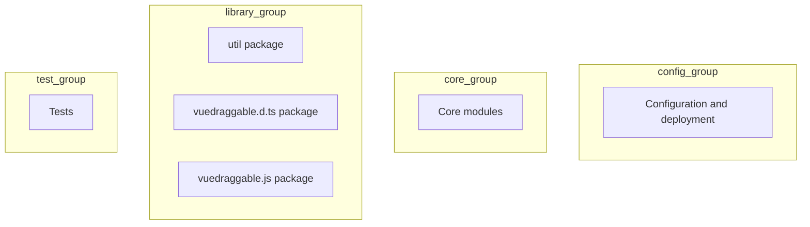

# Architecture report: SortableJS/Vue.Draggable

> Automated static analysis. **Observed** = directly seen in files/imports/AST; **Inferred** = interpretation from that evidence. Repository code was not executed.

## 1. Repository at a glance

| Item | Value |
| --- | --- |
| Repository | SortableJS/Vue.Draggable |
| Description | Vue drag-and-drop component based on Sortable.js |
| Language | JavaScript |
| Stars | 20538 |
| Licence | MIT |
| Analysed commit / branch | 431db153bfdfe09e31f622f01e9b3220b77e6b56 / master |
| Framework(s) | Vue |
| Files analysed | 63 |
| Components | 6 |

## 2. Architecture in one minute

SortableJS/Vue.Draggable - Vue drag-and-drop component based on Sortable.js. This repository was analysed statically from 63 file(s) (0 Python). Detected technologies (observed from imports/manifests): Vue. Files are grouped into 6 component(s): Configuration and deployment, Core modules, Tests, util package, vuedraggable.d.ts package, vuedraggable.js package. Findings below distinguish observed facts from inferred interpretation.

## 3. High-level block diagram

## 4. Main components

### Configuration and deployment (`config`)

- **Kind:** config
- **Status:** Observed
- **Confidence:** 0.85
- **Responsibility:** Groups 1 file(s) under configuration and deployment (observed from repository paths and static analysis).
- **Paths:** `package.json`
- **Evidence:** [package.json](https://github.com/SortableJS/Vue.Draggable/blob/431db153bfdfe09e31f622f01e9b3220b77e6b56/package.json)

### Core modules (`core`)

- **Kind:** core
- **Status:** Observed
- **Confidence:** 0.85
- **Responsibility:** Groups 3 file(s) under core modules (observed from repository paths and static analysis).
- **Paths:** `babel.config.js`, `jest.config.js`, `vue.config.js`
- **Evidence:** [babel.config.js](https://github.com/SortableJS/Vue.Draggable/blob/431db153bfdfe09e31f622f01e9b3220b77e6b56/babel.config.js); [jest.config.js](https://github.com/SortableJS/Vue.Draggable/blob/431db153bfdfe09e31f622f01e9b3220b77e6b56/jest.config.js); [vue.config.js](https://github.com/SortableJS/Vue.Draggable/blob/431db153bfdfe09e31f622f01e9b3220b77e6b56/vue.config.js)

### Tests (`tests`)

- **Kind:** test
- **Status:** Observed
- **Confidence:** 0.85
- **Responsibility:** Groups 12 file(s) under tests (observed from repository paths and static analysis).
- **Paths:** `tests/unit/.eslintrc.js`, `tests/unit/helper/DraggableWithList.vue`, `tests/unit/helper/DraggableWithModel.vue`, `tests/unit/helper/DraggableWithTransition.vue`, `tests/unit/helper/FakeComponent.js`, `tests/unit/helper/FakeFunctionalComponent.js`, `tests/unit/util/helper.node.spec.js`, `tests/unit/util/helper.spec.js`, `tests/unit/vuedraggable.integrated.spec.js`, `tests/unit/vuedraggable.script.tag.spec.js`, `tests/unit/vuedraggable.spec.js`, `tests/unit/vuedraggable.ssr.spec.js`
- **Evidence:** [tests/unit/.eslintrc.js](https://github.com/SortableJS/Vue.Draggable/blob/431db153bfdfe09e31f622f01e9b3220b77e6b56/tests/unit/.eslintrc.js); [tests/unit/helper/DraggableWithList.vue](https://github.com/SortableJS/Vue.Draggable/blob/431db153bfdfe09e31f622f01e9b3220b77e6b56/tests/unit/helper/DraggableWithList.vue); [tests/unit/helper/DraggableWithModel.vue](https://github.com/SortableJS/Vue.Draggable/blob/431db153bfdfe09e31f622f01e9b3220b77e6b56/tests/unit/helper/DraggableWithModel.vue); [tests/unit/helper/DraggableWithTransition.vue](https://github.com/SortableJS/Vue.Draggable/blob/431db153bfdfe09e31f622f01e9b3220b77e6b56/tests/unit/helper/DraggableWithTransition.vue); [tests/unit/helper/FakeComponent.js](https://github.com/SortableJS/Vue.Draggable/blob/431db153bfdfe09e31f622f01e9b3220b77e6b56/tests/unit/helper/FakeComponent.js); [tests/unit/helper/FakeFunctionalComponent.js](https://github.com/SortableJS/Vue.Draggable/blob/431db153bfdfe09e31f622f01e9b3220b77e6b56/tests/unit/helper/FakeFunctionalComponent.js); [tests/unit/util/helper.node.spec.js](https://github.com/SortableJS/Vue.Draggable/blob/431db153bfdfe09e31f622f01e9b3220b77e6b56/tests/unit/util/helper.node.spec.js); [tests/unit/util/helper.spec.js](https://github.com/SortableJS/Vue.Draggable/blob/431db153bfdfe09e31f622f01e9b3220b77e6b56/tests/unit/util/helper.spec.js)

### util package (`util`)

- **Kind:** library
- **Status:** Observed
- **Confidence:** 0.85
- **Responsibility:** Groups 1 file(s) under util package (observed from repository paths and static analysis).
- **Paths:** `src/util/helper.js`
- **Evidence:** [src/util/helper.js](https://github.com/SortableJS/Vue.Draggable/blob/431db153bfdfe09e31f622f01e9b3220b77e6b56/src/util/helper.js)

### vuedraggable.d.ts package (`vuedraggable_d_ts`)

- **Kind:** library
- **Status:** Observed
- **Confidence:** 0.85
- **Responsibility:** Groups 1 file(s) under vuedraggable.d.ts package (observed from repository paths and static analysis).
- **Paths:** `src/vuedraggable.d.ts`
- **Evidence:** [src/vuedraggable.d.ts](https://github.com/SortableJS/Vue.Draggable/blob/431db153bfdfe09e31f622f01e9b3220b77e6b56/src/vuedraggable.d.ts)

### vuedraggable.js package (`vuedraggable_js`)

- **Kind:** library
- **Status:** Observed
- **Confidence:** 0.85
- **Responsibility:** Groups 1 file(s) under vuedraggable.js package (observed from repository paths and static analysis).
- **Paths:** `src/vuedraggable.js`
- **Evidence:** [src/vuedraggable.js](https://github.com/SortableJS/Vue.Draggable/blob/431db153bfdfe09e31f622f01e9b3220b77e6b56/src/vuedraggable.js)

## 5. Execution flow

No entry point was observed; the startup flow below is therefore limited.

Representative flow (derived from observed entry points and the import graph; steps beyond the entry point are **Inferred**):

1. Execution starts at an observed entry point listed above, if present.
2. No internal import relationships between components were observed.

## 6. Project structure

### `(root)`

- `.codebeatignore` - other (7 bytes)
- `.gitignore` - other (162 bytes)
- `CONTRIBUTING.md` - docs (1723 bytes)
- `LICENSE` - docs (1088 bytes)
- `README.md` - docs (13451 bytes)
- `babel.config.js` - source, JavaScript (83 bytes)
- `jest.config.js` - source, JavaScript (737 bytes)
- `logo.svg` - other (3166 bytes)
- `package.json` - manifest (2397 bytes)
- `vue.config.js` - source, JavaScript (369 bytes)

### `.circleci`

- `.circleci/config.yml` - ci, YAML (995 bytes)

### `.github`

- `.github/issue_template.md` - docs (174 bytes)

### `.vscode`

- `.vscode/launch.json` - config (1418 bytes)

### `docs`

- `docs/img/logo.c6a3753c.svg` - docs (3166 bytes)
- `docs/index.html` - docs (645 bytes)

### `documentation`

- `documentation/Vue.draggable.for.ReadME.md` - docs (1489 bytes)
- `documentation/legacy.options.md` - docs (617 bytes)
- `documentation/migrate.md` - docs (1109 bytes)

### `example`

- `example/App.vue` - source, Vue (7383 bytes)
- `example/assets/logo.svg` - other (3166 bytes)
- `example/components/clone-on-control.vue` - source, Vue (1704 bytes)
- `example/components/clone.vue` - source, Vue (1560 bytes)
- `example/components/custom-clone.vue` - source, Vue (1640 bytes)
- `example/components/footerslot.vue` - source, Vue (1758 bytes)
- `example/components/functional.vue` - source, Vue (1868 bytes)
- `example/components/handle.vue` - source, Vue (1771 bytes)
- `example/components/headerslot.vue` - source, Vue (1436 bytes)
- `example/components/infra/nested.vue` - source, Vue (540 bytes)
- `example/components/infra/raw-displayer.vue` - source, Vue (424 bytes)
- `example/components/nested-example.vue` - source, Vue (876 bytes)
- `example/components/nested-with-vmodel.vue` - source, Vue (703 bytes)
- `example/components/nested/nested-store.js` - source, JavaScript (806 bytes)
- `example/components/nested/nested-test.vue` - source, Vue (1278 bytes)
- `example/components/simple.vue` - source, Vue (2123 bytes)
- `example/components/table-column-example.vue` - source, Vue (1295 bytes)
- `example/components/table-example.vue` - source, Vue (1207 bytes)
- `example/components/third-party.vue` - source, Vue (2958 bytes)
- `example/components/transition-example-2.vue` - source, Vue (2090 bytes)
- `example/components/transition-example.vue` - source, Vue (2059 bytes)
- `example/components/two-list-headerslots.vue` - source, Vue (2414 bytes)
- `example/components/two-lists.vue` - source, Vue (1684 bytes)
- `example/debug-components/future-index.vue` - source, Vue (1572 bytes)
- `example/debug-components/nested/draggable-list.vue` - source, Vue (1149 bytes)
- `example/debug-components/slot-example.vue` - source, Vue (1855 bytes)
- `example/main.js` - source, JavaScript (598 bytes)
- `example/route.js` - source, JavaScript (199 bytes)
- `example/store.js` - source, JavaScript (208 bytes)

### `public`

- `public/index.html` - other (561 bytes)

### `src`

- `src/util/helper.js` - source, JavaScript (831 bytes)
- `src/vuedraggable.d.ts` - source, TypeScript (1396 bytes)
- `src/vuedraggable.js` - source, JavaScript (12985 bytes)

### `tests`

- `tests/unit/.eslintrc.js` - test, JavaScript (50 bytes)
- `tests/unit/helper/DraggableWithList.vue` - test, Vue (346 bytes)
- `tests/unit/helper/DraggableWithModel.vue` - test, Vue (348 bytes)
- `tests/unit/helper/DraggableWithTransition.vue` - test, Vue (392 bytes)
- `tests/unit/helper/FakeComponent.js` - test, JavaScript (148 bytes)
- `tests/unit/helper/FakeFunctionalComponent.js` - test, JavaScript (229 bytes)
- `tests/unit/util/helper.node.spec.js` - test, JavaScript (317 bytes)
- `tests/unit/util/helper.spec.js` - test, JavaScript (677 bytes)
- `tests/unit/vuedraggable.integrated.spec.js` - test, JavaScript (2788 bytes)
- `tests/unit/vuedraggable.script.tag.spec.js` - test, JavaScript (307 bytes)
- `tests/unit/vuedraggable.spec.js` - test, JavaScript (33732 bytes)
- `tests/unit/vuedraggable.ssr.spec.js` - test, JavaScript (728 bytes)

## 7. Key dependencies and integrations

| Name | Category | Status | Confidence | Evidence |
| --- | --- | --- | --- | --- |
| Vue | framework | Observed | 0.85 | [package.json:2](https://github.com/SortableJS/Vue.Draggable/blob/431db153bfdfe09e31f622f01e9b3220b77e6b56/package.json#L2) |

## 8. Data and state

No database, cache, queue, or persistent-state usage was observed in the analysed files. State handling, if any, may be in-memory or in files that were not analysed.

## 9. Configuration and deployment clues

- `.circleci/config.yml` (ci)
- `.vscode/launch.json` (config)
- `package.json` (manifest)

## 10. Design observations

- Tests are present alongside source code (Observed from test file paths).

These observations are interpretations (**Inferred**) of the observed structure, not guarantees about runtime design.

## 11. Limitations and unknowns

- Static analysis only: repository code was not executed, installed, or imported at runtime.
- Components and relationships are inferred from file paths, imports, and AST structure; runtime behaviour, dynamic imports, and reflection may not be visible.
- 5 file(s) were skipped during inventory (2 x likely secret file excluded; 3 x vendored/generated directory excluded).
- No clear application entry point was observed in the analysed files.
- Repository text was treated as untrusted data; no instructions found in repository files were followed, and likely secret values were redacted/excluded.
- JavaScript and TypeScript files were inventoried from paths and package manifests. They were not parsed with a full language AST, and repository code was not executed.

## 12. Source references

- [babel.config.js](https://github.com/SortableJS/Vue.Draggable/blob/431db153bfdfe09e31f622f01e9b3220b77e6b56/babel.config.js)
- [jest.config.js](https://github.com/SortableJS/Vue.Draggable/blob/431db153bfdfe09e31f622f01e9b3220b77e6b56/jest.config.js)
- [package.json](https://github.com/SortableJS/Vue.Draggable/blob/431db153bfdfe09e31f622f01e9b3220b77e6b56/package.json)
- [package.json:2](https://github.com/SortableJS/Vue.Draggable/blob/431db153bfdfe09e31f622f01e9b3220b77e6b56/package.json#L2)
- [src/util/helper.js](https://github.com/SortableJS/Vue.Draggable/blob/431db153bfdfe09e31f622f01e9b3220b77e6b56/src/util/helper.js)
- [src/vuedraggable.d.ts](https://github.com/SortableJS/Vue.Draggable/blob/431db153bfdfe09e31f622f01e9b3220b77e6b56/src/vuedraggable.d.ts)
- [src/vuedraggable.js](https://github.com/SortableJS/Vue.Draggable/blob/431db153bfdfe09e31f622f01e9b3220b77e6b56/src/vuedraggable.js)
- [tests/unit/.eslintrc.js](https://github.com/SortableJS/Vue.Draggable/blob/431db153bfdfe09e31f622f01e9b3220b77e6b56/tests/unit/.eslintrc.js)
- [tests/unit/helper/DraggableWithList.vue](https://github.com/SortableJS/Vue.Draggable/blob/431db153bfdfe09e31f622f01e9b3220b77e6b56/tests/unit/helper/DraggableWithList.vue)
- [tests/unit/helper/DraggableWithModel.vue](https://github.com/SortableJS/Vue.Draggable/blob/431db153bfdfe09e31f622f01e9b3220b77e6b56/tests/unit/helper/DraggableWithModel.vue)
- [tests/unit/helper/DraggableWithTransition.vue](https://github.com/SortableJS/Vue.Draggable/blob/431db153bfdfe09e31f622f01e9b3220b77e6b56/tests/unit/helper/DraggableWithTransition.vue)
- [tests/unit/helper/FakeComponent.js](https://github.com/SortableJS/Vue.Draggable/blob/431db153bfdfe09e31f622f01e9b3220b77e6b56/tests/unit/helper/FakeComponent.js)
- [tests/unit/helper/FakeFunctionalComponent.js](https://github.com/SortableJS/Vue.Draggable/blob/431db153bfdfe09e31f622f01e9b3220b77e6b56/tests/unit/helper/FakeFunctionalComponent.js)
- [tests/unit/util/helper.node.spec.js](https://github.com/SortableJS/Vue.Draggable/blob/431db153bfdfe09e31f622f01e9b3220b77e6b56/tests/unit/util/helper.node.spec.js)
- [tests/unit/util/helper.spec.js](https://github.com/SortableJS/Vue.Draggable/blob/431db153bfdfe09e31f622f01e9b3220b77e6b56/tests/unit/util/helper.spec.js)
- [vue.config.js](https://github.com/SortableJS/Vue.Draggable/blob/431db153bfdfe09e31f622f01e9b3220b77e6b56/vue.config.js)
