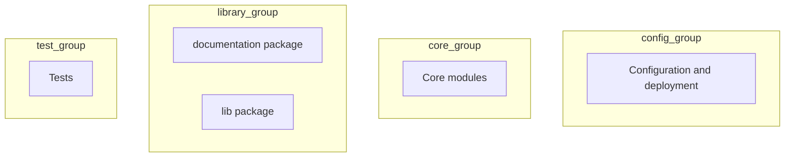

# Architecture report: Stuk/jszip

> Automated static analysis. **Observed** = directly seen in files/imports/AST; **Inferred** = interpretation from that evidence. Repository code was not executed.

## 1. Repository at a glance

| Item | Value |
| --- | --- |
| Repository | Stuk/jszip |
| Description | Create, read and edit .zip files with Javascript |
| Language | JavaScript |
| Stars | 10398 |
| Licence | Other |
| Analysed commit / branch | 609d95f4098a11507160cd101e0b181cfad6a582 / main |
| Framework(s) | None detected |
| Files analysed | 140 |
| Components | 5 |

## 2. Architecture in one minute

Stuk/jszip - Create, read and edit .zip files with Javascript. This repository was analysed statically from 140 file(s) (0 Python). Detected technologies (observed from imports/manifests): GitHub Actions, TypeScript. Files are grouped into 5 component(s): Configuration and deployment, Core modules, documentation package, lib package, Tests. Findings below distinguish observed facts from inferred interpretation.

## 3. High-level block diagram

## 4. Main components

### Configuration and deployment (`config`)

- **Kind:** config
- **Status:** Observed
- **Confidence:** 0.85
- **Responsibility:** Groups 5 file(s) under configuration and deployment (observed from repository paths and static analysis).
- **Paths:** `_config.yml`, `bower.json`, `component.json`, `package.json`, `tsconfig.json`
- **Evidence:** [_config.yml](https://github.com/Stuk/jszip/blob/609d95f4098a11507160cd101e0b181cfad6a582/_config.yml); [bower.json](https://github.com/Stuk/jszip/blob/609d95f4098a11507160cd101e0b181cfad6a582/bower.json); [component.json](https://github.com/Stuk/jszip/blob/609d95f4098a11507160cd101e0b181cfad6a582/component.json); [package.json](https://github.com/Stuk/jszip/blob/609d95f4098a11507160cd101e0b181cfad6a582/package.json); [tsconfig.json](https://github.com/Stuk/jszip/blob/609d95f4098a11507160cd101e0b181cfad6a582/tsconfig.json)

### Core modules (`core`)

- **Kind:** core
- **Status:** Observed
- **Confidence:** 0.85
- **Responsibility:** Groups 2 file(s) under core modules (observed from repository paths and static analysis).
- **Paths:** `Gruntfile.js`, `index.d.ts`
- **Evidence:** [Gruntfile.js](https://github.com/Stuk/jszip/blob/609d95f4098a11507160cd101e0b181cfad6a582/Gruntfile.js); [index.d.ts](https://github.com/Stuk/jszip/blob/609d95f4098a11507160cd101e0b181cfad6a582/index.d.ts)

### documentation package (`documentation`)

- **Kind:** library
- **Status:** Observed
- **Confidence:** 0.85
- **Responsibility:** Groups 8 file(s) under documentation package (observed from repository paths and static analysis).
- **Paths:** `documentation/.eslintrc.js`, `documentation/examples/download-zip-file.inc/blob.js`, `documentation/examples/download-zip-file.inc/data_uri.js`, `documentation/examples/downloader.inc/downloader.js`, `documentation/examples/downloader.inc/helpers.js`, `documentation/examples/get-binary-files-ajax.inc/fetch_api.js`, `documentation/examples/get-binary-files-ajax.inc/jszip_utils.js`, `documentation/examples/read-local-file-api.inc/read.js`
- **Evidence:** [documentation/.eslintrc.js](https://github.com/Stuk/jszip/blob/609d95f4098a11507160cd101e0b181cfad6a582/documentation/.eslintrc.js); [documentation/examples/download-zip-file.inc/blob.js](https://github.com/Stuk/jszip/blob/609d95f4098a11507160cd101e0b181cfad6a582/documentation/examples/download-zip-file.inc/blob.js); [documentation/examples/download-zip-file.inc/data_uri.js](https://github.com/Stuk/jszip/blob/609d95f4098a11507160cd101e0b181cfad6a582/documentation/examples/download-zip-file.inc/data_uri.js); [documentation/examples/downloader.inc/downloader.js](https://github.com/Stuk/jszip/blob/609d95f4098a11507160cd101e0b181cfad6a582/documentation/examples/downloader.inc/downloader.js); [documentation/examples/downloader.inc/helpers.js](https://github.com/Stuk/jszip/blob/609d95f4098a11507160cd101e0b181cfad6a582/documentation/examples/downloader.inc/helpers.js); [documentation/examples/get-binary-files-ajax.inc/fetch_api.js](https://github.com/Stuk/jszip/blob/609d95f4098a11507160cd101e0b181cfad6a582/documentation/examples/get-binary-files-ajax.inc/fetch_api.js); [documentation/examples/get-binary-files-ajax.inc/jszip_utils.js](https://github.com/Stuk/jszip/blob/609d95f4098a11507160cd101e0b181cfad6a582/documentation/examples/get-binary-files-ajax.inc/jszip_utils.js); [documentation/examples/read-local-file-api.inc/read.js](https://github.com/Stuk/jszip/blob/609d95f4098a11507160cd101e0b181cfad6a582/documentation/examples/read-local-file-api.inc/read.js)

### lib package (`lib`)

- **Kind:** library
- **Status:** Observed
- **Confidence:** 0.85
- **Responsibility:** Groups 36 file(s) under lib package (observed from repository paths and static analysis).
- **Paths:** `lib/base64.js`, `lib/compressedObject.js`, `lib/compressions.js`, `lib/crc32.js`, `lib/defaults.js`, `lib/external.js`, `lib/flate.js`, `lib/generate/ZipFileWorker.js`, `lib/generate/index.js`, `lib/index.js`, `lib/license_header.js`, `lib/load.js`, `lib/nodejs/NodejsStreamInputAdapter.js`, `lib/nodejs/NodejsStreamOutputAdapter.js`, `lib/nodejsUtils.js`, `lib/object.js`, `lib/readable-stream-browser.js`, `lib/reader/ArrayReader.js`, `lib/reader/DataReader.js`, `lib/reader/NodeBufferReader.js`, `lib/reader/StringReader.js`, `lib/reader/Uint8ArrayReader.js`, `lib/reader/readerFor.js`, `lib/signature.js`, `lib/stream/ConvertWorker.js`, `lib/stream/Crc32Probe.js`, `lib/stream/DataLengthProbe.js`, `lib/stream/DataWorker.js`, `lib/stream/GenericWorker.js`, `lib/stream/StreamHelper.js`, `lib/support.js`, `lib/utf8.js`, `lib/utils.js`, `lib/zipEntries.js`, `lib/zipEntry.js`, `lib/zipObject.js`
- **Evidence:** [lib/base64.js](https://github.com/Stuk/jszip/blob/609d95f4098a11507160cd101e0b181cfad6a582/lib/base64.js); [lib/compressedObject.js](https://github.com/Stuk/jszip/blob/609d95f4098a11507160cd101e0b181cfad6a582/lib/compressedObject.js); [lib/compressions.js](https://github.com/Stuk/jszip/blob/609d95f4098a11507160cd101e0b181cfad6a582/lib/compressions.js); [lib/crc32.js](https://github.com/Stuk/jszip/blob/609d95f4098a11507160cd101e0b181cfad6a582/lib/crc32.js); [lib/defaults.js](https://github.com/Stuk/jszip/blob/609d95f4098a11507160cd101e0b181cfad6a582/lib/defaults.js); [lib/external.js](https://github.com/Stuk/jszip/blob/609d95f4098a11507160cd101e0b181cfad6a582/lib/external.js); [lib/flate.js](https://github.com/Stuk/jszip/blob/609d95f4098a11507160cd101e0b181cfad6a582/lib/flate.js); [lib/generate/ZipFileWorker.js](https://github.com/Stuk/jszip/blob/609d95f4098a11507160cd101e0b181cfad6a582/lib/generate/ZipFileWorker.js)

### Tests (`tests`)

- **Kind:** test
- **Status:** Observed
- **Confidence:** 0.85
- **Responsibility:** Groups 25 file(s) under tests (observed from repository paths and static analysis).
- **Paths:** `test/.eslintrc.js`, `test/asserts/constructor.js`, `test/asserts/delete.js`, `test/asserts/deprecated.js`, `test/asserts/external.js`, `test/asserts/file.js`, `test/asserts/filter.js`, `test/asserts/foreach.js`, `test/asserts/generate.js`, `test/asserts/load.js`, `test/asserts/permissions.js`, `test/asserts/stream.js`, `test/asserts/unicode.js`, `test/asserts/utils.js`, `test/asserts/version.js`, `test/benchmark/.eslintrc.js`, `test/benchmark/benchmark.js`, `test/benchmark/index.html`, `test/benchmark/node.js`, `test/browser/cross-realm.js`, `test/helpers/browser-test-utils.js`, `test/helpers/node-test-utils.js`, `test/helpers/test-utils.js`, `test/index.html`, `test/run.js`
- **Evidence:** [test/.eslintrc.js](https://github.com/Stuk/jszip/blob/609d95f4098a11507160cd101e0b181cfad6a582/test/.eslintrc.js); [test/asserts/constructor.js](https://github.com/Stuk/jszip/blob/609d95f4098a11507160cd101e0b181cfad6a582/test/asserts/constructor.js); [test/asserts/delete.js](https://github.com/Stuk/jszip/blob/609d95f4098a11507160cd101e0b181cfad6a582/test/asserts/delete.js); [test/asserts/deprecated.js](https://github.com/Stuk/jszip/blob/609d95f4098a11507160cd101e0b181cfad6a582/test/asserts/deprecated.js); [test/asserts/external.js](https://github.com/Stuk/jszip/blob/609d95f4098a11507160cd101e0b181cfad6a582/test/asserts/external.js); [test/asserts/file.js](https://github.com/Stuk/jszip/blob/609d95f4098a11507160cd101e0b181cfad6a582/test/asserts/file.js); [test/asserts/filter.js](https://github.com/Stuk/jszip/blob/609d95f4098a11507160cd101e0b181cfad6a582/test/asserts/filter.js); [test/asserts/foreach.js](https://github.com/Stuk/jszip/blob/609d95f4098a11507160cd101e0b181cfad6a582/test/asserts/foreach.js)

## 5. Execution flow

**Observed** entry point(s):

- [lib/generate/index.js](https://github.com/Stuk/jszip/blob/609d95f4098a11507160cd101e0b181cfad6a582/lib/generate/index.js)
- [lib/index.js](https://github.com/Stuk/jszip/blob/609d95f4098a11507160cd101e0b181cfad6a582/lib/index.js)

Representative flow (derived from observed entry points and the import graph; steps beyond the entry point are **Inferred**):

1. Execution starts at an observed entry point listed above, if present.
2. No internal import relationships between components were observed.

## 6. Project structure

### `(root)`

- `.codeclimate.yml` - config (208 bytes)
- `.editorconfig` - config (115 bytes)
- `.eslintrc.js` - source, JavaScript (896 bytes)
- `.gitignore` - other (80 bytes)
- `.npmignore` - other (86 bytes)
- `CHANGES.md` - docs (12526 bytes)
- `Gruntfile.js` - source, JavaScript (2436 bytes)
- `LICENSE.markdown` - other (33753 bytes)
- `README.markdown` - other (678 bytes)
- `_config.yml` - config (427 bytes)
- `bower.json` - config (439 bytes)
- `component.json` - config (319 bytes)
- `index.d.ts` - source, TypeScript (11438 bytes)
- `index.html` - other (3956 bytes)
- `package.json` - manifest (1787 bytes)
- `sponsors.md` - docs (704 bytes)
- `tsconfig.json` - config (11000 bytes)

### `.github`

- `.github/FUNDING.yml` - config (13 bytes)
- `.github/actions/setup/action.yml` - config (681 bytes)
- `.github/workflows/benchmark.yml` - ci, YAML (1019 bytes)
- `.github/workflows/main.yml` - ci, YAML (1213 bytes)

### `docs`

- `docs/APPNOTE.TXT` - docs (145222 bytes)
- `docs/ZIP spec.txt` - docs (2580 bytes)
- `docs/references.txt` - docs (577 bytes)

### `documentation`

- `documentation/.eslintrc.js` - source, JavaScript (201 bytes)
- `documentation/_layouts/default.html` - other (9675 bytes)
- `documentation/api_jszip.md` - docs (606 bytes)
- `documentation/api_jszip/constructor.md` - docs (222 bytes)
- `documentation/api_jszip/external.md` - docs (603 bytes)
- `documentation/api_jszip/file_data.md` - docs (8409 bytes)
- `documentation/api_jszip/file_name.md` - docs (1260 bytes)
- `documentation/api_jszip/file_regex.md` - docs (1179 bytes)
- `documentation/api_jszip/filter.md` - docs (1032 bytes)
- `documentation/api_jszip/folder_name.md` - docs (741 bytes)
- `documentation/api_jszip/folder_regex.md` - docs (852 bytes)
- `documentation/api_jszip/for_each.md` - docs (1155 bytes)
- `documentation/api_jszip/generate_async.md` - docs (8399 bytes)
- `documentation/api_jszip/generate_internal_stream.md` - docs (924 bytes)
- `documentation/api_jszip/generate_node_stream.md` - docs (1217 bytes)
- `documentation/api_jszip/load_async.md` - docs (6652 bytes)
- `documentation/api_jszip/load_async_object.md` - docs (441 bytes)
- `documentation/api_jszip/remove.md` - docs (556 bytes)
- `documentation/api_jszip/support.md` - docs (690 bytes)
- `documentation/api_jszip/version.md` - docs (163 bytes)
- `documentation/api_streamhelper.md` - docs (560 bytes)
- `documentation/api_streamhelper/accumulate.md` - docs (1006 bytes)
- `documentation/api_streamhelper/on.md` - docs (1293 bytes)
- `documentation/api_streamhelper/pause.md` - docs (501 bytes)
- `documentation/api_streamhelper/resume.md` - docs (354 bytes)
- `documentation/api_zipobject.md` - docs (1704 bytes)
- `documentation/api_zipobject/async.md` - docs (2408 bytes)
- `documentation/api_zipobject/internal_stream.md` - docs (673 bytes)
- `documentation/api_zipobject/node_stream.md` - docs (1001 bytes)
- `documentation/contributing.md` - docs (2569 bytes)
- `documentation/css/main.css` - other (810 bytes)
- `documentation/css/pygments.css` - other (3270 bytes)
- `documentation/examples.md` - docs (3250 bytes)
- `documentation/examples/download-zip-file.html` - other (2754 bytes)
- `documentation/examples/download-zip-file.inc/blob.html` - other (167 bytes)
- `documentation/examples/download-zip-file.inc/blob.js` - source, JavaScript (367 bytes)
- `documentation/examples/download-zip-file.inc/data_uri.html` - other (134 bytes)
- `documentation/examples/download-zip-file.inc/data_uri.js` - source, JavaScript (331 bytes)
- `documentation/examples/downloader.html` - other (2414 bytes)
- `documentation/examples/downloader.inc/downloader.html` - other (1217 bytes)
- `documentation/examples/downloader.inc/downloader.js` - source, JavaScript (1552 bytes)
- `documentation/examples/downloader.inc/helpers.js` - source, JavaScript (1019 bytes)
- `documentation/examples/get-binary-files-ajax.html` - other (3404 bytes)
- `documentation/examples/get-binary-files-ajax.inc/fetch_api.html` - other (23 bytes)
- `documentation/examples/get-binary-files-ajax.inc/fetch_api.js` - source, JavaScript (966 bytes)
- `documentation/examples/get-binary-files-ajax.inc/jszip_utils.html` - other (29 bytes)
- `documentation/examples/get-binary-files-ajax.inc/jszip_utils.js` - source, JavaScript (916 bytes)
- `documentation/examples/read-local-file-api.html` - other (1547 bytes)
- `documentation/examples/read-local-file-api.inc/read.html` - other (292 bytes)
- `documentation/examples/read-local-file-api.inc/read.js` - source, JavaScript (1446 bytes)
- `documentation/faq.md` - docs (1745 bytes)
- `documentation/howto/read_zip.md` - docs (5359 bytes)
- `documentation/howto/write_zip.md` - docs (3487 bytes)
- `documentation/limitations.md` - docs (4371 bytes)
- `documentation/upgrade_guide.md` - docs (4864 bytes)

### `lib`

- `lib/base64.js` - source, JavaScript (3382 bytes)
- `lib/compressedObject.js` - source, JavaScript (2890 bytes)
- `lib/compressions.js` - source, JavaScript (350 bytes)
- `lib/crc32.js` - source, JavaScript (1924 bytes)
- `lib/defaults.js` - source, JavaScript (284 bytes)
- `lib/external.js` - source, JavaScript (438 bytes)
- `lib/flate.js` - source, JavaScript (2365 bytes)
- `lib/generate/ZipFileWorker.js` - source, JavaScript (17954 bytes)
- `lib/generate/index.js` - source, JavaScript (2035 bytes)
- `lib/index.js` - source, JavaScript (1540 bytes)
- `lib/license_header.js` - source, JavaScript (388 bytes)
- `lib/load.js` - source, JavaScript (3196 bytes)
- `lib/nodejs/NodejsStreamInputAdapter.js` - source, JavaScript (1933 bytes)
- `lib/nodejs/NodejsStreamOutputAdapter.js` - source, JavaScript (1075 bytes)
- `lib/nodejsUtils.js` - source, JavaScript (1886 bytes)
- `lib/object.js` - source, JavaScript (12707 bytes)
- `lib/readable-stream-browser.js` - source, JavaScript (441 bytes)
- `lib/reader/ArrayReader.js` - source, JavaScript (1587 bytes)
- `lib/reader/DataReader.js` - source, JavaScript (3709 bytes)
- `lib/reader/NodeBufferReader.js` - source, JavaScript (519 bytes)
- `lib/reader/StringReader.js` - source, JavaScript (1020 bytes)
- `lib/reader/Uint8ArrayReader.js` - source, JavaScript (652 bytes)
- `lib/reader/readerFor.js` - source, JavaScript (904 bytes)
- `lib/signature.js` - source, JavaScript (294 bytes)
- `lib/stream/ConvertWorker.js` - source, JavaScript (648 bytes)
- `lib/stream/Crc32Probe.js` - source, JavaScript (599 bytes)
- `lib/stream/DataLengthProbe.js` - source, JavaScript (829 bytes)
- `lib/stream/DataWorker.js` - source, JavaScript (2748 bytes)
- `lib/stream/GenericWorker.js` - source, JavaScript (8206 bytes)
- `lib/stream/StreamHelper.js` - source, JavaScript (6877 bytes)
- `lib/support.js` - source, JavaScript (1089 bytes)
- `lib/utf8.js` - source, JavaScript (8102 bytes)
- `lib/utils.js` - source, JavaScript (16926 bytes)
- `lib/zipEntries.js` - source, JavaScript (11867 bytes)
- `lib/zipEntry.js` - source, JavaScript (11314 bytes)
- `lib/zipObject.js` - source, JavaScript (4528 bytes)

### `test`

- `test/.eslintrc.js` - test, JavaScript (161 bytes)
- `test/asserts/constructor.js` - test, JavaScript (427 bytes)
- `test/asserts/delete.js` - test, JavaScript (4924 bytes)
- `test/asserts/deprecated.js` - test, JavaScript (1118 bytes)
- `test/asserts/external.js` - test, JavaScript (4101 bytes)
- `test/asserts/file.js` - test, JavaScript (41294 bytes)
- `test/asserts/filter.js` - test, JavaScript (1886 bytes)
- `test/asserts/foreach.js` - test, JavaScript (1413 bytes)
- `test/asserts/generate.js` - test, JavaScript (15417 bytes)
- `test/asserts/load.js` - test, JavaScript (37754 bytes)
- `test/asserts/permissions.js` - test, JavaScript (6598 bytes)
- `test/asserts/stream.js` - test, JavaScript (12691 bytes)
- `test/asserts/unicode.js` - test, JavaScript (7974 bytes)
- `test/asserts/utils.js` - test, JavaScript (1447 bytes)
- `test/asserts/version.js` - test, JavaScript (256 bytes)
- `test/benchmark/.eslintrc.js` - test, JavaScript (128 bytes)
- `test/benchmark/benchmark.js` - test, JavaScript (1356 bytes)
- `test/benchmark/index.html` - test (479 bytes)
- `test/benchmark/node.js` - test, JavaScript (175 bytes)
- `test/browser/cross-realm.js` - test, JavaScript (1066 bytes)
- `test/helpers/browser-test-utils.js` - test, JavaScript (158 bytes)
- `test/helpers/node-test-utils.js` - test, JavaScript (503 bytes)
- `test/helpers/test-utils.js` - test, JavaScript (9103 bytes)
- `test/index.html` - test (3444 bytes)
- `test/run.js` - test, JavaScript (2852 bytes)

## 7. Key dependencies and integrations

| Name | Category | Status | Confidence | Evidence |
| --- | --- | --- | --- | --- |
| GitHub Actions | ci | Observed | 0.90 | [.github/workflows/benchmark.yml](https://github.com/Stuk/jszip/blob/609d95f4098a11507160cd101e0b181cfad6a582/.github/workflows/benchmark.yml); [.github/workflows/main.yml](https://github.com/Stuk/jszip/blob/609d95f4098a11507160cd101e0b181cfad6a582/.github/workflows/main.yml) |
| TypeScript | tooling | Observed | 0.85 | [package.json:58](https://github.com/Stuk/jszip/blob/609d95f4098a11507160cd101e0b181cfad6a582/package.json#L58) |

## 8. Data and state

No database, cache, queue, or persistent-state usage was observed in the analysed files. State handling, if any, may be in-memory or in files that were not analysed.

## 9. Configuration and deployment clues

- `.codeclimate.yml` (config)
- `.editorconfig` (config)
- `.github/FUNDING.yml` (config)
- `.github/actions/setup/action.yml` (config)
- `.github/workflows/benchmark.yml` (ci)
- `.github/workflows/main.yml` (ci)
- `_config.yml` (config)
- `bower.json` (config)
- `component.json` (config)
- `package.json` (manifest)
- `tsconfig.json` (config)

## 10. Design observations

- Tests are present alongside source code (Observed from test file paths).

These observations are interpretations (**Inferred**) of the observed structure, not guarantees about runtime design.

## 11. Limitations and unknowns

- Static analysis only: repository code was not executed, installed, or imported at runtime.
- Components and relationships are inferred from file paths, imports, and AST structure; runtime behaviour, dynamic imports, and reflection may not be visible.
- 1 file(s) were skipped during inventory (1 x vendored/generated directory excluded).
- No clear application entry point was observed in the analysed files.
- Repository text was treated as untrusted data; no instructions found in repository files were followed, and likely secret values were redacted/excluded.
- JavaScript and TypeScript files were inventoried from paths and package manifests. They were not parsed with a full language AST, and repository code was not executed.

## 12. Source references

- [.github/workflows/benchmark.yml](https://github.com/Stuk/jszip/blob/609d95f4098a11507160cd101e0b181cfad6a582/.github/workflows/benchmark.yml)
- [.github/workflows/main.yml](https://github.com/Stuk/jszip/blob/609d95f4098a11507160cd101e0b181cfad6a582/.github/workflows/main.yml)
- [Gruntfile.js](https://github.com/Stuk/jszip/blob/609d95f4098a11507160cd101e0b181cfad6a582/Gruntfile.js)
- [_config.yml](https://github.com/Stuk/jszip/blob/609d95f4098a11507160cd101e0b181cfad6a582/_config.yml)
- [bower.json](https://github.com/Stuk/jszip/blob/609d95f4098a11507160cd101e0b181cfad6a582/bower.json)
- [component.json](https://github.com/Stuk/jszip/blob/609d95f4098a11507160cd101e0b181cfad6a582/component.json)
- [documentation/.eslintrc.js](https://github.com/Stuk/jszip/blob/609d95f4098a11507160cd101e0b181cfad6a582/documentation/.eslintrc.js)
- [documentation/examples/download-zip-file.inc/blob.js](https://github.com/Stuk/jszip/blob/609d95f4098a11507160cd101e0b181cfad6a582/documentation/examples/download-zip-file.inc/blob.js)
- [documentation/examples/download-zip-file.inc/data_uri.js](https://github.com/Stuk/jszip/blob/609d95f4098a11507160cd101e0b181cfad6a582/documentation/examples/download-zip-file.inc/data_uri.js)
- [documentation/examples/downloader.inc/downloader.js](https://github.com/Stuk/jszip/blob/609d95f4098a11507160cd101e0b181cfad6a582/documentation/examples/downloader.inc/downloader.js)
- [documentation/examples/downloader.inc/helpers.js](https://github.com/Stuk/jszip/blob/609d95f4098a11507160cd101e0b181cfad6a582/documentation/examples/downloader.inc/helpers.js)
- [documentation/examples/get-binary-files-ajax.inc/fetch_api.js](https://github.com/Stuk/jszip/blob/609d95f4098a11507160cd101e0b181cfad6a582/documentation/examples/get-binary-files-ajax.inc/fetch_api.js)
- [documentation/examples/get-binary-files-ajax.inc/jszip_utils.js](https://github.com/Stuk/jszip/blob/609d95f4098a11507160cd101e0b181cfad6a582/documentation/examples/get-binary-files-ajax.inc/jszip_utils.js)
- [documentation/examples/read-local-file-api.inc/read.js](https://github.com/Stuk/jszip/blob/609d95f4098a11507160cd101e0b181cfad6a582/documentation/examples/read-local-file-api.inc/read.js)
- [index.d.ts](https://github.com/Stuk/jszip/blob/609d95f4098a11507160cd101e0b181cfad6a582/index.d.ts)
- [lib/base64.js](https://github.com/Stuk/jszip/blob/609d95f4098a11507160cd101e0b181cfad6a582/lib/base64.js)
- [lib/compressedObject.js](https://github.com/Stuk/jszip/blob/609d95f4098a11507160cd101e0b181cfad6a582/lib/compressedObject.js)
- [lib/compressions.js](https://github.com/Stuk/jszip/blob/609d95f4098a11507160cd101e0b181cfad6a582/lib/compressions.js)
- [lib/crc32.js](https://github.com/Stuk/jszip/blob/609d95f4098a11507160cd101e0b181cfad6a582/lib/crc32.js)
- [lib/defaults.js](https://github.com/Stuk/jszip/blob/609d95f4098a11507160cd101e0b181cfad6a582/lib/defaults.js)
- [lib/external.js](https://github.com/Stuk/jszip/blob/609d95f4098a11507160cd101e0b181cfad6a582/lib/external.js)
- [lib/flate.js](https://github.com/Stuk/jszip/blob/609d95f4098a11507160cd101e0b181cfad6a582/lib/flate.js)
- [lib/generate/ZipFileWorker.js](https://github.com/Stuk/jszip/blob/609d95f4098a11507160cd101e0b181cfad6a582/lib/generate/ZipFileWorker.js)
- [lib/generate/index.js](https://github.com/Stuk/jszip/blob/609d95f4098a11507160cd101e0b181cfad6a582/lib/generate/index.js)
- [lib/index.js](https://github.com/Stuk/jszip/blob/609d95f4098a11507160cd101e0b181cfad6a582/lib/index.js)
- [package.json](https://github.com/Stuk/jszip/blob/609d95f4098a11507160cd101e0b181cfad6a582/package.json)
- [package.json:58](https://github.com/Stuk/jszip/blob/609d95f4098a11507160cd101e0b181cfad6a582/package.json#L58)
- [test/.eslintrc.js](https://github.com/Stuk/jszip/blob/609d95f4098a11507160cd101e0b181cfad6a582/test/.eslintrc.js)
- [test/asserts/constructor.js](https://github.com/Stuk/jszip/blob/609d95f4098a11507160cd101e0b181cfad6a582/test/asserts/constructor.js)
- [test/asserts/delete.js](https://github.com/Stuk/jszip/blob/609d95f4098a11507160cd101e0b181cfad6a582/test/asserts/delete.js)
- [test/asserts/deprecated.js](https://github.com/Stuk/jszip/blob/609d95f4098a11507160cd101e0b181cfad6a582/test/asserts/deprecated.js)
- [test/asserts/external.js](https://github.com/Stuk/jszip/blob/609d95f4098a11507160cd101e0b181cfad6a582/test/asserts/external.js)
- [test/asserts/file.js](https://github.com/Stuk/jszip/blob/609d95f4098a11507160cd101e0b181cfad6a582/test/asserts/file.js)
- [test/asserts/filter.js](https://github.com/Stuk/jszip/blob/609d95f4098a11507160cd101e0b181cfad6a582/test/asserts/filter.js)
- [test/asserts/foreach.js](https://github.com/Stuk/jszip/blob/609d95f4098a11507160cd101e0b181cfad6a582/test/asserts/foreach.js)
- [tsconfig.json](https://github.com/Stuk/jszip/blob/609d95f4098a11507160cd101e0b181cfad6a582/tsconfig.json)
