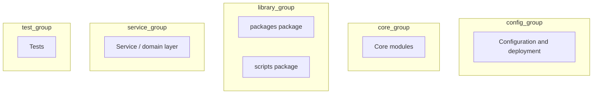

# Architecture report: Tencent/wepy

> Automated static analysis. **Observed** = directly seen in files/imports/AST; **Inferred** = interpretation from that evidence. Repository code was not executed.

## 1. Repository at a glance

| Item | Value |
| --- | --- |
| Repository | Tencent/wepy |
| Description | 小程序组件化开发框架 - 已归档 |
| Language | JavaScript |
| Stars | 22502 |
| Licence | Other |
| Analysed commit / branch | 253aa5bba394cf9efff90ab3a803a100a017b5cb / master |
| Framework(s) | None detected |
| Files analysed | 471 |
| Components | 6 |

## 2. Architecture in one minute

Tencent/wepy - 小程序组件化开发框架 - 已归档. This repository was analysed statically from 471 file(s) (0 Python). Detected technologies (observed from imports/manifests): GitHub Actions, TypeScript. Files are grouped into 6 component(s): Configuration and deployment, Core modules, packages package, scripts package, Service / domain layer, Tests. Findings below distinguish observed facts from inferred interpretation.

## 3. High-level block diagram

## 4. Main components

### Configuration and deployment (`config`)

- **Kind:** config
- **Status:** Observed
- **Confidence:** 0.85
- **Responsibility:** Groups 21 file(s) under configuration and deployment (observed from repository paths and static analysis).
- **Paths:** `lerna.json`, `package.json`, `packages/babel-plugin-import-regenerator/package.json`, `packages/cli/package.json`, `packages/compiler-babel/package.json`, `packages/compiler-less/package.json`, `packages/compiler-postcss/package.json`, `packages/compiler-sass/package.json`, `packages/compiler-stylus/package.json`, `packages/compiler-typescript/package.json`, `packages/core/package.json`, `packages/core/types/tsconfig.json`, `packages/core/types/typings.json`, `packages/plugin-define/package.json`, `packages/plugin-eslint/package.json`, `packages/plugin-uglifyjs/package.json`, `packages/redux/package.json`, `packages/router/package.json`, `packages/use-intercept/package.json`, `packages/use-promisify/package.json`, `packages/x/package.json`
- **Evidence:** [lerna.json](https://github.com/Tencent/wepy/blob/253aa5bba394cf9efff90ab3a803a100a017b5cb/lerna.json); [package.json](https://github.com/Tencent/wepy/blob/253aa5bba394cf9efff90ab3a803a100a017b5cb/package.json); [packages/babel-plugin-import-regenerator/package.json](https://github.com/Tencent/wepy/blob/253aa5bba394cf9efff90ab3a803a100a017b5cb/packages/babel-plugin-import-regenerator/package.json); [packages/cli/package.json](https://github.com/Tencent/wepy/blob/253aa5bba394cf9efff90ab3a803a100a017b5cb/packages/cli/package.json); [packages/compiler-babel/package.json](https://github.com/Tencent/wepy/blob/253aa5bba394cf9efff90ab3a803a100a017b5cb/packages/compiler-babel/package.json); [packages/compiler-less/package.json](https://github.com/Tencent/wepy/blob/253aa5bba394cf9efff90ab3a803a100a017b5cb/packages/compiler-less/package.json); [packages/compiler-postcss/package.json](https://github.com/Tencent/wepy/blob/253aa5bba394cf9efff90ab3a803a100a017b5cb/packages/compiler-postcss/package.json); [packages/compiler-sass/package.json](https://github.com/Tencent/wepy/blob/253aa5bba394cf9efff90ab3a803a100a017b5cb/packages/compiler-sass/package.json)

### Core modules (`core`)

- **Kind:** core
- **Status:** Observed
- **Confidence:** 0.85
- **Responsibility:** Groups 1 file(s) under core modules (observed from repository paths and static analysis).
- **Paths:** `verpub.config.js`
- **Evidence:** [verpub.config.js](https://github.com/Tencent/wepy/blob/253aa5bba394cf9efff90ab3a803a100a017b5cb/verpub.config.js)

### packages package (`packages`)

- **Kind:** library
- **Status:** Observed
- **Confidence:** 0.85
- **Responsibility:** Groups 43 file(s) under packages package (observed from repository paths and static analysis).
- **Paths:** `packages/babel-plugin-import-regenerator/index.js`, `packages/cli/bin/cli/ask.js`, `packages/cli/bin/cli/check-version.js`, `packages/cli/bin/cli/download.js`, `packages/cli/bin/cli/eval.js`, `packages/cli/bin/cli/filter.js`, `packages/cli/bin/cli/generate.js`, `packages/cli/bin/cli/git-user.js`, `packages/cli/bin/cli/local-path.js`, `packages/cli/bin/cli/logger.js`, `packages/cli/bin/cli/options.js`, `packages/cli/bin/wepy-build.js`, `packages/cli/bin/wepy-init.js`, `packages/cli/bin/wepy-list.js`, `packages/cli/bin/wepy-new.js`, `packages/cli/bin/wepy-upgrade.js`, `packages/cli/bin/wepy.js`, `packages/cli/index.js`, `packages/cli/util/logger.js`, `packages/compiler-babel/index.js`, `packages/compiler-less/createPlugin.js`, `packages/compiler-less/index.js`, `packages/compiler-postcss/index.js`, `packages/compiler-sass/importsToResolve.js`, `packages/compiler-sass/index.js`, `packages/compiler-sass/resolveImporter.js`, `packages/compiler-sass/src/index.js`, `packages/compiler-stylus/createPlugin.js`, `packages/compiler-stylus/index.js`, `packages/compiler-typescript/index.js`, `packages/plugin-define/index.js`, `packages/plugin-eslint/index.js`, `packages/plugin-uglifyjs/index.js`, `packages/redux/helper.js`, `packages/redux/index.js`, `packages/redux/install.js`, `packages/router/index.js`, `packages/router/install.js`, `packages/use-intercept/index.js`, `packages/use-intercept/install.js`, `packages/use-promisify/index.js`, `packages/use-promisify/install.js`, `packages/x/index.js`
- **Evidence:** [packages/babel-plugin-import-regenerator/index.js](https://github.com/Tencent/wepy/blob/253aa5bba394cf9efff90ab3a803a100a017b5cb/packages/babel-plugin-import-regenerator/index.js); [packages/cli/bin/cli/ask.js](https://github.com/Tencent/wepy/blob/253aa5bba394cf9efff90ab3a803a100a017b5cb/packages/cli/bin/cli/ask.js); [packages/cli/bin/cli/check-version.js](https://github.com/Tencent/wepy/blob/253aa5bba394cf9efff90ab3a803a100a017b5cb/packages/cli/bin/cli/check-version.js); [packages/cli/bin/cli/download.js](https://github.com/Tencent/wepy/blob/253aa5bba394cf9efff90ab3a803a100a017b5cb/packages/cli/bin/cli/download.js); [packages/cli/bin/cli/eval.js](https://github.com/Tencent/wepy/blob/253aa5bba394cf9efff90ab3a803a100a017b5cb/packages/cli/bin/cli/eval.js); [packages/cli/bin/cli/filter.js](https://github.com/Tencent/wepy/blob/253aa5bba394cf9efff90ab3a803a100a017b5cb/packages/cli/bin/cli/filter.js); [packages/cli/bin/cli/generate.js](https://github.com/Tencent/wepy/blob/253aa5bba394cf9efff90ab3a803a100a017b5cb/packages/cli/bin/cli/generate.js); [packages/cli/bin/cli/git-user.js](https://github.com/Tencent/wepy/blob/253aa5bba394cf9efff90ab3a803a100a017b5cb/packages/cli/bin/cli/git-user.js)

### scripts package (`scripts`)

- **Kind:** library
- **Status:** Observed
- **Confidence:** 0.85
- **Responsibility:** Groups 17 file(s) under scripts package (observed from repository paths and static analysis).
- **Paths:** `scripts/bootstrap.sh`, `scripts/build.js`, `scripts/build.sh`, `scripts/ci-release.js`, `scripts/clean.js`, `scripts/config.js`, `scripts/install_dev.sh`, `scripts/npm-ci-release.js`, `scripts/npm-tags.js`, `scripts/npm_publish/index.js`, `scripts/npm_publish/lib/auto.js`, `scripts/npm_publish/lib/check_repo_clean.js`, `scripts/npm_publish/lib/interact.js`, `scripts/npm_publish/lib/log.js`, `scripts/release.js`, `scripts/test-build.sh`, `scripts/unittest.js`
- **Evidence:** [scripts/bootstrap.sh](https://github.com/Tencent/wepy/blob/253aa5bba394cf9efff90ab3a803a100a017b5cb/scripts/bootstrap.sh); [scripts/build.js](https://github.com/Tencent/wepy/blob/253aa5bba394cf9efff90ab3a803a100a017b5cb/scripts/build.js); [scripts/build.sh](https://github.com/Tencent/wepy/blob/253aa5bba394cf9efff90ab3a803a100a017b5cb/scripts/build.sh); [scripts/ci-release.js](https://github.com/Tencent/wepy/blob/253aa5bba394cf9efff90ab3a803a100a017b5cb/scripts/ci-release.js); [scripts/clean.js](https://github.com/Tencent/wepy/blob/253aa5bba394cf9efff90ab3a803a100a017b5cb/scripts/clean.js); [scripts/config.js](https://github.com/Tencent/wepy/blob/253aa5bba394cf9efff90ab3a803a100a017b5cb/scripts/config.js); [scripts/install_dev.sh](https://github.com/Tencent/wepy/blob/253aa5bba394cf9efff90ab3a803a100a017b5cb/scripts/install_dev.sh); [scripts/npm-ci-release.js](https://github.com/Tencent/wepy/blob/253aa5bba394cf9efff90ab3a803a100a017b5cb/scripts/npm-ci-release.js)

### Service / domain layer (`service_layer`)

- **Kind:** service
- **Status:** Observed
- **Confidence:** 0.85
- **Responsibility:** Groups 145 file(s) under service / domain layer (observed from repository paths and static analysis).
- **Paths:** `packages/cli/core/ast/index.js`, `packages/cli/core/ast/paramsDetect.js`, `packages/cli/core/ast/parseClass.js`, `packages/cli/core/ast/toAST.js`, `packages/cli/core/ast/walker.js`, `packages/cli/core/ast/wxml.js`, `packages/cli/core/compile.js`, `packages/cli/core/fileDep.js`, `packages/cli/core/hook.js`, `packages/cli/core/init/compiler.js`, `packages/cli/core/init/parser.js`, `packages/cli/core/init/plugin.js`, `packages/cli/core/loader.js`, `packages/cli/core/moduleSet.js`, `packages/cli/core/parseOptions.js`, `packages/cli/core/plugins/compiler/before.js`, `packages/cli/core/plugins/compiler/common.js`, `packages/cli/core/plugins/compiler/index.js`, `packages/cli/core/plugins/compiler/wxss.js`, `packages/cli/core/plugins/helper/errorHandler.js`, `packages/cli/core/plugins/helper/generateCodeFrame.js`, `packages/cli/core/plugins/helper/sfcCustomBlock.js`, `packages/cli/core/plugins/helper/supportSrc.js`, `packages/cli/core/plugins/parser/component.js`, `packages/cli/core/plugins/parser/config.js`, `packages/cli/core/plugins/parser/file.js`, `packages/cli/core/plugins/parser/script.js`, `packages/cli/core/plugins/parser/style.js`, `packages/cli/core/plugins/parser/template.js`, `packages/cli/core/plugins/parser/wpy.js`, `packages/cli/core/plugins/parser/wxs.js`, `packages/cli/core/plugins/scriptDepFix.js`, `packages/cli/core/plugins/scriptInjection.js`, `packages/cli/core/plugins/template/attrs/bindClass.js`, `packages/cli/core/plugins/template/attrs/bindStyle.js`, `packages/cli/core/plugins/template/attrs/index.js`, `packages/cli/core/plugins/template/attrs/ref.js`, `packages/cli/core/plugins/template/attrs/src.js`, `packages/cli/core/plugins/template/directives/bind.js`, `packages/cli/core/plugins/template/directives/condition.js`, `packages/cli/core/plugins/template/directives/for.js`, `packages/cli/core/plugins/template/directives/index.js`, `packages/cli/core/plugins/template/directives/model.js`, `packages/cli/core/plugins/template/directives/other.js`, `packages/cli/core/plugins/template/directives/v-on.js`, `packages/cli/core/plugins/template/parse.js`, `packages/cli/core/plugins/template/util/check.js`, `packages/cli/core/tag.js`, `packages/cli/core/util/ast.js`, `packages/cli/core/util/const.js`, `packages/cli/core/util/error.js`, `packages/cli/core/util/exprParser.js`, `packages/cli/core/util/hash.js`, `packages/cli/core/util/logger.js`, `packages/cli/core/util/tools.js`, `packages/cli/core/util/xmllint.js`, `packages/core/ant/apis/index.js`, `packages/core/ant/class/WepyComponent.js`, `packages/core/ant/class/WepyPage.js`, `packages/core/ant/init/events.js`, `packages/core/ant/init/index.js`, `packages/core/ant/init/lifecycle.js`, `packages/core/ant/init/methods.js`, `packages/core/ant/init/props.js`, `packages/core/ant/native/app.js`, `packages/core/ant/native/component.js`, `packages/core/ant/native/index.js`, `packages/core/ant/native/page.js`, `packages/core/ant/wepy.js`, `packages/core/index.ant.js`, `packages/core/index.js`, `packages/core/shared/constants.js`, `packages/core/shared/env.js`, `packages/core/shared/extend.js`, `packages/core/shared/index.js`, `packages/core/shared/util.js`, `packages/core/src/bar.js`, `packages/core/src/foo.js`, `packages/core/src/index.js`, `packages/core/types/index.d.ts`, `packages/core/types/options.d.ts`, `packages/core/types/plugin.d.ts`, `packages/core/types/wepy.d.ts`, `packages/core/types/wx/index.d.ts`, `packages/core/types/wx/lib.wx.api.d.ts`, `packages/core/types/wx/lib.wx.app.d.ts`, `packages/core/types/wx/lib.wx.behavior.d.ts`, `packages/core/types/wx/lib.wx.cloud.d.ts`, `packages/core/types/wx/lib.wx.component.d.ts`, `packages/core/types/wx/lib.wx.page.d.ts`, `packages/core/weapp/apis/index.js`, `packages/core/weapp/apis/mixin.js`, `packages/core/weapp/apis/use.js`, `packages/core/weapp/class/Base.js`, `packages/core/weapp/class/Dirty.js`, `packages/core/weapp/class/Event.js`, `packages/core/weapp/class/WepyApp.js`, `packages/core/weapp/class/WepyComponent.js`, `packages/core/weapp/class/WepyConstructor.js`, `packages/core/weapp/class/WepyPage.js`, `packages/core/weapp/config.js`, `packages/core/weapp/dispatcher/index.js`, `packages/core/weapp/global.js`, `packages/core/weapp/init/computed.js`, `packages/core/weapp/init/data.js`, `packages/core/weapp/init/hooks.js`, `packages/core/weapp/init/index.js`, `packages/core/weapp/init/lifecycle.js`, `packages/core/weapp/init/methods.js`, `packages/core/weapp/init/mixins.js`, `packages/core/weapp/init/props.js`, `packages/core/weapp/init/relations.js`, `packages/core/weapp/init/render.js`, `packages/core/weapp/init/watch.js`, `packages/core/weapp/native/app.js`, `packages/core/weapp/native/component.js`, `packages/core/weapp/native/index.js`, `packages/core/weapp/native/page.js`, `packages/core/weapp/observer/array.js`, `packages/core/weapp/observer/dep.js`, `packages/core/weapp/observer/index.js`, `packages/core/weapp/observer/observerPath.js`, `packages/core/weapp/observer/scheduler.js`, `packages/core/weapp/observer/traverse.js`, `packages/core/weapp/observer/watcher.js`, `packages/core/weapp/util/config.js`, `packages/core/weapp/util/debug.js`, `packages/core/weapp/util/error.js`, `packages/core/weapp/util/index.js`, `packages/core/weapp/util/model.js`, `packages/core/weapp/util/next-tick.js`, `packages/core/weapp/wepy.js`, `packages/router/core/config.js`, `packages/router/core/createRouter.js`, `packages/router/core/guard/createComponentGuard.js`, `packages/router/core/guard/createRouterGuard.js`, `packages/router/core/guard/globalGuard.js`, `packages/router/core/guard/guardManager.js`, `packages/router/core/guard/index.js`, `packages/router/core/index.js`, `packages/router/core/routeManager.js`, `packages/router/core/routerApi.js`, `packages/router/core/utils/getRealPageInfo.js`, `packages/router/core/utils/queue.js`, `packages/router/core/utils/urlParse.js`
- **Evidence:** [packages/cli/core/ast/index.js](https://github.com/Tencent/wepy/blob/253aa5bba394cf9efff90ab3a803a100a017b5cb/packages/cli/core/ast/index.js); [packages/cli/core/ast/paramsDetect.js](https://github.com/Tencent/wepy/blob/253aa5bba394cf9efff90ab3a803a100a017b5cb/packages/cli/core/ast/paramsDetect.js); [packages/cli/core/ast/parseClass.js](https://github.com/Tencent/wepy/blob/253aa5bba394cf9efff90ab3a803a100a017b5cb/packages/cli/core/ast/parseClass.js); [packages/cli/core/ast/toAST.js](https://github.com/Tencent/wepy/blob/253aa5bba394cf9efff90ab3a803a100a017b5cb/packages/cli/core/ast/toAST.js); [packages/cli/core/ast/walker.js](https://github.com/Tencent/wepy/blob/253aa5bba394cf9efff90ab3a803a100a017b5cb/packages/cli/core/ast/walker.js); [packages/cli/core/ast/wxml.js](https://github.com/Tencent/wepy/blob/253aa5bba394cf9efff90ab3a803a100a017b5cb/packages/cli/core/ast/wxml.js); [packages/cli/core/compile.js](https://github.com/Tencent/wepy/blob/253aa5bba394cf9efff90ab3a803a100a017b5cb/packages/cli/core/compile.js); [packages/cli/core/fileDep.js](https://github.com/Tencent/wepy/blob/253aa5bba394cf9efff90ab3a803a100a017b5cb/packages/cli/core/fileDep.js)

### Tests (`tests`)

- **Kind:** test
- **Status:** Observed
- **Confidence:** 0.85
- **Responsibility:** Groups 171 file(s) under tests (observed from repository paths and static analysis).
- **Paths:** `packages/babel-plugin-import-regenerator/test/fixtures/mutiple-async/actual.js`, `packages/babel-plugin-import-regenerator/test/fixtures/mutiple-async/expected.js`, `packages/babel-plugin-import-regenerator/test/fixtures/normal/actual.js`, `packages/babel-plugin-import-regenerator/test/fixtures/normal/expected.js`, `packages/babel-plugin-import-regenerator/test/index.test.js`, `packages/cli/test/config.js`, `packages/cli/test/core/fileDep.test.js`, `packages/cli/test/core/fixtures/template/assert/attrWithoutValue.wxml`, `packages/cli/test/core/fixtures/template/assert/bindClass.wxml`, `packages/cli/test/core/fixtures/template/assert/bindStyle.wxml`, `packages/cli/test/core/fixtures/template/assert/joinStyle.wxml`, `packages/cli/test/core/fixtures/template/assert/ref.wxml`, `packages/cli/test/core/fixtures/template/assert/reference.wxml`, `packages/cli/test/core/fixtures/template/assert/v-for.wxml`, `packages/cli/test/core/fixtures/template/assert/v-if.wxml`, `packages/cli/test/core/fixtures/template/assert/v-on.wxml`, `packages/cli/test/core/fixtures/template/assert/v-on.wxs.wxml`, `packages/cli/test/core/fixtures/template/assert/v-on/0-0.tap.js`, `packages/cli/test/core/fixtures/template/assert/v-on/0-1.tap.js`, `packages/cli/test/core/fixtures/template/assert/v-on/0-10.tap.js`, `packages/cli/test/core/fixtures/template/assert/v-on/0-11.tap.js`, `packages/cli/test/core/fixtures/template/assert/v-on/0-12.tap.js`, `packages/cli/test/core/fixtures/template/assert/v-on/0-13.tap.js`, `packages/cli/test/core/fixtures/template/assert/v-on/0-14.tap.js`, `packages/cli/test/core/fixtures/template/assert/v-on/0-15.tap.js`, `packages/cli/test/core/fixtures/template/assert/v-on/0-2.tap.js`, `packages/cli/test/core/fixtures/template/assert/v-on/0-3.tap.js`, `packages/cli/test/core/fixtures/template/assert/v-on/0-4.tap.js`, `packages/cli/test/core/fixtures/template/assert/v-on/0-5.tap.js`, `packages/cli/test/core/fixtures/template/assert/v-on/0-6.tap.js`, `packages/cli/test/core/fixtures/template/assert/v-on/0-7.tap.js`, `packages/cli/test/core/fixtures/template/assert/v-on/0-8.tap.js`, `packages/cli/test/core/fixtures/template/assert/v-on/0-9.click-right.js`, `packages/cli/test/core/fixtures/template/assert/v-show.wxml`, `packages/cli/test/core/fixtures/template/original/attrWithoutValue.html`, `packages/cli/test/core/fixtures/template/original/bindClass.html`, `packages/cli/test/core/fixtures/template/original/bindStyle.html`, `packages/cli/test/core/fixtures/template/original/joinStyle.html`, `packages/cli/test/core/fixtures/template/original/ref.html`, `packages/cli/test/core/fixtures/template/original/reference.html`, `packages/cli/test/core/fixtures/template/original/v-for.html`, `packages/cli/test/core/fixtures/template/original/v-if.html`, `packages/cli/test/core/fixtures/template/original/v-on.html`, `packages/cli/test/core/fixtures/template/original/v-on.wxs.html`, `packages/cli/test/core/fixtures/template/original/v-show.html`, `packages/cli/test/core/hook.test.js`, `packages/cli/test/core/init/plugin.test.js`, `packages/cli/test/core/parseOption.test.js`, `packages/cli/test/core/plugins/helper/sfcCustomBlock.test.js`, `packages/cli/test/core/plugins/template/parse.test.js`, `packages/cli/test/core/tag.test.js`, `packages/compiler-babel/test/fixtures/app.js`, `packages/compiler-babel/test/helper/ast.js`, `packages/compiler-babel/test/helper/index.js`, `packages/compiler-babel/test/index.test.js`, `packages/compiler-less/test/fixtures/css/alias.css`, `packages/compiler-less/test/fixtures/css/basic.css`, `packages/compiler-less/test/fixtures/css/extend.css`, `packages/compiler-less/test/fixtures/css/function.css`, `packages/compiler-less/test/fixtures/css/guards.css`, `packages/compiler-less/test/fixtures/css/import.css`, `packages/compiler-less/test/fixtures/css/lazy.css`, `packages/compiler-less/test/fixtures/css/list-each.css`, `packages/compiler-less/test/fixtures/css/list.css`, `packages/compiler-less/test/fixtures/css/selector.css`, `packages/compiler-less/test/fixtures/css/uri.css`, `packages/compiler-less/test/fixtures/less/alias.less`, `packages/compiler-less/test/fixtures/less/basic.less`, `packages/compiler-less/test/fixtures/less/extend.less`, `packages/compiler-less/test/fixtures/less/fail-missing-file.less`, `packages/compiler-less/test/fixtures/less/fail-uri-alias.less`, `packages/compiler-less/test/fixtures/less/guards.less`, `packages/compiler-less/test/fixtures/less/import.less`, `packages/compiler-less/test/fixtures/less/lazy.less`, `packages/compiler-less/test/fixtures/less/list-each.less`, `packages/compiler-less/test/fixtures/less/list.less`, `packages/compiler-less/test/fixtures/less/selector.less`, `packages/compiler-less/test/fixtures/less/uri.less`, `packages/compiler-less/test/fixtures/less/vars/colors.less`, `packages/compiler-less/test/fixtures/less/vars/modules.less`, `packages/compiler-less/test/helpers/lessc.js`, `packages/compiler-less/test/helpers/specs.js`, `packages/compiler-less/test/index.test.js`, `packages/compiler-postcss/test/fixtures/css/basic.css`, `packages/compiler-postcss/test/fixtures/css/map.css`, `packages/compiler-postcss/test/fixtures/postcss/basic.postcss`, `packages/compiler-postcss/test/fixtures/postcss/map.postcss`, `packages/compiler-postcss/test/helpers/postcssc.js`, `packages/compiler-postcss/test/helpers/specs.js`, `packages/compiler-postcss/test/index.test.js`, `packages/compiler-sass/test/fixtures/css/alias.scss.css`, `packages/compiler-sass/test/fixtures/css/basic.sass.css`, `packages/compiler-sass/test/fixtures/css/basic.scss.css`, `packages/compiler-sass/test/fixtures/css/import.sass.css`, `packages/compiler-sass/test/fixtures/css/import.scss.css`, `packages/compiler-sass/test/fixtures/sass/alias.scss`, `packages/compiler-sass/test/fixtures/sass/basic.sass`, `packages/compiler-sass/test/fixtures/sass/basic.scss`, `packages/compiler-sass/test/fixtures/sass/import.sass`, `packages/compiler-sass/test/fixtures/sass/import.scss`, `packages/compiler-sass/test/fixtures/sass/vars/colors.scss`, `packages/compiler-sass/test/helpers/generate.js`, `packages/compiler-sass/test/helpers/specs.js`, `packages/compiler-sass/test/index.test.js`, `packages/compiler-stylus/test/fixtures/css/alias.css`, `packages/compiler-stylus/test/fixtures/css/basic.css`, `packages/compiler-stylus/test/fixtures/css/extend.css`, `packages/compiler-stylus/test/fixtures/css/function.css`, `packages/compiler-stylus/test/fixtures/css/guards.css`, `packages/compiler-stylus/test/fixtures/css/import.css`, `packages/compiler-stylus/test/fixtures/css/list-each.css`, `packages/compiler-stylus/test/fixtures/css/list.css`, `packages/compiler-stylus/test/fixtures/css/selector.css`, `packages/compiler-stylus/test/fixtures/css/uri.css`, `packages/compiler-stylus/test/fixtures/stylus/alias.styl`, `packages/compiler-stylus/test/fixtures/stylus/basic.styl`, `packages/compiler-stylus/test/fixtures/stylus/extend.styl`, `packages/compiler-stylus/test/fixtures/stylus/fail-missing-file.styl`, `packages/compiler-stylus/test/fixtures/stylus/fail-uri-alias.styl`, `packages/compiler-stylus/test/fixtures/stylus/guards.styl`, `packages/compiler-stylus/test/fixtures/stylus/import.styl`, `packages/compiler-stylus/test/fixtures/stylus/list-each.styl`, `packages/compiler-stylus/test/fixtures/stylus/list.styl`, `packages/compiler-stylus/test/fixtures/stylus/selector.styl`, `packages/compiler-stylus/test/fixtures/stylus/uri.styl`, `packages/compiler-stylus/test/fixtures/stylus/vars/colors.styl`, `packages/compiler-stylus/test/fixtures/stylus/vars/modules.styl`, `packages/compiler-stylus/test/helpers/specs.js`, `packages/compiler-stylus/test/helpers/stylus.js`, `packages/compiler-stylus/test/index.test.js`, `packages/core/test/.istanbul.yml`, `packages/core/test/bar.spec.js`, `packages/core/test/foo.spec.js`, `packages/core/test/index.test.js`, `packages/core/test/mock/api/createSelectorQuery.js`, `packages/core/test/mock/wxapi.js`, `packages/core/test/weapp/class/Dirty.js`, `packages/core/test/weapp/dispatcher/index.test.js`, `packages/core/test/weapp/helper/index.js`, `packages/core/test/weapp/helper/libs/App.js`, `packages/core/test/weapp/helper/libs/Component.js`, `packages/core/test/weapp/helper/libs/Page.js`, `packages/core/test/weapp/init/data.js`, `packages/core/test/weapp/init/lifecycle.test.js`, `packages/core/test/weapp/observer/index.test.js`, `packages/core/test/weapp/observer/observerPath.test.js`, `packages/core/test/weapp/util/debug.test.js`, `packages/core/test/weapp/util/error.test.js`, `packages/core/test/weapp/util/index.test.js`, `packages/core/test/weapp/util/model.test.js`, `packages/core/test/weapp/util/next-tick.test.js`, `packages/core/types/test/tsconfig.json`, `packages/core/types/test/wepy.app.test.ts`, `packages/core/types/test/wepy.component.test.ts`, `packages/core/types/test/wepy.page.test.ts`, `packages/core/types/test/wepy.test.ts`, `packages/plugin-define/test/fixtures/expected/app.js`, `packages/plugin-define/test/fixtures/src/app.wpy`, `packages/plugin-define/test/fixtures/weapp/.gitignore`, `packages/plugin-define/test/fixtures/wepy.config.js`, `packages/plugin-define/test/index.integration.js`, `packages/plugin-define/test/index.test.js`, `packages/plugin-eslint/test/index.test.js`, `packages/plugin-uglifyjs/test/index.test.js`, `packages/use-intercept/test/index.test.js`, `packages/use-promisify/test/index.test.js`, `test/build-cases/empty.sh`, `test/build-cases/standard.sh`, `test/build.sh`, `test/scripts/ci-release.test.js`, `test/unit.js`
- **Evidence:** [packages/babel-plugin-import-regenerator/test/fixtures/mutiple-async/actual.js](https://github.com/Tencent/wepy/blob/253aa5bba394cf9efff90ab3a803a100a017b5cb/packages/babel-plugin-import-regenerator/test/fixtures/mutiple-async/actual.js); [packages/babel-plugin-import-regenerator/test/fixtures/mutiple-async/expected.js](https://github.com/Tencent/wepy/blob/253aa5bba394cf9efff90ab3a803a100a017b5cb/packages/babel-plugin-import-regenerator/test/fixtures/mutiple-async/expected.js); [packages/babel-plugin-import-regenerator/test/fixtures/normal/actual.js](https://github.com/Tencent/wepy/blob/253aa5bba394cf9efff90ab3a803a100a017b5cb/packages/babel-plugin-import-regenerator/test/fixtures/normal/actual.js); [packages/babel-plugin-import-regenerator/test/fixtures/normal/expected.js](https://github.com/Tencent/wepy/blob/253aa5bba394cf9efff90ab3a803a100a017b5cb/packages/babel-plugin-import-regenerator/test/fixtures/normal/expected.js); [packages/babel-plugin-import-regenerator/test/index.test.js](https://github.com/Tencent/wepy/blob/253aa5bba394cf9efff90ab3a803a100a017b5cb/packages/babel-plugin-import-regenerator/test/index.test.js); [packages/cli/test/config.js](https://github.com/Tencent/wepy/blob/253aa5bba394cf9efff90ab3a803a100a017b5cb/packages/cli/test/config.js); [packages/cli/test/core/fileDep.test.js](https://github.com/Tencent/wepy/blob/253aa5bba394cf9efff90ab3a803a100a017b5cb/packages/cli/test/core/fileDep.test.js); [packages/cli/test/core/fixtures/template/assert/attrWithoutValue.wxml](https://github.com/Tencent/wepy/blob/253aa5bba394cf9efff90ab3a803a100a017b5cb/packages/cli/test/core/fixtures/template/assert/attrWithoutValue.wxml)

## 5. Execution flow

**Observed** entry point(s):

- [packages/babel-plugin-import-regenerator/index.js](https://github.com/Tencent/wepy/blob/253aa5bba394cf9efff90ab3a803a100a017b5cb/packages/babel-plugin-import-regenerator/index.js)
- [packages/cli/bin/wepy.js](https://github.com/Tencent/wepy/blob/253aa5bba394cf9efff90ab3a803a100a017b5cb/packages/cli/bin/wepy.js)
- [packages/cli/index.js](https://github.com/Tencent/wepy/blob/253aa5bba394cf9efff90ab3a803a100a017b5cb/packages/cli/index.js)
- [packages/compiler-babel/index.js](https://github.com/Tencent/wepy/blob/253aa5bba394cf9efff90ab3a803a100a017b5cb/packages/compiler-babel/index.js)
- [packages/compiler-less/index.js](https://github.com/Tencent/wepy/blob/253aa5bba394cf9efff90ab3a803a100a017b5cb/packages/compiler-less/index.js)
- [packages/compiler-postcss/index.js](https://github.com/Tencent/wepy/blob/253aa5bba394cf9efff90ab3a803a100a017b5cb/packages/compiler-postcss/index.js)
- [packages/compiler-sass/index.js](https://github.com/Tencent/wepy/blob/253aa5bba394cf9efff90ab3a803a100a017b5cb/packages/compiler-sass/index.js)
- [packages/compiler-stylus/index.js](https://github.com/Tencent/wepy/blob/253aa5bba394cf9efff90ab3a803a100a017b5cb/packages/compiler-stylus/index.js)
- [packages/compiler-typescript/index.js](https://github.com/Tencent/wepy/blob/253aa5bba394cf9efff90ab3a803a100a017b5cb/packages/compiler-typescript/index.js)
- [packages/plugin-define/index.js](https://github.com/Tencent/wepy/blob/253aa5bba394cf9efff90ab3a803a100a017b5cb/packages/plugin-define/index.js)
- [packages/plugin-eslint/index.js](https://github.com/Tencent/wepy/blob/253aa5bba394cf9efff90ab3a803a100a017b5cb/packages/plugin-eslint/index.js)
- [packages/plugin-uglifyjs/index.js](https://github.com/Tencent/wepy/blob/253aa5bba394cf9efff90ab3a803a100a017b5cb/packages/plugin-uglifyjs/index.js)

Representative flow (derived from observed entry points and the import graph; steps beyond the entry point are **Inferred**):

1. Execution starts at an observed entry point listed above, if present.
2. No internal import relationships between components were observed.

## 6. Project structure

### `(root)`

- `.editorconfig` - config (147 bytes)
- `.eslintignore` - other (188 bytes)
- `.eslintrc` - other (502 bytes)
- `.gitignore` - other (149 bytes)
- `.npmignore` - other (102 bytes)
- `.nycrc` - other (45 bytes)
- `.prettierrc.yml` - config (1312 bytes)
- `.travis.yml` - ci, YAML (913 bytes)
- `CHANGELOG.md` - docs (1065 bytes)
- `CONTRIBUTING.md` - docs (2851 bytes)
- `CONTRIBUTING_COMMIT.md` - docs (2652 bytes)
- `LICENSE` - docs (4891 bytes)
- `README.md` - docs (6325 bytes)
- `README_EN.md` - docs (6816 bytes)
- `lerna.json` - config (255 bytes)
- `package.json` - manifest (3633 bytes)
- `verpub.config.js` - source, JavaScript (39 bytes)

### `.github`

- `.github/ISSUE_TEMPLATE.md` - docs (1866 bytes)
- `.github/PULL_REQUEST_TEMPLATE.md` - docs (438 bytes)
- `.github/stale.yml` - config (901 bytes)
- `.github/workflows/ci.yml` - ci, YAML (1566 bytes)
- `.github/workflows/release.yml` - ci, YAML (1261 bytes)

### `packages`

- `packages/babel-plugin-import-regenerator/CHANGELOG.md` - docs (1134 bytes)
- `packages/babel-plugin-import-regenerator/README.md` - docs (591 bytes)
- `packages/babel-plugin-import-regenerator/README_EN.md` - docs (598 bytes)
- `packages/babel-plugin-import-regenerator/index.js` - source, JavaScript (1025 bytes)
- `packages/babel-plugin-import-regenerator/package.json` - manifest (915 bytes)
- `packages/babel-plugin-import-regenerator/test/fixtures/mutiple-async/actual.js` - test, JavaScript (255 bytes)
- `packages/babel-plugin-import-regenerator/test/fixtures/mutiple-async/expected.js` - test, JavaScript (3140 bytes)
- `packages/babel-plugin-import-regenerator/test/fixtures/normal/actual.js` - test, JavaScript (326 bytes)
- `packages/babel-plugin-import-regenerator/test/fixtures/normal/expected.js` - test, JavaScript (1994 bytes)
- `packages/babel-plugin-import-regenerator/test/index.test.js` - test, JavaScript (850 bytes)
- `packages/cli/.gitignore` - other (72 bytes)
- `packages/cli/.npmignore` - other (93 bytes)
- `packages/cli/CHANGELOG.md` - docs (909 bytes)
- `packages/cli/README.md` - docs (240 bytes)
- `packages/cli/bin/cli/ask.js` - source, JavaScript (1743 bytes)
- `packages/cli/bin/cli/check-version.js` - source, JavaScript (1340 bytes)
- `packages/cli/bin/cli/download.js` - source, JavaScript (1435 bytes)
- `packages/cli/bin/cli/eval.js` - source, JavaScript (370 bytes)
- `packages/cli/bin/cli/filter.js` - source, JavaScript (504 bytes)
- `packages/cli/bin/cli/generate.js` - source, JavaScript (5920 bytes)
- `packages/cli/bin/cli/git-user.js` - source, JavaScript (400 bytes)
- `packages/cli/bin/cli/local-path.js` - source, JavaScript (398 bytes)
- `packages/cli/bin/cli/logger.js` - source, JavaScript (1028 bytes)
- `packages/cli/bin/cli/options.js` - source, JavaScript (2041 bytes)
- `packages/cli/bin/wepy-build.js` - source, JavaScript (712 bytes)
- `packages/cli/bin/wepy-init.js` - source, JavaScript (5020 bytes)
- `packages/cli/bin/wepy-list.js` - source, JavaScript (4519 bytes)
- `packages/cli/bin/wepy-new.js` - source, JavaScript (413 bytes)
- `packages/cli/bin/wepy-upgrade.js` - source, JavaScript (1371 bytes)
- `packages/cli/bin/wepy.js` - source, JavaScript (2370 bytes)
- `packages/cli/core/ast/index.js` - source, JavaScript (0 bytes)
- `packages/cli/core/ast/paramsDetect.js` - source, JavaScript (6055 bytes)
- `packages/cli/core/ast/parseClass.js` - source, JavaScript (981 bytes)
- `packages/cli/core/ast/toAST.js` - source, JavaScript (1167 bytes)
- `packages/cli/core/ast/walker.js` - source, JavaScript (45126 bytes)
- `packages/cli/core/ast/wxml.js` - source, JavaScript (1752 bytes)
- `packages/cli/core/compile.js` - source, JavaScript (18092 bytes)
- `packages/cli/core/fileDep.js` - source, JavaScript (1120 bytes)
- `packages/cli/core/hook.js` - source, JavaScript (2574 bytes)
- `packages/cli/core/init/compiler.js` - source, JavaScript (965 bytes)
- `packages/cli/core/init/parser.js` - source, JavaScript (206 bytes)
- `packages/cli/core/init/plugin.js` - source, JavaScript (1277 bytes)
- `packages/cli/core/loader.js` - source, JavaScript (3378 bytes)
- `packages/cli/core/moduleSet.js` - source, JavaScript (1932 bytes)
- `packages/cli/core/parseOptions.js` - source, JavaScript (3190 bytes)
- `packages/cli/core/plugins/compiler/before.js` - source, JavaScript (3017 bytes)
- `packages/cli/core/plugins/compiler/common.js` - source, JavaScript (263 bytes)
- `packages/cli/core/plugins/compiler/index.js` - source, JavaScript (143 bytes)
- `packages/cli/core/plugins/compiler/wxss.js` - source, JavaScript (1637 bytes)
- `packages/cli/core/plugins/helper/errorHandler.js` - source, JavaScript (1829 bytes)
- `packages/cli/core/plugins/helper/generateCodeFrame.js` - source, JavaScript (2569 bytes)
- `packages/cli/core/plugins/helper/sfcCustomBlock.js` - source, JavaScript (1095 bytes)
- `packages/cli/core/plugins/helper/supportSrc.js` - source, JavaScript (851 bytes)
- `packages/cli/core/plugins/parser/component.js` - source, JavaScript (3951 bytes)
- `packages/cli/core/plugins/parser/config.js` - source, JavaScript (5270 bytes)
- `packages/cli/core/plugins/parser/file.js` - source, JavaScript (3907 bytes)
- `packages/cli/core/plugins/parser/script.js` - source, JavaScript (5201 bytes)
- `packages/cli/core/plugins/parser/style.js` - source, JavaScript (361 bytes)
- `packages/cli/core/plugins/parser/template.js` - source, JavaScript (1502 bytes)
- `packages/cli/core/plugins/parser/wpy.js` - source, JavaScript (4461 bytes)
- `packages/cli/core/plugins/parser/wxs.js` - source, JavaScript (2045 bytes)
- `packages/cli/core/plugins/scriptDepFix.js` - source, JavaScript (3765 bytes)
- `packages/cli/core/plugins/scriptInjection.js` - source, JavaScript (2221 bytes)
- `packages/cli/core/plugins/template/attrs/bindClass.js` - source, JavaScript (1139 bytes)
- `packages/cli/core/plugins/template/attrs/bindStyle.js` - source, JavaScript (798 bytes)
- `packages/cli/core/plugins/template/attrs/index.js` - source, JavaScript (138 bytes)
- `packages/cli/core/plugins/template/attrs/ref.js` - source, JavaScript (1580 bytes)
- `packages/cli/core/plugins/template/attrs/src.js` - source, JavaScript (1909 bytes)
- `packages/cli/core/plugins/template/directives/bind.js` - source, JavaScript (478 bytes)
- `packages/cli/core/plugins/template/directives/condition.js` - source, JavaScript (656 bytes)
- `packages/cli/core/plugins/template/directives/for.js` - source, JavaScript (2782 bytes)
- `packages/cli/core/plugins/template/directives/index.js` - source, JavaScript (161 bytes)
- `packages/cli/core/plugins/template/directives/model.js` - source, JavaScript (7554 bytes)
- `packages/cli/core/plugins/template/directives/other.js` - source, JavaScript (1797 bytes)
- `packages/cli/core/plugins/template/directives/v-on.js` - source, JavaScript (8588 bytes)
- `packages/cli/core/plugins/template/parse.js` - source, JavaScript (7789 bytes)
- `packages/cli/core/plugins/template/util/check.js` - source, JavaScript (1109 bytes)
- `packages/cli/core/tag.js` - source, JavaScript (3605 bytes)
- `packages/cli/core/util/ast.js` - source, JavaScript (1167 bytes)
- `packages/cli/core/util/const.js` - source, JavaScript (116 bytes)
- `packages/cli/core/util/error.js` - source, JavaScript (631 bytes)
- `packages/cli/core/util/exprParser.js` - source, JavaScript (2851 bytes)
- `packages/cli/core/util/hash.js` - source, JavaScript (282 bytes)
- `packages/cli/core/util/logger.js` - source, JavaScript (1130 bytes)
- `packages/cli/core/util/tools.js` - source, JavaScript (1513 bytes)
- `packages/cli/core/util/xmllint.js` - source, JavaScript (1057 bytes)
- `packages/cli/index.js` - source, JavaScript (57 bytes)
- `packages/cli/package.json` - manifest (2151 bytes)
- `packages/cli/test/config.js` - test, JavaScript (257 bytes)
- `packages/cli/test/core/fileDep.test.js` - test, JavaScript (2582 bytes)
- `packages/cli/test/core/fixtures/template/assert/attrWithoutValue.wxml` - test (58 bytes)
- `packages/cli/test/core/fixtures/template/assert/bindClass.wxml` - test (336 bytes)
- `packages/cli/test/core/fixtures/template/assert/bindStyle.wxml` - test (97 bytes)
- `packages/cli/test/core/fixtures/template/assert/joinStyle.wxml` - test (156 bytes)
- `packages/cli/test/core/fixtures/template/assert/ref.wxml` - test (297 bytes)
- `packages/cli/test/core/fixtures/template/assert/reference.wxml` - test (156 bytes)
- `packages/cli/test/core/fixtures/template/assert/v-for.wxml` - test (270 bytes)
- `packages/cli/test/core/fixtures/template/assert/v-if.wxml` - test (128 bytes)
- `packages/cli/test/core/fixtures/template/assert/v-on.wxml` - test (1098 bytes)
- `packages/cli/test/core/fixtures/template/assert/v-on.wxs.wxml` - test (100 bytes)
- `packages/cli/test/core/fixtures/template/assert/v-on/0-0.tap.js` - test, JavaScript (328 bytes)
- `packages/cli/test/core/fixtures/template/assert/v-on/0-1.tap.js` - test, JavaScript (332 bytes)
- `packages/cli/test/core/fixtures/template/assert/v-on/0-10.tap.js` - test, JavaScript (198 bytes)
- `packages/cli/test/core/fixtures/template/assert/v-on/0-11.tap.js` - test, JavaScript (262 bytes)
- `packages/cli/test/core/fixtures/template/assert/v-on/0-12.tap.js` - test, JavaScript (146 bytes)
- `packages/cli/test/core/fixtures/template/assert/v-on/0-13.tap.js` - test, JavaScript (324 bytes)
- `packages/cli/test/core/fixtures/template/assert/v-on/0-14.tap.js` - test, JavaScript (91 bytes)
- `packages/cli/test/core/fixtures/template/assert/v-on/0-15.tap.js` - test, JavaScript (92 bytes)
- `packages/cli/test/core/fixtures/template/assert/v-on/0-2.tap.js` - test, JavaScript (335 bytes)
- `packages/cli/test/core/fixtures/template/assert/v-on/0-3.tap.js` - test, JavaScript (339 bytes)
- `packages/cli/test/core/fixtures/template/assert/v-on/0-4.tap.js` - test, JavaScript (131 bytes)
- `packages/cli/test/core/fixtures/template/assert/v-on/0-5.tap.js` - test, JavaScript (259 bytes)
- `packages/cli/test/core/fixtures/template/assert/v-on/0-6.tap.js` - test, JavaScript (104 bytes)
- `packages/cli/test/core/fixtures/template/assert/v-on/0-7.tap.js` - test, JavaScript (344 bytes)
- `packages/cli/test/core/fixtures/template/assert/v-on/0-8.tap.js` - test, JavaScript (345 bytes)
- `packages/cli/test/core/fixtures/template/assert/v-on/0-9.click-right.js` - test, JavaScript (335 bytes)
- `packages/cli/test/core/fixtures/template/assert/v-show.wxml` - test (86 bytes)
- `packages/cli/test/core/fixtures/template/original/attrWithoutValue.html` - test (56 bytes)
- `packages/cli/test/core/fixtures/template/original/bindClass.html` - test (290 bytes)
- `packages/cli/test/core/fixtures/template/original/bindStyle.html` - test (83 bytes)
- `packages/cli/test/core/fixtures/template/original/joinStyle.html` - test (145 bytes)
- `packages/cli/test/core/fixtures/template/original/ref.html` - test (248 bytes)
- `packages/cli/test/core/fixtures/template/original/reference.html` - test (156 bytes)
- `packages/cli/test/core/fixtures/template/original/v-for.html` - test (125 bytes)
- `packages/cli/test/core/fixtures/template/original/v-if.html` - test (112 bytes)
- `packages/cli/test/core/fixtures/template/original/v-on.html` - test (737 bytes)
- `packages/cli/test/core/fixtures/template/original/v-on.wxs.html` - test (63 bytes)
- `packages/cli/test/core/fixtures/template/original/v-show.html` - test (68 bytes)
- `packages/cli/test/core/hook.test.js` - test, JavaScript (7477 bytes)
- `packages/cli/test/core/init/plugin.test.js` - test, JavaScript (1161 bytes)
- `packages/cli/test/core/parseOption.test.js` - test, JavaScript (1246 bytes)
- `packages/cli/test/core/plugins/helper/sfcCustomBlock.test.js` - test, JavaScript (1480 bytes)
- `packages/cli/test/core/plugins/template/parse.test.js` - test, JavaScript (4363 bytes)
- `packages/cli/test/core/tag.test.js` - test, JavaScript (1189 bytes)
- `packages/cli/util/logger.js` - source, JavaScript (1130 bytes)
- `packages/compiler-babel/.npmignore` - other (21 bytes)
- `packages/compiler-babel/CHANGELOG.md` - docs (998 bytes)
- `packages/compiler-babel/README.md` - docs (512 bytes)
- `packages/compiler-babel/index.js` - source, JavaScript (3611 bytes)
- `packages/compiler-babel/package.json` - manifest (639 bytes)
- `packages/compiler-babel/test/fixtures/app.js` - test, JavaScript (95 bytes)
- `packages/compiler-babel/test/helper/ast.js` - test, JavaScript (1167 bytes)
- `packages/compiler-babel/test/helper/index.js` - test, JavaScript (1140 bytes)
- `packages/compiler-babel/test/index.test.js` - test, JavaScript (2599 bytes)
- `packages/compiler-less/.npmignore` - other (13 bytes)
- `packages/compiler-less/CHANGELOG.md` - docs (990 bytes)
- `packages/compiler-less/README.md` - docs (287 bytes)
- `packages/compiler-less/createPlugin.js` - source, JavaScript (1543 bytes)
- `packages/compiler-less/index.js` - source, JavaScript (1690 bytes)
- `packages/compiler-less/package.json` - manifest (711 bytes)
- `packages/compiler-less/test/fixtures/css/alias.css` - test (27 bytes)
- `packages/compiler-less/test/fixtures/css/basic.css` - test (96 bytes)
- `packages/compiler-less/test/fixtures/css/extend.css` - test (238 bytes)
- `packages/compiler-less/test/fixtures/css/function.css` - test (98 bytes)
- `packages/compiler-less/test/fixtures/css/guards.css` - test (21 bytes)
- `packages/compiler-less/test/fixtures/css/import.css` - test (27 bytes)
- `packages/compiler-less/test/fixtures/css/lazy.css` - test (28 bytes)
- `packages/compiler-less/test/fixtures/css/list-each.css` - test (66 bytes)
- `packages/compiler-less/test/fixtures/css/list.css` - test (98 bytes)
- `packages/compiler-less/test/fixtures/css/selector.css` - test (310 bytes)
- `packages/compiler-less/test/fixtures/css/uri.css` - test (371 bytes)
- `packages/compiler-less/test/fixtures/less/alias.less` - test (51 bytes)
- `packages/compiler-less/test/fixtures/less/basic.less` - test (149 bytes)
- `packages/compiler-less/test/fixtures/less/extend.less` - test (168 bytes)
- `packages/compiler-less/test/fixtures/less/fail-missing-file.less` - test (51 bytes)
- `packages/compiler-less/test/fixtures/less/fail-uri-alias.less` - test (96 bytes)
- `packages/compiler-less/test/fixtures/less/guards.less` - test (70 bytes)
- `packages/compiler-less/test/fixtures/less/import.less` - test (54 bytes)
- `packages/compiler-less/test/fixtures/less/lazy.less` - test (68 bytes)
- `packages/compiler-less/test/fixtures/less/list-each.less` - test (86 bytes)
- `packages/compiler-less/test/fixtures/less/list.less` - test (187 bytes)
- `packages/compiler-less/test/fixtures/less/selector.less` - test (321 bytes)
- `packages/compiler-less/test/fixtures/less/uri.less` - test (290 bytes)
- `packages/compiler-less/test/fixtures/less/vars/colors.less` - test (15 bytes)
- `packages/compiler-less/test/fixtures/less/vars/modules.less` - test (99 bytes)
- `packages/compiler-less/test/helpers/lessc.js` - test, JavaScript (1511 bytes)
- `packages/compiler-less/test/helpers/specs.js` - test, JavaScript (2115 bytes)
- `packages/compiler-less/test/index.test.js` - test, JavaScript (3523 bytes)
- `packages/compiler-postcss/CHANGELOG.md` - docs (1014 bytes)
- `packages/compiler-postcss/README.md` - docs (903 bytes)
- `packages/compiler-postcss/index.js` - source, JavaScript (544 bytes)
- `packages/compiler-postcss/package.json` - manifest (581 bytes)
- `packages/compiler-postcss/test/fixtures/css/basic.css` - test (337 bytes)
- `packages/compiler-postcss/test/fixtures/css/map.css` - test (392 bytes)
- `packages/compiler-postcss/test/fixtures/postcss/basic.postcss` - test (438 bytes)
- `packages/compiler-postcss/test/fixtures/postcss/map.postcss` - test (61 bytes)
- `packages/compiler-postcss/test/helpers/postcssc.js` - test, JavaScript (1031 bytes)
- `packages/compiler-postcss/test/helpers/specs.js` - test, JavaScript (948 bytes)
- `packages/compiler-postcss/test/index.test.js` - test, JavaScript (2411 bytes)
- `packages/compiler-sass/.npmignore` - other (21 bytes)
- `packages/compiler-sass/CHANGELOG.md` - docs (990 bytes)
- `packages/compiler-sass/README.md` - docs (295 bytes)
- `packages/compiler-sass/importsToResolve.js` - source, JavaScript (1902 bytes)
- `packages/compiler-sass/index.js` - source, JavaScript (2031 bytes)
- `packages/compiler-sass/package.json` - manifest (605 bytes)
- `packages/compiler-sass/resolveImporter.js` - source, JavaScript (689 bytes)
- `packages/compiler-sass/src/index.js` - source, JavaScript (992 bytes)
- `packages/compiler-sass/test/fixtures/css/alias.scss.css` - test (26 bytes)
- `packages/compiler-sass/test/fixtures/css/basic.sass.css` - test (228 bytes)
- `packages/compiler-sass/test/fixtures/css/basic.scss.css` - test (228 bytes)
- `packages/compiler-sass/test/fixtures/css/import.sass.css` - test (26 bytes)
- `packages/compiler-sass/test/fixtures/css/import.scss.css` - test (26 bytes)
- `packages/compiler-sass/test/fixtures/sass/alias.scss` - test (50 bytes)
- `packages/compiler-sass/test/fixtures/sass/basic.sass` - test (302 bytes)
- `packages/compiler-sass/test/fixtures/sass/basic.scss` - test (335 bytes)
- `packages/compiler-sass/test/fixtures/sass/import.sass` - test (50 bytes)
- `packages/compiler-sass/test/fixtures/sass/import.scss` - test (54 bytes)
- `packages/compiler-sass/test/fixtures/sass/vars/colors.scss` - test (15 bytes)
- `packages/compiler-sass/test/helpers/generate.js` - test, JavaScript (1268 bytes)
- `packages/compiler-sass/test/helpers/specs.js` - test, JavaScript (932 bytes)
- `packages/compiler-sass/test/index.test.js` - test, JavaScript (2371 bytes)
- `packages/compiler-stylus/.npmignore` - other (13 bytes)
- `packages/compiler-stylus/CHANGELOG.md` - docs (1006 bytes)
- `packages/compiler-stylus/README.md` - docs (300 bytes)
- `packages/compiler-stylus/createPlugin.js` - source, JavaScript (1019 bytes)
- `packages/compiler-stylus/index.js` - source, JavaScript (1497 bytes)
- `packages/compiler-stylus/package.json` - manifest (667 bytes)
- `packages/compiler-stylus/test/fixtures/css/alias.css` - test (27 bytes)
- `packages/compiler-stylus/test/fixtures/css/basic.css` - test (96 bytes)
- `packages/compiler-stylus/test/fixtures/css/extend.css` - test (168 bytes)
- `packages/compiler-stylus/test/fixtures/css/function.css` - test (98 bytes)
- `packages/compiler-stylus/test/fixtures/css/guards.css` - test (21 bytes)
- `packages/compiler-stylus/test/fixtures/css/import.css` - test (27 bytes)
- `packages/compiler-stylus/test/fixtures/css/list-each.css` - test (66 bytes)
- `packages/compiler-stylus/test/fixtures/css/list.css` - test (98 bytes)
- `packages/compiler-stylus/test/fixtures/css/selector.css` - test (310 bytes)
- `packages/compiler-stylus/test/fixtures/css/uri.css` - test (381 bytes)
- `packages/compiler-stylus/test/fixtures/stylus/alias.styl` - test (44 bytes)
- `packages/compiler-stylus/test/fixtures/stylus/basic.styl` - test (149 bytes)
- `packages/compiler-stylus/test/fixtures/stylus/extend.styl` - test (99 bytes)
- `packages/compiler-stylus/test/fixtures/stylus/fail-missing-file.styl` - test (50 bytes)
- `packages/compiler-stylus/test/fixtures/stylus/fail-uri-alias.styl` - test (87 bytes)
- `packages/compiler-stylus/test/fixtures/stylus/guards.styl` - test (53 bytes)
- `packages/compiler-stylus/test/fixtures/stylus/import.styl` - test (47 bytes)
- `packages/compiler-stylus/test/fixtures/stylus/list-each.styl` - test (59 bytes)
- `packages/compiler-stylus/test/fixtures/stylus/list.styl` - test (172 bytes)
- `packages/compiler-stylus/test/fixtures/stylus/selector.styl` - test (218 bytes)
- `packages/compiler-stylus/test/fixtures/stylus/uri.styl` - test (268 bytes)
- `packages/compiler-stylus/test/fixtures/stylus/vars/colors.styl` - test (15 bytes)
- `packages/compiler-stylus/test/fixtures/stylus/vars/modules.styl` - test (79 bytes)
- `packages/compiler-stylus/test/helpers/specs.js` - test, JavaScript (1439 bytes)
- `packages/compiler-stylus/test/helpers/stylus.js` - test, JavaScript (1349 bytes)
- `packages/compiler-stylus/test/index.test.js` - test, JavaScript (3469 bytes)
- `packages/compiler-typescript/.npmignore` - other (21 bytes)
- `packages/compiler-typescript/CHANGELOG.md` - docs (1038 bytes)
- `packages/compiler-typescript/README.md` - docs (379 bytes)
- `packages/compiler-typescript/index.js` - source, JavaScript (3333 bytes)
- `packages/compiler-typescript/package.json` - manifest (533 bytes)
- `packages/core/.nycrc` - other (179 bytes)
- `packages/core/CHANGELOG.md` - docs (991 bytes)
- `packages/core/ant/apis/index.js` - source, JavaScript (623 bytes)
- `packages/core/ant/class/WepyComponent.js` - source, JavaScript (1065 bytes)
- `packages/core/ant/class/WepyPage.js` - source, JavaScript (1101 bytes)
- `packages/core/ant/init/events.js` - source, JavaScript (394 bytes)
- `packages/core/ant/init/index.js` - source, JavaScript (328 bytes)
- `packages/core/ant/init/lifecycle.js` - source, JavaScript (6445 bytes)
- `packages/core/ant/init/methods.js` - source, JavaScript (1438 bytes)
- `packages/core/ant/init/props.js` - source, JavaScript (1491 bytes)
- `packages/core/ant/native/app.js` - source, JavaScript (245 bytes)
- `packages/core/ant/native/component.js` - source, JavaScript (931 bytes)
- `packages/core/ant/native/index.js` - source, JavaScript (76 bytes)
- `packages/core/ant/native/page.js` - source, JavaScript (790 bytes)
- `packages/core/ant/wepy.js` - source, JavaScript (331 bytes)
- `packages/core/index.ant.js` - source, JavaScript (53 bytes)
- `packages/core/index.js` - source, JavaScript (55 bytes)
- `packages/core/package.json` - manifest (633 bytes)
- `packages/core/shared/constants.js` - source, JavaScript (792 bytes)
- `packages/core/shared/env.js` - source, JavaScript (928 bytes)
- `packages/core/shared/extend.js` - source, JavaScript (2298 bytes)
- `packages/core/shared/index.js` - source, JavaScript (102 bytes)
- `packages/core/shared/util.js` - source, JavaScript (2275 bytes)
- `packages/core/src/bar.js` - source, JavaScript (59 bytes)
- `packages/core/src/foo.js` - source, JavaScript (149 bytes)
- `packages/core/src/index.js` - source, JavaScript (29 bytes)
- `packages/core/test/.istanbul.yml` - test (0 bytes)
- `packages/core/test/bar.spec.js` - test, JavaScript (235 bytes)
- `packages/core/test/foo.spec.js` - test, JavaScript (379 bytes)
- `packages/core/test/index.test.js` - test, JavaScript (0 bytes)
- `packages/core/test/mock/api/createSelectorQuery.js` - test, JavaScript (158 bytes)
- `packages/core/test/mock/wxapi.js` - test, JavaScript (691 bytes)
- `packages/core/test/weapp/class/Dirty.js` - test, JavaScript (2196 bytes)
- `packages/core/test/weapp/dispatcher/index.test.js` - test, JavaScript (657 bytes)
- `packages/core/test/weapp/helper/index.js` - test, JavaScript (1666 bytes)
- `packages/core/test/weapp/helper/libs/App.js` - test, JavaScript (28 bytes)
- `packages/core/test/weapp/helper/libs/Component.js` - test, JavaScript (45 bytes)
- `packages/core/test/weapp/helper/libs/Page.js` - test, JavaScript (45 bytes)
- `packages/core/test/weapp/init/data.js` - test, JavaScript (1027 bytes)
- `packages/core/test/weapp/init/lifecycle.test.js` - test, JavaScript (4528 bytes)
- `packages/core/test/weapp/observer/index.test.js` - test, JavaScript (0 bytes)
- `packages/core/test/weapp/observer/observerPath.test.js` - test, JavaScript (5043 bytes)
- `packages/core/test/weapp/util/debug.test.js` - test, JavaScript (554 bytes)
- `packages/core/test/weapp/util/error.test.js` - test, JavaScript (341 bytes)
- `packages/core/test/weapp/util/index.test.js` - test, JavaScript (2518 bytes)
- `packages/core/test/weapp/util/model.test.js` - test, JavaScript (1667 bytes)
- `packages/core/test/weapp/util/next-tick.test.js` - test, JavaScript (328 bytes)
- `packages/core/types/index.d.ts` - source, TypeScript (385 bytes)
- `packages/core/types/options.d.ts` - source, TypeScript (3933 bytes)
- `packages/core/types/plugin.d.ts` - source, TypeScript (206 bytes)
- `packages/core/types/test/tsconfig.json` - test (557 bytes)
- `packages/core/types/test/wepy.app.test.ts` - test, TypeScript (259 bytes)
- `packages/core/types/test/wepy.component.test.ts` - test, TypeScript (624 bytes)
- `packages/core/types/test/wepy.page.test.ts` - test, TypeScript (1431 bytes)
- `packages/core/types/test/wepy.test.ts` - test, TypeScript (852 bytes)
- `packages/core/types/tsconfig.json` - config (235 bytes)
- `packages/core/types/typings.json` - config (45 bytes)
- `packages/core/types/wepy.d.ts` - source, TypeScript (4928 bytes)
- `packages/core/types/wx/index.d.ts` - source, TypeScript (1502 bytes)
- `packages/core/types/wx/lib.wx.api.d.ts` - source, TypeScript (1459 bytes)
- `packages/core/types/wx/lib.wx.app.d.ts` - source, TypeScript (2049 bytes)
- `packages/core/types/wx/lib.wx.behavior.d.ts` - source, TypeScript (221 bytes)
- `packages/core/types/wx/lib.wx.cloud.d.ts` - source, TypeScript (1463 bytes)
- `packages/core/types/wx/lib.wx.component.d.ts` - source, TypeScript (225 bytes)
- `packages/core/types/wx/lib.wx.page.d.ts` - source, TypeScript (4556 bytes)
- `packages/core/weapp/apis/index.js` - source, JavaScript (575 bytes)
- `packages/core/weapp/apis/mixin.js` - source, JavaScript (131 bytes)
- `packages/core/weapp/apis/use.js` - source, JavaScript (280 bytes)
- `packages/core/weapp/class/Base.js` - source, JavaScript (1870 bytes)
- `packages/core/weapp/class/Dirty.js` - source, JavaScript (1563 bytes)
- `packages/core/weapp/class/Event.js` - source, JavaScript (394 bytes)
- `packages/core/weapp/class/WepyApp.js` - source, JavaScript (109 bytes)
- `packages/core/weapp/class/WepyComponent.js` - source, JavaScript (1350 bytes)
- `packages/core/weapp/class/WepyConstructor.js` - source, JavaScript (508 bytes)
- `packages/core/weapp/class/WepyPage.js` - source, JavaScript (1060 bytes)
- `packages/core/weapp/config.js` - source, JavaScript (311 bytes)
- `packages/core/weapp/dispatcher/index.js` - source, JavaScript (2210 bytes)
- `packages/core/weapp/global.js` - source, JavaScript (36 bytes)
- `packages/core/weapp/init/computed.js` - source, JavaScript (1642 bytes)
- `packages/core/weapp/init/data.js` - source, JavaScript (1082 bytes)
- `packages/core/weapp/init/hooks.js` - source, JavaScript (742 bytes)
- `packages/core/weapp/init/index.js` - source, JavaScript (238 bytes)
- `packages/core/weapp/init/lifecycle.js` - source, JavaScript (8745 bytes)
- `packages/core/weapp/init/methods.js` - source, JavaScript (1141 bytes)
- `packages/core/weapp/init/mixins.js` - source, JavaScript (2346 bytes)
- `packages/core/weapp/init/props.js` - source, JavaScript (2566 bytes)
- `packages/core/weapp/init/relations.js` - source, JavaScript (130 bytes)
- `packages/core/weapp/init/render.js` - source, JavaScript (1585 bytes)
- `packages/core/weapp/init/watch.js` - source, JavaScript (142 bytes)
- `packages/core/weapp/native/app.js` - source, JavaScript (245 bytes)
- `packages/core/weapp/native/component.js` - source, JavaScript (891 bytes)
- `packages/core/weapp/native/index.js` - source, JavaScript (76 bytes)
- `packages/core/weapp/native/page.js` - source, JavaScript (795 bytes)
- `packages/core/weapp/observer/array.js` - source, JavaScript (1862 bytes)
- `packages/core/weapp/observer/dep.js` - source, JavaScript (1000 bytes)
- `packages/core/weapp/observer/index.js` - source, JavaScript (8529 bytes)
- `packages/core/weapp/observer/observerPath.js` - source, JavaScript (3725 bytes)
- `packages/core/weapp/observer/scheduler.js` - source, JavaScript (4516 bytes)
- `packages/core/weapp/observer/traverse.js` - source, JavaScript (814 bytes)
- `packages/core/weapp/observer/watcher.js` - source, JavaScript (5423 bytes)
- `packages/core/weapp/util/config.js` - source, JavaScript (19 bytes)
- `packages/core/weapp/util/debug.js` - source, JavaScript (712 bytes)
- `packages/core/weapp/util/error.js` - source, JavaScript (1122 bytes)
- `packages/core/weapp/util/index.js` - source, JavaScript (1041 bytes)
- `packages/core/weapp/util/model.js` - source, JavaScript (1669 bytes)
- `packages/core/weapp/util/next-tick.js` - source, JavaScript (4174 bytes)
- `packages/core/weapp/wepy.js` - source, JavaScript (310 bytes)
- `packages/plugin-define/.npmignore` - other (13 bytes)
- `packages/plugin-define/CHANGELOG.md` - docs (990 bytes)
- `packages/plugin-define/README.md` - docs (562 bytes)
- `packages/plugin-define/README_EN.md` - docs (555 bytes)
- `packages/plugin-define/index.js` - source, JavaScript (2462 bytes)
- `packages/plugin-define/package.json` - manifest (630 bytes)
- `packages/plugin-define/test/fixtures/expected/app.js` - test, JavaScript (339 bytes)
- `packages/plugin-define/test/fixtures/src/app.wpy` - test (724 bytes)
- `packages/plugin-define/test/fixtures/weapp/.gitignore` - test (14 bytes)
- `packages/plugin-define/test/fixtures/wepy.config.js` - test, JavaScript (304 bytes)
- `packages/plugin-define/test/index.integration.js` - test, JavaScript (554 bytes)
- `packages/plugin-define/test/index.test.js` - test, JavaScript (5511 bytes)
- `packages/plugin-eslint/.npmignore` - other (13 bytes)
- `packages/plugin-eslint/CHANGELOG.md` - docs (990 bytes)
- `packages/plugin-eslint/README.md` - docs (1740 bytes)
- `packages/plugin-eslint/index.js` - source, JavaScript (4073 bytes)
- `packages/plugin-eslint/package.json` - manifest (578 bytes)
- `packages/plugin-eslint/test/index.test.js` - test, JavaScript (8 bytes)
- `packages/plugin-uglifyjs/.npmignore` - other (13 bytes)
- `packages/plugin-uglifyjs/CHANGELOG.md` - docs (1006 bytes)
- `packages/plugin-uglifyjs/README.md` - docs (509 bytes)
- `packages/plugin-uglifyjs/index.js` - source, JavaScript (2794 bytes)
- `packages/plugin-uglifyjs/package.json` - manifest (524 bytes)
- `packages/plugin-uglifyjs/test/index.test.js` - test, JavaScript (8 bytes)
- `packages/redux/CHANGELOG.md` - docs (926 bytes)
- `packages/redux/README.md` - docs (1599 bytes)
- `packages/redux/README_EN.md` - docs (1633 bytes)
- `packages/redux/helper.js` - source, JavaScript (1831 bytes)
- `packages/redux/index.js` - source, JavaScript (170 bytes)
- `packages/redux/install.js` - source, JavaScript (1957 bytes)
- `packages/redux/package.json` - manifest (685 bytes)
- `packages/router/README.md` - docs (178 bytes)
- `packages/router/core/config.js` - source, JavaScript (247 bytes)
- `packages/router/core/createRouter.js` - source, JavaScript (2272 bytes)
- `packages/router/core/guard/createComponentGuard.js` - source, JavaScript (847 bytes)
- `packages/router/core/guard/createRouterGuard.js` - source, JavaScript (375 bytes)
- `packages/router/core/guard/globalGuard.js` - source, JavaScript (605 bytes)
- `packages/router/core/guard/guardManager.js` - source, JavaScript (566 bytes)
- `packages/router/core/guard/index.js` - source, JavaScript (874 bytes)
- `packages/router/core/index.js` - source, JavaScript (498 bytes)
- `packages/router/core/routeManager.js` - source, JavaScript (1828 bytes)
- `packages/router/core/routerApi.js` - source, JavaScript (6992 bytes)
- `packages/router/core/utils/getRealPageInfo.js` - source, JavaScript (1074 bytes)
- `packages/router/core/utils/queue.js` - source, JavaScript (208 bytes)
- `packages/router/core/utils/urlParse.js` - source, JavaScript (2189 bytes)
- `packages/router/doc/config.md` - docs (2211 bytes)
- `packages/router/doc/guard.md` - docs (11642 bytes)
- `packages/router/doc/instance.md` - docs (290 bytes)
- `packages/router/doc/router.md` - docs (5272 bytes)
- `packages/router/doc/usage.md` - docs (5518 bytes)
- `packages/router/index.js` - source, JavaScript (260 bytes)
- `packages/router/install.js` - source, JavaScript (6272 bytes)
- `packages/router/package.json` - manifest (703 bytes)
- `packages/use-intercept/CHANGELOG.md` - docs (990 bytes)
- `packages/use-intercept/README.md` - docs (695 bytes)
- `packages/use-intercept/README_EN.md` - docs (691 bytes)
- `packages/use-intercept/index.js` - source, JavaScript (88 bytes)
- `packages/use-intercept/install.js` - source, JavaScript (3079 bytes)
- `packages/use-intercept/package.json` - manifest (445 bytes)
- `packages/use-intercept/test/index.test.js` - test, JavaScript (6341 bytes)
- `packages/use-promisify/CHANGELOG.md` - docs (990 bytes)
- `packages/use-promisify/README.md` - docs (1873 bytes)
- `packages/use-promisify/README_EN.md` - docs (1870 bytes)
- `packages/use-promisify/index.js` - source, JavaScript (88 bytes)
- `packages/use-promisify/install.js` - source, JavaScript (5089 bytes)
- `packages/use-promisify/package.json` - manifest (445 bytes)
- `packages/use-promisify/test/index.test.js` - test, JavaScript (6166 bytes)
- `packages/x/CHANGELOG.md` - docs (894 bytes)
- `packages/x/README.md` - docs (1262 bytes)
- `packages/x/README_EN.md` - docs (1265 bytes)
- `packages/x/index.js` - source, JavaScript (1493 bytes)
- `packages/x/package.json` - manifest (756 bytes)

### `scripts`

- `scripts/bootstrap.sh` - source, Shell (2374 bytes)
- `scripts/build.js` - source, JavaScript (1246 bytes)
- `scripts/build.sh` - source, Shell (316 bytes)
- `scripts/ci-release.js` - source, JavaScript (1635 bytes)
- `scripts/clean.js` - source, JavaScript (286 bytes)
- `scripts/config.js` - source, JavaScript (2970 bytes)
- `scripts/install_dev.sh` - source, Shell (1735 bytes)
- `scripts/npm-ci-release.js` - source, JavaScript (1219 bytes)
- `scripts/npm-tags.js` - source, JavaScript (1153 bytes)
- `scripts/npm_publish/index.js` - source, JavaScript (850 bytes)
- `scripts/npm_publish/lib/auto.js` - source, JavaScript (2489 bytes)
- `scripts/npm_publish/lib/check_repo_clean.js` - source, JavaScript (355 bytes)
- `scripts/npm_publish/lib/interact.js` - source, JavaScript (2750 bytes)
- `scripts/npm_publish/lib/log.js` - source, JavaScript (371 bytes)
- `scripts/release.js` - source, JavaScript (2096 bytes)
- `scripts/test-build.sh` - source, Shell (1551 bytes)
- `scripts/unittest.js` - source, JavaScript (817 bytes)

### `test`

- `test/build-cases/empty.sh` - test, Shell (122 bytes)
- `test/build-cases/standard.sh` - test, Shell (149 bytes)
- `test/build.sh` - test, Shell (1376 bytes)
- `test/scripts/ci-release.test.js` - test, JavaScript (0 bytes)
- `test/unit.js` - test, JavaScript (1006 bytes)

## 7. Key dependencies and integrations

| Name | Category | Status | Confidence | Evidence |
| --- | --- | --- | --- | --- |
| GitHub Actions | ci | Observed | 0.90 | [.github/workflows/ci.yml](https://github.com/Tencent/wepy/blob/253aa5bba394cf9efff90ab3a803a100a017b5cb/.github/workflows/ci.yml); [.github/workflows/release.yml](https://github.com/Tencent/wepy/blob/253aa5bba394cf9efff90ab3a803a100a017b5cb/.github/workflows/release.yml) |
| TypeScript | tooling | Observed | 0.90 | [packages/compiler-typescript/package.json:2](https://github.com/Tencent/wepy/blob/253aa5bba394cf9efff90ab3a803a100a017b5cb/packages/compiler-typescript/package.json#L2); [packages/core/package.json:21](https://github.com/Tencent/wepy/blob/253aa5bba394cf9efff90ab3a803a100a017b5cb/packages/core/package.json#L21) |

## 8. Data and state

No database, cache, queue, or persistent-state usage was observed in the analysed files. State handling, if any, may be in-memory or in files that were not analysed.

## 9. Configuration and deployment clues

- `.editorconfig` (config)
- `.github/stale.yml` (config)
- `.github/workflows/ci.yml` (ci)
- `.github/workflows/release.yml` (ci)
- `.prettierrc.yml` (config)
- `.travis.yml` (ci)
- `lerna.json` (config)
- `package.json` (manifest)
- `packages/babel-plugin-import-regenerator/package.json` (manifest)
- `packages/cli/package.json` (manifest)
- `packages/compiler-babel/package.json` (manifest)
- `packages/compiler-less/package.json` (manifest)
- `packages/compiler-postcss/package.json` (manifest)
- `packages/compiler-sass/package.json` (manifest)
- `packages/compiler-stylus/package.json` (manifest)
- `packages/compiler-typescript/package.json` (manifest)
- `packages/core/package.json` (manifest)
- `packages/core/types/tsconfig.json` (config)
- `packages/core/types/typings.json` (config)
- `packages/plugin-define/package.json` (manifest)
- `packages/plugin-eslint/package.json` (manifest)
- `packages/plugin-uglifyjs/package.json` (manifest)
- `packages/redux/package.json` (manifest)
- `packages/router/package.json` (manifest)
- `packages/use-intercept/package.json` (manifest)
- `packages/use-promisify/package.json` (manifest)
- `packages/x/package.json` (manifest)

## 10. Design observations

- Service/domain code is distinct from entry and data code, suggesting layered separation (Inferred).
- Tests are present alongside source code (Observed from test file paths).

These observations are interpretations (**Inferred**) of the observed structure, not guarantees about runtime design.

## 11. Limitations and unknowns

- Static analysis only: repository code was not executed, installed, or imported at runtime.
- Components and relationships are inferred from file paths, imports, and AST structure; runtime behaviour, dynamic imports, and reflection may not be visible.
- 21 file(s) were skipped during inventory (10 x lockfile excluded; 11 x vendored/generated directory excluded).
- No clear application entry point was observed in the analysed files.
- Repository text was treated as untrusted data; no instructions found in repository files were followed, and likely secret values were redacted/excluded.
- JavaScript and TypeScript files were inventoried from paths and package manifests. They were not parsed with a full language AST, and repository code was not executed.
- The GitHub repository was marked archived at selection time.

## 12. Source references

- [.github/workflows/ci.yml](https://github.com/Tencent/wepy/blob/253aa5bba394cf9efff90ab3a803a100a017b5cb/.github/workflows/ci.yml)
- [.github/workflows/release.yml](https://github.com/Tencent/wepy/blob/253aa5bba394cf9efff90ab3a803a100a017b5cb/.github/workflows/release.yml)
- [lerna.json](https://github.com/Tencent/wepy/blob/253aa5bba394cf9efff90ab3a803a100a017b5cb/lerna.json)
- [package.json](https://github.com/Tencent/wepy/blob/253aa5bba394cf9efff90ab3a803a100a017b5cb/package.json)
- [packages/babel-plugin-import-regenerator/index.js](https://github.com/Tencent/wepy/blob/253aa5bba394cf9efff90ab3a803a100a017b5cb/packages/babel-plugin-import-regenerator/index.js)
- [packages/babel-plugin-import-regenerator/package.json](https://github.com/Tencent/wepy/blob/253aa5bba394cf9efff90ab3a803a100a017b5cb/packages/babel-plugin-import-regenerator/package.json)
- [packages/babel-plugin-import-regenerator/test/fixtures/mutiple-async/actual.js](https://github.com/Tencent/wepy/blob/253aa5bba394cf9efff90ab3a803a100a017b5cb/packages/babel-plugin-import-regenerator/test/fixtures/mutiple-async/actual.js)
- [packages/babel-plugin-import-regenerator/test/fixtures/mutiple-async/expected.js](https://github.com/Tencent/wepy/blob/253aa5bba394cf9efff90ab3a803a100a017b5cb/packages/babel-plugin-import-regenerator/test/fixtures/mutiple-async/expected.js)
- [packages/babel-plugin-import-regenerator/test/fixtures/normal/actual.js](https://github.com/Tencent/wepy/blob/253aa5bba394cf9efff90ab3a803a100a017b5cb/packages/babel-plugin-import-regenerator/test/fixtures/normal/actual.js)
- [packages/babel-plugin-import-regenerator/test/fixtures/normal/expected.js](https://github.com/Tencent/wepy/blob/253aa5bba394cf9efff90ab3a803a100a017b5cb/packages/babel-plugin-import-regenerator/test/fixtures/normal/expected.js)
- [packages/babel-plugin-import-regenerator/test/index.test.js](https://github.com/Tencent/wepy/blob/253aa5bba394cf9efff90ab3a803a100a017b5cb/packages/babel-plugin-import-regenerator/test/index.test.js)
- [packages/cli/bin/cli/ask.js](https://github.com/Tencent/wepy/blob/253aa5bba394cf9efff90ab3a803a100a017b5cb/packages/cli/bin/cli/ask.js)
- [packages/cli/bin/cli/check-version.js](https://github.com/Tencent/wepy/blob/253aa5bba394cf9efff90ab3a803a100a017b5cb/packages/cli/bin/cli/check-version.js)
- [packages/cli/bin/cli/download.js](https://github.com/Tencent/wepy/blob/253aa5bba394cf9efff90ab3a803a100a017b5cb/packages/cli/bin/cli/download.js)
- [packages/cli/bin/cli/eval.js](https://github.com/Tencent/wepy/blob/253aa5bba394cf9efff90ab3a803a100a017b5cb/packages/cli/bin/cli/eval.js)
- [packages/cli/bin/cli/filter.js](https://github.com/Tencent/wepy/blob/253aa5bba394cf9efff90ab3a803a100a017b5cb/packages/cli/bin/cli/filter.js)
- [packages/cli/bin/cli/generate.js](https://github.com/Tencent/wepy/blob/253aa5bba394cf9efff90ab3a803a100a017b5cb/packages/cli/bin/cli/generate.js)
- [packages/cli/bin/cli/git-user.js](https://github.com/Tencent/wepy/blob/253aa5bba394cf9efff90ab3a803a100a017b5cb/packages/cli/bin/cli/git-user.js)
- [packages/cli/bin/wepy.js](https://github.com/Tencent/wepy/blob/253aa5bba394cf9efff90ab3a803a100a017b5cb/packages/cli/bin/wepy.js)
- [packages/cli/core/ast/index.js](https://github.com/Tencent/wepy/blob/253aa5bba394cf9efff90ab3a803a100a017b5cb/packages/cli/core/ast/index.js)
- [packages/cli/core/ast/paramsDetect.js](https://github.com/Tencent/wepy/blob/253aa5bba394cf9efff90ab3a803a100a017b5cb/packages/cli/core/ast/paramsDetect.js)
- [packages/cli/core/ast/parseClass.js](https://github.com/Tencent/wepy/blob/253aa5bba394cf9efff90ab3a803a100a017b5cb/packages/cli/core/ast/parseClass.js)
- [packages/cli/core/ast/toAST.js](https://github.com/Tencent/wepy/blob/253aa5bba394cf9efff90ab3a803a100a017b5cb/packages/cli/core/ast/toAST.js)
- [packages/cli/core/ast/walker.js](https://github.com/Tencent/wepy/blob/253aa5bba394cf9efff90ab3a803a100a017b5cb/packages/cli/core/ast/walker.js)
- [packages/cli/core/ast/wxml.js](https://github.com/Tencent/wepy/blob/253aa5bba394cf9efff90ab3a803a100a017b5cb/packages/cli/core/ast/wxml.js)
- [packages/cli/core/compile.js](https://github.com/Tencent/wepy/blob/253aa5bba394cf9efff90ab3a803a100a017b5cb/packages/cli/core/compile.js)
- [packages/cli/core/fileDep.js](https://github.com/Tencent/wepy/blob/253aa5bba394cf9efff90ab3a803a100a017b5cb/packages/cli/core/fileDep.js)
- [packages/cli/index.js](https://github.com/Tencent/wepy/blob/253aa5bba394cf9efff90ab3a803a100a017b5cb/packages/cli/index.js)
- [packages/cli/package.json](https://github.com/Tencent/wepy/blob/253aa5bba394cf9efff90ab3a803a100a017b5cb/packages/cli/package.json)
- [packages/cli/test/config.js](https://github.com/Tencent/wepy/blob/253aa5bba394cf9efff90ab3a803a100a017b5cb/packages/cli/test/config.js)
- [packages/cli/test/core/fileDep.test.js](https://github.com/Tencent/wepy/blob/253aa5bba394cf9efff90ab3a803a100a017b5cb/packages/cli/test/core/fileDep.test.js)
- [packages/cli/test/core/fixtures/template/assert/attrWithoutValue.wxml](https://github.com/Tencent/wepy/blob/253aa5bba394cf9efff90ab3a803a100a017b5cb/packages/cli/test/core/fixtures/template/assert/attrWithoutValue.wxml)
- [packages/compiler-babel/index.js](https://github.com/Tencent/wepy/blob/253aa5bba394cf9efff90ab3a803a100a017b5cb/packages/compiler-babel/index.js)
- [packages/compiler-babel/package.json](https://github.com/Tencent/wepy/blob/253aa5bba394cf9efff90ab3a803a100a017b5cb/packages/compiler-babel/package.json)
- [packages/compiler-less/index.js](https://github.com/Tencent/wepy/blob/253aa5bba394cf9efff90ab3a803a100a017b5cb/packages/compiler-less/index.js)
- [packages/compiler-less/package.json](https://github.com/Tencent/wepy/blob/253aa5bba394cf9efff90ab3a803a100a017b5cb/packages/compiler-less/package.json)
- [packages/compiler-postcss/index.js](https://github.com/Tencent/wepy/blob/253aa5bba394cf9efff90ab3a803a100a017b5cb/packages/compiler-postcss/index.js)
- [packages/compiler-postcss/package.json](https://github.com/Tencent/wepy/blob/253aa5bba394cf9efff90ab3a803a100a017b5cb/packages/compiler-postcss/package.json)
- [packages/compiler-sass/index.js](https://github.com/Tencent/wepy/blob/253aa5bba394cf9efff90ab3a803a100a017b5cb/packages/compiler-sass/index.js)
- [packages/compiler-sass/package.json](https://github.com/Tencent/wepy/blob/253aa5bba394cf9efff90ab3a803a100a017b5cb/packages/compiler-sass/package.json)
- [packages/compiler-stylus/index.js](https://github.com/Tencent/wepy/blob/253aa5bba394cf9efff90ab3a803a100a017b5cb/packages/compiler-stylus/index.js)
- [packages/compiler-typescript/index.js](https://github.com/Tencent/wepy/blob/253aa5bba394cf9efff90ab3a803a100a017b5cb/packages/compiler-typescript/index.js)
- [packages/compiler-typescript/package.json:2](https://github.com/Tencent/wepy/blob/253aa5bba394cf9efff90ab3a803a100a017b5cb/packages/compiler-typescript/package.json#L2)
- [packages/core/package.json:21](https://github.com/Tencent/wepy/blob/253aa5bba394cf9efff90ab3a803a100a017b5cb/packages/core/package.json#L21)
- [packages/plugin-define/index.js](https://github.com/Tencent/wepy/blob/253aa5bba394cf9efff90ab3a803a100a017b5cb/packages/plugin-define/index.js)
- [packages/plugin-eslint/index.js](https://github.com/Tencent/wepy/blob/253aa5bba394cf9efff90ab3a803a100a017b5cb/packages/plugin-eslint/index.js)
- [packages/plugin-uglifyjs/index.js](https://github.com/Tencent/wepy/blob/253aa5bba394cf9efff90ab3a803a100a017b5cb/packages/plugin-uglifyjs/index.js)
- [scripts/bootstrap.sh](https://github.com/Tencent/wepy/blob/253aa5bba394cf9efff90ab3a803a100a017b5cb/scripts/bootstrap.sh)
- [scripts/build.js](https://github.com/Tencent/wepy/blob/253aa5bba394cf9efff90ab3a803a100a017b5cb/scripts/build.js)
- [scripts/build.sh](https://github.com/Tencent/wepy/blob/253aa5bba394cf9efff90ab3a803a100a017b5cb/scripts/build.sh)
- [scripts/ci-release.js](https://github.com/Tencent/wepy/blob/253aa5bba394cf9efff90ab3a803a100a017b5cb/scripts/ci-release.js)
- [scripts/clean.js](https://github.com/Tencent/wepy/blob/253aa5bba394cf9efff90ab3a803a100a017b5cb/scripts/clean.js)
- [scripts/config.js](https://github.com/Tencent/wepy/blob/253aa5bba394cf9efff90ab3a803a100a017b5cb/scripts/config.js)
- [scripts/install_dev.sh](https://github.com/Tencent/wepy/blob/253aa5bba394cf9efff90ab3a803a100a017b5cb/scripts/install_dev.sh)
- [scripts/npm-ci-release.js](https://github.com/Tencent/wepy/blob/253aa5bba394cf9efff90ab3a803a100a017b5cb/scripts/npm-ci-release.js)
- [verpub.config.js](https://github.com/Tencent/wepy/blob/253aa5bba394cf9efff90ab3a803a100a017b5cb/verpub.config.js)
