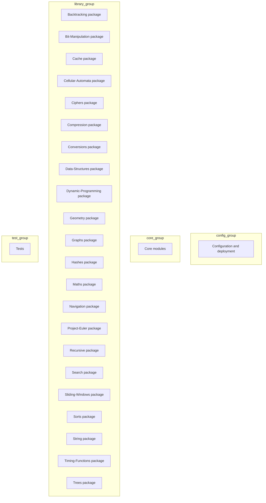

# Architecture report: TheAlgorithms/JavaScript

> Automated static analysis. **Observed** = directly seen in files/imports/AST; **Inferred** = interpretation from that evidence. Repository code was not executed.

## 1. Repository at a glance

| Item | Value |
| --- | --- |
| Repository | TheAlgorithms/JavaScript |
| Description | Algorithms and Data Structures implemented in JavaScript for beginners, following best practices. |
| Language | JavaScript |
| Stars | 34276 |
| Licence | GPL-3.0 |
| Analysed commit / branch | 5c39e87a9a31f279c60f830ad74a845e4788a517 / master |
| Framework(s) | None detected |
| Files analysed | 751 |
| Components | 25 |

## 2. Architecture in one minute

TheAlgorithms/JavaScript - Algorithms and Data Structures implemented in JavaScript for beginners, following best practices.. This repository was analysed statically from 751 file(s) (0 Python). Detected technologies (observed from imports/manifests): GitHub Actions, Vitest. Files are grouped into 25 component(s): Backtracking package, Bit-Manipulation package, Cache package, Cellular-Automata package, Ciphers package, Compression package, Configuration and deployment, Conversions package. Findings below distinguish observed facts from inferred interpretation.

## 3. High-level block diagram

## 4. Main components

### Backtracking package (`backtracking`)

- **Kind:** library
- **Status:** Observed
- **Confidence:** 0.85
- **Responsibility:** Groups 9 file(s) under backtracking package (observed from repository paths and static analysis).
- **Paths:** `Backtracking/AllCombinationsOfSizeK.js`, `Backtracking/GeneratePermutations.js`, `Backtracking/KnightTour.js`, `Backtracking/MColoringProblem.js`, `Backtracking/NQueens.js`, `Backtracking/RatInAMaze.js`, `Backtracking/Sudoku.js`, `Backtracking/SumOfSubset.js`, `Backtracking/generateParentheses.js`
- **Evidence:** [Backtracking/AllCombinationsOfSizeK.js](https://github.com/TheAlgorithms/JavaScript/blob/5c39e87a9a31f279c60f830ad74a845e4788a517/Backtracking/AllCombinationsOfSizeK.js); [Backtracking/GeneratePermutations.js](https://github.com/TheAlgorithms/JavaScript/blob/5c39e87a9a31f279c60f830ad74a845e4788a517/Backtracking/GeneratePermutations.js); [Backtracking/KnightTour.js](https://github.com/TheAlgorithms/JavaScript/blob/5c39e87a9a31f279c60f830ad74a845e4788a517/Backtracking/KnightTour.js); [Backtracking/MColoringProblem.js](https://github.com/TheAlgorithms/JavaScript/blob/5c39e87a9a31f279c60f830ad74a845e4788a517/Backtracking/MColoringProblem.js); [Backtracking/NQueens.js](https://github.com/TheAlgorithms/JavaScript/blob/5c39e87a9a31f279c60f830ad74a845e4788a517/Backtracking/NQueens.js); [Backtracking/RatInAMaze.js](https://github.com/TheAlgorithms/JavaScript/blob/5c39e87a9a31f279c60f830ad74a845e4788a517/Backtracking/RatInAMaze.js); [Backtracking/Sudoku.js](https://github.com/TheAlgorithms/JavaScript/blob/5c39e87a9a31f279c60f830ad74a845e4788a517/Backtracking/Sudoku.js); [Backtracking/SumOfSubset.js](https://github.com/TheAlgorithms/JavaScript/blob/5c39e87a9a31f279c60f830ad74a845e4788a517/Backtracking/SumOfSubset.js)

### Bit-Manipulation package (`bit_manipulation`)

- **Kind:** library
- **Status:** Observed
- **Confidence:** 0.85
- **Responsibility:** Groups 9 file(s) under bit-manipulation package (observed from repository paths and static analysis).
- **Paths:** `Bit-Manipulation/BinaryCountSetBits.js`, `Bit-Manipulation/GenerateSubSets.js`, `Bit-Manipulation/GrayCodes.js`, `Bit-Manipulation/IsPowerOfTwo.js`, `Bit-Manipulation/IsPowerofFour.js`, `Bit-Manipulation/LogTwo.js`, `Bit-Manipulation/NextPowerOfTwo.js`, `Bit-Manipulation/SetBit.js`, `Bit-Manipulation/UniqueElementInAnArray.js`
- **Evidence:** [Bit-Manipulation/BinaryCountSetBits.js](https://github.com/TheAlgorithms/JavaScript/blob/5c39e87a9a31f279c60f830ad74a845e4788a517/Bit-Manipulation/BinaryCountSetBits.js); [Bit-Manipulation/GenerateSubSets.js](https://github.com/TheAlgorithms/JavaScript/blob/5c39e87a9a31f279c60f830ad74a845e4788a517/Bit-Manipulation/GenerateSubSets.js); [Bit-Manipulation/GrayCodes.js](https://github.com/TheAlgorithms/JavaScript/blob/5c39e87a9a31f279c60f830ad74a845e4788a517/Bit-Manipulation/GrayCodes.js); [Bit-Manipulation/IsPowerOfTwo.js](https://github.com/TheAlgorithms/JavaScript/blob/5c39e87a9a31f279c60f830ad74a845e4788a517/Bit-Manipulation/IsPowerOfTwo.js); [Bit-Manipulation/IsPowerofFour.js](https://github.com/TheAlgorithms/JavaScript/blob/5c39e87a9a31f279c60f830ad74a845e4788a517/Bit-Manipulation/IsPowerofFour.js); [Bit-Manipulation/LogTwo.js](https://github.com/TheAlgorithms/JavaScript/blob/5c39e87a9a31f279c60f830ad74a845e4788a517/Bit-Manipulation/LogTwo.js); [Bit-Manipulation/NextPowerOfTwo.js](https://github.com/TheAlgorithms/JavaScript/blob/5c39e87a9a31f279c60f830ad74a845e4788a517/Bit-Manipulation/NextPowerOfTwo.js); [Bit-Manipulation/SetBit.js](https://github.com/TheAlgorithms/JavaScript/blob/5c39e87a9a31f279c60f830ad74a845e4788a517/Bit-Manipulation/SetBit.js)

### Cache package (`cache`)

- **Kind:** library
- **Status:** Observed
- **Confidence:** 0.85
- **Responsibility:** Groups 3 file(s) under cache package (observed from repository paths and static analysis).
- **Paths:** `Cache/LFUCache.js`, `Cache/LRUCache.js`, `Cache/Memoize.js`
- **Evidence:** [Cache/LFUCache.js](https://github.com/TheAlgorithms/JavaScript/blob/5c39e87a9a31f279c60f830ad74a845e4788a517/Cache/LFUCache.js); [Cache/LRUCache.js](https://github.com/TheAlgorithms/JavaScript/blob/5c39e87a9a31f279c60f830ad74a845e4788a517/Cache/LRUCache.js); [Cache/Memoize.js](https://github.com/TheAlgorithms/JavaScript/blob/5c39e87a9a31f279c60f830ad74a845e4788a517/Cache/Memoize.js)

### Cellular-Automata package (`cellular_automata`)

- **Kind:** library
- **Status:** Observed
- **Confidence:** 0.85
- **Responsibility:** Groups 2 file(s) under cellular-automata package (observed from repository paths and static analysis).
- **Paths:** `Cellular-Automata/ConwaysGameOfLife.js`, `Cellular-Automata/Elementary.js`
- **Evidence:** [Cellular-Automata/ConwaysGameOfLife.js](https://github.com/TheAlgorithms/JavaScript/blob/5c39e87a9a31f279c60f830ad74a845e4788a517/Cellular-Automata/ConwaysGameOfLife.js); [Cellular-Automata/Elementary.js](https://github.com/TheAlgorithms/JavaScript/blob/5c39e87a9a31f279c60f830ad74a845e4788a517/Cellular-Automata/Elementary.js)

### Ciphers package (`ciphers`)

- **Kind:** library
- **Status:** Observed
- **Confidence:** 0.85
- **Responsibility:** Groups 9 file(s) under ciphers package (observed from repository paths and static analysis).
- **Paths:** `Ciphers/AffineCipher.js`, `Ciphers/Atbash.js`, `Ciphers/CaesarCipher.js`, `Ciphers/KeyFinder.js`, `Ciphers/KeywordShiftedAlphabet.js`, `Ciphers/MorseCode.js`, `Ciphers/ROT13.js`, `Ciphers/VigenereCipher.js`, `Ciphers/XORCipher.js`
- **Evidence:** [Ciphers/AffineCipher.js](https://github.com/TheAlgorithms/JavaScript/blob/5c39e87a9a31f279c60f830ad74a845e4788a517/Ciphers/AffineCipher.js); [Ciphers/Atbash.js](https://github.com/TheAlgorithms/JavaScript/blob/5c39e87a9a31f279c60f830ad74a845e4788a517/Ciphers/Atbash.js); [Ciphers/CaesarCipher.js](https://github.com/TheAlgorithms/JavaScript/blob/5c39e87a9a31f279c60f830ad74a845e4788a517/Ciphers/CaesarCipher.js); [Ciphers/KeyFinder.js](https://github.com/TheAlgorithms/JavaScript/blob/5c39e87a9a31f279c60f830ad74a845e4788a517/Ciphers/KeyFinder.js); [Ciphers/KeywordShiftedAlphabet.js](https://github.com/TheAlgorithms/JavaScript/blob/5c39e87a9a31f279c60f830ad74a845e4788a517/Ciphers/KeywordShiftedAlphabet.js); [Ciphers/MorseCode.js](https://github.com/TheAlgorithms/JavaScript/blob/5c39e87a9a31f279c60f830ad74a845e4788a517/Ciphers/MorseCode.js); [Ciphers/ROT13.js](https://github.com/TheAlgorithms/JavaScript/blob/5c39e87a9a31f279c60f830ad74a845e4788a517/Ciphers/ROT13.js); [Ciphers/VigenereCipher.js](https://github.com/TheAlgorithms/JavaScript/blob/5c39e87a9a31f279c60f830ad74a845e4788a517/Ciphers/VigenereCipher.js)

### Compression package (`compression`)

- **Kind:** library
- **Status:** Observed
- **Confidence:** 0.85
- **Responsibility:** Groups 1 file(s) under compression package (observed from repository paths and static analysis).
- **Paths:** `Compression/RLE.js`
- **Evidence:** [Compression/RLE.js](https://github.com/TheAlgorithms/JavaScript/blob/5c39e87a9a31f279c60f830ad74a845e4788a517/Compression/RLE.js)

### Configuration and deployment (`config`)

- **Kind:** config
- **Status:** Observed
- **Confidence:** 0.85
- **Responsibility:** Groups 1 file(s) under configuration and deployment (observed from repository paths and static analysis).
- **Paths:** `package.json`
- **Evidence:** [package.json](https://github.com/TheAlgorithms/JavaScript/blob/5c39e87a9a31f279c60f830ad74a845e4788a517/package.json)

### Conversions package (`conversions`)

- **Kind:** library
- **Status:** Observed
- **Confidence:** 0.85
- **Responsibility:** Groups 29 file(s) under conversions package (observed from repository paths and static analysis).
- **Paths:** `Conversions/ArbitraryBase.js`, `Conversions/ArrayBufferToBase64.js`, `Conversions/Base64ToArrayBuffer.js`, `Conversions/BinaryToDecimal.js`, `Conversions/BinaryToHex.js`, `Conversions/DateDayDifference.js`, `Conversions/DateToDay.js`, `Conversions/DecimalToBinary.js`, `Conversions/DecimalToHex.js`, `Conversions/DecimalToOctal.js`, `Conversions/DecimalToRoman.js`, `Conversions/HexToBinary.js`, `Conversions/HexToDecimal.js`, `Conversions/HexToRGB.js`, `Conversions/LengthConversion.js`, `Conversions/LitersToImperialGallons.js`, `Conversions/LitersToUSGallons.js`, `Conversions/LowerCaseConversion.js`, `Conversions/MeterToFeetConversion.js`, `Conversions/OctToDecimal.js`, `Conversions/OuncesToKilograms.js`, `Conversions/RGBToHex.js`, `Conversions/RailwayTimeConversion.js`, `Conversions/RgbHslConversion.js`, `Conversions/RgbHsvConversion.js`, `Conversions/RomanToDecimal.js`, `Conversions/TemperatureConversion.js`, `Conversions/TitleCaseConversion.js`, `Conversions/UpperCaseConversion.js`
- **Evidence:** [Conversions/ArbitraryBase.js](https://github.com/TheAlgorithms/JavaScript/blob/5c39e87a9a31f279c60f830ad74a845e4788a517/Conversions/ArbitraryBase.js); [Conversions/ArrayBufferToBase64.js](https://github.com/TheAlgorithms/JavaScript/blob/5c39e87a9a31f279c60f830ad74a845e4788a517/Conversions/ArrayBufferToBase64.js); [Conversions/Base64ToArrayBuffer.js](https://github.com/TheAlgorithms/JavaScript/blob/5c39e87a9a31f279c60f830ad74a845e4788a517/Conversions/Base64ToArrayBuffer.js); [Conversions/BinaryToDecimal.js](https://github.com/TheAlgorithms/JavaScript/blob/5c39e87a9a31f279c60f830ad74a845e4788a517/Conversions/BinaryToDecimal.js); [Conversions/BinaryToHex.js](https://github.com/TheAlgorithms/JavaScript/blob/5c39e87a9a31f279c60f830ad74a845e4788a517/Conversions/BinaryToHex.js); [Conversions/DateDayDifference.js](https://github.com/TheAlgorithms/JavaScript/blob/5c39e87a9a31f279c60f830ad74a845e4788a517/Conversions/DateDayDifference.js); [Conversions/DateToDay.js](https://github.com/TheAlgorithms/JavaScript/blob/5c39e87a9a31f279c60f830ad74a845e4788a517/Conversions/DateToDay.js); [Conversions/DecimalToBinary.js](https://github.com/TheAlgorithms/JavaScript/blob/5c39e87a9a31f279c60f830ad74a845e4788a517/Conversions/DecimalToBinary.js)

### Core modules (`core`)

- **Kind:** core
- **Status:** Observed
- **Confidence:** 0.85
- **Responsibility:** Groups 1 file(s) under core modules (observed from repository paths and static analysis).
- **Paths:** `vitest.config.ts`
- **Evidence:** [vitest.config.ts](https://github.com/TheAlgorithms/JavaScript/blob/5c39e87a9a31f279c60f830ad74a845e4788a517/vitest.config.ts)

### Data-Structures package (`data_structures`)

- **Kind:** library
- **Status:** Observed
- **Confidence:** 0.85
- **Responsibility:** Groups 29 file(s) under data-structures package (observed from repository paths and static analysis).
- **Paths:** `Data-Structures/Array/LocalMaximumPoint.js`, `Data-Structures/Array/NumberOfLocalMaximumPoints.js`, `Data-Structures/Array/QuickSelect.js`, `Data-Structures/Array/Reverse.js`, `Data-Structures/Graph/Graph.js`, `Data-Structures/Graph/Graph2.js`, `Data-Structures/Graph/Graph3.js`, `Data-Structures/Heap/BinaryHeap.js`, `Data-Structures/Heap/KeyPriorityQueue.js`, `Data-Structures/Heap/MinPriorityQueue.js`, `Data-Structures/Linked-List/AddTwoNumbers.js`, `Data-Structures/Linked-List/CycleDetection.js`, `Data-Structures/Linked-List/CycleDetectionII.js`, `Data-Structures/Linked-List/DoublyLinkedList.js`, `Data-Structures/Linked-List/MergeTwoSortedLinkedLists.js`, `Data-Structures/Linked-List/ReverseSinglyLinkedList.js`, `Data-Structures/Linked-List/SinglyCircularLinkedList.js`, `Data-Structures/Linked-List/SinglyLinkedList.js`, `Data-Structures/Queue/CircularQueue.js`, `Data-Structures/Queue/Queue.js`, `Data-Structures/Queue/QueueUsing2Stacks.js`, `Data-Structures/Stack/EvaluateExpression.js`, `Data-Structures/Stack/Stack.js`, `Data-Structures/Stack/StackES6.js`, `Data-Structures/Tree/AVLTree.js`, `Data-Structures/Tree/BinarySearchTree.js`, `Data-Structures/Tree/SegmentTree.js`, `Data-Structures/Tree/Trie.js`, `Data-Structures/Vectors/Vector2.js`
- **Evidence:** [Data-Structures/Array/LocalMaximumPoint.js](https://github.com/TheAlgorithms/JavaScript/blob/5c39e87a9a31f279c60f830ad74a845e4788a517/Data-Structures/Array/LocalMaximumPoint.js); [Data-Structures/Array/NumberOfLocalMaximumPoints.js](https://github.com/TheAlgorithms/JavaScript/blob/5c39e87a9a31f279c60f830ad74a845e4788a517/Data-Structures/Array/NumberOfLocalMaximumPoints.js); [Data-Structures/Array/QuickSelect.js](https://github.com/TheAlgorithms/JavaScript/blob/5c39e87a9a31f279c60f830ad74a845e4788a517/Data-Structures/Array/QuickSelect.js); [Data-Structures/Array/Reverse.js](https://github.com/TheAlgorithms/JavaScript/blob/5c39e87a9a31f279c60f830ad74a845e4788a517/Data-Structures/Array/Reverse.js); [Data-Structures/Graph/Graph.js](https://github.com/TheAlgorithms/JavaScript/blob/5c39e87a9a31f279c60f830ad74a845e4788a517/Data-Structures/Graph/Graph.js); [Data-Structures/Graph/Graph2.js](https://github.com/TheAlgorithms/JavaScript/blob/5c39e87a9a31f279c60f830ad74a845e4788a517/Data-Structures/Graph/Graph2.js); [Data-Structures/Graph/Graph3.js](https://github.com/TheAlgorithms/JavaScript/blob/5c39e87a9a31f279c60f830ad74a845e4788a517/Data-Structures/Graph/Graph3.js); [Data-Structures/Heap/BinaryHeap.js](https://github.com/TheAlgorithms/JavaScript/blob/5c39e87a9a31f279c60f830ad74a845e4788a517/Data-Structures/Heap/BinaryHeap.js)

### Dynamic-Programming package (`dynamic_programming`)

- **Kind:** library
- **Status:** Observed
- **Confidence:** 0.85
- **Responsibility:** Groups 32 file(s) under dynamic-programming package (observed from repository paths and static analysis).
- **Paths:** `Dynamic-Programming/Abbreviation.js`, `Dynamic-Programming/CatalanNumbers.js`, `Dynamic-Programming/ClimbingStairs.js`, `Dynamic-Programming/CoinChange.js`, `Dynamic-Programming/EditDistance.js`, `Dynamic-Programming/FastFibonacciNumber.js`, `Dynamic-Programming/FibonacciNumber.js`, `Dynamic-Programming/FindMonthCalendar.js`, `Dynamic-Programming/KadaneAlgo.js`, `Dynamic-Programming/LevenshteinDistance.js`, `Dynamic-Programming/LongestCommonSubsequence.js`, `Dynamic-Programming/LongestIncreasingSubsequence.js`, `Dynamic-Programming/LongestPalindromicSubsequence.js`, `Dynamic-Programming/LongestValidParentheses.js`, `Dynamic-Programming/MaxNonAdjacentSum.js`, `Dynamic-Programming/MaxProductOfThree.js`, `Dynamic-Programming/MinimumCostPath.js`, `Dynamic-Programming/NumberOfSubsetEqualToGivenSum.js`, `Dynamic-Programming/RodCutting.js`, `Dynamic-Programming/Shuf.js`, `Dynamic-Programming/SieveOfEratosthenes.js`, `Dynamic-Programming/Sliding-Window/HouseRobber.js`, `Dynamic-Programming/Sliding-Window/LongestSubstringWithoutRepeatingCharacters.js`, `Dynamic-Programming/Sliding-Window/MaxConsecutiveOnes.js`, `Dynamic-Programming/Sliding-Window/MaxConsecutiveOnesIII.js`, `Dynamic-Programming/Sliding-Window/PermutationinString.js`, `Dynamic-Programming/SudokuSolver.js`, `Dynamic-Programming/TrappingRainWater.js`, `Dynamic-Programming/TribonacciNumber.js`, `Dynamic-Programming/UniquePaths.js`, `Dynamic-Programming/UniquePaths2.js`, `Dynamic-Programming/ZeroOneKnapsack.js`
- **Evidence:** [Dynamic-Programming/Abbreviation.js](https://github.com/TheAlgorithms/JavaScript/blob/5c39e87a9a31f279c60f830ad74a845e4788a517/Dynamic-Programming/Abbreviation.js); [Dynamic-Programming/CatalanNumbers.js](https://github.com/TheAlgorithms/JavaScript/blob/5c39e87a9a31f279c60f830ad74a845e4788a517/Dynamic-Programming/CatalanNumbers.js); [Dynamic-Programming/ClimbingStairs.js](https://github.com/TheAlgorithms/JavaScript/blob/5c39e87a9a31f279c60f830ad74a845e4788a517/Dynamic-Programming/ClimbingStairs.js); [Dynamic-Programming/CoinChange.js](https://github.com/TheAlgorithms/JavaScript/blob/5c39e87a9a31f279c60f830ad74a845e4788a517/Dynamic-Programming/CoinChange.js); [Dynamic-Programming/EditDistance.js](https://github.com/TheAlgorithms/JavaScript/blob/5c39e87a9a31f279c60f830ad74a845e4788a517/Dynamic-Programming/EditDistance.js); [Dynamic-Programming/FastFibonacciNumber.js](https://github.com/TheAlgorithms/JavaScript/blob/5c39e87a9a31f279c60f830ad74a845e4788a517/Dynamic-Programming/FastFibonacciNumber.js); [Dynamic-Programming/FibonacciNumber.js](https://github.com/TheAlgorithms/JavaScript/blob/5c39e87a9a31f279c60f830ad74a845e4788a517/Dynamic-Programming/FibonacciNumber.js); [Dynamic-Programming/FindMonthCalendar.js](https://github.com/TheAlgorithms/JavaScript/blob/5c39e87a9a31f279c60f830ad74a845e4788a517/Dynamic-Programming/FindMonthCalendar.js)

### Geometry package (`geometry`)

- **Kind:** library
- **Status:** Observed
- **Confidence:** 0.85
- **Responsibility:** Groups 5 file(s) under geometry package (observed from repository paths and static analysis).
- **Paths:** `Geometry/Circle.js`, `Geometry/Cone.js`, `Geometry/ConvexHullGraham.js`, `Geometry/Pyramid.js`, `Geometry/Sphere.js`
- **Evidence:** [Geometry/Circle.js](https://github.com/TheAlgorithms/JavaScript/blob/5c39e87a9a31f279c60f830ad74a845e4788a517/Geometry/Circle.js); [Geometry/Cone.js](https://github.com/TheAlgorithms/JavaScript/blob/5c39e87a9a31f279c60f830ad74a845e4788a517/Geometry/Cone.js); [Geometry/ConvexHullGraham.js](https://github.com/TheAlgorithms/JavaScript/blob/5c39e87a9a31f279c60f830ad74a845e4788a517/Geometry/ConvexHullGraham.js); [Geometry/Pyramid.js](https://github.com/TheAlgorithms/JavaScript/blob/5c39e87a9a31f279c60f830ad74a845e4788a517/Geometry/Pyramid.js); [Geometry/Sphere.js](https://github.com/TheAlgorithms/JavaScript/blob/5c39e87a9a31f279c60f830ad74a845e4788a517/Geometry/Sphere.js)

### Graphs package (`graphs`)

- **Kind:** library
- **Status:** Observed
- **Confidence:** 0.85
- **Responsibility:** Groups 17 file(s) under graphs package (observed from repository paths and static analysis).
- **Paths:** `Graphs/BellmanFord.js`, `Graphs/BinaryLifting.js`, `Graphs/BreadthFirstSearch.js`, `Graphs/BreadthFirstShortestPath.js`, `Graphs/ConnectedComponents.js`, `Graphs/Density.js`, `Graphs/DepthFirstSearchIterative.js`, `Graphs/DepthFirstSearchRecursive.js`, `Graphs/Dijkstra.js`, `Graphs/DijkstraSmallestPath.js`, `Graphs/FloydWarshall.js`, `Graphs/Kosaraju.js`, `Graphs/KruskalMST.js`, `Graphs/LCABinaryLifting.js`, `Graphs/NodeNeighbors.js`, `Graphs/NumberOfIslands.js`, `Graphs/PrimMST.js`
- **Evidence:** [Graphs/BellmanFord.js](https://github.com/TheAlgorithms/JavaScript/blob/5c39e87a9a31f279c60f830ad74a845e4788a517/Graphs/BellmanFord.js); [Graphs/BinaryLifting.js](https://github.com/TheAlgorithms/JavaScript/blob/5c39e87a9a31f279c60f830ad74a845e4788a517/Graphs/BinaryLifting.js); [Graphs/BreadthFirstSearch.js](https://github.com/TheAlgorithms/JavaScript/blob/5c39e87a9a31f279c60f830ad74a845e4788a517/Graphs/BreadthFirstSearch.js); [Graphs/BreadthFirstShortestPath.js](https://github.com/TheAlgorithms/JavaScript/blob/5c39e87a9a31f279c60f830ad74a845e4788a517/Graphs/BreadthFirstShortestPath.js); [Graphs/ConnectedComponents.js](https://github.com/TheAlgorithms/JavaScript/blob/5c39e87a9a31f279c60f830ad74a845e4788a517/Graphs/ConnectedComponents.js); [Graphs/Density.js](https://github.com/TheAlgorithms/JavaScript/blob/5c39e87a9a31f279c60f830ad74a845e4788a517/Graphs/Density.js); [Graphs/DepthFirstSearchIterative.js](https://github.com/TheAlgorithms/JavaScript/blob/5c39e87a9a31f279c60f830ad74a845e4788a517/Graphs/DepthFirstSearchIterative.js); [Graphs/DepthFirstSearchRecursive.js](https://github.com/TheAlgorithms/JavaScript/blob/5c39e87a9a31f279c60f830ad74a845e4788a517/Graphs/DepthFirstSearchRecursive.js)

### Hashes package (`hashes`)

- **Kind:** library
- **Status:** Observed
- **Confidence:** 0.85
- **Responsibility:** Groups 3 file(s) under hashes package (observed from repository paths and static analysis).
- **Paths:** `Hashes/MD5.js`, `Hashes/SHA1.js`, `Hashes/SHA256.js`
- **Evidence:** [Hashes/MD5.js](https://github.com/TheAlgorithms/JavaScript/blob/5c39e87a9a31f279c60f830ad74a845e4788a517/Hashes/MD5.js); [Hashes/SHA1.js](https://github.com/TheAlgorithms/JavaScript/blob/5c39e87a9a31f279c60f830ad74a845e4788a517/Hashes/SHA1.js); [Hashes/SHA256.js](https://github.com/TheAlgorithms/JavaScript/blob/5c39e87a9a31f279c60f830ad74a845e4788a517/Hashes/SHA256.js)

### Maths package (`maths`)

- **Kind:** library
- **Status:** Observed
- **Confidence:** 0.85
- **Responsibility:** Groups 97 file(s) under maths package (observed from repository paths and static analysis).
- **Paths:** `Maths/Abs.js`, `Maths/AliquotSum.js`, `Maths/Area.js`, `Maths/ArithmeticGeometricMean.js`, `Maths/ArmstrongNumber.js`, `Maths/AutomorphicNumber.js`, `Maths/AverageMean.js`, `Maths/AverageMedian.js`, `Maths/BinaryConvert.js`, `Maths/BinaryExponentiationIterative.js`, `Maths/BinaryExponentiationRecursive.js`, `Maths/BinomialCoefficient.js`, `Maths/BisectionMethod.js`, `Maths/CheckKishnamurthyNumber.js`, `Maths/CircularArc.js`, `Maths/CoPrimeCheck.js`, `Maths/CollatzSequence.js`, `Maths/Coordinate.js`, `Maths/CountNumbersDivisible.js`, `Maths/DecimalExpansion.js`, `Maths/DecimalIsolate.js`, `Maths/DegreeToRadian.js`, `Maths/Determinant.js`, `Maths/EuclideanDistance.js`, `Maths/EulerMethod.js`, `Maths/EulersTotient.js`, `Maths/EulersTotientFunction.js`, `Maths/ExponentialFunction.js`, `Maths/ExtendedEuclideanGCD.js`, `Maths/Factorial.js`, `Maths/Factors.js`, `Maths/FareyApproximation.js`, `Maths/FermatPrimalityTest.js`, `Maths/Fibonacci.js`, `Maths/FigurateNumber.js`, `Maths/FindHcf.js`, `Maths/FindLcm.js`, `Maths/FindMaxRecursion.js`, `Maths/FindMin.js`, `Maths/FindMinIterator.js`, `Maths/FriendlyNumbers.js`, `Maths/GetEuclidGCD.js`, `Maths/GridGet.js`, `Maths/HexagonalNumber.js`, `Maths/IntToBase.js`, `Maths/IsDivisible.js`, `Maths/IsEven.js`, `Maths/IsOdd.js`, `Maths/IsPronic.js`, `Maths/IsSquareFree.js`, `Maths/JugglerSequence.js`, `Maths/LeapYear.js`, `Maths/LinearSieve.js`, `Maths/LiouvilleFunction.js`, `Maths/LucasSeries.js`, `Maths/Mandelbrot.js`, `Maths/MatrixExponentiationRecursive.js`, `Maths/MatrixMultiplication.js`, `Maths/MeanAbsoluteDeviation.js`, `Maths/MeanSquareError.js`, `Maths/MidpointIntegration.js`, `Maths/MobiusFunction.js`, `Maths/ModularArithmetic.js`, `Maths/ModularBinaryExponentiationRecursive.js`, `Maths/NumberOfDigits.js`, `Maths/Palindrome.js`, `Maths/ParityOutlier.js`, `Maths/PascalTriangle.js`, `Maths/PerfectCube.js`, `Maths/PerfectNumber.js`, `Maths/PerfectSquare.js`, `Maths/PermutationAndCombination.js`, `Maths/PiApproximationMonteCarlo.js`, `Maths/Polynomial.js`, `Maths/Pow.js`, `Maths/PowLogarithmic.js`, `Maths/PrimeCheck.js`, `Maths/PrimeFactors.js`, `Maths/QuadraticRoots.js`, `Maths/RadianToDegree.js`, `Maths/ReverseNumber.js`, `Maths/ReversePolishNotation.js`, `Maths/RowEchelon.js`, `Maths/ShorsAlgorithm.js`, `Maths/SieveOfEratosthenes.js`, `Maths/Signum.js`, `Maths/SimpsonIntegration.js`, `Maths/Softmax.js`, `Maths/SquareRoot.js`, `Maths/SquareRootLogarithmic.js`, `Maths/SumOfDigits.js`, `Maths/SumOfGeometricProgression.js`, `Maths/TwoSum.js`, `Maths/Volume.js`, `Maths/WhileLoopFactorial.js`, `Maths/ZellersCongruenceAlgorithm.js`, `Maths/isPalindromeIntegerNumber.js`
- **Evidence:** [Maths/Abs.js](https://github.com/TheAlgorithms/JavaScript/blob/5c39e87a9a31f279c60f830ad74a845e4788a517/Maths/Abs.js); [Maths/AliquotSum.js](https://github.com/TheAlgorithms/JavaScript/blob/5c39e87a9a31f279c60f830ad74a845e4788a517/Maths/AliquotSum.js); [Maths/Area.js](https://github.com/TheAlgorithms/JavaScript/blob/5c39e87a9a31f279c60f830ad74a845e4788a517/Maths/Area.js); [Maths/ArithmeticGeometricMean.js](https://github.com/TheAlgorithms/JavaScript/blob/5c39e87a9a31f279c60f830ad74a845e4788a517/Maths/ArithmeticGeometricMean.js); [Maths/ArmstrongNumber.js](https://github.com/TheAlgorithms/JavaScript/blob/5c39e87a9a31f279c60f830ad74a845e4788a517/Maths/ArmstrongNumber.js); [Maths/AutomorphicNumber.js](https://github.com/TheAlgorithms/JavaScript/blob/5c39e87a9a31f279c60f830ad74a845e4788a517/Maths/AutomorphicNumber.js); [Maths/AverageMean.js](https://github.com/TheAlgorithms/JavaScript/blob/5c39e87a9a31f279c60f830ad74a845e4788a517/Maths/AverageMean.js); [Maths/AverageMedian.js](https://github.com/TheAlgorithms/JavaScript/blob/5c39e87a9a31f279c60f830ad74a845e4788a517/Maths/AverageMedian.js)

### Navigation package (`navigation`)

- **Kind:** library
- **Status:** Observed
- **Confidence:** 0.85
- **Responsibility:** Groups 1 file(s) under navigation package (observed from repository paths and static analysis).
- **Paths:** `Navigation/Haversine.js`
- **Evidence:** [Navigation/Haversine.js](https://github.com/TheAlgorithms/JavaScript/blob/5c39e87a9a31f279c60f830ad74a845e4788a517/Navigation/Haversine.js)

### Project-Euler package (`project_euler`)

- **Kind:** library
- **Status:** Observed
- **Confidence:** 0.85
- **Responsibility:** Groups 26 file(s) under project-euler package (observed from repository paths and static analysis).
- **Paths:** `Project-Euler/Problem001.js`, `Project-Euler/Problem002.js`, `Project-Euler/Problem003.js`, `Project-Euler/Problem004.js`, `Project-Euler/Problem005.js`, `Project-Euler/Problem006.js`, `Project-Euler/Problem007.js`, `Project-Euler/Problem008.js`, `Project-Euler/Problem009.js`, `Project-Euler/Problem010.js`, `Project-Euler/Problem011.js`, `Project-Euler/Problem012.js`, `Project-Euler/Problem013.js`, `Project-Euler/Problem014.js`, `Project-Euler/Problem015.js`, `Project-Euler/Problem016.js`, `Project-Euler/Problem017.js`, `Project-Euler/Problem018.js`, `Project-Euler/Problem019.js`, `Project-Euler/Problem020.js`, `Project-Euler/Problem021.js`, `Project-Euler/Problem023.js`, `Project-Euler/Problem025.js`, `Project-Euler/Problem028.js`, `Project-Euler/Problem035.js`, `Project-Euler/Problem044.js`
- **Evidence:** [Project-Euler/Problem001.js](https://github.com/TheAlgorithms/JavaScript/blob/5c39e87a9a31f279c60f830ad74a845e4788a517/Project-Euler/Problem001.js); [Project-Euler/Problem002.js](https://github.com/TheAlgorithms/JavaScript/blob/5c39e87a9a31f279c60f830ad74a845e4788a517/Project-Euler/Problem002.js); [Project-Euler/Problem003.js](https://github.com/TheAlgorithms/JavaScript/blob/5c39e87a9a31f279c60f830ad74a845e4788a517/Project-Euler/Problem003.js); [Project-Euler/Problem004.js](https://github.com/TheAlgorithms/JavaScript/blob/5c39e87a9a31f279c60f830ad74a845e4788a517/Project-Euler/Problem004.js); [Project-Euler/Problem005.js](https://github.com/TheAlgorithms/JavaScript/blob/5c39e87a9a31f279c60f830ad74a845e4788a517/Project-Euler/Problem005.js); [Project-Euler/Problem006.js](https://github.com/TheAlgorithms/JavaScript/blob/5c39e87a9a31f279c60f830ad74a845e4788a517/Project-Euler/Problem006.js); [Project-Euler/Problem007.js](https://github.com/TheAlgorithms/JavaScript/blob/5c39e87a9a31f279c60f830ad74a845e4788a517/Project-Euler/Problem007.js); [Project-Euler/Problem008.js](https://github.com/TheAlgorithms/JavaScript/blob/5c39e87a9a31f279c60f830ad74a845e4788a517/Project-Euler/Problem008.js)

### Recursive package (`recursive`)

- **Kind:** library
- **Status:** Observed
- **Confidence:** 0.85
- **Responsibility:** Groups 13 file(s) under recursive package (observed from repository paths and static analysis).
- **Paths:** `Recursive/BinaryEquivalent.js`, `Recursive/BinarySearch.js`, `Recursive/Factorial.js`, `Recursive/FibonacciNumberRecursive.js`, `Recursive/FloodFill.js`, `Recursive/KochSnowflake.js`, `Recursive/KochSnowflake.manual-test.js`, `Recursive/LetterCombination.js`, `Recursive/Palindrome.js`, `Recursive/PalindromePartitioning.js`, `Recursive/Partition.js`, `Recursive/SubsequenceRecursive.js`, `Recursive/TowerOfHanoi.js`
- **Evidence:** [Recursive/BinaryEquivalent.js](https://github.com/TheAlgorithms/JavaScript/blob/5c39e87a9a31f279c60f830ad74a845e4788a517/Recursive/BinaryEquivalent.js); [Recursive/BinarySearch.js](https://github.com/TheAlgorithms/JavaScript/blob/5c39e87a9a31f279c60f830ad74a845e4788a517/Recursive/BinarySearch.js); [Recursive/Factorial.js](https://github.com/TheAlgorithms/JavaScript/blob/5c39e87a9a31f279c60f830ad74a845e4788a517/Recursive/Factorial.js); [Recursive/FibonacciNumberRecursive.js](https://github.com/TheAlgorithms/JavaScript/blob/5c39e87a9a31f279c60f830ad74a845e4788a517/Recursive/FibonacciNumberRecursive.js); [Recursive/FloodFill.js](https://github.com/TheAlgorithms/JavaScript/blob/5c39e87a9a31f279c60f830ad74a845e4788a517/Recursive/FloodFill.js); [Recursive/KochSnowflake.js](https://github.com/TheAlgorithms/JavaScript/blob/5c39e87a9a31f279c60f830ad74a845e4788a517/Recursive/KochSnowflake.js); [Recursive/KochSnowflake.manual-test.js](https://github.com/TheAlgorithms/JavaScript/blob/5c39e87a9a31f279c60f830ad74a845e4788a517/Recursive/KochSnowflake.manual-test.js); [Recursive/LetterCombination.js](https://github.com/TheAlgorithms/JavaScript/blob/5c39e87a9a31f279c60f830ad74a845e4788a517/Recursive/LetterCombination.js)

### Search package (`search`)

- **Kind:** library
- **Status:** Observed
- **Confidence:** 0.85
- **Responsibility:** Groups 13 file(s) under search package (observed from repository paths and static analysis).
- **Paths:** `Search/BinarySearch.js`, `Search/ExponentialSearch.js`, `Search/FibonacciSearch.js`, `Search/InterpolationSearch.js`, `Search/JumpSearch.js`, `Search/LinearSearch.js`, `Search/Minesweeper.js`, `Search/QuickSelectSearch.js`, `Search/RabinKarp.js`, `Search/SlidingWindow.js`, `Search/StringSearch.js`, `Search/TernarySearch.js`, `Search/UnionFind.js`
- **Evidence:** [Search/BinarySearch.js](https://github.com/TheAlgorithms/JavaScript/blob/5c39e87a9a31f279c60f830ad74a845e4788a517/Search/BinarySearch.js); [Search/ExponentialSearch.js](https://github.com/TheAlgorithms/JavaScript/blob/5c39e87a9a31f279c60f830ad74a845e4788a517/Search/ExponentialSearch.js); [Search/FibonacciSearch.js](https://github.com/TheAlgorithms/JavaScript/blob/5c39e87a9a31f279c60f830ad74a845e4788a517/Search/FibonacciSearch.js); [Search/InterpolationSearch.js](https://github.com/TheAlgorithms/JavaScript/blob/5c39e87a9a31f279c60f830ad74a845e4788a517/Search/InterpolationSearch.js); [Search/JumpSearch.js](https://github.com/TheAlgorithms/JavaScript/blob/5c39e87a9a31f279c60f830ad74a845e4788a517/Search/JumpSearch.js); [Search/LinearSearch.js](https://github.com/TheAlgorithms/JavaScript/blob/5c39e87a9a31f279c60f830ad74a845e4788a517/Search/LinearSearch.js); [Search/Minesweeper.js](https://github.com/TheAlgorithms/JavaScript/blob/5c39e87a9a31f279c60f830ad74a845e4788a517/Search/Minesweeper.js); [Search/QuickSelectSearch.js](https://github.com/TheAlgorithms/JavaScript/blob/5c39e87a9a31f279c60f830ad74a845e4788a517/Search/QuickSelectSearch.js)

### Sliding-Windows package (`sliding_windows`)

- **Kind:** library
- **Status:** Observed
- **Confidence:** 0.85
- **Responsibility:** Groups 2 file(s) under sliding-windows package (observed from repository paths and static analysis).
- **Paths:** `Sliding-Windows/LongestSubarrayWithSumAtMost.js`, `Sliding-Windows/MaxSumSubarrayFixed.js`
- **Evidence:** [Sliding-Windows/LongestSubarrayWithSumAtMost.js](https://github.com/TheAlgorithms/JavaScript/blob/5c39e87a9a31f279c60f830ad74a845e4788a517/Sliding-Windows/LongestSubarrayWithSumAtMost.js); [Sliding-Windows/MaxSumSubarrayFixed.js](https://github.com/TheAlgorithms/JavaScript/blob/5c39e87a9a31f279c60f830ad74a845e4788a517/Sliding-Windows/MaxSumSubarrayFixed.js)

### Sorts package (`sorts`)

- **Kind:** library
- **Status:** Observed
- **Confidence:** 0.85
- **Responsibility:** Groups 33 file(s) under sorts package (observed from repository paths and static analysis).
- **Paths:** `Sorts/AlphaNumericalSort.js`, `Sorts/BeadSort.js`, `Sorts/BinaryInsertionSort.js`, `Sorts/BogoSort.js`, `Sorts/BubbleSort.js`, `Sorts/BucketSort.js`, `Sorts/CocktailShakerSort.js`, `Sorts/CombSort.js`, `Sorts/CountingSort.js`, `Sorts/CycleSort.js`, `Sorts/DutchNationalFlagSort.js`, `Sorts/FindSecondLargestElement.js`, `Sorts/FisherYatesShuffle.js`, `Sorts/FlashSort.js`, `Sorts/GnomeSort.js`, `Sorts/HeapSort.js`, `Sorts/HeapSortV2.js`, `Sorts/InsertionSort.js`, `Sorts/IntroSort.js`, `Sorts/MergeSort.js`, `Sorts/OddEvenSort.js`, `Sorts/PancakeSort.js`, `Sorts/PigeonHoleSort.js`, `Sorts/QuickSort.js`, `Sorts/QuickSortRecursive.js`, `Sorts/RadixSort.js`, `Sorts/SelectionSort.js`, `Sorts/ShellSort.js`, `Sorts/SimplifiedWiggleSort.js`, `Sorts/StoogeSort.js`, `Sorts/SwapSort.js`, `Sorts/TimSort.js`, `Sorts/TopologicalSort.js`
- **Evidence:** [Sorts/AlphaNumericalSort.js](https://github.com/TheAlgorithms/JavaScript/blob/5c39e87a9a31f279c60f830ad74a845e4788a517/Sorts/AlphaNumericalSort.js); [Sorts/BeadSort.js](https://github.com/TheAlgorithms/JavaScript/blob/5c39e87a9a31f279c60f830ad74a845e4788a517/Sorts/BeadSort.js); [Sorts/BinaryInsertionSort.js](https://github.com/TheAlgorithms/JavaScript/blob/5c39e87a9a31f279c60f830ad74a845e4788a517/Sorts/BinaryInsertionSort.js); [Sorts/BogoSort.js](https://github.com/TheAlgorithms/JavaScript/blob/5c39e87a9a31f279c60f830ad74a845e4788a517/Sorts/BogoSort.js); [Sorts/BubbleSort.js](https://github.com/TheAlgorithms/JavaScript/blob/5c39e87a9a31f279c60f830ad74a845e4788a517/Sorts/BubbleSort.js); [Sorts/BucketSort.js](https://github.com/TheAlgorithms/JavaScript/blob/5c39e87a9a31f279c60f830ad74a845e4788a517/Sorts/BucketSort.js); [Sorts/CocktailShakerSort.js](https://github.com/TheAlgorithms/JavaScript/blob/5c39e87a9a31f279c60f830ad74a845e4788a517/Sorts/CocktailShakerSort.js); [Sorts/CombSort.js](https://github.com/TheAlgorithms/JavaScript/blob/5c39e87a9a31f279c60f830ad74a845e4788a517/Sorts/CombSort.js)

### String package (`string`)

- **Kind:** library
- **Status:** Observed
- **Confidence:** 0.85
- **Responsibility:** Groups 40 file(s) under string package (observed from repository paths and static analysis).
- **Paths:** `String/AlphaNumericPalindrome.js`, `String/AlternativeStringArrange.js`, `String/BoyerMoore.js`, `String/CheckAnagram.js`, `String/CheckCamelCase.js`, `String/CheckExceeding.js`, `String/CheckFlatCase.js`, `String/CheckKebabCase.js`, `String/CheckPalindrome.js`, `String/CheckPangram.js`, `String/CheckPascalCase.js`, `String/CheckRearrangePalindrome.js`, `String/CheckSnakeCase.js`, `String/CheckWordOccurrence.js`, `String/CountLetters.js`, `String/CountSubstrings.js`, `String/CountVowels.js`, `String/CreatePermutations.js`, `String/DiceCoefficient.js`, `String/FirstUniqueCharacter.js`, `String/FormatPhoneNumber.js`, `String/GenerateGUID.js`, `String/HammingDistance.js`, `String/IsPalindrome.js`, `String/KMPPatternSearching.js`, `String/LengthofLongestSubstringWithoutRepetition.js`, `String/LevenshteinDistance.js`, `String/Lower.js`, `String/MaxCharacter.js`, `String/MaxWord.js`, `String/PatternMatching.js`, `String/PercentageOfLetters.js`, `String/PermutateString.js`, `String/ReverseString.js`, `String/ReverseWords.js`, `String/ScrambleStrings.js`, `String/Upper.js`, `String/ValidateCreditCard.js`, `String/ValidateEmail.js`, `String/ZFunction.js`
- **Evidence:** [String/AlphaNumericPalindrome.js](https://github.com/TheAlgorithms/JavaScript/blob/5c39e87a9a31f279c60f830ad74a845e4788a517/String/AlphaNumericPalindrome.js); [String/AlternativeStringArrange.js](https://github.com/TheAlgorithms/JavaScript/blob/5c39e87a9a31f279c60f830ad74a845e4788a517/String/AlternativeStringArrange.js); [String/BoyerMoore.js](https://github.com/TheAlgorithms/JavaScript/blob/5c39e87a9a31f279c60f830ad74a845e4788a517/String/BoyerMoore.js); [String/CheckAnagram.js](https://github.com/TheAlgorithms/JavaScript/blob/5c39e87a9a31f279c60f830ad74a845e4788a517/String/CheckAnagram.js); [String/CheckCamelCase.js](https://github.com/TheAlgorithms/JavaScript/blob/5c39e87a9a31f279c60f830ad74a845e4788a517/String/CheckCamelCase.js); [String/CheckExceeding.js](https://github.com/TheAlgorithms/JavaScript/blob/5c39e87a9a31f279c60f830ad74a845e4788a517/String/CheckExceeding.js); [String/CheckFlatCase.js](https://github.com/TheAlgorithms/JavaScript/blob/5c39e87a9a31f279c60f830ad74a845e4788a517/String/CheckFlatCase.js); [String/CheckKebabCase.js](https://github.com/TheAlgorithms/JavaScript/blob/5c39e87a9a31f279c60f830ad74a845e4788a517/String/CheckKebabCase.js)

### Tests (`tests`)

- **Kind:** test
- **Status:** Observed
- **Confidence:** 0.85
- **Responsibility:** Groups 349 file(s) under tests (observed from repository paths and static analysis).
- **Paths:** `Backtracking/tests/AllCombinationsOfSizeK.test.js`, `Backtracking/tests/GenerateParentheses.test.js`, `Backtracking/tests/GeneratePermutations.test.js`, `Backtracking/tests/KnightTour.test.js`, `Backtracking/tests/MColoringProblem.test.js`, `Backtracking/tests/NQueens.test.js`, `Backtracking/tests/RatInAMaze.test.js`, `Backtracking/tests/Sudoku.test.js`, `Backtracking/tests/SumOfSubset.test.js`, `Bit-Manipulation/test/BinaryCountSetBits.test.js`, `Bit-Manipulation/test/GenerateSubSets.test.js`, `Bit-Manipulation/test/GrayCodes.test.js`, `Bit-Manipulation/test/IsPowerOfFour.test.js`, `Bit-Manipulation/test/IsPowerOfTwo.test.js`, `Bit-Manipulation/test/LogTwo.test.js`, `Bit-Manipulation/test/NextPowerOfTwo.test.js`, `Bit-Manipulation/test/SetBit.test.js`, `Bit-Manipulation/test/UniqueElementInAnArray.test.js`, `Cache/test/LFUCache.test.js`, `Cache/test/LRUCache.test.js`, `Cache/test/Memoize.test.js`, `Cache/test/cacheTest.js`, `Cellular-Automata/test/ConwaysGameOfLife.test.js`, `Cellular-Automata/test/Elementary.test.js`, `Ciphers/test/AffineCipher.test.js`, `Ciphers/test/Atbash.test.js`, `Ciphers/test/CaesarCipher.test.js`, `Ciphers/test/KeywordShiftedAlphabet.test.js`, `Ciphers/test/MorseCode.test.js`, `Ciphers/test/ROT13.test.js`, `Ciphers/test/VigenereCipher.test.js`, `Ciphers/test/XORCipher.test.js`, `Compression/test/RLE.test.js`, `Conversions/test/ArbitraryBase.test.js`, `Conversions/test/ArrayBufferToBase64.test.js`, `Conversions/test/Base64ToArrayBuffer.test.js`, `Conversions/test/BinaryToDecimal.test.js`, `Conversions/test/BinaryToHex.test.js`, `Conversions/test/DateDayDiffernce.test.js`, `Conversions/test/DateToDay.test.js`, `Conversions/test/DecimalToBinary.test.js`, `Conversions/test/DecimalToHex.test.js`, `Conversions/test/DecimalToOctal.test.js`, `Conversions/test/DecimalToRoman.test.js`, `Conversions/test/HexToBinary.test.js`, `Conversions/test/HexToDecimal.test.js`, `Conversions/test/HexToRGB.test.js`, `Conversions/test/LengthConversion.test.js`, `Conversions/test/LitersToImperialGallons.test.js`, `Conversions/test/LitersToUSGallons.test.js`, `Conversions/test/LowerCaseConversion.test.js`, `Conversions/test/MeterToFeetConversion.test.js`, `Conversions/test/OctToDecimal.test.js`, `Conversions/test/OuncesToKilogram.test.js`, `Conversions/test/RGBToHex.test.js`, `Conversions/test/RailwayTimeConversion.test.js`, `Conversions/test/RgbHslConversion.test.js`, `Conversions/test/RgbHsvConversion.test.js`, `Conversions/test/RomanToDecimal.test.js`, `Conversions/test/TemperatureConversion.test.js`, `Conversions/test/TitleCaseConversion.test.js`, `Conversions/test/UpperCaseConverstion.test.js`, `Data-Structures/Array/test/LocalMaximumPoint.test.js`, `Data-Structures/Array/test/NumberOfLocalMaximumPoints.test.js`, `Data-Structures/Array/test/QuickSelect.test.js`, `Data-Structures/Array/test/Reverse.test.js`, `Data-Structures/Graph/test/Graph2.test.js`, `Data-Structures/Graph/test/Graph3.test.js`, `Data-Structures/Heap/test/BinaryHeap.test.js`, `Data-Structures/Heap/test/KeyPriorityQueue.test.js`, `Data-Structures/Heap/test/MinPriorityQueue.test.js`, `Data-Structures/Linked-List/test/AddTwoNumbers.test.js`, `Data-Structures/Linked-List/test/CycleDetection.test.js`, `Data-Structures/Linked-List/test/CycleDetectionII.test.js`, `Data-Structures/Linked-List/test/DoublyLinkedList.test.js`, `Data-Structures/Linked-List/test/MergeTwoSortedLinkedLists.test.js`, `Data-Structures/Linked-List/test/ReverseSinglyLinkedList.test.js`, `Data-Structures/Linked-List/test/SinglyCircularLinkedList.test.js`, `Data-Structures/Linked-List/test/SinglyLinkedList.test.js`, `Data-Structures/Queue/test/Queue.test.js`, `Data-Structures/Queue/test/QueueUsing2Stacks.test.js`, `Data-Structures/Stack/test/EvaluateExpression.test.js`, `Data-Structures/Tree/test/AVLTree.test.js`, `Data-Structures/Tree/test/BinarySearchTree.test.js`, `Data-Structures/Tree/test/SegmentTree.test.js`, `Data-Structures/Vectors/test/Vector2.test.js`, `Dynamic-Programming/Sliding-Window/test/HouseRobber.test.js`, `Dynamic-Programming/Sliding-Window/test/LongestSubstringWithoutRepeatingCharacters.test.js`, `Dynamic-Programming/Sliding-Window/test/MaxConsecutiveOnes.test.js`, `Dynamic-Programming/Sliding-Window/test/MaxConsecutiveOnesIII.test.js`, `Dynamic-Programming/Sliding-Window/test/PermutationinString.test.js`, `Dynamic-Programming/tests/Abbreviation.test.js`, `Dynamic-Programming/tests/CatalanNumbers.test.js`, `Dynamic-Programming/tests/ClimbingStairs.test.js`, `Dynamic-Programming/tests/CoinChange.test.js`, `Dynamic-Programming/tests/EditDistance.test.js`, `Dynamic-Programming/tests/FastFibonacciNumber.test.js`, `Dynamic-Programming/tests/FibonacciNumber.test.js`, `Dynamic-Programming/tests/KadaneAlgo.test.js`, `Dynamic-Programming/tests/LevenshteinDistance.test.js`, `Dynamic-Programming/tests/LongestCommonSubsequence.test.js`, `Dynamic-Programming/tests/LongestIncreasingSubsequence.test.js`, `Dynamic-Programming/tests/LongestPalindromicSubsequence.test.js`, `Dynamic-Programming/tests/LongestValidParentheses.test.js`, `Dynamic-Programming/tests/MaxProductOfThree.test.js`, `Dynamic-Programming/tests/NumberOfSubsetEqualToGivenSum.test.js`, `Dynamic-Programming/tests/RodCutting.test.js`, `Dynamic-Programming/tests/SieveOfEratosthenes.test.js`, `Dynamic-Programming/tests/TrappingRainWater.test.js`, `Dynamic-Programming/tests/TribonacciNumber.test.js`, `Dynamic-Programming/tests/UniquePaths.test.js`, `Dynamic-Programming/tests/UniquePaths2.test.js`, `Dynamic-Programming/tests/ZeroOneKnapsack.test.js`, `Geometry/Test/Circle.test.js`, `Geometry/Test/Cone.test.js`, `Geometry/Test/ConvexHullGraham.test.js`, `Geometry/Test/Pyramid.test.js`, `Geometry/Test/Sphere.test.js`, `Graphs/test/BellmanFord.test.js`, `Graphs/test/BinaryLifting.test.js`, `Graphs/test/BreadthFirstSearch.test.js`, `Graphs/test/BreadthFirstShortestPath.test.js`, `Graphs/test/Kosaraju.test.js`, `Graphs/test/LCABinaryLifting.test.js`, `Graphs/test/NumberOfIslands.test.js`, `Graphs/test/PrimMST.test.js`, `Hashes/tests/MD5.test.js`, `Hashes/tests/SHA1.test.js`, `Hashes/tests/SHA256.test.js`, `Maths/test/Abs.test.js`, `Maths/test/AliquotSum.test.js`, `Maths/test/Area.test.js`, `Maths/test/ArithmeticGeometricMean.test.js`, `Maths/test/ArmstrongNumber.test.js`, `Maths/test/AutomorphicNumber.test.js`, `Maths/test/AverageMean.test.js`, `Maths/test/AverageMedian.test.js`, `Maths/test/BInaryConvert.test.js`, `Maths/test/BinaryExponentiationIterative.test.js`, `Maths/test/BinaryExponentiationRecursive.test.js`, `Maths/test/BinomialCoefficient.test.js`, `Maths/test/BisectionMethod.test.js`, `Maths/test/CheckKishnamurthyNumber.test.js`, `Maths/test/CircularArc.test.js`, `Maths/test/CoPrimeCheck.test.js`, `Maths/test/CollatzSequence.test.js`, `Maths/test/Coordinate.test.js`, `Maths/test/CountNumbersDivisible.test.js`, `Maths/test/DecimalExpansion.test.js`, `Maths/test/DegreeToRadian.test.js`, `Maths/test/Determinant.test.js`, `Maths/test/EuclideanDistance.test.js`, `Maths/test/EulerMethod.manual-test.js`, `Maths/test/EulerMethod.test.js`, `Maths/test/EulersTotient.test.js`, `Maths/test/EulersTotientFunction.test.js`, `Maths/test/ExponentialFunction.test.js`, `Maths/test/ExtendedEuclideanGCD.test.js`, `Maths/test/Factorial.test.js`, `Maths/test/Factors.test.js`, `Maths/test/FareyApproximation.test.js`, `Maths/test/FermatPrimalityTest.test.js`, `Maths/test/Fibonacci.test.js`, `Maths/test/FigurateNumber.test.js`, `Maths/test/FindHcf.test.js`, `Maths/test/FindLcm.test.js`, `Maths/test/FindMaxRecursion.test.js`, `Maths/test/FindMin.test.js`, `Maths/test/FindMinIterator.test.js`, `Maths/test/GetEuclidGCD.test.js`, `Maths/test/GridGet.test.js`, `Maths/test/HexagonalNumber.test.js`, `Maths/test/IntToBase.test.js`, `Maths/test/IsDivisible.test.js`, `Maths/test/IsEven.test.js`, `Maths/test/IsOdd.test.js`, `Maths/test/IsPronic.test.js`, `Maths/test/IsSquareFree.test.js`, `Maths/test/JugglerSequence.test.js`, `Maths/test/LeapYear.test.js`, `Maths/test/LinearSieve.test.js`, `Maths/test/LiouvilleFunction.test.js`, `Maths/test/LucasSeries.test.js`, `Maths/test/Mandelbrot.manual-test.js`, `Maths/test/Mandelbrot.test.js`, `Maths/test/MeanAbsoluteDeviation.test.js`, `Maths/test/MeanSquareError.test.js`, `Maths/test/MidpointIntegration.test.js`, `Maths/test/MobiusFunction.test.js`, `Maths/test/ModularArithmetic.test.js`, `Maths/test/ModularBinaryExponentiationRecursive.test.js`, `Maths/test/NumberOfDigits.test.js`, `Maths/test/Palindrome.test.js`, `Maths/test/ParityOutlier.test.js`, `Maths/test/PascalTriangle.test.js`, `Maths/test/PerfectCube.test.js`, `Maths/test/PerfectNumber.test.js`, `Maths/test/PerfectSquare.test.js`, `Maths/test/PermutationAndCombination.test.js`, `Maths/test/PiApproximationMonteCarlo.test.js`, `Maths/test/Polynomial.test.js`, `Maths/test/Pow.test.js`, `Maths/test/PowLogarithmic.test.js`, `Maths/test/PrimeCheck.test.js`, `Maths/test/PrimeFactors.test.js`, `Maths/test/QuadraticRoots.test.js`, `Maths/test/RadianToDegree.test.js`, `Maths/test/ReverseNumber.test.js`, `Maths/test/ReversePolishNotation.test.js`, `Maths/test/RowEchelon.test.js`, `Maths/test/ShorsAlgorithm.test.js`, `Maths/test/SieveOfEratosthenes.test.js`, `Maths/test/Signum.test.js`, `Maths/test/SimpsonIntegration.test.js`, `Maths/test/Softmax.test.js`, `Maths/test/SquareRoot.test.js`, `Maths/test/SquareRootLogarithmic.test.js`, `Maths/test/SumOfDigits.test.js`, `Maths/test/SumOfGeometricProgression.test.js`, `Maths/test/TwoSum.test.js`, `Maths/test/Volume.test.js`, `Maths/test/WhileLoopFactorial.test.js`, `Maths/test/ZellersCongruenceAlgorithm.test.js`, `Maths/test/isPalindromeIntegerNumber.test.js`, `Navigation/test/Haversine.test.js`, `Project-Euler/test/Problem001.test.js`, `Project-Euler/test/Problem002.test.js`, `Project-Euler/test/Problem003.test.js`, `Project-Euler/test/Problem004.test.js`, `Project-Euler/test/Problem005.test.js`, `Project-Euler/test/Problem006.test.js`, `Project-Euler/test/Problem007.test.js`, `Project-Euler/test/Problem008.test.js`, `Project-Euler/test/Problem009.test.js`, `Project-Euler/test/Problem010.test.js`, `Project-Euler/test/Problem011.test.js`, `Project-Euler/test/Problem012.test.js`, `Project-Euler/test/Problem013.test.js`, `Project-Euler/test/Problem014.test.js`, `Project-Euler/test/Problem016.test.js`, `Project-Euler/test/Problem017.test.js`, `Project-Euler/test/Problem018.test.js`, `Project-Euler/test/Problem019.test.js`, `Project-Euler/test/Problem020.test.js`, `Project-Euler/test/Problem021.test.js`, `Project-Euler/test/Problem023.test.js`, `Project-Euler/test/Problem025.test.js`, `Project-Euler/test/Problem028.test.js`, `Project-Euler/test/Problem035.test.js`, `Project-Euler/test/Problem044.test.js`, `Recursive/test/BinaryEquivalent.test.js`, `Recursive/test/BinarySearch.test.js`, `Recursive/test/Factorial.test.js`, `Recursive/test/FibonacciNumberRecursive.test.js`, `Recursive/test/FloodFill.test.js`, `Recursive/test/KochSnowflake.test.js`, `Recursive/test/LetterCombination.test.js`, `Recursive/test/Palindrome.test.js`, `Recursive/test/PalindromePartitioning.test.js`, `Recursive/test/Partition.test.js`, `Search/test/BinarySearch.test.js`, `Search/test/ExponentialSearch.test.js`, `Search/test/FibonacciSearch.test.js`, `Search/test/InterpolationSearch.test.js`, `Search/test/LinearSearch.test.js`, `Search/test/Minesweeper.test.js`, `Search/test/RabinKarp.test.js`, `Search/test/SlidingWindow.test.js`, `Search/test/TernarySearch.test.js`, `Search/test/UnionFind.test.js`, `Search/test/jumpSearch.test.js`, `Sliding-Windows/test/LongestSubarrayWithSumAtMost.test.js`, `Sliding-Windows/test/MaxSumSubarrayFixed.test.js`, `Sorts/test/AlphaNumericalSort.test.js`, `Sorts/test/BeadSort.test.js`, `Sorts/test/BinaryInsertionSort.test.js`, `Sorts/test/BogoSort.test.js`, `Sorts/test/BubbleSort.test.js`, `Sorts/test/BucketSort.test.js`, `Sorts/test/CocktailShakerSort.test.js`, `Sorts/test/CombSort.test.js`, `Sorts/test/CountingSort.test.js`, `Sorts/test/CycleSort.test.js`, `Sorts/test/DutchNationalFlagSort.test.js`, `Sorts/test/FindSecondLargestElement.test.js`, `Sorts/test/FisherYatesShuffle.test.js`, `Sorts/test/FlashSort.test.js`, `Sorts/test/GnomeSort.test.js`, `Sorts/test/HeapSort.test.js`, `Sorts/test/HeapSortV2.test.js`, `Sorts/test/InsertionSort.test.js`, `Sorts/test/MergeSort.test.js`, `Sorts/test/OddEvenSort.test.js`, `Sorts/test/PancakeSort.test.js`, `Sorts/test/PigeonHoleSort.test.js`, `Sorts/test/QuickSort.test.js`, `Sorts/test/QuickSortRecursive.test.js`, `Sorts/test/RadixSort.test.js`, `Sorts/test/SecondLargestElement.test.js`, `Sorts/test/SelectionSort.test.js`, `Sorts/test/ShellSort.test.js`, `Sorts/test/SimplifiedWiggleSort.test.js`, `Sorts/test/StoogeSort.test.js`, `Sorts/test/SwapSort.test.js`, `Sorts/test/TimSort.test.js`, `String/test/AlphaNumericPalindrome.test.js`, `String/test/AlternativeStringArrange.test.js`, `String/test/BoyerMoore.test.js`, `String/test/CheckAnagram.test.js`, `String/test/CheckCamelCase.test.js`, `String/test/CheckExceeding.test.js`, `String/test/CheckFlatCase.test.js`, `String/test/CheckKebabCase.test.js`, `String/test/CheckPalindrome.test.js`, `String/test/CheckPangram.test.js`, `String/test/CheckPascalCase.test.js`, `String/test/CheckRearrangePalindrome.test.js`, `String/test/CheckSnakeCase.test.js`, `String/test/CheckWordOcurrence.test.js`, `String/test/CountLetters.test.js`, `String/test/CountSubstrings.test.js`, `String/test/CountVowels.test.js`, `String/test/CreatePermutations.test.js`, `String/test/DiceCoefficient.test.js`, `String/test/FirstUniqueCharacter.test.js`, `String/test/FormatPhoneNumber.test.js`, `String/test/HammingDistance.test.js`, `String/test/IsPalindrome.test.js`, `String/test/KMPPatternSearching.test.js`, `String/test/LengthofLongestSubstringWithoutRepetition.test.js`, `String/test/LevenshteinDistance.test.js`, `String/test/Lower.test.js`, `String/test/MaxCharacter.test.js`, `String/test/MaxWord.test.js`, `String/test/PatternMatching.test.js`, `String/test/PercentageOfLetters.test.js`, `String/test/PermutateString.test.js`, `String/test/ReverseString.test.js`, `String/test/ReverseWords.test.js`, `String/test/ScrambleStrings.test.js`, `String/test/Upper.test.js`, `String/test/ValidateCreditCard.test.js`, `String/test/ValidateEmail.test.js`, `String/test/ZFunction.test.js`, `Timing-Functions/test/GetMonthDays.test.js`, `Timing-Functions/test/ParseDate.test.js`, `Trees/test/BreadthFirstTreeTraversal.test.js`, `Trees/test/DepthFirstSearch.test.js`, `Trees/test/FenwickTree.test.js`
- **Evidence:** [Backtracking/tests/AllCombinationsOfSizeK.test.js](https://github.com/TheAlgorithms/JavaScript/blob/5c39e87a9a31f279c60f830ad74a845e4788a517/Backtracking/tests/AllCombinationsOfSizeK.test.js); [Backtracking/tests/GenerateParentheses.test.js](https://github.com/TheAlgorithms/JavaScript/blob/5c39e87a9a31f279c60f830ad74a845e4788a517/Backtracking/tests/GenerateParentheses.test.js); [Backtracking/tests/GeneratePermutations.test.js](https://github.com/TheAlgorithms/JavaScript/blob/5c39e87a9a31f279c60f830ad74a845e4788a517/Backtracking/tests/GeneratePermutations.test.js); [Backtracking/tests/KnightTour.test.js](https://github.com/TheAlgorithms/JavaScript/blob/5c39e87a9a31f279c60f830ad74a845e4788a517/Backtracking/tests/KnightTour.test.js); [Backtracking/tests/MColoringProblem.test.js](https://github.com/TheAlgorithms/JavaScript/blob/5c39e87a9a31f279c60f830ad74a845e4788a517/Backtracking/tests/MColoringProblem.test.js); [Backtracking/tests/NQueens.test.js](https://github.com/TheAlgorithms/JavaScript/blob/5c39e87a9a31f279c60f830ad74a845e4788a517/Backtracking/tests/NQueens.test.js); [Backtracking/tests/RatInAMaze.test.js](https://github.com/TheAlgorithms/JavaScript/blob/5c39e87a9a31f279c60f830ad74a845e4788a517/Backtracking/tests/RatInAMaze.test.js); [Backtracking/tests/Sudoku.test.js](https://github.com/TheAlgorithms/JavaScript/blob/5c39e87a9a31f279c60f830ad74a845e4788a517/Backtracking/tests/Sudoku.test.js)

### Timing-Functions package (`timing_functions`)

- **Kind:** library
- **Status:** Observed
- **Confidence:** 0.85
- **Responsibility:** Groups 3 file(s) under timing-functions package (observed from repository paths and static analysis).
- **Paths:** `Timing-Functions/GetMonthDays.js`, `Timing-Functions/IntervalTimer.js`, `Timing-Functions/ParseDate.js`
- **Evidence:** [Timing-Functions/GetMonthDays.js](https://github.com/TheAlgorithms/JavaScript/blob/5c39e87a9a31f279c60f830ad74a845e4788a517/Timing-Functions/GetMonthDays.js); [Timing-Functions/IntervalTimer.js](https://github.com/TheAlgorithms/JavaScript/blob/5c39e87a9a31f279c60f830ad74a845e4788a517/Timing-Functions/IntervalTimer.js); [Timing-Functions/ParseDate.js](https://github.com/TheAlgorithms/JavaScript/blob/5c39e87a9a31f279c60f830ad74a845e4788a517/Timing-Functions/ParseDate.js)

### Trees package (`trees`)

- **Kind:** library
- **Status:** Observed
- **Confidence:** 0.85
- **Responsibility:** Groups 3 file(s) under trees package (observed from repository paths and static analysis).
- **Paths:** `Trees/BreadthFirstTreeTraversal.js`, `Trees/DepthFirstSearch.js`, `Trees/FenwickTree.js`
- **Evidence:** [Trees/BreadthFirstTreeTraversal.js](https://github.com/TheAlgorithms/JavaScript/blob/5c39e87a9a31f279c60f830ad74a845e4788a517/Trees/BreadthFirstTreeTraversal.js); [Trees/DepthFirstSearch.js](https://github.com/TheAlgorithms/JavaScript/blob/5c39e87a9a31f279c60f830ad74a845e4788a517/Trees/DepthFirstSearch.js); [Trees/FenwickTree.js](https://github.com/TheAlgorithms/JavaScript/blob/5c39e87a9a31f279c60f830ad74a845e4788a517/Trees/FenwickTree.js)

## 5. Execution flow

No entry point was observed; the startup flow below is therefore limited.

Representative flow (derived from observed entry points and the import graph; steps beyond the entry point are **Inferred**):

1. Execution starts at an observed entry point listed above, if present.
2. No internal import relationships between components were observed.

## 6. Project structure

### `(root)`

- `.gitignore` - other (227 bytes)
- `.gitpod.yml` - config (180 bytes)
- `.prettierignore` - other (21 bytes)
- `.prettierrc` - other (308 bytes)
- `CONTRIBUTING.md` - docs (6777 bytes)
- `DIRECTORY.md` - docs (19632 bytes)
- `LICENSE` - docs (35141 bytes)
- `README.md` - docs (2867 bytes)
- `package.json` - manifest (626 bytes)
- `vitest.config.ts` - source, TypeScript (199 bytes)

### `.github`

- `.github/CODEOWNERS` - other (13 bytes)
- `.github/ISSUE_TEMPLATE/bug_report.yml` - config (1409 bytes)
- `.github/ISSUE_TEMPLATE/config.yml` - config (203 bytes)
- `.github/ISSUE_TEMPLATE/feature_request.yml` - config (1297 bytes)
- `.github/ISSUE_TEMPLATE/other.yml` - config (555 bytes)
- `.github/dependabot.yml` - config (295 bytes)
- `.github/pull_request_template.md` - docs (1220 bytes)
- `.github/stale.yml` - config (848 bytes)
- `.github/workflows/Ci.yml` - ci, YAML (812 bytes)
- `.github/workflows/UpdateDirectory.js` - ci, YAML (1793 bytes)
- `.github/workflows/UpdateDirectory.yml` - ci, YAML (993 bytes)
- `.github/workflows/UploadCoverageReport.yml` - ci, YAML (1091 bytes)

### `.husky`

- `.husky/pre-commit` - other (75 bytes)

### `Backtracking`

- `Backtracking/AllCombinationsOfSizeK.js` - source, JavaScript (683 bytes)
- `Backtracking/GeneratePermutations.js` - source, JavaScript (851 bytes)
- `Backtracking/KnightTour.js` - source, JavaScript (1927 bytes)
- `Backtracking/MColoringProblem.js` - source, JavaScript (1303 bytes)
- `Backtracking/NQueens.js` - source, JavaScript (1464 bytes)
- `Backtracking/RatInAMaze.js` - source, JavaScript (3815 bytes)
- `Backtracking/Sudoku.js` - source, JavaScript (2102 bytes)
- `Backtracking/SumOfSubset.js` - source, JavaScript (2136 bytes)
- `Backtracking/generateParentheses.js` - source, JavaScript (810 bytes)
- `Backtracking/tests/AllCombinationsOfSizeK.test.js` - test, JavaScript (539 bytes)
- `Backtracking/tests/GenerateParentheses.test.js` - test, JavaScript (246 bytes)
- `Backtracking/tests/GeneratePermutations.test.js` - test, JavaScript (1175 bytes)
- `Backtracking/tests/KnightTour.test.js` - test, JavaScript (760 bytes)
- `Backtracking/tests/MColoringProblem.test.js` - test, JavaScript (514 bytes)
- `Backtracking/tests/NQueens.test.js` - test, JavaScript (555 bytes)
- `Backtracking/tests/RatInAMaze.test.js` - test, JavaScript (2688 bytes)
- `Backtracking/tests/Sudoku.test.js` - test, JavaScript (1456 bytes)
- `Backtracking/tests/SumOfSubset.test.js` - test, JavaScript (402 bytes)

### `Bit-Manipulation`

- `Bit-Manipulation/BinaryCountSetBits.js` - source, JavaScript (664 bytes)
- `Bit-Manipulation/GenerateSubSets.js` - source, JavaScript (1001 bytes)
- `Bit-Manipulation/GrayCodes.js` - source, JavaScript (1502 bytes)
- `Bit-Manipulation/IsPowerOfTwo.js` - source, JavaScript (933 bytes)
- `Bit-Manipulation/IsPowerofFour.js` - source, JavaScript (693 bytes)
- `Bit-Manipulation/LogTwo.js` - source, JavaScript (302 bytes)
- `Bit-Manipulation/NextPowerOfTwo.js` - source, JavaScript (345 bytes)
- `Bit-Manipulation/SetBit.js` - source, JavaScript (874 bytes)
- `Bit-Manipulation/UniqueElementInAnArray.js` - source, JavaScript (406 bytes)
- `Bit-Manipulation/test/BinaryCountSetBits.test.js` - test, JavaScript (988 bytes)
- `Bit-Manipulation/test/GenerateSubSets.test.js` - test, JavaScript (851 bytes)
- `Bit-Manipulation/test/GrayCodes.test.js` - test, JavaScript (516 bytes)
- `Bit-Manipulation/test/IsPowerOfFour.test.js` - test, JavaScript (321 bytes)
- `Bit-Manipulation/test/IsPowerOfTwo.test.js` - test, JavaScript (611 bytes)
- `Bit-Manipulation/test/LogTwo.test.js` - test, JavaScript (162 bytes)
- `Bit-Manipulation/test/NextPowerOfTwo.test.js` - test, JavaScript (433 bytes)
- `Bit-Manipulation/test/SetBit.test.js` - test, JavaScript (457 bytes)
- `Bit-Manipulation/test/UniqueElementInAnArray.test.js` - test, JavaScript (314 bytes)

### `Cache`

- `Cache/LFUCache.js` - source, JavaScript (5841 bytes)
- `Cache/LRUCache.js` - source, JavaScript (2753 bytes)
- `Cache/Memoize.js` - source, JavaScript (2059 bytes)
- `Cache/test/LFUCache.test.js` - test, JavaScript (2237 bytes)
- `Cache/test/LRUCache.test.js` - test, JavaScript (1791 bytes)
- `Cache/test/Memoize.test.js` - test, JavaScript (2415 bytes)
- `Cache/test/cacheTest.js` - test, JavaScript (725 bytes)

### `Cellular-Automata`

- `Cellular-Automata/ConwaysGameOfLife.js` - source, JavaScript (2227 bytes)
- `Cellular-Automata/Elementary.js` - source, JavaScript (7065 bytes)
- `Cellular-Automata/test/ConwaysGameOfLife.test.js` - test, JavaScript (342 bytes)
- `Cellular-Automata/test/Elementary.test.js` - test, JavaScript (4379 bytes)

### `Ciphers`

- `Ciphers/AffineCipher.js` - source, JavaScript (2901 bytes)
- `Ciphers/Atbash.js` - source, JavaScript (842 bytes)
- `Ciphers/CaesarCipher.js` - source, JavaScript (1453 bytes)
- `Ciphers/KeyFinder.js` - source, JavaScript (4767 bytes)
- `Ciphers/KeywordShiftedAlphabet.js` - source, JavaScript (2836 bytes)
- `Ciphers/MorseCode.js` - source, JavaScript (1837 bytes)
- `Ciphers/ROT13.js` - source, JavaScript (1119 bytes)
- `Ciphers/VigenereCipher.js` - source, JavaScript (2222 bytes)
- `Ciphers/XORCipher.js` - source, JavaScript (649 bytes)
- `Ciphers/test/AffineCipher.test.js` - test, JavaScript (1216 bytes)
- `Ciphers/test/Atbash.test.js` - test, JavaScript (607 bytes)
- `Ciphers/test/CaesarCipher.test.js` - test, JavaScript (826 bytes)
- `Ciphers/test/KeywordShiftedAlphabet.test.js` - test, JavaScript (449 bytes)
- `Ciphers/test/MorseCode.test.js` - test, JavaScript (721 bytes)
- `Ciphers/test/ROT13.test.js` - test, JavaScript (773 bytes)
- `Ciphers/test/VigenereCipher.test.js` - test, JavaScript (429 bytes)
- `Ciphers/test/XORCipher.test.js` - test, JavaScript (712 bytes)

### `Compression`

- `Compression/RLE.js` - source, JavaScript (893 bytes)
- `Compression/test/RLE.test.js` - test, JavaScript (437 bytes)

### `Conversions`

- `Conversions/ArbitraryBase.js` - source, JavaScript (3999 bytes)
- `Conversions/ArrayBufferToBase64.js` - source, JavaScript (1578 bytes)
- `Conversions/Base64ToArrayBuffer.js` - source, JavaScript (1933 bytes)
- `Conversions/BinaryToDecimal.js` - source, JavaScript (374 bytes)
- `Conversions/BinaryToHex.js` - source, JavaScript (1717 bytes)
- `Conversions/DateDayDifference.js` - source, JavaScript (1000 bytes)
- `Conversions/DateToDay.js` - source, JavaScript (2479 bytes)
- `Conversions/DecimalToBinary.js` - source, JavaScript (312 bytes)
- `Conversions/DecimalToHex.js` - source, JavaScript (454 bytes)
- `Conversions/DecimalToOctal.js` - source, JavaScript (414 bytes)
- `Conversions/DecimalToRoman.js` - source, JavaScript (772 bytes)
- `Conversions/HexToBinary.js` - source, JavaScript (879 bytes)
- `Conversions/HexToDecimal.js` - source, JavaScript (761 bytes)
- `Conversions/HexToRGB.js` - source, JavaScript (342 bytes)
- `Conversions/LengthConversion.js` - source, JavaScript (999 bytes)
- `Conversions/LitersToImperialGallons.js` - source, JavaScript (303 bytes)
- `Conversions/LitersToUSGallons.js` - source, JavaScript (284 bytes)
- `Conversions/LowerCaseConversion.js` - source, JavaScript (1596 bytes)
- `Conversions/MeterToFeetConversion.js` - source, JavaScript (205 bytes)
- `Conversions/OctToDecimal.js` - source, JavaScript (291 bytes)
- `Conversions/OuncesToKilograms.js` - source, JavaScript (277 bytes)
- `Conversions/RGBToHex.js` - source, JavaScript (385 bytes)
- `Conversions/RailwayTimeConversion.js` - source, JavaScript (1497 bytes)
- `Conversions/RgbHslConversion.js` - source, JavaScript (2000 bytes)
- `Conversions/RgbHsvConversion.js` - source, JavaScript (4269 bytes)
- `Conversions/RomanToDecimal.js` - source, JavaScript (533 bytes)
- `Conversions/TemperatureConversion.js` - source, JavaScript (3734 bytes)
- `Conversions/TitleCaseConversion.js` - source, JavaScript (2305 bytes)
- `Conversions/UpperCaseConversion.js` - source, JavaScript (1636 bytes)
- `Conversions/test/ArbitraryBase.test.js` - test, JavaScript (1962 bytes)
- `Conversions/test/ArrayBufferToBase64.test.js` - test, JavaScript (948 bytes)
- `Conversions/test/Base64ToArrayBuffer.test.js` - test, JavaScript (1062 bytes)
- `Conversions/test/BinaryToDecimal.test.js` - test, JavaScript (480 bytes)
- `Conversions/test/BinaryToHex.test.js` - test, JavaScript (657 bytes)
- `Conversions/test/DateDayDiffernce.test.js` - test, JavaScript (1306 bytes)
- `Conversions/test/DateToDay.test.js` - test, JavaScript (762 bytes)
- `Conversions/test/DecimalToBinary.test.js` - test, JavaScript (666 bytes)
- `Conversions/test/DecimalToHex.test.js` - test, JavaScript (498 bytes)
- `Conversions/test/DecimalToOctal.test.js` - test, JavaScript (614 bytes)
- `Conversions/test/DecimalToRoman.test.js` - test, JavaScript (459 bytes)
- `Conversions/test/HexToBinary.test.js` - test, JavaScript (1070 bytes)
- `Conversions/test/HexToDecimal.test.js` - test, JavaScript (531 bytes)
- `Conversions/test/HexToRGB.test.js` - test, JavaScript (546 bytes)
- `Conversions/test/LengthConversion.test.js` - test, JavaScript (1685 bytes)
- `Conversions/test/LitersToImperialGallons.test.js` - test, JavaScript (194 bytes)
- `Conversions/test/LitersToUSGallons.test.js` - test, JavaScript (172 bytes)
- `Conversions/test/LowerCaseConversion.test.js` - test, JavaScript (726 bytes)
- `Conversions/test/MeterToFeetConversion.test.js` - test, JavaScript (343 bytes)
- `Conversions/test/OctToDecimal.test.js` - test, JavaScript (687 bytes)
- `Conversions/test/OuncesToKilogram.test.js` - test, JavaScript (171 bytes)
- `Conversions/test/RGBToHex.test.js` - test, JavaScript (583 bytes)
- `Conversions/test/RailwayTimeConversion.test.js` - test, JavaScript (828 bytes)
- `Conversions/test/RgbHslConversion.test.js` - test, JavaScript (905 bytes)
- `Conversions/test/RgbHsvConversion.test.js` - test, JavaScript (1953 bytes)
- `Conversions/test/RomanToDecimal.test.js` - test, JavaScript (316 bytes)
- `Conversions/test/TemperatureConversion.test.js` - test, JavaScript (2882 bytes)
- `Conversions/test/TitleCaseConversion.test.js` - test, JavaScript (2322 bytes)
- `Conversions/test/UpperCaseConverstion.test.js` - test, JavaScript (1940 bytes)

### `Data-Structures`

- `Data-Structures/Array/LocalMaximumPoint.js` - source, JavaScript (1400 bytes)
- `Data-Structures/Array/NumberOfLocalMaximumPoints.js` - source, JavaScript (1551 bytes)
- `Data-Structures/Array/QuickSelect.js` - source, JavaScript (1619 bytes)
- `Data-Structures/Array/Reverse.js` - source, JavaScript (512 bytes)
- `Data-Structures/Array/test/LocalMaximumPoint.test.js` - test, JavaScript (1016 bytes)
- `Data-Structures/Array/test/NumberOfLocalMaximumPoints.test.js` - test, JavaScript (1855 bytes)
- `Data-Structures/Array/test/QuickSelect.test.js` - test, JavaScript (2310 bytes)
- `Data-Structures/Array/test/Reverse.test.js` - test, JavaScript (292 bytes)
- `Data-Structures/Graph/Graph.js` - source, JavaScript (2323 bytes)
- `Data-Structures/Graph/Graph2.js` - source, JavaScript (1352 bytes)
- `Data-Structures/Graph/Graph3.js` - source, JavaScript (2298 bytes)
- `Data-Structures/Graph/test/Graph2.test.js` - test, JavaScript (940 bytes)
- `Data-Structures/Graph/test/Graph3.test.js` - test, JavaScript (1759 bytes)
- `Data-Structures/Heap/BinaryHeap.js` - source, JavaScript (4234 bytes)
- `Data-Structures/Heap/KeyPriorityQueue.js` - source, JavaScript (5329 bytes)
- `Data-Structures/Heap/MinPriorityQueue.js` - source, JavaScript (3481 bytes)
- `Data-Structures/Heap/test/BinaryHeap.test.js` - test, JavaScript (2349 bytes)
- `Data-Structures/Heap/test/KeyPriorityQueue.test.js` - test, JavaScript (3586 bytes)
- `Data-Structures/Heap/test/MinPriorityQueue.test.js` - test, JavaScript (1625 bytes)
- `Data-Structures/Linked-List/AddTwoNumbers.js` - source, JavaScript (1465 bytes)
- `Data-Structures/Linked-List/CycleDetection.js` - source, JavaScript (593 bytes)
- `Data-Structures/Linked-List/CycleDetectionII.js` - source, JavaScript (1254 bytes)
- `Data-Structures/Linked-List/DoublyLinkedList.js` - source, JavaScript (4820 bytes)
- `Data-Structures/Linked-List/MergeTwoSortedLinkedLists.js` - source, JavaScript (1230 bytes)
- `Data-Structures/Linked-List/ReverseSinglyLinkedList.js` - source, JavaScript (543 bytes)
- `Data-Structures/Linked-List/SinglyCircularLinkedList.js` - source, JavaScript (4388 bytes)
- `Data-Structures/Linked-List/SinglyLinkedList.js` - source, JavaScript (7805 bytes)
- `Data-Structures/Linked-List/test/AddTwoNumbers.test.js` - test, JavaScript (684 bytes)
- `Data-Structures/Linked-List/test/CycleDetection.test.js` - test, JavaScript (1021 bytes)
- `Data-Structures/Linked-List/test/CycleDetectionII.test.js` - test, JavaScript (993 bytes)
- `Data-Structures/Linked-List/test/DoublyLinkedList.test.js` - test, JavaScript (2686 bytes)
- `Data-Structures/Linked-List/test/MergeTwoSortedLinkedLists.test.js` - test, JavaScript (1050 bytes)
- `Data-Structures/Linked-List/test/ReverseSinglyLinkedList.test.js` - test, JavaScript (567 bytes)
- `Data-Structures/Linked-List/test/SinglyCircularLinkedList.test.js` - test, JavaScript (3867 bytes)
- `Data-Structures/Linked-List/test/SinglyLinkedList.test.js` - test, JavaScript (6833 bytes)
- `Data-Structures/Queue/CircularQueue.js` - source, JavaScript (2079 bytes)
- `Data-Structures/Queue/Queue.js` - source, JavaScript (2126 bytes)
- `Data-Structures/Queue/QueueUsing2Stacks.js` - source, JavaScript (823 bytes)
- `Data-Structures/Queue/test/Queue.test.js` - test, JavaScript (1051 bytes)
- `Data-Structures/Queue/test/QueueUsing2Stacks.test.js` - test, JavaScript (316 bytes)
- `Data-Structures/Stack/EvaluateExpression.js` - source, JavaScript (1779 bytes)
- `Data-Structures/Stack/Stack.js` - source, JavaScript (1241 bytes)
- `Data-Structures/Stack/StackES6.js` - source, JavaScript (1472 bytes)
- `Data-Structures/Stack/test/EvaluateExpression.test.js` - test, JavaScript (718 bytes)
- `Data-Structures/Tree/AVLTree.js` - source, JavaScript (7212 bytes)
- `Data-Structures/Tree/BinarySearchTree.js` - source, JavaScript (3714 bytes)
- `Data-Structures/Tree/SegmentTree.js` - source, JavaScript (2796 bytes)
- `Data-Structures/Tree/Trie.js` - source, JavaScript (3428 bytes)
- `Data-Structures/Tree/test/AVLTree.test.js` - test, JavaScript (2001 bytes)
- `Data-Structures/Tree/test/BinarySearchTree.test.js` - test, JavaScript (1607 bytes)
- `Data-Structures/Tree/test/SegmentTree.test.js` - test, JavaScript (359 bytes)
- `Data-Structures/Vectors/Vector2.js` - source, JavaScript (3361 bytes)
- `Data-Structures/Vectors/test/Vector2.test.js` - test, JavaScript (3952 bytes)

### `Dynamic-Programming`

- `Dynamic-Programming/Abbreviation.js` - source, JavaScript (2062 bytes)
- `Dynamic-Programming/CatalanNumbers.js` - source, JavaScript (735 bytes)
- `Dynamic-Programming/ClimbingStairs.js` - source, JavaScript (592 bytes)
- `Dynamic-Programming/CoinChange.js` - source, JavaScript (898 bytes)
- `Dynamic-Programming/EditDistance.js` - source, JavaScript (1342 bytes)
- `Dynamic-Programming/FastFibonacciNumber.js` - source, JavaScript (767 bytes)
- `Dynamic-Programming/FibonacciNumber.js` - source, JavaScript (698 bytes)
- `Dynamic-Programming/FindMonthCalendar.js` - source, JavaScript (3385 bytes)
- `Dynamic-Programming/KadaneAlgo.js` - source, JavaScript (942 bytes)
- `Dynamic-Programming/LevenshteinDistance.js` - source, JavaScript (1265 bytes)
- `Dynamic-Programming/LongestCommonSubsequence.js` - source, JavaScript (1901 bytes)
- `Dynamic-Programming/LongestIncreasingSubsequence.js` - source, JavaScript (665 bytes)
- `Dynamic-Programming/LongestPalindromicSubsequence.js` - source, JavaScript (779 bytes)
- `Dynamic-Programming/LongestValidParentheses.js` - source, JavaScript (846 bytes)
- `Dynamic-Programming/MaxNonAdjacentSum.js` - source, JavaScript (746 bytes)
- `Dynamic-Programming/MaxProductOfThree.js` - source, JavaScript (1128 bytes)
- `Dynamic-Programming/MinimumCostPath.js` - source, JavaScript (1072 bytes)
- `Dynamic-Programming/NumberOfSubsetEqualToGivenSum.js` - source, JavaScript (892 bytes)
- `Dynamic-Programming/RodCutting.js` - source, JavaScript (490 bytes)
- `Dynamic-Programming/Shuf.js` - source, JavaScript (2698 bytes)
- `Dynamic-Programming/SieveOfEratosthenes.js` - source, JavaScript (892 bytes)
- `Dynamic-Programming/Sliding-Window/HouseRobber.js` - source, JavaScript (783 bytes)
- `Dynamic-Programming/Sliding-Window/LongestSubstringWithoutRepeatingCharacters.js` - source, JavaScript (1505 bytes)
- `Dynamic-Programming/Sliding-Window/MaxConsecutiveOnes.js` - source, JavaScript (700 bytes)
- `Dynamic-Programming/Sliding-Window/MaxConsecutiveOnesIII.js` - source, JavaScript (777 bytes)
- `Dynamic-Programming/Sliding-Window/PermutationinString.js` - source, JavaScript (1784 bytes)
- `Dynamic-Programming/Sliding-Window/test/HouseRobber.test.js` - test, JavaScript (617 bytes)
- `Dynamic-Programming/Sliding-Window/test/LongestSubstringWithoutRepeatingCharacters.test.js` - test, JavaScript (629 bytes)
- `Dynamic-Programming/Sliding-Window/test/MaxConsecutiveOnes.test.js` - test, JavaScript (533 bytes)
- `Dynamic-Programming/Sliding-Window/test/MaxConsecutiveOnesIII.test.js` - test, JavaScript (453 bytes)
- `Dynamic-Programming/Sliding-Window/test/PermutationinString.test.js` - test, JavaScript (448 bytes)
- `Dynamic-Programming/SudokuSolver.js` - source, JavaScript (1340 bytes)
- `Dynamic-Programming/TrappingRainWater.js` - source, JavaScript (1481 bytes)
- `Dynamic-Programming/TribonacciNumber.js` - source, JavaScript (542 bytes)
- `Dynamic-Programming/UniquePaths.js` - source, JavaScript (1180 bytes)
- `Dynamic-Programming/UniquePaths2.js` - source, JavaScript (2318 bytes)
- `Dynamic-Programming/ZeroOneKnapsack.js` - source, JavaScript (2194 bytes)
- `Dynamic-Programming/tests/Abbreviation.test.js` - test, JavaScript (1091 bytes)
- `Dynamic-Programming/tests/CatalanNumbers.test.js` - test, JavaScript (500 bytes)
- `Dynamic-Programming/tests/ClimbingStairs.test.js` - test, JavaScript (389 bytes)
- `Dynamic-Programming/tests/CoinChange.test.js` - test, JavaScript (1237 bytes)
- `Dynamic-Programming/tests/EditDistance.test.js` - test, JavaScript (604 bytes)
- `Dynamic-Programming/tests/FastFibonacciNumber.test.js` - test, JavaScript (518 bytes)
- `Dynamic-Programming/tests/FibonacciNumber.test.js` - test, JavaScript (576 bytes)
- `Dynamic-Programming/tests/KadaneAlgo.test.js` - test, JavaScript (328 bytes)
- `Dynamic-Programming/tests/LevenshteinDistance.test.js` - test, JavaScript (612 bytes)
- `Dynamic-Programming/tests/LongestCommonSubsequence.test.js` - test, JavaScript (1712 bytes)
- `Dynamic-Programming/tests/LongestIncreasingSubsequence.test.js` - test, JavaScript (732 bytes)
- `Dynamic-Programming/tests/LongestPalindromicSubsequence.test.js` - test, JavaScript (681 bytes)
- `Dynamic-Programming/tests/LongestValidParentheses.test.js` - test, JavaScript (644 bytes)
- `Dynamic-Programming/tests/MaxProductOfThree.test.js` - test, JavaScript (2779 bytes)
- `Dynamic-Programming/tests/NumberOfSubsetEqualToGivenSum.test.js` - test, JavaScript (649 bytes)
- `Dynamic-Programming/tests/RodCutting.test.js` - test, JavaScript (460 bytes)
- `Dynamic-Programming/tests/SieveOfEratosthenes.test.js` - test, JavaScript (647 bytes)
- `Dynamic-Programming/tests/TrappingRainWater.test.js` - test, JavaScript (333 bytes)
- `Dynamic-Programming/tests/TribonacciNumber.test.js` - test, JavaScript (461 bytes)
- `Dynamic-Programming/tests/UniquePaths.test.js` - test, JavaScript (293 bytes)
- `Dynamic-Programming/tests/UniquePaths2.test.js` - test, JavaScript (1021 bytes)
- `Dynamic-Programming/tests/ZeroOneKnapsack.test.js` - test, JavaScript (879 bytes)

### `Geometry`

- `Geometry/Circle.js` - source, JavaScript (411 bytes)
- `Geometry/Cone.js` - source, JavaScript (736 bytes)
- `Geometry/ConvexHullGraham.js` - source, JavaScript (2395 bytes)
- `Geometry/Pyramid.js` - source, JavaScript (701 bytes)
- `Geometry/Sphere.js` - source, JavaScript (446 bytes)
- `Geometry/Test/Circle.test.js` - test, JavaScript (323 bytes)
- `Geometry/Test/Cone.test.js` - test, JavaScript (373 bytes)
- `Geometry/Test/ConvexHullGraham.test.js` - test, JavaScript (933 bytes)
- `Geometry/Test/Pyramid.test.js` - test, JavaScript (388 bytes)
- `Geometry/Test/Sphere.test.js` - test, JavaScript (386 bytes)

### `Graphs`

- `Graphs/BellmanFord.js` - source, JavaScript (1636 bytes)
- `Graphs/BinaryLifting.js` - source, JavaScript (2828 bytes)
- `Graphs/BreadthFirstSearch.js` - source, JavaScript (1146 bytes)
- `Graphs/BreadthFirstShortestPath.js` - source, JavaScript (1689 bytes)
- `Graphs/ConnectedComponents.js` - source, JavaScript (1870 bytes)
- `Graphs/Density.js` - source, JavaScript (467 bytes)
- `Graphs/DepthFirstSearchIterative.js` - source, JavaScript (1529 bytes)
- `Graphs/DepthFirstSearchRecursive.js` - source, JavaScript (1440 bytes)
- `Graphs/Dijkstra.js` - source, JavaScript (1776 bytes)
- `Graphs/DijkstraSmallestPath.js` - source, JavaScript (847 bytes)
- `Graphs/FloydWarshall.js` - source, JavaScript (1328 bytes)
- `Graphs/Kosaraju.js` - source, JavaScript (2680 bytes)
- `Graphs/KruskalMST.js` - source, JavaScript (3086 bytes)
- `Graphs/LCABinaryLifting.js` - source, JavaScript (1978 bytes)
- `Graphs/NodeNeighbors.js` - source, JavaScript (985 bytes)
- `Graphs/NumberOfIslands.js` - source, JavaScript (1871 bytes)
- `Graphs/PrimMST.js` - source, JavaScript (2078 bytes)
- `Graphs/test/BellmanFord.test.js` - test, JavaScript (936 bytes)
- `Graphs/test/BinaryLifting.test.js` - test, JavaScript (1312 bytes)
- `Graphs/test/BreadthFirstSearch.test.js` - test, JavaScript (695 bytes)
- `Graphs/test/BreadthFirstShortestPath.test.js` - test, JavaScript (776 bytes)
- `Graphs/test/Kosaraju.test.js` - test, JavaScript (563 bytes)
- `Graphs/test/LCABinaryLifting.test.js` - test, JavaScript (1331 bytes)
- `Graphs/test/NumberOfIslands.test.js` - test, JavaScript (641 bytes)
- `Graphs/test/PrimMST.test.js` - test, JavaScript (664 bytes)

### `Hashes`

- `Hashes/MD5.js` - source, JavaScript (5556 bytes)
- `Hashes/SHA1.js` - source, JavaScript (4513 bytes)
- `Hashes/SHA256.js` - source, JavaScript (5782 bytes)
- `Hashes/tests/MD5.test.js` - test, JavaScript (1090 bytes)
- `Hashes/tests/SHA1.test.js` - test, JavaScript (852 bytes)
- `Hashes/tests/SHA256.test.js` - test, JavaScript (997 bytes)

### `Maths`

- `Maths/Abs.js` - source, JavaScript (714 bytes)
- `Maths/AliquotSum.js` - source, JavaScript (1097 bytes)
- `Maths/Area.js` - source, JavaScript (5573 bytes)
- `Maths/ArithmeticGeometricMean.js` - source, JavaScript (1291 bytes)
- `Maths/ArmstrongNumber.js` - source, JavaScript (593 bytes)
- `Maths/AutomorphicNumber.js` - source, JavaScript (1246 bytes)
- `Maths/AverageMean.js` - source, JavaScript (836 bytes)
- `Maths/AverageMedian.js` - source, JavaScript (799 bytes)
- `Maths/BinaryConvert.js` - source, JavaScript (565 bytes)
- `Maths/BinaryExponentiationIterative.js` - source, JavaScript (557 bytes)
- `Maths/BinaryExponentiationRecursive.js` - source, JavaScript (469 bytes)
- `Maths/BinomialCoefficient.js` - source, JavaScript (867 bytes)
- `Maths/BisectionMethod.js` - source, JavaScript (1696 bytes)
- `Maths/CheckKishnamurthyNumber.js` - source, JavaScript (1657 bytes)
- `Maths/CircularArc.js` - source, JavaScript (920 bytes)
- `Maths/CoPrimeCheck.js` - source, JavaScript (1263 bytes)
- `Maths/CollatzSequence.js` - source, JavaScript (844 bytes)
- `Maths/Coordinate.js` - source, JavaScript (742 bytes)
- `Maths/CountNumbersDivisible.js` - source, JavaScript (1786 bytes)
- `Maths/DecimalExpansion.js` - source, JavaScript (1736 bytes)
- `Maths/DecimalIsolate.js` - source, JavaScript (300 bytes)
- `Maths/DegreeToRadian.js` - source, JavaScript (508 bytes)
- `Maths/Determinant.js` - source, JavaScript (1860 bytes)
- `Maths/EuclideanDistance.js` - source, JavaScript (550 bytes)
- `Maths/EulerMethod.js` - source, JavaScript (1523 bytes)
- `Maths/EulersTotient.js` - source, JavaScript (672 bytes)
- `Maths/EulersTotientFunction.js` - source, JavaScript (919 bytes)
- `Maths/ExponentialFunction.js` - source, JavaScript (651 bytes)
- `Maths/ExtendedEuclideanGCD.js` - source, JavaScript (1944 bytes)
- `Maths/Factorial.js` - source, JavaScript (848 bytes)
- `Maths/Factors.js` - source, JavaScript (308 bytes)
- `Maths/FareyApproximation.js` - source, JavaScript (1303 bytes)
- `Maths/FermatPrimalityTest.js` - source, JavaScript (3624 bytes)
- `Maths/Fibonacci.js` - source, JavaScript (5504 bytes)
- `Maths/FigurateNumber.js` - source, JavaScript (1576 bytes)
- `Maths/FindHcf.js` - source, JavaScript (738 bytes)
- `Maths/FindLcm.js` - source, JavaScript (1378 bytes)
- `Maths/FindMaxRecursion.js` - source, JavaScript (1176 bytes)
- `Maths/FindMin.js` - source, JavaScript (474 bytes)
- `Maths/FindMinIterator.js` - source, JavaScript (898 bytes)
- `Maths/FriendlyNumbers.js` - source, JavaScript (1241 bytes)
- `Maths/GetEuclidGCD.js` - source, JavaScript (918 bytes)
- `Maths/GridGet.js` - source, JavaScript (1808 bytes)
- `Maths/HexagonalNumber.js` - source, JavaScript (679 bytes)
- `Maths/IntToBase.js` - source, JavaScript (1332 bytes)
- `Maths/IsDivisible.js` - source, JavaScript (411 bytes)
- `Maths/IsEven.js` - source, JavaScript (1441 bytes)
- `Maths/IsOdd.js` - source, JavaScript (1437 bytes)
- `Maths/IsPronic.js` - source, JavaScript (822 bytes)
- `Maths/IsSquareFree.js` - source, JavaScript (792 bytes)
- `Maths/JugglerSequence.js` - source, JavaScript (914 bytes)
- `Maths/LeapYear.js` - source, JavaScript (757 bytes)
- `Maths/LinearSieve.js` - source, JavaScript (629 bytes)
- `Maths/LiouvilleFunction.js` - source, JavaScript (980 bytes)
- `Maths/LucasSeries.js` - source, JavaScript (706 bytes)
- `Maths/Mandelbrot.js` - source, JavaScript (5755 bytes)
- `Maths/MatrixExponentiationRecursive.js` - source, JavaScript (2200 bytes)
- `Maths/MatrixMultiplication.js` - source, JavaScript (3385 bytes)
- `Maths/MeanAbsoluteDeviation.js` - source, JavaScript (630 bytes)
- `Maths/MeanSquareError.js` - source, JavaScript (526 bytes)
- `Maths/MidpointIntegration.js` - source, JavaScript (1923 bytes)
- `Maths/MobiusFunction.js` - source, JavaScript (1271 bytes)
- `Maths/ModularArithmetic.js` - source, JavaScript (1664 bytes)
- `Maths/ModularBinaryExponentiationRecursive.js` - source, JavaScript (551 bytes)
- `Maths/NumberOfDigits.js` - source, JavaScript (654 bytes)
- `Maths/Palindrome.js` - source, JavaScript (1591 bytes)
- `Maths/ParityOutlier.js` - source, JavaScript (1028 bytes)
- `Maths/PascalTriangle.js` - source, JavaScript (578 bytes)
- `Maths/PerfectCube.js` - source, JavaScript (283 bytes)
- `Maths/PerfectNumber.js` - source, JavaScript (813 bytes)
- `Maths/PerfectSquare.js` - source, JavaScript (287 bytes)
- `Maths/PermutationAndCombination.js` - source, JavaScript (1370 bytes)
- `Maths/PiApproximationMonteCarlo.js` - source, JavaScript (654 bytes)
- `Maths/Polynomial.js` - source, JavaScript (1625 bytes)
- `Maths/Pow.js` - source, JavaScript (2080 bytes)
- `Maths/PowLogarithmic.js` - source, JavaScript (966 bytes)
- `Maths/PrimeCheck.js` - source, JavaScript (446 bytes)
- `Maths/PrimeFactors.js` - source, JavaScript (440 bytes)
- `Maths/QuadraticRoots.js` - source, JavaScript (1085 bytes)
- `Maths/RadianToDegree.js` - source, JavaScript (516 bytes)
- `Maths/ReverseNumber.js` - source, JavaScript (919 bytes)
- `Maths/ReversePolishNotation.js` - source, JavaScript (627 bytes)
- `Maths/RowEchelon.js` - source, JavaScript (4315 bytes)
- `Maths/ShorsAlgorithm.js` - source, JavaScript (2971 bytes)
- `Maths/SieveOfEratosthenes.js` - source, JavaScript (906 bytes)
- `Maths/Signum.js` - source, JavaScript (665 bytes)
- `Maths/SimpsonIntegration.js` - source, JavaScript (2300 bytes)
- `Maths/Softmax.js` - source, JavaScript (397 bytes)
- `Maths/SquareRoot.js` - source, JavaScript (545 bytes)
- `Maths/SquareRootLogarithmic.js` - source, JavaScript (975 bytes)
- `Maths/SumOfDigits.js` - source, JavaScript (1482 bytes)
- `Maths/SumOfGeometricProgression.js` - source, JavaScript (1314 bytes)
- `Maths/TwoSum.js` - source, JavaScript (755 bytes)
- `Maths/Volume.js` - source, JavaScript (3581 bytes)
- `Maths/WhileLoopFactorial.js` - source, JavaScript (364 bytes)
- `Maths/ZellersCongruenceAlgorithm.js` - source, JavaScript (813 bytes)
- `Maths/isPalindromeIntegerNumber.js` - source, JavaScript (731 bytes)
- `Maths/test/Abs.test.js` - test, JavaScript (1177 bytes)
- `Maths/test/AliquotSum.test.js` - test, JavaScript (312 bytes)
- `Maths/test/Area.test.js` - test, JavaScript (4102 bytes)
- `Maths/test/ArithmeticGeometricMean.test.js` - test, JavaScript (2119 bytes)
- `Maths/test/ArmstrongNumber.test.js` - test, JavaScript (422 bytes)
- `Maths/test/AutomorphicNumber.test.js` - test, JavaScript (832 bytes)
- `Maths/test/AverageMean.test.js` - test, JavaScript (1931 bytes)
- `Maths/test/AverageMedian.test.js` - test, JavaScript (677 bytes)
- `Maths/test/BInaryConvert.test.js` - test, JavaScript (742 bytes)
- `Maths/test/BinaryExponentiationIterative.test.js` - test, JavaScript (380 bytes)
- `Maths/test/BinaryExponentiationRecursive.test.js` - test, JavaScript (366 bytes)
- `Maths/test/BinomialCoefficient.test.js` - test, JavaScript (1028 bytes)
- `Maths/test/BisectionMethod.test.js` - test, JavaScript (1161 bytes)
- `Maths/test/CheckKishnamurthyNumber.test.js` - test, JavaScript (519 bytes)
- `Maths/test/CircularArc.test.js` - test, JavaScript (685 bytes)
- `Maths/test/CoPrimeCheck.test.js` - test, JavaScript (808 bytes)
- `Maths/test/CollatzSequence.test.js` - test, JavaScript (263 bytes)
- `Maths/test/Coordinate.test.js` - test, JavaScript (2156 bytes)
- `Maths/test/CountNumbersDivisible.test.js` - test, JavaScript (780 bytes)
- `Maths/test/DecimalExpansion.test.js` - test, JavaScript (4700 bytes)
- `Maths/test/DegreeToRadian.test.js` - test, JavaScript (573 bytes)
- `Maths/test/Determinant.test.js` - test, JavaScript (1083 bytes)
- `Maths/test/EuclideanDistance.test.js` - test, JavaScript (771 bytes)
- `Maths/test/EulerMethod.manual-test.js` - test, JavaScript (1837 bytes)
- `Maths/test/EulerMethod.test.js` - test, JavaScript (821 bytes)
- `Maths/test/EulersTotient.test.js` - test, JavaScript (314 bytes)
- `Maths/test/EulersTotientFunction.test.js` - test, JavaScript (350 bytes)
- `Maths/test/ExponentialFunction.test.js` - test, JavaScript (504 bytes)
- `Maths/test/ExtendedEuclideanGCD.test.js` - test, JavaScript (899 bytes)
- `Maths/test/Factorial.test.js` - test, JavaScript (671 bytes)
- `Maths/test/Factors.test.js` - test, JavaScript (249 bytes)
- `Maths/test/FareyApproximation.test.js` - test, JavaScript (465 bytes)
- `Maths/test/FermatPrimalityTest.test.js` - test, JavaScript (739 bytes)
- `Maths/test/Fibonacci.test.js` - test, JavaScript (3615 bytes)
- `Maths/test/FigurateNumber.test.js` - test, JavaScript (1697 bytes)
- `Maths/test/FindHcf.test.js` - test, JavaScript (675 bytes)
- `Maths/test/FindLcm.test.js` - test, JavaScript (1303 bytes)
- `Maths/test/FindMaxRecursion.test.js` - test, JavaScript (1573 bytes)
- `Maths/test/FindMin.test.js` - test, JavaScript (456 bytes)
- `Maths/test/FindMinIterator.test.js` - test, JavaScript (1649 bytes)
- `Maths/test/GetEuclidGCD.test.js` - test, JavaScript (682 bytes)
- `Maths/test/GridGet.test.js` - test, JavaScript (695 bytes)
- `Maths/test/HexagonalNumber.test.js` - test, JavaScript (726 bytes)
- `Maths/test/IntToBase.test.js` - test, JavaScript (848 bytes)
- `Maths/test/IsDivisible.test.js` - test, JavaScript (875 bytes)
- `Maths/test/IsEven.test.js` - test, JavaScript (711 bytes)
- `Maths/test/IsOdd.test.js` - test, JavaScript (694 bytes)
- `Maths/test/IsPronic.test.js` - test, JavaScript (570 bytes)
- `Maths/test/IsSquareFree.test.js` - test, JavaScript (9284 bytes)
- `Maths/test/JugglerSequence.test.js` - test, JavaScript (663 bytes)
- `Maths/test/LeapYear.test.js` - test, JavaScript (666 bytes)
- `Maths/test/LinearSieve.test.js` - test, JavaScript (509 bytes)
- `Maths/test/LiouvilleFunction.test.js` - test, JavaScript (996 bytes)
- `Maths/test/LucasSeries.test.js` - test, JavaScript (367 bytes)
- `Maths/test/Mandelbrot.manual-test.js` - test, JavaScript (649 bytes)
- `Maths/test/Mandelbrot.test.js` - test, JavaScript (811 bytes)
- `Maths/test/MeanAbsoluteDeviation.test.js` - test, JavaScript (541 bytes)
- `Maths/test/MeanSquareError.test.js` - test, JavaScript (709 bytes)
- `Maths/test/MidpointIntegration.test.js` - test, JavaScript (848 bytes)
- `Maths/test/MobiusFunction.test.js` - test, JavaScript (957 bytes)
- `Maths/test/ModularArithmetic.test.js` - test, JavaScript (1272 bytes)
- `Maths/test/ModularBinaryExponentiationRecursive.test.js` - test, JavaScript (258 bytes)
- `Maths/test/NumberOfDigits.test.js` - test, JavaScript (612 bytes)
- `Maths/test/Palindrome.test.js` - test, JavaScript (914 bytes)
- `Maths/test/ParityOutlier.test.js` - test, JavaScript (1042 bytes)
- `Maths/test/PascalTriangle.test.js` - test, JavaScript (643 bytes)
- `Maths/test/PerfectCube.test.js` - test, JavaScript (376 bytes)
- `Maths/test/PerfectNumber.test.js` - test, JavaScript (295 bytes)
- `Maths/test/PerfectSquare.test.js` - test, JavaScript (347 bytes)
- `Maths/test/PermutationAndCombination.test.js` - test, JavaScript (420 bytes)
- `Maths/test/PiApproximationMonteCarlo.test.js` - test, JavaScript (271 bytes)
- `Maths/test/Polynomial.test.js` - test, JavaScript (1430 bytes)
- `Maths/test/Pow.test.js` - test, JavaScript (1145 bytes)
- `Maths/test/PowLogarithmic.test.js` - test, JavaScript (414 bytes)
- `Maths/test/PrimeCheck.test.js` - test, JavaScript (417 bytes)
- `Maths/test/PrimeFactors.test.js` - test, JavaScript (332 bytes)
- `Maths/test/QuadraticRoots.test.js` - test, JavaScript (527 bytes)
- `Maths/test/RadianToDegree.test.js` - test, JavaScript (573 bytes)
- `Maths/test/ReverseNumber.test.js` - test, JavaScript (378 bytes)
- `Maths/test/ReversePolishNotation.test.js` - test, JavaScript (354 bytes)
- `Maths/test/RowEchelon.test.js` - test, JavaScript (1960 bytes)
- `Maths/test/ShorsAlgorithm.test.js` - test, JavaScript (793 bytes)
- `Maths/test/SieveOfEratosthenes.test.js` - test, JavaScript (848 bytes)
- `Maths/test/Signum.test.js` - test, JavaScript (342 bytes)
- `Maths/test/SimpsonIntegration.test.js` - test, JavaScript (842 bytes)
- `Maths/test/Softmax.test.js` - test, JavaScript (410 bytes)
- `Maths/test/SquareRoot.test.js` - test, JavaScript (822 bytes)
- `Maths/test/SquareRootLogarithmic.test.js` - test, JavaScript (492 bytes)
- `Maths/test/SumOfDigits.test.js` - test, JavaScript (467 bytes)
- `Maths/test/SumOfGeometricProgression.test.js` - test, JavaScript (504 bytes)
- `Maths/test/TwoSum.test.js` - test, JavaScript (742 bytes)
- `Maths/test/Volume.test.js` - test, JavaScript (1244 bytes)
- `Maths/test/WhileLoopFactorial.test.js` - test, JavaScript (275 bytes)
- `Maths/test/ZellersCongruenceAlgorithm.test.js` - test, JavaScript (599 bytes)
- `Maths/test/isPalindromeIntegerNumber.test.js` - test, JavaScript (1232 bytes)

### `Navigation`

- `Navigation/Haversine.js` - source, JavaScript (1456 bytes)
- `Navigation/test/Haversine.test.js` - test, JavaScript (423 bytes)

### `Project-Euler`

- `Project-Euler/Problem001.js` - source, JavaScript (956 bytes)
- `Project-Euler/Problem002.js` - source, JavaScript (663 bytes)
- `Project-Euler/Problem003.js` - source, JavaScript (379 bytes)
- `Project-Euler/Problem004.js` - source, JavaScript (1192 bytes)
- `Project-Euler/Problem005.js` - source, JavaScript (572 bytes)
- `Project-Euler/Problem006.js` - source, JavaScript (279 bytes)
- `Project-Euler/Problem007.js` - source, JavaScript (596 bytes)
- `Project-Euler/Problem008.js` - source, JavaScript (684 bytes)
- `Project-Euler/Problem009.js` - source, JavaScript (661 bytes)
- `Project-Euler/Problem010.js` - source, JavaScript (489 bytes)
- `Project-Euler/Problem011.js` - source, JavaScript (2363 bytes)
- `Project-Euler/Problem012.js` - source, JavaScript (1914 bytes)
- `Project-Euler/Problem013.js` - source, JavaScript (525 bytes)
- `Project-Euler/Problem014.js` - source, JavaScript (1397 bytes)
- `Project-Euler/Problem015.js` - source, JavaScript (643 bytes)
- `Project-Euler/Problem016.js` - source, JavaScript (1035 bytes)
- `Project-Euler/Problem017.js` - source, JavaScript (3257 bytes)
- `Project-Euler/Problem018.js` - source, JavaScript (3714 bytes)
- `Project-Euler/Problem019.js` - source, JavaScript (1503 bytes)
- `Project-Euler/Problem020.js` - source, JavaScript (981 bytes)
- `Project-Euler/Problem021.js` - source, JavaScript (1068 bytes)
- `Project-Euler/Problem023.js` - source, JavaScript (2372 bytes)
- `Project-Euler/Problem025.js` - source, JavaScript (949 bytes)
- `Project-Euler/Problem028.js` - source, JavaScript (1720 bytes)
- `Project-Euler/Problem035.js` - source, JavaScript (1298 bytes)
- `Project-Euler/Problem044.js` - source, JavaScript (1293 bytes)
- `Project-Euler/test/Problem001.test.js` - test, JavaScript (681 bytes)
- `Project-Euler/test/Problem002.test.js` - test, JavaScript (487 bytes)
- `Project-Euler/test/Problem003.test.js` - test, JavaScript (355 bytes)
- `Project-Euler/test/Problem004.test.js` - test, JavaScript (306 bytes)
- `Project-Euler/test/Problem005.test.js` - test, JavaScript (340 bytes)
- `Project-Euler/test/Problem006.test.js` - test, JavaScript (475 bytes)
- `Project-Euler/test/Problem007.test.js` - test, JavaScript (553 bytes)
- `Project-Euler/test/Problem008.test.js` - test, JavaScript (4780 bytes)
- `Project-Euler/test/Problem009.test.js` - test, JavaScript (295 bytes)
- `Project-Euler/test/Problem010.test.js` - test, JavaScript (544 bytes)
- `Project-Euler/test/Problem011.test.js` - test, JavaScript (2030 bytes)
- `Project-Euler/test/Problem012.test.js` - test, JavaScript (275 bytes)
- `Project-Euler/test/Problem013.test.js` - test, JavaScript (5235 bytes)
- `Project-Euler/test/Problem014.test.js` - test, JavaScript (370 bytes)
- `Project-Euler/test/Problem016.test.js` - test, JavaScript (420 bytes)
- `Project-Euler/test/Problem017.test.js` - test, JavaScript (535 bytes)
- `Project-Euler/test/Problem018.test.js` - test, JavaScript (295 bytes)
- `Project-Euler/test/Problem019.test.js` - test, JavaScript (228 bytes)
- `Project-Euler/test/Problem020.test.js` - test, JavaScript (440 bytes)
- `Project-Euler/test/Problem021.test.js` - test, JavaScript (499 bytes)
- `Project-Euler/test/Problem023.test.js` - test, JavaScript (980 bytes)
- `Project-Euler/test/Problem025.test.js` - test, JavaScript (854 bytes)
- `Project-Euler/test/Problem028.test.js` - test, JavaScript (646 bytes)
- `Project-Euler/test/Problem035.test.js` - test, JavaScript (644 bytes)
- `Project-Euler/test/Problem044.test.js` - test, JavaScript (647 bytes)

### `Recursive`

- `Recursive/BinaryEquivalent.js` - source, JavaScript (578 bytes)
- `Recursive/BinarySearch.js` - source, JavaScript (1094 bytes)
- `Recursive/Factorial.js` - source, JavaScript (524 bytes)
- `Recursive/FibonacciNumberRecursive.js` - source, JavaScript (388 bytes)
- `Recursive/FloodFill.js` - source, JavaScript (3732 bytes)
- `Recursive/KochSnowflake.js` - source, JavaScript (3853 bytes)
- `Recursive/KochSnowflake.manual-test.js` - source, JavaScript (1846 bytes)
- `Recursive/LetterCombination.js` - source, JavaScript (1204 bytes)
- `Recursive/Palindrome.js` - source, JavaScript (533 bytes)
- `Recursive/PalindromePartitioning.js` - source, JavaScript (754 bytes)
- `Recursive/Partition.js` - source, JavaScript (1182 bytes)
- `Recursive/SubsequenceRecursive.js` - source, JavaScript (1048 bytes)
- `Recursive/TowerOfHanoi.js` - source, JavaScript (542 bytes)
- `Recursive/test/BinaryEquivalent.test.js` - test, JavaScript (511 bytes)
- `Recursive/test/BinarySearch.test.js` - test, JavaScript (960 bytes)
- `Recursive/test/Factorial.test.js` - test, JavaScript (828 bytes)
- `Recursive/test/FibonacciNumberRecursive.test.js` - test, JavaScript (389 bytes)
- `Recursive/test/FloodFill.test.js` - test, JavaScript (3313 bytes)
- `Recursive/test/KochSnowflake.test.js` - test, JavaScript (730 bytes)
- `Recursive/test/LetterCombination.test.js` - test, JavaScript (994 bytes)
- `Recursive/test/Palindrome.test.js` - test, JavaScript (754 bytes)
- `Recursive/test/PalindromePartitioning.test.js` - test, JavaScript (396 bytes)
- `Recursive/test/Partition.test.js` - test, JavaScript (796 bytes)

### `Search`

- `Search/BinarySearch.js` - source, JavaScript (1747 bytes)
- `Search/ExponentialSearch.js` - source, JavaScript (1399 bytes)
- `Search/FibonacciSearch.js` - source, JavaScript (2541 bytes)
- `Search/InterpolationSearch.js` - source, JavaScript (920 bytes)
- `Search/JumpSearch.js` - source, JavaScript (977 bytes)
- `Search/LinearSearch.js` - source, JavaScript (898 bytes)
- `Search/Minesweeper.js` - source, JavaScript (1364 bytes)
- `Search/QuickSelectSearch.js` - source, JavaScript (1564 bytes)
- `Search/RabinKarp.js` - source, JavaScript (2214 bytes)
- `Search/SlidingWindow.js` - source, JavaScript (1639 bytes)
- `Search/StringSearch.js` - source, JavaScript (2963 bytes)
- `Search/TernarySearch.js` - source, JavaScript (2921 bytes)
- `Search/UnionFind.js` - source, JavaScript (3163 bytes)
- `Search/test/BinarySearch.test.js` - test, JavaScript (1027 bytes)
- `Search/test/ExponentialSearch.test.js` - test, JavaScript (589 bytes)
- `Search/test/FibonacciSearch.test.js` - test, JavaScript (793 bytes)
- `Search/test/InterpolationSearch.test.js` - test, JavaScript (471 bytes)
- `Search/test/LinearSearch.test.js` - test, JavaScript (692 bytes)
- `Search/test/Minesweeper.test.js` - test, JavaScript (1739 bytes)
- `Search/test/RabinKarp.test.js` - test, JavaScript (838 bytes)
- `Search/test/SlidingWindow.test.js` - test, JavaScript (527 bytes)
- `Search/test/TernarySearch.test.js` - test, JavaScript (1526 bytes)
- `Search/test/UnionFind.test.js` - test, JavaScript (1527 bytes)
- `Search/test/jumpSearch.test.js` - test, JavaScript (577 bytes)

### `Sliding-Windows`

- `Sliding-Windows/LongestSubarrayWithSumAtMost.js` - source, JavaScript (632 bytes)
- `Sliding-Windows/MaxSumSubarrayFixed.js` - source, JavaScript (777 bytes)
- `Sliding-Windows/test/LongestSubarrayWithSumAtMost.test.js` - test, JavaScript (832 bytes)
- `Sliding-Windows/test/MaxSumSubarrayFixed.test.js` - test, JavaScript (702 bytes)

### `Sorts`

- `Sorts/AlphaNumericalSort.js` - source, JavaScript (1662 bytes)
- `Sorts/BeadSort.js` - source, JavaScript (1432 bytes)
- `Sorts/BinaryInsertionSort.js` - source, JavaScript (1580 bytes)
- `Sorts/BogoSort.js` - source, JavaScript (811 bytes)
- `Sorts/BubbleSort.js` - source, JavaScript (1568 bytes)
- `Sorts/BucketSort.js` - source, JavaScript (2244 bytes)
- `Sorts/CocktailShakerSort.js` - source, JavaScript (925 bytes)
- `Sorts/CombSort.js` - source, JavaScript (1522 bytes)
- `Sorts/CountingSort.js` - source, JavaScript (1075 bytes)
- `Sorts/CycleSort.js` - source, JavaScript (1649 bytes)
- `Sorts/DutchNationalFlagSort.js` - source, JavaScript (983 bytes)
- `Sorts/FindSecondLargestElement.js` - source, JavaScript (734 bytes)
- `Sorts/FisherYatesShuffle.js` - source, JavaScript (394 bytes)
- `Sorts/FlashSort.js` - source, JavaScript (1549 bytes)
- `Sorts/GnomeSort.js` - source, JavaScript (571 bytes)
- `Sorts/HeapSort.js` - source, JavaScript (1484 bytes)
- `Sorts/HeapSortV2.js` - source, JavaScript (770 bytes)
- `Sorts/InsertionSort.js` - source, JavaScript (2106 bytes)
- `Sorts/IntroSort.js` - source, JavaScript (8653 bytes)
- `Sorts/MergeSort.js` - source, JavaScript (1301 bytes)
- `Sorts/OddEvenSort.js` - source, JavaScript (887 bytes)
- `Sorts/PancakeSort.js` - source, JavaScript (2568 bytes)
- `Sorts/PigeonHoleSort.js` - source, JavaScript (778 bytes)
- `Sorts/QuickSort.js` - source, JavaScript (705 bytes)
- `Sorts/QuickSortRecursive.js` - source, JavaScript (2211 bytes)
- `Sorts/RadixSort.js` - source, JavaScript (1015 bytes)
- `Sorts/SelectionSort.js` - source, JavaScript (1520 bytes)
- `Sorts/ShellSort.js` - source, JavaScript (663 bytes)
- `Sorts/SimplifiedWiggleSort.js` - source, JavaScript (1220 bytes)
- `Sorts/StoogeSort.js` - source, JavaScript (661 bytes)
- `Sorts/SwapSort.js` - source, JavaScript (991 bytes)
- `Sorts/TimSort.js` - source, JavaScript (3036 bytes)
- `Sorts/TopologicalSort.js` - source, JavaScript (1460 bytes)
- `Sorts/test/AlphaNumericalSort.test.js` - test, JavaScript (1440 bytes)
- `Sorts/test/BeadSort.test.js` - test, JavaScript (407 bytes)
- `Sorts/test/BinaryInsertionSort.test.js` - test, JavaScript (303 bytes)
- `Sorts/test/BogoSort.test.js` - test, JavaScript (711 bytes)
- `Sorts/test/BubbleSort.test.js` - test, JavaScript (1277 bytes)
- `Sorts/test/BucketSort.test.js` - test, JavaScript (2954 bytes)
- `Sorts/test/CocktailShakerSort.test.js` - test, JavaScript (496 bytes)
- `Sorts/test/CombSort.test.js` - test, JavaScript (2892 bytes)
- `Sorts/test/CountingSort.test.js` - test, JavaScript (926 bytes)
- `Sorts/test/CycleSort.test.js` - test, JavaScript (2926 bytes)
- `Sorts/test/DutchNationalFlagSort.test.js` - test, JavaScript (395 bytes)
- `Sorts/test/FindSecondLargestElement.test.js` - test, JavaScript (439 bytes)
- `Sorts/test/FisherYatesShuffle.test.js` - test, JavaScript (880 bytes)
- `Sorts/test/FlashSort.test.js` - test, JavaScript (997 bytes)
- `Sorts/test/GnomeSort.test.js` - test, JavaScript (613 bytes)
- `Sorts/test/HeapSort.test.js` - test, JavaScript (755 bytes)
- `Sorts/test/HeapSortV2.test.js` - test, JavaScript (515 bytes)
- `Sorts/test/InsertionSort.test.js` - test, JavaScript (910 bytes)
- `Sorts/test/MergeSort.test.js` - test, JavaScript (778 bytes)
- `Sorts/test/OddEvenSort.test.js` - test, JavaScript (733 bytes)
- `Sorts/test/PancakeSort.test.js` - test, JavaScript (834 bytes)
- `Sorts/test/PigeonHoleSort.test.js` - test, JavaScript (617 bytes)
- `Sorts/test/QuickSort.test.js` - test, JavaScript (448 bytes)
- `Sorts/test/QuickSortRecursive.test.js` - test, JavaScript (1153 bytes)
- `Sorts/test/RadixSort.test.js` - test, JavaScript (533 bytes)
- `Sorts/test/SecondLargestElement.test.js` - test, JavaScript (817 bytes)
- `Sorts/test/SelectionSort.test.js` - test, JavaScript (960 bytes)
- `Sorts/test/ShellSort.test.js` - test, JavaScript (729 bytes)
- `Sorts/test/SimplifiedWiggleSort.test.js` - test, JavaScript (787 bytes)
- `Sorts/test/StoogeSort.test.js` - test, JavaScript (1052 bytes)
- `Sorts/test/SwapSort.test.js` - test, JavaScript (572 bytes)
- `Sorts/test/TimSort.test.js` - test, JavaScript (721 bytes)

### `String`

- `String/AlphaNumericPalindrome.js` - source, JavaScript (1294 bytes)
- `String/AlternativeStringArrange.js` - source, JavaScript (1540 bytes)
- `String/BoyerMoore.js` - source, JavaScript (1298 bytes)
- `String/CheckAnagram.js` - source, JavaScript (2441 bytes)
- `String/CheckCamelCase.js` - source, JavaScript (665 bytes)
- `String/CheckExceeding.js` - source, JavaScript (1302 bytes)
- `String/CheckFlatCase.js` - source, JavaScript (895 bytes)
- `String/CheckKebabCase.js` - source, JavaScript (717 bytes)
- `String/CheckPalindrome.js` - source, JavaScript (603 bytes)
- `String/CheckPangram.js` - source, JavaScript (2072 bytes)
- `String/CheckPascalCase.js` - source, JavaScript (684 bytes)
- `String/CheckRearrangePalindrome.js` - source, JavaScript (1120 bytes)
- `String/CheckSnakeCase.js` - source, JavaScript (690 bytes)
- `String/CheckWordOccurrence.js` - source, JavaScript (816 bytes)
- `String/CountLetters.js` - source, JavaScript (810 bytes)
- `String/CountSubstrings.js` - source, JavaScript (798 bytes)
- `String/CountVowels.js` - source, JavaScript (534 bytes)
- `String/CreatePermutations.js` - source, JavaScript (1076 bytes)
- `String/DiceCoefficient.js` - source, JavaScript (1648 bytes)
- `String/FirstUniqueCharacter.js` - source, JavaScript (797 bytes)
- `String/FormatPhoneNumber.js` - source, JavaScript (543 bytes)
- `String/GenerateGUID.js` - source, JavaScript (721 bytes)
- `String/HammingDistance.js` - source, JavaScript (720 bytes)
- `String/IsPalindrome.js` - source, JavaScript (1404 bytes)
- `String/KMPPatternSearching.js` - source, JavaScript (1458 bytes)
- `String/LengthofLongestSubstringWithoutRepetition.js` - source, JavaScript (935 bytes)
- `String/LevenshteinDistance.js` - source, JavaScript (1350 bytes)
- `String/Lower.js` - source, JavaScript (477 bytes)
- `String/MaxCharacter.js` - source, JavaScript (1033 bytes)
- `String/MaxWord.js` - source, JavaScript (945 bytes)
- `String/PatternMatching.js` - source, JavaScript (1194 bytes)
- `String/PercentageOfLetters.js` - source, JavaScript (933 bytes)
- `String/PermutateString.js` - source, JavaScript (1006 bytes)
- `String/ReverseString.js` - source, JavaScript (765 bytes)
- `String/ReverseWords.js` - source, JavaScript (495 bytes)
- `String/ScrambleStrings.js` - source, JavaScript (1178 bytes)
- `String/Upper.js` - source, JavaScript (482 bytes)
- `String/ValidateCreditCard.js` - source, JavaScript (2134 bytes)
- `String/ValidateEmail.js` - source, JavaScript (290 bytes)
- `String/ZFunction.js` - source, JavaScript (1581 bytes)
- `String/test/AlphaNumericPalindrome.test.js` - test, JavaScript (923 bytes)
- `String/test/AlternativeStringArrange.test.js` - test, JavaScript (669 bytes)
- `String/test/BoyerMoore.test.js` - test, JavaScript (593 bytes)
- `String/test/CheckAnagram.test.js` - test, JavaScript (6243 bytes)
- `String/test/CheckCamelCase.test.js` - test, JavaScript (701 bytes)
- `String/test/CheckExceeding.test.js` - test, JavaScript (1929 bytes)
- `String/test/CheckFlatCase.test.js` - test, JavaScript (757 bytes)
- `String/test/CheckKebabCase.test.js` - test, JavaScript (477 bytes)
- `String/test/CheckPalindrome.test.js` - test, JavaScript (577 bytes)
- `String/test/CheckPangram.test.js` - test, JavaScript (2127 bytes)
- `String/test/CheckPascalCase.test.js` - test, JavaScript (636 bytes)
- `String/test/CheckRearrangePalindrome.test.js` - test, JavaScript (672 bytes)
- `String/test/CheckSnakeCase.test.js` - test, JavaScript (583 bytes)
- `String/test/CheckWordOcurrence.test.js` - test, JavaScript (1138 bytes)
- `String/test/CountLetters.test.js` - test, JavaScript (1012 bytes)
- `String/test/CountSubstrings.test.js` - test, JavaScript (1647 bytes)
- `String/test/CountVowels.test.js` - test, JavaScript (1922 bytes)
- `String/test/CreatePermutations.test.js` - test, JavaScript (479 bytes)
- `String/test/DiceCoefficient.test.js` - test, JavaScript (687 bytes)
- `String/test/FirstUniqueCharacter.test.js` - test, JavaScript (325 bytes)
- `String/test/FormatPhoneNumber.test.js` - test, JavaScript (696 bytes)
- `String/test/HammingDistance.test.js` - test, JavaScript (649 bytes)
- `String/test/IsPalindrome.test.js` - test, JavaScript (1279 bytes)
- `String/test/KMPPatternSearching.test.js` - test, JavaScript (895 bytes)
- `String/test/LengthofLongestSubstringWithoutRepetition.test.js` - test, JavaScript (1045 bytes)
- `String/test/LevenshteinDistance.test.js` - test, JavaScript (1062 bytes)
- `String/test/Lower.test.js` - test, JavaScript (565 bytes)
- `String/test/MaxCharacter.test.js` - test, JavaScript (648 bytes)
- `String/test/MaxWord.test.js` - test, JavaScript (358 bytes)
- `String/test/PatternMatching.test.js` - test, JavaScript (1064 bytes)
- `String/test/PercentageOfLetters.test.js` - test, JavaScript (632 bytes)
- `String/test/PermutateString.test.js` - test, JavaScript (856 bytes)
- `String/test/ReverseString.test.js` - test, JavaScript (1482 bytes)
- `String/test/ReverseWords.test.js` - test, JavaScript (688 bytes)
- `String/test/ScrambleStrings.test.js` - test, JavaScript (436 bytes)
- `String/test/Upper.test.js` - test, JavaScript (261 bytes)
- `String/test/ValidateCreditCard.test.js` - test, JavaScript (2251 bytes)
- `String/test/ValidateEmail.test.js` - test, JavaScript (799 bytes)
- `String/test/ZFunction.test.js` - test, JavaScript (269 bytes)

### `Timing-Functions`

- `Timing-Functions/GetMonthDays.js` - source, JavaScript (796 bytes)
- `Timing-Functions/IntervalTimer.js` - source, JavaScript (2294 bytes)
- `Timing-Functions/ParseDate.js` - source, JavaScript (585 bytes)
- `Timing-Functions/test/GetMonthDays.test.js` - test, JavaScript (835 bytes)
- `Timing-Functions/test/ParseDate.test.js` - test, JavaScript (1022 bytes)

### `Trees`

- `Trees/BreadthFirstTreeTraversal.js` - source, JavaScript (1533 bytes)
- `Trees/DepthFirstSearch.js` - source, JavaScript (1083 bytes)
- `Trees/FenwickTree.js` - source, JavaScript (742 bytes)
- `Trees/test/BreadthFirstTreeTraversal.test.js` - test, JavaScript (1032 bytes)
- `Trees/test/DepthFirstSearch.test.js` - test, JavaScript (1496 bytes)
- `Trees/test/FenwickTree.test.js` - test, JavaScript (651 bytes)

## 7. Key dependencies and integrations

| Name | Category | Status | Confidence | Evidence |
| --- | --- | --- | --- | --- |
| GitHub Actions | ci | Observed | 0.90 | [.github/workflows/Ci.yml](https://github.com/TheAlgorithms/JavaScript/blob/5c39e87a9a31f279c60f830ad74a845e4788a517/.github/workflows/Ci.yml); [.github/workflows/UpdateDirectory.js](https://github.com/TheAlgorithms/JavaScript/blob/5c39e87a9a31f279c60f830ad74a845e4788a517/.github/workflows/UpdateDirectory.js); [.github/workflows/UpdateDirectory.yml](https://github.com/TheAlgorithms/JavaScript/blob/5c39e87a9a31f279c60f830ad74a845e4788a517/.github/workflows/UpdateDirectory.yml); [.github/workflows/UploadCoverageReport.yml](https://github.com/TheAlgorithms/JavaScript/blob/5c39e87a9a31f279c60f830ad74a845e4788a517/.github/workflows/UploadCoverageReport.yml) |
| Vitest | tooling | Observed | 0.85 | [package.json:7](https://github.com/TheAlgorithms/JavaScript/blob/5c39e87a9a31f279c60f830ad74a845e4788a517/package.json#L7) |

## 8. Data and state

No database, cache, queue, or persistent-state usage was observed in the analysed files. State handling, if any, may be in-memory or in files that were not analysed.

## 9. Configuration and deployment clues

- `.github/ISSUE_TEMPLATE/bug_report.yml` (config)
- `.github/ISSUE_TEMPLATE/config.yml` (config)
- `.github/ISSUE_TEMPLATE/feature_request.yml` (config)
- `.github/ISSUE_TEMPLATE/other.yml` (config)
- `.github/dependabot.yml` (config)
- `.github/stale.yml` (config)
- `.github/workflows/Ci.yml` (ci)
- `.github/workflows/UpdateDirectory.js` (ci)
- `.github/workflows/UpdateDirectory.yml` (ci)
- `.github/workflows/UploadCoverageReport.yml` (ci)
- `.gitpod.yml` (config)
- `package.json` (manifest)

## 10. Design observations

- Tests are present alongside source code (Observed from test file paths).

These observations are interpretations (**Inferred**) of the observed structure, not guarantees about runtime design.

## 11. Limitations and unknowns

- Static analysis only: repository code was not executed, installed, or imported at runtime.
- Components and relationships are inferred from file paths, imports, and AST structure; runtime behaviour, dynamic imports, and reflection may not be visible.
- 1 file(s) were skipped during inventory (1 x lockfile excluded).
- No clear application entry point was observed in the analysed files.
- Repository text was treated as untrusted data; no instructions found in repository files were followed, and likely secret values were redacted/excluded.
- JavaScript and TypeScript files were inventoried from paths and package manifests. They were not parsed with a full language AST, and repository code was not executed.

## 12. Source references

- [.github/workflows/Ci.yml](https://github.com/TheAlgorithms/JavaScript/blob/5c39e87a9a31f279c60f830ad74a845e4788a517/.github/workflows/Ci.yml)
- [.github/workflows/UpdateDirectory.js](https://github.com/TheAlgorithms/JavaScript/blob/5c39e87a9a31f279c60f830ad74a845e4788a517/.github/workflows/UpdateDirectory.js)
- [.github/workflows/UpdateDirectory.yml](https://github.com/TheAlgorithms/JavaScript/blob/5c39e87a9a31f279c60f830ad74a845e4788a517/.github/workflows/UpdateDirectory.yml)
- [.github/workflows/UploadCoverageReport.yml](https://github.com/TheAlgorithms/JavaScript/blob/5c39e87a9a31f279c60f830ad74a845e4788a517/.github/workflows/UploadCoverageReport.yml)
- [Backtracking/AllCombinationsOfSizeK.js](https://github.com/TheAlgorithms/JavaScript/blob/5c39e87a9a31f279c60f830ad74a845e4788a517/Backtracking/AllCombinationsOfSizeK.js)
- [Backtracking/GeneratePermutations.js](https://github.com/TheAlgorithms/JavaScript/blob/5c39e87a9a31f279c60f830ad74a845e4788a517/Backtracking/GeneratePermutations.js)
- [Backtracking/KnightTour.js](https://github.com/TheAlgorithms/JavaScript/blob/5c39e87a9a31f279c60f830ad74a845e4788a517/Backtracking/KnightTour.js)
- [Backtracking/MColoringProblem.js](https://github.com/TheAlgorithms/JavaScript/blob/5c39e87a9a31f279c60f830ad74a845e4788a517/Backtracking/MColoringProblem.js)
- [Backtracking/NQueens.js](https://github.com/TheAlgorithms/JavaScript/blob/5c39e87a9a31f279c60f830ad74a845e4788a517/Backtracking/NQueens.js)
- [Backtracking/RatInAMaze.js](https://github.com/TheAlgorithms/JavaScript/blob/5c39e87a9a31f279c60f830ad74a845e4788a517/Backtracking/RatInAMaze.js)
- [Backtracking/Sudoku.js](https://github.com/TheAlgorithms/JavaScript/blob/5c39e87a9a31f279c60f830ad74a845e4788a517/Backtracking/Sudoku.js)
- [Backtracking/SumOfSubset.js](https://github.com/TheAlgorithms/JavaScript/blob/5c39e87a9a31f279c60f830ad74a845e4788a517/Backtracking/SumOfSubset.js)
- [Backtracking/tests/AllCombinationsOfSizeK.test.js](https://github.com/TheAlgorithms/JavaScript/blob/5c39e87a9a31f279c60f830ad74a845e4788a517/Backtracking/tests/AllCombinationsOfSizeK.test.js)
- [Backtracking/tests/GenerateParentheses.test.js](https://github.com/TheAlgorithms/JavaScript/blob/5c39e87a9a31f279c60f830ad74a845e4788a517/Backtracking/tests/GenerateParentheses.test.js)
- [Backtracking/tests/GeneratePermutations.test.js](https://github.com/TheAlgorithms/JavaScript/blob/5c39e87a9a31f279c60f830ad74a845e4788a517/Backtracking/tests/GeneratePermutations.test.js)
- [Backtracking/tests/KnightTour.test.js](https://github.com/TheAlgorithms/JavaScript/blob/5c39e87a9a31f279c60f830ad74a845e4788a517/Backtracking/tests/KnightTour.test.js)
- [Backtracking/tests/MColoringProblem.test.js](https://github.com/TheAlgorithms/JavaScript/blob/5c39e87a9a31f279c60f830ad74a845e4788a517/Backtracking/tests/MColoringProblem.test.js)
- [Backtracking/tests/NQueens.test.js](https://github.com/TheAlgorithms/JavaScript/blob/5c39e87a9a31f279c60f830ad74a845e4788a517/Backtracking/tests/NQueens.test.js)
- [Backtracking/tests/RatInAMaze.test.js](https://github.com/TheAlgorithms/JavaScript/blob/5c39e87a9a31f279c60f830ad74a845e4788a517/Backtracking/tests/RatInAMaze.test.js)
- [Backtracking/tests/Sudoku.test.js](https://github.com/TheAlgorithms/JavaScript/blob/5c39e87a9a31f279c60f830ad74a845e4788a517/Backtracking/tests/Sudoku.test.js)
- [Bit-Manipulation/BinaryCountSetBits.js](https://github.com/TheAlgorithms/JavaScript/blob/5c39e87a9a31f279c60f830ad74a845e4788a517/Bit-Manipulation/BinaryCountSetBits.js)
- [Bit-Manipulation/GenerateSubSets.js](https://github.com/TheAlgorithms/JavaScript/blob/5c39e87a9a31f279c60f830ad74a845e4788a517/Bit-Manipulation/GenerateSubSets.js)
- [Bit-Manipulation/GrayCodes.js](https://github.com/TheAlgorithms/JavaScript/blob/5c39e87a9a31f279c60f830ad74a845e4788a517/Bit-Manipulation/GrayCodes.js)
- [Bit-Manipulation/IsPowerOfTwo.js](https://github.com/TheAlgorithms/JavaScript/blob/5c39e87a9a31f279c60f830ad74a845e4788a517/Bit-Manipulation/IsPowerOfTwo.js)
- [Bit-Manipulation/IsPowerofFour.js](https://github.com/TheAlgorithms/JavaScript/blob/5c39e87a9a31f279c60f830ad74a845e4788a517/Bit-Manipulation/IsPowerofFour.js)
- [Bit-Manipulation/LogTwo.js](https://github.com/TheAlgorithms/JavaScript/blob/5c39e87a9a31f279c60f830ad74a845e4788a517/Bit-Manipulation/LogTwo.js)
- [Bit-Manipulation/NextPowerOfTwo.js](https://github.com/TheAlgorithms/JavaScript/blob/5c39e87a9a31f279c60f830ad74a845e4788a517/Bit-Manipulation/NextPowerOfTwo.js)
- [Bit-Manipulation/SetBit.js](https://github.com/TheAlgorithms/JavaScript/blob/5c39e87a9a31f279c60f830ad74a845e4788a517/Bit-Manipulation/SetBit.js)
- [Cache/LFUCache.js](https://github.com/TheAlgorithms/JavaScript/blob/5c39e87a9a31f279c60f830ad74a845e4788a517/Cache/LFUCache.js)
- [Cache/LRUCache.js](https://github.com/TheAlgorithms/JavaScript/blob/5c39e87a9a31f279c60f830ad74a845e4788a517/Cache/LRUCache.js)
- [Cache/Memoize.js](https://github.com/TheAlgorithms/JavaScript/blob/5c39e87a9a31f279c60f830ad74a845e4788a517/Cache/Memoize.js)
- [Cellular-Automata/ConwaysGameOfLife.js](https://github.com/TheAlgorithms/JavaScript/blob/5c39e87a9a31f279c60f830ad74a845e4788a517/Cellular-Automata/ConwaysGameOfLife.js)
- [Cellular-Automata/Elementary.js](https://github.com/TheAlgorithms/JavaScript/blob/5c39e87a9a31f279c60f830ad74a845e4788a517/Cellular-Automata/Elementary.js)
- [Ciphers/AffineCipher.js](https://github.com/TheAlgorithms/JavaScript/blob/5c39e87a9a31f279c60f830ad74a845e4788a517/Ciphers/AffineCipher.js)
- [Ciphers/Atbash.js](https://github.com/TheAlgorithms/JavaScript/blob/5c39e87a9a31f279c60f830ad74a845e4788a517/Ciphers/Atbash.js)
- [Ciphers/CaesarCipher.js](https://github.com/TheAlgorithms/JavaScript/blob/5c39e87a9a31f279c60f830ad74a845e4788a517/Ciphers/CaesarCipher.js)
- [Ciphers/KeyFinder.js](https://github.com/TheAlgorithms/JavaScript/blob/5c39e87a9a31f279c60f830ad74a845e4788a517/Ciphers/KeyFinder.js)
- [Ciphers/KeywordShiftedAlphabet.js](https://github.com/TheAlgorithms/JavaScript/blob/5c39e87a9a31f279c60f830ad74a845e4788a517/Ciphers/KeywordShiftedAlphabet.js)
- [Ciphers/MorseCode.js](https://github.com/TheAlgorithms/JavaScript/blob/5c39e87a9a31f279c60f830ad74a845e4788a517/Ciphers/MorseCode.js)
- [Ciphers/ROT13.js](https://github.com/TheAlgorithms/JavaScript/blob/5c39e87a9a31f279c60f830ad74a845e4788a517/Ciphers/ROT13.js)
- [Ciphers/VigenereCipher.js](https://github.com/TheAlgorithms/JavaScript/blob/5c39e87a9a31f279c60f830ad74a845e4788a517/Ciphers/VigenereCipher.js)
- [Compression/RLE.js](https://github.com/TheAlgorithms/JavaScript/blob/5c39e87a9a31f279c60f830ad74a845e4788a517/Compression/RLE.js)
- [Conversions/ArbitraryBase.js](https://github.com/TheAlgorithms/JavaScript/blob/5c39e87a9a31f279c60f830ad74a845e4788a517/Conversions/ArbitraryBase.js)
- [Conversions/ArrayBufferToBase64.js](https://github.com/TheAlgorithms/JavaScript/blob/5c39e87a9a31f279c60f830ad74a845e4788a517/Conversions/ArrayBufferToBase64.js)
- [Conversions/Base64ToArrayBuffer.js](https://github.com/TheAlgorithms/JavaScript/blob/5c39e87a9a31f279c60f830ad74a845e4788a517/Conversions/Base64ToArrayBuffer.js)
- [Conversions/BinaryToDecimal.js](https://github.com/TheAlgorithms/JavaScript/blob/5c39e87a9a31f279c60f830ad74a845e4788a517/Conversions/BinaryToDecimal.js)
- [Conversions/BinaryToHex.js](https://github.com/TheAlgorithms/JavaScript/blob/5c39e87a9a31f279c60f830ad74a845e4788a517/Conversions/BinaryToHex.js)
- [Conversions/DateDayDifference.js](https://github.com/TheAlgorithms/JavaScript/blob/5c39e87a9a31f279c60f830ad74a845e4788a517/Conversions/DateDayDifference.js)
- [Conversions/DateToDay.js](https://github.com/TheAlgorithms/JavaScript/blob/5c39e87a9a31f279c60f830ad74a845e4788a517/Conversions/DateToDay.js)
- [Conversions/DecimalToBinary.js](https://github.com/TheAlgorithms/JavaScript/blob/5c39e87a9a31f279c60f830ad74a845e4788a517/Conversions/DecimalToBinary.js)
- [Data-Structures/Array/LocalMaximumPoint.js](https://github.com/TheAlgorithms/JavaScript/blob/5c39e87a9a31f279c60f830ad74a845e4788a517/Data-Structures/Array/LocalMaximumPoint.js)
- [Data-Structures/Array/NumberOfLocalMaximumPoints.js](https://github.com/TheAlgorithms/JavaScript/blob/5c39e87a9a31f279c60f830ad74a845e4788a517/Data-Structures/Array/NumberOfLocalMaximumPoints.js)
- [Data-Structures/Array/QuickSelect.js](https://github.com/TheAlgorithms/JavaScript/blob/5c39e87a9a31f279c60f830ad74a845e4788a517/Data-Structures/Array/QuickSelect.js)
- [Data-Structures/Array/Reverse.js](https://github.com/TheAlgorithms/JavaScript/blob/5c39e87a9a31f279c60f830ad74a845e4788a517/Data-Structures/Array/Reverse.js)
- [Data-Structures/Graph/Graph.js](https://github.com/TheAlgorithms/JavaScript/blob/5c39e87a9a31f279c60f830ad74a845e4788a517/Data-Structures/Graph/Graph.js)
- [Data-Structures/Graph/Graph2.js](https://github.com/TheAlgorithms/JavaScript/blob/5c39e87a9a31f279c60f830ad74a845e4788a517/Data-Structures/Graph/Graph2.js)
- [Data-Structures/Graph/Graph3.js](https://github.com/TheAlgorithms/JavaScript/blob/5c39e87a9a31f279c60f830ad74a845e4788a517/Data-Structures/Graph/Graph3.js)
- [Data-Structures/Heap/BinaryHeap.js](https://github.com/TheAlgorithms/JavaScript/blob/5c39e87a9a31f279c60f830ad74a845e4788a517/Data-Structures/Heap/BinaryHeap.js)
- [Dynamic-Programming/Abbreviation.js](https://github.com/TheAlgorithms/JavaScript/blob/5c39e87a9a31f279c60f830ad74a845e4788a517/Dynamic-Programming/Abbreviation.js)
- [Dynamic-Programming/CatalanNumbers.js](https://github.com/TheAlgorithms/JavaScript/blob/5c39e87a9a31f279c60f830ad74a845e4788a517/Dynamic-Programming/CatalanNumbers.js)
- [Dynamic-Programming/ClimbingStairs.js](https://github.com/TheAlgorithms/JavaScript/blob/5c39e87a9a31f279c60f830ad74a845e4788a517/Dynamic-Programming/ClimbingStairs.js)
- [Dynamic-Programming/CoinChange.js](https://github.com/TheAlgorithms/JavaScript/blob/5c39e87a9a31f279c60f830ad74a845e4788a517/Dynamic-Programming/CoinChange.js)
- [Dynamic-Programming/EditDistance.js](https://github.com/TheAlgorithms/JavaScript/blob/5c39e87a9a31f279c60f830ad74a845e4788a517/Dynamic-Programming/EditDistance.js)
- [Dynamic-Programming/FastFibonacciNumber.js](https://github.com/TheAlgorithms/JavaScript/blob/5c39e87a9a31f279c60f830ad74a845e4788a517/Dynamic-Programming/FastFibonacciNumber.js)
- [Dynamic-Programming/FibonacciNumber.js](https://github.com/TheAlgorithms/JavaScript/blob/5c39e87a9a31f279c60f830ad74a845e4788a517/Dynamic-Programming/FibonacciNumber.js)
- [Dynamic-Programming/FindMonthCalendar.js](https://github.com/TheAlgorithms/JavaScript/blob/5c39e87a9a31f279c60f830ad74a845e4788a517/Dynamic-Programming/FindMonthCalendar.js)
- [Geometry/Circle.js](https://github.com/TheAlgorithms/JavaScript/blob/5c39e87a9a31f279c60f830ad74a845e4788a517/Geometry/Circle.js)
- [Geometry/Cone.js](https://github.com/TheAlgorithms/JavaScript/blob/5c39e87a9a31f279c60f830ad74a845e4788a517/Geometry/Cone.js)
- [Geometry/ConvexHullGraham.js](https://github.com/TheAlgorithms/JavaScript/blob/5c39e87a9a31f279c60f830ad74a845e4788a517/Geometry/ConvexHullGraham.js)
- [Geometry/Pyramid.js](https://github.com/TheAlgorithms/JavaScript/blob/5c39e87a9a31f279c60f830ad74a845e4788a517/Geometry/Pyramid.js)
- [Geometry/Sphere.js](https://github.com/TheAlgorithms/JavaScript/blob/5c39e87a9a31f279c60f830ad74a845e4788a517/Geometry/Sphere.js)
- [Graphs/BellmanFord.js](https://github.com/TheAlgorithms/JavaScript/blob/5c39e87a9a31f279c60f830ad74a845e4788a517/Graphs/BellmanFord.js)
- [Graphs/BinaryLifting.js](https://github.com/TheAlgorithms/JavaScript/blob/5c39e87a9a31f279c60f830ad74a845e4788a517/Graphs/BinaryLifting.js)
- [Graphs/BreadthFirstSearch.js](https://github.com/TheAlgorithms/JavaScript/blob/5c39e87a9a31f279c60f830ad74a845e4788a517/Graphs/BreadthFirstSearch.js)
- [Graphs/BreadthFirstShortestPath.js](https://github.com/TheAlgorithms/JavaScript/blob/5c39e87a9a31f279c60f830ad74a845e4788a517/Graphs/BreadthFirstShortestPath.js)
- [Graphs/ConnectedComponents.js](https://github.com/TheAlgorithms/JavaScript/blob/5c39e87a9a31f279c60f830ad74a845e4788a517/Graphs/ConnectedComponents.js)
- [Graphs/Density.js](https://github.com/TheAlgorithms/JavaScript/blob/5c39e87a9a31f279c60f830ad74a845e4788a517/Graphs/Density.js)
- [Graphs/DepthFirstSearchIterative.js](https://github.com/TheAlgorithms/JavaScript/blob/5c39e87a9a31f279c60f830ad74a845e4788a517/Graphs/DepthFirstSearchIterative.js)
- [Graphs/DepthFirstSearchRecursive.js](https://github.com/TheAlgorithms/JavaScript/blob/5c39e87a9a31f279c60f830ad74a845e4788a517/Graphs/DepthFirstSearchRecursive.js)
- [Hashes/MD5.js](https://github.com/TheAlgorithms/JavaScript/blob/5c39e87a9a31f279c60f830ad74a845e4788a517/Hashes/MD5.js)
- [Hashes/SHA1.js](https://github.com/TheAlgorithms/JavaScript/blob/5c39e87a9a31f279c60f830ad74a845e4788a517/Hashes/SHA1.js)
- [Hashes/SHA256.js](https://github.com/TheAlgorithms/JavaScript/blob/5c39e87a9a31f279c60f830ad74a845e4788a517/Hashes/SHA256.js)
- [Maths/Abs.js](https://github.com/TheAlgorithms/JavaScript/blob/5c39e87a9a31f279c60f830ad74a845e4788a517/Maths/Abs.js)
- [Maths/AliquotSum.js](https://github.com/TheAlgorithms/JavaScript/blob/5c39e87a9a31f279c60f830ad74a845e4788a517/Maths/AliquotSum.js)
- [Maths/Area.js](https://github.com/TheAlgorithms/JavaScript/blob/5c39e87a9a31f279c60f830ad74a845e4788a517/Maths/Area.js)
- [Maths/ArithmeticGeometricMean.js](https://github.com/TheAlgorithms/JavaScript/blob/5c39e87a9a31f279c60f830ad74a845e4788a517/Maths/ArithmeticGeometricMean.js)
- [Maths/ArmstrongNumber.js](https://github.com/TheAlgorithms/JavaScript/blob/5c39e87a9a31f279c60f830ad74a845e4788a517/Maths/ArmstrongNumber.js)
- [Maths/AutomorphicNumber.js](https://github.com/TheAlgorithms/JavaScript/blob/5c39e87a9a31f279c60f830ad74a845e4788a517/Maths/AutomorphicNumber.js)
- [Maths/AverageMean.js](https://github.com/TheAlgorithms/JavaScript/blob/5c39e87a9a31f279c60f830ad74a845e4788a517/Maths/AverageMean.js)
- [Maths/AverageMedian.js](https://github.com/TheAlgorithms/JavaScript/blob/5c39e87a9a31f279c60f830ad74a845e4788a517/Maths/AverageMedian.js)
- [Navigation/Haversine.js](https://github.com/TheAlgorithms/JavaScript/blob/5c39e87a9a31f279c60f830ad74a845e4788a517/Navigation/Haversine.js)
- [Project-Euler/Problem001.js](https://github.com/TheAlgorithms/JavaScript/blob/5c39e87a9a31f279c60f830ad74a845e4788a517/Project-Euler/Problem001.js)
- [Project-Euler/Problem002.js](https://github.com/TheAlgorithms/JavaScript/blob/5c39e87a9a31f279c60f830ad74a845e4788a517/Project-Euler/Problem002.js)
- [Project-Euler/Problem003.js](https://github.com/TheAlgorithms/JavaScript/blob/5c39e87a9a31f279c60f830ad74a845e4788a517/Project-Euler/Problem003.js)
- [Project-Euler/Problem004.js](https://github.com/TheAlgorithms/JavaScript/blob/5c39e87a9a31f279c60f830ad74a845e4788a517/Project-Euler/Problem004.js)
- [Project-Euler/Problem005.js](https://github.com/TheAlgorithms/JavaScript/blob/5c39e87a9a31f279c60f830ad74a845e4788a517/Project-Euler/Problem005.js)
- [Project-Euler/Problem006.js](https://github.com/TheAlgorithms/JavaScript/blob/5c39e87a9a31f279c60f830ad74a845e4788a517/Project-Euler/Problem006.js)
- [Project-Euler/Problem007.js](https://github.com/TheAlgorithms/JavaScript/blob/5c39e87a9a31f279c60f830ad74a845e4788a517/Project-Euler/Problem007.js)
- [Project-Euler/Problem008.js](https://github.com/TheAlgorithms/JavaScript/blob/5c39e87a9a31f279c60f830ad74a845e4788a517/Project-Euler/Problem008.js)
- [Recursive/BinaryEquivalent.js](https://github.com/TheAlgorithms/JavaScript/blob/5c39e87a9a31f279c60f830ad74a845e4788a517/Recursive/BinaryEquivalent.js)
- [Recursive/BinarySearch.js](https://github.com/TheAlgorithms/JavaScript/blob/5c39e87a9a31f279c60f830ad74a845e4788a517/Recursive/BinarySearch.js)
- [Recursive/Factorial.js](https://github.com/TheAlgorithms/JavaScript/blob/5c39e87a9a31f279c60f830ad74a845e4788a517/Recursive/Factorial.js)
- [Recursive/FibonacciNumberRecursive.js](https://github.com/TheAlgorithms/JavaScript/blob/5c39e87a9a31f279c60f830ad74a845e4788a517/Recursive/FibonacciNumberRecursive.js)
- [Recursive/FloodFill.js](https://github.com/TheAlgorithms/JavaScript/blob/5c39e87a9a31f279c60f830ad74a845e4788a517/Recursive/FloodFill.js)
- [Recursive/KochSnowflake.js](https://github.com/TheAlgorithms/JavaScript/blob/5c39e87a9a31f279c60f830ad74a845e4788a517/Recursive/KochSnowflake.js)
- [Recursive/KochSnowflake.manual-test.js](https://github.com/TheAlgorithms/JavaScript/blob/5c39e87a9a31f279c60f830ad74a845e4788a517/Recursive/KochSnowflake.manual-test.js)
- [Recursive/LetterCombination.js](https://github.com/TheAlgorithms/JavaScript/blob/5c39e87a9a31f279c60f830ad74a845e4788a517/Recursive/LetterCombination.js)
- [Search/BinarySearch.js](https://github.com/TheAlgorithms/JavaScript/blob/5c39e87a9a31f279c60f830ad74a845e4788a517/Search/BinarySearch.js)
- [Search/ExponentialSearch.js](https://github.com/TheAlgorithms/JavaScript/blob/5c39e87a9a31f279c60f830ad74a845e4788a517/Search/ExponentialSearch.js)
- [Search/FibonacciSearch.js](https://github.com/TheAlgorithms/JavaScript/blob/5c39e87a9a31f279c60f830ad74a845e4788a517/Search/FibonacciSearch.js)
- [Search/InterpolationSearch.js](https://github.com/TheAlgorithms/JavaScript/blob/5c39e87a9a31f279c60f830ad74a845e4788a517/Search/InterpolationSearch.js)
- [Search/JumpSearch.js](https://github.com/TheAlgorithms/JavaScript/blob/5c39e87a9a31f279c60f830ad74a845e4788a517/Search/JumpSearch.js)
- [Search/LinearSearch.js](https://github.com/TheAlgorithms/JavaScript/blob/5c39e87a9a31f279c60f830ad74a845e4788a517/Search/LinearSearch.js)
- [Search/Minesweeper.js](https://github.com/TheAlgorithms/JavaScript/blob/5c39e87a9a31f279c60f830ad74a845e4788a517/Search/Minesweeper.js)
- [Search/QuickSelectSearch.js](https://github.com/TheAlgorithms/JavaScript/blob/5c39e87a9a31f279c60f830ad74a845e4788a517/Search/QuickSelectSearch.js)
- [Sliding-Windows/LongestSubarrayWithSumAtMost.js](https://github.com/TheAlgorithms/JavaScript/blob/5c39e87a9a31f279c60f830ad74a845e4788a517/Sliding-Windows/LongestSubarrayWithSumAtMost.js)
- [Sliding-Windows/MaxSumSubarrayFixed.js](https://github.com/TheAlgorithms/JavaScript/blob/5c39e87a9a31f279c60f830ad74a845e4788a517/Sliding-Windows/MaxSumSubarrayFixed.js)
- [Sorts/AlphaNumericalSort.js](https://github.com/TheAlgorithms/JavaScript/blob/5c39e87a9a31f279c60f830ad74a845e4788a517/Sorts/AlphaNumericalSort.js)
- [Sorts/BeadSort.js](https://github.com/TheAlgorithms/JavaScript/blob/5c39e87a9a31f279c60f830ad74a845e4788a517/Sorts/BeadSort.js)
- [Sorts/BinaryInsertionSort.js](https://github.com/TheAlgorithms/JavaScript/blob/5c39e87a9a31f279c60f830ad74a845e4788a517/Sorts/BinaryInsertionSort.js)
- [Sorts/BogoSort.js](https://github.com/TheAlgorithms/JavaScript/blob/5c39e87a9a31f279c60f830ad74a845e4788a517/Sorts/BogoSort.js)
- [Sorts/BubbleSort.js](https://github.com/TheAlgorithms/JavaScript/blob/5c39e87a9a31f279c60f830ad74a845e4788a517/Sorts/BubbleSort.js)
- [Sorts/BucketSort.js](https://github.com/TheAlgorithms/JavaScript/blob/5c39e87a9a31f279c60f830ad74a845e4788a517/Sorts/BucketSort.js)
- [Sorts/CocktailShakerSort.js](https://github.com/TheAlgorithms/JavaScript/blob/5c39e87a9a31f279c60f830ad74a845e4788a517/Sorts/CocktailShakerSort.js)
- [Sorts/CombSort.js](https://github.com/TheAlgorithms/JavaScript/blob/5c39e87a9a31f279c60f830ad74a845e4788a517/Sorts/CombSort.js)
- [String/AlphaNumericPalindrome.js](https://github.com/TheAlgorithms/JavaScript/blob/5c39e87a9a31f279c60f830ad74a845e4788a517/String/AlphaNumericPalindrome.js)
- [String/AlternativeStringArrange.js](https://github.com/TheAlgorithms/JavaScript/blob/5c39e87a9a31f279c60f830ad74a845e4788a517/String/AlternativeStringArrange.js)
- [String/BoyerMoore.js](https://github.com/TheAlgorithms/JavaScript/blob/5c39e87a9a31f279c60f830ad74a845e4788a517/String/BoyerMoore.js)
- [String/CheckAnagram.js](https://github.com/TheAlgorithms/JavaScript/blob/5c39e87a9a31f279c60f830ad74a845e4788a517/String/CheckAnagram.js)
- [String/CheckCamelCase.js](https://github.com/TheAlgorithms/JavaScript/blob/5c39e87a9a31f279c60f830ad74a845e4788a517/String/CheckCamelCase.js)
- [String/CheckExceeding.js](https://github.com/TheAlgorithms/JavaScript/blob/5c39e87a9a31f279c60f830ad74a845e4788a517/String/CheckExceeding.js)
- [String/CheckFlatCase.js](https://github.com/TheAlgorithms/JavaScript/blob/5c39e87a9a31f279c60f830ad74a845e4788a517/String/CheckFlatCase.js)
- [String/CheckKebabCase.js](https://github.com/TheAlgorithms/JavaScript/blob/5c39e87a9a31f279c60f830ad74a845e4788a517/String/CheckKebabCase.js)
- [Timing-Functions/GetMonthDays.js](https://github.com/TheAlgorithms/JavaScript/blob/5c39e87a9a31f279c60f830ad74a845e4788a517/Timing-Functions/GetMonthDays.js)
- [Timing-Functions/IntervalTimer.js](https://github.com/TheAlgorithms/JavaScript/blob/5c39e87a9a31f279c60f830ad74a845e4788a517/Timing-Functions/IntervalTimer.js)
- [Timing-Functions/ParseDate.js](https://github.com/TheAlgorithms/JavaScript/blob/5c39e87a9a31f279c60f830ad74a845e4788a517/Timing-Functions/ParseDate.js)
- [Trees/BreadthFirstTreeTraversal.js](https://github.com/TheAlgorithms/JavaScript/blob/5c39e87a9a31f279c60f830ad74a845e4788a517/Trees/BreadthFirstTreeTraversal.js)
- [Trees/DepthFirstSearch.js](https://github.com/TheAlgorithms/JavaScript/blob/5c39e87a9a31f279c60f830ad74a845e4788a517/Trees/DepthFirstSearch.js)
- [Trees/FenwickTree.js](https://github.com/TheAlgorithms/JavaScript/blob/5c39e87a9a31f279c60f830ad74a845e4788a517/Trees/FenwickTree.js)
- [package.json](https://github.com/TheAlgorithms/JavaScript/blob/5c39e87a9a31f279c60f830ad74a845e4788a517/package.json)
- [package.json:7](https://github.com/TheAlgorithms/JavaScript/blob/5c39e87a9a31f279c60f830ad74a845e4788a517/package.json#L7)
- [vitest.config.ts](https://github.com/TheAlgorithms/JavaScript/blob/5c39e87a9a31f279c60f830ad74a845e4788a517/vitest.config.ts)
