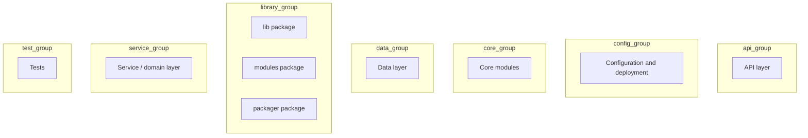

# Architecture report: Unitech/pm2

> Automated static analysis. **Observed** = directly seen in files/imports/AST; **Inferred** = interpretation from that evidence. Repository code was not executed.

## 1. Repository at a glance

| Item | Value |
| --- | --- |
| Repository | Unitech/pm2 |
| Description | Node.js/Typescript/Bun Production Process Manager with a built-in Load Balancer. |
| Language | JavaScript |
| Stars | 43334 |
| Licence | Other |
| Analysed commit / branch | 7a7fb4e22e9a26ec79c870ce8daafd2f78b648d1 / master |
| Framework(s) | Express |
| Files analysed | 800 |
| Components | 9 |

## 2. Architecture in one minute

Unitech/pm2 - Node.js/Typescript/Bun Production Process Manager with a built-in Load Balancer.. This repository was analysed statically from 800 file(s) (5 Python). Detected technologies (observed from imports/manifests): GitHub Actions, Redis, Express, Docker. Files are grouped into 9 component(s): API layer, Configuration and deployment, Core modules, Data layer, lib package, modules package, packager package, Service / domain layer. Findings below distinguish observed facts from inferred interpretation.

## 3. High-level block diagram

## 4. Main components

### API layer (`api_layer`)

- **Kind:** api
- **Status:** Observed
- **Confidence:** 0.85
- **Responsibility:** Groups 29 file(s) under api layer (observed from repository paths and static analysis).
- **Paths:** `lib/API/Configuration.js`, `lib/API/Containerizer.js`, `lib/API/Dashboard.js`, `lib/API/Deploy.js`, `lib/API/Extra.js`, `lib/API/ExtraMgmt/Docker.js`, `lib/API/Log.js`, `lib/API/LogManagement.js`, `lib/API/Modules/LOCAL.js`, `lib/API/Modules/Modularizer.js`, `lib/API/Modules/NPM.js`, `lib/API/Modules/TAR.js`, `lib/API/Modules/flagExt.js`, `lib/API/Modules/index.js`, `lib/API/Monit.js`, `lib/API/Serve.js`, `lib/API/Startup.js`, `lib/API/UX/helpers.js`, `lib/API/UX/index.js`, `lib/API/UX/pm2-describe.js`, `lib/API/UX/pm2-ls-minimal.js`, `lib/API/UX/pm2-ls.js`, `lib/API/Version.js`, `lib/API/pm2-plus/PM2IO.js`, `lib/API/pm2-plus/auth-strategies/CliAuth.js`, `lib/API/pm2-plus/auth-strategies/WebAuth.js`, `lib/API/pm2-plus/helpers.js`, `lib/API/pm2-plus/link.js`, `lib/API/pm2-plus/process-selector.js`
- **Evidence:** [lib/API/Configuration.js](https://github.com/Unitech/pm2/blob/7a7fb4e22e9a26ec79c870ce8daafd2f78b648d1/lib/API/Configuration.js); [lib/API/Containerizer.js](https://github.com/Unitech/pm2/blob/7a7fb4e22e9a26ec79c870ce8daafd2f78b648d1/lib/API/Containerizer.js); [lib/API/Dashboard.js](https://github.com/Unitech/pm2/blob/7a7fb4e22e9a26ec79c870ce8daafd2f78b648d1/lib/API/Dashboard.js); [lib/API/Deploy.js](https://github.com/Unitech/pm2/blob/7a7fb4e22e9a26ec79c870ce8daafd2f78b648d1/lib/API/Deploy.js); [lib/API/Extra.js](https://github.com/Unitech/pm2/blob/7a7fb4e22e9a26ec79c870ce8daafd2f78b648d1/lib/API/Extra.js); [lib/API/ExtraMgmt/Docker.js](https://github.com/Unitech/pm2/blob/7a7fb4e22e9a26ec79c870ce8daafd2f78b648d1/lib/API/ExtraMgmt/Docker.js); [lib/API/Log.js](https://github.com/Unitech/pm2/blob/7a7fb4e22e9a26ec79c870ce8daafd2f78b648d1/lib/API/Log.js); [lib/API/LogManagement.js](https://github.com/Unitech/pm2/blob/7a7fb4e22e9a26ec79c870ce8daafd2f78b648d1/lib/API/LogManagement.js)

### Configuration and deployment (`config`)

- **Kind:** config
- **Status:** Observed
- **Confidence:** 0.85
- **Responsibility:** Groups 12 file(s) under configuration and deployment (observed from repository paths and static analysis).
- **Paths:** `lib/API/interpreter.json`, `lib/API/schema.json`, `lib/templates/Dockerfiles/Dockerfile-nodejs.tpl`, `lib/templates/sample-apps/http-server/package.json`, `lib/templates/sample-apps/pm2-plus-metrics-actions/package.json`, `lib/templates/sample-apps/python-app/package.json`, `modules/pm2-axon/lib/configurable/package.json`, `package.json`, `test/Dockerfile`, `test/fixtures/containerizer/Dockerfile.dev`, `test/fixtures/containerizer/Dockerfile.prod`, `test/fixtures/docker/expressor/Dockerfile.bak`
- **Evidence:** [lib/API/interpreter.json](https://github.com/Unitech/pm2/blob/7a7fb4e22e9a26ec79c870ce8daafd2f78b648d1/lib/API/interpreter.json); [lib/API/schema.json](https://github.com/Unitech/pm2/blob/7a7fb4e22e9a26ec79c870ce8daafd2f78b648d1/lib/API/schema.json); [lib/templates/Dockerfiles/Dockerfile-nodejs.tpl](https://github.com/Unitech/pm2/blob/7a7fb4e22e9a26ec79c870ce8daafd2f78b648d1/lib/templates/Dockerfiles/Dockerfile-nodejs.tpl); [lib/templates/sample-apps/http-server/package.json](https://github.com/Unitech/pm2/blob/7a7fb4e22e9a26ec79c870ce8daafd2f78b648d1/lib/templates/sample-apps/http-server/package.json); [lib/templates/sample-apps/pm2-plus-metrics-actions/package.json](https://github.com/Unitech/pm2/blob/7a7fb4e22e9a26ec79c870ce8daafd2f78b648d1/lib/templates/sample-apps/pm2-plus-metrics-actions/package.json); [lib/templates/sample-apps/python-app/package.json](https://github.com/Unitech/pm2/blob/7a7fb4e22e9a26ec79c870ce8daafd2f78b648d1/lib/templates/sample-apps/python-app/package.json); [modules/pm2-axon/lib/configurable/package.json](https://github.com/Unitech/pm2/blob/7a7fb4e22e9a26ec79c870ce8daafd2f78b648d1/modules/pm2-axon/lib/configurable/package.json); [package.json](https://github.com/Unitech/pm2/blob/7a7fb4e22e9a26ec79c870ce8daafd2f78b648d1/package.json)

### Core modules (`core`)

- **Kind:** core
- **Status:** Observed
- **Confidence:** 0.85
- **Responsibility:** Groups 3 file(s) under core modules (observed from repository paths and static analysis).
- **Paths:** `constants.js`, `index.js`, `paths.js`
- **Evidence:** [constants.js](https://github.com/Unitech/pm2/blob/7a7fb4e22e9a26ec79c870ce8daafd2f78b648d1/constants.js); [index.js](https://github.com/Unitech/pm2/blob/7a7fb4e22e9a26ec79c870ce8daafd2f78b648d1/index.js); [paths.js](https://github.com/Unitech/pm2/blob/7a7fb4e22e9a26ec79c870ce8daafd2f78b648d1/paths.js)

### Data layer (`data_layer`)

- **Kind:** data
- **Status:** Inferred
- **Confidence:** 0.70
- **Responsibility:** Groups 0 file(s) under data layer (observed from repository paths and static analysis).
- **Evidence:** [test/fixtures/docker/expressor/package.json:14](https://github.com/Unitech/pm2/blob/7a7fb4e22e9a26ec79c870ce8daafd2f78b648d1/test/fixtures/docker/expressor/package.json#L14)

### lib package (`lib`)

- **Kind:** library
- **Status:** Observed
- **Confidence:** 0.85
- **Responsibility:** Groups 60 file(s) under lib package (observed from repository paths and static analysis).
- **Paths:** `lib/API.js`, `lib/Client.js`, `lib/Common.js`, `lib/Configuration.js`, `lib/Daemon.js`, `lib/Event.js`, `lib/God.js`, `lib/God/ActionMethods.js`, `lib/God/ClusterMode.js`, `lib/God/ForkMode.js`, `lib/God/Methods.js`, `lib/God/Reload.js`, `lib/God/StdioLogger.js`, `lib/HttpInterface.js`, `lib/OtelManager.js`, `lib/ProcessContainer.js`, `lib/ProcessContainerBun.js`, `lib/ProcessContainerFork.js`, `lib/ProcessContainerForkBun.js`, `lib/ProcessUtils.js`, `lib/TreeKill.js`, `lib/Utility.js`, `lib/VersionCheck.js`, `lib/Watcher.js`, `lib/Worker.js`, `lib/binaries/CLI.js`, `lib/binaries/DevCLI.js`, `lib/binaries/Runtime.js`, `lib/binaries/Runtime4Docker.js`, `lib/completion.js`, `lib/completion.sh`, `lib/templates/init-scripts/pm2-init-amazon.sh`, `lib/templates/sample-apps/http-server/api.js`, `lib/templates/sample-apps/http-server/ecosystem.config.js`, `lib/templates/sample-apps/pm2-plus-metrics-actions/custom-metrics.js`, `lib/templates/sample-apps/pm2-plus-metrics-actions/ecosystem.config.js`, `lib/templates/sample-apps/python-app/echo.py`, `lib/templates/sample-apps/python-app/ecosystem.config.js`, `lib/tools/Config.js`, `lib/tools/SysMetrics.js`, `lib/tools/copydirSync.js`, `lib/tools/deleteFolderRecursive.js`, `lib/tools/find-package-json.js`, `lib/tools/fmt.js`, `lib/tools/interpreter.js`, `lib/tools/isbinaryfile.js`, `lib/tools/json5.js`, `lib/tools/multimeter/bar.js`, `lib/tools/multimeter/charm/encode.js`, `lib/tools/multimeter/charm/index.js`, `lib/tools/multimeter/index.js`, `lib/tools/open.js`, `lib/tools/passwd.js`, `lib/tools/pm2-config-keys.js`, `lib/tools/prompt.js`, `lib/tools/serviceStop.js`, `lib/tools/sexec.js`, `lib/tools/treeify.js`, `lib/tools/typestrip.js`, `lib/tools/which.js`
- **Evidence:** [lib/API.js](https://github.com/Unitech/pm2/blob/7a7fb4e22e9a26ec79c870ce8daafd2f78b648d1/lib/API.js); [lib/Client.js](https://github.com/Unitech/pm2/blob/7a7fb4e22e9a26ec79c870ce8daafd2f78b648d1/lib/Client.js); [lib/Common.js](https://github.com/Unitech/pm2/blob/7a7fb4e22e9a26ec79c870ce8daafd2f78b648d1/lib/Common.js); [lib/Configuration.js](https://github.com/Unitech/pm2/blob/7a7fb4e22e9a26ec79c870ce8daafd2f78b648d1/lib/Configuration.js); [lib/Daemon.js](https://github.com/Unitech/pm2/blob/7a7fb4e22e9a26ec79c870ce8daafd2f78b648d1/lib/Daemon.js); [lib/Event.js](https://github.com/Unitech/pm2/blob/7a7fb4e22e9a26ec79c870ce8daafd2f78b648d1/lib/Event.js); [lib/God.js](https://github.com/Unitech/pm2/blob/7a7fb4e22e9a26ec79c870ce8daafd2f78b648d1/lib/God.js); [lib/God/ActionMethods.js](https://github.com/Unitech/pm2/blob/7a7fb4e22e9a26ec79c870ce8daafd2f78b648d1/lib/God/ActionMethods.js)

### modules package (`modules`)

- **Kind:** library
- **Status:** Observed
- **Confidence:** 0.85
- **Responsibility:** Groups 111 file(s) under modules package (observed from repository paths and static analysis).
- **Paths:** `modules/blessed/index.js`, `modules/blessed/lib/alias.js`, `modules/blessed/lib/blessed.js`, `modules/blessed/lib/colors.js`, `modules/blessed/lib/events.js`, `modules/blessed/lib/gpmclient.js`, `modules/blessed/lib/helpers.js`, `modules/blessed/lib/keys.js`, `modules/blessed/lib/program.js`, `modules/blessed/lib/tput.js`, `modules/blessed/lib/unicode.js`, `modules/blessed/lib/widget.js`, `modules/blessed/lib/widgets/box.js`, `modules/blessed/lib/widgets/element.js`, `modules/blessed/lib/widgets/list.js`, `modules/blessed/lib/widgets/log.js`, `modules/blessed/lib/widgets/node.js`, `modules/blessed/lib/widgets/screen.js`, `modules/blessed/lib/widgets/scrollablebox.js`, `modules/blessed/lib/widgets/scrollabletext.js`, `modules/blessed/lib/widgets/text.js`, `modules/chokidar/index.js`, `modules/chokidar/lib/brace-expand.js`, `modules/chokidar/lib/constants.js`, `modules/chokidar/lib/fsevents-handler.js`, `modules/chokidar/lib/nodefs-handler.js`, `modules/fclone.js`, `modules/pm2-axon-rpc/index.js`, `modules/pm2-axon-rpc/lib/client.js`, `modules/pm2-axon-rpc/lib/server.js`, `modules/pm2-axon/index.js`, `modules/pm2-axon/lib/configurable/index.js`, `modules/pm2-axon/lib/configurable/lib/configurable.js`, `modules/pm2-axon/lib/index.js`, `modules/pm2-axon/lib/plugins/queue.js`, `modules/pm2-axon/lib/plugins/round-robin.js`, `modules/pm2-axon/lib/sockets/pub-emitter.js`, `modules/pm2-axon/lib/sockets/pub.js`, `modules/pm2-axon/lib/sockets/pull.js`, `modules/pm2-axon/lib/sockets/push.js`, `modules/pm2-axon/lib/sockets/rep.js`, `modules/pm2-axon/lib/sockets/req.js`, `modules/pm2-axon/lib/sockets/sock.js`, `modules/pm2-axon/lib/sockets/sub-emitter.js`, `modules/pm2-axon/lib/sockets/sub.js`, `modules/pm2-axon/lib/utils.js`, `modules/pm2-io-agent/config.js`, `modules/pm2-io-agent/constants.js`, `modules/pm2-io-agent/index.js`, `modules/pm2-io-agent/src/InteractorClient.js`, `modules/pm2-io-agent/src/InteractorDaemon.js`, `modules/pm2-io-agent/src/PM2Client.js`, `modules/pm2-io-agent/src/PM2Interface.js`, `modules/pm2-io-agent/src/TransporterInterface.js`, `modules/pm2-io-agent/src/Utility.js`, `modules/pm2-io-agent/src/WatchDog.js`, `modules/pm2-io-agent/src/push/DataRetriever.js`, `modules/pm2-io-agent/src/push/PushInteractor.js`, `modules/pm2-io-agent/src/push/TransactionAggregator.js`, `modules/pm2-io-agent/src/reverse/ReverseInteractor.js`, `modules/pm2-io-agent/src/transporters/Transporter.js`, `modules/pm2-io-agent/src/transporters/WebsocketTransport.js`, `modules/pm2-io-agent/src/utils/BinaryHeap.js`, `modules/pm2-io-agent/src/utils/EDS.js`, `modules/pm2-io-agent/src/utils/probes/Histogram.js`, `modules/pm2-io-agent/src/utils/units.js`, `modules/pm2-io-bpm/configuration.js`, `modules/pm2-io-bpm/constants.js`, `modules/pm2-io-bpm/featureManager.js`, `modules/pm2-io-bpm/features/dependencies.js`, `modules/pm2-io-bpm/features/events.js`, `modules/pm2-io-bpm/features/metrics.js`, `modules/pm2-io-bpm/features/notify.js`, `modules/pm2-io-bpm/features/profiling.js`, `modules/pm2-io-bpm/features/tracing.js`, `modules/pm2-io-bpm/index.js`, `modules/pm2-io-bpm/metrics/eventLoopMetrics.js`, `modules/pm2-io-bpm/metrics/httpMetrics.js`, `modules/pm2-io-bpm/metrics/network.js`, `modules/pm2-io-bpm/metrics/runtime.js`, `modules/pm2-io-bpm/metrics/v8.js`, `modules/pm2-io-bpm/otel/constants.js`, `modules/pm2-io-bpm/otel/custom-zipkin-exporter/platform/index.js`, `modules/pm2-io-bpm/otel/custom-zipkin-exporter/platform/node/index.js`, `modules/pm2-io-bpm/otel/custom-zipkin-exporter/platform/node/util.js`, `modules/pm2-io-bpm/otel/custom-zipkin-exporter/transform.js`, `modules/pm2-io-bpm/otel/custom-zipkin-exporter/types.js`, `modules/pm2-io-bpm/otel/custom-zipkin-exporter/utils.js`, `modules/pm2-io-bpm/otel/custom-zipkin-exporter/zipkin.js`, `modules/pm2-io-bpm/pmx.js`, `modules/pm2-io-bpm/profilers/addonProfiler.js`, `modules/pm2-io-bpm/profilers/inspectorProfiler.js`, `modules/pm2-io-bpm/serviceManager.js`, `modules/pm2-io-bpm/transports/IPCTransport.js`, `modules/pm2-io-bpm/utils/BinaryHeap.js`, `modules/pm2-io-bpm/utils/EDS.js`, `modules/pm2-io-bpm/utils/EWMA.js`, `modules/pm2-io-bpm/utils/autocast.js`, `modules/pm2-io-bpm/utils/metrics/counter.js`, `modules/pm2-io-bpm/utils/metrics/gauge.js`, `modules/pm2-io-bpm/utils/metrics/histogram.js`, `modules/pm2-io-bpm/utils/metrics/meter.js`, `modules/pm2-io-bpm/utils/miscellaneous.js`, `modules/pm2-io-bpm/utils/module.js`, `modules/pm2-io-bpm/utils/shimmer.js`, `modules/pm2-io-bpm/utils/stackParser.js`, `modules/pm2-io-bpm/utils/transactionAggregator.js`, `modules/pm2-io-bpm/utils/units.js`, `modules/vizion/index.js`, `modules/vizion/lib/git/git.js`, `modules/vizion/lib/vizion.js`
- **Evidence:** [modules/blessed/index.js](https://github.com/Unitech/pm2/blob/7a7fb4e22e9a26ec79c870ce8daafd2f78b648d1/modules/blessed/index.js); [modules/blessed/lib/alias.js](https://github.com/Unitech/pm2/blob/7a7fb4e22e9a26ec79c870ce8daafd2f78b648d1/modules/blessed/lib/alias.js); [modules/blessed/lib/blessed.js](https://github.com/Unitech/pm2/blob/7a7fb4e22e9a26ec79c870ce8daafd2f78b648d1/modules/blessed/lib/blessed.js); [modules/blessed/lib/colors.js](https://github.com/Unitech/pm2/blob/7a7fb4e22e9a26ec79c870ce8daafd2f78b648d1/modules/blessed/lib/colors.js); [modules/blessed/lib/events.js](https://github.com/Unitech/pm2/blob/7a7fb4e22e9a26ec79c870ce8daafd2f78b648d1/modules/blessed/lib/events.js); [modules/blessed/lib/gpmclient.js](https://github.com/Unitech/pm2/blob/7a7fb4e22e9a26ec79c870ce8daafd2f78b648d1/modules/blessed/lib/gpmclient.js); [modules/blessed/lib/helpers.js](https://github.com/Unitech/pm2/blob/7a7fb4e22e9a26ec79c870ce8daafd2f78b648d1/modules/blessed/lib/helpers.js); [modules/blessed/lib/keys.js](https://github.com/Unitech/pm2/blob/7a7fb4e22e9a26ec79c870ce8daafd2f78b648d1/modules/blessed/lib/keys.js)

### packager package (`packager`)

- **Kind:** library
- **Status:** Observed
- **Confidence:** 0.85
- **Responsibility:** Groups 5 file(s) under packager package (observed from repository paths and static analysis).
- **Paths:** `packager/build-deb-rpm.sh`, `packager/build-dist.sh`, `packager/publish_deb_rpm.sh`, `packager/setup.deb.sh`, `packager/setup.rpm.sh`
- **Evidence:** [packager/build-deb-rpm.sh](https://github.com/Unitech/pm2/blob/7a7fb4e22e9a26ec79c870ce8daafd2f78b648d1/packager/build-deb-rpm.sh); [packager/build-dist.sh](https://github.com/Unitech/pm2/blob/7a7fb4e22e9a26ec79c870ce8daafd2f78b648d1/packager/build-dist.sh); [packager/publish_deb_rpm.sh](https://github.com/Unitech/pm2/blob/7a7fb4e22e9a26ec79c870ce8daafd2f78b648d1/packager/publish_deb_rpm.sh); [packager/setup.deb.sh](https://github.com/Unitech/pm2/blob/7a7fb4e22e9a26ec79c870ce8daafd2f78b648d1/packager/setup.deb.sh); [packager/setup.rpm.sh](https://github.com/Unitech/pm2/blob/7a7fb4e22e9a26ec79c870ce8daafd2f78b648d1/packager/setup.rpm.sh)

### Service / domain layer (`service_layer`)

- **Kind:** service
- **Status:** Observed
- **Confidence:** 0.85
- **Responsibility:** Groups 5 file(s) under service / domain layer (observed from repository paths and static analysis).
- **Paths:** `modules/pm2-io-bpm/services/actions.js`, `modules/pm2-io-bpm/services/inspector.js`, `modules/pm2-io-bpm/services/metrics.js`, `modules/pm2-io-bpm/services/runtimeStats.js`, `modules/pm2-io-bpm/services/transport.js`
- **Evidence:** [modules/pm2-io-bpm/services/actions.js](https://github.com/Unitech/pm2/blob/7a7fb4e22e9a26ec79c870ce8daafd2f78b648d1/modules/pm2-io-bpm/services/actions.js); [modules/pm2-io-bpm/services/inspector.js](https://github.com/Unitech/pm2/blob/7a7fb4e22e9a26ec79c870ce8daafd2f78b648d1/modules/pm2-io-bpm/services/inspector.js); [modules/pm2-io-bpm/services/metrics.js](https://github.com/Unitech/pm2/blob/7a7fb4e22e9a26ec79c870ce8daafd2f78b648d1/modules/pm2-io-bpm/services/metrics.js); [modules/pm2-io-bpm/services/runtimeStats.js](https://github.com/Unitech/pm2/blob/7a7fb4e22e9a26ec79c870ce8daafd2f78b648d1/modules/pm2-io-bpm/services/runtimeStats.js); [modules/pm2-io-bpm/services/transport.js](https://github.com/Unitech/pm2/blob/7a7fb4e22e9a26ec79c870ce8daafd2f78b648d1/modules/pm2-io-bpm/services/transport.js)

### Tests (`tests`)

- **Kind:** test
- **Status:** Observed
- **Confidence:** 0.85
- **Responsibility:** Groups 336 file(s) under tests (observed from repository paths and static analysis).
- **Paths:** `modules/pm2-axon-rpc/test/index.js`, `modules/pm2-axon-rpc/test/unix.js`, `modules/pm2-axon/test/run`, `modules/pm2-axon/test/test.arg-types.js`, `modules/pm2-axon/test/test.bind-event.js`, `modules/pm2-axon/test/test.bind.ephemeral.js`, `modules/pm2-axon/test/test.emitter.js`, `modules/pm2-axon/test/test.emitter.many-connect.js`, `modules/pm2-axon/test/test.emitter.many.js`, `modules/pm2-axon/test/test.emitter.off.js`, `modules/pm2-axon/test/test.emitter.wildcards.js`, `modules/pm2-axon/test/test.hwm.js`, `modules/pm2-axon/test/test.pubsub.js`, `modules/pm2-axon/test/test.pubsub.missed-messages.js`, `modules/pm2-axon/test/test.pubsub.multiple-subscribers.js`, `modules/pm2-axon/test/test.pubsub.string-subscriptions.js`, `modules/pm2-axon/test/test.pubsub.subscriptions.js`, `modules/pm2-axon/test/test.pubsub.unsubscribe.js`, `modules/pm2-axon/test/test.pushpull.js`, `modules/pm2-axon/test/test.pushpull.json.js`, `modules/pm2-axon/test/test.pushpull.multiple-pushers.js`, `modules/pm2-axon/test/test.pushpull.pull-bind.js`, `modules/pm2-axon/test/test.queue.js`, `modules/pm2-axon/test/test.reqrep.callback.js`, `modules/pm2-axon/test/test.reqrep.chain.js`, `modules/pm2-axon/test/test.reqrep.error-reply.js`, `modules/pm2-axon/test/test.reqrep.js`, `modules/pm2-axon/test/test.reqrep.json.js`, `modules/pm2-axon/test/test.reqrep.ordering.js`, `modules/pm2-axon/test/test.reqrep.undefined.js`, `modules/pm2-axon/test/test.reqrep.vargs.js`, `modules/pm2-axon/test/test.socket.accept.econnrefused.js`, `modules/pm2-axon/test/test.socket.accept.econnreset.js`, `modules/pm2-axon/test/test.socket.accept.epipe.js`, `modules/pm2-axon/test/test.socket.close.js`, `modules/pm2-axon/test/test.socket.connect.econnrefused.js`, `modules/pm2-axon/test/test.socket.connect.econnreset.js`, `modules/pm2-axon/test/test.socket.connect.epipe.js`, `modules/pm2-axon/test/test.socket.connect.error.js`, `modules/pm2-axon/test/test.socket.error-remove-sock.js`, `modules/pm2-axon/test/test.socket.js`, `modules/pm2-axon/test/test.socket.rebind.js`, `modules/pm2-axon/test/test.socket.reconnect.js`, `modules/pm2-axon/test/test.sub.matches.js`, `modules/pm2-axon/test/test.unixsocket.advanced.js`, `modules/pm2-axon/test/test.unixsocket.js`, `modules/pm2-io-agent/test/fixtures/processes.json`, `modules/pm2-io-agent/test/integrations/websocket.json-patch.mocha.js`, `modules/pm2-io-agent/test/integrations/websocket.mocha.js`, `modules/pm2-io-agent/test/misc/trace_factory.js`, `modules/pm2-io-agent/test/mock/module.js`, `modules/pm2-io-agent/test/mock/servers.js`, `modules/pm2-io-agent/test/units/InteractorClient.mocha.js`, `modules/pm2-io-agent/test/units/InteractorDaemon.mocha.js`, `modules/pm2-io-agent/test/units/PM2Client.mocha.js`, `modules/pm2-io-agent/test/units/PM2Interface.mocha.js`, `modules/pm2-io-agent/test/units/TransporterInterface.mocha.js`, `modules/pm2-io-agent/test/units/Utility/cache.mocha.js`, `modules/pm2-io-agent/test/units/Utility/stacktrace.mocha.js`, `modules/pm2-io-agent/test/units/WatchDog.mocha.js`, `modules/pm2-io-agent/test/units/push/PushInteractor.mocha.js`, `modules/pm2-io-agent/test/units/push/TransactionAggregator.mocha.js`, `modules/pm2-io-agent/test/units/reverse/ReverseInteractor.mocha.js`, `modules/pm2-io-agent/test/units/transporters/WebsocketTransport.mocha.js`, `modules/pm2-io-bpm/test/api.spec.js`, `modules/pm2-io-bpm/test/autoExit.spec.js`, `modules/pm2-io-bpm/test/features/events.spec.js`, `modules/pm2-io-bpm/test/features/otel-tracing.spec.js`, `modules/pm2-io-bpm/test/features/profiling.spec.js`, `modules/pm2-io-bpm/test/features/tracing.spec.js`, `modules/pm2-io-bpm/test/fixtures/apiActionsChild.js`, `modules/pm2-io-bpm/test/fixtures/apiActionsJsonChild.js`, `modules/pm2-io-bpm/test/fixtures/apiBackwardActionsChild.js`, `modules/pm2-io-bpm/test/fixtures/apiBackwardConfChild.js`, `modules/pm2-io-bpm/test/fixtures/apiBackwardEventChild.js`, `modules/pm2-io-bpm/test/fixtures/apiBackwardExpressChild.js`, `modules/pm2-io-bpm/test/fixtures/apiInitModuleChild.js`, `modules/pm2-io-bpm/test/fixtures/apiKoaErrorHandler.js`, `modules/pm2-io-bpm/test/fixtures/apiMetricsChild.js`, `modules/pm2-io-bpm/test/fixtures/apiNotifyChild.js`, `modules/pm2-io-bpm/test/fixtures/apiOnExitChild.js`, `modules/pm2-io-bpm/test/fixtures/apiOnExitExceptionChild.js`, `modules/pm2-io-bpm/test/fixtures/autoExitChild.js`, `modules/pm2-io-bpm/test/fixtures/features/eventLoopInspectorChild.js`, `modules/pm2-io-bpm/test/fixtures/features/eventsChild.js`, `modules/pm2-io-bpm/test/fixtures/features/profilingChild.js`, `modules/pm2-io-bpm/test/fixtures/metrics/gcv8Child.js`, `modules/pm2-io-bpm/test/fixtures/metrics/httpWrapperChild.js`, `modules/pm2-io-bpm/test/fixtures/metrics/networkChild.js`, `modules/pm2-io-bpm/test/fixtures/metrics/networkWithoutDownloadChild.js`, `modules/pm2-io-bpm/test/fixtures/metrics/tracingChild.js`, `modules/pm2-io-bpm/test/fixtures/otelTracingChild.js`, `modules/pm2-io-bpm/test/fixtures/package.json`, `modules/pm2-io-bpm/test/metrics/eventloop.spec.js`, `modules/pm2-io-bpm/test/metrics/http.spec.js`, `modules/pm2-io-bpm/test/metrics/network.spec.js`, `modules/pm2-io-bpm/test/metrics/runtime.spec.js`, `modules/pm2-io-bpm/test/metrics/v8.spec.js`, `modules/pm2-io-bpm/test/services/actions.spec.js`, `modules/pm2-io-bpm/test/services/metrics.spec.js`, `modules/pm2-io-bpm/test/standalone/events.spec.js`, `modules/pm2-io-bpm/test/standalone/helper.js`, `modules/pm2-io-bpm/test/standalone/tracing.spec.js`, `test/README.md`, `test/benchmarks/monit-daemon.sh`, `test/benchmarks/monit.sh`, `test/benchmarks/result.monit`, `test/docker-parallel.sh`, `test/e2e.sh`, `test/e2e/binaries/pm2-dev.sh`, `test/e2e/binaries/pm2-runtime.sh`, `test/e2e/cli/app-configuration.sh`, `test/e2e/cli/args.sh`, `test/e2e/cli/attach.sh`, `test/e2e/cli/binary.sh`, `test/e2e/cli/bun.sh`, `test/e2e/cli/cli-actions-1.sh`, `test/e2e/cli/cli-actions-2.sh`, `test/e2e/cli/dump.sh`, `test/e2e/cli/ecosystem.e2e.sh`, `test/e2e/cli/env-refresh.sh`, `test/e2e/cli/extra-lang.sh`, `test/e2e/cli/fork.sh`, `test/e2e/cli/mjs.sh`, `test/e2e/cli/monit.sh`, `test/e2e/cli/multiparam.sh`, `test/e2e/cli/operate-regex.sh`, `test/e2e/cli/otel-install.sh`, `test/e2e/cli/piped-config.sh`, `test/e2e/cli/plus.sh`, `test/e2e/cli/python-support.sh`, `test/e2e/cli/reload.sh`, `test/e2e/cli/reset.sh`, `test/e2e/cli/resurrect.sh`, `test/e2e/cli/right-exit-code.sh`, `test/e2e/cli/serve.sh`, `test/e2e/cli/smart-start.sh`, `test/e2e/cli/sort.sh`, `test/e2e/cli/start-app.sh`, `test/e2e/cli/startOrX.sh`, `test/e2e/cli/typescript.sh`, `test/e2e/cli/watch.sh`, `test/e2e/docker.sh`, `test/e2e/esmodule.sh`, `test/e2e/file-descriptor.sh`, `test/e2e/include.sh`, `test/e2e/internals/daemon-paths-override.sh`, `test/e2e/internals/increment-var.sh`, `test/e2e/internals/infinite-loop.sh`, `test/e2e/internals/listen-timeout.sh`, `test/e2e/internals/options-via-env.sh`, `test/e2e/internals/promise.sh`, `test/e2e/internals/signal.sh`, `test/e2e/internals/source_map.sh`, `test/e2e/internals/start-consistency.sh`, `test/e2e/internals/wait-ready-event.sh`, `test/e2e/internals/wrapped-fork.sh`, `test/e2e/logs/log-cluster-raw-stdio.sh`, `test/e2e/logs/log-create-not-exist-dir.sh`, `test/e2e/logs/log-custom.sh`, `test/e2e/logs/log-entire.sh`, `test/e2e/logs/log-integrity.sh`, `test/e2e/logs/log-json.sh`, `test/e2e/logs/log-namespace.sh`, `test/e2e/logs/log-null.sh`, `test/e2e/logs/log-regex.sh`, `test/e2e/logs/log-reload.sh`, `test/e2e/logs/log-timestamp.sh`, `test/e2e/misc/cron-system.sh`, `test/e2e/misc/inside-pm2.sh`, `test/e2e/misc/instance-number.sh`, `test/e2e/misc/misc.sh`, `test/e2e/misc/nvm-node-version.sh`, `test/e2e/misc/port-release.sh`, `test/e2e/misc/startup.sh`, `test/e2e/misc/versioning-cmd.sh`, `test/e2e/misc/vizion.sh`, `test/e2e/modules/get-set.sh`, `test/e2e/modules/module-safeguard.sh`, `test/e2e/modules/module.sh`, `test/e2e/process-file/app-config-update.sh`, `test/e2e/process-file/append-env-to-name.sh`, `test/e2e/process-file/homogen-json-action.sh`, `test/e2e/process-file/js-configuration.sh`, `test/e2e/process-file/json-file.sh`, `test/e2e/process-file/json-reload.sh`, `test/e2e/process-file/yaml-configuration.sh`, `test/e2e/pull.sh`, `test/fixtures/001-test.js`, `test/fixtures/all.json`, `test/fixtures/all2.json`, `test/fixtures/app-config-update/args1.json`, `test/fixtures/app-config-update/args2.json`, `test/fixtures/app-config-update/echo.js`, `test/fixtures/append-env-to-name.json`, `test/fixtures/args.js`, `test/fixtures/args/echo.js`, `test/fixtures/args/params_check.js`, `test/fixtures/bashscript.sh`, `test/fixtures/big-array-es6.js`, `test/fixtures/big-array-listen.js`, `test/fixtures/big-array.js`, `test/fixtures/big-log-burst.js`, `test/fixtures/binary-js-file`, `test/fixtures/binary-js-file.js`, `test/fixtures/binary-py-file.py`, `test/fixtures/c-compile/hello.c`, `test/fixtures/change_cwd.json`, `test/fixtures/child.js`, `test/fixtures/child_no_http.js`, `test/fixtures/cluster-alias.json`, `test/fixtures/cluster-atypical-node.config.js`, `test/fixtures/cluster-non-node.json`, `test/fixtures/cluster-pm2.json`, `test/fixtures/cluster/sigint_catcher.js`, `test/fixtures/conf.json`, `test/fixtures/configuration.js`, `test/fixtures/configuration.json`, `test/fixtures/cron-stop.js`, `test/fixtures/cron.js`, `test/fixtures/cron_no_autorestart.js`, `test/fixtures/custom_actions/index.js`, `test/fixtures/delayed_exit.js`, `test/fixtures/docker/expressor/app.js`, `test/fixtures/docker/expressor/package.json`, `test/fixtures/docker/expressor/process.json`, `test/fixtures/docker/expressor/worker.js`, `test/fixtures/dump-env.js`, `test/fixtures/echo-env.js`, `test/fixtures/echo-pm2.json`, `test/fixtures/echo-post.json`, `test/fixtures/echo-to-pm2.json`, `test/fixtures/echo.coffee`, `test/fixtures/echo.js`, `test/fixtures/echo2.js`, `test/fixtures/echo3.js`, `test/fixtures/echoto-pm2.json`, `test/fixtures/ecosystem.config.js`, `test/fixtures/ecosystem.json`, `test/fixtures/ecosystem.json5`, `test/fixtures/ecosystem/ecosystem.config.js`, `test/fixtures/empty.js`, `test/fixtures/env-ecosystem.json`, `test/fixtures/env-refreshed.json`, `test/fixtures/env-report.js`, `test/fixtures/env-switching/app.json`, `test/fixtures/env-switching/child.js`, `test/fixtures/env.js`, `test/fixtures/env.json`, `test/fixtures/esmodules/mjs/circle.mjs`, `test/fixtures/esmodules/mjs/index.mjs`, `test/fixtures/esmodules/packagemodule/circle.js`, `test/fixtures/esmodules/packagemodule/index.js`, `test/fixtures/esmodules/packagemodule/package.json`, `test/fixtures/events/custom_action.js`, `test/fixtures/events/custom_action_with_params.js`, `test/fixtures/events/own_event.js`, `test/fixtures/exitcode42.js`, `test/fixtures/extra-lang/app-python.config.js`, `test/fixtures/extra-lang/apps.json`, `test/fixtures/extra-lang/echo.php`, `test/fixtures/extra-lang/echo.py`, `test/fixtures/filter-env-ecosystem.json`, `test/fixtures/filter-env-off-ecosystem.json`, `test/fixtures/filter-env-string-true-ecosystem.json`, `test/fixtures/filter-env-unset-ecosystem.json`, `test/fixtures/git/COMMIT_EDITMSG`, `test/fixtures/git/HEAD`, `test/fixtures/git/config`, `test/fixtures/git/description`, `test/fixtures/git/hooks/applypatch-msg.sample`, `test/fixtures/git/hooks/commit-msg.sample`, `test/fixtures/git/hooks/post-update.sample`, `test/fixtures/git/hooks/pre-applypatch.sample`, `test/fixtures/git/hooks/pre-commit.sample`, `test/fixtures/git/hooks/pre-push.sample`, `test/fixtures/git/hooks/pre-rebase.sample`, `test/fixtures/git/hooks/prepare-commit-msg.sample`, `test/fixtures/git/hooks/update.sample`, `test/fixtures/git/info/exclude`, `test/fixtures/git/logs/HEAD`, `test/fixtures/git/logs/refs/heads/master`, `test/fixtures/git/logs/refs/remotes/origin/master`, `test/fixtures/git/objects/7a/e6d7c64d39da2167c33993e1f4f0233e8eb6f0`, `test/fixtures/git/refs/heads/master`, `test/fixtures/git/refs/remotes/origin/master`, `test/fixtures/graceful-exit-no-listen.js`, `test/fixtures/graceful-exit-send.js`, `test/fixtures/graceful-exit.js`, `test/fixtures/homogen-json-action/all.json`, `test/fixtures/homogen-json-action/http.js`, `test/fixtures/http.js`, `test/fixtures/increment-var/ecosystem.json`, `test/fixtures/increment-var/sample.js`, `test/fixtures/inside/echo.js`, `test/fixtures/inside/inner_restart.sh`, `test/fixtures/inside/reload_inside.js`, `test/fixtures/inside/restart_inside.js`, `test/fixtures/inside/start_inside.js`, `test/fixtures/insidePm2Process.js`, `test/fixtures/interface/child.js`, `test/fixtures/interface/http_transaction.js`, `test/fixtures/interface/human_event.js`, `test/fixtures/interface/log_out.js`, `test/fixtures/interface/process_exception.js`, `test/fixtures/interface/process_exception_with_logs.js`, `test/fixtures/interface/promise_rejection.js`, `test/fixtures/interpreter/echo-strippable.ts`, `test/fixtures/interpreter/echo.coffee`, `test/fixtures/interpreter/echo.ls`, `test/fixtures/interpreter/echo.ts`, `test/fixtures/interpreter/echo.tsx`, `test/fixtures/issue-6129-slow-listen.js`, `test/fixtures/js-configuration/app.js`, `test/fixtures/js-configuration/ecosystem.config.js`, `test/fixtures/json-reload/big-array.js`, `test/fixtures/json-reload/echo-env.js`, `test/fixtures/json-reload/echo-post.json`, `test/fixtures/json-reload/echo-pre.json`, `test/fixtures/json-reload/max-mem-0.json`, `test/fixtures/json-reload/max-mem.json`, `test/fixtures/killnotsofast.js`, `test/fixtures/killtoofast.js`, `test/fixtures/listen-timeout/wait-ready.js`, `test/fixtures/local_require.js`, `test/fixtures/log-create-not-exist-dir/echo.js`, `test/fixtures/log-json/ecosystem.json`, `test/fixtures/log-json/one-echo.js`, `test/fixtures/log-namespace/echo.js`, `test/fixtures/mjs/ecosystem.config.js`, `test/fixtures/mjs/index.mjs`, `test/fixtures/mjs/package.json`, `test/fixtures/mjs/test.mjs`, `test/fixtures/module-fixture/package.json`, `test/fixtures/module-fixture/scoped-action.js`, `test/fixtures/multi-echo.json`
- **Evidence:** [modules/pm2-axon-rpc/test/index.js](https://github.com/Unitech/pm2/blob/7a7fb4e22e9a26ec79c870ce8daafd2f78b648d1/modules/pm2-axon-rpc/test/index.js); [modules/pm2-axon-rpc/test/unix.js](https://github.com/Unitech/pm2/blob/7a7fb4e22e9a26ec79c870ce8daafd2f78b648d1/modules/pm2-axon-rpc/test/unix.js); [modules/pm2-axon/test/run](https://github.com/Unitech/pm2/blob/7a7fb4e22e9a26ec79c870ce8daafd2f78b648d1/modules/pm2-axon/test/run); [modules/pm2-axon/test/test.arg-types.js](https://github.com/Unitech/pm2/blob/7a7fb4e22e9a26ec79c870ce8daafd2f78b648d1/modules/pm2-axon/test/test.arg-types.js); [modules/pm2-axon/test/test.bind-event.js](https://github.com/Unitech/pm2/blob/7a7fb4e22e9a26ec79c870ce8daafd2f78b648d1/modules/pm2-axon/test/test.bind-event.js); [modules/pm2-axon/test/test.bind.ephemeral.js](https://github.com/Unitech/pm2/blob/7a7fb4e22e9a26ec79c870ce8daafd2f78b648d1/modules/pm2-axon/test/test.bind.ephemeral.js); [modules/pm2-axon/test/test.emitter.js](https://github.com/Unitech/pm2/blob/7a7fb4e22e9a26ec79c870ce8daafd2f78b648d1/modules/pm2-axon/test/test.emitter.js); [modules/pm2-axon/test/test.emitter.many-connect.js](https://github.com/Unitech/pm2/blob/7a7fb4e22e9a26ec79c870ce8daafd2f78b648d1/modules/pm2-axon/test/test.emitter.many-connect.js)

## 5. Execution flow

**Observed** entry point(s):

- [bin/pm2](https://github.com/Unitech/pm2/blob/7a7fb4e22e9a26ec79c870ce8daafd2f78b648d1/bin/pm2)
- [bin/pm2-dev](https://github.com/Unitech/pm2/blob/7a7fb4e22e9a26ec79c870ce8daafd2f78b648d1/bin/pm2-dev)
- [bin/pm2-docker](https://github.com/Unitech/pm2/blob/7a7fb4e22e9a26ec79c870ce8daafd2f78b648d1/bin/pm2-docker)
- [bin/pm2-runtime](https://github.com/Unitech/pm2/blob/7a7fb4e22e9a26ec79c870ce8daafd2f78b648d1/bin/pm2-runtime)
- [examples/esm/addTwo.js](https://github.com/Unitech/pm2/blob/7a7fb4e22e9a26ec79c870ce8daafd2f78b648d1/examples/esm/addTwo.js)
- [examples/import/index.js](https://github.com/Unitech/pm2/blob/7a7fb4e22e9a26ec79c870ce8daafd2f78b648d1/examples/import/index.js)
- [examples/module-extra-meta/index.js](https://github.com/Unitech/pm2/blob/7a7fb4e22e9a26ec79c870ce8daafd2f78b648d1/examples/module-extra-meta/index.js)
- [examples/module-test/app.js](https://github.com/Unitech/pm2/blob/7a7fb4e22e9a26ec79c870ce8daafd2f78b648d1/examples/module-test/app.js)
- [index.js](https://github.com/Unitech/pm2/blob/7a7fb4e22e9a26ec79c870ce8daafd2f78b648d1/index.js)
- [test/fixtures/esmodules/packagemodule/index.js](https://github.com/Unitech/pm2/blob/7a7fb4e22e9a26ec79c870ce8daafd2f78b648d1/test/fixtures/esmodules/packagemodule/index.js)
- [test/fixtures/mjs/index.mjs](https://github.com/Unitech/pm2/blob/7a7fb4e22e9a26ec79c870ce8daafd2f78b648d1/test/fixtures/mjs/index.mjs)
- [test/fixtures/module-fixture/scoped-action.js](https://github.com/Unitech/pm2/blob/7a7fb4e22e9a26ec79c870ce8daafd2f78b648d1/test/fixtures/module-fixture/scoped-action.js)

Representative flow (derived from observed entry points and the import graph; steps beyond the entry point are **Inferred**):

1. Execution starts at an observed entry point listed above, if present.
2. No internal import relationships between components were observed.

## 6. Project structure

### `(root)`

- `.editorconfig` - config (273 bytes)
- `.gitattributes` - other (89 bytes)
- `.gitignore` - other (327 bytes)
- `.mocharc.js` - source, JavaScript (216 bytes)
- `.npmignore` - other (243 bytes)
- `CHANGELOG.md` - docs (118909 bytes)
- `CONTRIBUTING.md` - docs (2845 bytes)
- `GNU-AGPL-3.0.txt` - docs (34516 bytes)
- `LICENSE` - docs (17 bytes)
- `README.md` - docs (6510 bytes)
- `SECURITY.md` - docs (1854 bytes)
- `constants.js` - source, JavaScript (5059 bytes)
- `index.js` - source, JavaScript (306 bytes)
- `package.json` - manifest (3881 bytes)
- `paths.js` - source, JavaScript (3140 bytes)
- `pm2` - other (220 bytes)

### `.github`

- `.github/CONTRIBUTING.md` - docs (1794 bytes)
- `.github/ISSUE_TEMPLATE.md` - docs (140 bytes)
- `.github/PULL_REQUEST_TEMPLATE.md` - docs (425 bytes)
- `.github/workflows/docker-images.yml` - ci, YAML (1283 bytes)
- `.github/workflows/node.js.yml` - ci, YAML (1316 bytes)

### `bin`

- `bin/pm2` - other (56 bytes)
- `bin/pm2-dev` - other (59 bytes)
- `bin/pm2-docker` - other (67 bytes)
- `bin/pm2-runtime` - other (67 bytes)
- `bin/pm2.ps1` - other (90 bytes)

### `examples`

- `examples/api-pm2/README.md` - docs (1412 bytes)
- `examples/api-pm2/api.js` - source, JavaScript (531 bytes)
- `examples/api-pm2/http.js` - source, JavaScript (241 bytes)
- `examples/c-compile/hello.c` - source, C (133 bytes)
- `examples/cluster-http/README.md` - docs (121 bytes)
- `examples/cluster-http/ecosystem.config.js` - source, JavaScript (275 bytes)
- `examples/cluster-http/http-no-exit.js` - source, JavaScript (285 bytes)
- `examples/cluster-http/http.js` - source, JavaScript (258 bytes)
- `examples/cluster-tcp/README.md` - docs (119 bytes)
- `examples/cluster-tcp/http.js` - source, JavaScript (241 bytes)
- `examples/cluster-tcp/process.config.js` - source, JavaScript (272 bytes)
- `examples/cluster-tcp/tcp.js` - source, JavaScript (313 bytes)
- `examples/custom-nodejs-version/ecosystem.config.js` - source, JavaScript (277 bytes)
- `examples/custom-nodejs-version/http.js` - source, JavaScript (624 bytes)
- `examples/docker-pm2/Dockerfile` - container (268 bytes)
- `examples/docker-pm2/README.md` - docs (332 bytes)
- `examples/docker-pm2/app/app.js` - source, JavaScript (187 bytes)
- `examples/docker-pm2/app/package.json` - manifest (249 bytes)
- `examples/docker-pm2/app/process.config.js` - source, JavaScript (90 bytes)
- `examples/echo/log.js` - source, JavaScript (119 bytes)
- `examples/echo/stdout.js` - source, JavaScript (64 bytes)
- `examples/ecosystem-file/README.md` - docs (486 bytes)
- `examples/ecosystem-file/apps/connection_check.sh` - source, Shell (81 bytes)
- `examples/ecosystem-file/apps/http.js` - source, JavaScript (276 bytes)
- `examples/ecosystem-file/apps/worker.js` - source, JavaScript (132 bytes)
- `examples/ecosystem-file/process.config.js` - source, JavaScript (574 bytes)
- `examples/ecosystem-file/process.json` - config (557 bytes)
- `examples/ecosystem-file/process.yml` - config (359 bytes)
- `examples/esm/addTwo.js` - source, JavaScript (77 bytes)
- `examples/esm/app.js` - source, JavaScript (88 bytes)
- `examples/esm/package.json` - manifest (220 bytes)
- `examples/exception/fast.js` - source, JavaScript (52 bytes)
- `examples/exception/slow.js` - source, JavaScript (53 bytes)
- `examples/expose-custom-metrics/README.md` - docs (190 bytes)
- `examples/expose-custom-metrics/process-metrics.js` - source, JavaScript (577 bytes)
- `examples/expose-custom-metrics/process.config.js` - source, JavaScript (72 bytes)
- `examples/expose-triggerable-functions/index.js` - source, JavaScript (222 bytes)
- `examples/expose-triggerable-functions/process.yml` - config (50 bytes)
- `examples/expose-triggerable-functions/trigger-param.js` - source, JavaScript (225 bytes)
- `examples/expose-triggerable-functions/trigger-ping.js` - source, JavaScript (205 bytes)
- `examples/import/circle.js` - source, JavaScript (158 bytes)
- `examples/import/index.js` - source, JavaScript (167 bytes)
- `examples/import/package.json` - manifest (221 bytes)
- `examples/interact-via-stdin/README.md` - docs (120 bytes)
- `examples/interact-via-stdin/stdin.js` - source, JavaScript (283 bytes)
- `examples/misc-examples/001-test.js` - source, JavaScript (197 bytes)
- `examples/misc-examples/apps/all-pm2.json` - config (262 bytes)
- `examples/misc-examples/apps/args.json` - config (171 bytes)
- `examples/misc-examples/apps/auto-kill-echo.json` - config (82 bytes)
- `examples/misc-examples/apps/cluster-pm2.json` - config (191 bytes)
- `examples/misc-examples/apps/cron-pm2.json` - config (171 bytes)
- `examples/misc-examples/apps/default-path-echo.json` - config (78 bytes)
- `examples/misc-examples/apps/echo-pm2.json` - config (235 bytes)
- `examples/misc-examples/apps/env-pm2.json` - config (294 bytes)
- `examples/misc-examples/apps/killfast.json` - config (116 bytes)
- `examples/misc-examples/apps/multi-pm2.json` - config (173 bytes)
- `examples/misc-examples/apps/no-name-echo.json` - config (51 bytes)
- `examples/misc-examples/args.js` - source, JavaScript (226 bytes)
- `examples/misc-examples/auto-restart-all.js` - source, JavaScript (185 bytes)
- `examples/misc-examples/auto-restart-threshold.js` - source, JavaScript (380 bytes)
- `examples/misc-examples/auto-save.js` - source, JavaScript (0 bytes)
- `examples/misc-examples/beforeExit.js` - source, JavaScript (328 bytes)
- `examples/misc-examples/child-echo.json` - config (353 bytes)
- `examples/misc-examples/child-env.js` - source, JavaScript (157 bytes)
- `examples/misc-examples/child-pm2.json` - config (161 bytes)
- `examples/misc-examples/child.js` - source, JavaScript (276 bytes)
- `examples/misc-examples/child.js-pm2.json` - config (56 bytes)
- `examples/misc-examples/child2.js` - source, JavaScript (164 bytes)
- `examples/misc-examples/client.js` - source, JavaScript (1392 bytes)
- `examples/misc-examples/cwd.js` - source, JavaScript (137 bytes)
- `examples/misc-examples/echo.coffee` - other (61 bytes)
- `examples/misc-examples/echo.js` - source, JavaScript (229 bytes)
- `examples/misc-examples/echokill.js` - source, JavaScript (192 bytes)
- `examples/misc-examples/env.js` - source, JavaScript (91 bytes)
- `examples/misc-examples/env_args.js` - source, JavaScript (43 bytes)
- `examples/misc-examples/exec_watch.json` - config (181 bytes)
- `examples/misc-examples/exit.js` - source, JavaScript (529 bytes)
- `examples/misc-examples/expose_method.js` - source, JavaScript (303 bytes)
- `examples/misc-examples/graceful-exit.js` - source, JavaScript (488 bytes)
- `examples/misc-examples/harmony.js` - source, JavaScript (153 bytes)
- `examples/misc-examples/http.js` - source, JavaScript (1280 bytes)
- `examples/misc-examples/infinite-recurse.js` - source, JavaScript (29 bytes)
- `examples/misc-examples/inside.js` - source, JavaScript (170 bytes)
- `examples/misc-examples/inside.json` - config (113 bytes)
- `examples/misc-examples/interact.js` - source, JavaScript (350 bytes)
- `examples/misc-examples/json.js` - source, JavaScript (175 bytes)
- `examples/misc-examples/kill-not-so-fast.js` - source, JavaScript (132 bytes)
- `examples/misc-examples/kill-slow.js` - source, JavaScript (77 bytes)
- `examples/misc-examples/killfast.js` - source, JavaScript (18 bytes)
- `examples/misc-examples/killslow.js` - source, JavaScript (61 bytes)
- `examples/misc-examples/killtoofast.js` - source, JavaScript (107 bytes)
- `examples/misc-examples/leak.js` - source, JavaScript (169 bytes)
- `examples/misc-examples/malformated.json` - config (496 bytes)
- `examples/misc-examples/modulechild.js` - source, JavaScript (30 bytes)
- `examples/misc-examples/moduleparent.js` - source, JavaScript (68 bytes)
- `examples/misc-examples/null.js` - source, JavaScript (372 bytes)
- `examples/misc-examples/package.json` - manifest (436 bytes)
- `examples/misc-examples/process.json` - config (603 bytes)
- `examples/misc-examples/programmatic.js` - source, JavaScript (642 bytes)
- `examples/misc-examples/require.js` - source, JavaScript (151 bytes)
- `examples/misc-examples/sendmsg.js` - source, JavaScript (131 bytes)
- `examples/misc-examples/sigint.js` - source, JavaScript (129 bytes)
- `examples/misc-examples/start-args.js` - source, JavaScript (201 bytes)
- `examples/misc-examples/stop-after5.js` - source, JavaScript (54 bytes)
- `examples/misc-examples/string-crash.js` - source, JavaScript (51 bytes)
- `examples/misc-examples/throw.js` - source, JavaScript (88 bytes)
- `examples/misc-examples/tree.js` - source, JavaScript (303 bytes)
- `examples/misc-examples/udp.js` - source, JavaScript (462 bytes)
- `examples/misc-examples/wrap.js` - source, JavaScript (823 bytes)
- `examples/module-extra-meta/index.js` - source, JavaScript (384 bytes)
- `examples/module-extra-meta/package.json` - manifest (306 bytes)
- `examples/module-test/README.md` - docs (959 bytes)
- `examples/module-test/app.js` - source, JavaScript (3523 bytes)
- `examples/module-test/package.json` - manifest (482 bytes)
- `examples/npm-start/http.js` - source, JavaScript (241 bytes)
- `examples/npm-start/package.json` - manifest (234 bytes)
- `examples/pmx-test-all/elements/cluster.js` - source, JavaScript (1025 bytes)
- `examples/pmx-test-all/elements/counter.js` - source, JavaScript (163 bytes)
- `examples/pmx-test-all/elements/error.js` - source, JavaScript (55 bytes)
- `examples/pmx-test-all/elements/event.js` - source, JavaScript (164 bytes)
- `examples/pmx-test-all/elements/histogram.js` - source, JavaScript (237 bytes)
- `examples/pmx-test-all/elements/http.js` - source, JavaScript (1025 bytes)
- `examples/pmx-test-all/elements/log-cluster.js` - source, JavaScript (80 bytes)
- `examples/pmx-test-all/elements/log.js` - source, JavaScript (81 bytes)
- `examples/pmx-test-all/elements/meter.js` - source, JavaScript (159 bytes)
- `examples/pmx-test-all/elements/metric.js` - source, JavaScript (239 bytes)
- `examples/pmx-test-all/elements/notify.js` - source, JavaScript (99 bytes)
- `examples/pmx-test-all/elements/trace.js` - source, JavaScript (1005 bytes)
- `examples/pmx-test-all/process.config.js` - source, JavaScript (640 bytes)
- `examples/run-php-python-ruby-bash/bashscript.sh` - source, Shell (43 bytes)
- `examples/run-php-python-ruby-bash/echo.php` - source, PHP (68 bytes)
- `examples/run-php-python-ruby-bash/echo.py` - source, Python (122 bytes)
- `examples/run-php-python-ruby-bash/echo.rb` - source, Ruby (39 bytes)
- `examples/run-php-python-ruby-bash/leak-mem.py` - source, Python (4854 bytes)
- `examples/run-php-python-ruby-bash/process.yml` - config (214 bytes)
- `examples/send-msg/pm2-app.js` - source, JavaScript (135 bytes)
- `examples/send-msg/pm2-msg.js` - source, JavaScript (559 bytes)
- `examples/send-msg/t2.js` - source, JavaScript (305 bytes)
- `examples/signal-catching/graceful-http.js` - source, JavaScript (408 bytes)
- `examples/sourcemap-auto-resolve/API.js` - source, JavaScript (47856 bytes)
- `examples/sourcemap-auto-resolve/README.md` - docs (1606 bytes)
- `examples/sourcemap-auto-resolve/process.config.js` - source, JavaScript (93 bytes)
- `examples/start-a-binary/ls.yml` - config (26 bytes)
- `examples/test-all-keymetrics-features/README.md` - docs (190 bytes)
- `examples/test-all-keymetrics-features/actions-fibonacci.js` - source, JavaScript (947 bytes)
- `examples/test-all-keymetrics-features/custom_action.js` - source, JavaScript (359 bytes)
- `examples/test-all-keymetrics-features/custom_action_with_params.js` - source, JavaScript (578 bytes)
- `examples/test-all-keymetrics-features/event.js` - source, JavaScript (183 bytes)
- `examples/test-all-keymetrics-features/http_app.js` - source, JavaScript (1191 bytes)
- `examples/test-all-keymetrics-features/http_transaction.js` - source, JavaScript (1198 bytes)
- `examples/test-all-keymetrics-features/pm2_probe.js` - source, JavaScript (834 bytes)
- `examples/test-all-keymetrics-features/probes.js` - source, JavaScript (1880 bytes)
- `examples/test-all-keymetrics-features/process-load.config.js` - source, JavaScript (135 bytes)
- `examples/test-all-keymetrics-features/process-transpose.js` - source, JavaScript (350 bytes)
- `examples/test-all-keymetrics-features/process.config.js` - source, JavaScript (495 bytes)
- `examples/test-all-keymetrics-features/scoped-actions.js` - source, JavaScript (474 bytes)
- `examples/test-all-keymetrics-features/test-threshold.js` - source, JavaScript (1197 bytes)
- `examples/test-all-keymetrics-features/throw.js` - source, JavaScript (175 bytes)
- `examples/treekill/app.js` - source, JavaScript (745 bytes)
- `examples/treekill/process.json` - config (69 bytes)
- `examples/udp/client.js` - source, JavaScript (860 bytes)
- `examples/udp/server.js` - source, JavaScript (1193 bytes)
- `examples/using-pm2-and-transpilers/README.md` - docs (218 bytes)
- `examples/using-pm2-and-transpilers/echo.coffee` - other (61 bytes)
- `examples/using-pm2-and-transpilers/echo.ls` - other (58 bytes)
- `examples/using-pm2-and-transpilers/echo.ts` - source, TypeScript (200 bytes)
- `examples/using-pm2-and-transpilers/http.ts` - source, TypeScript (665 bytes)
- `examples/using-pm2-and-transpilers/node.d.ts` - source, TypeScript (110836 bytes)
- `examples/wait-ready/app.js` - source, JavaScript (415 bytes)
- `examples/wait-ready/ecosystem.json` - config (191 bytes)
- `examples/wait-ready/http-simple.js` - source, JavaScript (592 bytes)

### `lib`

- `lib/API.js` - source, JavaScript (62430 bytes)
- `lib/API/Configuration.js` - source, JavaScript (6316 bytes)
- `lib/API/Containerizer.js` - source, JavaScript (11247 bytes)
- `lib/API/Dashboard.js` - source, JavaScript (21804 bytes)
- `lib/API/Deploy.js` - source, JavaScript (4336 bytes)
- `lib/API/Extra.js` - source, JavaScript (23364 bytes)
- `lib/API/ExtraMgmt/Docker.js` - source, JavaScript (874 bytes)
- `lib/API/Log.js` - source, JavaScript (11469 bytes)
- `lib/API/LogManagement.js` - source, JavaScript (12535 bytes)
- `lib/API/Modules/LOCAL.js` - source, JavaScript (4023 bytes)
- `lib/API/Modules/Modularizer.js` - source, JavaScript (4043 bytes)
- `lib/API/Modules/NPM.js` - source, JavaScript (14093 bytes)
- `lib/API/Modules/TAR.js` - source, JavaScript (10510 bytes)
- `lib/API/Modules/flagExt.js` - source, JavaScript (1321 bytes)
- `lib/API/Modules/index.js` - source, JavaScript (3172 bytes)
- `lib/API/Monit.js` - source, JavaScript (5388 bytes)
- `lib/API/Serve.js` - source, JavaScript (16553 bytes)
- `lib/API/Startup.js` - source, JavaScript (20424 bytes)
- `lib/API/UX/helpers.js` - source, JavaScript (4983 bytes)
- `lib/API/UX/index.js` - source, JavaScript (190 bytes)
- `lib/API/UX/pm2-describe.js` - source, JavaScript (6984 bytes)
- `lib/API/UX/pm2-ls-minimal.js` - source, JavaScript (1187 bytes)
- `lib/API/UX/pm2-ls.js` - source, JavaScript (18425 bytes)
- `lib/API/Version.js` - source, JavaScript (13713 bytes)
- `lib/API/interpreter.json` - config (223 bytes)
- `lib/API/pm2-plus/PM2IO.js` - source, JavaScript (12497 bytes)
- `lib/API/pm2-plus/auth-strategies/CliAuth.js` - source, JavaScript (9954 bytes)
- `lib/API/pm2-plus/auth-strategies/WebAuth.js` - source, JavaScript (5317 bytes)
- `lib/API/pm2-plus/helpers.js` - source, JavaScript (2612 bytes)
- `lib/API/pm2-plus/link.js` - source, JavaScript (3482 bytes)
- `lib/API/pm2-plus/pres/motd` - other (1067 bytes)
- `lib/API/pm2-plus/pres/motd.update` - other (1155 bytes)
- `lib/API/pm2-plus/pres/welcome` - other (645 bytes)
- `lib/API/pm2-plus/process-selector.js` - source, JavaScript (1795 bytes)
- `lib/API/schema.json` - config (10359 bytes)
- `lib/Client.js` - source, JavaScript (21152 bytes)
- `lib/Common.js` - source, JavaScript (28200 bytes)
- `lib/Configuration.js` - source, JavaScript (6715 bytes)
- `lib/Daemon.js` - source, JavaScript (12969 bytes)
- `lib/Event.js` - source, JavaScript (1126 bytes)
- `lib/God.js` - source, JavaScript (20325 bytes)
- `lib/God/ActionMethods.js` - source, JavaScript (26748 bytes)
- `lib/God/ClusterMode.js` - source, JavaScript (6797 bytes)
- `lib/God/ForkMode.js` - source, JavaScript (5717 bytes)
- `lib/God/Methods.js` - source, JavaScript (7834 bytes)
- `lib/God/Reload.js` - source, JavaScript (8844 bytes)
- `lib/God/StdioLogger.js` - source, JavaScript (7814 bytes)
- `lib/HttpInterface.js` - source, JavaScript (2243 bytes)
- `lib/OtelManager.js` - source, JavaScript (2289 bytes)
- `lib/ProcessContainer.js` - source, JavaScript (9817 bytes)
- `lib/ProcessContainerBun.js` - source, JavaScript (10484 bytes)
- `lib/ProcessContainerFork.js` - source, JavaScript (1356 bytes)
- `lib/ProcessContainerForkBun.js` - source, JavaScript (959 bytes)
- `lib/ProcessUtils.js` - source, JavaScript (2276 bytes)
- `lib/TreeKill.js` - source, JavaScript (2902 bytes)
- `lib/Utility.js` - source, JavaScript (9634 bytes)
- `lib/VersionCheck.js` - source, JavaScript (1022 bytes)
- `lib/Watcher.js` - source, JavaScript (2992 bytes)
- `lib/Worker.js` - source, JavaScript (5998 bytes)
- `lib/binaries/CLI.js` - source, JavaScript (33662 bytes)
- `lib/binaries/DevCLI.js` - source, JavaScript (4905 bytes)
- `lib/binaries/Runtime.js` - source, JavaScript (2846 bytes)
- `lib/binaries/Runtime4Docker.js` - source, JavaScript (6510 bytes)
- `lib/completion.js` - source, JavaScript (6874 bytes)
- `lib/completion.sh` - source, Shell (1191 bytes)
- `lib/motd` - other (1249 bytes)
- `lib/templates/Dockerfiles/Dockerfile-nodejs.tpl` - container (121 bytes)
- `lib/templates/ecosystem-es.tpl` - other (511 bytes)
- `lib/templates/ecosystem-simple-es.tpl` - other (105 bytes)
- `lib/templates/ecosystem-simple.tpl` - other (83 bytes)
- `lib/templates/ecosystem.tpl` - other (489 bytes)
- `lib/templates/init-scripts/launchd.tpl` - other (898 bytes)
- `lib/templates/init-scripts/openrc.tpl` - other (1237 bytes)
- `lib/templates/init-scripts/pm2-init-amazon.sh` - source, Shell (1419 bytes)
- `lib/templates/init-scripts/rcd-openbsd.tpl` - other (624 bytes)
- `lib/templates/init-scripts/rcd.tpl` - other (519 bytes)
- `lib/templates/init-scripts/smf.tpl` - other (1927 bytes)
- `lib/templates/init-scripts/systemd-online.tpl` - other (500 bytes)
- `lib/templates/init-scripts/systemd.tpl` - other (489 bytes)
- `lib/templates/init-scripts/upstart.tpl` - other (1791 bytes)
- `lib/templates/logrotate.d/pm2` - other (211 bytes)
- `lib/templates/sample-apps/http-server/README.md` - docs (395 bytes)
- `lib/templates/sample-apps/http-server/api.js` - source, JavaScript (241 bytes)
- `lib/templates/sample-apps/http-server/ecosystem.config.js` - source, JavaScript (231 bytes)
- `lib/templates/sample-apps/http-server/package.json` - manifest (265 bytes)
- `lib/templates/sample-apps/pm2-plus-metrics-actions/README.md` - docs (897 bytes)
- `lib/templates/sample-apps/pm2-plus-metrics-actions/custom-metrics.js` - source, JavaScript (985 bytes)
- `lib/templates/sample-apps/pm2-plus-metrics-actions/ecosystem.config.js` - source, JavaScript (205 bytes)
- `lib/templates/sample-apps/pm2-plus-metrics-actions/package.json` - manifest (268 bytes)
- `lib/templates/sample-apps/python-app/README.md` - docs (115 bytes)
- `lib/templates/sample-apps/python-app/echo.py` - source, Python (122 bytes)
- `lib/templates/sample-apps/python-app/ecosystem.config.js` - source, JavaScript (184 bytes)
- `lib/templates/sample-apps/python-app/package.json` - manifest (260 bytes)
- `lib/tools/Config.js` - source, JavaScript (6378 bytes)
- `lib/tools/SysMetrics.js` - source, JavaScript (13057 bytes)
- `lib/tools/copydirSync.js` - source, JavaScript (2888 bytes)
- `lib/tools/deleteFolderRecursive.js` - source, JavaScript (480 bytes)
- `lib/tools/find-package-json.js` - source, JavaScript (1772 bytes)
- `lib/tools/fmt.js` - source, JavaScript (2088 bytes)
- `lib/tools/interpreter.js` - source, JavaScript (3230 bytes)
- `lib/tools/isbinaryfile.js` - source, JavaScript (2703 bytes)
- `lib/tools/json5.js` - source, JavaScript (23494 bytes)
- `lib/tools/multimeter/bar.js` - source, JavaScript (2475 bytes)
- `lib/tools/multimeter/charm/encode.js` - source, JavaScript (454 bytes)
- `lib/tools/multimeter/charm/index.js` - source, JavaScript (7306 bytes)
- `lib/tools/multimeter/index.js` - source, JavaScript (1905 bytes)
- `lib/tools/open.js` - source, JavaScript (1427 bytes)
- `lib/tools/passwd.js` - source, JavaScript (1154 bytes)
- `lib/tools/pm2-config-keys.js` - source, JavaScript (6108 bytes)
- `lib/tools/prompt.js` - source, JavaScript (2115 bytes)
- `lib/tools/serviceStop.js` - source, JavaScript (5042 bytes)
- `lib/tools/sexec.js` - source, JavaScript (1196 bytes)
- `lib/tools/treeify.js` - source, JavaScript (3541 bytes)
- `lib/tools/typestrip.js` - source, JavaScript (1577 bytes)
- `lib/tools/which.js` - source, JavaScript (3575 bytes)
- `lib/tools/xdg-open` - other (21436 bytes)

### `modules`

- `modules/blessed/LICENSE` - docs (1111 bytes)
- `modules/blessed/README.md` - docs (1663 bytes)
- `modules/blessed/index.js` - source, JavaScript (43 bytes)
- `modules/blessed/lib/alias.js` - source, JavaScript (77344 bytes)
- `modules/blessed/lib/blessed.js` - source, JavaScript (786 bytes)
- `modules/blessed/lib/colors.js` - source, JavaScript (10175 bytes)
- `modules/blessed/lib/events.js` - source, JavaScript (4444 bytes)
- `modules/blessed/lib/gpmclient.js` - source, JavaScript (5921 bytes)
- `modules/blessed/lib/helpers.js` - source, JavaScript (3497 bytes)
- `modules/blessed/lib/keys.js` - source, JavaScript (11292 bytes)
- `modules/blessed/lib/program.js` - source, JavaScript (120376 bytes)
- `modules/blessed/lib/tput.js` - source, JavaScript (68713 bytes)
- `modules/blessed/lib/unicode.js` - source, JavaScript (31656 bytes)
- `modules/blessed/lib/widget.js` - source, JavaScript (887 bytes)
- `modules/blessed/lib/widgets/box.js` - source, JavaScript (530 bytes)
- `modules/blessed/lib/widgets/element.js` - source, JavaScript (69231 bytes)
- `modules/blessed/lib/widgets/list.js` - source, JavaScript (15268 bytes)
- `modules/blessed/lib/widgets/log.js` - source, JavaScript (1798 bytes)
- `modules/blessed/lib/widgets/node.js` - source, JavaScript (6224 bytes)
- `modules/blessed/lib/widgets/screen.js` - source, JavaScript (56311 bytes)
- `modules/blessed/lib/widgets/scrollablebox.js` - source, JavaScript (11114 bytes)
- `modules/blessed/lib/widgets/scrollabletext.js` - source, JavaScript (686 bytes)
- `modules/blessed/lib/widgets/text.js` - source, JavaScript (564 bytes)
- `modules/blessed/usr/xterm.termcap` - other (10343 bytes)
- `modules/chokidar/LICENSE` - docs (1129 bytes)
- `modules/chokidar/VENDORED.md` - docs (3731 bytes)
- `modules/chokidar/index.js` - source, JavaScript (28797 bytes)
- `modules/chokidar/lib/brace-expand.js` - source, JavaScript (6365 bytes)
- `modules/chokidar/lib/constants.js` - source, JavaScript (1878 bytes)
- `modules/chokidar/lib/fsevents-handler.js` - source, JavaScript (16368 bytes)
- `modules/chokidar/lib/nodefs-handler.js` - source, JavaScript (20067 bytes)
- `modules/fclone.js` - source, JavaScript (1239 bytes)
- `modules/pm2-axon-rpc/index.js` - source, JavaScript (84 bytes)
- `modules/pm2-axon-rpc/lib/client.js` - source, JavaScript (1113 bytes)
- `modules/pm2-axon-rpc/lib/server.js` - source, JavaScript (2529 bytes)
- `modules/pm2-axon-rpc/test/index.js` - test, JavaScript (3254 bytes)
- `modules/pm2-axon-rpc/test/unix.js` - test, JavaScript (2990 bytes)
- `modules/pm2-axon/index.js` - source, JavaScript (36 bytes)
- `modules/pm2-axon/lib/configurable/History.md` - docs (60 bytes)
- `modules/pm2-axon/lib/configurable/Makefile` - other (89 bytes)
- `modules/pm2-axon/lib/configurable/Readme.md` - docs (1528 bytes)
- `modules/pm2-axon/lib/configurable/index.js` - source, JavaScript (48 bytes)
- `modules/pm2-axon/lib/configurable/lib/configurable.js` - source, JavaScript (738 bytes)
- `modules/pm2-axon/lib/configurable/package.json` - manifest (1622 bytes)
- `modules/pm2-axon/lib/index.js` - source, JavaScript (1090 bytes)
- `modules/pm2-axon/lib/plugins/queue.js` - source, JavaScript (1237 bytes)
- `modules/pm2-axon/lib/plugins/round-robin.js` - source, JavaScript (873 bytes)
- `modules/pm2-axon/lib/sockets/pub-emitter.js` - source, JavaScript (468 bytes)
- `modules/pm2-axon/lib/sockets/pub.js` - source, JavaScript (1165 bytes)
- `modules/pm2-axon/lib/sockets/pull.js` - source, JavaScript (523 bytes)
- `modules/pm2-axon/lib/sockets/push.js` - source, JavaScript (502 bytes)
- `modules/pm2-axon/lib/sockets/rep.js` - source, JavaScript (1332 bytes)
- `modules/pm2-axon/lib/sockets/req.js` - source, JavaScript (1906 bytes)
- `modules/pm2-axon/lib/sockets/sock.js` - source, JavaScript (9541 bytes)
- `modules/pm2-axon/lib/sockets/sub-emitter.js` - source, JavaScript (1810 bytes)
- `modules/pm2-axon/lib/sockets/sub.js` - source, JavaScript (2652 bytes)
- `modules/pm2-axon/lib/utils.js` - source, JavaScript (255 bytes)
- `modules/pm2-axon/test/run` - test (177 bytes)
- `modules/pm2-axon/test/test.arg-types.js` - test, JavaScript (602 bytes)
- `modules/pm2-axon/test/test.bind-event.js` - test, JavaScript (147 bytes)
- `modules/pm2-axon/test/test.bind.ephemeral.js` - test, JavaScript (369 bytes)
- `modules/pm2-axon/test/test.emitter.js` - test, JavaScript (971 bytes)
- `modules/pm2-axon/test/test.emitter.many-connect.js` - test, JavaScript (1173 bytes)
- `modules/pm2-axon/test/test.emitter.many.js` - test, JavaScript (1298 bytes)
- `modules/pm2-axon/test/test.emitter.off.js` - test, JavaScript (1196 bytes)
- `modules/pm2-axon/test/test.emitter.wildcards.js` - test, JavaScript (1144 bytes)
- `modules/pm2-axon/test/test.hwm.js` - test, JavaScript (881 bytes)
- `modules/pm2-axon/test/test.pubsub.js` - test, JavaScript (874 bytes)
- `modules/pm2-axon/test/test.pubsub.missed-messages.js` - test, JavaScript (842 bytes)
- `modules/pm2-axon/test/test.pubsub.multiple-subscribers.js` - test, JavaScript (1013 bytes)
- `modules/pm2-axon/test/test.pubsub.string-subscriptions.js` - test, JavaScript (766 bytes)
- `modules/pm2-axon/test/test.pubsub.subscriptions.js` - test, JavaScript (772 bytes)
- `modules/pm2-axon/test/test.pubsub.unsubscribe.js` - test, JavaScript (1314 bytes)
- `modules/pm2-axon/test/test.pushpull.js` - test, JavaScript (766 bytes)
- `modules/pm2-axon/test/test.pushpull.json.js` - test, JavaScript (498 bytes)
- `modules/pm2-axon/test/test.pushpull.multiple-pushers.js` - test, JavaScript (681 bytes)
- `modules/pm2-axon/test/test.pushpull.pull-bind.js` - test, JavaScript (711 bytes)
- `modules/pm2-axon/test/test.queue.js` - test, JavaScript (439 bytes)
- `modules/pm2-axon/test/test.reqrep.callback.js` - test, JavaScript (300 bytes)
- `modules/pm2-axon/test/test.reqrep.chain.js` - test, JavaScript (597 bytes)
- `modules/pm2-axon/test/test.reqrep.error-reply.js` - test, JavaScript (405 bytes)
- `modules/pm2-axon/test/test.reqrep.js` - test, JavaScript (342 bytes)
- `modules/pm2-axon/test/test.reqrep.json.js` - test, JavaScript (338 bytes)
- `modules/pm2-axon/test/test.reqrep.ordering.js` - test, JavaScript (672 bytes)
- `modules/pm2-axon/test/test.reqrep.undefined.js` - test, JavaScript (365 bytes)
- `modules/pm2-axon/test/test.reqrep.vargs.js` - test, JavaScript (357 bytes)
- `modules/pm2-axon/test/test.socket.accept.econnrefused.js` - test, JavaScript (413 bytes)
- `modules/pm2-axon/test/test.socket.accept.econnreset.js` - test, JavaScript (407 bytes)
- `modules/pm2-axon/test/test.socket.accept.epipe.js` - test, JavaScript (392 bytes)
- `modules/pm2-axon/test/test.socket.close.js` - test, JavaScript (285 bytes)
- `modules/pm2-axon/test/test.socket.connect.econnrefused.js` - test, JavaScript (413 bytes)
- `modules/pm2-axon/test/test.socket.connect.econnreset.js` - test, JavaScript (408 bytes)
- `modules/pm2-axon/test/test.socket.connect.epipe.js` - test, JavaScript (392 bytes)
- `modules/pm2-axon/test/test.socket.connect.error.js` - test, JavaScript (341 bytes)
- `modules/pm2-axon/test/test.socket.error-remove-sock.js` - test, JavaScript (1047 bytes)
- `modules/pm2-axon/test/test.socket.js` - test, JavaScript (485 bytes)
- `modules/pm2-axon/test/test.socket.rebind.js` - test, JavaScript (751 bytes)
- `modules/pm2-axon/test/test.socket.reconnect.js` - test, JavaScript (904 bytes)
- `modules/pm2-axon/test/test.sub.matches.js` - test, JavaScript (990 bytes)
- `modules/pm2-axon/test/test.unixsocket.advanced.js` - test, JavaScript (516 bytes)
- `modules/pm2-axon/test/test.unixsocket.js` - test, JavaScript (385 bytes)
- `modules/pm2-io-agent/LICENSE` - docs (34522 bytes)
- `modules/pm2-io-agent/README.md` - docs (2497 bytes)
- `modules/pm2-io-agent/config.js` - source, JavaScript (702 bytes)
- `modules/pm2-io-agent/constants.js` - source, JavaScript (2848 bytes)
- `modules/pm2-io-agent/index.js` - source, JavaScript (55 bytes)
- `modules/pm2-io-agent/src/InteractorClient.js` - source, JavaScript (17364 bytes)
- `modules/pm2-io-agent/src/InteractorDaemon.js` - source, JavaScript (13908 bytes)
- `modules/pm2-io-agent/src/PM2Client.js` - source, JavaScript (3068 bytes)
- `modules/pm2-io-agent/src/PM2Interface.js` - source, JavaScript (4578 bytes)
- `modules/pm2-io-agent/src/TransporterInterface.js` - source, JavaScript (4772 bytes)
- `modules/pm2-io-agent/src/Utility.js` - source, JavaScript (10255 bytes)
- `modules/pm2-io-agent/src/WatchDog.js` - source, JavaScript (1766 bytes)
- `modules/pm2-io-agent/src/push/DataRetriever.js` - source, JavaScript (2642 bytes)
- `modules/pm2-io-agent/src/push/PushInteractor.js` - source, JavaScript (6963 bytes)
- `modules/pm2-io-agent/src/push/TransactionAggregator.js` - source, JavaScript (21471 bytes)
- `modules/pm2-io-agent/src/reverse/ReverseInteractor.js` - source, JavaScript (4610 bytes)
- `modules/pm2-io-agent/src/transporters/Transporter.js` - source, JavaScript (3407 bytes)
- `modules/pm2-io-agent/src/transporters/WebsocketTransport.js` - source, JavaScript (5627 bytes)
- `modules/pm2-io-agent/src/utils/BinaryHeap.js` - source, JavaScript (3129 bytes)
- `modules/pm2-io-agent/src/utils/EDS.js` - source, JavaScript (2889 bytes)
- `modules/pm2-io-agent/src/utils/probes/Histogram.js` - source, JavaScript (4503 bytes)
- `modules/pm2-io-agent/src/utils/units.js` - source, JavaScript (387 bytes)
- `modules/pm2-io-agent/test/fixtures/processes.json` - test (1579 bytes)
- `modules/pm2-io-agent/test/integrations/websocket.json-patch.mocha.js` - test, JavaScript (6330 bytes)
- `modules/pm2-io-agent/test/integrations/websocket.mocha.js` - test, JavaScript (14060 bytes)
- `modules/pm2-io-agent/test/misc/trace_factory.js` - test, JavaScript (3599 bytes)
- `modules/pm2-io-agent/test/mock/module.js` - test, JavaScript (708 bytes)
- `modules/pm2-io-agent/test/mock/servers.js` - test, JavaScript (1607 bytes)
- `modules/pm2-io-agent/test/units/InteractorClient.mocha.js` - test, JavaScript (36874 bytes)
- `modules/pm2-io-agent/test/units/InteractorDaemon.mocha.js` - test, JavaScript (15160 bytes)
- `modules/pm2-io-agent/test/units/PM2Client.mocha.js` - test, JavaScript (4537 bytes)
- `modules/pm2-io-agent/test/units/PM2Interface.mocha.js` - test, JavaScript (12073 bytes)
- `modules/pm2-io-agent/test/units/TransporterInterface.mocha.js` - test, JavaScript (7272 bytes)
- `modules/pm2-io-agent/test/units/Utility/cache.mocha.js` - test, JavaScript (2037 bytes)
- `modules/pm2-io-agent/test/units/Utility/stacktrace.mocha.js` - test, JavaScript (4441 bytes)
- `modules/pm2-io-agent/test/units/WatchDog.mocha.js` - test, JavaScript (2486 bytes)
- `modules/pm2-io-agent/test/units/push/PushInteractor.mocha.js` - test, JavaScript (14186 bytes)
- `modules/pm2-io-agent/test/units/push/TransactionAggregator.mocha.js` - test, JavaScript (8257 bytes)
- `modules/pm2-io-agent/test/units/reverse/ReverseInteractor.mocha.js` - test, JavaScript (7676 bytes)
- `modules/pm2-io-agent/test/units/transporters/WebsocketTransport.mocha.js` - test, JavaScript (14458 bytes)
- `modules/pm2-io-bpm/configuration.js` - source, JavaScript (3726 bytes)
- `modules/pm2-io-bpm/constants.js` - source, JavaScript (183 bytes)
- `modules/pm2-io-bpm/featureManager.js` - source, JavaScript (2797 bytes)
- `modules/pm2-io-bpm/features/dependencies.js` - source, JavaScript (1481 bytes)
- `modules/pm2-io-bpm/features/events.js` - source, JavaScript (1196 bytes)
- `modules/pm2-io-bpm/features/metrics.js` - source, JavaScript (2365 bytes)
- `modules/pm2-io-bpm/features/notify.js` - source, JavaScript (6484 bytes)
- `modules/pm2-io-bpm/features/profiling.js` - source, JavaScript (1783 bytes)
- `modules/pm2-io-bpm/features/tracing.js` - source, JavaScript (4579 bytes)
- `modules/pm2-io-bpm/index.js` - source, JavaScript (266 bytes)
- `modules/pm2-io-bpm/metrics/eventLoopMetrics.js` - source, JavaScript (4256 bytes)
- `modules/pm2-io-bpm/metrics/httpMetrics.js` - source, JavaScript (5201 bytes)
- `modules/pm2-io-bpm/metrics/network.js` - source, JavaScript (3500 bytes)
- `modules/pm2-io-bpm/metrics/runtime.js` - source, JavaScript (5238 bytes)
- `modules/pm2-io-bpm/metrics/v8.js` - source, JavaScript (2801 bytes)
- `modules/pm2-io-bpm/otel/constants.js` - source, JavaScript (138 bytes)
- `modules/pm2-io-bpm/otel/custom-zipkin-exporter/platform/index.js` - source, JavaScript (642 bytes)
- `modules/pm2-io-bpm/otel/custom-zipkin-exporter/platform/node/index.js` - source, JavaScript (642 bytes)
- `modules/pm2-io-bpm/otel/custom-zipkin-exporter/platform/node/util.js` - source, JavaScript (1611 bytes)
- `modules/pm2-io-bpm/otel/custom-zipkin-exporter/transform.js` - source, JavaScript (4553 bytes)
- `modules/pm2-io-bpm/otel/custom-zipkin-exporter/types.js` - source, JavaScript (747 bytes)
- `modules/pm2-io-bpm/otel/custom-zipkin-exporter/utils.js` - source, JavaScript (768 bytes)
- `modules/pm2-io-bpm/otel/custom-zipkin-exporter/zipkin.js` - source, JavaScript (4298 bytes)
- `modules/pm2-io-bpm/pmx.js` - source, JavaScript (9962 bytes)
- `modules/pm2-io-bpm/profilers/addonProfiler.js` - source, JavaScript (5203 bytes)
- `modules/pm2-io-bpm/profilers/inspectorProfiler.js` - source, JavaScript (8651 bytes)
- `modules/pm2-io-bpm/serviceManager.js` - source, JavaScript (366 bytes)
- `modules/pm2-io-bpm/services/actions.js` - source, JavaScript (4257 bytes)
- `modules/pm2-io-bpm/services/inspector.js` - source, JavaScript (952 bytes)
- `modules/pm2-io-bpm/services/metrics.js` - source, JavaScript (5119 bytes)
- `modules/pm2-io-bpm/services/runtimeStats.js` - source, JavaScript (1586 bytes)
- `modules/pm2-io-bpm/services/transport.js` - source, JavaScript (243 bytes)
- `modules/pm2-io-bpm/test/api.spec.js` - test, JavaScript (12198 bytes)
- `modules/pm2-io-bpm/test/autoExit.spec.js` - test, JavaScript (458 bytes)
- `modules/pm2-io-bpm/test/features/events.spec.js` - test, JavaScript (686 bytes)
- `modules/pm2-io-bpm/test/features/otel-tracing.spec.js` - test, JavaScript (3813 bytes)
- `modules/pm2-io-bpm/test/features/profiling.spec.js` - test, JavaScript (4623 bytes)
- `modules/pm2-io-bpm/test/features/tracing.spec.js` - test, JavaScript (1070 bytes)
- `modules/pm2-io-bpm/test/fixtures/apiActionsChild.js` - test, JavaScript (114 bytes)
- `modules/pm2-io-bpm/test/fixtures/apiActionsJsonChild.js` - test, JavaScript (151 bytes)
- `modules/pm2-io-bpm/test/fixtures/apiBackwardActionsChild.js` - test, JavaScript (178 bytes)
- `modules/pm2-io-bpm/test/fixtures/apiBackwardConfChild.js` - test, JavaScript (696 bytes)
- `modules/pm2-io-bpm/test/fixtures/apiBackwardEventChild.js` - test, JavaScript (72 bytes)
- `modules/pm2-io-bpm/test/fixtures/apiBackwardExpressChild.js` - test, JavaScript (414 bytes)
- `modules/pm2-io-bpm/test/fixtures/apiInitModuleChild.js` - test, JavaScript (161 bytes)
- `modules/pm2-io-bpm/test/fixtures/apiKoaErrorHandler.js` - test, JavaScript (312 bytes)
- `modules/pm2-io-bpm/test/fixtures/apiMetricsChild.js` - test, JavaScript (820 bytes)
- `modules/pm2-io-bpm/test/fixtures/apiNotifyChild.js` - test, JavaScript (119 bytes)
- `modules/pm2-io-bpm/test/fixtures/apiOnExitChild.js` - test, JavaScript (115 bytes)
- `modules/pm2-io-bpm/test/fixtures/apiOnExitExceptionChild.js` - test, JavaScript (187 bytes)
- `modules/pm2-io-bpm/test/fixtures/autoExitChild.js` - test, JavaScript (40 bytes)
- `modules/pm2-io-bpm/test/fixtures/features/eventLoopInspectorChild.js` - test, JavaScript (126 bytes)
- `modules/pm2-io-bpm/test/fixtures/features/eventsChild.js` - test, JavaScript (137 bytes)
- `modules/pm2-io-bpm/test/fixtures/features/profilingChild.js` - test, JavaScript (229 bytes)
- `modules/pm2-io-bpm/test/fixtures/metrics/gcv8Child.js` - test, JavaScript (217 bytes)
- `modules/pm2-io-bpm/test/fixtures/metrics/httpWrapperChild.js` - test, JavaScript (579 bytes)
- `modules/pm2-io-bpm/test/fixtures/metrics/networkChild.js` - test, JavaScript (480 bytes)
- `modules/pm2-io-bpm/test/fixtures/metrics/networkWithoutDownloadChild.js` - test, JavaScript (491 bytes)
- `modules/pm2-io-bpm/test/fixtures/metrics/tracingChild.js` - test, JavaScript (1252 bytes)
- `modules/pm2-io-bpm/test/fixtures/otelTracingChild.js` - test, JavaScript (710 bytes)
- `modules/pm2-io-bpm/test/fixtures/package.json` - test (122 bytes)
- `modules/pm2-io-bpm/test/metrics/eventloop.spec.js` - test, JavaScript (1766 bytes)
- `modules/pm2-io-bpm/test/metrics/http.spec.js` - test, JavaScript (1514 bytes)
- `modules/pm2-io-bpm/test/metrics/network.spec.js` - test, JavaScript (1389 bytes)
- `modules/pm2-io-bpm/test/metrics/runtime.spec.js` - test, JavaScript (2002 bytes)
- `modules/pm2-io-bpm/test/metrics/v8.spec.js` - test, JavaScript (821 bytes)
- `modules/pm2-io-bpm/test/services/actions.spec.js` - test, JavaScript (1108 bytes)
- `modules/pm2-io-bpm/test/services/metrics.spec.js` - test, JavaScript (2961 bytes)
- `modules/pm2-io-bpm/test/standalone/events.spec.js` - test, JavaScript (1709 bytes)
- `modules/pm2-io-bpm/test/standalone/helper.js` - test, JavaScript (947 bytes)
- `modules/pm2-io-bpm/test/standalone/tracing.spec.js` - test, JavaScript (1685 bytes)
- `modules/pm2-io-bpm/transports/IPCTransport.js` - source, JavaScript (3119 bytes)
- `modules/pm2-io-bpm/utils/BinaryHeap.js` - source, JavaScript (2811 bytes)
- `modules/pm2-io-bpm/utils/EDS.js` - source, JavaScript (2514 bytes)
- `modules/pm2-io-bpm/utils/EWMA.js` - source, JavaScript (724 bytes)
- `modules/pm2-io-bpm/utils/autocast.js` - source, JavaScript (1138 bytes)
- `modules/pm2-io-bpm/utils/metrics/counter.js` - source, JavaScript (430 bytes)
- `modules/pm2-io-bpm/utils/metrics/gauge.js` - source, JavaScript (267 bytes)
- `modules/pm2-io-bpm/utils/metrics/histogram.js` - source, JavaScript (4156 bytes)
- `modules/pm2-io-bpm/utils/metrics/meter.js` - source, JavaScript (912 bytes)
- `modules/pm2-io-bpm/utils/miscellaneous.js` - source, JavaScript (502 bytes)
- `modules/pm2-io-bpm/utils/module.js` - source, JavaScript (1820 bytes)
- `modules/pm2-io-bpm/utils/shimmer.js` - source, JavaScript (442 bytes)
- `modules/pm2-io-bpm/utils/stackParser.js` - source, JavaScript (4400 bytes)
- `modules/pm2-io-bpm/utils/transactionAggregator.js` - source, JavaScript (13317 bytes)
- `modules/pm2-io-bpm/utils/units.js` - source, JavaScript (316 bytes)
- `modules/vizion/LICENSE` - docs (557 bytes)
- `modules/vizion/README.md` - docs (2733 bytes)
- `modules/vizion/index.js` - source, JavaScript (45 bytes)
- `modules/vizion/lib/git/git.js` - source, JavaScript (7994 bytes)
- `modules/vizion/lib/vizion.js` - source, JavaScript (1338 bytes)

### `packager`

- `packager/alpine/pm2/APKBUILD` - other (1491 bytes)
- `packager/alpine/pm2_io.rsa.pub` - other (451 bytes)
- `packager/build-deb-rpm.sh` - source, Shell (4477 bytes)
- `packager/build-dist.sh` - source, Shell (445 bytes)
- `packager/debian/control` - other (497 bytes)
- `packager/debian/copyright` - other (243 bytes)
- `packager/debian/description` - other (243 bytes)
- `packager/debian/lintian-overrides` - other (460 bytes)
- `packager/debian/postinst` - other (530 bytes)
- `packager/debian/postrm` - other (41 bytes)
- `packager/debian/prerm` - other (472 bytes)
- `packager/publish_deb_rpm.sh` - source, Shell (499 bytes)
- `packager/rhel/postinst` - other (566 bytes)
- `packager/rhel/postrm` - other (54 bytes)
- `packager/rhel/prerm` - other (472 bytes)
- `packager/setup.deb.sh` - source, Shell (7913 bytes)
- `packager/setup.rpm.sh` - source, Shell (9050 bytes)

### `pres`

- `pres/TMP.md` - docs (3086 bytes)

### `test`

- `test/Dockerfile` - container (1885 bytes)
- `test/README.md` - test (1023 bytes)
- `test/benchmarks/monit-daemon.sh` - test, Shell (317 bytes)
- `test/benchmarks/monit.sh` - test, Shell (508 bytes)
- `test/benchmarks/result.monit` - test (162 bytes)
- `test/docker-parallel.sh` - test, Shell (13924 bytes)
- `test/e2e.sh` - test, Shell (3188 bytes)
- `test/e2e/binaries/pm2-dev.sh` - test, Shell (886 bytes)
- `test/e2e/binaries/pm2-runtime.sh` - test, Shell (1302 bytes)
- `test/e2e/cli/app-configuration.sh` - test, Shell (1490 bytes)
- `test/e2e/cli/args.sh` - test, Shell (1332 bytes)
- `test/e2e/cli/attach.sh` - test, Shell (320 bytes)
- `test/e2e/cli/binary.sh` - test, Shell (897 bytes)
- `test/e2e/cli/bun.sh` - test, Shell (576 bytes)
- `test/e2e/cli/cli-actions-1.sh` - test, Shell (4223 bytes)
- `test/e2e/cli/cli-actions-2.sh` - test, Shell (3742 bytes)
- `test/e2e/cli/dump.sh` - test, Shell (562 bytes)
- `test/e2e/cli/ecosystem.e2e.sh` - test, Shell (139 bytes)
- `test/e2e/cli/env-refresh.sh` - test, Shell (2029 bytes)
- `test/e2e/cli/extra-lang.sh` - test, Shell (1203 bytes)
- `test/e2e/cli/fork.sh` - test, Shell (679 bytes)
- `test/e2e/cli/mjs.sh` - test, Shell (454 bytes)
- `test/e2e/cli/monit.sh` - test, Shell (707 bytes)
- `test/e2e/cli/multiparam.sh` - test, Shell (508 bytes)
- `test/e2e/cli/operate-regex.sh` - test, Shell (533 bytes)
- `test/e2e/cli/otel-install.sh` - test, Shell (1968 bytes)
- `test/e2e/cli/piped-config.sh` - test, Shell (266 bytes)
- `test/e2e/cli/plus.sh` - test, Shell (481 bytes)
- `test/e2e/cli/python-support.sh` - test, Shell (1018 bytes)
- `test/e2e/cli/reload.sh` - test, Shell (4231 bytes)
- `test/e2e/cli/reset.sh` - test, Shell (983 bytes)
- `test/e2e/cli/resurrect.sh` - test, Shell (683 bytes)
- `test/e2e/cli/right-exit-code.sh` - test, Shell (418 bytes)
- `test/e2e/cli/serve.sh` - test, Shell (6376 bytes)
- `test/e2e/cli/smart-start.sh` - test, Shell (873 bytes)
- `test/e2e/cli/sort.sh` - test, Shell (1366 bytes)
- `test/e2e/cli/start-app.sh` - test, Shell (1436 bytes)
- `test/e2e/cli/startOrX.sh` - test, Shell (487 bytes)
- `test/e2e/cli/typescript.sh` - test, Shell (1382 bytes)
- `test/e2e/cli/watch.sh` - test, Shell (2924 bytes)
- `test/e2e/docker.sh` - test, Shell (2380 bytes)
- `test/e2e/esmodule.sh` - test, Shell (2088 bytes)
- `test/e2e/file-descriptor.sh` - test, Shell (1160 bytes)
- `test/e2e/include.sh` - test, Shell (2063 bytes)
- `test/e2e/internals/daemon-paths-override.sh` - test, Shell (263 bytes)
- `test/e2e/internals/increment-var.sh` - test, Shell (5400 bytes)
- `test/e2e/internals/infinite-loop.sh` - test, Shell (978 bytes)
- `test/e2e/internals/listen-timeout.sh` - test, Shell (408 bytes)
- `test/e2e/internals/options-via-env.sh` - test, Shell (496 bytes)
- `test/e2e/internals/promise.sh` - test, Shell (1392 bytes)
- `test/e2e/internals/signal.sh` - test, Shell (970 bytes)
- `test/e2e/internals/source_map.sh` - test, Shell (1038 bytes)
- `test/e2e/internals/start-consistency.sh` - test, Shell (529 bytes)
- `test/e2e/internals/wait-ready-event.sh` - test, Shell (1651 bytes)
- `test/e2e/internals/wrapped-fork.sh` - test, Shell (598 bytes)
- `test/e2e/logs/log-cluster-raw-stdio.sh` - test, Shell (4189 bytes)
- `test/e2e/logs/log-create-not-exist-dir.sh` - test, Shell (693 bytes)
- `test/e2e/logs/log-custom.sh` - test, Shell (893 bytes)
- `test/e2e/logs/log-entire.sh` - test, Shell (4320 bytes)
- `test/e2e/logs/log-integrity.sh` - test, Shell (1534 bytes)
- `test/e2e/logs/log-json.sh` - test, Shell (1418 bytes)
- `test/e2e/logs/log-namespace.sh` - test, Shell (1054 bytes)
- `test/e2e/logs/log-null.sh` - test, Shell (3915 bytes)
- `test/e2e/logs/log-regex.sh` - test, Shell (1664 bytes)
- `test/e2e/logs/log-reload.sh` - test, Shell (737 bytes)
- `test/e2e/logs/log-timestamp.sh` - test, Shell (1839 bytes)
- `test/e2e/misc/cron-system.sh` - test, Shell (1610 bytes)
- `test/e2e/misc/inside-pm2.sh` - test, Shell (1054 bytes)
- `test/e2e/misc/instance-number.sh` - test, Shell (195 bytes)
- `test/e2e/misc/misc.sh` - test, Shell (1796 bytes)
- `test/e2e/misc/nvm-node-version.sh` - test, Shell (1352 bytes)
- `test/e2e/misc/port-release.sh` - test, Shell (259 bytes)
- `test/e2e/misc/startup.sh` - test, Shell (913 bytes)
- `test/e2e/misc/versioning-cmd.sh` - test, Shell (2142 bytes)
- `test/e2e/misc/vizion.sh` - test, Shell (544 bytes)
- `test/e2e/modules/get-set.sh` - test, Shell (428 bytes)
- `test/e2e/modules/module-safeguard.sh` - test, Shell (1162 bytes)
- `test/e2e/modules/module.sh` - test, Shell (2382 bytes)
- `test/e2e/process-file/app-config-update.sh` - test, Shell (2074 bytes)
- `test/e2e/process-file/append-env-to-name.sh` - test, Shell (339 bytes)
- `test/e2e/process-file/homogen-json-action.sh` - test, Shell (963 bytes)
- `test/e2e/process-file/js-configuration.sh` - test, Shell (197 bytes)
- `test/e2e/process-file/json-file.sh` - test, Shell (2719 bytes)
- `test/e2e/process-file/json-reload.sh` - test, Shell (1558 bytes)
- `test/e2e/process-file/yaml-configuration.sh` - test, Shell (888 bytes)
- `test/e2e/pull.sh` - test, Shell (2705 bytes)
- `test/fixtures/001-test.js` - test, JavaScript (120 bytes)
- `test/fixtures/all.json` - test (266 bytes)
- `test/fixtures/all2.json` - test (470 bytes)
- `test/fixtures/app-config-update/args1.json` - test (47 bytes)
- `test/fixtures/app-config-update/args2.json` - test (56 bytes)
- `test/fixtures/app-config-update/echo.js` - test, JavaScript (93 bytes)
- `test/fixtures/append-env-to-name.json` - test (224 bytes)
- `test/fixtures/args.js` - test, JavaScript (168 bytes)
- `test/fixtures/args/echo.js` - test, JavaScript (132 bytes)
- `test/fixtures/args/params_check.js` - test, JavaScript (150 bytes)
- `test/fixtures/bashscript.sh` - test, Shell (43 bytes)
- `test/fixtures/big-array-es6.js` - test, JavaScript (374 bytes)
- `test/fixtures/big-array-listen.js` - test, JavaScript (512 bytes)
- `test/fixtures/big-array.js` - test, JavaScript (149 bytes)
- `test/fixtures/big-log-burst.js` - test, JavaScript (398 bytes)
- `test/fixtures/binary-js-file` - test (52 bytes)
- `test/fixtures/binary-js-file.js` - test, JavaScript (52 bytes)
- `test/fixtures/binary-py-file.py` - test, Python (61 bytes)
- `test/fixtures/c-compile/hello.c` - test, C (124 bytes)
- `test/fixtures/change_cwd.json` - test (249 bytes)
- `test/fixtures/child.js` - test, JavaScript (359 bytes)
- `test/fixtures/child_no_http.js` - test, JavaScript (434 bytes)
- `test/fixtures/cluster-alias.json` - test (216 bytes)
- `test/fixtures/cluster-atypical-node.config.js` - test, JavaScript (394 bytes)
- `test/fixtures/cluster-non-node.json` - test (125 bytes)
- `test/fixtures/cluster-pm2.json` - test (137 bytes)
- `test/fixtures/cluster/sigint_catcher.js` - test, JavaScript (150 bytes)
- `test/fixtures/conf.json` - test (139 bytes)
- `test/fixtures/configuration.js` - test, JavaScript (271 bytes)
- `test/fixtures/configuration.json` - test (316 bytes)
- `test/fixtures/containerizer/Dockerfile.dev` - container (288 bytes)
- `test/fixtures/containerizer/Dockerfile.prod` - container (303 bytes)
- `test/fixtures/cron-stop.js` - test, JavaScript (46 bytes)
- `test/fixtures/cron.js` - test, JavaScript (56 bytes)
- `test/fixtures/cron_no_autorestart.js` - test, JavaScript (18 bytes)
- `test/fixtures/custom_actions/index.js` - test, JavaScript (235 bytes)
- `test/fixtures/delayed_exit.js` - test, JavaScript (343 bytes)
- `test/fixtures/docker/expressor/Dockerfile.bak` - container (214 bytes)
- `test/fixtures/docker/expressor/app.js` - test, JavaScript (216 bytes)
- `test/fixtures/docker/expressor/package.json` - test (308 bytes)
- `test/fixtures/docker/expressor/process.json` - test (118 bytes)
- `test/fixtures/docker/expressor/worker.js` - test, JavaScript (78 bytes)
- `test/fixtures/dump-env.js` - test, JavaScript (1103 bytes)
- `test/fixtures/echo-env.js` - test, JavaScript (80 bytes)
- `test/fixtures/echo-pm2.json` - test (65 bytes)
- `test/fixtures/echo-post.json` - test (281 bytes)
- `test/fixtures/echo-to-pm2.json` - test (71 bytes)
- `test/fixtures/echo.coffee` - test (61 bytes)
- `test/fixtures/echo.js` - test, JavaScript (128 bytes)
- `test/fixtures/echo2.js` - test, JavaScript (359 bytes)
- `test/fixtures/echo3.js` - test, JavaScript (360 bytes)
- `test/fixtures/echoto-pm2.json` - test (69 bytes)
- `test/fixtures/ecosystem.config.js` - test, JavaScript (489 bytes)
- `test/fixtures/ecosystem.json` - test (1123 bytes)
- `test/fixtures/ecosystem.json5` - test (1327 bytes)
- `test/fixtures/ecosystem/ecosystem.config.js` - test, JavaScript (45 bytes)
- `test/fixtures/empty.js` - test, JavaScript (35 bytes)
- `test/fixtures/env-ecosystem.json` - test (464 bytes)
- `test/fixtures/env-refreshed.json` - test (200 bytes)
- `test/fixtures/env-report.js` - test, JavaScript (336 bytes)
- `test/fixtures/env-switching/app.json` - test (208 bytes)
- `test/fixtures/env-switching/child.js` - test, JavaScript (73 bytes)
- `test/fixtures/env.js` - test, JavaScript (76 bytes)
- `test/fixtures/env.json` - test (187 bytes)
- `test/fixtures/esmodules/mjs/circle.mjs` - test, JavaScript (158 bytes)
- `test/fixtures/esmodules/mjs/index.mjs` - test, JavaScript (198 bytes)
- `test/fixtures/esmodules/packagemodule/circle.js` - test, JavaScript (158 bytes)
- `test/fixtures/esmodules/packagemodule/index.js` - test, JavaScript (197 bytes)
- `test/fixtures/esmodules/packagemodule/package.json` - test (221 bytes)
- `test/fixtures/events/custom_action.js` - test, JavaScript (176 bytes)
- `test/fixtures/events/custom_action_with_params.js` - test, JavaScript (598 bytes)
- `test/fixtures/events/own_event.js` - test, JavaScript (178 bytes)
- `test/fixtures/exitcode42.js` - test, JavaScript (82 bytes)
- `test/fixtures/extra-lang/app-python.config.js` - test, JavaScript (401 bytes)
- `test/fixtures/extra-lang/apps.json` - test (573 bytes)
- `test/fixtures/extra-lang/echo.php` - test, PHP (98 bytes)
- `test/fixtures/extra-lang/echo.py` - test, Python (166 bytes)
- `test/fixtures/filter-env-ecosystem.json` - test (174 bytes)
- `test/fixtures/filter-env-off-ecosystem.json` - test (175 bytes)
- `test/fixtures/filter-env-string-true-ecosystem.json` - test (176 bytes)
- `test/fixtures/filter-env-unset-ecosystem.json` - test (149 bytes)
- `test/fixtures/git/COMMIT_EDITMSG` - test (13 bytes)
- `test/fixtures/git/HEAD` - test (23 bytes)
- `test/fixtures/git/config` - test (267 bytes)
- `test/fixtures/git/description` - test (73 bytes)
- `test/fixtures/git/hooks/applypatch-msg.sample` - test (452 bytes)
- `test/fixtures/git/hooks/commit-msg.sample` - test (896 bytes)
- `test/fixtures/git/hooks/post-update.sample` - test (189 bytes)
- `test/fixtures/git/hooks/pre-applypatch.sample` - test (398 bytes)
- `test/fixtures/git/hooks/pre-commit.sample` - test (1642 bytes)
- `test/fixtures/git/hooks/pre-push.sample` - test (1352 bytes)
- `test/fixtures/git/hooks/pre-rebase.sample` - test (4898 bytes)
- `test/fixtures/git/hooks/prepare-commit-msg.sample` - test (1239 bytes)
- `test/fixtures/git/hooks/update.sample` - test (3611 bytes)
- `test/fixtures/git/info/exclude` - test (240 bytes)
- `test/fixtures/git/logs/HEAD` - test (164 bytes)
- `test/fixtures/git/logs/refs/heads/master` - test (164 bytes)
- `test/fixtures/git/logs/refs/remotes/origin/master` - test (148 bytes)
- `test/fixtures/git/objects/7a/e6d7c64d39da2167c33993e1f4f0233e8eb6f0` - test (213 bytes)
- `test/fixtures/git/refs/heads/master` - test (41 bytes)
- `test/fixtures/git/refs/remotes/origin/master` - test (41 bytes)
- `test/fixtures/graceful-exit-no-listen.js` - test, JavaScript (377 bytes)
- `test/fixtures/graceful-exit-send.js` - test, JavaScript (458 bytes)
- `test/fixtures/graceful-exit.js` - test, JavaScript (466 bytes)
- `test/fixtures/homogen-json-action/all.json` - test (165 bytes)
- `test/fixtures/homogen-json-action/http.js` - test, JavaScript (274 bytes)
- `test/fixtures/http.js` - test, JavaScript (468 bytes)
- `test/fixtures/increment-var/ecosystem.json` - test (1222 bytes)
- `test/fixtures/increment-var/sample.js` - test, JavaScript (36 bytes)
- `test/fixtures/inside/echo.js` - test, JavaScript (130 bytes)
- `test/fixtures/inside/inner_restart.sh` - test, Shell (82 bytes)
- `test/fixtures/inside/reload_inside.js` - test, JavaScript (151 bytes)
- `test/fixtures/inside/restart_inside.js` - test, JavaScript (151 bytes)
- `test/fixtures/inside/start_inside.js` - test, JavaScript (153 bytes)
- `test/fixtures/insidePm2Process.js` - test, JavaScript (73 bytes)
- `test/fixtures/interface/child.js` - test, JavaScript (364 bytes)
- `test/fixtures/interface/http_transaction.js` - test, JavaScript (1132 bytes)
- `test/fixtures/interface/human_event.js` - test, JavaScript (200 bytes)
- `test/fixtures/interface/log_out.js` - test, JavaScript (85 bytes)
- `test/fixtures/interface/process_exception.js` - test, JavaScript (131 bytes)
- `test/fixtures/interface/process_exception_with_logs.js` - test, JavaScript (273 bytes)
- `test/fixtures/interface/promise_rejection.js` - test, JavaScript (230 bytes)
- `test/fixtures/interpreter/echo-strippable.ts` - test, TypeScript (323 bytes)
- `test/fixtures/interpreter/echo.coffee` - test (61 bytes)
- `test/fixtures/interpreter/echo.ls` - test (74 bytes)
- `test/fixtures/interpreter/echo.ts` - test, TypeScript (185 bytes)
- `test/fixtures/interpreter/echo.tsx` - test, TypeScript (185 bytes)
- `test/fixtures/issue-6129-slow-listen.js` - test, JavaScript (282 bytes)
- `test/fixtures/js-configuration/app.js` - test, JavaScript (57 bytes)
- `test/fixtures/js-configuration/ecosystem.config.js` - test, JavaScript (1059 bytes)
- `test/fixtures/json-reload/big-array.js` - test, JavaScript (149 bytes)
- `test/fixtures/json-reload/echo-env.js` - test, JavaScript (80 bytes)
- `test/fixtures/json-reload/echo-post.json` - test (232 bytes)
- `test/fixtures/json-reload/echo-pre.json` - test (157 bytes)
- `test/fixtures/json-reload/max-mem-0.json` - test (87 bytes)
- `test/fixtures/json-reload/max-mem.json` - test (86 bytes)
- `test/fixtures/killnotsofast.js` - test, JavaScript (58 bytes)
- `test/fixtures/killtoofast.js` - test, JavaScript (76 bytes)
- `test/fixtures/listen-timeout/wait-ready.js` - test, JavaScript (593 bytes)
- `test/fixtures/local_require.js` - test, JavaScript (322 bytes)
- `test/fixtures/log-create-not-exist-dir/echo.js` - test, JavaScript (79 bytes)
- `test/fixtures/log-json/ecosystem.json` - test (934 bytes)
- `test/fixtures/log-json/one-echo.js` - test, JavaScript (19 bytes)
- `test/fixtures/log-namespace/echo.js` - test, JavaScript (79 bytes)
- `test/fixtures/mjs/ecosystem.config.js` - test, JavaScript (167 bytes)
- `test/fixtures/mjs/index.mjs` - test, JavaScript (37 bytes)
- `test/fixtures/mjs/package.json` - test (404 bytes)
- `test/fixtures/mjs/test.mjs` - test, JavaScript (89 bytes)
- `test/fixtures/module-fixture/package.json` - test (436 bytes)
- `test/fixtures/module-fixture/scoped-action.js` - test, JavaScript (1303 bytes)
- `test/fixtures/multi-echo.json` - test (127 bytes)

## 7. Key dependencies and integrations

| Name | Category | Status | Confidence | Evidence |
| --- | --- | --- | --- | --- |
| GitHub Actions | ci | Observed | 0.90 | [.github/workflows/docker-images.yml](https://github.com/Unitech/pm2/blob/7a7fb4e22e9a26ec79c870ce8daafd2f78b648d1/.github/workflows/docker-images.yml); [.github/workflows/node.js.yml](https://github.com/Unitech/pm2/blob/7a7fb4e22e9a26ec79c870ce8daafd2f78b648d1/.github/workflows/node.js.yml) |
| Redis | database | Observed | 0.85 | [test/fixtures/docker/expressor/package.json:14](https://github.com/Unitech/pm2/blob/7a7fb4e22e9a26ec79c870ce8daafd2f78b648d1/test/fixtures/docker/expressor/package.json#L14) |
| Express | framework | Observed | 0.90 | [examples/docker-pm2/app/package.json:12](https://github.com/Unitech/pm2/blob/7a7fb4e22e9a26ec79c870ce8daafd2f78b648d1/examples/docker-pm2/app/package.json#L12); [package.json:69](https://github.com/Unitech/pm2/blob/7a7fb4e22e9a26ec79c870ce8daafd2f78b648d1/package.json#L69); [test/fixtures/docker/expressor/package.json:2](https://github.com/Unitech/pm2/blob/7a7fb4e22e9a26ec79c870ce8daafd2f78b648d1/test/fixtures/docker/expressor/package.json#L2) |
| Docker | tooling | Observed | 0.90 | [.github/workflows/docker-images.yml:1](https://github.com/Unitech/pm2/blob/7a7fb4e22e9a26ec79c870ce8daafd2f78b648d1/.github/workflows/docker-images.yml#L1); [.github/workflows/node.js.yml:17](https://github.com/Unitech/pm2/blob/7a7fb4e22e9a26ec79c870ce8daafd2f78b648d1/.github/workflows/node.js.yml#L17); [examples/docker-pm2/Dockerfile](https://github.com/Unitech/pm2/blob/7a7fb4e22e9a26ec79c870ce8daafd2f78b648d1/examples/docker-pm2/Dockerfile); [lib/templates/Dockerfiles/Dockerfile-nodejs.tpl](https://github.com/Unitech/pm2/blob/7a7fb4e22e9a26ec79c870ce8daafd2f78b648d1/lib/templates/Dockerfiles/Dockerfile-nodejs.tpl) |

## 8. Data and state

- **Redis** (Observed, confidence 0.85) - evidence: [test/fixtures/docker/expressor/package.json:14](https://github.com/Unitech/pm2/blob/7a7fb4e22e9a26ec79c870ce8daafd2f78b648d1/test/fixtures/docker/expressor/package.json#L14)
- Data component `data_layer` (Inferred): Groups 0 file(s) under data layer (observed from repository paths and static analysis).

## 9. Configuration and deployment clues

- `.editorconfig` (config)
- `.github/workflows/docker-images.yml` (ci)
- `.github/workflows/node.js.yml` (ci)
- `examples/docker-pm2/Dockerfile` (container)
- `examples/docker-pm2/app/package.json` (manifest)
- `examples/ecosystem-file/process.json` (config)
- `examples/ecosystem-file/process.yml` (config)
- `examples/esm/package.json` (manifest)
- `examples/expose-triggerable-functions/process.yml` (config)
- `examples/import/package.json` (manifest)
- `examples/misc-examples/apps/all-pm2.json` (config)
- `examples/misc-examples/apps/args.json` (config)
- `examples/misc-examples/apps/auto-kill-echo.json` (config)
- `examples/misc-examples/apps/cluster-pm2.json` (config)
- `examples/misc-examples/apps/cron-pm2.json` (config)
- `examples/misc-examples/apps/default-path-echo.json` (config)
- `examples/misc-examples/apps/echo-pm2.json` (config)
- `examples/misc-examples/apps/env-pm2.json` (config)
- `examples/misc-examples/apps/killfast.json` (config)
- `examples/misc-examples/apps/multi-pm2.json` (config)
- `examples/misc-examples/apps/no-name-echo.json` (config)
- `examples/misc-examples/child-echo.json` (config)
- `examples/misc-examples/child-pm2.json` (config)
- `examples/misc-examples/child.js-pm2.json` (config)
- `examples/misc-examples/exec_watch.json` (config)
- `examples/misc-examples/inside.json` (config)
- `examples/misc-examples/malformated.json` (config)
- `examples/misc-examples/package.json` (manifest)
- `examples/misc-examples/process.json` (config)
- `examples/module-extra-meta/package.json` (manifest)
- `examples/module-test/package.json` (manifest)
- `examples/npm-start/package.json` (manifest)
- `examples/run-php-python-ruby-bash/process.yml` (config)
- `examples/start-a-binary/ls.yml` (config)
- `examples/treekill/process.json` (config)
- `examples/wait-ready/ecosystem.json` (config)
- `lib/API/interpreter.json` (config)
- `lib/API/schema.json` (config)
- `lib/templates/Dockerfiles/Dockerfile-nodejs.tpl` (container)
- `lib/templates/sample-apps/http-server/package.json` (manifest)
- `lib/templates/sample-apps/pm2-plus-metrics-actions/package.json` (manifest)
- `lib/templates/sample-apps/python-app/package.json` (manifest)
- `modules/pm2-axon/lib/configurable/package.json` (manifest)
- `package.json` (manifest)
- `test/Dockerfile` (container)
- `test/fixtures/containerizer/Dockerfile.dev` (container)
- `test/fixtures/containerizer/Dockerfile.prod` (container)
- `test/fixtures/docker/expressor/Dockerfile.bak` (container)

## 10. Design observations

- An entry/API layer is separated from other code (Inferred from paths and decorators).
- Data-related code is grouped separately, suggesting a data-layer boundary (Inferred).
- Service/domain code is distinct from entry and data code, suggesting layered separation (Inferred).
- Tests are present alongside source code (Observed from test file paths).

These observations are interpretations (**Inferred**) of the observed structure, not guarantees about runtime design.

## 11. Limitations and unknowns

- Static analysis only: repository code was not executed, installed, or imported at runtime.
- Components and relationships are inferred from file paths, imports, and AST structure; runtime behaviour, dynamic imports, and reflection may not be visible.
- File test/fixtures/binary-py-file.py could not be parsed as Python (possible SyntaxError) and was skipped for AST analysis.
- No clear application entry point was observed in the analysed files.
- Repository text was treated as untrusted data; no instructions found in repository files were followed, and likely secret values were redacted/excluded.

## 12. Source references

- [.github/workflows/docker-images.yml](https://github.com/Unitech/pm2/blob/7a7fb4e22e9a26ec79c870ce8daafd2f78b648d1/.github/workflows/docker-images.yml)
- [.github/workflows/docker-images.yml:1](https://github.com/Unitech/pm2/blob/7a7fb4e22e9a26ec79c870ce8daafd2f78b648d1/.github/workflows/docker-images.yml#L1)
- [.github/workflows/node.js.yml](https://github.com/Unitech/pm2/blob/7a7fb4e22e9a26ec79c870ce8daafd2f78b648d1/.github/workflows/node.js.yml)
- [.github/workflows/node.js.yml:17](https://github.com/Unitech/pm2/blob/7a7fb4e22e9a26ec79c870ce8daafd2f78b648d1/.github/workflows/node.js.yml#L17)
- [bin/pm2](https://github.com/Unitech/pm2/blob/7a7fb4e22e9a26ec79c870ce8daafd2f78b648d1/bin/pm2)
- [bin/pm2-dev](https://github.com/Unitech/pm2/blob/7a7fb4e22e9a26ec79c870ce8daafd2f78b648d1/bin/pm2-dev)
- [bin/pm2-docker](https://github.com/Unitech/pm2/blob/7a7fb4e22e9a26ec79c870ce8daafd2f78b648d1/bin/pm2-docker)
- [bin/pm2-runtime](https://github.com/Unitech/pm2/blob/7a7fb4e22e9a26ec79c870ce8daafd2f78b648d1/bin/pm2-runtime)
- [constants.js](https://github.com/Unitech/pm2/blob/7a7fb4e22e9a26ec79c870ce8daafd2f78b648d1/constants.js)
- [examples/docker-pm2/Dockerfile](https://github.com/Unitech/pm2/blob/7a7fb4e22e9a26ec79c870ce8daafd2f78b648d1/examples/docker-pm2/Dockerfile)
- [examples/docker-pm2/app/package.json:12](https://github.com/Unitech/pm2/blob/7a7fb4e22e9a26ec79c870ce8daafd2f78b648d1/examples/docker-pm2/app/package.json#L12)
- [examples/esm/addTwo.js](https://github.com/Unitech/pm2/blob/7a7fb4e22e9a26ec79c870ce8daafd2f78b648d1/examples/esm/addTwo.js)
- [examples/import/index.js](https://github.com/Unitech/pm2/blob/7a7fb4e22e9a26ec79c870ce8daafd2f78b648d1/examples/import/index.js)
- [examples/module-extra-meta/index.js](https://github.com/Unitech/pm2/blob/7a7fb4e22e9a26ec79c870ce8daafd2f78b648d1/examples/module-extra-meta/index.js)
- [examples/module-test/app.js](https://github.com/Unitech/pm2/blob/7a7fb4e22e9a26ec79c870ce8daafd2f78b648d1/examples/module-test/app.js)
- [index.js](https://github.com/Unitech/pm2/blob/7a7fb4e22e9a26ec79c870ce8daafd2f78b648d1/index.js)
- [lib/API.js](https://github.com/Unitech/pm2/blob/7a7fb4e22e9a26ec79c870ce8daafd2f78b648d1/lib/API.js)
- [lib/API/Configuration.js](https://github.com/Unitech/pm2/blob/7a7fb4e22e9a26ec79c870ce8daafd2f78b648d1/lib/API/Configuration.js)
- [lib/API/Containerizer.js](https://github.com/Unitech/pm2/blob/7a7fb4e22e9a26ec79c870ce8daafd2f78b648d1/lib/API/Containerizer.js)
- [lib/API/Dashboard.js](https://github.com/Unitech/pm2/blob/7a7fb4e22e9a26ec79c870ce8daafd2f78b648d1/lib/API/Dashboard.js)
- [lib/API/Deploy.js](https://github.com/Unitech/pm2/blob/7a7fb4e22e9a26ec79c870ce8daafd2f78b648d1/lib/API/Deploy.js)
- [lib/API/Extra.js](https://github.com/Unitech/pm2/blob/7a7fb4e22e9a26ec79c870ce8daafd2f78b648d1/lib/API/Extra.js)
- [lib/API/ExtraMgmt/Docker.js](https://github.com/Unitech/pm2/blob/7a7fb4e22e9a26ec79c870ce8daafd2f78b648d1/lib/API/ExtraMgmt/Docker.js)
- [lib/API/Log.js](https://github.com/Unitech/pm2/blob/7a7fb4e22e9a26ec79c870ce8daafd2f78b648d1/lib/API/Log.js)
- [lib/API/LogManagement.js](https://github.com/Unitech/pm2/blob/7a7fb4e22e9a26ec79c870ce8daafd2f78b648d1/lib/API/LogManagement.js)
- [lib/API/interpreter.json](https://github.com/Unitech/pm2/blob/7a7fb4e22e9a26ec79c870ce8daafd2f78b648d1/lib/API/interpreter.json)
- [lib/API/schema.json](https://github.com/Unitech/pm2/blob/7a7fb4e22e9a26ec79c870ce8daafd2f78b648d1/lib/API/schema.json)
- [lib/Client.js](https://github.com/Unitech/pm2/blob/7a7fb4e22e9a26ec79c870ce8daafd2f78b648d1/lib/Client.js)
- [lib/Common.js](https://github.com/Unitech/pm2/blob/7a7fb4e22e9a26ec79c870ce8daafd2f78b648d1/lib/Common.js)
- [lib/Configuration.js](https://github.com/Unitech/pm2/blob/7a7fb4e22e9a26ec79c870ce8daafd2f78b648d1/lib/Configuration.js)
- [lib/Daemon.js](https://github.com/Unitech/pm2/blob/7a7fb4e22e9a26ec79c870ce8daafd2f78b648d1/lib/Daemon.js)
- [lib/Event.js](https://github.com/Unitech/pm2/blob/7a7fb4e22e9a26ec79c870ce8daafd2f78b648d1/lib/Event.js)
- [lib/God.js](https://github.com/Unitech/pm2/blob/7a7fb4e22e9a26ec79c870ce8daafd2f78b648d1/lib/God.js)
- [lib/God/ActionMethods.js](https://github.com/Unitech/pm2/blob/7a7fb4e22e9a26ec79c870ce8daafd2f78b648d1/lib/God/ActionMethods.js)
- [lib/templates/Dockerfiles/Dockerfile-nodejs.tpl](https://github.com/Unitech/pm2/blob/7a7fb4e22e9a26ec79c870ce8daafd2f78b648d1/lib/templates/Dockerfiles/Dockerfile-nodejs.tpl)
- [lib/templates/sample-apps/http-server/package.json](https://github.com/Unitech/pm2/blob/7a7fb4e22e9a26ec79c870ce8daafd2f78b648d1/lib/templates/sample-apps/http-server/package.json)
- [lib/templates/sample-apps/pm2-plus-metrics-actions/package.json](https://github.com/Unitech/pm2/blob/7a7fb4e22e9a26ec79c870ce8daafd2f78b648d1/lib/templates/sample-apps/pm2-plus-metrics-actions/package.json)
- [lib/templates/sample-apps/python-app/package.json](https://github.com/Unitech/pm2/blob/7a7fb4e22e9a26ec79c870ce8daafd2f78b648d1/lib/templates/sample-apps/python-app/package.json)
- [modules/blessed/index.js](https://github.com/Unitech/pm2/blob/7a7fb4e22e9a26ec79c870ce8daafd2f78b648d1/modules/blessed/index.js)
- [modules/blessed/lib/alias.js](https://github.com/Unitech/pm2/blob/7a7fb4e22e9a26ec79c870ce8daafd2f78b648d1/modules/blessed/lib/alias.js)
- [modules/blessed/lib/blessed.js](https://github.com/Unitech/pm2/blob/7a7fb4e22e9a26ec79c870ce8daafd2f78b648d1/modules/blessed/lib/blessed.js)
- [modules/blessed/lib/colors.js](https://github.com/Unitech/pm2/blob/7a7fb4e22e9a26ec79c870ce8daafd2f78b648d1/modules/blessed/lib/colors.js)
- [modules/blessed/lib/events.js](https://github.com/Unitech/pm2/blob/7a7fb4e22e9a26ec79c870ce8daafd2f78b648d1/modules/blessed/lib/events.js)
- [modules/blessed/lib/gpmclient.js](https://github.com/Unitech/pm2/blob/7a7fb4e22e9a26ec79c870ce8daafd2f78b648d1/modules/blessed/lib/gpmclient.js)
- [modules/blessed/lib/helpers.js](https://github.com/Unitech/pm2/blob/7a7fb4e22e9a26ec79c870ce8daafd2f78b648d1/modules/blessed/lib/helpers.js)
- [modules/blessed/lib/keys.js](https://github.com/Unitech/pm2/blob/7a7fb4e22e9a26ec79c870ce8daafd2f78b648d1/modules/blessed/lib/keys.js)
- [modules/pm2-axon-rpc/test/index.js](https://github.com/Unitech/pm2/blob/7a7fb4e22e9a26ec79c870ce8daafd2f78b648d1/modules/pm2-axon-rpc/test/index.js)
- [modules/pm2-axon-rpc/test/unix.js](https://github.com/Unitech/pm2/blob/7a7fb4e22e9a26ec79c870ce8daafd2f78b648d1/modules/pm2-axon-rpc/test/unix.js)
- [modules/pm2-axon/lib/configurable/package.json](https://github.com/Unitech/pm2/blob/7a7fb4e22e9a26ec79c870ce8daafd2f78b648d1/modules/pm2-axon/lib/configurable/package.json)
- [modules/pm2-axon/test/run](https://github.com/Unitech/pm2/blob/7a7fb4e22e9a26ec79c870ce8daafd2f78b648d1/modules/pm2-axon/test/run)
- [modules/pm2-axon/test/test.arg-types.js](https://github.com/Unitech/pm2/blob/7a7fb4e22e9a26ec79c870ce8daafd2f78b648d1/modules/pm2-axon/test/test.arg-types.js)
- [modules/pm2-axon/test/test.bind-event.js](https://github.com/Unitech/pm2/blob/7a7fb4e22e9a26ec79c870ce8daafd2f78b648d1/modules/pm2-axon/test/test.bind-event.js)
- [modules/pm2-axon/test/test.bind.ephemeral.js](https://github.com/Unitech/pm2/blob/7a7fb4e22e9a26ec79c870ce8daafd2f78b648d1/modules/pm2-axon/test/test.bind.ephemeral.js)
- [modules/pm2-axon/test/test.emitter.js](https://github.com/Unitech/pm2/blob/7a7fb4e22e9a26ec79c870ce8daafd2f78b648d1/modules/pm2-axon/test/test.emitter.js)
- [modules/pm2-axon/test/test.emitter.many-connect.js](https://github.com/Unitech/pm2/blob/7a7fb4e22e9a26ec79c870ce8daafd2f78b648d1/modules/pm2-axon/test/test.emitter.many-connect.js)
- [modules/pm2-io-bpm/services/actions.js](https://github.com/Unitech/pm2/blob/7a7fb4e22e9a26ec79c870ce8daafd2f78b648d1/modules/pm2-io-bpm/services/actions.js)
- [modules/pm2-io-bpm/services/inspector.js](https://github.com/Unitech/pm2/blob/7a7fb4e22e9a26ec79c870ce8daafd2f78b648d1/modules/pm2-io-bpm/services/inspector.js)
- [modules/pm2-io-bpm/services/metrics.js](https://github.com/Unitech/pm2/blob/7a7fb4e22e9a26ec79c870ce8daafd2f78b648d1/modules/pm2-io-bpm/services/metrics.js)
- [modules/pm2-io-bpm/services/runtimeStats.js](https://github.com/Unitech/pm2/blob/7a7fb4e22e9a26ec79c870ce8daafd2f78b648d1/modules/pm2-io-bpm/services/runtimeStats.js)
- [modules/pm2-io-bpm/services/transport.js](https://github.com/Unitech/pm2/blob/7a7fb4e22e9a26ec79c870ce8daafd2f78b648d1/modules/pm2-io-bpm/services/transport.js)
- [package.json](https://github.com/Unitech/pm2/blob/7a7fb4e22e9a26ec79c870ce8daafd2f78b648d1/package.json)
- [package.json:69](https://github.com/Unitech/pm2/blob/7a7fb4e22e9a26ec79c870ce8daafd2f78b648d1/package.json#L69)
- [packager/build-deb-rpm.sh](https://github.com/Unitech/pm2/blob/7a7fb4e22e9a26ec79c870ce8daafd2f78b648d1/packager/build-deb-rpm.sh)
- [packager/build-dist.sh](https://github.com/Unitech/pm2/blob/7a7fb4e22e9a26ec79c870ce8daafd2f78b648d1/packager/build-dist.sh)
- [packager/publish_deb_rpm.sh](https://github.com/Unitech/pm2/blob/7a7fb4e22e9a26ec79c870ce8daafd2f78b648d1/packager/publish_deb_rpm.sh)
- [packager/setup.deb.sh](https://github.com/Unitech/pm2/blob/7a7fb4e22e9a26ec79c870ce8daafd2f78b648d1/packager/setup.deb.sh)
- [packager/setup.rpm.sh](https://github.com/Unitech/pm2/blob/7a7fb4e22e9a26ec79c870ce8daafd2f78b648d1/packager/setup.rpm.sh)
- [paths.js](https://github.com/Unitech/pm2/blob/7a7fb4e22e9a26ec79c870ce8daafd2f78b648d1/paths.js)
- [test/Dockerfile](https://github.com/Unitech/pm2/blob/7a7fb4e22e9a26ec79c870ce8daafd2f78b648d1/test/Dockerfile)
- [test/fixtures/containerizer/Dockerfile.dev](https://github.com/Unitech/pm2/blob/7a7fb4e22e9a26ec79c870ce8daafd2f78b648d1/test/fixtures/containerizer/Dockerfile.dev)
- [test/fixtures/containerizer/Dockerfile.prod](https://github.com/Unitech/pm2/blob/7a7fb4e22e9a26ec79c870ce8daafd2f78b648d1/test/fixtures/containerizer/Dockerfile.prod)
- [test/fixtures/docker/expressor/Dockerfile.bak](https://github.com/Unitech/pm2/blob/7a7fb4e22e9a26ec79c870ce8daafd2f78b648d1/test/fixtures/docker/expressor/Dockerfile.bak)
- [test/fixtures/docker/expressor/package.json:2](https://github.com/Unitech/pm2/blob/7a7fb4e22e9a26ec79c870ce8daafd2f78b648d1/test/fixtures/docker/expressor/package.json#L2)
- [test/fixtures/docker/expressor/package.json:14](https://github.com/Unitech/pm2/blob/7a7fb4e22e9a26ec79c870ce8daafd2f78b648d1/test/fixtures/docker/expressor/package.json#L14)
- [test/fixtures/esmodules/packagemodule/index.js](https://github.com/Unitech/pm2/blob/7a7fb4e22e9a26ec79c870ce8daafd2f78b648d1/test/fixtures/esmodules/packagemodule/index.js)
- [test/fixtures/mjs/index.mjs](https://github.com/Unitech/pm2/blob/7a7fb4e22e9a26ec79c870ce8daafd2f78b648d1/test/fixtures/mjs/index.mjs)
- [test/fixtures/module-fixture/scoped-action.js](https://github.com/Unitech/pm2/blob/7a7fb4e22e9a26ec79c870ce8daafd2f78b648d1/test/fixtures/module-fixture/scoped-action.js)
