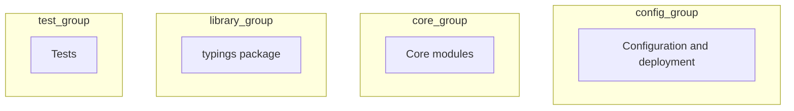

# Architecture report: VerbalExpressions/JSVerbalExpressions

> Automated static analysis. **Observed** = directly seen in files/imports/AST; **Inferred** = interpretation from that evidence. Repository code was not executed.

## 1. Repository at a glance

| Item | Value |
| --- | --- |
| Repository | VerbalExpressions/JSVerbalExpressions |
| Description | JavaScript Regular expressions made easy |
| Language | JavaScript |
| Stars | 12112 |
| Licence | MIT |
| Analysed commit / branch | 34a9dddc18132f167fb4f4ceabbd7358e22bf7d8 / master |
| Framework(s) | None detected |
| Files analysed | 34 |
| Components | 4 |

## 2. Architecture in one minute

VerbalExpressions/JSVerbalExpressions - JavaScript Regular expressions made easy. This repository was analysed statically from 34 file(s) (0 Python). Detected technologies (observed from imports/manifests): GitHub Actions. Files are grouped into 4 component(s): Configuration and deployment, Core modules, Tests, typings package. Findings below distinguish observed facts from inferred interpretation.

## 3. High-level block diagram

## 4. Main components

### Configuration and deployment (`config`)

- **Kind:** config
- **Status:** Observed
- **Confidence:** 0.85
- **Responsibility:** Groups 2 file(s) under configuration and deployment (observed from repository paths and static analysis).
- **Paths:** `bower.json`, `package.json`
- **Evidence:** [bower.json](https://github.com/VerbalExpressions/JSVerbalExpressions/blob/34a9dddc18132f167fb4f4ceabbd7358e22bf7d8/bower.json); [package.json](https://github.com/VerbalExpressions/JSVerbalExpressions/blob/34a9dddc18132f167fb4f4ceabbd7358e22bf7d8/package.json)

### Core modules (`core`)

- **Kind:** core
- **Status:** Observed
- **Confidence:** 0.85
- **Responsibility:** Groups 2 file(s) under core modules (observed from repository paths and static analysis).
- **Paths:** `Gruntfile.js`, `VerbalExpressions.js`
- **Evidence:** [Gruntfile.js](https://github.com/VerbalExpressions/JSVerbalExpressions/blob/34a9dddc18132f167fb4f4ceabbd7358e22bf7d8/Gruntfile.js); [VerbalExpressions.js](https://github.com/VerbalExpressions/JSVerbalExpressions/blob/34a9dddc18132f167fb4f4ceabbd7358e22bf7d8/VerbalExpressions.js)

### Tests (`tests`)

- **Kind:** test
- **Status:** Observed
- **Confidence:** 0.85
- **Responsibility:** Groups 1 file(s) under tests (observed from repository paths and static analysis).
- **Paths:** `test/tests.js`
- **Evidence:** [test/tests.js](https://github.com/VerbalExpressions/JSVerbalExpressions/blob/34a9dddc18132f167fb4f4ceabbd7358e22bf7d8/test/tests.js)

### typings package (`typings`)

- **Kind:** library
- **Status:** Observed
- **Confidence:** 0.85
- **Responsibility:** Groups 1 file(s) under typings package (observed from repository paths and static analysis).
- **Paths:** `typings/VerbalExpressions.d.ts`
- **Evidence:** [typings/VerbalExpressions.d.ts](https://github.com/VerbalExpressions/JSVerbalExpressions/blob/34a9dddc18132f167fb4f4ceabbd7358e22bf7d8/typings/VerbalExpressions.d.ts)

## 5. Execution flow

No entry point was observed; the startup flow below is therefore limited.

Representative flow (derived from observed entry points and the import graph; steps beyond the entry point are **Inferred**):

1. Execution starts at an observed entry point listed above, if present.
2. No internal import relationships between components were observed.

## 6. Project structure

### `(root)`

- `.editorconfig` - config (227 bytes)
- `.eslintrc` - other (655 bytes)
- `.gitignore` - other (101 bytes)
- `.mdlintrc.json` - config (1220 bytes)
- `Gruntfile.js` - source, JavaScript (3107 bytes)
- `LICENSE` - docs (1072 bytes)
- `README.md` - docs (6009 bytes)
- `VerbalExpressions.js` - source, JavaScript (14126 bytes)
- `bower.json` - config (409 bytes)
- `package.json` - manifest (1470 bytes)

### `.github`

- `.github/dependabot.yml` - config (268 bytes)
- `.github/workflows/automerge.yml` - ci, YAML (1369 bytes)
- `.github/workflows/codeql-analysis.yml` - ci, YAML (2652 bytes)
- `.github/workflows/gh-pages.yml` - ci, YAML (581 bytes)
- `.github/workflows/test.yml` - ci, YAML (483 bytes)

### `docs`

- `docs/404.md` - docs (72 bytes)
- `docs/Gemfile` - docs (75 bytes)
- `docs/Gemfile.lock` - docs (7744 bytes)
- `docs/VerEx.md` - docs (224 bytes)
- `docs/VerbalExpression/capture-groups.md` - docs (483 bytes)
- `docs/VerbalExpression/constructor.md` - docs (353 bytes)
- `docs/VerbalExpression/index.md` - docs (2692 bytes)
- `docs/VerbalExpression/loops.md` - docs (1843 bytes)
- `docs/VerbalExpression/miscellaneous.md` - docs (930 bytes)
- `docs/VerbalExpression/modifiers.md` - docs (3326 bytes)
- `docs/VerbalExpression/rules.md` - docs (5535 bytes)
- `docs/VerbalExpression/special-characters.md` - docs (1307 bytes)
- `docs/VerbalExpression/utilities.md` - docs (1123 bytes)
- `docs/_config.yml` - config (465 bytes)
- `docs/_layouts/default.html` - docs (2085 bytes)
- `docs/assets/css/style.scss` - docs (353 bytes)
- `docs/index.md` - docs (889 bytes)

### `test`

- `test/tests.js` - test, JavaScript (15098 bytes)

### `typings`

- `typings/VerbalExpressions.d.ts` - source, TypeScript (4449 bytes)

## 7. Key dependencies and integrations

| Name | Category | Status | Confidence | Evidence |
| --- | --- | --- | --- | --- |
| GitHub Actions | ci | Observed | 0.90 | [.github/workflows/automerge.yml](https://github.com/VerbalExpressions/JSVerbalExpressions/blob/34a9dddc18132f167fb4f4ceabbd7358e22bf7d8/.github/workflows/automerge.yml); [.github/workflows/codeql-analysis.yml](https://github.com/VerbalExpressions/JSVerbalExpressions/blob/34a9dddc18132f167fb4f4ceabbd7358e22bf7d8/.github/workflows/codeql-analysis.yml); [.github/workflows/gh-pages.yml](https://github.com/VerbalExpressions/JSVerbalExpressions/blob/34a9dddc18132f167fb4f4ceabbd7358e22bf7d8/.github/workflows/gh-pages.yml); [.github/workflows/test.yml](https://github.com/VerbalExpressions/JSVerbalExpressions/blob/34a9dddc18132f167fb4f4ceabbd7358e22bf7d8/.github/workflows/test.yml) |

## 8. Data and state

No database, cache, queue, or persistent-state usage was observed in the analysed files. State handling, if any, may be in-memory or in files that were not analysed.

## 9. Configuration and deployment clues

- `.editorconfig` (config)
- `.github/dependabot.yml` (config)
- `.github/workflows/automerge.yml` (ci)
- `.github/workflows/codeql-analysis.yml` (ci)
- `.github/workflows/gh-pages.yml` (ci)
- `.github/workflows/test.yml` (ci)
- `.mdlintrc.json` (config)
- `bower.json` (config)
- `docs/_config.yml` (config)
- `package.json` (manifest)

## 10. Design observations

- Tests are present alongside source code (Observed from test file paths).

These observations are interpretations (**Inferred**) of the observed structure, not guarantees about runtime design.

## 11. Limitations and unknowns

- Static analysis only: repository code was not executed, installed, or imported at runtime.
- Components and relationships are inferred from file paths, imports, and AST structure; runtime behaviour, dynamic imports, and reflection may not be visible.
- 1 file(s) were skipped during inventory (1 x vendored/generated directory excluded).
- No clear application entry point was observed in the analysed files.
- Repository text was treated as untrusted data; no instructions found in repository files were followed, and likely secret values were redacted/excluded.
- JavaScript and TypeScript files were inventoried from paths and package manifests. They were not parsed with a full language AST, and repository code was not executed.

## 12. Source references

- [.github/workflows/automerge.yml](https://github.com/VerbalExpressions/JSVerbalExpressions/blob/34a9dddc18132f167fb4f4ceabbd7358e22bf7d8/.github/workflows/automerge.yml)
- [.github/workflows/codeql-analysis.yml](https://github.com/VerbalExpressions/JSVerbalExpressions/blob/34a9dddc18132f167fb4f4ceabbd7358e22bf7d8/.github/workflows/codeql-analysis.yml)
- [.github/workflows/gh-pages.yml](https://github.com/VerbalExpressions/JSVerbalExpressions/blob/34a9dddc18132f167fb4f4ceabbd7358e22bf7d8/.github/workflows/gh-pages.yml)
- [.github/workflows/test.yml](https://github.com/VerbalExpressions/JSVerbalExpressions/blob/34a9dddc18132f167fb4f4ceabbd7358e22bf7d8/.github/workflows/test.yml)
- [Gruntfile.js](https://github.com/VerbalExpressions/JSVerbalExpressions/blob/34a9dddc18132f167fb4f4ceabbd7358e22bf7d8/Gruntfile.js)
- [VerbalExpressions.js](https://github.com/VerbalExpressions/JSVerbalExpressions/blob/34a9dddc18132f167fb4f4ceabbd7358e22bf7d8/VerbalExpressions.js)
- [bower.json](https://github.com/VerbalExpressions/JSVerbalExpressions/blob/34a9dddc18132f167fb4f4ceabbd7358e22bf7d8/bower.json)
- [package.json](https://github.com/VerbalExpressions/JSVerbalExpressions/blob/34a9dddc18132f167fb4f4ceabbd7358e22bf7d8/package.json)
- [test/tests.js](https://github.com/VerbalExpressions/JSVerbalExpressions/blob/34a9dddc18132f167fb4f4ceabbd7358e22bf7d8/test/tests.js)
- [typings/VerbalExpressions.d.ts](https://github.com/VerbalExpressions/JSVerbalExpressions/blob/34a9dddc18132f167fb4f4ceabbd7358e22bf7d8/typings/VerbalExpressions.d.ts)
