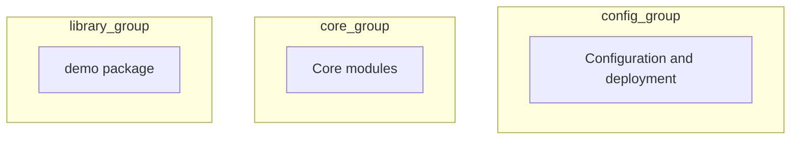

# Architecture report: VincentGarreau/particles.js

> Automated static analysis. **Observed** = directly seen in files/imports/AST; **Inferred** = interpretation from that evidence. Repository code was not executed.

## 1. Repository at a glance

| Item | Value |
| --- | --- |
| Repository | VincentGarreau/particles.js |
| Description | A lightweight JavaScript library for creating particles |
| Language | JavaScript |
| Stars | 30184 |
| Licence | MIT |
| Analysed commit / branch | d01286d6dcd61f497d07cc62bd48e692f6508ad5 / master |
| Framework(s) | None detected |
| Files analysed | 11 |
| Components | 3 |

## 2. Architecture in one minute

VincentGarreau/particles.js - A lightweight JavaScript library for creating particles. This repository was analysed statically from 11 file(s) (0 Python). Detected technologies (observed from imports/manifests): no known frameworks/libraries. Files are grouped into 3 component(s): Configuration and deployment, Core modules, demo package. Findings below distinguish observed facts from inferred interpretation.

## 3. High-level block diagram

## 4. Main components

### Configuration and deployment (`config`)

- **Kind:** config
- **Status:** Observed
- **Confidence:** 0.85
- **Responsibility:** Groups 3 file(s) under configuration and deployment (observed from repository paths and static analysis).
- **Paths:** `bower.json`, `demo/particles.json`, `package.json`
- **Evidence:** [bower.json](https://github.com/VincentGarreau/particles.js/blob/d01286d6dcd61f497d07cc62bd48e692f6508ad5/bower.json); [demo/particles.json](https://github.com/VincentGarreau/particles.js/blob/d01286d6dcd61f497d07cc62bd48e692f6508ad5/demo/particles.json); [package.json](https://github.com/VincentGarreau/particles.js/blob/d01286d6dcd61f497d07cc62bd48e692f6508ad5/package.json)

### Core modules (`core`)

- **Kind:** core
- **Status:** Observed
- **Confidence:** 0.85
- **Responsibility:** Groups 1 file(s) under core modules (observed from repository paths and static analysis).
- **Paths:** `particles.js`
- **Evidence:** [particles.js](https://github.com/VincentGarreau/particles.js/blob/d01286d6dcd61f497d07cc62bd48e692f6508ad5/particles.js)

### demo package (`demo`)

- **Kind:** library
- **Status:** Observed
- **Confidence:** 0.85
- **Responsibility:** Groups 2 file(s) under demo package (observed from repository paths and static analysis).
- **Paths:** `demo/js/app.js`, `demo/js/lib/stats.js`
- **Evidence:** [demo/js/app.js](https://github.com/VincentGarreau/particles.js/blob/d01286d6dcd61f497d07cc62bd48e692f6508ad5/demo/js/app.js); [demo/js/lib/stats.js](https://github.com/VincentGarreau/particles.js/blob/d01286d6dcd61f497d07cc62bd48e692f6508ad5/demo/js/lib/stats.js)

## 5. Execution flow

**Observed** entry point(s):

- [demo/js/app.js](https://github.com/VincentGarreau/particles.js/blob/d01286d6dcd61f497d07cc62bd48e692f6508ad5/demo/js/app.js)

Representative flow (derived from observed entry points and the import graph; steps beyond the entry point are **Inferred**):

1. Execution starts at an observed entry point listed above, if present.
2. No internal import relationships between components were observed.

## 6. Project structure

### `(root)`

- `.gitignore` - other (16 bytes)
- `LICENSE.md` - docs (1083 bytes)
- `README.md` - docs (7502 bytes)
- `bower.json` - config (435 bytes)
- `package.json` - manifest (693 bytes)
- `particles.js` - source, JavaScript (43009 bytes)

### `demo`

- `demo/css/style.css` - other (2585 bytes)
- `demo/index.html` - other (1448 bytes)
- `demo/js/app.js` - source, JavaScript (2821 bytes)
- `demo/js/lib/stats.js` - source, JavaScript (3560 bytes)
- `demo/particles.json` - config (2137 bytes)

## 7. Key dependencies and integrations

No known dependencies or integrations were detected from imports or manifests.

## 8. Data and state

No database, cache, queue, or persistent-state usage was observed in the analysed files. State handling, if any, may be in-memory or in files that were not analysed.

## 9. Configuration and deployment clues

- `bower.json` (config)
- `demo/particles.json` (config)
- `package.json` (manifest)

## 10. Design observations

- No strong design patterns could be established from the available evidence.

These observations are interpretations (**Inferred**) of the observed structure, not guarantees about runtime design.

## 11. Limitations and unknowns

- Static analysis only: repository code was not executed, installed, or imported at runtime.
- Components and relationships are inferred from file paths, imports, and AST structure; runtime behaviour, dynamic imports, and reflection may not be visible.
- No clear application entry point was observed in the analysed files.
- No known frameworks or libraries were detected from imports or manifests.
- Repository text was treated as untrusted data; no instructions found in repository files were followed, and likely secret values were redacted/excluded.
- JavaScript and TypeScript files were inventoried from paths and package manifests. They were not parsed with a full language AST, and repository code was not executed.

## 12. Source references

- [bower.json](https://github.com/VincentGarreau/particles.js/blob/d01286d6dcd61f497d07cc62bd48e692f6508ad5/bower.json)
- [demo/js/app.js](https://github.com/VincentGarreau/particles.js/blob/d01286d6dcd61f497d07cc62bd48e692f6508ad5/demo/js/app.js)
- [demo/js/lib/stats.js](https://github.com/VincentGarreau/particles.js/blob/d01286d6dcd61f497d07cc62bd48e692f6508ad5/demo/js/lib/stats.js)
- [demo/particles.json](https://github.com/VincentGarreau/particles.js/blob/d01286d6dcd61f497d07cc62bd48e692f6508ad5/demo/particles.json)
- [package.json](https://github.com/VincentGarreau/particles.js/blob/d01286d6dcd61f497d07cc62bd48e692f6508ad5/package.json)
- [particles.js](https://github.com/VincentGarreau/particles.js/blob/d01286d6dcd61f497d07cc62bd48e692f6508ad5/particles.js)
