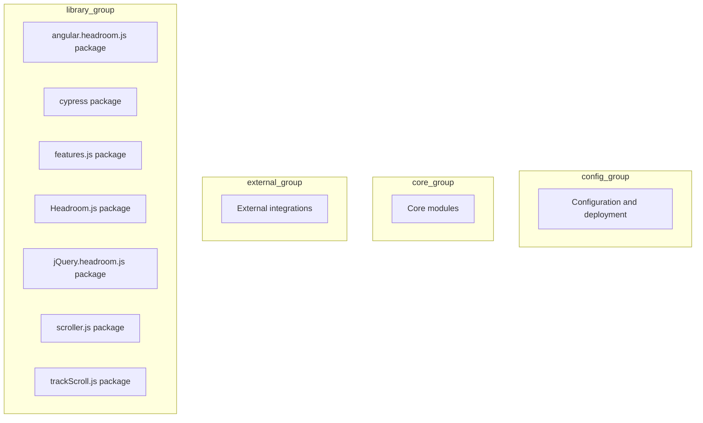

# Architecture report: WickyNilliams/headroom.js

> Automated static analysis. **Observed** = directly seen in files/imports/AST; **Inferred** = interpretation from that evidence. Repository code was not executed.

## 1. Repository at a glance

| Item | Value |
| --- | --- |
| Repository | WickyNilliams/headroom.js |
| Description | Give your pages some headroom. Hide your header until you need it |
| Language | JavaScript |
| Stars | 10840 |
| Licence | MIT |
| Analysed commit / branch | 0f53fc75f41b0025a80b6075bcdd0d1ea51478be / master |
| Framework(s) | None detected |
| Files analysed | 21 |
| Components | 10 |

## 2. Architecture in one minute

WickyNilliams/headroom.js - Give your pages some headroom. Hide your header until you need it. This repository was analysed statically from 21 file(s) (0 Python). Detected technologies (observed from imports/manifests): no known frameworks/libraries. Files are grouped into 10 component(s): angular.headroom.js package, Configuration and deployment, Core modules, cypress package, External integrations, features.js package, Headroom.js package, jQuery.headroom.js package. Findings below distinguish observed facts from inferred interpretation.

## 3. High-level block diagram

## 4. Main components

### angular.headroom.js package (`angular_headroom_js`)

- **Kind:** library
- **Status:** Observed
- **Confidence:** 0.85
- **Responsibility:** Groups 1 file(s) under angular.headroom.js package (observed from repository paths and static analysis).
- **Paths:** `src/angular.headroom.js`
- **Evidence:** [src/angular.headroom.js](https://github.com/WickyNilliams/headroom.js/blob/0f53fc75f41b0025a80b6075bcdd0d1ea51478be/src/angular.headroom.js)

### Configuration and deployment (`config`)

- **Kind:** config
- **Status:** Observed
- **Confidence:** 0.85
- **Responsibility:** Groups 2 file(s) under configuration and deployment (observed from repository paths and static analysis).
- **Paths:** `cypress.json`, `package.json`
- **Evidence:** [cypress.json](https://github.com/WickyNilliams/headroom.js/blob/0f53fc75f41b0025a80b6075bcdd0d1ea51478be/cypress.json); [package.json](https://github.com/WickyNilliams/headroom.js/blob/0f53fc75f41b0025a80b6075bcdd0d1ea51478be/package.json)

### Core modules (`core`)

- **Kind:** core
- **Status:** Observed
- **Confidence:** 0.85
- **Responsibility:** Groups 1 file(s) under core modules (observed from repository paths and static analysis).
- **Paths:** `rollup.config.js`
- **Evidence:** [rollup.config.js](https://github.com/WickyNilliams/headroom.js/blob/0f53fc75f41b0025a80b6075bcdd0d1ea51478be/rollup.config.js)

### cypress package (`cypress`)

- **Kind:** library
- **Status:** Observed
- **Confidence:** 0.85
- **Responsibility:** Groups 3 file(s) under cypress package (observed from repository paths and static analysis).
- **Paths:** `cypress/plugins/index.js`, `cypress/support/commands.js`, `cypress/support/index.js`
- **Evidence:** [cypress/plugins/index.js](https://github.com/WickyNilliams/headroom.js/blob/0f53fc75f41b0025a80b6075bcdd0d1ea51478be/cypress/plugins/index.js); [cypress/support/commands.js](https://github.com/WickyNilliams/headroom.js/blob/0f53fc75f41b0025a80b6075bcdd0d1ea51478be/cypress/support/commands.js); [cypress/support/index.js](https://github.com/WickyNilliams/headroom.js/blob/0f53fc75f41b0025a80b6075bcdd0d1ea51478be/cypress/support/index.js)

### External integrations (`external_integrations`)

- **Kind:** external
- **Status:** Observed
- **Confidence:** 0.85
- **Responsibility:** Groups 1 file(s) under external integrations (observed from repository paths and static analysis).
- **Paths:** `cypress/integration/headroom.spec.js`
- **Evidence:** [cypress/integration/headroom.spec.js](https://github.com/WickyNilliams/headroom.js/blob/0f53fc75f41b0025a80b6075bcdd0d1ea51478be/cypress/integration/headroom.spec.js)

### features.js package (`features_js`)

- **Kind:** library
- **Status:** Observed
- **Confidence:** 0.85
- **Responsibility:** Groups 1 file(s) under features.js package (observed from repository paths and static analysis).
- **Paths:** `src/features.js`
- **Evidence:** [src/features.js](https://github.com/WickyNilliams/headroom.js/blob/0f53fc75f41b0025a80b6075bcdd0d1ea51478be/src/features.js)

### Headroom.js package (`headroom_js`)

- **Kind:** library
- **Status:** Observed
- **Confidence:** 0.85
- **Responsibility:** Groups 1 file(s) under headroom.js package (observed from repository paths and static analysis).
- **Paths:** `src/Headroom.js`
- **Evidence:** [src/Headroom.js](https://github.com/WickyNilliams/headroom.js/blob/0f53fc75f41b0025a80b6075bcdd0d1ea51478be/src/Headroom.js)

### jQuery.headroom.js package (`jquery_headroom_js`)

- **Kind:** library
- **Status:** Observed
- **Confidence:** 0.85
- **Responsibility:** Groups 1 file(s) under jquery.headroom.js package (observed from repository paths and static analysis).
- **Paths:** `src/jQuery.headroom.js`
- **Evidence:** [src/jQuery.headroom.js](https://github.com/WickyNilliams/headroom.js/blob/0f53fc75f41b0025a80b6075bcdd0d1ea51478be/src/jQuery.headroom.js)

### scroller.js package (`scroller_js`)

- **Kind:** library
- **Status:** Observed
- **Confidence:** 0.85
- **Responsibility:** Groups 1 file(s) under scroller.js package (observed from repository paths and static analysis).
- **Paths:** `src/scroller.js`
- **Evidence:** [src/scroller.js](https://github.com/WickyNilliams/headroom.js/blob/0f53fc75f41b0025a80b6075bcdd0d1ea51478be/src/scroller.js)

### trackScroll.js package (`trackscroll_js`)

- **Kind:** library
- **Status:** Observed
- **Confidence:** 0.85
- **Responsibility:** Groups 1 file(s) under trackscroll.js package (observed from repository paths and static analysis).
- **Paths:** `src/trackScroll.js`
- **Evidence:** [src/trackScroll.js](https://github.com/WickyNilliams/headroom.js/blob/0f53fc75f41b0025a80b6075bcdd0d1ea51478be/src/trackScroll.js)

## 5. Execution flow

**Observed** entry point(s):

- [cypress/plugins/index.js](https://github.com/WickyNilliams/headroom.js/blob/0f53fc75f41b0025a80b6075bcdd0d1ea51478be/cypress/plugins/index.js)
- [cypress/support/index.js](https://github.com/WickyNilliams/headroom.js/blob/0f53fc75f41b0025a80b6075bcdd0d1ea51478be/cypress/support/index.js)

Representative flow (derived from observed entry points and the import graph; steps beyond the entry point are **Inferred**):

1. Execution starts at an observed entry point listed above, if present.
2. No internal import relationships between components were observed.

## 6. Project structure

### `(root)`

- `.eslintrc` - other (659 bytes)
- `.gitignore` - other (26 bytes)
- `.travis.yml` - ci, YAML (392 bytes)
- `LICENSE` - docs (1079 bytes)
- `README.md` - docs (2417 bytes)
- `cypress.json` - config (21 bytes)
- `package.json` - manifest (1096 bytes)
- `rollup.config.js` - source, JavaScript (1089 bytes)

### `cypress`

- `cypress/.eslintrc` - other (48 bytes)
- `cypress/fixtures/index.html` - other (10841 bytes)
- `cypress/integration/headroom.spec.js` - source, JavaScript (8615 bytes)
- `cypress/plugins/index.js` - source, JavaScript (649 bytes)
- `cypress/support/commands.js` - source, JavaScript (841 bytes)
- `cypress/support/index.js` - source, JavaScript (3395 bytes)

### `src`

- `src/.eslintrc` - other (86 bytes)
- `src/Headroom.js` - source, JavaScript (5119 bytes)
- `src/angular.headroom.js` - source, JavaScript (999 bytes)
- `src/features.js` - source, JavaScript (846 bytes)
- `src/jQuery.headroom.js` - source, JavaScript (851 bytes)
- `src/scroller.js` - source, JavaScript (2193 bytes)
- `src/trackScroll.js` - source, JavaScript (1608 bytes)

## 7. Key dependencies and integrations

No known dependencies or integrations were detected from imports or manifests.

## 8. Data and state

No database, cache, queue, or persistent-state usage was observed in the analysed files. State handling, if any, may be in-memory or in files that were not analysed.

## 9. Configuration and deployment clues

- `.travis.yml` (ci)
- `cypress.json` (config)
- `package.json` (manifest)

## 10. Design observations

- External integrations appear isolated behind a boundary component (Inferred from imports/paths).

These observations are interpretations (**Inferred**) of the observed structure, not guarantees about runtime design.

## 11. Limitations and unknowns

- Static analysis only: repository code was not executed, installed, or imported at runtime.
- Components and relationships are inferred from file paths, imports, and AST structure; runtime behaviour, dynamic imports, and reflection may not be visible.
- 1 file(s) were skipped during inventory (1 x lockfile excluded).
- No clear application entry point was observed in the analysed files.
- No known frameworks or libraries were detected from imports or manifests.
- Repository text was treated as untrusted data; no instructions found in repository files were followed, and likely secret values were redacted/excluded.
- JavaScript and TypeScript files were inventoried from paths and package manifests. They were not parsed with a full language AST, and repository code was not executed.

## 12. Source references

- [cypress.json](https://github.com/WickyNilliams/headroom.js/blob/0f53fc75f41b0025a80b6075bcdd0d1ea51478be/cypress.json)
- [cypress/integration/headroom.spec.js](https://github.com/WickyNilliams/headroom.js/blob/0f53fc75f41b0025a80b6075bcdd0d1ea51478be/cypress/integration/headroom.spec.js)
- [cypress/plugins/index.js](https://github.com/WickyNilliams/headroom.js/blob/0f53fc75f41b0025a80b6075bcdd0d1ea51478be/cypress/plugins/index.js)
- [cypress/support/commands.js](https://github.com/WickyNilliams/headroom.js/blob/0f53fc75f41b0025a80b6075bcdd0d1ea51478be/cypress/support/commands.js)
- [cypress/support/index.js](https://github.com/WickyNilliams/headroom.js/blob/0f53fc75f41b0025a80b6075bcdd0d1ea51478be/cypress/support/index.js)
- [package.json](https://github.com/WickyNilliams/headroom.js/blob/0f53fc75f41b0025a80b6075bcdd0d1ea51478be/package.json)
- [rollup.config.js](https://github.com/WickyNilliams/headroom.js/blob/0f53fc75f41b0025a80b6075bcdd0d1ea51478be/rollup.config.js)
- [src/Headroom.js](https://github.com/WickyNilliams/headroom.js/blob/0f53fc75f41b0025a80b6075bcdd0d1ea51478be/src/Headroom.js)
- [src/angular.headroom.js](https://github.com/WickyNilliams/headroom.js/blob/0f53fc75f41b0025a80b6075bcdd0d1ea51478be/src/angular.headroom.js)
- [src/features.js](https://github.com/WickyNilliams/headroom.js/blob/0f53fc75f41b0025a80b6075bcdd0d1ea51478be/src/features.js)
- [src/jQuery.headroom.js](https://github.com/WickyNilliams/headroom.js/blob/0f53fc75f41b0025a80b6075bcdd0d1ea51478be/src/jQuery.headroom.js)
- [src/scroller.js](https://github.com/WickyNilliams/headroom.js/blob/0f53fc75f41b0025a80b6075bcdd0d1ea51478be/src/scroller.js)
- [src/trackScroll.js](https://github.com/WickyNilliams/headroom.js/blob/0f53fc75f41b0025a80b6075bcdd0d1ea51478be/src/trackScroll.js)
