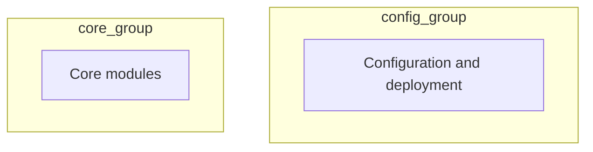

# Architecture report: XIU2/UserScript

> Automated static analysis. **Observed** = directly seen in files/imports/AST; **Inferred** = interpretation from that evidence. Repository code was not executed.

## 1. Repository at a glance

| Item | Value |
| --- | --- |
| Repository | XIU2/UserScript |
| Description | 🐵 自用的一些乱七八糟 油猴脚本~  |
| Language | JavaScript |
| Stars | 10204 |
| Licence | GPL-3.0 |
| Analysed commit / branch | 8ef9d3eb59974a9341ebf1b76a5f655ad266ec23 / master |
| Framework(s) | None detected |
| Files analysed | 29 |
| Components | 2 |

## 2. Architecture in one minute

XIU2/UserScript - 🐵 自用的一些乱七八糟 油猴脚本~ . This repository was analysed statically from 29 file(s) (0 Python). Detected technologies (observed from imports/manifests): no known frameworks/libraries. Files are grouped into 2 component(s): Configuration and deployment, Core modules. Findings below distinguish observed facts from inferred interpretation.

## 3. High-level block diagram

## 4. Main components

### Configuration and deployment (`config`)

- **Kind:** config
- **Status:** Observed
- **Confidence:** 0.85
- **Responsibility:** Groups 1 file(s) under configuration and deployment (observed from repository paths and static analysis).
- **Paths:** `other/Autopage/ruleUpdateTime.json`
- **Evidence:** [other/Autopage/ruleUpdateTime.json](https://github.com/XIU2/UserScript/blob/8ef9d3eb59974a9341ebf1b76a5f655ad266ec23/other/Autopage/ruleUpdateTime.json)

### Core modules (`core`)

- **Kind:** core
- **Status:** Observed
- **Confidence:** 0.85
- **Responsibility:** Groups 21 file(s) under core modules (observed from repository paths and static analysis).
- **Paths:** `3dm-Beautification.user.js`, `3dm-Enhanced.user.js`, `52pojie-Beautification.user.js`, `52pojie-Enhanced.user.js`, `Autopage.user.js`, `DarkMode.user.js`, `DuckDuckGo-Enhanced.user.js`, `GithubEnhanced-High-Speed-Download.user.js`, `GoogleTranslate-Beautification.user.js`, `HTML5Volume.user.js`, `Hostloc-Enhanced.user.js`, `Lanzou-Enhanced.user.js`, `Ping.Sx-Enhanced.user.js`, `RightClick_ScrollBar_BackToTop.user.js`, `SteamWorkshopImageRepair.user.js`, `TargetBlank.user.js`, `V2ex-Enhanced.user.js`, `Zhihu-Beautification.user.js`, `Zhihu-Enhanced.user.js`, `Zhiyoo-Beautification.user.js`, `Zhiyoo-Enhanced.user.js`
- **Evidence:** [3dm-Beautification.user.js](https://github.com/XIU2/UserScript/blob/8ef9d3eb59974a9341ebf1b76a5f655ad266ec23/3dm-Beautification.user.js); [3dm-Enhanced.user.js](https://github.com/XIU2/UserScript/blob/8ef9d3eb59974a9341ebf1b76a5f655ad266ec23/3dm-Enhanced.user.js); [52pojie-Beautification.user.js](https://github.com/XIU2/UserScript/blob/8ef9d3eb59974a9341ebf1b76a5f655ad266ec23/52pojie-Beautification.user.js); [52pojie-Enhanced.user.js](https://github.com/XIU2/UserScript/blob/8ef9d3eb59974a9341ebf1b76a5f655ad266ec23/52pojie-Enhanced.user.js); [Autopage.user.js](https://github.com/XIU2/UserScript/blob/8ef9d3eb59974a9341ebf1b76a5f655ad266ec23/Autopage.user.js); [DarkMode.user.js](https://github.com/XIU2/UserScript/blob/8ef9d3eb59974a9341ebf1b76a5f655ad266ec23/DarkMode.user.js); [DuckDuckGo-Enhanced.user.js](https://github.com/XIU2/UserScript/blob/8ef9d3eb59974a9341ebf1b76a5f655ad266ec23/DuckDuckGo-Enhanced.user.js); [GithubEnhanced-High-Speed-Download.user.js](https://github.com/XIU2/UserScript/blob/8ef9d3eb59974a9341ebf1b76a5f655ad266ec23/GithubEnhanced-High-Speed-Download.user.js)

## 5. Execution flow

No entry point was observed; the startup flow below is therefore limited.

Representative flow (derived from observed entry points and the import graph; steps beyond the entry point are **Inferred**):

1. Execution starts at an observed entry point listed above, if present.
2. No internal import relationships between components were observed.

## 6. Project structure

### `(root)`

- `3dm-Beautification.user.js` - source, JavaScript (3171 bytes)
- `3dm-Enhanced.user.js` - source, JavaScript (18569 bytes)
- `52pojie-Beautification.user.js` - source, JavaScript (6755 bytes)
- `52pojie-Enhanced.user.js` - source, JavaScript (21900 bytes)
- `Autopage.user.js` - source, JavaScript (186829 bytes)
- `CNAME` - other (19 bytes)
- `DarkMode.user.js` - source, JavaScript (32775 bytes)
- `DuckDuckGo-Enhanced.user.js` - source, JavaScript (10495 bytes)
- `GithubEnhanced-High-Speed-Download.user.js` - source, JavaScript (42732 bytes)
- `GoogleTranslate-Beautification.user.js` - source, JavaScript (4887 bytes)
- `HTML5Volume.user.js` - source, JavaScript (14119 bytes)
- `Hostloc-Enhanced.user.js` - source, JavaScript (39131 bytes)
- `LICENSE` - docs (35149 bytes)
- `Lanzou-Enhanced.user.js` - source, JavaScript (45323 bytes)
- `Ping.Sx-Enhanced.user.js` - source, JavaScript (11223 bytes)
- `README.md` - docs (13401 bytes)
- `RightClick_ScrollBar_BackToTop.user.js` - source, JavaScript (7388 bytes)
- `SteamWorkshopImageRepair.user.js` - source, JavaScript (4838 bytes)
- `TargetBlank.user.js` - source, JavaScript (7358 bytes)
- `V2ex-Enhanced.user.js` - source, JavaScript (31066 bytes)
- `Zhihu-Beautification.user.js` - source, JavaScript (45618 bytes)
- `Zhihu-Enhanced.user.js` - source, JavaScript (114600 bytes)
- `Zhiyoo-Beautification.user.js` - source, JavaScript (1785 bytes)
- `Zhiyoo-Enhanced.user.js` - source, JavaScript (22086 bytes)

### `.github`

- `.github/ISSUE_TEMPLATE/01-bugReport.yml` - config (1286 bytes)
- `.github/ISSUE_TEMPLATE/02-featureRequest.yml` - config (1522 bytes)
- `.github/ISSUE_TEMPLATE/03-autoPageRequest.yml` - config (3345 bytes)
- `.github/ISSUE_TEMPLATE/config.yml` - config (27 bytes)

### `other`

- `other/Autopage/ruleUpdateTime.json` - config (10 bytes)

## 7. Key dependencies and integrations

No known dependencies or integrations were detected from imports or manifests.

## 8. Data and state

No database, cache, queue, or persistent-state usage was observed in the analysed files. State handling, if any, may be in-memory or in files that were not analysed.

## 9. Configuration and deployment clues

- `.github/ISSUE_TEMPLATE/01-bugReport.yml` (config)
- `.github/ISSUE_TEMPLATE/02-featureRequest.yml` (config)
- `.github/ISSUE_TEMPLATE/03-autoPageRequest.yml` (config)
- `.github/ISSUE_TEMPLATE/config.yml` (config)
- `other/Autopage/ruleUpdateTime.json` (config)

## 10. Design observations

- No strong design patterns could be established from the available evidence.

These observations are interpretations (**Inferred**) of the observed structure, not guarantees about runtime design.

## 11. Limitations and unknowns

- Static analysis only: repository code was not executed, installed, or imported at runtime.
- Components and relationships are inferred from file paths, imports, and AST structure; runtime behaviour, dynamic imports, and reflection may not be visible.
- No clear application entry point was observed in the analysed files.
- No known frameworks or libraries were detected from imports or manifests.
- Repository text was treated as untrusted data; no instructions found in repository files were followed, and likely secret values were redacted/excluded.
- JavaScript and TypeScript files were inventoried from paths and package manifests. They were not parsed with a full language AST, and repository code was not executed.

## 12. Source references

- [3dm-Beautification.user.js](https://github.com/XIU2/UserScript/blob/8ef9d3eb59974a9341ebf1b76a5f655ad266ec23/3dm-Beautification.user.js)
- [3dm-Enhanced.user.js](https://github.com/XIU2/UserScript/blob/8ef9d3eb59974a9341ebf1b76a5f655ad266ec23/3dm-Enhanced.user.js)
- [52pojie-Beautification.user.js](https://github.com/XIU2/UserScript/blob/8ef9d3eb59974a9341ebf1b76a5f655ad266ec23/52pojie-Beautification.user.js)
- [52pojie-Enhanced.user.js](https://github.com/XIU2/UserScript/blob/8ef9d3eb59974a9341ebf1b76a5f655ad266ec23/52pojie-Enhanced.user.js)
- [Autopage.user.js](https://github.com/XIU2/UserScript/blob/8ef9d3eb59974a9341ebf1b76a5f655ad266ec23/Autopage.user.js)
- [DarkMode.user.js](https://github.com/XIU2/UserScript/blob/8ef9d3eb59974a9341ebf1b76a5f655ad266ec23/DarkMode.user.js)
- [DuckDuckGo-Enhanced.user.js](https://github.com/XIU2/UserScript/blob/8ef9d3eb59974a9341ebf1b76a5f655ad266ec23/DuckDuckGo-Enhanced.user.js)
- [GithubEnhanced-High-Speed-Download.user.js](https://github.com/XIU2/UserScript/blob/8ef9d3eb59974a9341ebf1b76a5f655ad266ec23/GithubEnhanced-High-Speed-Download.user.js)
- [other/Autopage/ruleUpdateTime.json](https://github.com/XIU2/UserScript/blob/8ef9d3eb59974a9341ebf1b76a5f655ad266ec23/other/Autopage/ruleUpdateTime.json)
