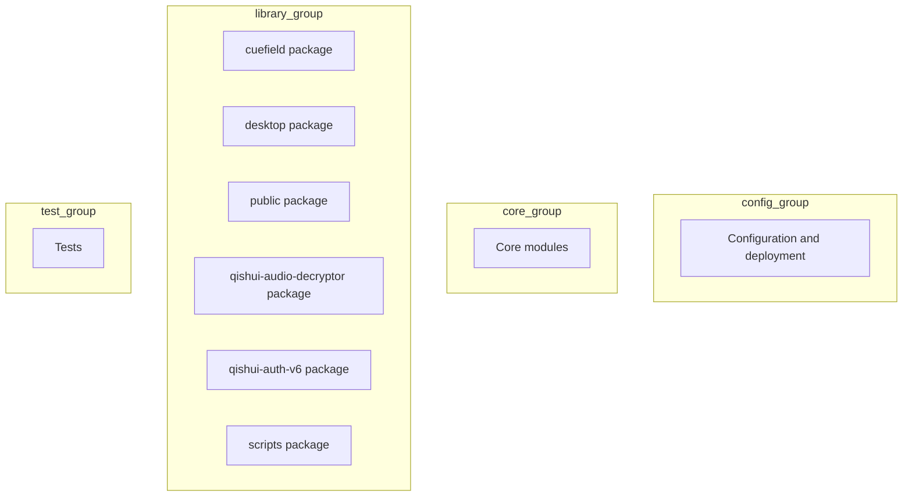

# Architecture report: XxHuberrr/Mineradio-paused

> Automated static analysis. **Observed** = directly seen in files/imports/AST; **Inferred** = interpretation from that evidence. Repository code was not executed.

## 1. Repository at a glance

| Item | Value |
| --- | --- |
| Repository | XxHuberrr/Mineradio-paused |
| Description | Mineradio 官网：mineradio.cn ｜ 一款以电影镜头、粒子视觉和歌词舞台为核心的沉浸式音乐播放器。 |
| Language | JavaScript |
| Stars | 11423 |
| Licence | Other |
| Analysed commit / branch | 649c787d22fd283b5431899eca3ee6a509319247 / main |
| Framework(s) | Electron |
| Files analysed | 254 |
| Components | 9 |

## 2. Architecture in one minute

XxHuberrr/Mineradio-paused - Mineradio 官网：mineradio.cn ｜ 一款以电影镜头、粒子视觉和歌词舞台为核心的沉浸式音乐播放器。. This repository was analysed statically from 254 file(s) (0 Python). Detected technologies (observed from imports/manifests): Electron. Files are grouped into 9 component(s): Configuration and deployment, Core modules, cuefield package, desktop package, public package, qishui-audio-decryptor package, qishui-auth-v6 package, scripts package. Findings below distinguish observed facts from inferred interpretation.

## 3. High-level block diagram

## 4. Main components

### Configuration and deployment (`config`)

- **Kind:** config
- **Status:** Observed
- **Confidence:** 0.85
- **Responsibility:** Groups 3 file(s) under configuration and deployment (observed from repository paths and static analysis).
- **Paths:** `electron-builder.internal-beta.json`, `package.json`, `public/default-user-fx-archive.json`
- **Evidence:** [electron-builder.internal-beta.json](https://github.com/XxHuberrr/Mineradio-paused/blob/649c787d22fd283b5431899eca3ee6a509319247/electron-builder.internal-beta.json); [package.json](https://github.com/XxHuberrr/Mineradio-paused/blob/649c787d22fd283b5431899eca3ee6a509319247/package.json); [public/default-user-fx-archive.json](https://github.com/XxHuberrr/Mineradio-paused/blob/649c787d22fd283b5431899eca3ee6a509319247/public/default-user-fx-archive.json)

### Core modules (`core`)

- **Kind:** core
- **Status:** Observed
- **Confidence:** 0.85
- **Responsibility:** Groups 7 file(s) under core modules (observed from repository paths and static analysis).
- **Paths:** `dj-analyzer.js`, `kugou-api.js`, `qishui-api.js`, `qishui-auth-v6.js`, `qishui-qr-login.js`, `qq-vip-api.js`, `spotify-api.js`
- **Evidence:** [dj-analyzer.js](https://github.com/XxHuberrr/Mineradio-paused/blob/649c787d22fd283b5431899eca3ee6a509319247/dj-analyzer.js); [kugou-api.js](https://github.com/XxHuberrr/Mineradio-paused/blob/649c787d22fd283b5431899eca3ee6a509319247/kugou-api.js); [qishui-api.js](https://github.com/XxHuberrr/Mineradio-paused/blob/649c787d22fd283b5431899eca3ee6a509319247/qishui-api.js); [qishui-auth-v6.js](https://github.com/XxHuberrr/Mineradio-paused/blob/649c787d22fd283b5431899eca3ee6a509319247/qishui-auth-v6.js); [qishui-qr-login.js](https://github.com/XxHuberrr/Mineradio-paused/blob/649c787d22fd283b5431899eca3ee6a509319247/qishui-qr-login.js); [qq-vip-api.js](https://github.com/XxHuberrr/Mineradio-paused/blob/649c787d22fd283b5431899eca3ee6a509319247/qq-vip-api.js); [spotify-api.js](https://github.com/XxHuberrr/Mineradio-paused/blob/649c787d22fd283b5431899eca3ee6a509319247/spotify-api.js)

### cuefield package (`cuefield`)

- **Kind:** library
- **Status:** Observed
- **Confidence:** 0.85
- **Responsibility:** Groups 19 file(s) under cuefield package (observed from repository paths and static analysis).
- **Paths:** `cuefield/adapter-mineradio.js`, `cuefield/boundary-evidence.js`, `cuefield/bridge-planner.js`, `cuefield/cue-profile.js`, `cuefield/feedback-log.js`, `cuefield/lrc-anchors.js`, `cuefield/lyric-link.js`, `cuefield/mineradio-bridge.js`, `cuefield/musical-profile.js`, `cuefield/planner-contracts.js`, `cuefield/recipe-planner.js`, `cuefield/section-candidates.js`, `cuefield/shadow-diagnostics.js`, `cuefield/structure-map.js`, `cuefield/transition-artifact.js`, `cuefield/transition-evaluator.js`, `cuefield/transition-router.js`, `cuefield/transition-window-planner.js`, `cuefield/version.js`
- **Evidence:** [cuefield/adapter-mineradio.js](https://github.com/XxHuberrr/Mineradio-paused/blob/649c787d22fd283b5431899eca3ee6a509319247/cuefield/adapter-mineradio.js); [cuefield/boundary-evidence.js](https://github.com/XxHuberrr/Mineradio-paused/blob/649c787d22fd283b5431899eca3ee6a509319247/cuefield/boundary-evidence.js); [cuefield/bridge-planner.js](https://github.com/XxHuberrr/Mineradio-paused/blob/649c787d22fd283b5431899eca3ee6a509319247/cuefield/bridge-planner.js); [cuefield/cue-profile.js](https://github.com/XxHuberrr/Mineradio-paused/blob/649c787d22fd283b5431899eca3ee6a509319247/cuefield/cue-profile.js); [cuefield/feedback-log.js](https://github.com/XxHuberrr/Mineradio-paused/blob/649c787d22fd283b5431899eca3ee6a509319247/cuefield/feedback-log.js); [cuefield/lrc-anchors.js](https://github.com/XxHuberrr/Mineradio-paused/blob/649c787d22fd283b5431899eca3ee6a509319247/cuefield/lrc-anchors.js); [cuefield/lyric-link.js](https://github.com/XxHuberrr/Mineradio-paused/blob/649c787d22fd283b5431899eca3ee6a509319247/cuefield/lyric-link.js); [cuefield/mineradio-bridge.js](https://github.com/XxHuberrr/Mineradio-paused/blob/649c787d22fd283b5431899eca3ee6a509319247/cuefield/mineradio-bridge.js)

### desktop package (`desktop`)

- **Kind:** library
- **Status:** Observed
- **Confidence:** 0.85
- **Responsibility:** Groups 13 file(s) under desktop package (observed from repository paths and static analysis).
- **Paths:** `desktop/app-memory.js`, `desktop/built-in-playlist-library.js`, `desktop/desktop-icon-shape-runtime.js`, `desktop/desktop-native-icon-layer-runtime.js`, `desktop/full-desktop-mode-runtime.js`, `desktop/local-music-library.js`, `desktop/login-easter-egg-gate.js`, `desktop/overlay-preload.js`, `desktop/preload.js`, `desktop/system-memory.js`, `desktop/wallpaper-engine-library.js`, `desktop/wallpaper-engine-runtime.js`, `desktop/wallpaper-mode-runtime.js`
- **Evidence:** [desktop/app-memory.js](https://github.com/XxHuberrr/Mineradio-paused/blob/649c787d22fd283b5431899eca3ee6a509319247/desktop/app-memory.js); [desktop/built-in-playlist-library.js](https://github.com/XxHuberrr/Mineradio-paused/blob/649c787d22fd283b5431899eca3ee6a509319247/desktop/built-in-playlist-library.js); [desktop/desktop-icon-shape-runtime.js](https://github.com/XxHuberrr/Mineradio-paused/blob/649c787d22fd283b5431899eca3ee6a509319247/desktop/desktop-icon-shape-runtime.js); [desktop/desktop-native-icon-layer-runtime.js](https://github.com/XxHuberrr/Mineradio-paused/blob/649c787d22fd283b5431899eca3ee6a509319247/desktop/desktop-native-icon-layer-runtime.js); [desktop/full-desktop-mode-runtime.js](https://github.com/XxHuberrr/Mineradio-paused/blob/649c787d22fd283b5431899eca3ee6a509319247/desktop/full-desktop-mode-runtime.js); [desktop/local-music-library.js](https://github.com/XxHuberrr/Mineradio-paused/blob/649c787d22fd283b5431899eca3ee6a509319247/desktop/local-music-library.js); [desktop/login-easter-egg-gate.js](https://github.com/XxHuberrr/Mineradio-paused/blob/649c787d22fd283b5431899eca3ee6a509319247/desktop/login-easter-egg-gate.js); [desktop/overlay-preload.js](https://github.com/XxHuberrr/Mineradio-paused/blob/649c787d22fd283b5431899eca3ee6a509319247/desktop/overlay-preload.js)

### public package (`public`)

- **Kind:** library
- **Status:** Observed
- **Confidence:** 0.85
- **Responsibility:** Groups 107 file(s) under public package (observed from repository paths and static analysis).
- **Paths:** `public/js/index-loader.js`, `public/js/modules/00-state/00-core-stores.js`, `public/js/modules/00-state/01-perf-render-state.js`, `public/js/modules/00-state/02-preferences-ui-modes.js`, `public/js/modules/00-state/03-beat-dj-state.js`, `public/js/modules/00-state/04-fx-defaults.js`, `public/js/modules/00-state/05-packaged-fx-archive.js`, `public/js/modules/00-state/06-fx-runtime-layout.js`, `public/js/modules/00-state/07-ui-playback-runtime.js`, `public/js/modules/00-state/08-desktop-render-power.js`, `public/js/modules/00-state/09-performance-probe.js`, `public/js/modules/00-state/10-frame-scheduler.js`, `public/js/modules/00-state/11-system-memory-controls.js`, `public/js/modules/01-scene/00-renderer-quality.js`, `public/js/modules/01-scene/01-orbit-free-camera.js`, `public/js/modules/01-scene/02-beat-camera-runtime.js`, `public/js/modules/01-scene/03-focus-cinema-camera.js`, `public/js/modules/01-scene/04-bottom-controls-cursor.js`, `public/js/modules/02-visual/00-pointer-cover-particles.js`, `public/js/modules/02-visual/01-float-skull-backcover.js`, `public/js/modules/02-visual/02-lyrics-state-layout.js`, `public/js/modules/02-visual/03-lyrics-star-river.js`, `public/js/modules/02-visual/04-visual-settings-persistence.js`, `public/js/modules/02-visual/05-lyrics-fonts-texture.js`, `public/js/modules/02-visual/06-custom-background-colorlab.js`, `public/js/modules/02-visual/07-lyrics-palette-text-utils.js`, `public/js/modules/02-visual/08-lyrics-display-modes.js`, `public/js/modules/02-visual/09-lyrics-payloads.js`, `public/js/modules/02-visual/10-lyrics-mask-textures.js`, `public/js/modules/02-visual/11-lyrics-shaders.js`, `public/js/modules/02-visual/12-lyrics-row-layers.js`, `public/js/modules/02-visual/13-lyrics-mesh-build.js`, `public/js/modules/02-visual/14-stage-lyrics-rendering.js`, `public/js/modules/02-visual/15-ripples-cover-depth.js`, `public/js/modules/03-beat/00-tempo-worker-cache-prefetch.js`, `public/js/modules/03-beat/01-audio-beat-analysis.js`, `public/js/modules/03-beat/02-podcast-dj-analysis.js`, `public/js/modules/03-beat/03-local-beat-cache-modal.js`, `public/js/modules/03-beat/04-beat-map-runtime.js`, `public/js/modules/03-beat/05-cover-loading-crop.js`, `public/js/modules/03-beat/06-sonic-audio-monitor.js`, `public/js/modules/04-shelf/00-layout-hover.js`, `public/js/modules/04-shelf/01-manager-core.js`, `public/js/modules/04-shelf/02-rebuild-panel-sync.js`, `public/js/modules/04-shelf/03-content-list-manager.js`, `public/js/modules/04-shelf/04-cover-api-helpers.js`, `public/js/modules/04-shelf/05-card-interactions.js`, `public/js/modules/04-shelf/06-keyboard-camera-events.js`, `public/js/modules/05-playback/00-api-quality-output.js`, `public/js/modules/05-playback/01-cover-custom-map.js`, `public/js/modules/05-playback/02-listen-stats.js`, `public/js/modules/05-playback/03-home-discover-weather.js`, `public/js/modules/05-playback/03a-home-dashboard.js`, `public/js/modules/05-playback/04-home-empty-wallpaper.js`, `public/js/modules/05-playback/05-home-actions.js`, `public/js/modules/05-playback/06-track-detail-lyrics-actions.js`, `public/js/modules/05-playback/07-search.js`, `public/js/modules/05-playback/08-audio-graph-controls.js`, `public/js/modules/05-playback/09-queue-snapshot-autoplay.js`, `public/js/modules/05-playback/10-queue-actions.js`, `public/js/modules/05-playback/11-provider-fallback.js`, `public/js/modules/05-playback/12-playback-switch-core.js`, `public/js/modules/05-playback/13-playback-start-audio.js`, `public/js/modules/05-playback/14-player-controls.js`, `public/js/modules/05-playback/15-control-glass-animations.js`, `public/js/modules/05-playback/16-cuefield-automix-core.js`, `public/js/modules/05-playback/17-cuefield-timeline-executor.js`, `public/js/modules/05-playback/17a-cuefield-bridge-engine.js`, `public/js/modules/05-playback/17b-cuefield-source-loop.js`, `public/js/modules/05-playback/18-cuefield-automix-integration.js`, `public/js/modules/06-lyrics/00-built-in-playlists.js`, `public/js/modules/06-lyrics/00-lyrics-fetch-parse.js`, `public/js/modules/06-lyrics/01-playlist-panel-shell.js`, `public/js/modules/06-lyrics/02-playlist-detail.js`, `public/js/modules/06-lyrics/03-podcast-playlist-loaders.js`, `public/js/modules/06-lyrics/04-progress-seek.js`, `public/js/modules/06-lyrics/05-upload-dragdrop.js`, `public/js/modules/06-lyrics/06-lyric-timing-offset.js`, `public/js/modules/07-fx/00-preset-archive-data.js`, `public/js/modules/07-fx/01-lyric-color-controls.js`, `public/js/modules/07-fx/02-accent-background-controls.js`, `public/js/modules/07-fx/03-cover-picker-fonts.js`, `public/js/modules/07-fx/03-wallpaper-engine-library.js`, `public/js/modules/07-fx/04-preset-grid-uniforms.js`, `public/js/modules/07-fx/05-fx-panel-performance.js`, `public/js/modules/07-fx/06-hotkeys.js`, `public/js/modules/07-fx/07-bindings-shelf-immersive.js`, `public/js/modules/07-fx/08-cache-storage-settings.js`, `public/js/modules/07-fx/09-console-workspace.js`, `public/js/modules/08-account/00-login-easter-egg.js`, `public/js/modules/08-account/00-update-preview.js`, `public/js/modules/08-account/01-login-modal-utils.js`, `public/js/modules/08-account/02-login-status.js`, `public/js/modules/08-account/03-login-modal-flows.js`, `public/js/modules/08-account/04-user-modal-logout.js`, `public/js/modules/08-account/05-startup-login-guide.js`, `public/js/modules/09-idle-toast-libraries.js`, `public/js/modules/10-shell/00-gesture-control.js`, `public/js/modules/10-shell/01-viewport-resize-shortcuts.js`, `public/js/modules/10-shell/02-peek-panels-upload.js`, `public/js/modules/10-shell/03-splash.js`, `public/js/modules/10-shell/04-desktop-overlay-fullscreen.js`, `public/js/modules/10-shell/05-startup-bindings.js`, `public/js/modules/11-main-loop.js`, `public/js/preload-mode.js`, `public/sonic-topography-preset.js`, `public/sonic-workshop-preset.js`
- **Evidence:** [public/js/index-loader.js](https://github.com/XxHuberrr/Mineradio-paused/blob/649c787d22fd283b5431899eca3ee6a509319247/public/js/index-loader.js); [public/js/modules/00-state/00-core-stores.js](https://github.com/XxHuberrr/Mineradio-paused/blob/649c787d22fd283b5431899eca3ee6a509319247/public/js/modules/00-state/00-core-stores.js); [public/js/modules/00-state/01-perf-render-state.js](https://github.com/XxHuberrr/Mineradio-paused/blob/649c787d22fd283b5431899eca3ee6a509319247/public/js/modules/00-state/01-perf-render-state.js); [public/js/modules/00-state/02-preferences-ui-modes.js](https://github.com/XxHuberrr/Mineradio-paused/blob/649c787d22fd283b5431899eca3ee6a509319247/public/js/modules/00-state/02-preferences-ui-modes.js); [public/js/modules/00-state/03-beat-dj-state.js](https://github.com/XxHuberrr/Mineradio-paused/blob/649c787d22fd283b5431899eca3ee6a509319247/public/js/modules/00-state/03-beat-dj-state.js); [public/js/modules/00-state/04-fx-defaults.js](https://github.com/XxHuberrr/Mineradio-paused/blob/649c787d22fd283b5431899eca3ee6a509319247/public/js/modules/00-state/04-fx-defaults.js); [public/js/modules/00-state/05-packaged-fx-archive.js](https://github.com/XxHuberrr/Mineradio-paused/blob/649c787d22fd283b5431899eca3ee6a509319247/public/js/modules/00-state/05-packaged-fx-archive.js); [public/js/modules/00-state/06-fx-runtime-layout.js](https://github.com/XxHuberrr/Mineradio-paused/blob/649c787d22fd283b5431899eca3ee6a509319247/public/js/modules/00-state/06-fx-runtime-layout.js)

### qishui-audio-decryptor package (`qishui_audio_decryptor`)

- **Kind:** library
- **Status:** Observed
- **Confidence:** 0.85
- **Responsibility:** Groups 3 file(s) under qishui-audio-decryptor package (observed from repository paths and static analysis).
- **Paths:** `qishui-audio-decryptor/decrypt-utils.js`, `qishui-audio-decryptor/mp4-box.js`, `qishui-audio-decryptor/track-decryptor.js`
- **Evidence:** [qishui-audio-decryptor/decrypt-utils.js](https://github.com/XxHuberrr/Mineradio-paused/blob/649c787d22fd283b5431899eca3ee6a509319247/qishui-audio-decryptor/decrypt-utils.js); [qishui-audio-decryptor/mp4-box.js](https://github.com/XxHuberrr/Mineradio-paused/blob/649c787d22fd283b5431899eca3ee6a509319247/qishui-audio-decryptor/mp4-box.js); [qishui-audio-decryptor/track-decryptor.js](https://github.com/XxHuberrr/Mineradio-paused/blob/649c787d22fd283b5431899eca3ee6a509319247/qishui-audio-decryptor/track-decryptor.js)

### qishui-auth-v6 package (`qishui_auth_v6`)

- **Kind:** library
- **Status:** Observed
- **Confidence:** 0.85
- **Responsibility:** Groups 3 file(s) under qishui-auth-v6 package (observed from repository paths and static analysis).
- **Paths:** `qishui-auth-v6/react-dom.js`, `qishui-auth-v6/react.js`, `qishui-auth-v6/sdk-glue.js`
- **Evidence:** [qishui-auth-v6/react-dom.js](https://github.com/XxHuberrr/Mineradio-paused/blob/649c787d22fd283b5431899eca3ee6a509319247/qishui-auth-v6/react-dom.js); [qishui-auth-v6/react.js](https://github.com/XxHuberrr/Mineradio-paused/blob/649c787d22fd283b5431899eca3ee6a509319247/qishui-auth-v6/react.js); [qishui-auth-v6/sdk-glue.js](https://github.com/XxHuberrr/Mineradio-paused/blob/649c787d22fd283b5431899eca3ee6a509319247/qishui-auth-v6/sdk-glue.js)

### scripts package (`scripts`)

- **Kind:** library
- **Status:** Observed
- **Confidence:** 0.85
- **Responsibility:** Groups 15 file(s) under scripts package (observed from repository paths and static analysis).
- **Paths:** `scripts/check-desktop-icon-lock-live.js`, `scripts/check-desktop-keyboard-focus-live.js`, `scripts/check-wallpaper-engine-host-move-helper.js`, `scripts/check-wallpaper-engine-library.js`, `scripts/check-wallpaper-engine-lifecycle.js`, `scripts/check-wallpaper-engine-live-scene.js`, `scripts/check-wallpaper-engine-live-ui.js`, `scripts/check-wallpaper-engine-normal-user.js`, `scripts/check-wallpaper-engine-property-command.js`, `scripts/check-wallpaper-engine-runtime.js`, `scripts/check-wallpaper-mode-live.js`, `scripts/diagnose-wallpaper-engine-pointer-target.js`, `scripts/list-wallpaper-engine-capture-sources.js`, `scripts/read-wallpaper-engine-dwm-state.js`, `scripts/sync-current-fx-default-archive.js`
- **Evidence:** [scripts/check-desktop-icon-lock-live.js](https://github.com/XxHuberrr/Mineradio-paused/blob/649c787d22fd283b5431899eca3ee6a509319247/scripts/check-desktop-icon-lock-live.js); [scripts/check-desktop-keyboard-focus-live.js](https://github.com/XxHuberrr/Mineradio-paused/blob/649c787d22fd283b5431899eca3ee6a509319247/scripts/check-desktop-keyboard-focus-live.js); [scripts/check-wallpaper-engine-host-move-helper.js](https://github.com/XxHuberrr/Mineradio-paused/blob/649c787d22fd283b5431899eca3ee6a509319247/scripts/check-wallpaper-engine-host-move-helper.js); [scripts/check-wallpaper-engine-library.js](https://github.com/XxHuberrr/Mineradio-paused/blob/649c787d22fd283b5431899eca3ee6a509319247/scripts/check-wallpaper-engine-library.js); [scripts/check-wallpaper-engine-lifecycle.js](https://github.com/XxHuberrr/Mineradio-paused/blob/649c787d22fd283b5431899eca3ee6a509319247/scripts/check-wallpaper-engine-lifecycle.js); [scripts/check-wallpaper-engine-live-scene.js](https://github.com/XxHuberrr/Mineradio-paused/blob/649c787d22fd283b5431899eca3ee6a509319247/scripts/check-wallpaper-engine-live-scene.js); [scripts/check-wallpaper-engine-live-ui.js](https://github.com/XxHuberrr/Mineradio-paused/blob/649c787d22fd283b5431899eca3ee6a509319247/scripts/check-wallpaper-engine-live-ui.js); [scripts/check-wallpaper-engine-normal-user.js](https://github.com/XxHuberrr/Mineradio-paused/blob/649c787d22fd283b5431899eca3ee6a509319247/scripts/check-wallpaper-engine-normal-user.js)

### Tests (`tests`)

- **Kind:** test
- **Status:** Observed
- **Confidence:** 0.85
- **Responsibility:** Groups 53 file(s) under tests (observed from repository paths and static analysis).
- **Paths:** `tests/built-in-playlist-library.test.js`, `tests/cuefield-electron-smoke.js`, `tests/cuefield-mineradio-integration.test.js`, `tests/cuefield-transition-runtime.test.js`, `tests/curated-visual-presets.test.js`, `tests/desktop-icon-shape-runtime.test.js`, `tests/desktop-native-icon-layer-runtime.test.js`, `tests/external-update-page-bridge.test.js`, `tests/fixtures/update-three-cloud-pages.json`, `tests/full-desktop-mode-runtime.test.js`, `tests/gesture-camera-permission.test.js`, `tests/gesture-player-actions.test.js`, `tests/gesture-runtime-lifecycle.test.js`, `tests/home-daily-recommendation-virtualization.test.js`, `tests/home-daily-recommendations-backend.test.js`, `tests/home-dashboard-update.test.js`, `tests/home-hero-mp4-platform-recommend.test.js`, `tests/kugou-api-resilience.test.js`, `tests/kugou-login-bridge.test.js`, `tests/kugou-vip-hardening.test.js`, `tests/local-music-library-persistence.test.js`, `tests/login-easter-egg-gate.test.js`, `tests/login-easter-egg-ime-focus.test.js`, `tests/lyric-active-line-viewport-fit.test.js`, `tests/main-window-runtime-recovery.test.js`, `tests/platform-account-sync-guard.test.js`, `tests/playback-audio-graph-recovery.test.js`, `tests/playback-single-repeat-loop.test.js`, `tests/playback-source-fallback-transaction.test.js`, `tests/provider-entitlement-boundary.test.js`, `tests/provider-login-state-recovery.test.js`, `tests/provider-removal-diy-cinema-preload.test.js`, `tests/qishui-entitlement-cache.test.js`, `tests/qishui-local-official-merge.test.js`, `tests/qishui-passport-live-smoke.js`, `tests/qishui-passport-qr-login.test.js`, `tests/qishui-provider-distribution.test.js`, `tests/qishui-session-recovery.test.js`, `tests/qishui-tier-rights.test.js`, `tests/qq-vip-entitlement.test.js`, `tests/search-frontend-pagination.test.js`, `tests/spotify-api-resilience.test.js`, `tests/spotify-setup-electron-smoke.js`, `tests/startup-navigation-readiness.test.js`, `tests/startup-qa-userdata-isolation.test.js`, `tests/ui-default-theme-shelf-layer.test.js`, `tests/update-download-link-rotation.test.js`, `tests/update-external-only.test.js`, `tests/visual-clarity-and-portrait-fullscreen.test.js`, `tests/visual-performance-controls.test.js`, `tests/wallpaper-engine-idle-dispose.test.js`, `tests/wallpaper-engine-minimize-resident.test.js`, `tests/wallpaper-engine-win10-yellow-border.test.js`
- **Evidence:** [tests/built-in-playlist-library.test.js](https://github.com/XxHuberrr/Mineradio-paused/blob/649c787d22fd283b5431899eca3ee6a509319247/tests/built-in-playlist-library.test.js); [tests/cuefield-electron-smoke.js](https://github.com/XxHuberrr/Mineradio-paused/blob/649c787d22fd283b5431899eca3ee6a509319247/tests/cuefield-electron-smoke.js); [tests/cuefield-mineradio-integration.test.js](https://github.com/XxHuberrr/Mineradio-paused/blob/649c787d22fd283b5431899eca3ee6a509319247/tests/cuefield-mineradio-integration.test.js); [tests/cuefield-transition-runtime.test.js](https://github.com/XxHuberrr/Mineradio-paused/blob/649c787d22fd283b5431899eca3ee6a509319247/tests/cuefield-transition-runtime.test.js); [tests/curated-visual-presets.test.js](https://github.com/XxHuberrr/Mineradio-paused/blob/649c787d22fd283b5431899eca3ee6a509319247/tests/curated-visual-presets.test.js); [tests/desktop-icon-shape-runtime.test.js](https://github.com/XxHuberrr/Mineradio-paused/blob/649c787d22fd283b5431899eca3ee6a509319247/tests/desktop-icon-shape-runtime.test.js); [tests/desktop-native-icon-layer-runtime.test.js](https://github.com/XxHuberrr/Mineradio-paused/blob/649c787d22fd283b5431899eca3ee6a509319247/tests/desktop-native-icon-layer-runtime.test.js); [tests/external-update-page-bridge.test.js](https://github.com/XxHuberrr/Mineradio-paused/blob/649c787d22fd283b5431899eca3ee6a509319247/tests/external-update-page-bridge.test.js)

## 5. Execution flow

No entry point was observed; the startup flow below is therefore limited.

Representative flow (derived from observed entry points and the import graph; steps beyond the entry point are **Inferred**):

1. Execution starts at an observed entry point listed above, if present.
2. No internal import relationships between components were observed.

## 6. Project structure

### `(root)`

- `.gitattributes` - other (149 bytes)
- `.gitignore` - other (981 bytes)
- `CHANGELOG.md` - docs (15351 bytes)
- `LICENSE` - docs (28529 bytes)
- `NOTICE.md` - docs (3027 bytes)
- `PRIVACY.md` - docs (974 bytes)
- `README.md` - docs (9587 bytes)
- `RELEASE.md` - docs (2698 bytes)
- `SECURITY.md` - docs (1046 bytes)
- `dj-analyzer.js` - source, JavaScript (33794 bytes)
- `electron-builder.internal-beta.json` - config (1873 bytes)
- `kugou-api.js` - source, JavaScript (90431 bytes)
- `package.json` - manifest (3025 bytes)
- `qishui-api.js` - source, JavaScript (135652 bytes)
- `qishui-auth-v6.js` - source, JavaScript (20224 bytes)
- `qishui-qr-login.js` - source, JavaScript (4964 bytes)
- `qq-vip-api.js` - source, JavaScript (27539 bytes)
- `quick-check.bat` - other (1056 bytes)
- `spotify-api.js` - source, JavaScript (62712 bytes)
- `start-mineradio.bat` - other (458 bytes)

### `cuefield`

- `cuefield/adapter-mineradio.js` - source, JavaScript (7362 bytes)
- `cuefield/boundary-evidence.js` - source, JavaScript (4292 bytes)
- `cuefield/bridge-planner.js` - source, JavaScript (8365 bytes)
- `cuefield/cue-profile.js` - source, JavaScript (8340 bytes)
- `cuefield/feedback-log.js` - source, JavaScript (18561 bytes)
- `cuefield/lrc-anchors.js` - source, JavaScript (3864 bytes)
- `cuefield/lyric-link.js` - source, JavaScript (3817 bytes)
- `cuefield/mineradio-bridge.js` - source, JavaScript (28513 bytes)
- `cuefield/musical-profile.js` - source, JavaScript (8071 bytes)
- `cuefield/planner-contracts.js` - source, JavaScript (2799 bytes)
- `cuefield/recipe-planner.js` - source, JavaScript (63325 bytes)
- `cuefield/section-candidates.js` - source, JavaScript (11935 bytes)
- `cuefield/shadow-diagnostics.js` - source, JavaScript (7095 bytes)
- `cuefield/structure-map.js` - source, JavaScript (11115 bytes)
- `cuefield/transition-artifact.js` - source, JavaScript (7709 bytes)
- `cuefield/transition-evaluator.js` - source, JavaScript (9935 bytes)
- `cuefield/transition-router.js` - source, JavaScript (7587 bytes)
- `cuefield/transition-window-planner.js` - source, JavaScript (55268 bytes)
- `cuefield/version.js` - source, JavaScript (3572 bytes)

### `desktop`

- `desktop/app-memory.js` - source, JavaScript (3311 bytes)
- `desktop/built-in-playlist-library.js` - source, JavaScript (12791 bytes)
- `desktop/desktop-icon-shape-runtime.js` - source, JavaScript (38174 bytes)
- `desktop/desktop-native-icon-layer-runtime.js` - source, JavaScript (55840 bytes)
- `desktop/full-desktop-mode-runtime.js` - source, JavaScript (90872 bytes)
- `desktop/local-music-library.js` - source, JavaScript (29704 bytes)
- `desktop/login-easter-egg-gate.js` - source, JavaScript (7532 bytes)
- `desktop/overlay-preload.js` - source, JavaScript (1183 bytes)
- `desktop/preload.js` - source, JavaScript (11302 bytes)
- `desktop/startup.html` - other (2068 bytes)
- `desktop/system-memory.js` - source, JavaScript (21010 bytes)
- `desktop/wallpaper-engine-library.js` - source, JavaScript (36711 bytes)
- `desktop/wallpaper-engine-runtime.js` - source, JavaScript (184278 bytes)
- `desktop/wallpaper-mode-runtime.js` - source, JavaScript (31533 bytes)

### `docs`

- `docs/3D_PLAYLIST_SHELF_MEMORY.md` - docs (9443 bytes)
- `docs/DESKTOP_LYRICS_VISUAL.md` - docs (2190 bytes)
- `docs/GLASS_SVG_TEXTURE.md` - docs (8896 bytes)
- `docs/INSTALLER_STYLE.md` - docs (4513 bytes)
- `docs/LOW_SPEC_OPTIMIZATION_DOCTRINE.md` - docs (17022 bytes)
- `docs/RELEASE_NOTES_v1.1.0.md` - docs (2379 bytes)
- `docs/RELEASE_NOTES_v2.2.0.md` - docs (928 bytes)
- `docs/SUPPORT.md` - docs (331 bytes)
- `docs/THIRD_PARTY_PORTS.md` - docs (4060 bytes)
- `docs/UPDATE_DELIVERY.md` - docs (1457 bytes)
- `docs/update/latest.yml` - config (55 bytes)

### `public`

- `public/default-user-fx-archive.json` - config (6560 bytes)
- `public/desktop-lyrics.html` - other (56571 bytes)
- `public/index.html` - other (129327 bytes)
- `public/js/index-loader.js` - source, JavaScript (6321 bytes)
- `public/js/modules/00-state/00-core-stores.js` - source, JavaScript (12043 bytes)
- `public/js/modules/00-state/01-perf-render-state.js` - source, JavaScript (3191 bytes)
- `public/js/modules/00-state/02-preferences-ui-modes.js` - source, JavaScript (16700 bytes)
- `public/js/modules/00-state/03-beat-dj-state.js` - source, JavaScript (4294 bytes)
- `public/js/modules/00-state/04-fx-defaults.js` - source, JavaScript (6408 bytes)
- `public/js/modules/00-state/05-packaged-fx-archive.js` - source, JavaScript (724 bytes)
- `public/js/modules/00-state/06-fx-runtime-layout.js` - source, JavaScript (4077 bytes)
- `public/js/modules/00-state/07-ui-playback-runtime.js` - source, JavaScript (1848 bytes)
- `public/js/modules/00-state/08-desktop-render-power.js` - source, JavaScript (21848 bytes)
- `public/js/modules/00-state/09-performance-probe.js` - source, JavaScript (6236 bytes)
- `public/js/modules/00-state/10-frame-scheduler.js` - source, JavaScript (2170 bytes)
- `public/js/modules/00-state/11-system-memory-controls.js` - source, JavaScript (11766 bytes)
- `public/js/modules/01-scene/00-renderer-quality.js` - source, JavaScript (8799 bytes)
- `public/js/modules/01-scene/01-orbit-free-camera.js` - source, JavaScript (20132 bytes)
- `public/js/modules/01-scene/02-beat-camera-runtime.js` - source, JavaScript (46648 bytes)
- `public/js/modules/01-scene/03-focus-cinema-camera.js` - source, JavaScript (14255 bytes)
- `public/js/modules/01-scene/04-bottom-controls-cursor.js` - source, JavaScript (13089 bytes)
- `public/js/modules/02-visual/00-pointer-cover-particles.js` - source, JavaScript (53435 bytes)
- `public/js/modules/02-visual/01-float-skull-backcover.js` - source, JavaScript (39630 bytes)
- `public/js/modules/02-visual/02-lyrics-state-layout.js` - source, JavaScript (4588 bytes)
- `public/js/modules/02-visual/03-lyrics-star-river.js` - source, JavaScript (9703 bytes)
- `public/js/modules/02-visual/04-visual-settings-persistence.js` - source, JavaScript (78291 bytes)
- `public/js/modules/02-visual/05-lyrics-fonts-texture.js` - source, JavaScript (13463 bytes)
- `public/js/modules/02-visual/06-custom-background-colorlab.js` - source, JavaScript (13738 bytes)
- `public/js/modules/02-visual/07-lyrics-palette-text-utils.js` - source, JavaScript (26986 bytes)
- `public/js/modules/02-visual/08-lyrics-display-modes.js` - source, JavaScript (9118 bytes)
- `public/js/modules/02-visual/09-lyrics-payloads.js` - source, JavaScript (8703 bytes)
- `public/js/modules/02-visual/10-lyrics-mask-textures.js` - source, JavaScript (42012 bytes)
- `public/js/modules/02-visual/11-lyrics-shaders.js` - source, JavaScript (7869 bytes)
- `public/js/modules/02-visual/12-lyrics-row-layers.js` - source, JavaScript (89472 bytes)
- `public/js/modules/02-visual/13-lyrics-mesh-build.js` - source, JavaScript (25153 bytes)
- `public/js/modules/02-visual/14-stage-lyrics-rendering.js` - source, JavaScript (154424 bytes)
- `public/js/modules/02-visual/15-ripples-cover-depth.js` - source, JavaScript (24977 bytes)
- `public/js/modules/03-beat/00-tempo-worker-cache-prefetch.js` - source, JavaScript (18431 bytes)
- `public/js/modules/03-beat/01-audio-beat-analysis.js` - source, JavaScript (38430 bytes)
- `public/js/modules/03-beat/02-podcast-dj-analysis.js` - source, JavaScript (37005 bytes)
- `public/js/modules/03-beat/03-local-beat-cache-modal.js` - source, JavaScript (15140 bytes)
- `public/js/modules/03-beat/04-beat-map-runtime.js` - source, JavaScript (5876 bytes)
- `public/js/modules/03-beat/05-cover-loading-crop.js` - source, JavaScript (13226 bytes)
- `public/js/modules/03-beat/06-sonic-audio-monitor.js` - source, JavaScript (32882 bytes)
- `public/js/modules/04-shelf/00-layout-hover.js` - source, JavaScript (13178 bytes)
- `public/js/modules/04-shelf/01-manager-core.js` - source, JavaScript (43478 bytes)
- `public/js/modules/04-shelf/02-rebuild-panel-sync.js` - source, JavaScript (3015 bytes)
- `public/js/modules/04-shelf/03-content-list-manager.js` - source, JavaScript (49857 bytes)
- `public/js/modules/04-shelf/04-cover-api-helpers.js` - source, JavaScript (2162 bytes)
- `public/js/modules/04-shelf/05-card-interactions.js` - source, JavaScript (10246 bytes)
- `public/js/modules/04-shelf/06-keyboard-camera-events.js` - source, JavaScript (2741 bytes)
- `public/js/modules/05-playback/00-api-quality-output.js` - source, JavaScript (51407 bytes)
- `public/js/modules/05-playback/01-cover-custom-map.js` - source, JavaScript (3983 bytes)
- `public/js/modules/05-playback/02-listen-stats.js` - source, JavaScript (12668 bytes)
- `public/js/modules/05-playback/03-home-discover-weather.js` - source, JavaScript (12020 bytes)
- `public/js/modules/05-playback/03a-home-dashboard.js` - source, JavaScript (57874 bytes)
- `public/js/modules/05-playback/04-home-empty-wallpaper.js` - source, JavaScript (14802 bytes)
- `public/js/modules/05-playback/05-home-actions.js` - source, JavaScript (2349 bytes)
- `public/js/modules/05-playback/06-track-detail-lyrics-actions.js` - source, JavaScript (76361 bytes)
- `public/js/modules/05-playback/07-search.js` - source, JavaScript (61532 bytes)
- `public/js/modules/05-playback/08-audio-graph-controls.js` - source, JavaScript (30266 bytes)
- `public/js/modules/05-playback/09-queue-snapshot-autoplay.js` - source, JavaScript (14689 bytes)
- `public/js/modules/05-playback/10-queue-actions.js` - source, JavaScript (3917 bytes)
- `public/js/modules/05-playback/11-provider-fallback.js` - source, JavaScript (35953 bytes)
- `public/js/modules/05-playback/12-playback-switch-core.js` - source, JavaScript (4774 bytes)
- `public/js/modules/05-playback/13-playback-start-audio.js` - source, JavaScript (72925 bytes)
- `public/js/modules/05-playback/14-player-controls.js` - source, JavaScript (35359 bytes)
- `public/js/modules/05-playback/15-control-glass-animations.js` - source, JavaScript (23992 bytes)
- `public/js/modules/05-playback/16-cuefield-automix-core.js` - source, JavaScript (15019 bytes)
- `public/js/modules/05-playback/17-cuefield-timeline-executor.js` - source, JavaScript (13801 bytes)
- `public/js/modules/05-playback/17a-cuefield-bridge-engine.js` - source, JavaScript (7365 bytes)
- `public/js/modules/05-playback/17b-cuefield-source-loop.js` - source, JavaScript (3307 bytes)
- `public/js/modules/05-playback/18-cuefield-automix-integration.js` - source, JavaScript (50147 bytes)
- `public/js/modules/06-lyrics/00-built-in-playlists.js` - source, JavaScript (8061 bytes)
- `public/js/modules/06-lyrics/00-lyrics-fetch-parse.js` - source, JavaScript (32598 bytes)
- `public/js/modules/06-lyrics/01-playlist-panel-shell.js` - source, JavaScript (34182 bytes)
- `public/js/modules/06-lyrics/02-playlist-detail.js` - source, JavaScript (40885 bytes)
- `public/js/modules/06-lyrics/03-podcast-playlist-loaders.js` - source, JavaScript (14494 bytes)
- `public/js/modules/06-lyrics/04-progress-seek.js` - source, JavaScript (23633 bytes)
- `public/js/modules/06-lyrics/05-upload-dragdrop.js` - source, JavaScript (14704 bytes)
- `public/js/modules/06-lyrics/06-lyric-timing-offset.js` - source, JavaScript (10448 bytes)
- `public/js/modules/07-fx/00-preset-archive-data.js` - source, JavaScript (68512 bytes)
- `public/js/modules/07-fx/01-lyric-color-controls.js` - source, JavaScript (5015 bytes)
- `public/js/modules/07-fx/02-accent-background-controls.js` - source, JavaScript (58168 bytes)
- `public/js/modules/07-fx/03-cover-picker-fonts.js` - source, JavaScript (13296 bytes)
- `public/js/modules/07-fx/03-wallpaper-engine-library.js` - source, JavaScript (114665 bytes)
- `public/js/modules/07-fx/04-preset-grid-uniforms.js` - source, JavaScript (5723 bytes)
- `public/js/modules/07-fx/05-fx-panel-performance.js` - source, JavaScript (46074 bytes)
- `public/js/modules/07-fx/06-hotkeys.js` - source, JavaScript (15762 bytes)
- `public/js/modules/07-fx/07-bindings-shelf-immersive.js` - source, JavaScript (46974 bytes)
- `public/js/modules/07-fx/08-cache-storage-settings.js` - source, JavaScript (4258 bytes)
- `public/js/modules/07-fx/09-console-workspace.js` - source, JavaScript (56782 bytes)
- `public/js/modules/08-account/00-login-easter-egg.js` - source, JavaScript (23323 bytes)
- `public/js/modules/08-account/00-update-preview.js` - source, JavaScript (15192 bytes)
- `public/js/modules/08-account/01-login-modal-utils.js` - source, JavaScript (19987 bytes)
- `public/js/modules/08-account/02-login-status.js` - source, JavaScript (26992 bytes)
- `public/js/modules/08-account/03-login-modal-flows.js` - source, JavaScript (75755 bytes)
- `public/js/modules/08-account/04-user-modal-logout.js` - source, JavaScript (15437 bytes)
- `public/js/modules/08-account/05-startup-login-guide.js` - source, JavaScript (4956 bytes)
- `public/js/modules/09-idle-toast-libraries.js` - source, JavaScript (35622 bytes)
- `public/js/modules/10-shell/00-gesture-control.js` - source, JavaScript (33975 bytes)
- `public/js/modules/10-shell/01-viewport-resize-shortcuts.js` - source, JavaScript (3976 bytes)
- `public/js/modules/10-shell/02-peek-panels-upload.js` - source, JavaScript (23420 bytes)
- `public/js/modules/10-shell/03-splash.js` - source, JavaScript (29295 bytes)
- `public/js/modules/10-shell/04-desktop-overlay-fullscreen.js` - source, JavaScript (74653 bytes)
- `public/js/modules/10-shell/05-startup-bindings.js` - source, JavaScript (4002 bytes)
- `public/js/modules/11-main-loop.js` - source, JavaScript (35873 bytes)
- `public/js/preload-mode.js` - source, JavaScript (385 bytes)
- `public/sonic-topography-preset.js` - source, JavaScript (43484 bytes)
- `public/sonic-workshop-preset.js` - source, JavaScript (31874 bytes)

### `qishui-audio-decryptor`

- `qishui-audio-decryptor/decrypt-utils.js` - source, JavaScript (4347 bytes)
- `qishui-audio-decryptor/mp4-box.js` - source, JavaScript (1424 bytes)
- `qishui-audio-decryptor/track-decryptor.js` - source, JavaScript (4927 bytes)

### `qishui-auth-v6`

- `qishui-auth-v6/react-dom.js` - source, JavaScript (120585 bytes)
- `qishui-auth-v6/react.js` - source, JavaScript (11440 bytes)
- `qishui-auth-v6/sdk-glue.js` - source, JavaScript (94515 bytes)
- `qishui-auth-v6/security_host.html` - other (14037 bytes)
- `qishui-auth-v6/security_seed.html` - other (85 bytes)

### `scripts`

- `scripts/check-desktop-icon-lock-live.js` - source, JavaScript (58277 bytes)
- `scripts/check-desktop-keyboard-focus-live.js` - source, JavaScript (11663 bytes)
- `scripts/check-wallpaper-engine-audio-session.ps1` - other (16165 bytes)
- `scripts/check-wallpaper-engine-dwm-thumbnail.ps1` - other (5775 bytes)
- `scripts/check-wallpaper-engine-host-move-helper.js` - source, JavaScript (5354 bytes)
- `scripts/check-wallpaper-engine-library.js` - source, JavaScript (10308 bytes)
- `scripts/check-wallpaper-engine-lifecycle.js` - source, JavaScript (61196 bytes)
- `scripts/check-wallpaper-engine-live-scene.js` - source, JavaScript (11925 bytes)
- `scripts/check-wallpaper-engine-live-ui.js` - source, JavaScript (14127 bytes)
- `scripts/check-wallpaper-engine-normal-user.js` - source, JavaScript (30325 bytes)
- `scripts/check-wallpaper-engine-property-command.js` - source, JavaScript (10167 bytes)
- `scripts/check-wallpaper-engine-runtime.js` - source, JavaScript (113456 bytes)
- `scripts/check-wallpaper-engine-window-list.ps1` - other (3087 bytes)
- `scripts/check-wallpaper-mode-live.js` - source, JavaScript (23670 bytes)
- `scripts/check-wallpaper-mode-window-tree.ps1` - other (3999 bytes)
- `scripts/diagnose-wallpaper-engine-pointer-target.js` - source, JavaScript (9610 bytes)
- `scripts/list-wallpaper-engine-capture-sources.js` - source, JavaScript (804 bytes)
- `scripts/read-wallpaper-engine-dwm-state.js` - source, JavaScript (15052 bytes)
- `scripts/sync-current-fx-default-archive.js` - source, JavaScript (2305 bytes)

### `tests`

- `tests/built-in-playlist-library.test.js` - test, JavaScript (4976 bytes)
- `tests/cuefield-electron-smoke.js` - test, JavaScript (4449 bytes)
- `tests/cuefield-mineradio-integration.test.js` - test, JavaScript (2091 bytes)
- `tests/cuefield-transition-runtime.test.js` - test, JavaScript (5330 bytes)
- `tests/curated-visual-presets.test.js` - test, JavaScript (1910 bytes)
- `tests/desktop-icon-shape-runtime.test.js` - test, JavaScript (10127 bytes)
- `tests/desktop-native-icon-layer-runtime.test.js` - test, JavaScript (8873 bytes)
- `tests/external-update-page-bridge.test.js` - test, JavaScript (1416 bytes)
- `tests/fixtures/update-three-cloud-pages.json` - test (584 bytes)
- `tests/full-desktop-mode-runtime.test.js` - test, JavaScript (50250 bytes)
- `tests/gesture-camera-permission.test.js` - test, JavaScript (1527 bytes)
- `tests/gesture-player-actions.test.js` - test, JavaScript (2636 bytes)
- `tests/gesture-runtime-lifecycle.test.js` - test, JavaScript (6487 bytes)
- `tests/home-daily-recommendation-virtualization.test.js` - test, JavaScript (4855 bytes)
- `tests/home-daily-recommendations-backend.test.js` - test, JavaScript (2792 bytes)
- `tests/home-dashboard-update.test.js` - test, JavaScript (6609 bytes)
- `tests/home-hero-mp4-platform-recommend.test.js` - test, JavaScript (6691 bytes)
- `tests/kugou-api-resilience.test.js` - test, JavaScript (11241 bytes)
- `tests/kugou-login-bridge.test.js` - test, JavaScript (6200 bytes)
- `tests/kugou-vip-hardening.test.js` - test, JavaScript (13280 bytes)
- `tests/local-music-library-persistence.test.js` - test, JavaScript (13204 bytes)
- `tests/login-easter-egg-gate.test.js` - test, JavaScript (15937 bytes)
- `tests/login-easter-egg-ime-focus.test.js` - test, JavaScript (5141 bytes)
- `tests/lyric-active-line-viewport-fit.test.js` - test, JavaScript (3977 bytes)
- `tests/main-window-runtime-recovery.test.js` - test, JavaScript (10203 bytes)
- `tests/platform-account-sync-guard.test.js` - test, JavaScript (2477 bytes)
- `tests/playback-audio-graph-recovery.test.js` - test, JavaScript (15597 bytes)
- `tests/playback-single-repeat-loop.test.js` - test, JavaScript (2114 bytes)
- `tests/playback-source-fallback-transaction.test.js` - test, JavaScript (12320 bytes)
- `tests/provider-entitlement-boundary.test.js` - test, JavaScript (26695 bytes)
- `tests/provider-login-state-recovery.test.js` - test, JavaScript (8612 bytes)
- `tests/provider-removal-diy-cinema-preload.test.js` - test, JavaScript (2603 bytes)
- `tests/qishui-entitlement-cache.test.js` - test, JavaScript (7727 bytes)
- `tests/qishui-local-official-merge.test.js` - test, JavaScript (15006 bytes)
- `tests/qishui-passport-live-smoke.js` - test, JavaScript (1661 bytes)
- `tests/qishui-passport-qr-login.test.js` - test, JavaScript (6515 bytes)
- `tests/qishui-provider-distribution.test.js` - test, JavaScript (4783 bytes)
- `tests/qishui-session-recovery.test.js` - test, JavaScript (8115 bytes)
- `tests/qishui-tier-rights.test.js` - test, JavaScript (6515 bytes)
- `tests/qq-vip-entitlement.test.js` - test, JavaScript (26976 bytes)
- `tests/search-frontend-pagination.test.js` - test, JavaScript (9510 bytes)
- `tests/spotify-api-resilience.test.js` - test, JavaScript (12999 bytes)
- `tests/spotify-setup-electron-smoke.js` - test, JavaScript (4492 bytes)
- `tests/startup-navigation-readiness.test.js` - test, JavaScript (8349 bytes)
- `tests/startup-qa-userdata-isolation.test.js` - test, JavaScript (1068 bytes)
- `tests/ui-default-theme-shelf-layer.test.js` - test, JavaScript (6267 bytes)
- `tests/update-download-link-rotation.test.js` - test, JavaScript (7466 bytes)
- `tests/update-external-only.test.js` - test, JavaScript (4622 bytes)
- `tests/visual-clarity-and-portrait-fullscreen.test.js` - test, JavaScript (2368 bytes)
- `tests/visual-performance-controls.test.js` - test, JavaScript (2183 bytes)
- `tests/wallpaper-engine-idle-dispose.test.js` - test, JavaScript (2129 bytes)
- `tests/wallpaper-engine-minimize-resident.test.js` - test, JavaScript (1518 bytes)
- `tests/wallpaper-engine-win10-yellow-border.test.js` - test, JavaScript (2379 bytes)

## 7. Key dependencies and integrations

| Name | Category | Status | Confidence | Evidence |
| --- | --- | --- | --- | --- |
| Electron | framework | Observed | 0.85 | [package.json:11](https://github.com/XxHuberrr/Mineradio-paused/blob/649c787d22fd283b5431899eca3ee6a509319247/package.json#L11) |

## 8. Data and state

No database, cache, queue, or persistent-state usage was observed in the analysed files. State handling, if any, may be in-memory or in files that were not analysed.

## 9. Configuration and deployment clues

- `docs/update/latest.yml` (config)
- `electron-builder.internal-beta.json` (config)
- `package.json` (manifest)
- `public/default-user-fx-archive.json` (config)

## 10. Design observations

- Tests are present alongside source code (Observed from test file paths).

These observations are interpretations (**Inferred**) of the observed structure, not guarantees about runtime design.

## 11. Limitations and unknowns

- Static analysis only: repository code was not executed, installed, or imported at runtime.
- Components and relationships are inferred from file paths, imports, and AST structure; runtime behaviour, dynamic imports, and reflection may not be visible.
- 8 file(s) were skipped during inventory (1 x lockfile excluded; 7 x vendored/generated directory excluded).
- No clear application entry point was observed in the analysed files.
- Repository text was treated as untrusted data; no instructions found in repository files were followed, and likely secret values were redacted/excluded.
- JavaScript and TypeScript files were inventoried from paths and package manifests. They were not parsed with a full language AST, and repository code was not executed.

## 12. Source references

- [cuefield/adapter-mineradio.js](https://github.com/XxHuberrr/Mineradio-paused/blob/649c787d22fd283b5431899eca3ee6a509319247/cuefield/adapter-mineradio.js)
- [cuefield/boundary-evidence.js](https://github.com/XxHuberrr/Mineradio-paused/blob/649c787d22fd283b5431899eca3ee6a509319247/cuefield/boundary-evidence.js)
- [cuefield/bridge-planner.js](https://github.com/XxHuberrr/Mineradio-paused/blob/649c787d22fd283b5431899eca3ee6a509319247/cuefield/bridge-planner.js)
- [cuefield/cue-profile.js](https://github.com/XxHuberrr/Mineradio-paused/blob/649c787d22fd283b5431899eca3ee6a509319247/cuefield/cue-profile.js)
- [cuefield/feedback-log.js](https://github.com/XxHuberrr/Mineradio-paused/blob/649c787d22fd283b5431899eca3ee6a509319247/cuefield/feedback-log.js)
- [cuefield/lrc-anchors.js](https://github.com/XxHuberrr/Mineradio-paused/blob/649c787d22fd283b5431899eca3ee6a509319247/cuefield/lrc-anchors.js)
- [cuefield/lyric-link.js](https://github.com/XxHuberrr/Mineradio-paused/blob/649c787d22fd283b5431899eca3ee6a509319247/cuefield/lyric-link.js)
- [cuefield/mineradio-bridge.js](https://github.com/XxHuberrr/Mineradio-paused/blob/649c787d22fd283b5431899eca3ee6a509319247/cuefield/mineradio-bridge.js)
- [desktop/app-memory.js](https://github.com/XxHuberrr/Mineradio-paused/blob/649c787d22fd283b5431899eca3ee6a509319247/desktop/app-memory.js)
- [desktop/built-in-playlist-library.js](https://github.com/XxHuberrr/Mineradio-paused/blob/649c787d22fd283b5431899eca3ee6a509319247/desktop/built-in-playlist-library.js)
- [desktop/desktop-icon-shape-runtime.js](https://github.com/XxHuberrr/Mineradio-paused/blob/649c787d22fd283b5431899eca3ee6a509319247/desktop/desktop-icon-shape-runtime.js)
- [desktop/desktop-native-icon-layer-runtime.js](https://github.com/XxHuberrr/Mineradio-paused/blob/649c787d22fd283b5431899eca3ee6a509319247/desktop/desktop-native-icon-layer-runtime.js)
- [desktop/full-desktop-mode-runtime.js](https://github.com/XxHuberrr/Mineradio-paused/blob/649c787d22fd283b5431899eca3ee6a509319247/desktop/full-desktop-mode-runtime.js)
- [desktop/local-music-library.js](https://github.com/XxHuberrr/Mineradio-paused/blob/649c787d22fd283b5431899eca3ee6a509319247/desktop/local-music-library.js)
- [desktop/login-easter-egg-gate.js](https://github.com/XxHuberrr/Mineradio-paused/blob/649c787d22fd283b5431899eca3ee6a509319247/desktop/login-easter-egg-gate.js)
- [desktop/overlay-preload.js](https://github.com/XxHuberrr/Mineradio-paused/blob/649c787d22fd283b5431899eca3ee6a509319247/desktop/overlay-preload.js)
- [dj-analyzer.js](https://github.com/XxHuberrr/Mineradio-paused/blob/649c787d22fd283b5431899eca3ee6a509319247/dj-analyzer.js)
- [electron-builder.internal-beta.json](https://github.com/XxHuberrr/Mineradio-paused/blob/649c787d22fd283b5431899eca3ee6a509319247/electron-builder.internal-beta.json)
- [kugou-api.js](https://github.com/XxHuberrr/Mineradio-paused/blob/649c787d22fd283b5431899eca3ee6a509319247/kugou-api.js)
- [package.json](https://github.com/XxHuberrr/Mineradio-paused/blob/649c787d22fd283b5431899eca3ee6a509319247/package.json)
- [package.json:11](https://github.com/XxHuberrr/Mineradio-paused/blob/649c787d22fd283b5431899eca3ee6a509319247/package.json#L11)
- [public/default-user-fx-archive.json](https://github.com/XxHuberrr/Mineradio-paused/blob/649c787d22fd283b5431899eca3ee6a509319247/public/default-user-fx-archive.json)
- [public/js/index-loader.js](https://github.com/XxHuberrr/Mineradio-paused/blob/649c787d22fd283b5431899eca3ee6a509319247/public/js/index-loader.js)
- [public/js/modules/00-state/00-core-stores.js](https://github.com/XxHuberrr/Mineradio-paused/blob/649c787d22fd283b5431899eca3ee6a509319247/public/js/modules/00-state/00-core-stores.js)
- [public/js/modules/00-state/01-perf-render-state.js](https://github.com/XxHuberrr/Mineradio-paused/blob/649c787d22fd283b5431899eca3ee6a509319247/public/js/modules/00-state/01-perf-render-state.js)
- [public/js/modules/00-state/02-preferences-ui-modes.js](https://github.com/XxHuberrr/Mineradio-paused/blob/649c787d22fd283b5431899eca3ee6a509319247/public/js/modules/00-state/02-preferences-ui-modes.js)
- [public/js/modules/00-state/03-beat-dj-state.js](https://github.com/XxHuberrr/Mineradio-paused/blob/649c787d22fd283b5431899eca3ee6a509319247/public/js/modules/00-state/03-beat-dj-state.js)
- [public/js/modules/00-state/04-fx-defaults.js](https://github.com/XxHuberrr/Mineradio-paused/blob/649c787d22fd283b5431899eca3ee6a509319247/public/js/modules/00-state/04-fx-defaults.js)
- [public/js/modules/00-state/05-packaged-fx-archive.js](https://github.com/XxHuberrr/Mineradio-paused/blob/649c787d22fd283b5431899eca3ee6a509319247/public/js/modules/00-state/05-packaged-fx-archive.js)
- [public/js/modules/00-state/06-fx-runtime-layout.js](https://github.com/XxHuberrr/Mineradio-paused/blob/649c787d22fd283b5431899eca3ee6a509319247/public/js/modules/00-state/06-fx-runtime-layout.js)
- [qishui-api.js](https://github.com/XxHuberrr/Mineradio-paused/blob/649c787d22fd283b5431899eca3ee6a509319247/qishui-api.js)
- [qishui-audio-decryptor/decrypt-utils.js](https://github.com/XxHuberrr/Mineradio-paused/blob/649c787d22fd283b5431899eca3ee6a509319247/qishui-audio-decryptor/decrypt-utils.js)
- [qishui-audio-decryptor/mp4-box.js](https://github.com/XxHuberrr/Mineradio-paused/blob/649c787d22fd283b5431899eca3ee6a509319247/qishui-audio-decryptor/mp4-box.js)
- [qishui-audio-decryptor/track-decryptor.js](https://github.com/XxHuberrr/Mineradio-paused/blob/649c787d22fd283b5431899eca3ee6a509319247/qishui-audio-decryptor/track-decryptor.js)
- [qishui-auth-v6.js](https://github.com/XxHuberrr/Mineradio-paused/blob/649c787d22fd283b5431899eca3ee6a509319247/qishui-auth-v6.js)
- [qishui-auth-v6/react-dom.js](https://github.com/XxHuberrr/Mineradio-paused/blob/649c787d22fd283b5431899eca3ee6a509319247/qishui-auth-v6/react-dom.js)
- [qishui-auth-v6/react.js](https://github.com/XxHuberrr/Mineradio-paused/blob/649c787d22fd283b5431899eca3ee6a509319247/qishui-auth-v6/react.js)
- [qishui-auth-v6/sdk-glue.js](https://github.com/XxHuberrr/Mineradio-paused/blob/649c787d22fd283b5431899eca3ee6a509319247/qishui-auth-v6/sdk-glue.js)
- [qishui-qr-login.js](https://github.com/XxHuberrr/Mineradio-paused/blob/649c787d22fd283b5431899eca3ee6a509319247/qishui-qr-login.js)
- [qq-vip-api.js](https://github.com/XxHuberrr/Mineradio-paused/blob/649c787d22fd283b5431899eca3ee6a509319247/qq-vip-api.js)
- [scripts/check-desktop-icon-lock-live.js](https://github.com/XxHuberrr/Mineradio-paused/blob/649c787d22fd283b5431899eca3ee6a509319247/scripts/check-desktop-icon-lock-live.js)
- [scripts/check-desktop-keyboard-focus-live.js](https://github.com/XxHuberrr/Mineradio-paused/blob/649c787d22fd283b5431899eca3ee6a509319247/scripts/check-desktop-keyboard-focus-live.js)
- [scripts/check-wallpaper-engine-host-move-helper.js](https://github.com/XxHuberrr/Mineradio-paused/blob/649c787d22fd283b5431899eca3ee6a509319247/scripts/check-wallpaper-engine-host-move-helper.js)
- [scripts/check-wallpaper-engine-library.js](https://github.com/XxHuberrr/Mineradio-paused/blob/649c787d22fd283b5431899eca3ee6a509319247/scripts/check-wallpaper-engine-library.js)
- [scripts/check-wallpaper-engine-lifecycle.js](https://github.com/XxHuberrr/Mineradio-paused/blob/649c787d22fd283b5431899eca3ee6a509319247/scripts/check-wallpaper-engine-lifecycle.js)
- [scripts/check-wallpaper-engine-live-scene.js](https://github.com/XxHuberrr/Mineradio-paused/blob/649c787d22fd283b5431899eca3ee6a509319247/scripts/check-wallpaper-engine-live-scene.js)
- [scripts/check-wallpaper-engine-live-ui.js](https://github.com/XxHuberrr/Mineradio-paused/blob/649c787d22fd283b5431899eca3ee6a509319247/scripts/check-wallpaper-engine-live-ui.js)
- [scripts/check-wallpaper-engine-normal-user.js](https://github.com/XxHuberrr/Mineradio-paused/blob/649c787d22fd283b5431899eca3ee6a509319247/scripts/check-wallpaper-engine-normal-user.js)
- [spotify-api.js](https://github.com/XxHuberrr/Mineradio-paused/blob/649c787d22fd283b5431899eca3ee6a509319247/spotify-api.js)
- [tests/built-in-playlist-library.test.js](https://github.com/XxHuberrr/Mineradio-paused/blob/649c787d22fd283b5431899eca3ee6a509319247/tests/built-in-playlist-library.test.js)
- [tests/cuefield-electron-smoke.js](https://github.com/XxHuberrr/Mineradio-paused/blob/649c787d22fd283b5431899eca3ee6a509319247/tests/cuefield-electron-smoke.js)
- [tests/cuefield-mineradio-integration.test.js](https://github.com/XxHuberrr/Mineradio-paused/blob/649c787d22fd283b5431899eca3ee6a509319247/tests/cuefield-mineradio-integration.test.js)
- [tests/cuefield-transition-runtime.test.js](https://github.com/XxHuberrr/Mineradio-paused/blob/649c787d22fd283b5431899eca3ee6a509319247/tests/cuefield-transition-runtime.test.js)
- [tests/curated-visual-presets.test.js](https://github.com/XxHuberrr/Mineradio-paused/blob/649c787d22fd283b5431899eca3ee6a509319247/tests/curated-visual-presets.test.js)
- [tests/desktop-icon-shape-runtime.test.js](https://github.com/XxHuberrr/Mineradio-paused/blob/649c787d22fd283b5431899eca3ee6a509319247/tests/desktop-icon-shape-runtime.test.js)
- [tests/desktop-native-icon-layer-runtime.test.js](https://github.com/XxHuberrr/Mineradio-paused/blob/649c787d22fd283b5431899eca3ee6a509319247/tests/desktop-native-icon-layer-runtime.test.js)
- [tests/external-update-page-bridge.test.js](https://github.com/XxHuberrr/Mineradio-paused/blob/649c787d22fd283b5431899eca3ee6a509319247/tests/external-update-page-bridge.test.js)
