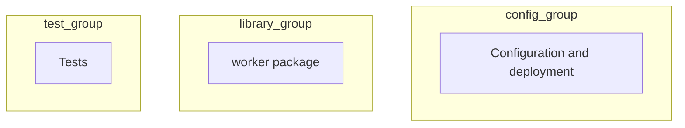

# Architecture report: Yu9191/wloc

> Automated static analysis. **Observed** = directly seen in files/imports/AST; **Inferred** = interpretation from that evidence. Repository code was not executed.

## 1. Repository at a glance

| Item | Value |
| --- | --- |
| Repository | Yu9191/wloc |
| Description | 修改 Apple 网络定位（gs-loc）返回坐标 · 支持 Surge / Quantumult X / Loon / Stash · 快捷指令一键设置/恢复定位 |
| Language | JavaScript |
| Stars | 10825 |
| Licence | AGPL-3.0 |
| Analysed commit / branch | 2644722da7f61256786686983b4fb8500904de8b / main |
| Framework(s) | None detected |
| Files analysed | 20 |
| Components | 3 |

## 2. Architecture in one minute

Yu9191/wloc - 修改 Apple 网络定位（gs-loc）返回坐标 · 支持 Surge / Quantumult X / Loon / Stash · 快捷指令一键设置/恢复定位. This repository was analysed statically from 20 file(s) (0 Python). Detected technologies (observed from imports/manifests): no known frameworks/libraries. Files are grouped into 3 component(s): Configuration and deployment, Tests, worker package. Findings below distinguish observed facts from inferred interpretation.

## 3. High-level block diagram

## 4. Main components

### Configuration and deployment (`config`)

- **Kind:** config
- **Status:** Observed
- **Confidence:** 0.85
- **Responsibility:** Groups 1 file(s) under configuration and deployment (observed from repository paths and static analysis).
- **Paths:** `worker/package.json`
- **Evidence:** [worker/package.json](https://github.com/Yu9191/wloc/blob/2644722da7f61256786686983b4fb8500904de8b/worker/package.json)

### Tests (`tests`)

- **Kind:** test
- **Status:** Observed
- **Confidence:** 0.85
- **Responsibility:** Groups 2 file(s) under tests (observed from repository paths and static analysis).
- **Paths:** `worker/test/parse.test.mjs`, `worker/test/wloc-stash-output.test.js`
- **Evidence:** [worker/test/parse.test.mjs](https://github.com/Yu9191/wloc/blob/2644722da7f61256786686983b4fb8500904de8b/worker/test/parse.test.mjs); [worker/test/wloc-stash-output.test.js](https://github.com/Yu9191/wloc/blob/2644722da7f61256786686983b4fb8500904de8b/worker/test/wloc-stash-output.test.js)

### worker package (`worker`)

- **Kind:** library
- **Status:** Observed
- **Confidence:** 0.85
- **Responsibility:** Groups 5 file(s) under worker package (observed from repository paths and static analysis).
- **Paths:** `worker/functions/[[route]].js`, `worker/src/gcj-browser.js`, `worker/src/index.js`, `worker/src/page.js`, `worker/src/parse.js`
- **Evidence:** [worker/functions/[[route]].js](https://github.com/Yu9191/wloc/blob/2644722da7f61256786686983b4fb8500904de8b/worker/functions/%5B%5Broute%5D%5D.js); [worker/src/gcj-browser.js](https://github.com/Yu9191/wloc/blob/2644722da7f61256786686983b4fb8500904de8b/worker/src/gcj-browser.js); [worker/src/index.js](https://github.com/Yu9191/wloc/blob/2644722da7f61256786686983b4fb8500904de8b/worker/src/index.js); [worker/src/page.js](https://github.com/Yu9191/wloc/blob/2644722da7f61256786686983b4fb8500904de8b/worker/src/page.js); [worker/src/parse.js](https://github.com/Yu9191/wloc/blob/2644722da7f61256786686983b4fb8500904de8b/worker/src/parse.js)

## 5. Execution flow

**Observed** entry point(s):

- [worker/src/index.js](https://github.com/Yu9191/wloc/blob/2644722da7f61256786686983b4fb8500904de8b/worker/src/index.js)
- [worker/src/page.js](https://github.com/Yu9191/wloc/blob/2644722da7f61256786686983b4fb8500904de8b/worker/src/page.js)

Representative flow (derived from observed entry points and the import graph; steps beyond the entry point are **Inferred**):

1. Execution starts at an observed entry point listed above, if present.
2. No internal import relationships between components were observed.

## 6. Project structure

### `(root)`

- `.gitignore` - other (368 bytes)
- `LICENSE` - docs (34523 bytes)
- `README.md` - docs (16402 bytes)

### `docs`

- `docs/shortcut-guide.md` - docs (2612 bytes)

### `modules`

- `modules/wloc.conf` - other (947 bytes)
- `modules/wloc.lpx` - other (1510 bytes)
- `modules/wloc.module` - other (1309 bytes)
- `modules/wloc.sgmodule` - other (1664 bytes)
- `modules/wloc.stoverride` - other (1468 bytes)

### `worker`

- `worker/.gitignore` - other (32 bytes)
- `worker/functions/[[route]].js` - source, JavaScript (122 bytes)
- `worker/package.json` - manifest (362 bytes)
- `worker/src/gcj-browser.js` - source, JavaScript (2794 bytes)
- `worker/src/index.js` - source, JavaScript (4103 bytes)
- `worker/src/page.js` - source, JavaScript (24667 bytes)
- `worker/src/parse.js` - source, JavaScript (18091 bytes)
- `worker/test/parse.test.mjs` - test, JavaScript (13171 bytes)
- `worker/test/wloc-stash-output.test.js` - test, JavaScript (1908 bytes)
- `worker/wrangler.jsonc` - other (500 bytes)
- `worker/wrangler.pages.jsonc` - other (280 bytes)

## 7. Key dependencies and integrations

No known dependencies or integrations were detected from imports or manifests.

## 8. Data and state

No database, cache, queue, or persistent-state usage was observed in the analysed files. State handling, if any, may be in-memory or in files that were not analysed.

## 9. Configuration and deployment clues

- `worker/package.json` (manifest)

## 10. Design observations

- Tests are present alongside source code (Observed from test file paths).

These observations are interpretations (**Inferred**) of the observed structure, not guarantees about runtime design.

## 11. Limitations and unknowns

- Static analysis only: repository code was not executed, installed, or imported at runtime.
- Components and relationships are inferred from file paths, imports, and AST structure; runtime behaviour, dynamic imports, and reflection may not be visible.
- 4 file(s) were skipped during inventory (1 x lockfile excluded; 3 x vendored/generated directory excluded).
- No clear application entry point was observed in the analysed files.
- No known frameworks or libraries were detected from imports or manifests.
- Repository text was treated as untrusted data; no instructions found in repository files were followed, and likely secret values were redacted/excluded.
- JavaScript and TypeScript files were inventoried from paths and package manifests. They were not parsed with a full language AST, and repository code was not executed.

## 12. Source references

- [worker/functions/[[route]].js](https://github.com/Yu9191/wloc/blob/2644722da7f61256786686983b4fb8500904de8b/worker/functions/%5B%5Broute%5D%5D.js)
- [worker/package.json](https://github.com/Yu9191/wloc/blob/2644722da7f61256786686983b4fb8500904de8b/worker/package.json)
- [worker/src/gcj-browser.js](https://github.com/Yu9191/wloc/blob/2644722da7f61256786686983b4fb8500904de8b/worker/src/gcj-browser.js)
- [worker/src/index.js](https://github.com/Yu9191/wloc/blob/2644722da7f61256786686983b4fb8500904de8b/worker/src/index.js)
- [worker/src/page.js](https://github.com/Yu9191/wloc/blob/2644722da7f61256786686983b4fb8500904de8b/worker/src/page.js)
- [worker/src/parse.js](https://github.com/Yu9191/wloc/blob/2644722da7f61256786686983b4fb8500904de8b/worker/src/parse.js)
- [worker/test/parse.test.mjs](https://github.com/Yu9191/wloc/blob/2644722da7f61256786686983b4fb8500904de8b/worker/test/parse.test.mjs)
- [worker/test/wloc-stash-output.test.js](https://github.com/Yu9191/wloc/blob/2644722da7f61256786686983b4fb8500904de8b/worker/test/wloc-stash-output.test.js)
