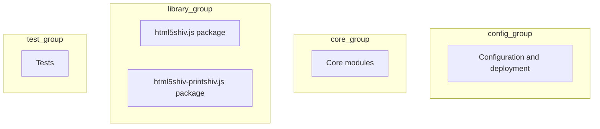

# Architecture report: aFarkas/html5shiv

> Automated static analysis. **Observed** = directly seen in files/imports/AST; **Inferred** = interpretation from that evidence. Repository code was not executed.

## 1. Repository at a glance

| Item | Value |
| --- | --- |
| Repository | aFarkas/html5shiv |
| Description | This script is the defacto way to enable use of HTML5 sectioning elements in legacy Internet Explorer. |
| Language | JavaScript |
| Stars | 9839 |
| Licence | Not detected |
| Analysed commit / branch | daa5fd1169cf8c1b63b0659754b4d13b037c0e54 / master |
| Framework(s) | None detected |
| Files analysed | 45 |
| Components | 5 |

## 2. Architecture in one minute

aFarkas/html5shiv - This script is the defacto way to enable use of HTML5 sectioning elements in legacy Internet Explorer.. This repository was analysed statically from 45 file(s) (0 Python). Detected technologies (observed from imports/manifests): no known frameworks/libraries. Files are grouped into 5 component(s): Configuration and deployment, Core modules, html5shiv.js package, html5shiv-printshiv.js package, Tests. Findings below distinguish observed facts from inferred interpretation.

## 3. High-level block diagram

## 4. Main components

### Configuration and deployment (`config`)

- **Kind:** config
- **Status:** Observed
- **Confidence:** 0.85
- **Responsibility:** Groups 3 file(s) under configuration and deployment (observed from repository paths and static analysis).
- **Paths:** `bower.json`, `composer.json`, `package.json`
- **Evidence:** [bower.json](https://github.com/aFarkas/html5shiv/blob/daa5fd1169cf8c1b63b0659754b4d13b037c0e54/bower.json); [composer.json](https://github.com/aFarkas/html5shiv/blob/daa5fd1169cf8c1b63b0659754b4d13b037c0e54/composer.json); [package.json](https://github.com/aFarkas/html5shiv/blob/daa5fd1169cf8c1b63b0659754b4d13b037c0e54/package.json)

### Core modules (`core`)

- **Kind:** core
- **Status:** Observed
- **Confidence:** 0.85
- **Responsibility:** Groups 1 file(s) under core modules (observed from repository paths and static analysis).
- **Paths:** `Gruntfile.js`
- **Evidence:** [Gruntfile.js](https://github.com/aFarkas/html5shiv/blob/daa5fd1169cf8c1b63b0659754b4d13b037c0e54/Gruntfile.js)

### html5shiv.js package (`html5shiv_js`)

- **Kind:** library
- **Status:** Observed
- **Confidence:** 0.85
- **Responsibility:** Groups 1 file(s) under html5shiv.js package (observed from repository paths and static analysis).
- **Paths:** `src/html5shiv.js`
- **Evidence:** [src/html5shiv.js](https://github.com/aFarkas/html5shiv/blob/daa5fd1169cf8c1b63b0659754b4d13b037c0e54/src/html5shiv.js)

### html5shiv-printshiv.js package (`html5shiv_printshiv_js`)

- **Kind:** library
- **Status:** Observed
- **Confidence:** 0.85
- **Responsibility:** Groups 1 file(s) under html5shiv-printshiv.js package (observed from repository paths and static analysis).
- **Paths:** `src/html5shiv-printshiv.js`
- **Evidence:** [src/html5shiv-printshiv.js](https://github.com/aFarkas/html5shiv/blob/daa5fd1169cf8c1b63b0659754b4d13b037c0e54/src/html5shiv-printshiv.js)

### Tests (`tests`)

- **Kind:** test
- **Status:** Observed
- **Confidence:** 0.85
- **Responsibility:** Groups 35 file(s) under tests (observed from repository paths and static analysis).
- **Paths:** `test/data/iframed-tests.html`, `test/data/inline-mixed-media.css`, `test/data/inline-print-media.css`, `test/data/no-print.css`, `test/data/print-styles.css`, `test/data/print.css`, `test/data/screen.css`, `test/highcharts/area-basic.html`, `test/highcharts/highcharts.js`, `test/html5shiv.html`, `test/iframe.1-1.html`, `test/iframe.1-2.html`, `test/iframe.1.html`, `test/index.html`, `test/jquery-1.7.1/data/dashboard.xml`, `test/jquery-1.7.1/data/iframe.html`, `test/jquery-1.7.1/data/test.js`, `test/jquery-1.7.1/data/testinit.js`, `test/jquery-1.7.1/data/testrunner.js`, `test/jquery-1.7.1/data/testsuite.css`, `test/jquery-1.7.1/data/versioncheck.js`, `test/jquery-1.7.1/index.html`, `test/jquery-1.7.1/unit/core.js`, `test/jquery-1.7.1/unit/manipulation.js`, `test/jquery-1.7.1/unit/traversing.js`, `test/mixed-test.html`, `test/object-test.html`, `test/perf.1.html`, `test/perf.2.html`, `test/qunit/qunit.css`, `test/qunit/qunit.js`, `test/style.all.css`, `test/style.css`, `test/style.print.css`, `test/unit/tests.js`
- **Evidence:** [test/data/iframed-tests.html](https://github.com/aFarkas/html5shiv/blob/daa5fd1169cf8c1b63b0659754b4d13b037c0e54/test/data/iframed-tests.html); [test/data/inline-mixed-media.css](https://github.com/aFarkas/html5shiv/blob/daa5fd1169cf8c1b63b0659754b4d13b037c0e54/test/data/inline-mixed-media.css); [test/data/inline-print-media.css](https://github.com/aFarkas/html5shiv/blob/daa5fd1169cf8c1b63b0659754b4d13b037c0e54/test/data/inline-print-media.css); [test/data/no-print.css](https://github.com/aFarkas/html5shiv/blob/daa5fd1169cf8c1b63b0659754b4d13b037c0e54/test/data/no-print.css); [test/data/print-styles.css](https://github.com/aFarkas/html5shiv/blob/daa5fd1169cf8c1b63b0659754b4d13b037c0e54/test/data/print-styles.css); [test/data/print.css](https://github.com/aFarkas/html5shiv/blob/daa5fd1169cf8c1b63b0659754b4d13b037c0e54/test/data/print.css); [test/data/screen.css](https://github.com/aFarkas/html5shiv/blob/daa5fd1169cf8c1b63b0659754b4d13b037c0e54/test/data/screen.css); [test/highcharts/area-basic.html](https://github.com/aFarkas/html5shiv/blob/daa5fd1169cf8c1b63b0659754b4d13b037c0e54/test/highcharts/area-basic.html)

## 5. Execution flow

No entry point was observed; the startup flow below is therefore limited.

Representative flow (derived from observed entry points and the import graph; steps beyond the entry point are **Inferred**):

1. Execution starts at an observed entry point listed above, if present.
2. No internal import relationships between components were observed.

## 6. Project structure

### `(root)`

- `.gitattributes` - other (11 bytes)
- `.gitignore` - other (22 bytes)
- `Gruntfile.js` - source, JavaScript (1177 bytes)
- `MIT and GPL2 licenses.md` - docs (19536 bytes)
- `bower.json` - config (193 bytes)
- `composer.json` - config (378 bytes)
- `package.json` - manifest (352 bytes)
- `readme.md` - docs (8366 bytes)

### `src`

- `src/html5shiv-printshiv.js` - source, JavaScript (16268 bytes)
- `src/html5shiv.js` - source, JavaScript (10331 bytes)

### `test`

- `test/data/iframed-tests.html` - test (2247 bytes)
- `test/data/inline-mixed-media.css` - test (165 bytes)
- `test/data/inline-print-media.css` - test (130 bytes)
- `test/data/no-print.css` - test (136 bytes)
- `test/data/print-styles.css` - test (129 bytes)
- `test/data/print.css` - test (43 bytes)
- `test/data/screen.css` - test (149 bytes)
- `test/highcharts/area-basic.html` - test (2547 bytes)
- `test/highcharts/highcharts.js` - test, JavaScript (86203 bytes)
- `test/html5shiv.html` - test (1913 bytes)
- `test/iframe.1-1.html` - test (299 bytes)
- `test/iframe.1-2.html` - test (323 bytes)
- `test/iframe.1.html` - test (619 bytes)
- `test/index.html` - test (1010 bytes)
- `test/jquery-1.7.1/data/dashboard.xml` - test (298 bytes)
- `test/jquery-1.7.1/data/iframe.html` - test (117 bytes)
- `test/jquery-1.7.1/data/test.js` - test, JavaScript (78 bytes)
- `test/jquery-1.7.1/data/testinit.js` - test, JavaScript (3386 bytes)
- `test/jquery-1.7.1/data/testrunner.js` - test, JavaScript (770 bytes)
- `test/jquery-1.7.1/data/testsuite.css` - test (2720 bytes)
- `test/jquery-1.7.1/data/versioncheck.js` - test, JavaScript (295 bytes)
- `test/jquery-1.7.1/index.html` - test (11126 bytes)
- `test/jquery-1.7.1/unit/core.js` - test, JavaScript (44525 bytes)
- `test/jquery-1.7.1/unit/manipulation.js` - test, JavaScript (64131 bytes)
- `test/jquery-1.7.1/unit/traversing.js` - test, JavaScript (35493 bytes)
- `test/mixed-test.html` - test (2389 bytes)
- `test/object-test.html` - test (2351 bytes)
- `test/perf.1.html` - test (1668 bytes)
- `test/perf.2.html` - test (726 bytes)
- `test/qunit/qunit.css` - test (4517 bytes)
- `test/qunit/qunit.js` - test, JavaScript (41024 bytes)
- `test/style.all.css` - test (374 bytes)
- `test/style.css` - test (57 bytes)
- `test/style.print.css` - test (54 bytes)
- `test/unit/tests.js` - test, JavaScript (9259 bytes)

## 7. Key dependencies and integrations

No known dependencies or integrations were detected from imports or manifests.

## 8. Data and state

No database, cache, queue, or persistent-state usage was observed in the analysed files. State handling, if any, may be in-memory or in files that were not analysed.

## 9. Configuration and deployment clues

- `bower.json` (config)
- `composer.json` (config)
- `package.json` (manifest)

## 10. Design observations

- Tests are present alongside source code (Observed from test file paths).

These observations are interpretations (**Inferred**) of the observed structure, not guarantees about runtime design.

## 11. Limitations and unknowns

- Static analysis only: repository code was not executed, installed, or imported at runtime.
- Components and relationships are inferred from file paths, imports, and AST structure; runtime behaviour, dynamic imports, and reflection may not be visible.
- 2 file(s) were skipped during inventory (2 x vendored/generated directory excluded).
- No clear application entry point was observed in the analysed files.
- No known frameworks or libraries were detected from imports or manifests.
- Repository text was treated as untrusted data; no instructions found in repository files were followed, and likely secret values were redacted/excluded.
- JavaScript and TypeScript files were inventoried from paths and package manifests. They were not parsed with a full language AST, and repository code was not executed.

## 12. Source references

- [Gruntfile.js](https://github.com/aFarkas/html5shiv/blob/daa5fd1169cf8c1b63b0659754b4d13b037c0e54/Gruntfile.js)
- [bower.json](https://github.com/aFarkas/html5shiv/blob/daa5fd1169cf8c1b63b0659754b4d13b037c0e54/bower.json)
- [composer.json](https://github.com/aFarkas/html5shiv/blob/daa5fd1169cf8c1b63b0659754b4d13b037c0e54/composer.json)
- [package.json](https://github.com/aFarkas/html5shiv/blob/daa5fd1169cf8c1b63b0659754b4d13b037c0e54/package.json)
- [src/html5shiv-printshiv.js](https://github.com/aFarkas/html5shiv/blob/daa5fd1169cf8c1b63b0659754b4d13b037c0e54/src/html5shiv-printshiv.js)
- [src/html5shiv.js](https://github.com/aFarkas/html5shiv/blob/daa5fd1169cf8c1b63b0659754b4d13b037c0e54/src/html5shiv.js)
- [test/data/iframed-tests.html](https://github.com/aFarkas/html5shiv/blob/daa5fd1169cf8c1b63b0659754b4d13b037c0e54/test/data/iframed-tests.html)
- [test/data/inline-mixed-media.css](https://github.com/aFarkas/html5shiv/blob/daa5fd1169cf8c1b63b0659754b4d13b037c0e54/test/data/inline-mixed-media.css)
- [test/data/inline-print-media.css](https://github.com/aFarkas/html5shiv/blob/daa5fd1169cf8c1b63b0659754b4d13b037c0e54/test/data/inline-print-media.css)
- [test/data/no-print.css](https://github.com/aFarkas/html5shiv/blob/daa5fd1169cf8c1b63b0659754b4d13b037c0e54/test/data/no-print.css)
- [test/data/print-styles.css](https://github.com/aFarkas/html5shiv/blob/daa5fd1169cf8c1b63b0659754b4d13b037c0e54/test/data/print-styles.css)
- [test/data/print.css](https://github.com/aFarkas/html5shiv/blob/daa5fd1169cf8c1b63b0659754b4d13b037c0e54/test/data/print.css)
- [test/data/screen.css](https://github.com/aFarkas/html5shiv/blob/daa5fd1169cf8c1b63b0659754b4d13b037c0e54/test/data/screen.css)
- [test/highcharts/area-basic.html](https://github.com/aFarkas/html5shiv/blob/daa5fd1169cf8c1b63b0659754b4d13b037c0e54/test/highcharts/area-basic.html)
