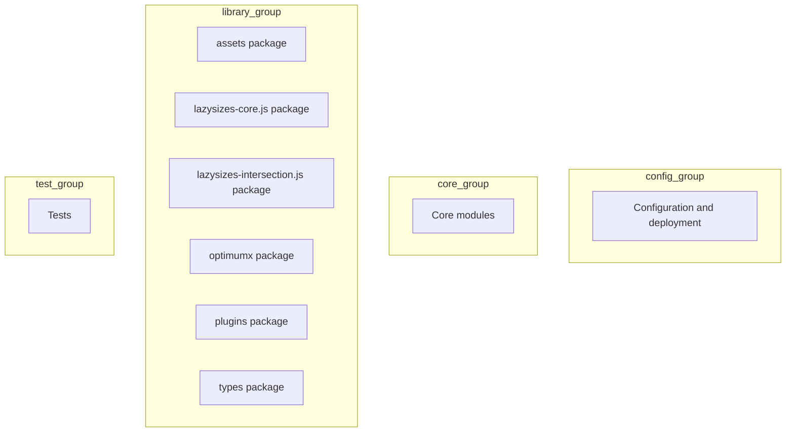

# Architecture report: aFarkas/lazysizes

> Automated static analysis. **Observed** = directly seen in files/imports/AST; **Inferred** = interpretation from that evidence. Repository code was not executed.

## 1. Repository at a glance

| Item | Value |
| --- | --- |
| Repository | aFarkas/lazysizes |
| Description | High performance and SEO friendly lazy loader for images (responsive and normal), iframes and more, that detects any visibility changes triggered through user interaction, CSS or JavaScript without configuration. |
| Language | JavaScript |
| Stars | 17705 |
| Licence | MIT |
| Analysed commit / branch | 1523a4ff4579e170355c7607f445689b43229caf / gh-pages |
| Framework(s) | None detected |
| Files analysed | 87 |
| Components | 9 |

## 2. Architecture in one minute

aFarkas/lazysizes - High performance and SEO friendly lazy loader for images (responsive and normal), iframes and more, that detects any visibility changes triggered through user interaction, CSS or JavaScript without c…. This repository was analysed statically from 87 file(s) (0 Python). Detected technologies (observed from imports/manifests): TypeScript. Files are grouped into 9 component(s): assets package, Configuration and deployment, Core modules, lazysizes-core.js package, lazysizes-intersection.js package, optimumx package, plugins package, Tests. Findings below distinguish observed facts from inferred interpretation.

## 3. High-level block diagram

## 4. Main components

### assets package (`assets`)

- **Kind:** library
- **Status:** Observed
- **Confidence:** 0.85
- **Responsibility:** Groups 1 file(s) under assets package (observed from repository paths and static analysis).
- **Paths:** `assets/js/bootstrap.js`
- **Evidence:** [assets/js/bootstrap.js](https://github.com/aFarkas/lazysizes/blob/1523a4ff4579e170355c7607f445689b43229caf/assets/js/bootstrap.js)

### Configuration and deployment (`config`)

- **Kind:** config
- **Status:** Observed
- **Confidence:** 0.85
- **Responsibility:** Groups 4 file(s) under configuration and deployment (observed from repository paths and static analysis).
- **Paths:** `bower.json`, `component.json`, `package.json`, `tsconfig.json`
- **Evidence:** [bower.json](https://github.com/aFarkas/lazysizes/blob/1523a4ff4579e170355c7607f445689b43229caf/bower.json); [component.json](https://github.com/aFarkas/lazysizes/blob/1523a4ff4579e170355c7607f445689b43229caf/component.json); [package.json](https://github.com/aFarkas/lazysizes/blob/1523a4ff4579e170355c7607f445689b43229caf/package.json); [tsconfig.json](https://github.com/aFarkas/lazysizes/blob/1523a4ff4579e170355c7607f445689b43229caf/tsconfig.json)

### Core modules (`core`)

- **Kind:** core
- **Status:** Observed
- **Confidence:** 0.85
- **Responsibility:** Groups 4 file(s) under core modules (observed from repository paths and static analysis).
- **Paths:** `Gruntfile.js`, `lazysizes-umd.js`, `lazysizes.d.ts`, `lazysizes.js`
- **Evidence:** [Gruntfile.js](https://github.com/aFarkas/lazysizes/blob/1523a4ff4579e170355c7607f445689b43229caf/Gruntfile.js); [lazysizes-umd.js](https://github.com/aFarkas/lazysizes/blob/1523a4ff4579e170355c7607f445689b43229caf/lazysizes-umd.js); [lazysizes.d.ts](https://github.com/aFarkas/lazysizes/blob/1523a4ff4579e170355c7607f445689b43229caf/lazysizes.d.ts); [lazysizes.js](https://github.com/aFarkas/lazysizes/blob/1523a4ff4579e170355c7607f445689b43229caf/lazysizes.js)

### lazysizes-core.js package (`lazysizes_core_js`)

- **Kind:** library
- **Status:** Observed
- **Confidence:** 0.85
- **Responsibility:** Groups 1 file(s) under lazysizes-core.js package (observed from repository paths and static analysis).
- **Paths:** `src/lazysizes-core.js`
- **Evidence:** [src/lazysizes-core.js](https://github.com/aFarkas/lazysizes/blob/1523a4ff4579e170355c7607f445689b43229caf/src/lazysizes-core.js)

### lazysizes-intersection.js package (`lazysizes_intersection_js`)

- **Kind:** library
- **Status:** Observed
- **Confidence:** 0.85
- **Responsibility:** Groups 1 file(s) under lazysizes-intersection.js package (observed from repository paths and static analysis).
- **Paths:** `src/lazysizes-intersection.js`
- **Evidence:** [src/lazysizes-intersection.js](https://github.com/aFarkas/lazysizes/blob/1523a4ff4579e170355c7607f445689b43229caf/src/lazysizes-intersection.js)

### optimumx package (`optimumx`)

- **Kind:** library
- **Status:** Observed
- **Confidence:** 0.85
- **Responsibility:** Groups 1 file(s) under optimumx package (observed from repository paths and static analysis).
- **Paths:** `optimumx/js/parent.js`
- **Evidence:** [optimumx/js/parent.js](https://github.com/aFarkas/lazysizes/blob/1523a4ff4579e170355c7607f445689b43229caf/optimumx/js/parent.js)

### plugins package (`plugins`)

- **Kind:** library
- **Status:** Observed
- **Confidence:** 0.85
- **Responsibility:** Groups 23 file(s) under plugins package (observed from repository paths and static analysis).
- **Paths:** `plugins/artdirect/ls.artdirect.js`, `plugins/aspectratio/ls.aspectratio.js`, `plugins/attrchange/ls.attrchange.js`, `plugins/bgset/ls.bgset.js`, `plugins/blur-up/ls.blur-up.js`, `plugins/custommedia/ls.custommedia.js`, `plugins/fix-edge-h-descriptor/ls.fix-edge-h-descriptor.js`, `plugins/fix-ios-sizes/fix-ios-sizes.js`, `plugins/include/ls.include.js`, `plugins/native-loading/ls.native-loading.js`, `plugins/noscript/ls.noscript.js`, `plugins/object-fit/ls.object-fit.js`, `plugins/optimumx/ls.optimumx.js`, `plugins/parent-fit/ls.parent-fit.js`, `plugins/print/ls.print.js`, `plugins/progressive/ls.progressive.js`, `plugins/respimg/ls.respimg.js`, `plugins/rias/ls.rias.js`, `plugins/static-gecko-picture/ls.static-gecko-picture.js`, `plugins/twitter/ls.twitter.js`, `plugins/unload/ls.unload.js`, `plugins/unveilhooks/ls.unveilhooks.js`, `plugins/video-embed/ls.video-embed.js`
- **Evidence:** [plugins/artdirect/ls.artdirect.js](https://github.com/aFarkas/lazysizes/blob/1523a4ff4579e170355c7607f445689b43229caf/plugins/artdirect/ls.artdirect.js); [plugins/aspectratio/ls.aspectratio.js](https://github.com/aFarkas/lazysizes/blob/1523a4ff4579e170355c7607f445689b43229caf/plugins/aspectratio/ls.aspectratio.js); [plugins/attrchange/ls.attrchange.js](https://github.com/aFarkas/lazysizes/blob/1523a4ff4579e170355c7607f445689b43229caf/plugins/attrchange/ls.attrchange.js); [plugins/bgset/ls.bgset.js](https://github.com/aFarkas/lazysizes/blob/1523a4ff4579e170355c7607f445689b43229caf/plugins/bgset/ls.bgset.js); [plugins/blur-up/ls.blur-up.js](https://github.com/aFarkas/lazysizes/blob/1523a4ff4579e170355c7607f445689b43229caf/plugins/blur-up/ls.blur-up.js); [plugins/custommedia/ls.custommedia.js](https://github.com/aFarkas/lazysizes/blob/1523a4ff4579e170355c7607f445689b43229caf/plugins/custommedia/ls.custommedia.js); [plugins/fix-edge-h-descriptor/ls.fix-edge-h-descriptor.js](https://github.com/aFarkas/lazysizes/blob/1523a4ff4579e170355c7607f445689b43229caf/plugins/fix-edge-h-descriptor/ls.fix-edge-h-descriptor.js); [plugins/fix-ios-sizes/fix-ios-sizes.js](https://github.com/aFarkas/lazysizes/blob/1523a4ff4579e170355c7607f445689b43229caf/plugins/fix-ios-sizes/fix-ios-sizes.js)

### Tests (`tests`)

- **Kind:** test
- **Status:** Observed
- **Confidence:** 0.85
- **Responsibility:** Groups 6 file(s) under tests (observed from repository paths and static analysis).
- **Paths:** `tests/functional-tests-plugins.js`, `tests/functional-tests.js`, `tests/index.html`, `tests/test-files/content-file.html`, `tests/test-files/matchMedia.js`, `tests/test-helper.js`
- **Evidence:** [tests/functional-tests-plugins.js](https://github.com/aFarkas/lazysizes/blob/1523a4ff4579e170355c7607f445689b43229caf/tests/functional-tests-plugins.js); [tests/functional-tests.js](https://github.com/aFarkas/lazysizes/blob/1523a4ff4579e170355c7607f445689b43229caf/tests/functional-tests.js); [tests/index.html](https://github.com/aFarkas/lazysizes/blob/1523a4ff4579e170355c7607f445689b43229caf/tests/index.html); [tests/test-files/content-file.html](https://github.com/aFarkas/lazysizes/blob/1523a4ff4579e170355c7607f445689b43229caf/tests/test-files/content-file.html); [tests/test-files/matchMedia.js](https://github.com/aFarkas/lazysizes/blob/1523a4ff4579e170355c7607f445689b43229caf/tests/test-files/matchMedia.js); [tests/test-helper.js](https://github.com/aFarkas/lazysizes/blob/1523a4ff4579e170355c7607f445689b43229caf/tests/test-helper.js)

### types package (`types`)

- **Kind:** library
- **Status:** Observed
- **Confidence:** 0.85
- **Responsibility:** Groups 2 file(s) under types package (observed from repository paths and static analysis).
- **Paths:** `types/global.d.ts`, `types/lazysizes-config.d.ts`
- **Evidence:** [types/global.d.ts](https://github.com/aFarkas/lazysizes/blob/1523a4ff4579e170355c7607f445689b43229caf/types/global.d.ts); [types/lazysizes-config.d.ts](https://github.com/aFarkas/lazysizes/blob/1523a4ff4579e170355c7607f445689b43229caf/types/lazysizes-config.d.ts)

## 5. Execution flow

**Observed** entry point(s):

- [lazysizes.js](https://github.com/aFarkas/lazysizes/blob/1523a4ff4579e170355c7607f445689b43229caf/lazysizes.js)

Representative flow (derived from observed entry points and the import graph; steps beyond the entry point are **Inferred**):

1. Execution starts at an observed entry point listed above, if present.
2. No internal import relationships between components were observed.

## 6. Project structure

### `(root)`

- `.editorconfig` - config (220 bytes)
- `.gitignore` - other (51 bytes)
- `.npmignore` - other (242 bytes)
- `BingSiteAuth.xml` - other (85 bytes)
- `CHANGELOG.md` - docs (7374 bytes)
- `Gruntfile.js` - source, JavaScript (2745 bytes)
- `LICENSE` - docs (1084 bytes)
- `README.md` - docs (35079 bytes)
- `animate.html` - other (24331 bytes)
- `bower.json` - config (799 bytes)
- `component.json` - config (407 bytes)
- `index.html` - other (32958 bytes)
- `lazysizes-umd.js` - source, JavaScript (19996 bytes)
- `lazysizes.d.ts` - source, TypeScript (2070 bytes)
- `lazysizes.js` - source, JavaScript (19949 bytes)
- `no-src.html` - other (27546 bytes)
- `package.json` - manifest (1604 bytes)
- `tsconfig.json` - config (343 bytes)

### `.github`

- `.github/ISSUE_TEMPLATE/bug_report.md` - docs (955 bytes)
- `.github/ISSUE_TEMPLATE/feature_request.md` - docs (740 bytes)
- `.github/ISSUE_TEMPLATE/other-issues.md` - docs (193 bytes)
- `.github/ISSUE_TEMPLATE/question.md` - docs (785 bytes)

### `assets`

- `assets/css/bootstrap-theme.css` - other (18437 bytes)
- `assets/css/bootstrap.css` - other (74282 bytes)
- `assets/css/carousel.css` - other (4433 bytes)
- `assets/css/tidy.css` - other (12540 bytes)
- `assets/js/bootstrap.js` - source, JavaScript (8819 bytes)

### `optimumx`

- `optimumx/child.html` - other (31455 bytes)
- `optimumx/index.html` - other (3756 bytes)
- `optimumx/js/parent.js` - source, JavaScript (1319 bytes)

### `plugins`

- `plugins/README.md` - docs (291 bytes)
- `plugins/artdirect/README.md` - docs (3585 bytes)
- `plugins/artdirect/ls.artdirect.js` - source, JavaScript (4404 bytes)
- `plugins/aspectratio/README.md` - docs (2857 bytes)
- `plugins/aspectratio/ls.aspectratio.js` - source, JavaScript (5190 bytes)
- `plugins/attrchange/README.md` - docs (781 bytes)
- `plugins/attrchange/ls.attrchange.js` - source, JavaScript (3464 bytes)
- `plugins/bgset/README.md` - docs (2989 bytes)
- `plugins/bgset/ls.bgset.js` - source, JavaScript (5276 bytes)
- `plugins/blur-up/README.md` - docs (3335 bytes)
- `plugins/blur-up/ls.blur-up.js` - source, JavaScript (5764 bytes)
- `plugins/custommedia/README.md` - docs (1955 bytes)
- `plugins/custommedia/ls.custommedia.js` - source, JavaScript (2280 bytes)
- `plugins/fix-edge-h-descriptor/README.md` - docs (492 bytes)
- `plugins/fix-edge-h-descriptor/ls.fix-edge-h-descriptor.js` - source, JavaScript (2247 bytes)
- `plugins/fix-ios-sizes/fix-ios-sizes.js` - source, JavaScript (2422 bytes)
- `plugins/include/README.md` - docs (13400 bytes)
- `plugins/include/ls.include.js` - source, JavaScript (13849 bytes)
- `plugins/native-loading/README.md` - docs (1784 bytes)
- `plugins/native-loading/ls.native-loading.js` - source, JavaScript (2943 bytes)
- `plugins/noscript/README.md` - docs (3072 bytes)
- `plugins/noscript/ls.noscript.js` - source, JavaScript (2489 bytes)
- `plugins/object-fit/README.md` - docs (2519 bytes)
- `plugins/object-fit/ls.object-fit.js` - source, JavaScript (5926 bytes)
- `plugins/optimumx/README.md` - docs (8982 bytes)
- `plugins/optimumx/ls.optimumx.js` - source, JavaScript (6414 bytes)
- `plugins/parent-fit/README.md` - docs (4057 bytes)
- `plugins/parent-fit/ls.parent-fit.js` - source, JavaScript (4692 bytes)
- `plugins/print/README.md` - docs (194 bytes)
- `plugins/print/ls.print.js` - source, JavaScript (1538 bytes)
- `plugins/progressive/README.md` - docs (1798 bytes)
- `plugins/progressive/ls.progressive.js` - source, JavaScript (1455 bytes)
- `plugins/respimg/README.md` - docs (4828 bytes)
- `plugins/respimg/ls.respimg.js` - source, JavaScript (7911 bytes)
- `plugins/rias/README.md` - docs (12385 bytes)
- `plugins/rias/ls.rias.js` - source, JavaScript (10619 bytes)
- `plugins/static-gecko-picture/ls.static-gecko-picture.js` - source, JavaScript (2336 bytes)
- `plugins/twitter/ls.twitter.js` - source, JavaScript (1924 bytes)
- `plugins/unload/README.md` - docs (2147 bytes)
- `plugins/unload/ls.unload.js` - source, JavaScript (4470 bytes)
- `plugins/unveilhooks/README.md` - docs (1471 bytes)
- `plugins/unveilhooks/ls.unveilhooks.js` - source, JavaScript (4355 bytes)
- `plugins/video-embed/README.md` - docs (272 bytes)
- `plugins/video-embed/ls.video-embed.js` - source, JavaScript (3777 bytes)

### `rias`

- `rias/index.html` - other (7923 bytes)

### `src`

- `src/common.wrapper` - other (262 bytes)
- `src/lazysizes-core.js` - source, JavaScript (19693 bytes)
- `src/lazysizes-intersection.js` - source, JavaScript (12640 bytes)
- `src/umd.wrapper` - other (309 bytes)

### `tests`

- `tests/functional-tests-plugins.js` - test, JavaScript (19772 bytes)
- `tests/functional-tests.js` - test, JavaScript (16016 bytes)
- `tests/index.html` - test (1054 bytes)
- `tests/test-files/content-file.html` - test (2462 bytes)
- `tests/test-files/matchMedia.js` - test, JavaScript (1700 bytes)
- `tests/test-helper.js` - test, JavaScript (1591 bytes)

### `types`

- `types/global.d.ts` - source, TypeScript (1245 bytes)
- `types/lazysizes-config.d.ts` - source, TypeScript (653 bytes)

## 7. Key dependencies and integrations

| Name | Category | Status | Confidence | Evidence |
| --- | --- | --- | --- | --- |
| TypeScript | tooling | Observed | 0.85 | [package.json:34](https://github.com/aFarkas/lazysizes/blob/1523a4ff4579e170355c7607f445689b43229caf/package.json#L34) |

## 8. Data and state

No database, cache, queue, or persistent-state usage was observed in the analysed files. State handling, if any, may be in-memory or in files that were not analysed.

## 9. Configuration and deployment clues

- `.editorconfig` (config)
- `bower.json` (config)
- `component.json` (config)
- `package.json` (manifest)
- `tsconfig.json` (config)

## 10. Design observations

- Tests are present alongside source code (Observed from test file paths).

These observations are interpretations (**Inferred**) of the observed structure, not guarantees about runtime design.

## 11. Limitations and unknowns

- Static analysis only: repository code was not executed, installed, or imported at runtime.
- Components and relationships are inferred from file paths, imports, and AST structure; runtime behaviour, dynamic imports, and reflection may not be visible.
- 3 file(s) were skipped during inventory (2 x generated/minified file excluded; 1 x lockfile excluded).
- No clear application entry point was observed in the analysed files.
- Repository text was treated as untrusted data; no instructions found in repository files were followed, and likely secret values were redacted/excluded.
- JavaScript and TypeScript files were inventoried from paths and package manifests. They were not parsed with a full language AST, and repository code was not executed.

## 12. Source references

- [Gruntfile.js](https://github.com/aFarkas/lazysizes/blob/1523a4ff4579e170355c7607f445689b43229caf/Gruntfile.js)
- [assets/js/bootstrap.js](https://github.com/aFarkas/lazysizes/blob/1523a4ff4579e170355c7607f445689b43229caf/assets/js/bootstrap.js)
- [bower.json](https://github.com/aFarkas/lazysizes/blob/1523a4ff4579e170355c7607f445689b43229caf/bower.json)
- [component.json](https://github.com/aFarkas/lazysizes/blob/1523a4ff4579e170355c7607f445689b43229caf/component.json)
- [lazysizes-umd.js](https://github.com/aFarkas/lazysizes/blob/1523a4ff4579e170355c7607f445689b43229caf/lazysizes-umd.js)
- [lazysizes.d.ts](https://github.com/aFarkas/lazysizes/blob/1523a4ff4579e170355c7607f445689b43229caf/lazysizes.d.ts)
- [lazysizes.js](https://github.com/aFarkas/lazysizes/blob/1523a4ff4579e170355c7607f445689b43229caf/lazysizes.js)
- [optimumx/js/parent.js](https://github.com/aFarkas/lazysizes/blob/1523a4ff4579e170355c7607f445689b43229caf/optimumx/js/parent.js)
- [package.json](https://github.com/aFarkas/lazysizes/blob/1523a4ff4579e170355c7607f445689b43229caf/package.json)
- [package.json:34](https://github.com/aFarkas/lazysizes/blob/1523a4ff4579e170355c7607f445689b43229caf/package.json#L34)
- [plugins/artdirect/ls.artdirect.js](https://github.com/aFarkas/lazysizes/blob/1523a4ff4579e170355c7607f445689b43229caf/plugins/artdirect/ls.artdirect.js)
- [plugins/aspectratio/ls.aspectratio.js](https://github.com/aFarkas/lazysizes/blob/1523a4ff4579e170355c7607f445689b43229caf/plugins/aspectratio/ls.aspectratio.js)
- [plugins/attrchange/ls.attrchange.js](https://github.com/aFarkas/lazysizes/blob/1523a4ff4579e170355c7607f445689b43229caf/plugins/attrchange/ls.attrchange.js)
- [plugins/bgset/ls.bgset.js](https://github.com/aFarkas/lazysizes/blob/1523a4ff4579e170355c7607f445689b43229caf/plugins/bgset/ls.bgset.js)
- [plugins/blur-up/ls.blur-up.js](https://github.com/aFarkas/lazysizes/blob/1523a4ff4579e170355c7607f445689b43229caf/plugins/blur-up/ls.blur-up.js)
- [plugins/custommedia/ls.custommedia.js](https://github.com/aFarkas/lazysizes/blob/1523a4ff4579e170355c7607f445689b43229caf/plugins/custommedia/ls.custommedia.js)
- [plugins/fix-edge-h-descriptor/ls.fix-edge-h-descriptor.js](https://github.com/aFarkas/lazysizes/blob/1523a4ff4579e170355c7607f445689b43229caf/plugins/fix-edge-h-descriptor/ls.fix-edge-h-descriptor.js)
- [plugins/fix-ios-sizes/fix-ios-sizes.js](https://github.com/aFarkas/lazysizes/blob/1523a4ff4579e170355c7607f445689b43229caf/plugins/fix-ios-sizes/fix-ios-sizes.js)
- [src/lazysizes-core.js](https://github.com/aFarkas/lazysizes/blob/1523a4ff4579e170355c7607f445689b43229caf/src/lazysizes-core.js)
- [src/lazysizes-intersection.js](https://github.com/aFarkas/lazysizes/blob/1523a4ff4579e170355c7607f445689b43229caf/src/lazysizes-intersection.js)
- [tests/functional-tests-plugins.js](https://github.com/aFarkas/lazysizes/blob/1523a4ff4579e170355c7607f445689b43229caf/tests/functional-tests-plugins.js)
- [tests/functional-tests.js](https://github.com/aFarkas/lazysizes/blob/1523a4ff4579e170355c7607f445689b43229caf/tests/functional-tests.js)
- [tests/index.html](https://github.com/aFarkas/lazysizes/blob/1523a4ff4579e170355c7607f445689b43229caf/tests/index.html)
- [tests/test-files/content-file.html](https://github.com/aFarkas/lazysizes/blob/1523a4ff4579e170355c7607f445689b43229caf/tests/test-files/content-file.html)
- [tests/test-files/matchMedia.js](https://github.com/aFarkas/lazysizes/blob/1523a4ff4579e170355c7607f445689b43229caf/tests/test-files/matchMedia.js)
- [tests/test-helper.js](https://github.com/aFarkas/lazysizes/blob/1523a4ff4579e170355c7607f445689b43229caf/tests/test-helper.js)
- [tsconfig.json](https://github.com/aFarkas/lazysizes/blob/1523a4ff4579e170355c7607f445689b43229caf/tsconfig.json)
- [types/global.d.ts](https://github.com/aFarkas/lazysizes/blob/1523a4ff4579e170355c7607f445689b43229caf/types/global.d.ts)
- [types/lazysizes-config.d.ts](https://github.com/aFarkas/lazysizes/blob/1523a4ff4579e170355c7607f445689b43229caf/types/lazysizes-config.d.ts)
