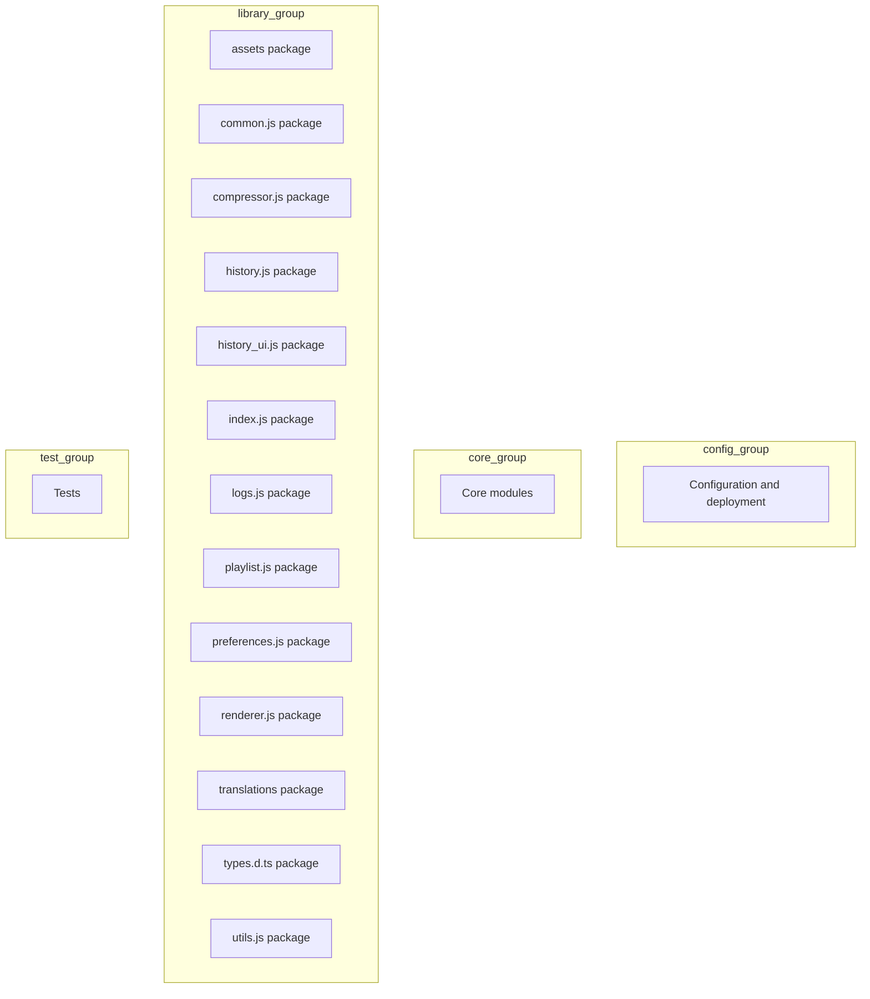

# Architecture report: aandrew-me/ytDownloader

> Automated static analysis. **Observed** = directly seen in files/imports/AST; **Inferred** = interpretation from that evidence. Repository code was not executed.

## 1. Repository at a glance

| Item | Value |
| --- | --- |
| Repository | aandrew-me/ytDownloader |
| Description | Desktop app to download audio/video from hundreds of sites |
| Language | JavaScript |
| Stars | 10668 |
| Licence | GPL-3.0 |
| Analysed commit / branch | 1381ad9417ec421fef830feb81b21479d7bed26f / main |
| Framework(s) | Electron |
| Files analysed | 73 |
| Components | 16 |

## 2. Architecture in one minute

aandrew-me/ytDownloader - Desktop app to download audio/video from hundreds of sites. This repository was analysed statically from 73 file(s) (0 Python). Detected technologies (observed from imports/manifests): GitHub Actions, Electron, TypeScript. Files are grouped into 16 component(s): assets package, common.js package, compressor.js package, Configuration and deployment, Core modules, history.js package, history_ui.js package, index.js package. Findings below distinguish observed facts from inferred interpretation.

## 3. High-level block diagram

## 4. Main components

### assets package (`assets`)

- **Kind:** library
- **Status:** Observed
- **Confidence:** 0.85
- **Responsibility:** Groups 1 file(s) under assets package (observed from repository paths and static analysis).
- **Paths:** `assets/slimselect.js`
- **Evidence:** [assets/slimselect.js](https://github.com/aandrew-me/ytDownloader/blob/1381ad9417ec421fef830feb81b21479d7bed26f/assets/slimselect.js)

### common.js package (`common_js`)

- **Kind:** library
- **Status:** Observed
- **Confidence:** 0.85
- **Responsibility:** Groups 1 file(s) under common.js package (observed from repository paths and static analysis).
- **Paths:** `src/common.js`
- **Evidence:** [src/common.js](https://github.com/aandrew-me/ytDownloader/blob/1381ad9417ec421fef830feb81b21479d7bed26f/src/common.js)

### compressor.js package (`compressor_js`)

- **Kind:** library
- **Status:** Observed
- **Confidence:** 0.85
- **Responsibility:** Groups 1 file(s) under compressor.js package (observed from repository paths and static analysis).
- **Paths:** `src/compressor.js`
- **Evidence:** [src/compressor.js](https://github.com/aandrew-me/ytDownloader/blob/1381ad9417ec421fef830feb81b21479d7bed26f/src/compressor.js)

### Configuration and deployment (`config`)

- **Kind:** config
- **Status:** Observed
- **Confidence:** 0.85
- **Responsibility:** Groups 27 file(s) under configuration and deployment (observed from repository paths and static analysis).
- **Paths:** `crowdin.yml`, `package.json`, `translations/ar-SA.json`, `translations/bn-BD.json`, `translations/de-DE.json`, `translations/el-GR.json`, `translations/en.json`, `translations/es-ES.json`, `translations/eu-ES.json`, `translations/fa-IR.json`, `translations/fi-FI.json`, `translations/fr-FR.json`, `translations/hi-IN.json`, `translations/hu-HU.json`, `translations/it-IT.json`, `translations/ja-JP.json`, `translations/ne-NP.json`, `translations/pl-PL.json`, `translations/pt-BR.json`, `translations/ru-RU.json`, `translations/tr-TR.json`, `translations/uk-UA.json`, `translations/vi-VN.json`, `translations/zh-CN.json`, `translations/zh-TW.json`, `tsconfig.json`, `ytdownloader.json`
- **Evidence:** [crowdin.yml](https://github.com/aandrew-me/ytDownloader/blob/1381ad9417ec421fef830feb81b21479d7bed26f/crowdin.yml); [package.json](https://github.com/aandrew-me/ytDownloader/blob/1381ad9417ec421fef830feb81b21479d7bed26f/package.json); [translations/ar-SA.json](https://github.com/aandrew-me/ytDownloader/blob/1381ad9417ec421fef830feb81b21479d7bed26f/translations/ar-SA.json); [translations/bn-BD.json](https://github.com/aandrew-me/ytDownloader/blob/1381ad9417ec421fef830feb81b21479d7bed26f/translations/bn-BD.json); [translations/de-DE.json](https://github.com/aandrew-me/ytDownloader/blob/1381ad9417ec421fef830feb81b21479d7bed26f/translations/de-DE.json); [translations/el-GR.json](https://github.com/aandrew-me/ytDownloader/blob/1381ad9417ec421fef830feb81b21479d7bed26f/translations/el-GR.json); [translations/en.json](https://github.com/aandrew-me/ytDownloader/blob/1381ad9417ec421fef830feb81b21479d7bed26f/translations/en.json); [translations/es-ES.json](https://github.com/aandrew-me/ytDownloader/blob/1381ad9417ec421fef830feb81b21479d7bed26f/translations/es-ES.json)

### Core modules (`core`)

- **Kind:** core
- **Status:** Observed
- **Confidence:** 0.85
- **Responsibility:** Groups 6 file(s) under core modules (observed from repository paths and static analysis).
- **Paths:** `linux.sh`, `mac.sh`, `main.js`, `patch-snap.js`, `playwright.config.js`, `preload.js`
- **Evidence:** [linux.sh](https://github.com/aandrew-me/ytDownloader/blob/1381ad9417ec421fef830feb81b21479d7bed26f/linux.sh); [mac.sh](https://github.com/aandrew-me/ytDownloader/blob/1381ad9417ec421fef830feb81b21479d7bed26f/mac.sh); [main.js](https://github.com/aandrew-me/ytDownloader/blob/1381ad9417ec421fef830feb81b21479d7bed26f/main.js); [patch-snap.js](https://github.com/aandrew-me/ytDownloader/blob/1381ad9417ec421fef830feb81b21479d7bed26f/patch-snap.js); [playwright.config.js](https://github.com/aandrew-me/ytDownloader/blob/1381ad9417ec421fef830feb81b21479d7bed26f/playwright.config.js); [preload.js](https://github.com/aandrew-me/ytDownloader/blob/1381ad9417ec421fef830feb81b21479d7bed26f/preload.js)

### history.js package (`history_js`)

- **Kind:** library
- **Status:** Observed
- **Confidence:** 0.85
- **Responsibility:** Groups 1 file(s) under history.js package (observed from repository paths and static analysis).
- **Paths:** `src/history.js`
- **Evidence:** [src/history.js](https://github.com/aandrew-me/ytDownloader/blob/1381ad9417ec421fef830feb81b21479d7bed26f/src/history.js)

### history_ui.js package (`history_ui_js`)

- **Kind:** library
- **Status:** Observed
- **Confidence:** 0.85
- **Responsibility:** Groups 1 file(s) under history_ui.js package (observed from repository paths and static analysis).
- **Paths:** `src/history_ui.js`
- **Evidence:** [src/history_ui.js](https://github.com/aandrew-me/ytDownloader/blob/1381ad9417ec421fef830feb81b21479d7bed26f/src/history_ui.js)

### index.js package (`index_js`)

- **Kind:** library
- **Status:** Observed
- **Confidence:** 0.85
- **Responsibility:** Groups 1 file(s) under index.js package (observed from repository paths and static analysis).
- **Paths:** `src/index.js`
- **Evidence:** [src/index.js](https://github.com/aandrew-me/ytDownloader/blob/1381ad9417ec421fef830feb81b21479d7bed26f/src/index.js)

### logs.js package (`logs_js`)

- **Kind:** library
- **Status:** Observed
- **Confidence:** 0.85
- **Responsibility:** Groups 1 file(s) under logs.js package (observed from repository paths and static analysis).
- **Paths:** `src/logs.js`
- **Evidence:** [src/logs.js](https://github.com/aandrew-me/ytDownloader/blob/1381ad9417ec421fef830feb81b21479d7bed26f/src/logs.js)

### playlist.js package (`playlist_js`)

- **Kind:** library
- **Status:** Observed
- **Confidence:** 0.85
- **Responsibility:** Groups 1 file(s) under playlist.js package (observed from repository paths and static analysis).
- **Paths:** `src/playlist.js`
- **Evidence:** [src/playlist.js](https://github.com/aandrew-me/ytDownloader/blob/1381ad9417ec421fef830feb81b21479d7bed26f/src/playlist.js)

### preferences.js package (`preferences_js`)

- **Kind:** library
- **Status:** Observed
- **Confidence:** 0.85
- **Responsibility:** Groups 1 file(s) under preferences.js package (observed from repository paths and static analysis).
- **Paths:** `src/preferences.js`
- **Evidence:** [src/preferences.js](https://github.com/aandrew-me/ytDownloader/blob/1381ad9417ec421fef830feb81b21479d7bed26f/src/preferences.js)

### renderer.js package (`renderer_js`)

- **Kind:** library
- **Status:** Observed
- **Confidence:** 0.85
- **Responsibility:** Groups 1 file(s) under renderer.js package (observed from repository paths and static analysis).
- **Paths:** `src/renderer.js`
- **Evidence:** [src/renderer.js](https://github.com/aandrew-me/ytDownloader/blob/1381ad9417ec421fef830feb81b21479d7bed26f/src/renderer.js)

### Tests (`tests`)

- **Kind:** test
- **Status:** Observed
- **Confidence:** 0.85
- **Responsibility:** Groups 10 file(s) under tests (observed from repository paths and static analysis).
- **Paths:** `tests/compressor-page-compression.spec.js`, `tests/format-video-codec.spec.js`, `tests/helpers/electronApp.js`, `tests/logs.spec.js`, `tests/main-page-downloads.spec.js`, `tests/playlist-page-downloads.spec.js`, `tests/playlist-preferences-integration.spec.js`, `tests/preferences-integration.spec.js`, `tests/preferences-page.spec.js`, `tests/translations-check.js`
- **Evidence:** [tests/compressor-page-compression.spec.js](https://github.com/aandrew-me/ytDownloader/blob/1381ad9417ec421fef830feb81b21479d7bed26f/tests/compressor-page-compression.spec.js); [tests/format-video-codec.spec.js](https://github.com/aandrew-me/ytDownloader/blob/1381ad9417ec421fef830feb81b21479d7bed26f/tests/format-video-codec.spec.js); [tests/helpers/electronApp.js](https://github.com/aandrew-me/ytDownloader/blob/1381ad9417ec421fef830feb81b21479d7bed26f/tests/helpers/electronApp.js); [tests/logs.spec.js](https://github.com/aandrew-me/ytDownloader/blob/1381ad9417ec421fef830feb81b21479d7bed26f/tests/logs.spec.js); [tests/main-page-downloads.spec.js](https://github.com/aandrew-me/ytDownloader/blob/1381ad9417ec421fef830feb81b21479d7bed26f/tests/main-page-downloads.spec.js); [tests/playlist-page-downloads.spec.js](https://github.com/aandrew-me/ytDownloader/blob/1381ad9417ec421fef830feb81b21479d7bed26f/tests/playlist-page-downloads.spec.js); [tests/playlist-preferences-integration.spec.js](https://github.com/aandrew-me/ytDownloader/blob/1381ad9417ec421fef830feb81b21479d7bed26f/tests/playlist-preferences-integration.spec.js); [tests/preferences-integration.spec.js](https://github.com/aandrew-me/ytDownloader/blob/1381ad9417ec421fef830feb81b21479d7bed26f/tests/preferences-integration.spec.js)

### translations package (`translations`)

- **Kind:** library
- **Status:** Observed
- **Confidence:** 0.85
- **Responsibility:** Groups 2 file(s) under translations package (observed from repository paths and static analysis).
- **Paths:** `translations/i18n-init.js`, `translations/i18n.js`
- **Evidence:** [translations/i18n-init.js](https://github.com/aandrew-me/ytDownloader/blob/1381ad9417ec421fef830feb81b21479d7bed26f/translations/i18n-init.js); [translations/i18n.js](https://github.com/aandrew-me/ytDownloader/blob/1381ad9417ec421fef830feb81b21479d7bed26f/translations/i18n.js)

### types.d.ts package (`types_d_ts`)

- **Kind:** library
- **Status:** Observed
- **Confidence:** 0.85
- **Responsibility:** Groups 1 file(s) under types.d.ts package (observed from repository paths and static analysis).
- **Paths:** `src/types.d.ts`
- **Evidence:** [src/types.d.ts](https://github.com/aandrew-me/ytDownloader/blob/1381ad9417ec421fef830feb81b21479d7bed26f/src/types.d.ts)

### utils.js package (`utils_js`)

- **Kind:** library
- **Status:** Observed
- **Confidence:** 0.85
- **Responsibility:** Groups 1 file(s) under utils.js package (observed from repository paths and static analysis).
- **Paths:** `src/utils.js`
- **Evidence:** [src/utils.js](https://github.com/aandrew-me/ytDownloader/blob/1381ad9417ec421fef830feb81b21479d7bed26f/src/utils.js)

## 5. Execution flow

**Observed** entry point(s):

- [main.js](https://github.com/aandrew-me/ytDownloader/blob/1381ad9417ec421fef830feb81b21479d7bed26f/main.js)
- [src/index.js](https://github.com/aandrew-me/ytDownloader/blob/1381ad9417ec421fef830feb81b21479d7bed26f/src/index.js)

Representative flow (derived from observed entry points and the import graph; steps beyond the entry point are **Inferred**):

1. Execution starts at an observed entry point listed above, if present.
2. No internal import relationships between components were observed.

## 6. Project structure

### `(root)`

- `.gitignore` - other (153 bytes)
- `LICENSE` - docs (35149 bytes)
- `LICENSE.rtf` - other (40358 bytes)
- `README.md` - docs (9540 bytes)
- `crowdin.yml` - config (86 bytes)
- `linux.sh` - source, Shell (966 bytes)
- `mac.sh` - source, Shell (863 bytes)
- `main.js` - source, JavaScript (25921 bytes)
- `package.json` - manifest (3124 bytes)
- `patch-snap.js` - source, JavaScript (1080 bytes)
- `playwright.config.js` - source, JavaScript (280 bytes)
- `preload.js` - source, JavaScript (14211 bytes)
- `test-appx.ps1` - other (2721 bytes)
- `tsconfig.json` - config (160 bytes)
- `windows.ps1` - other (360 bytes)
- `ytdownloader.json` - config (668 bytes)

### `.github`

- `.github/ISSUE_TEMPLATE/bug_report.md` - docs (409 bytes)
- `.github/ISSUE_TEMPLATE/feature_request.md` - docs (157 bytes)
- `.github/workflows/main.yml` - ci, YAML (4589 bytes)
- `.github/workflows/release_to_winget.yml` - ci, YAML (741 bytes)

### `assets`

- `assets/css/index.css` - other (131347 bytes)
- `assets/css/themes.css` - other (3701 bytes)
- `assets/slimselect.css` - other (11560 bytes)
- `assets/slimselect.js` - source, JavaScript (51552 bytes)

### `flatpak`

- `flatpak/io.github.aandrew_me.ytdn.desktop` - other (178 bytes)
- `flatpak/io.github.aandrew_me.ytdn.metainfo.xml` - other (11524 bytes)

### `html`

- `html/index.html` - other (146692 bytes)

### `src`

- `src/common.js` - source, JavaScript (8548 bytes)
- `src/compressor.js` - source, JavaScript (27721 bytes)
- `src/history.js` - source, JavaScript (4602 bytes)
- `src/history_ui.js` - source, JavaScript (9587 bytes)
- `src/index.js` - source, JavaScript (1381 bytes)
- `src/logs.js` - source, JavaScript (12191 bytes)
- `src/playlist.js` - source, JavaScript (67251 bytes)
- `src/preferences.js` - source, JavaScript (47880 bytes)
- `src/renderer.js` - source, JavaScript (158327 bytes)
- `src/types.d.ts` - source, TypeScript (4712 bytes)
- `src/utils.js` - source, JavaScript (13239 bytes)

### `tests`

- `tests/compressor-page-compression.spec.js` - test, JavaScript (10197 bytes)
- `tests/format-video-codec.spec.js` - test, JavaScript (5913 bytes)
- `tests/helpers/electronApp.js` - test, JavaScript (9239 bytes)
- `tests/logs.spec.js` - test, JavaScript (7882 bytes)
- `tests/main-page-downloads.spec.js` - test, JavaScript (33171 bytes)
- `tests/playlist-page-downloads.spec.js` - test, JavaScript (11155 bytes)
- `tests/playlist-preferences-integration.spec.js` - test, JavaScript (5832 bytes)
- `tests/preferences-integration.spec.js` - test, JavaScript (11908 bytes)
- `tests/preferences-page.spec.js` - test, JavaScript (13584 bytes)
- `tests/translations-check.js` - test, JavaScript (3950 bytes)

### `translations`

- `translations/ar-SA.json` - config (19627 bytes)
- `translations/bn-BD.json` - config (27547 bytes)
- `translations/de-DE.json` - config (16226 bytes)
- `translations/el-GR.json` - config (23074 bytes)
- `translations/en.json` - config (14431 bytes)
- `translations/es-ES.json` - config (16223 bytes)
- `translations/eu-ES.json` - config (15856 bytes)
- `translations/fa-IR.json` - config (20835 bytes)
- `translations/fi-FI.json` - config (15787 bytes)
- `translations/fr-FR.json` - config (16808 bytes)
- `translations/hi-IN.json` - config (26648 bytes)
- `translations/hu-HU.json` - config (16645 bytes)
- `translations/i18n-init.js` - source, JavaScript (207 bytes)
- `translations/i18n.js` - source, JavaScript (2771 bytes)
- `translations/it-IT.json` - config (15567 bytes)
- `translations/ja-JP.json` - config (18397 bytes)
- `translations/ne-NP.json` - config (28601 bytes)
- `translations/pl-PL.json` - config (16037 bytes)
- `translations/pt-BR.json` - config (15916 bytes)
- `translations/ru-RU.json` - config (21627 bytes)
- `translations/tr-TR.json` - config (15947 bytes)
- `translations/uk-UA.json` - config (21772 bytes)
- `translations/vi-VN.json` - config (17717 bytes)
- `translations/zh-CN.json` - config (14283 bytes)
- `translations/zh-TW.json` - config (14328 bytes)

## 7. Key dependencies and integrations

| Name | Category | Status | Confidence | Evidence |
| --- | --- | --- | --- | --- |
| GitHub Actions | ci | Observed | 0.90 | [.github/workflows/main.yml](https://github.com/aandrew-me/ytDownloader/blob/1381ad9417ec421fef830feb81b21479d7bed26f/.github/workflows/main.yml); [.github/workflows/release_to_winget.yml](https://github.com/aandrew-me/ytDownloader/blob/1381ad9417ec421fef830feb81b21479d7bed26f/.github/workflows/release_to_winget.yml) |
| Electron | framework | Observed | 0.85 | [package.json:3](https://github.com/aandrew-me/ytDownloader/blob/1381ad9417ec421fef830feb81b21479d7bed26f/package.json#L3) |
| TypeScript | tooling | Observed | 0.85 | [package.json:41](https://github.com/aandrew-me/ytDownloader/blob/1381ad9417ec421fef830feb81b21479d7bed26f/package.json#L41) |

## 8. Data and state

No database, cache, queue, or persistent-state usage was observed in the analysed files. State handling, if any, may be in-memory or in files that were not analysed.

## 9. Configuration and deployment clues

- `.github/workflows/main.yml` (ci)
- `.github/workflows/release_to_winget.yml` (ci)
- `crowdin.yml` (config)
- `package.json` (manifest)
- `translations/ar-SA.json` (config)
- `translations/bn-BD.json` (config)
- `translations/de-DE.json` (config)
- `translations/el-GR.json` (config)
- `translations/en.json` (config)
- `translations/es-ES.json` (config)
- `translations/eu-ES.json` (config)
- `translations/fa-IR.json` (config)
- `translations/fi-FI.json` (config)
- `translations/fr-FR.json` (config)
- `translations/hi-IN.json` (config)
- `translations/hu-HU.json` (config)
- `translations/it-IT.json` (config)
- `translations/ja-JP.json` (config)
- `translations/ne-NP.json` (config)
- `translations/pl-PL.json` (config)
- `translations/pt-BR.json` (config)
- `translations/ru-RU.json` (config)
- `translations/tr-TR.json` (config)
- `translations/uk-UA.json` (config)
- `translations/vi-VN.json` (config)
- `translations/zh-CN.json` (config)
- `translations/zh-TW.json` (config)
- `tsconfig.json` (config)
- `ytdownloader.json` (config)

## 10. Design observations

- Tests are present alongside source code (Observed from test file paths).

These observations are interpretations (**Inferred**) of the observed structure, not guarantees about runtime design.

## 11. Limitations and unknowns

- Static analysis only: repository code was not executed, installed, or imported at runtime.
- Components and relationships are inferred from file paths, imports, and AST structure; runtime behaviour, dynamic imports, and reflection may not be visible.
- 1 file(s) were skipped during inventory (1 x lockfile excluded).
- No clear application entry point was observed in the analysed files.
- Repository text was treated as untrusted data; no instructions found in repository files were followed, and likely secret values were redacted/excluded.
- JavaScript and TypeScript files were inventoried from paths and package manifests. They were not parsed with a full language AST, and repository code was not executed.

## 12. Source references

- [.github/workflows/main.yml](https://github.com/aandrew-me/ytDownloader/blob/1381ad9417ec421fef830feb81b21479d7bed26f/.github/workflows/main.yml)
- [.github/workflows/release_to_winget.yml](https://github.com/aandrew-me/ytDownloader/blob/1381ad9417ec421fef830feb81b21479d7bed26f/.github/workflows/release_to_winget.yml)
- [assets/slimselect.js](https://github.com/aandrew-me/ytDownloader/blob/1381ad9417ec421fef830feb81b21479d7bed26f/assets/slimselect.js)
- [crowdin.yml](https://github.com/aandrew-me/ytDownloader/blob/1381ad9417ec421fef830feb81b21479d7bed26f/crowdin.yml)
- [linux.sh](https://github.com/aandrew-me/ytDownloader/blob/1381ad9417ec421fef830feb81b21479d7bed26f/linux.sh)
- [mac.sh](https://github.com/aandrew-me/ytDownloader/blob/1381ad9417ec421fef830feb81b21479d7bed26f/mac.sh)
- [main.js](https://github.com/aandrew-me/ytDownloader/blob/1381ad9417ec421fef830feb81b21479d7bed26f/main.js)
- [package.json](https://github.com/aandrew-me/ytDownloader/blob/1381ad9417ec421fef830feb81b21479d7bed26f/package.json)
- [package.json:3](https://github.com/aandrew-me/ytDownloader/blob/1381ad9417ec421fef830feb81b21479d7bed26f/package.json#L3)
- [package.json:41](https://github.com/aandrew-me/ytDownloader/blob/1381ad9417ec421fef830feb81b21479d7bed26f/package.json#L41)
- [patch-snap.js](https://github.com/aandrew-me/ytDownloader/blob/1381ad9417ec421fef830feb81b21479d7bed26f/patch-snap.js)
- [playwright.config.js](https://github.com/aandrew-me/ytDownloader/blob/1381ad9417ec421fef830feb81b21479d7bed26f/playwright.config.js)
- [preload.js](https://github.com/aandrew-me/ytDownloader/blob/1381ad9417ec421fef830feb81b21479d7bed26f/preload.js)
- [src/common.js](https://github.com/aandrew-me/ytDownloader/blob/1381ad9417ec421fef830feb81b21479d7bed26f/src/common.js)
- [src/compressor.js](https://github.com/aandrew-me/ytDownloader/blob/1381ad9417ec421fef830feb81b21479d7bed26f/src/compressor.js)
- [src/history.js](https://github.com/aandrew-me/ytDownloader/blob/1381ad9417ec421fef830feb81b21479d7bed26f/src/history.js)
- [src/history_ui.js](https://github.com/aandrew-me/ytDownloader/blob/1381ad9417ec421fef830feb81b21479d7bed26f/src/history_ui.js)
- [src/index.js](https://github.com/aandrew-me/ytDownloader/blob/1381ad9417ec421fef830feb81b21479d7bed26f/src/index.js)
- [src/logs.js](https://github.com/aandrew-me/ytDownloader/blob/1381ad9417ec421fef830feb81b21479d7bed26f/src/logs.js)
- [src/playlist.js](https://github.com/aandrew-me/ytDownloader/blob/1381ad9417ec421fef830feb81b21479d7bed26f/src/playlist.js)
- [src/preferences.js](https://github.com/aandrew-me/ytDownloader/blob/1381ad9417ec421fef830feb81b21479d7bed26f/src/preferences.js)
- [src/renderer.js](https://github.com/aandrew-me/ytDownloader/blob/1381ad9417ec421fef830feb81b21479d7bed26f/src/renderer.js)
- [src/types.d.ts](https://github.com/aandrew-me/ytDownloader/blob/1381ad9417ec421fef830feb81b21479d7bed26f/src/types.d.ts)
- [src/utils.js](https://github.com/aandrew-me/ytDownloader/blob/1381ad9417ec421fef830feb81b21479d7bed26f/src/utils.js)
- [tests/compressor-page-compression.spec.js](https://github.com/aandrew-me/ytDownloader/blob/1381ad9417ec421fef830feb81b21479d7bed26f/tests/compressor-page-compression.spec.js)
- [tests/format-video-codec.spec.js](https://github.com/aandrew-me/ytDownloader/blob/1381ad9417ec421fef830feb81b21479d7bed26f/tests/format-video-codec.spec.js)
- [tests/helpers/electronApp.js](https://github.com/aandrew-me/ytDownloader/blob/1381ad9417ec421fef830feb81b21479d7bed26f/tests/helpers/electronApp.js)
- [tests/logs.spec.js](https://github.com/aandrew-me/ytDownloader/blob/1381ad9417ec421fef830feb81b21479d7bed26f/tests/logs.spec.js)
- [tests/main-page-downloads.spec.js](https://github.com/aandrew-me/ytDownloader/blob/1381ad9417ec421fef830feb81b21479d7bed26f/tests/main-page-downloads.spec.js)
- [tests/playlist-page-downloads.spec.js](https://github.com/aandrew-me/ytDownloader/blob/1381ad9417ec421fef830feb81b21479d7bed26f/tests/playlist-page-downloads.spec.js)
- [tests/playlist-preferences-integration.spec.js](https://github.com/aandrew-me/ytDownloader/blob/1381ad9417ec421fef830feb81b21479d7bed26f/tests/playlist-preferences-integration.spec.js)
- [tests/preferences-integration.spec.js](https://github.com/aandrew-me/ytDownloader/blob/1381ad9417ec421fef830feb81b21479d7bed26f/tests/preferences-integration.spec.js)
- [translations/ar-SA.json](https://github.com/aandrew-me/ytDownloader/blob/1381ad9417ec421fef830feb81b21479d7bed26f/translations/ar-SA.json)
- [translations/bn-BD.json](https://github.com/aandrew-me/ytDownloader/blob/1381ad9417ec421fef830feb81b21479d7bed26f/translations/bn-BD.json)
- [translations/de-DE.json](https://github.com/aandrew-me/ytDownloader/blob/1381ad9417ec421fef830feb81b21479d7bed26f/translations/de-DE.json)
- [translations/el-GR.json](https://github.com/aandrew-me/ytDownloader/blob/1381ad9417ec421fef830feb81b21479d7bed26f/translations/el-GR.json)
- [translations/en.json](https://github.com/aandrew-me/ytDownloader/blob/1381ad9417ec421fef830feb81b21479d7bed26f/translations/en.json)
- [translations/es-ES.json](https://github.com/aandrew-me/ytDownloader/blob/1381ad9417ec421fef830feb81b21479d7bed26f/translations/es-ES.json)
- [translations/i18n-init.js](https://github.com/aandrew-me/ytDownloader/blob/1381ad9417ec421fef830feb81b21479d7bed26f/translations/i18n-init.js)
- [translations/i18n.js](https://github.com/aandrew-me/ytDownloader/blob/1381ad9417ec421fef830feb81b21479d7bed26f/translations/i18n.js)
