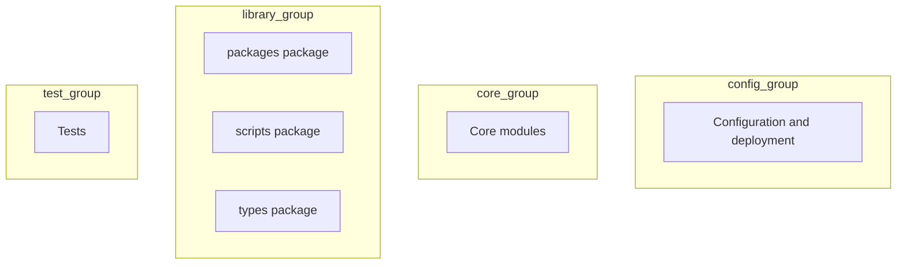

# Architecture report: acdlite/recompose

> Automated static analysis. **Observed** = directly seen in files/imports/AST; **Inferred** = interpretation from that evidence. Repository code was not executed.

## 1. Repository at a glance

| Item | Value |
| --- | --- |
| Repository | acdlite/recompose |
| Description | A React utility belt for function components and higher-order components. |
| Language | JavaScript |
| Stars | 14751 |
| Licence | MIT |
| Analysed commit / branch | 3db12ce7121a050b533476958ff3d66ded1c4bb8 / master |
| Framework(s) | React |
| Files analysed | 170 |
| Components | 6 |

## 2. Architecture in one minute

acdlite/recompose - A React utility belt for function components and higher-order components.. This repository was analysed statically from 170 file(s) (0 Python). Detected technologies (observed from imports/manifests): React, Jest, webpack. Files are grouped into 6 component(s): Configuration and deployment, Core modules, packages package, scripts package, Tests, types package. Findings below distinguish observed facts from inferred interpretation.

## 3. High-level block diagram

## 4. Main components

### Configuration and deployment (`config`)

- **Kind:** config
- **Status:** Observed
- **Confidence:** 0.85
- **Responsibility:** Groups 6 file(s) under configuration and deployment (observed from repository paths and static analysis).
- **Paths:** `package.json`, `src/basePackage.json`, `src/packages/recompose-relay/package.json`, `src/packages/recompose/package.json`, `types/flow-example/package.json`, `types/flow-example/public/manifest.json`
- **Evidence:** [package.json](https://github.com/acdlite/recompose/blob/3db12ce7121a050b533476958ff3d66ded1c4bb8/package.json); [src/basePackage.json](https://github.com/acdlite/recompose/blob/3db12ce7121a050b533476958ff3d66ded1c4bb8/src/basePackage.json); [src/packages/recompose-relay/package.json](https://github.com/acdlite/recompose/blob/3db12ce7121a050b533476958ff3d66ded1c4bb8/src/packages/recompose-relay/package.json); [src/packages/recompose/package.json](https://github.com/acdlite/recompose/blob/3db12ce7121a050b533476958ff3d66ded1c4bb8/src/packages/recompose/package.json); [types/flow-example/package.json](https://github.com/acdlite/recompose/blob/3db12ce7121a050b533476958ff3d66ded1c4bb8/types/flow-example/package.json); [types/flow-example/public/manifest.json](https://github.com/acdlite/recompose/blob/3db12ce7121a050b533476958ff3d66ded1c4bb8/types/flow-example/public/manifest.json)

### Core modules (`core`)

- **Kind:** core
- **Status:** Observed
- **Confidence:** 0.85
- **Responsibility:** Groups 1 file(s) under core modules (observed from repository paths and static analysis).
- **Paths:** `babel.config.js`
- **Evidence:** [babel.config.js](https://github.com/acdlite/recompose/blob/3db12ce7121a050b533476958ff3d66ded1c4bb8/babel.config.js)

### packages package (`packages`)

- **Kind:** library
- **Status:** Observed
- **Confidence:** 0.85
- **Responsibility:** Groups 97 file(s) under packages package (observed from repository paths and static analysis).
- **Paths:** `src/packages/recompose-relay/createContainer.js`, `src/packages/recompose-relay/index.js`, `src/packages/recompose/__tests__/branch-test.js`, `src/packages/recompose/__tests__/componentFromProp-test.js`, `src/packages/recompose/__tests__/componentFromStream-test.js`, `src/packages/recompose/__tests__/componentFromStreamWithConfig-test.js`, `src/packages/recompose/__tests__/compose-test.js`, `src/packages/recompose/__tests__/createEventHandler-test.js`, `src/packages/recompose/__tests__/createSink-test.js`, `src/packages/recompose/__tests__/defaultProps-test.js`, `src/packages/recompose/__tests__/fixtures/treeshake-entry.js`, `src/packages/recompose/__tests__/flattenProp-test.js`, `src/packages/recompose/__tests__/fromRenderProps-test.js`, `src/packages/recompose/__tests__/getContext-test.js`, `src/packages/recompose/__tests__/getDisplayName-test.js`, `src/packages/recompose/__tests__/hoistStatics-test.js`, `src/packages/recompose/__tests__/isClassComponent-test.js`, `src/packages/recompose/__tests__/lifecycle-test.js`, `src/packages/recompose/__tests__/mapProps-test.js`, `src/packages/recompose/__tests__/mapPropsStream-test.js`, `src/packages/recompose/__tests__/mapPropsStreamWithConfig-test.js`, `src/packages/recompose/__tests__/nest-test.js`, `src/packages/recompose/__tests__/onlyUpdateForKeys-test.js`, `src/packages/recompose/__tests__/onlyUpdateForPropTypes-test.js`, `src/packages/recompose/__tests__/pure-test.js`, `src/packages/recompose/__tests__/renameProp-test.js`, `src/packages/recompose/__tests__/renameProps-test.js`, `src/packages/recompose/__tests__/renderComponent-test.js`, `src/packages/recompose/__tests__/renderNothing-test.js`, `src/packages/recompose/__tests__/setDisplayName-test.js`, `src/packages/recompose/__tests__/setObservableConfig-test.js`, `src/packages/recompose/__tests__/setPropTypes-test.js`, `src/packages/recompose/__tests__/setStatic-test.js`, `src/packages/recompose/__tests__/shallowEqual-test.js`, `src/packages/recompose/__tests__/shouldUpdate-test.js`, `src/packages/recompose/__tests__/toClass-test.js`, `src/packages/recompose/__tests__/toRenderProps-test.js`, `src/packages/recompose/__tests__/utils.js`, `src/packages/recompose/__tests__/withContext-test.js`, `src/packages/recompose/__tests__/withHandlers-test.js`, `src/packages/recompose/__tests__/withProps-test.js`, `src/packages/recompose/__tests__/withPropsOnChange-test.js`, `src/packages/recompose/__tests__/withReducer-test.js`, `src/packages/recompose/__tests__/withState-test.js`, `src/packages/recompose/__tests__/withStateHandlers-test.js`, `src/packages/recompose/__tests__/wrapDisplayName-test.js`, `src/packages/recompose/baconObservableConfig.js`, `src/packages/recompose/branch.js`, `src/packages/recompose/componentFromProp.js`, `src/packages/recompose/componentFromStream.js`, `src/packages/recompose/compose.js`, `src/packages/recompose/createEventHandler.js`, `src/packages/recompose/createSink.js`, `src/packages/recompose/defaultProps.js`, `src/packages/recompose/flattenProp.js`, `src/packages/recompose/flydObservableConfig.js`, `src/packages/recompose/fromRenderProps.js`, `src/packages/recompose/getContext.js`, `src/packages/recompose/getDisplayName.js`, `src/packages/recompose/hoistStatics.js`, `src/packages/recompose/index.js`, `src/packages/recompose/isClassComponent.js`, `src/packages/recompose/kefirObservableConfig.js`, `src/packages/recompose/lifecycle.js`, `src/packages/recompose/mapProps.js`, `src/packages/recompose/mapPropsStream.js`, `src/packages/recompose/mostObservableConfig.js`, `src/packages/recompose/nest.js`, `src/packages/recompose/onlyUpdateForKeys.js`, `src/packages/recompose/onlyUpdateForPropTypes.js`, `src/packages/recompose/pure.js`, `src/packages/recompose/renameProp.js`, `src/packages/recompose/renameProps.js`, `src/packages/recompose/renderComponent.js`, `src/packages/recompose/renderNothing.js`, `src/packages/recompose/rxjs4ObservableConfig.js`, `src/packages/recompose/rxjsObservableConfig.js`, `src/packages/recompose/setDisplayName.js`, `src/packages/recompose/setObservableConfig.js`, `src/packages/recompose/setPropTypes.js`, `src/packages/recompose/setStatic.js`, `src/packages/recompose/shallowEqual.js`, `src/packages/recompose/shouldUpdate.js`, `src/packages/recompose/toClass.js`, `src/packages/recompose/toRenderProps.js`, `src/packages/recompose/utils/mapValues.js`, `src/packages/recompose/utils/omit.js`, `src/packages/recompose/utils/pick.js`, `src/packages/recompose/withContext.js`, `src/packages/recompose/withHandlers.js`, `src/packages/recompose/withProps.js`, `src/packages/recompose/withPropsOnChange.js`, `src/packages/recompose/withReducer.js`, `src/packages/recompose/withState.js`, `src/packages/recompose/withStateHandlers.js`, `src/packages/recompose/wrapDisplayName.js`, `src/packages/recompose/xstreamObservableConfig.js`
- **Evidence:** [src/packages/recompose-relay/createContainer.js](https://github.com/acdlite/recompose/blob/3db12ce7121a050b533476958ff3d66ded1c4bb8/src/packages/recompose-relay/createContainer.js); [src/packages/recompose-relay/index.js](https://github.com/acdlite/recompose/blob/3db12ce7121a050b533476958ff3d66ded1c4bb8/src/packages/recompose-relay/index.js); [src/packages/recompose/__tests__/branch-test.js](https://github.com/acdlite/recompose/blob/3db12ce7121a050b533476958ff3d66ded1c4bb8/src/packages/recompose/__tests__/branch-test.js); [src/packages/recompose/__tests__/componentFromProp-test.js](https://github.com/acdlite/recompose/blob/3db12ce7121a050b533476958ff3d66ded1c4bb8/src/packages/recompose/__tests__/componentFromProp-test.js); [src/packages/recompose/__tests__/componentFromStream-test.js](https://github.com/acdlite/recompose/blob/3db12ce7121a050b533476958ff3d66ded1c4bb8/src/packages/recompose/__tests__/componentFromStream-test.js); [src/packages/recompose/__tests__/componentFromStreamWithConfig-test.js](https://github.com/acdlite/recompose/blob/3db12ce7121a050b533476958ff3d66ded1c4bb8/src/packages/recompose/__tests__/componentFromStreamWithConfig-test.js); [src/packages/recompose/__tests__/compose-test.js](https://github.com/acdlite/recompose/blob/3db12ce7121a050b533476958ff3d66ded1c4bb8/src/packages/recompose/__tests__/compose-test.js); [src/packages/recompose/__tests__/createEventHandler-test.js](https://github.com/acdlite/recompose/blob/3db12ce7121a050b533476958ff3d66ded1c4bb8/src/packages/recompose/__tests__/createEventHandler-test.js)

### scripts package (`scripts`)

- **Kind:** library
- **Status:** Observed
- **Confidence:** 0.85
- **Responsibility:** Groups 5 file(s) under scripts package (observed from repository paths and static analysis).
- **Paths:** `scripts/getPackageNames.js`, `scripts/installNestedPackageDeps.js`, `scripts/jest.setup.js`, `scripts/release.js`, `scripts/rollup.config.js`
- **Evidence:** [scripts/getPackageNames.js](https://github.com/acdlite/recompose/blob/3db12ce7121a050b533476958ff3d66ded1c4bb8/scripts/getPackageNames.js); [scripts/installNestedPackageDeps.js](https://github.com/acdlite/recompose/blob/3db12ce7121a050b533476958ff3d66ded1c4bb8/scripts/installNestedPackageDeps.js); [scripts/jest.setup.js](https://github.com/acdlite/recompose/blob/3db12ce7121a050b533476958ff3d66ded1c4bb8/scripts/jest.setup.js); [scripts/release.js](https://github.com/acdlite/recompose/blob/3db12ce7121a050b533476958ff3d66ded1c4bb8/scripts/release.js); [scripts/rollup.config.js](https://github.com/acdlite/recompose/blob/3db12ce7121a050b533476958ff3d66ded1c4bb8/scripts/rollup.config.js)

### Tests (`tests`)

- **Kind:** test
- **Status:** Observed
- **Confidence:** 0.85
- **Responsibility:** Groups 24 file(s) under tests (observed from repository paths and static analysis).
- **Paths:** `src/packages/recompose/__tests__/types/test_branch.js`, `src/packages/recompose/__tests__/types/test_classBasedEnhancer.js`, `src/packages/recompose/__tests__/types/test_componentFromStream.js`, `src/packages/recompose/__tests__/types/test_createEventHandler.js`, `src/packages/recompose/__tests__/types/test_defaultProps.js`, `src/packages/recompose/__tests__/types/test_fromRenderProps.js`, `src/packages/recompose/__tests__/types/test_functionalEnhancer.js`, `src/packages/recompose/__tests__/types/test_getContext.js`, `src/packages/recompose/__tests__/types/test_mapProps.js`, `src/packages/recompose/__tests__/types/test_mapPropsStream.js`, `src/packages/recompose/__tests__/types/test_onlyUpdateForKeys.js`, `src/packages/recompose/__tests__/types/test_onlyUpdateForPropTypes.js`, `src/packages/recompose/__tests__/types/test_pure.js`, `src/packages/recompose/__tests__/types/test_shouldUpdate.js`, `src/packages/recompose/__tests__/types/test_statics.js`, `src/packages/recompose/__tests__/types/test_toClass.js`, `src/packages/recompose/__tests__/types/test_toRenderProps.js`, `src/packages/recompose/__tests__/types/test_utils.js`, `src/packages/recompose/__tests__/types/test_voodoo.js`, `src/packages/recompose/__tests__/types/test_withContext.js`, `src/packages/recompose/__tests__/types/test_withHandlers.js`, `src/packages/recompose/__tests__/types/test_withProps.js`, `src/packages/recompose/__tests__/types/test_withPropsOnChange.js`, `src/packages/recompose/__tests__/types/test_withStateHandlers.js`
- **Evidence:** [src/packages/recompose/__tests__/types/test_branch.js](https://github.com/acdlite/recompose/blob/3db12ce7121a050b533476958ff3d66ded1c4bb8/src/packages/recompose/__tests__/types/test_branch.js); [src/packages/recompose/__tests__/types/test_classBasedEnhancer.js](https://github.com/acdlite/recompose/blob/3db12ce7121a050b533476958ff3d66ded1c4bb8/src/packages/recompose/__tests__/types/test_classBasedEnhancer.js); [src/packages/recompose/__tests__/types/test_componentFromStream.js](https://github.com/acdlite/recompose/blob/3db12ce7121a050b533476958ff3d66ded1c4bb8/src/packages/recompose/__tests__/types/test_componentFromStream.js); [src/packages/recompose/__tests__/types/test_createEventHandler.js](https://github.com/acdlite/recompose/blob/3db12ce7121a050b533476958ff3d66ded1c4bb8/src/packages/recompose/__tests__/types/test_createEventHandler.js); [src/packages/recompose/__tests__/types/test_defaultProps.js](https://github.com/acdlite/recompose/blob/3db12ce7121a050b533476958ff3d66ded1c4bb8/src/packages/recompose/__tests__/types/test_defaultProps.js); [src/packages/recompose/__tests__/types/test_fromRenderProps.js](https://github.com/acdlite/recompose/blob/3db12ce7121a050b533476958ff3d66ded1c4bb8/src/packages/recompose/__tests__/types/test_fromRenderProps.js); [src/packages/recompose/__tests__/types/test_functionalEnhancer.js](https://github.com/acdlite/recompose/blob/3db12ce7121a050b533476958ff3d66ded1c4bb8/src/packages/recompose/__tests__/types/test_functionalEnhancer.js); [src/packages/recompose/__tests__/types/test_getContext.js](https://github.com/acdlite/recompose/blob/3db12ce7121a050b533476958ff3d66ded1c4bb8/src/packages/recompose/__tests__/types/test_getContext.js)

### types package (`types`)

- **Kind:** library
- **Status:** Observed
- **Confidence:** 0.85
- **Responsibility:** Groups 7 file(s) under types package (observed from repository paths and static analysis).
- **Paths:** `types/flow-example/flow-typed/glamor.js`, `types/flow-example/flow-typed/react-motion.js`, `types/flow-example/src/App.js`, `types/flow-example/src/Item.js`, `types/flow-example/src/ItemsAnimator.js`, `types/flow-example/src/MouseDetector.js`, `types/flow-example/src/index.js`
- **Evidence:** [types/flow-example/flow-typed/glamor.js](https://github.com/acdlite/recompose/blob/3db12ce7121a050b533476958ff3d66ded1c4bb8/types/flow-example/flow-typed/glamor.js); [types/flow-example/flow-typed/react-motion.js](https://github.com/acdlite/recompose/blob/3db12ce7121a050b533476958ff3d66ded1c4bb8/types/flow-example/flow-typed/react-motion.js); [types/flow-example/src/App.js](https://github.com/acdlite/recompose/blob/3db12ce7121a050b533476958ff3d66ded1c4bb8/types/flow-example/src/App.js); [types/flow-example/src/Item.js](https://github.com/acdlite/recompose/blob/3db12ce7121a050b533476958ff3d66ded1c4bb8/types/flow-example/src/Item.js); [types/flow-example/src/ItemsAnimator.js](https://github.com/acdlite/recompose/blob/3db12ce7121a050b533476958ff3d66ded1c4bb8/types/flow-example/src/ItemsAnimator.js); [types/flow-example/src/MouseDetector.js](https://github.com/acdlite/recompose/blob/3db12ce7121a050b533476958ff3d66ded1c4bb8/types/flow-example/src/MouseDetector.js); [types/flow-example/src/index.js](https://github.com/acdlite/recompose/blob/3db12ce7121a050b533476958ff3d66ded1c4bb8/types/flow-example/src/index.js)

## 5. Execution flow

**Observed** entry point(s):

- [src/packages/recompose-relay/index.js](https://github.com/acdlite/recompose/blob/3db12ce7121a050b533476958ff3d66ded1c4bb8/src/packages/recompose-relay/index.js)
- [src/packages/recompose/index.js](https://github.com/acdlite/recompose/blob/3db12ce7121a050b533476958ff3d66ded1c4bb8/src/packages/recompose/index.js)
- [types/flow-example/src/App.js](https://github.com/acdlite/recompose/blob/3db12ce7121a050b533476958ff3d66ded1c4bb8/types/flow-example/src/App.js)
- [types/flow-example/src/index.js](https://github.com/acdlite/recompose/blob/3db12ce7121a050b533476958ff3d66ded1c4bb8/types/flow-example/src/index.js)

Representative flow (derived from observed entry points and the import graph; steps beyond the entry point are **Inferred**):

1. Execution starts at an observed entry point listed above, if present.
2. No internal import relationships between components were observed.

## 6. Project structure

### `(root)`

- `.codeclimate.yml` - config (213 bytes)
- `.editorconfig` - config (238 bytes)
- `.eslintignore` - other (24 bytes)
- `.eslintrc` - other (1533 bytes)
- `.flowconfig` - other (116 bytes)
- `.gitignore` - other (57 bytes)
- `.npmignore` - other (28 bytes)
- `.prettierignore` - other (25 bytes)
- `.prettierrc` - other (48 bytes)
- `.size-snapshot.json` - config (525 bytes)
- `.travis.yml` - ci, YAML (384 bytes)
- `CHANGELOG.md` - docs (105 bytes)
- `LICENSE.md` - docs (1084 bytes)
- `README.md` - docs (12182 bytes)
- `babel.config.js` - source, JavaScript (250 bytes)
- `package.json` - manifest (2903 bytes)

### `docs`

- `docs/API.md` - docs (32869 bytes)
- `docs/flow.md` - docs (2658 bytes)
- `docs/performance.md` - docs (1043 bytes)

### `scripts`

- `scripts/getPackageNames.js` - source, JavaScript (554 bytes)
- `scripts/installNestedPackageDeps.js` - source, JavaScript (340 bytes)
- `scripts/jest.setup.js` - source, JavaScript (183 bytes)
- `scripts/release.js` - source, JavaScript (4479 bytes)
- `scripts/rollup.config.js` - source, JavaScript (2317 bytes)

### `src`

- `src/basePackage.json` - config (292 bytes)
- `src/packages/recompose-relay/.npmignore` - other (14 bytes)
- `src/packages/recompose-relay/README.md` - docs (1377 bytes)
- `src/packages/recompose-relay/VERSION` - other (6 bytes)
- `src/packages/recompose-relay/createContainer.js` - source, JavaScript (210 bytes)
- `src/packages/recompose-relay/index.js` - source, JavaScript (63 bytes)
- `src/packages/recompose-relay/package.json` - manifest (622 bytes)
- `src/packages/recompose/.npmignore` - other (14 bytes)
- `src/packages/recompose/README.md` - docs (319 bytes)
- `src/packages/recompose/VERSION` - other (7 bytes)
- `src/packages/recompose/__tests__/branch-test.js` - source, JavaScript (1927 bytes)
- `src/packages/recompose/__tests__/componentFromProp-test.js` - source, JavaScript (579 bytes)
- `src/packages/recompose/__tests__/componentFromStream-test.js` - source, JavaScript (3055 bytes)
- `src/packages/recompose/__tests__/componentFromStreamWithConfig-test.js` - source, JavaScript (884 bytes)
- `src/packages/recompose/__tests__/compose-test.js` - source, JavaScript (768 bytes)
- `src/packages/recompose/__tests__/createEventHandler-test.js` - source, JavaScript (844 bytes)
- `src/packages/recompose/__tests__/createSink-test.js` - source, JavaScript (787 bytes)
- `src/packages/recompose/__tests__/defaultProps-test.js` - source, JavaScript (1076 bytes)
- `src/packages/recompose/__tests__/fixtures/treeshake-entry.js` - source, JavaScript (63 bytes)
- `src/packages/recompose/__tests__/flattenProp-test.js` - source, JavaScript (748 bytes)
- `src/packages/recompose/__tests__/fromRenderProps-test.js` - source, JavaScript (2751 bytes)
- `src/packages/recompose/__tests__/getContext-test.js` - source, JavaScript (170 bytes)
- `src/packages/recompose/__tests__/getDisplayName-test.js` - source, JavaScript (749 bytes)
- `src/packages/recompose/__tests__/hoistStatics-test.js` - source, JavaScript (991 bytes)
- `src/packages/recompose/__tests__/isClassComponent-test.js` - source, JavaScript (696 bytes)
- `src/packages/recompose/__tests__/lifecycle-test.js` - source, JavaScript (507 bytes)
- `src/packages/recompose/__tests__/mapProps-test.js` - source, JavaScript (812 bytes)
- `src/packages/recompose/__tests__/mapPropsStream-test.js` - source, JavaScript (671 bytes)
- `src/packages/recompose/__tests__/mapPropsStreamWithConfig-test.js` - source, JavaScript (1248 bytes)
- `src/packages/recompose/__tests__/nest-test.js` - source, JavaScript (625 bytes)
- `src/packages/recompose/__tests__/onlyUpdateForKeys-test.js` - source, JavaScript (1040 bytes)
- `src/packages/recompose/__tests__/onlyUpdateForPropTypes-test.js` - source, JavaScript (1672 bytes)
- `src/packages/recompose/__tests__/pure-test.js` - source, JavaScript (1080 bytes)
- `src/packages/recompose/__tests__/renameProp-test.js` - source, JavaScript (482 bytes)
- `src/packages/recompose/__tests__/renameProps-test.js` - source, JavaScript (519 bytes)
- `src/packages/recompose/__tests__/renderComponent-test.js` - source, JavaScript (768 bytes)
- `src/packages/recompose/__tests__/renderNothing-test.js` - source, JavaScript (413 bytes)
- `src/packages/recompose/__tests__/setDisplayName-test.js` - source, JavaScript (288 bytes)
- `src/packages/recompose/__tests__/setObservableConfig-test.js` - source, JavaScript (2017 bytes)
- `src/packages/recompose/__tests__/setPropTypes-test.js` - source, JavaScript (366 bytes)
- `src/packages/recompose/__tests__/setStatic-test.js` - source, JavaScript (378 bytes)
- `src/packages/recompose/__tests__/shallowEqual-test.js` - source, JavaScript (1444 bytes)
- `src/packages/recompose/__tests__/shouldUpdate-test.js` - source, JavaScript (1152 bytes)
- `src/packages/recompose/__tests__/toClass-test.js` - source, JavaScript (2692 bytes)
- `src/packages/recompose/__tests__/toRenderProps-test.js` - source, JavaScript (520 bytes)
- `src/packages/recompose/__tests__/types/test_branch.js` - test, JavaScript (2900 bytes)
- `src/packages/recompose/__tests__/types/test_classBasedEnhancer.js` - test, JavaScript (1251 bytes)
- `src/packages/recompose/__tests__/types/test_componentFromStream.js` - test, JavaScript (243 bytes)
- `src/packages/recompose/__tests__/types/test_createEventHandler.js` - test, JavaScript (308 bytes)
- `src/packages/recompose/__tests__/types/test_defaultProps.js` - test, JavaScript (955 bytes)
- `src/packages/recompose/__tests__/types/test_fromRenderProps.js` - test, JavaScript (1265 bytes)
- `src/packages/recompose/__tests__/types/test_functionalEnhancer.js` - test, JavaScript (900 bytes)
- `src/packages/recompose/__tests__/types/test_getContext.js` - test, JavaScript (1111 bytes)
- `src/packages/recompose/__tests__/types/test_mapProps.js` - test, JavaScript (770 bytes)
- `src/packages/recompose/__tests__/types/test_mapPropsStream.js` - test, JavaScript (1019 bytes)
- `src/packages/recompose/__tests__/types/test_onlyUpdateForKeys.js` - test, JavaScript (843 bytes)
- `src/packages/recompose/__tests__/types/test_onlyUpdateForPropTypes.js` - test, JavaScript (722 bytes)
- `src/packages/recompose/__tests__/types/test_pure.js` - test, JavaScript (686 bytes)
- `src/packages/recompose/__tests__/types/test_shouldUpdate.js` - test, JavaScript (1058 bytes)
- `src/packages/recompose/__tests__/types/test_statics.js` - test, JavaScript (1085 bytes)
- `src/packages/recompose/__tests__/types/test_toClass.js` - test, JavaScript (692 bytes)
- `src/packages/recompose/__tests__/types/test_toRenderProps.js` - test, JavaScript (1193 bytes)
- `src/packages/recompose/__tests__/types/test_utils.js` - test, JavaScript (667 bytes)
- `src/packages/recompose/__tests__/types/test_voodoo.js` - test, JavaScript (3101 bytes)
- `src/packages/recompose/__tests__/types/test_withContext.js` - test, JavaScript (818 bytes)
- `src/packages/recompose/__tests__/types/test_withHandlers.js` - test, JavaScript (1931 bytes)
- `src/packages/recompose/__tests__/types/test_withProps.js` - test, JavaScript (1233 bytes)
- `src/packages/recompose/__tests__/types/test_withPropsOnChange.js` - test, JavaScript (2143 bytes)
- `src/packages/recompose/__tests__/types/test_withStateHandlers.js` - test, JavaScript (2850 bytes)
- `src/packages/recompose/__tests__/utils.js` - source, JavaScript (466 bytes)
- `src/packages/recompose/__tests__/withContext-test.js` - source, JavaScript (1352 bytes)
- `src/packages/recompose/__tests__/withHandlers-test.js` - source, JavaScript (3083 bytes)
- `src/packages/recompose/__tests__/withProps-test.js` - source, JavaScript (932 bytes)
- `src/packages/recompose/__tests__/withPropsOnChange-test.js` - source, JavaScript (3770 bytes)
- `src/packages/recompose/__tests__/withReducer-test.js` - source, JavaScript (2885 bytes)
- `src/packages/recompose/__tests__/withState-test.js` - source, JavaScript (2160 bytes)
- `src/packages/recompose/__tests__/withStateHandlers-test.js` - source, JavaScript (5924 bytes)
- `src/packages/recompose/__tests__/wrapDisplayName-test.js` - source, JavaScript (367 bytes)
- `src/packages/recompose/baconObservableConfig.js` - source, JavaScript (857 bytes)
- `src/packages/recompose/branch.js` - source, JavaScript (713 bytes)
- `src/packages/recompose/componentFromProp.js` - source, JavaScript (314 bytes)
- `src/packages/recompose/componentFromStream.js` - source, JavaScript (1765 bytes)
- `src/packages/recompose/compose.js` - source, JavaScript (119 bytes)
- `src/packages/recompose/createEventHandler.js` - source, JavaScript (656 bytes)
- `src/packages/recompose/createSink.js` - source, JavaScript (372 bytes)
- `src/packages/recompose/defaultProps.js` - source, JavaScript (526 bytes)
- `src/packages/recompose/flattenProp.js` - source, JavaScript (526 bytes)
- `src/packages/recompose/flydObservableConfig.js` - source, JavaScript (733 bytes)
- `src/packages/recompose/fromRenderProps.js` - source, JavaScript (763 bytes)
- `src/packages/recompose/getContext.js` - source, JavaScript (579 bytes)
- `src/packages/recompose/getDisplayName.js` - source, JavaScript (246 bytes)
- `src/packages/recompose/hoistStatics.js` - source, JavaScript (312 bytes)
- `src/packages/recompose/index.js` - source, JavaScript (2534 bytes)
- `src/packages/recompose/index.js.flow` - other (9223 bytes)
- `src/packages/recompose/isClassComponent.js` - source, JavaScript (187 bytes)
- `src/packages/recompose/kefirObservableConfig.js` - source, JavaScript (166 bytes)
- `src/packages/recompose/lifecycle.js` - source, JavaScript (928 bytes)
- `src/packages/recompose/mapProps.js` - source, JavaScript (463 bytes)
- `src/packages/recompose/mapPropsStream.js` - source, JavaScript (1422 bytes)
- `src/packages/recompose/mostObservableConfig.js` - source, JavaScript (156 bytes)
- `src/packages/recompose/nest.js` - source, JavaScript (495 bytes)
- `src/packages/recompose/onlyUpdateForKeys.js` - source, JavaScript (618 bytes)
- `src/packages/recompose/onlyUpdateForPropTypes.js` - source, JavaScript (1033 bytes)
- `src/packages/recompose/package.json` - manifest (598 bytes)
- `src/packages/recompose/pure.js` - source, JavaScript (503 bytes)
- `src/packages/recompose/renameProp.js` - source, JavaScript (531 bytes)
- `src/packages/recompose/renameProps.js` - source, JavaScript (871 bytes)
- `src/packages/recompose/renderComponent.js` - source, JavaScript (414 bytes)
- `src/packages/recompose/renderNothing.js` - source, JavaScript (170 bytes)
- `src/packages/recompose/rxjs4ObservableConfig.js` - source, JavaScript (770 bytes)
- `src/packages/recompose/rxjsObservableConfig.js` - source, JavaScript (141 bytes)
- `src/packages/recompose/setDisplayName.js` - source, JavaScript (144 bytes)
- `src/packages/recompose/setObservableConfig.js` - source, JavaScript (465 bytes)
- `src/packages/recompose/setPropTypes.js` - source, JavaScript (134 bytes)
- `src/packages/recompose/setStatic.js` - source, JavaScript (214 bytes)
- `src/packages/recompose/shallowEqual.js` - source, JavaScript (1647 bytes)
- `src/packages/recompose/shouldUpdate.js` - source, JavaScript (630 bytes)
- `src/packages/recompose/toClass.js` - source, JavaScript (735 bytes)
- `src/packages/recompose/toRenderProps.js` - source, JavaScript (144 bytes)
- `src/packages/recompose/utils/mapValues.js` - source, JavaScript (298 bytes)
- `src/packages/recompose/utils/omit.js` - source, JavaScript (228 bytes)
- `src/packages/recompose/utils/pick.js` - source, JavaScript (229 bytes)
- `src/packages/recompose/withContext.js` - source, JavaScript (679 bytes)
- `src/packages/recompose/withHandlers.js` - source, JavaScript (1237 bytes)
- `src/packages/recompose/withProps.js` - source, JavaScript (496 bytes)
- `src/packages/recompose/withPropsOnChange.js` - source, JavaScript (1444 bytes)
- `src/packages/recompose/withReducer.js` - source, JavaScript (1259 bytes)
- `src/packages/recompose/withState.js` - source, JavaScript (1071 bytes)
- `src/packages/recompose/withStateHandlers.js` - source, JavaScript (1261 bytes)
- `src/packages/recompose/wrapDisplayName.js` - source, JavaScript (180 bytes)
- `src/packages/recompose/xstreamObservableConfig.js` - source, JavaScript (779 bytes)

### `types`

- `types/README.md` - docs (3041 bytes)
- `types/flow-example/.eslintrc` - other (29 bytes)
- `types/flow-example/.flowconfig` - other (310 bytes)
- `types/flow-example/.gitignore` - other (285 bytes)
- `types/flow-example/README.md` - docs (147 bytes)
- `types/flow-example/flow-typed/glamor.js` - source, JavaScript (274 bytes)
- `types/flow-example/flow-typed/react-motion.js` - source, JavaScript (289 bytes)
- `types/flow-example/package.json` - manifest (549 bytes)
- `types/flow-example/public/index.html` - other (1567 bytes)
- `types/flow-example/public/manifest.json` - config (298 bytes)
- `types/flow-example/src/App.js` - source, JavaScript (2298 bytes)
- `types/flow-example/src/Item.js` - source, JavaScript (2893 bytes)
- `types/flow-example/src/ItemsAnimator.js` - source, JavaScript (4193 bytes)
- `types/flow-example/src/MouseDetector.js` - source, JavaScript (4103 bytes)
- `types/flow-example/src/index.js` - source, JavaScript (843 bytes)

## 7. Key dependencies and integrations

| Name | Category | Status | Confidence | Evidence |
| --- | --- | --- | --- | --- |
| React | framework | Observed | 0.90 | [package.json:44](https://github.com/acdlite/recompose/blob/3db12ce7121a050b533476958ff3d66ded1c4bb8/package.json#L44); [package.json:73](https://github.com/acdlite/recompose/blob/3db12ce7121a050b533476958ff3d66ded1c4bb8/package.json#L73); [src/packages/recompose-relay/package.json:9](https://github.com/acdlite/recompose/blob/3db12ce7121a050b533476958ff3d66ded1c4bb8/src/packages/recompose-relay/package.json#L9); [src/packages/recompose/package.json:2](https://github.com/acdlite/recompose/blob/3db12ce7121a050b533476958ff3d66ded1c4bb8/src/packages/recompose/package.json#L2) |
| Jest | tooling | Observed | 0.85 | [package.json:13](https://github.com/acdlite/recompose/blob/3db12ce7121a050b533476958ff3d66ded1c4bb8/package.json#L13) |
| webpack | tooling | Observed | 0.85 | [package.json:86](https://github.com/acdlite/recompose/blob/3db12ce7121a050b533476958ff3d66ded1c4bb8/package.json#L86) |

## 8. Data and state

No database, cache, queue, or persistent-state usage was observed in the analysed files. State handling, if any, may be in-memory or in files that were not analysed.

## 9. Configuration and deployment clues

- `.codeclimate.yml` (config)
- `.editorconfig` (config)
- `.size-snapshot.json` (config)
- `.travis.yml` (ci)
- `package.json` (manifest)
- `src/basePackage.json` (config)
- `src/packages/recompose-relay/package.json` (manifest)
- `src/packages/recompose/package.json` (manifest)
- `types/flow-example/package.json` (manifest)
- `types/flow-example/public/manifest.json` (config)

## 10. Design observations

- Tests are present alongside source code (Observed from test file paths).

These observations are interpretations (**Inferred**) of the observed structure, not guarantees about runtime design.

## 11. Limitations and unknowns

- Static analysis only: repository code was not executed, installed, or imported at runtime.
- Components and relationships are inferred from file paths, imports, and AST structure; runtime behaviour, dynamic imports, and reflection may not be visible.
- 3 file(s) were skipped during inventory (3 x lockfile excluded).
- No clear application entry point was observed in the analysed files.
- Repository text was treated as untrusted data; no instructions found in repository files were followed, and likely secret values were redacted/excluded.
- JavaScript and TypeScript files were inventoried from paths and package manifests. They were not parsed with a full language AST, and repository code was not executed.
- The GitHub repository was marked archived at selection time.

## 12. Source references

- [babel.config.js](https://github.com/acdlite/recompose/blob/3db12ce7121a050b533476958ff3d66ded1c4bb8/babel.config.js)
- [package.json](https://github.com/acdlite/recompose/blob/3db12ce7121a050b533476958ff3d66ded1c4bb8/package.json)
- [package.json:13](https://github.com/acdlite/recompose/blob/3db12ce7121a050b533476958ff3d66ded1c4bb8/package.json#L13)
- [package.json:44](https://github.com/acdlite/recompose/blob/3db12ce7121a050b533476958ff3d66ded1c4bb8/package.json#L44)
- [package.json:73](https://github.com/acdlite/recompose/blob/3db12ce7121a050b533476958ff3d66ded1c4bb8/package.json#L73)
- [package.json:86](https://github.com/acdlite/recompose/blob/3db12ce7121a050b533476958ff3d66ded1c4bb8/package.json#L86)
- [scripts/getPackageNames.js](https://github.com/acdlite/recompose/blob/3db12ce7121a050b533476958ff3d66ded1c4bb8/scripts/getPackageNames.js)
- [scripts/installNestedPackageDeps.js](https://github.com/acdlite/recompose/blob/3db12ce7121a050b533476958ff3d66ded1c4bb8/scripts/installNestedPackageDeps.js)
- [scripts/jest.setup.js](https://github.com/acdlite/recompose/blob/3db12ce7121a050b533476958ff3d66ded1c4bb8/scripts/jest.setup.js)
- [scripts/release.js](https://github.com/acdlite/recompose/blob/3db12ce7121a050b533476958ff3d66ded1c4bb8/scripts/release.js)
- [scripts/rollup.config.js](https://github.com/acdlite/recompose/blob/3db12ce7121a050b533476958ff3d66ded1c4bb8/scripts/rollup.config.js)
- [src/basePackage.json](https://github.com/acdlite/recompose/blob/3db12ce7121a050b533476958ff3d66ded1c4bb8/src/basePackage.json)
- [src/packages/recompose-relay/createContainer.js](https://github.com/acdlite/recompose/blob/3db12ce7121a050b533476958ff3d66ded1c4bb8/src/packages/recompose-relay/createContainer.js)
- [src/packages/recompose-relay/index.js](https://github.com/acdlite/recompose/blob/3db12ce7121a050b533476958ff3d66ded1c4bb8/src/packages/recompose-relay/index.js)
- [src/packages/recompose-relay/package.json](https://github.com/acdlite/recompose/blob/3db12ce7121a050b533476958ff3d66ded1c4bb8/src/packages/recompose-relay/package.json)
- [src/packages/recompose-relay/package.json:9](https://github.com/acdlite/recompose/blob/3db12ce7121a050b533476958ff3d66ded1c4bb8/src/packages/recompose-relay/package.json#L9)
- [src/packages/recompose/__tests__/branch-test.js](https://github.com/acdlite/recompose/blob/3db12ce7121a050b533476958ff3d66ded1c4bb8/src/packages/recompose/__tests__/branch-test.js)
- [src/packages/recompose/__tests__/componentFromProp-test.js](https://github.com/acdlite/recompose/blob/3db12ce7121a050b533476958ff3d66ded1c4bb8/src/packages/recompose/__tests__/componentFromProp-test.js)
- [src/packages/recompose/__tests__/componentFromStream-test.js](https://github.com/acdlite/recompose/blob/3db12ce7121a050b533476958ff3d66ded1c4bb8/src/packages/recompose/__tests__/componentFromStream-test.js)
- [src/packages/recompose/__tests__/componentFromStreamWithConfig-test.js](https://github.com/acdlite/recompose/blob/3db12ce7121a050b533476958ff3d66ded1c4bb8/src/packages/recompose/__tests__/componentFromStreamWithConfig-test.js)
- [src/packages/recompose/__tests__/compose-test.js](https://github.com/acdlite/recompose/blob/3db12ce7121a050b533476958ff3d66ded1c4bb8/src/packages/recompose/__tests__/compose-test.js)
- [src/packages/recompose/__tests__/createEventHandler-test.js](https://github.com/acdlite/recompose/blob/3db12ce7121a050b533476958ff3d66ded1c4bb8/src/packages/recompose/__tests__/createEventHandler-test.js)
- [src/packages/recompose/__tests__/types/test_branch.js](https://github.com/acdlite/recompose/blob/3db12ce7121a050b533476958ff3d66ded1c4bb8/src/packages/recompose/__tests__/types/test_branch.js)
- [src/packages/recompose/__tests__/types/test_classBasedEnhancer.js](https://github.com/acdlite/recompose/blob/3db12ce7121a050b533476958ff3d66ded1c4bb8/src/packages/recompose/__tests__/types/test_classBasedEnhancer.js)
- [src/packages/recompose/__tests__/types/test_componentFromStream.js](https://github.com/acdlite/recompose/blob/3db12ce7121a050b533476958ff3d66ded1c4bb8/src/packages/recompose/__tests__/types/test_componentFromStream.js)
- [src/packages/recompose/__tests__/types/test_createEventHandler.js](https://github.com/acdlite/recompose/blob/3db12ce7121a050b533476958ff3d66ded1c4bb8/src/packages/recompose/__tests__/types/test_createEventHandler.js)
- [src/packages/recompose/__tests__/types/test_defaultProps.js](https://github.com/acdlite/recompose/blob/3db12ce7121a050b533476958ff3d66ded1c4bb8/src/packages/recompose/__tests__/types/test_defaultProps.js)
- [src/packages/recompose/__tests__/types/test_fromRenderProps.js](https://github.com/acdlite/recompose/blob/3db12ce7121a050b533476958ff3d66ded1c4bb8/src/packages/recompose/__tests__/types/test_fromRenderProps.js)
- [src/packages/recompose/__tests__/types/test_functionalEnhancer.js](https://github.com/acdlite/recompose/blob/3db12ce7121a050b533476958ff3d66ded1c4bb8/src/packages/recompose/__tests__/types/test_functionalEnhancer.js)
- [src/packages/recompose/__tests__/types/test_getContext.js](https://github.com/acdlite/recompose/blob/3db12ce7121a050b533476958ff3d66ded1c4bb8/src/packages/recompose/__tests__/types/test_getContext.js)
- [src/packages/recompose/index.js](https://github.com/acdlite/recompose/blob/3db12ce7121a050b533476958ff3d66ded1c4bb8/src/packages/recompose/index.js)
- [src/packages/recompose/package.json](https://github.com/acdlite/recompose/blob/3db12ce7121a050b533476958ff3d66ded1c4bb8/src/packages/recompose/package.json)
- [src/packages/recompose/package.json:2](https://github.com/acdlite/recompose/blob/3db12ce7121a050b533476958ff3d66ded1c4bb8/src/packages/recompose/package.json#L2)
- [types/flow-example/flow-typed/glamor.js](https://github.com/acdlite/recompose/blob/3db12ce7121a050b533476958ff3d66ded1c4bb8/types/flow-example/flow-typed/glamor.js)
- [types/flow-example/flow-typed/react-motion.js](https://github.com/acdlite/recompose/blob/3db12ce7121a050b533476958ff3d66ded1c4bb8/types/flow-example/flow-typed/react-motion.js)
- [types/flow-example/package.json](https://github.com/acdlite/recompose/blob/3db12ce7121a050b533476958ff3d66ded1c4bb8/types/flow-example/package.json)
- [types/flow-example/package.json:11](https://github.com/acdlite/recompose/blob/3db12ce7121a050b533476958ff3d66ded1c4bb8/types/flow-example/package.json#L11)
- [types/flow-example/package.json:13](https://github.com/acdlite/recompose/blob/3db12ce7121a050b533476958ff3d66ded1c4bb8/types/flow-example/package.json#L13)
- [types/flow-example/public/manifest.json](https://github.com/acdlite/recompose/blob/3db12ce7121a050b533476958ff3d66ded1c4bb8/types/flow-example/public/manifest.json)
- [types/flow-example/src/App.js](https://github.com/acdlite/recompose/blob/3db12ce7121a050b533476958ff3d66ded1c4bb8/types/flow-example/src/App.js)
- [types/flow-example/src/Item.js](https://github.com/acdlite/recompose/blob/3db12ce7121a050b533476958ff3d66ded1c4bb8/types/flow-example/src/Item.js)
- [types/flow-example/src/ItemsAnimator.js](https://github.com/acdlite/recompose/blob/3db12ce7121a050b533476958ff3d66ded1c4bb8/types/flow-example/src/ItemsAnimator.js)
- [types/flow-example/src/MouseDetector.js](https://github.com/acdlite/recompose/blob/3db12ce7121a050b533476958ff3d66ded1c4bb8/types/flow-example/src/MouseDetector.js)
- [types/flow-example/src/index.js](https://github.com/acdlite/recompose/blob/3db12ce7121a050b533476958ff3d66ded1c4bb8/types/flow-example/src/index.js)
