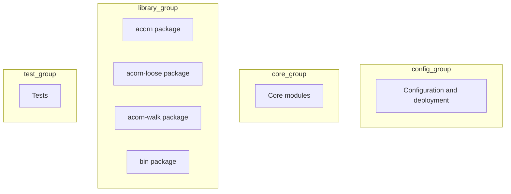

# Architecture report: acornjs/acorn

> Automated static analysis. **Observed** = directly seen in files/imports/AST; **Inferred** = interpretation from that evidence. Repository code was not executed.

## 1. Repository at a glance

| Item | Value |
| --- | --- |
| Repository | acornjs/acorn |
| Description | A small, fast, JavaScript-based JavaScript parser |
| Language | JavaScript |
| Stars | 11474 |
| Licence | Not detected |
| Analysed commit / branch | e4516ce0f49aea06b98ae1a551644119958ed4e1 / master |
| Framework(s) | None detected |
| Files analysed | 117 |
| Components | 7 |

## 2. Architecture in one minute

acornjs/acorn - A small, fast, JavaScript-based JavaScript parser. This repository was analysed statically from 117 file(s) (0 Python). Detected technologies (observed from imports/manifests): GitHub Actions, TypeScript. Files are grouped into 7 component(s): acorn package, acorn-loose package, acorn-walk package, bin package, Configuration and deployment, Core modules, Tests. Findings below distinguish observed facts from inferred interpretation.

## 3. High-level block diagram

## 4. Main components

### acorn package (`acorn`)

- **Kind:** library
- **Status:** Observed
- **Confidence:** 0.85
- **Responsibility:** Groups 28 file(s) under acorn package (observed from repository paths and static analysis).
- **Paths:** `acorn/rollup.config.mjs`, `acorn/src/acorn.d.ts`, `acorn/src/bin/acorn.js`, `acorn/src/expression.js`, `acorn/src/generated/astralIdentifierCodes.js`, `acorn/src/generated/astralIdentifierStartCodes.js`, `acorn/src/generated/nonASCIIidentifierChars.js`, `acorn/src/generated/nonASCIIidentifierStartChars.js`, `acorn/src/generated/scriptValuesAddedInUnicode.js`, `acorn/src/identifier.js`, `acorn/src/index.js`, `acorn/src/location.js`, `acorn/src/locutil.js`, `acorn/src/lval.js`, `acorn/src/node.js`, `acorn/src/options.js`, `acorn/src/parseutil.js`, `acorn/src/regexp.js`, `acorn/src/scope.js`, `acorn/src/scopeflags.js`, `acorn/src/state.js`, `acorn/src/statement.js`, `acorn/src/tokencontext.js`, `acorn/src/tokenize.js`, `acorn/src/tokentype.js`, `acorn/src/unicode-property-data.js`, `acorn/src/util.js`, `acorn/src/whitespace.js`
- **Evidence:** [acorn/rollup.config.mjs](https://github.com/acornjs/acorn/blob/e4516ce0f49aea06b98ae1a551644119958ed4e1/acorn/rollup.config.mjs); [acorn/src/acorn.d.ts](https://github.com/acornjs/acorn/blob/e4516ce0f49aea06b98ae1a551644119958ed4e1/acorn/src/acorn.d.ts); [acorn/src/bin/acorn.js](https://github.com/acornjs/acorn/blob/e4516ce0f49aea06b98ae1a551644119958ed4e1/acorn/src/bin/acorn.js); [acorn/src/expression.js](https://github.com/acornjs/acorn/blob/e4516ce0f49aea06b98ae1a551644119958ed4e1/acorn/src/expression.js); [acorn/src/generated/astralIdentifierCodes.js](https://github.com/acornjs/acorn/blob/e4516ce0f49aea06b98ae1a551644119958ed4e1/acorn/src/generated/astralIdentifierCodes.js); [acorn/src/generated/astralIdentifierStartCodes.js](https://github.com/acornjs/acorn/blob/e4516ce0f49aea06b98ae1a551644119958ed4e1/acorn/src/generated/astralIdentifierStartCodes.js); [acorn/src/generated/nonASCIIidentifierChars.js](https://github.com/acornjs/acorn/blob/e4516ce0f49aea06b98ae1a551644119958ed4e1/acorn/src/generated/nonASCIIidentifierChars.js); [acorn/src/generated/nonASCIIidentifierStartChars.js](https://github.com/acornjs/acorn/blob/e4516ce0f49aea06b98ae1a551644119958ed4e1/acorn/src/generated/nonASCIIidentifierStartChars.js)

### acorn-loose package (`acorn_loose`)

- **Kind:** library
- **Status:** Observed
- **Confidence:** 0.85
- **Responsibility:** Groups 8 file(s) under acorn-loose package (observed from repository paths and static analysis).
- **Paths:** `acorn-loose/rollup.config.mjs`, `acorn-loose/src/acorn-loose.d.ts`, `acorn-loose/src/expression.js`, `acorn-loose/src/index.js`, `acorn-loose/src/parseutil.js`, `acorn-loose/src/state.js`, `acorn-loose/src/statement.js`, `acorn-loose/src/tokenize.js`
- **Evidence:** [acorn-loose/rollup.config.mjs](https://github.com/acornjs/acorn/blob/e4516ce0f49aea06b98ae1a551644119958ed4e1/acorn-loose/rollup.config.mjs); [acorn-loose/src/acorn-loose.d.ts](https://github.com/acornjs/acorn/blob/e4516ce0f49aea06b98ae1a551644119958ed4e1/acorn-loose/src/acorn-loose.d.ts); [acorn-loose/src/expression.js](https://github.com/acornjs/acorn/blob/e4516ce0f49aea06b98ae1a551644119958ed4e1/acorn-loose/src/expression.js); [acorn-loose/src/index.js](https://github.com/acornjs/acorn/blob/e4516ce0f49aea06b98ae1a551644119958ed4e1/acorn-loose/src/index.js); [acorn-loose/src/parseutil.js](https://github.com/acornjs/acorn/blob/e4516ce0f49aea06b98ae1a551644119958ed4e1/acorn-loose/src/parseutil.js); [acorn-loose/src/state.js](https://github.com/acornjs/acorn/blob/e4516ce0f49aea06b98ae1a551644119958ed4e1/acorn-loose/src/state.js); [acorn-loose/src/statement.js](https://github.com/acornjs/acorn/blob/e4516ce0f49aea06b98ae1a551644119958ed4e1/acorn-loose/src/statement.js); [acorn-loose/src/tokenize.js](https://github.com/acornjs/acorn/blob/e4516ce0f49aea06b98ae1a551644119958ed4e1/acorn-loose/src/tokenize.js)

### acorn-walk package (`acorn_walk`)

- **Kind:** library
- **Status:** Observed
- **Confidence:** 0.85
- **Responsibility:** Groups 3 file(s) under acorn-walk package (observed from repository paths and static analysis).
- **Paths:** `acorn-walk/rollup.config.mjs`, `acorn-walk/src/index.js`, `acorn-walk/src/walk.d.ts`
- **Evidence:** [acorn-walk/rollup.config.mjs](https://github.com/acornjs/acorn/blob/e4516ce0f49aea06b98ae1a551644119958ed4e1/acorn-walk/rollup.config.mjs); [acorn-walk/src/index.js](https://github.com/acornjs/acorn/blob/e4516ce0f49aea06b98ae1a551644119958ed4e1/acorn-walk/src/index.js); [acorn-walk/src/walk.d.ts](https://github.com/acornjs/acorn/blob/e4516ce0f49aea06b98ae1a551644119958ed4e1/acorn-walk/src/walk.d.ts)

### bin package (`bin`)

- **Kind:** library
- **Status:** Observed
- **Confidence:** 0.85
- **Responsibility:** Groups 4 file(s) under bin package (observed from repository paths and static analysis).
- **Paths:** `bin/generate-identifier-regex.js`, `bin/generate-unicode-script-values.js`, `bin/run_test262.js`, `bin/update_authors.sh`
- **Evidence:** [bin/generate-identifier-regex.js](https://github.com/acornjs/acorn/blob/e4516ce0f49aea06b98ae1a551644119958ed4e1/bin/generate-identifier-regex.js); [bin/generate-unicode-script-values.js](https://github.com/acornjs/acorn/blob/e4516ce0f49aea06b98ae1a551644119958ed4e1/bin/generate-unicode-script-values.js); [bin/run_test262.js](https://github.com/acornjs/acorn/blob/e4516ce0f49aea06b98ae1a551644119958ed4e1/bin/run_test262.js); [bin/update_authors.sh](https://github.com/acornjs/acorn/blob/e4516ce0f49aea06b98ae1a551644119958ed4e1/bin/update_authors.sh)

### Configuration and deployment (`config`)

- **Kind:** config
- **Status:** Observed
- **Confidence:** 0.85
- **Responsibility:** Groups 7 file(s) under configuration and deployment (observed from repository paths and static analysis).
- **Paths:** `acorn-loose/package.json`, `acorn-loose/src/package.json`, `acorn-walk/package.json`, `acorn-walk/src/package.json`, `acorn/package.json`, `acorn/src/package.json`, `package.json`
- **Evidence:** [acorn-loose/package.json](https://github.com/acornjs/acorn/blob/e4516ce0f49aea06b98ae1a551644119958ed4e1/acorn-loose/package.json); [acorn-loose/src/package.json](https://github.com/acornjs/acorn/blob/e4516ce0f49aea06b98ae1a551644119958ed4e1/acorn-loose/src/package.json); [acorn-walk/package.json](https://github.com/acornjs/acorn/blob/e4516ce0f49aea06b98ae1a551644119958ed4e1/acorn-walk/package.json); [acorn-walk/src/package.json](https://github.com/acornjs/acorn/blob/e4516ce0f49aea06b98ae1a551644119958ed4e1/acorn-walk/src/package.json); [acorn/package.json](https://github.com/acornjs/acorn/blob/e4516ce0f49aea06b98ae1a551644119958ed4e1/acorn/package.json); [acorn/src/package.json](https://github.com/acornjs/acorn/blob/e4516ce0f49aea06b98ae1a551644119958ed4e1/acorn/src/package.json); [package.json](https://github.com/acornjs/acorn/blob/e4516ce0f49aea06b98ae1a551644119958ed4e1/package.json)

### Core modules (`core`)

- **Kind:** core
- **Status:** Observed
- **Confidence:** 0.85
- **Responsibility:** Groups 1 file(s) under core modules (observed from repository paths and static analysis).
- **Paths:** `eslint.config.mjs`
- **Evidence:** [eslint.config.mjs](https://github.com/acornjs/acorn/blob/e4516ce0f49aea06b98ae1a551644119958ed4e1/eslint.config.mjs)

### Tests (`tests`)

- **Kind:** test
- **Status:** Observed
- **Confidence:** 0.85
- **Responsibility:** Groups 39 file(s) under tests (observed from repository paths and static analysis).
- **Paths:** `test/bench/common.js`, `test/bench/fixtures/backbone.js`, `test/bench/fixtures/react.js`, `test/bench/index.html`, `test/bench/index.js`, `test/bench/package.json`, `test/bench/worker.js`, `test/driver.js`, `test/run.js`, `test/tests-async-iteration.js`, `test/tests-asyncawait.js`, `test/tests-await-top-level.js`, `test/tests-bigint.js`, `test/tests-class-features-2022.js`, `test/tests-commonjs.js`, `test/tests-directive.js`, `test/tests-dynamic-import.js`, `test/tests-es7.js`, `test/tests-export-all-as-ns-from-source.js`, `test/tests-export-named.js`, `test/tests-import-attributes.js`, `test/tests-import-meta.js`, `test/tests-json-superset.js`, `test/tests-logical-assignment-operators.js`, `test/tests-module-string-names.js`, `test/tests-nullish-coalescing.js`, `test/tests-numeric-separators.js`, `test/tests-optional-catch-binding.js`, `test/tests-optional-chaining.js`, `test/tests-regexp-2018.js`, `test/tests-regexp-2020.js`, `test/tests-regexp-2022.js`, `test/tests-regexp-2024.js`, `test/tests-regexp-2025.js`, `test/tests-regexp.js`, `test/tests-rest-spread-properties.js`, `test/tests-template-literal-revision.js`, `test/tests-trailing-commas-in-func.js`, `test/tests-using.js`
- **Evidence:** [test/bench/common.js](https://github.com/acornjs/acorn/blob/e4516ce0f49aea06b98ae1a551644119958ed4e1/test/bench/common.js); [test/bench/fixtures/backbone.js](https://github.com/acornjs/acorn/blob/e4516ce0f49aea06b98ae1a551644119958ed4e1/test/bench/fixtures/backbone.js); [test/bench/fixtures/react.js](https://github.com/acornjs/acorn/blob/e4516ce0f49aea06b98ae1a551644119958ed4e1/test/bench/fixtures/react.js); [test/bench/index.html](https://github.com/acornjs/acorn/blob/e4516ce0f49aea06b98ae1a551644119958ed4e1/test/bench/index.html); [test/bench/index.js](https://github.com/acornjs/acorn/blob/e4516ce0f49aea06b98ae1a551644119958ed4e1/test/bench/index.js); [test/bench/package.json](https://github.com/acornjs/acorn/blob/e4516ce0f49aea06b98ae1a551644119958ed4e1/test/bench/package.json); [test/bench/worker.js](https://github.com/acornjs/acorn/blob/e4516ce0f49aea06b98ae1a551644119958ed4e1/test/bench/worker.js); [test/driver.js](https://github.com/acornjs/acorn/blob/e4516ce0f49aea06b98ae1a551644119958ed4e1/test/driver.js)

## 5. Execution flow

**Observed** entry point(s):

- [acorn-loose/src/index.js](https://github.com/acornjs/acorn/blob/e4516ce0f49aea06b98ae1a551644119958ed4e1/acorn-loose/src/index.js)
- [acorn-walk/src/index.js](https://github.com/acornjs/acorn/blob/e4516ce0f49aea06b98ae1a551644119958ed4e1/acorn-walk/src/index.js)
- [acorn/bin/acorn](https://github.com/acornjs/acorn/blob/e4516ce0f49aea06b98ae1a551644119958ed4e1/acorn/bin/acorn)
- [acorn/src/index.js](https://github.com/acornjs/acorn/blob/e4516ce0f49aea06b98ae1a551644119958ed4e1/acorn/src/index.js)

Representative flow (derived from observed entry points and the import graph; steps beyond the entry point are **Inferred**):

1. Execution starts at an observed entry point listed above, if present.
2. No internal import relationships between components were observed.

## 6. Project structure

### `(root)`

- `.editorconfig` - config (99 bytes)
- `.gitattributes` - other (14 bytes)
- `.gitignore` - other (100 bytes)
- `.mailmap` - other (168 bytes)
- `.npmignore` - other (165 bytes)
- `.nvmrc` - other (3 bytes)
- `.tern-project` - other (63 bytes)
- `AUTHORS` - other (1826 bytes)
- `CONTRIBUTING.md` - docs (1516 bytes)
- `README.md` - docs (3602 bytes)
- `eslint.config.mjs` - source, JavaScript (1704 bytes)
- `logo.svg` - other (4287 bytes)
- `package.json` - manifest (1717 bytes)

### `.github`

- `.github/workflows/ci.yml` - ci, YAML (789 bytes)

### `acorn`

- `acorn/.npmignore` - other (30 bytes)
- `acorn/CHANGELOG.md` - docs (24993 bytes)
- `acorn/LICENSE` - docs (1099 bytes)
- `acorn/README.md` - docs (11759 bytes)
- `acorn/bin/acorn` - other (60 bytes)
- `acorn/package.json` - manifest (1067 bytes)
- `acorn/rollup.config.mjs` - source, JavaScript (912 bytes)
- `acorn/src/acorn.d.ts` - source, TypeScript (22462 bytes)
- `acorn/src/bin/acorn.js` - source, JavaScript (2609 bytes)
- `acorn/src/expression.js` - source, JavaScript (45079 bytes)
- `acorn/src/generated/astralIdentifierCodes.js` - source, JavaScript (1290 bytes)
- `acorn/src/generated/astralIdentifierStartCodes.js` - source, JavaScript (2370 bytes)
- `acorn/src/generated/nonASCIIidentifierChars.js` - source, JavaScript (2726 bytes)
- `acorn/src/generated/nonASCIIidentifierStartChars.js` - source, JavaScript (4350 bytes)
- `acorn/src/generated/scriptValuesAddedInUnicode.js` - source, JavaScript (332 bytes)
- `acorn/src/identifier.js` - source, JavaScript (3322 bytes)
- `acorn/src/index.js` - source, JavaScript (2548 bytes)
- `acorn/src/location.js` - source, JavaScript (862 bytes)
- `acorn/src/locutil.js` - source, JavaScript (978 bytes)
- `acorn/src/lval.js` - source, JavaScript (11079 bytes)
- `acorn/src/node.js` - source, JavaScript (1361 bytes)
- `acorn/src/options.js` - source, JavaScript (7413 bytes)
- `acorn/src/package.json` - manifest (23 bytes)
- `acorn/src/parseutil.js` - source, JavaScript (5761 bytes)
- `acorn/src/regexp.js` - source, JavaScript (40716 bytes)
- `acorn/src/scope.js` - source, JavaScript (3589 bytes)
- `acorn/src/scopeflags.js` - source, JavaScript (987 bytes)
- `acorn/src/state.js` - source, JavaScript (6581 bytes)
- `acorn/src/statement.js` - source, JavaScript (43183 bytes)
- `acorn/src/tokencontext.js` - source, JavaScript (5231 bytes)
- `acorn/src/tokenize.js` - source, JavaScript (26491 bytes)
- `acorn/src/tokentype.js` - source, JavaScript (5786 bytes)
- `acorn/src/unicode-property-data.js` - source, JavaScript (6662 bytes)
- `acorn/src/util.js` - source, JavaScript (704 bytes)
- `acorn/src/whitespace.js` - source, JavaScript (923 bytes)

### `acorn-loose`

- `acorn-loose/.npmignore` - other (30 bytes)
- `acorn-loose/CHANGELOG.md` - docs (3247 bytes)
- `acorn-loose/LICENSE` - docs (1099 bytes)
- `acorn-loose/README.md` - docs (2175 bytes)
- `acorn-loose/package.json` - manifest (1133 bytes)
- `acorn-loose/rollup.config.mjs` - source, JavaScript (777 bytes)
- `acorn-loose/src/acorn-loose.d.ts` - source, TypeScript (346 bytes)
- `acorn-loose/src/expression.js` - source, JavaScript (21427 bytes)
- `acorn-loose/src/index.js` - source, JavaScript (1631 bytes)
- `acorn-loose/src/package.json` - manifest (23 bytes)
- `acorn-loose/src/parseutil.js` - source, JavaScript (99 bytes)
- `acorn-loose/src/state.js` - source, JavaScript (4608 bytes)
- `acorn-loose/src/statement.js` - source, JavaScript (20401 bytes)
- `acorn-loose/src/tokenize.js` - source, JavaScript (4114 bytes)

### `acorn-walk`

- `acorn-walk/.npmignore` - other (30 bytes)
- `acorn-walk/CHANGELOG.md` - docs (3913 bytes)
- `acorn-walk/LICENSE` - docs (1099 bytes)
- `acorn-walk/README.md` - docs (4467 bytes)
- `acorn-walk/package.json` - manifest (1080 bytes)
- `acorn-walk/rollup.config.mjs` - source, JavaScript (638 bytes)
- `acorn-walk/src/index.js` - source, JavaScript (13181 bytes)
- `acorn-walk/src/package.json` - manifest (23 bytes)
- `acorn-walk/src/walk.d.ts` - source, TypeScript (5601 bytes)

### `bin`

- `bin/generate-identifier-regex.js` - source, JavaScript (2409 bytes)
- `bin/generate-unicode-script-values.js` - source, JavaScript (1932 bytes)
- `bin/run_test262.js` - source, JavaScript (726 bytes)
- `bin/test262.unsupported-features` - other (45 bytes)
- `bin/test262.whitelist` - other (649 bytes)
- `bin/update_authors.sh` - source, Shell (136 bytes)

### `test`

- `test/bench/common.js` - test, JavaScript (2421 bytes)
- `test/bench/fixtures/backbone.js` - test, JavaScript (72236 bytes)
- `test/bench/fixtures/react.js` - test, JavaScript (136397 bytes)
- `test/bench/index.html` - test (4191 bytes)
- `test/bench/index.js` - test, JavaScript (1316 bytes)
- `test/bench/package.json` - test (702 bytes)
- `test/bench/worker.js` - test, JavaScript (1890 bytes)
- `test/driver.js` - test, JavaScript (3311 bytes)
- `test/run.js` - test, JavaScript (4698 bytes)
- `test/tests-async-iteration.js` - test, JavaScript (61702 bytes)
- `test/tests-asyncawait.js` - test, JavaScript (109985 bytes)
- `test/tests-await-top-level.js` - test, JavaScript (1744 bytes)
- `test/tests-bigint.js` - test, JavaScript (4698 bytes)
- `test/tests-class-features-2022.js` - test, JavaScript (163403 bytes)
- `test/tests-commonjs.js` - test, JavaScript (2722 bytes)
- `test/tests-directive.js` - test, JavaScript (33893 bytes)
- `test/tests-dynamic-import.js` - test, JavaScript (5469 bytes)
- `test/tests-es7.js` - test, JavaScript (8759 bytes)
- `test/tests-export-all-as-ns-from-source.js` - test, JavaScript (2740 bytes)
- `test/tests-export-named.js` - test, JavaScript (5174 bytes)
- `test/tests-import-attributes.js` - test, JavaScript (18218 bytes)
- `test/tests-import-meta.js` - test, JavaScript (3497 bytes)
- `test/tests-json-superset.js` - test, JavaScript (553 bytes)
- `test/tests-logical-assignment-operators.js` - test, JavaScript (3965 bytes)
- `test/tests-module-string-names.js` - test, JavaScript (7812 bytes)
- `test/tests-nullish-coalescing.js` - test, JavaScript (12320 bytes)
- `test/tests-numeric-separators.js` - test, JavaScript (4038 bytes)
- `test/tests-optional-catch-binding.js` - test, JavaScript (640 bytes)
- `test/tests-optional-chaining.js` - test, JavaScript (33504 bytes)
- `test/tests-regexp-2018.js` - test, JavaScript (12008 bytes)
- `test/tests-regexp-2020.js` - test, JavaScript (1075 bytes)
- `test/tests-regexp-2022.js` - test, JavaScript (315 bytes)
- `test/tests-regexp-2024.js` - test, JavaScript (6473 bytes)
- `test/tests-regexp-2025.js` - test, JavaScript (4022 bytes)
- `test/tests-regexp.js` - test, JavaScript (77261 bytes)
- `test/tests-rest-spread-properties.js` - test, JavaScript (38315 bytes)
- `test/tests-template-literal-revision.js` - test, JavaScript (11530 bytes)
- `test/tests-trailing-commas-in-func.js` - test, JavaScript (20034 bytes)
- `test/tests-using.js` - test, JavaScript (70425 bytes)

## 7. Key dependencies and integrations

| Name | Category | Status | Confidence | Evidence |
| --- | --- | --- | --- | --- |
| GitHub Actions | ci | Observed | 0.85 | [.github/workflows/ci.yml](https://github.com/acornjs/acorn/blob/e4516ce0f49aea06b98ae1a551644119958ed4e1/.github/workflows/ci.yml) |
| TypeScript | tooling | Observed | 0.85 | [test/bench/package.json:30](https://github.com/acornjs/acorn/blob/e4516ce0f49aea06b98ae1a551644119958ed4e1/test/bench/package.json#L30) |

## 8. Data and state

No database, cache, queue, or persistent-state usage was observed in the analysed files. State handling, if any, may be in-memory or in files that were not analysed.

## 9. Configuration and deployment clues

- `.editorconfig` (config)
- `.github/workflows/ci.yml` (ci)
- `acorn-loose/package.json` (manifest)
- `acorn-loose/src/package.json` (manifest)
- `acorn-walk/package.json` (manifest)
- `acorn-walk/src/package.json` (manifest)
- `acorn/package.json` (manifest)
- `acorn/src/package.json` (manifest)
- `package.json` (manifest)

## 10. Design observations

- Tests are present alongside source code (Observed from test file paths).

These observations are interpretations (**Inferred**) of the observed structure, not guarantees about runtime design.

## 11. Limitations and unknowns

- Static analysis only: repository code was not executed, installed, or imported at runtime.
- Components and relationships are inferred from file paths, imports, and AST structure; runtime behaviour, dynamic imports, and reflection may not be visible.
- 1 file(s) were skipped during inventory (1 x likely secret file excluded).
- No clear application entry point was observed in the analysed files.
- Repository text was treated as untrusted data; no instructions found in repository files were followed, and likely secret values were redacted/excluded.
- JavaScript and TypeScript files were inventoried from paths and package manifests. They were not parsed with a full language AST, and repository code was not executed.

## 12. Source references

- [.github/workflows/ci.yml](https://github.com/acornjs/acorn/blob/e4516ce0f49aea06b98ae1a551644119958ed4e1/.github/workflows/ci.yml)
- [acorn-loose/package.json](https://github.com/acornjs/acorn/blob/e4516ce0f49aea06b98ae1a551644119958ed4e1/acorn-loose/package.json)
- [acorn-loose/rollup.config.mjs](https://github.com/acornjs/acorn/blob/e4516ce0f49aea06b98ae1a551644119958ed4e1/acorn-loose/rollup.config.mjs)
- [acorn-loose/src/acorn-loose.d.ts](https://github.com/acornjs/acorn/blob/e4516ce0f49aea06b98ae1a551644119958ed4e1/acorn-loose/src/acorn-loose.d.ts)
- [acorn-loose/src/expression.js](https://github.com/acornjs/acorn/blob/e4516ce0f49aea06b98ae1a551644119958ed4e1/acorn-loose/src/expression.js)
- [acorn-loose/src/index.js](https://github.com/acornjs/acorn/blob/e4516ce0f49aea06b98ae1a551644119958ed4e1/acorn-loose/src/index.js)
- [acorn-loose/src/package.json](https://github.com/acornjs/acorn/blob/e4516ce0f49aea06b98ae1a551644119958ed4e1/acorn-loose/src/package.json)
- [acorn-loose/src/parseutil.js](https://github.com/acornjs/acorn/blob/e4516ce0f49aea06b98ae1a551644119958ed4e1/acorn-loose/src/parseutil.js)
- [acorn-loose/src/state.js](https://github.com/acornjs/acorn/blob/e4516ce0f49aea06b98ae1a551644119958ed4e1/acorn-loose/src/state.js)
- [acorn-loose/src/statement.js](https://github.com/acornjs/acorn/blob/e4516ce0f49aea06b98ae1a551644119958ed4e1/acorn-loose/src/statement.js)
- [acorn-loose/src/tokenize.js](https://github.com/acornjs/acorn/blob/e4516ce0f49aea06b98ae1a551644119958ed4e1/acorn-loose/src/tokenize.js)
- [acorn-walk/package.json](https://github.com/acornjs/acorn/blob/e4516ce0f49aea06b98ae1a551644119958ed4e1/acorn-walk/package.json)
- [acorn-walk/rollup.config.mjs](https://github.com/acornjs/acorn/blob/e4516ce0f49aea06b98ae1a551644119958ed4e1/acorn-walk/rollup.config.mjs)
- [acorn-walk/src/index.js](https://github.com/acornjs/acorn/blob/e4516ce0f49aea06b98ae1a551644119958ed4e1/acorn-walk/src/index.js)
- [acorn-walk/src/package.json](https://github.com/acornjs/acorn/blob/e4516ce0f49aea06b98ae1a551644119958ed4e1/acorn-walk/src/package.json)
- [acorn-walk/src/walk.d.ts](https://github.com/acornjs/acorn/blob/e4516ce0f49aea06b98ae1a551644119958ed4e1/acorn-walk/src/walk.d.ts)
- [acorn/bin/acorn](https://github.com/acornjs/acorn/blob/e4516ce0f49aea06b98ae1a551644119958ed4e1/acorn/bin/acorn)
- [acorn/package.json](https://github.com/acornjs/acorn/blob/e4516ce0f49aea06b98ae1a551644119958ed4e1/acorn/package.json)
- [acorn/rollup.config.mjs](https://github.com/acornjs/acorn/blob/e4516ce0f49aea06b98ae1a551644119958ed4e1/acorn/rollup.config.mjs)
- [acorn/src/acorn.d.ts](https://github.com/acornjs/acorn/blob/e4516ce0f49aea06b98ae1a551644119958ed4e1/acorn/src/acorn.d.ts)
- [acorn/src/bin/acorn.js](https://github.com/acornjs/acorn/blob/e4516ce0f49aea06b98ae1a551644119958ed4e1/acorn/src/bin/acorn.js)
- [acorn/src/expression.js](https://github.com/acornjs/acorn/blob/e4516ce0f49aea06b98ae1a551644119958ed4e1/acorn/src/expression.js)
- [acorn/src/generated/astralIdentifierCodes.js](https://github.com/acornjs/acorn/blob/e4516ce0f49aea06b98ae1a551644119958ed4e1/acorn/src/generated/astralIdentifierCodes.js)
- [acorn/src/generated/astralIdentifierStartCodes.js](https://github.com/acornjs/acorn/blob/e4516ce0f49aea06b98ae1a551644119958ed4e1/acorn/src/generated/astralIdentifierStartCodes.js)
- [acorn/src/generated/nonASCIIidentifierChars.js](https://github.com/acornjs/acorn/blob/e4516ce0f49aea06b98ae1a551644119958ed4e1/acorn/src/generated/nonASCIIidentifierChars.js)
- [acorn/src/generated/nonASCIIidentifierStartChars.js](https://github.com/acornjs/acorn/blob/e4516ce0f49aea06b98ae1a551644119958ed4e1/acorn/src/generated/nonASCIIidentifierStartChars.js)
- [acorn/src/index.js](https://github.com/acornjs/acorn/blob/e4516ce0f49aea06b98ae1a551644119958ed4e1/acorn/src/index.js)
- [acorn/src/package.json](https://github.com/acornjs/acorn/blob/e4516ce0f49aea06b98ae1a551644119958ed4e1/acorn/src/package.json)
- [bin/generate-identifier-regex.js](https://github.com/acornjs/acorn/blob/e4516ce0f49aea06b98ae1a551644119958ed4e1/bin/generate-identifier-regex.js)
- [bin/generate-unicode-script-values.js](https://github.com/acornjs/acorn/blob/e4516ce0f49aea06b98ae1a551644119958ed4e1/bin/generate-unicode-script-values.js)
- [bin/run_test262.js](https://github.com/acornjs/acorn/blob/e4516ce0f49aea06b98ae1a551644119958ed4e1/bin/run_test262.js)
- [bin/update_authors.sh](https://github.com/acornjs/acorn/blob/e4516ce0f49aea06b98ae1a551644119958ed4e1/bin/update_authors.sh)
- [eslint.config.mjs](https://github.com/acornjs/acorn/blob/e4516ce0f49aea06b98ae1a551644119958ed4e1/eslint.config.mjs)
- [package.json](https://github.com/acornjs/acorn/blob/e4516ce0f49aea06b98ae1a551644119958ed4e1/package.json)
- [test/bench/common.js](https://github.com/acornjs/acorn/blob/e4516ce0f49aea06b98ae1a551644119958ed4e1/test/bench/common.js)
- [test/bench/fixtures/backbone.js](https://github.com/acornjs/acorn/blob/e4516ce0f49aea06b98ae1a551644119958ed4e1/test/bench/fixtures/backbone.js)
- [test/bench/fixtures/react.js](https://github.com/acornjs/acorn/blob/e4516ce0f49aea06b98ae1a551644119958ed4e1/test/bench/fixtures/react.js)
- [test/bench/index.html](https://github.com/acornjs/acorn/blob/e4516ce0f49aea06b98ae1a551644119958ed4e1/test/bench/index.html)
- [test/bench/index.js](https://github.com/acornjs/acorn/blob/e4516ce0f49aea06b98ae1a551644119958ed4e1/test/bench/index.js)
- [test/bench/package.json](https://github.com/acornjs/acorn/blob/e4516ce0f49aea06b98ae1a551644119958ed4e1/test/bench/package.json)
- [test/bench/package.json:30](https://github.com/acornjs/acorn/blob/e4516ce0f49aea06b98ae1a551644119958ed4e1/test/bench/package.json#L30)
- [test/bench/worker.js](https://github.com/acornjs/acorn/blob/e4516ce0f49aea06b98ae1a551644119958ed4e1/test/bench/worker.js)
- [test/driver.js](https://github.com/acornjs/acorn/blob/e4516ce0f49aea06b98ae1a551644119958ed4e1/test/driver.js)
