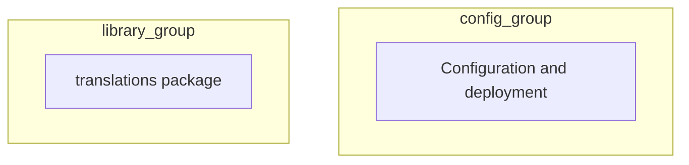

# Architecture report: adam-golab/react-developer-roadmap

> Automated static analysis. **Observed** = directly seen in files/imports/AST; **Inferred** = interpretation from that evidence. Repository code was not executed.

## 1. Repository at a glance

| Item | Value |
| --- | --- |
| Repository | adam-golab/react-developer-roadmap |
| Description | Roadmap to becoming a React developer |
| Language | JavaScript |
| Stars | 18887 |
| Licence | Other |
| Analysed commit / branch | 6f5f7cf24711637e2ad3f9d6b001cfa19e9e7e92 / master |
| Framework(s) | None detected |
| Files analysed | 24 |
| Components | 2 |

## 2. Architecture in one minute

adam-golab/react-developer-roadmap - Roadmap to becoming a React developer. This repository was analysed statically from 24 file(s) (0 Python). Detected technologies (observed from imports/manifests): no known frameworks/libraries. Files are grouped into 2 component(s): Configuration and deployment, translations package. Findings below distinguish observed facts from inferred interpretation.

## 3. High-level block diagram

## 4. Main components

### Configuration and deployment (`config`)

- **Kind:** config
- **Status:** Observed
- **Confidence:** 0.85
- **Responsibility:** Groups 6 file(s) under configuration and deployment (observed from repository paths and static analysis).
- **Paths:** `translations/cn.json`, `translations/es.json`, `translations/ja.json`, `translations/ko.json`, `translations/pt-br.json`, `translations/ru.json`
- **Evidence:** [translations/cn.json](https://github.com/adam-golab/react-developer-roadmap/blob/6f5f7cf24711637e2ad3f9d6b001cfa19e9e7e92/translations/cn.json); [translations/es.json](https://github.com/adam-golab/react-developer-roadmap/blob/6f5f7cf24711637e2ad3f9d6b001cfa19e9e7e92/translations/es.json); [translations/ja.json](https://github.com/adam-golab/react-developer-roadmap/blob/6f5f7cf24711637e2ad3f9d6b001cfa19e9e7e92/translations/ja.json); [translations/ko.json](https://github.com/adam-golab/react-developer-roadmap/blob/6f5f7cf24711637e2ad3f9d6b001cfa19e9e7e92/translations/ko.json); [translations/pt-br.json](https://github.com/adam-golab/react-developer-roadmap/blob/6f5f7cf24711637e2ad3f9d6b001cfa19e9e7e92/translations/pt-br.json); [translations/ru.json](https://github.com/adam-golab/react-developer-roadmap/blob/6f5f7cf24711637e2ad3f9d6b001cfa19e9e7e92/translations/ru.json)

### translations package (`translations`)

- **Kind:** library
- **Status:** Observed
- **Confidence:** 0.85
- **Responsibility:** Groups 1 file(s) under translations package (observed from repository paths and static analysis).
- **Paths:** `translations/translate.js`
- **Evidence:** [translations/translate.js](https://github.com/adam-golab/react-developer-roadmap/blob/6f5f7cf24711637e2ad3f9d6b001cfa19e9e7e92/translations/translate.js)

## 5. Execution flow

No entry point was observed; the startup flow below is therefore limited.

Representative flow (derived from observed entry points and the import graph; steps beyond the entry point are **Inferred**):

1. Execution starts at an observed entry point listed above, if present.
2. No internal import relationships between components were observed.

## 6. Project structure

### `(root)`

- `.gitignore` - other (68 bytes)
- `LICENSE` - docs (19093 bytes)
- `PULL_REQUEST_TEMPLATE.md` - docs (213 bytes)
- `README-CN.md` - docs (8418 bytes)
- `README-ES.md` - docs (8944 bytes)
- `README-JA.md` - docs (9172 bytes)
- `README-KO.md` - docs (9352 bytes)
- `README-PTBR.md` - docs (8776 bytes)
- `README-RU.md` - docs (11805 bytes)
- `README.md` - docs (8488 bytes)

### `src`

- `src/react-developer-roadmap-cn.xml` - other (129882 bytes)
- `src/react-developer-roadmap-es.xml` - other (130072 bytes)
- `src/react-developer-roadmap-ja.xml` - other (130079 bytes)
- `src/react-developer-roadmap-ko.xml` - other (16633 bytes)
- `src/react-developer-roadmap-pt-br.xml` - other (130047 bytes)
- `src/react-developer-roadmap-ru.xml` - other (131159 bytes)
- `src/react-developer-roadmap.xml` - other (129935 bytes)

### `translations`

- `translations/cn.json` - config (2486 bytes)
- `translations/es.json` - config (2813 bytes)
- `translations/ja.json` - config (2481 bytes)
- `translations/ko.json` - config (2823 bytes)
- `translations/pt-br.json` - config (2650 bytes)
- `translations/ru.json` - config (3878 bytes)
- `translations/translate.js` - source, JavaScript (1364 bytes)

## 7. Key dependencies and integrations

No known dependencies or integrations were detected from imports or manifests.

## 8. Data and state

No database, cache, queue, or persistent-state usage was observed in the analysed files. State handling, if any, may be in-memory or in files that were not analysed.

## 9. Configuration and deployment clues

- `translations/cn.json` (config)
- `translations/es.json` (config)
- `translations/ja.json` (config)
- `translations/ko.json` (config)
- `translations/pt-br.json` (config)
- `translations/ru.json` (config)

## 10. Design observations

- No strong design patterns could be established from the available evidence.

These observations are interpretations (**Inferred**) of the observed structure, not guarantees about runtime design.

## 11. Limitations and unknowns

- Static analysis only: repository code was not executed, installed, or imported at runtime.
- Components and relationships are inferred from file paths, imports, and AST structure; runtime behaviour, dynamic imports, and reflection may not be visible.
- No clear application entry point was observed in the analysed files.
- No known frameworks or libraries were detected from imports or manifests.
- Repository text was treated as untrusted data; no instructions found in repository files were followed, and likely secret values were redacted/excluded.
- JavaScript and TypeScript files were inventoried from paths and package manifests. They were not parsed with a full language AST, and repository code was not executed.

## 12. Source references

- [translations/cn.json](https://github.com/adam-golab/react-developer-roadmap/blob/6f5f7cf24711637e2ad3f9d6b001cfa19e9e7e92/translations/cn.json)
- [translations/es.json](https://github.com/adam-golab/react-developer-roadmap/blob/6f5f7cf24711637e2ad3f9d6b001cfa19e9e7e92/translations/es.json)
- [translations/ja.json](https://github.com/adam-golab/react-developer-roadmap/blob/6f5f7cf24711637e2ad3f9d6b001cfa19e9e7e92/translations/ja.json)
- [translations/ko.json](https://github.com/adam-golab/react-developer-roadmap/blob/6f5f7cf24711637e2ad3f9d6b001cfa19e9e7e92/translations/ko.json)
- [translations/pt-br.json](https://github.com/adam-golab/react-developer-roadmap/blob/6f5f7cf24711637e2ad3f9d6b001cfa19e9e7e92/translations/pt-br.json)
- [translations/ru.json](https://github.com/adam-golab/react-developer-roadmap/blob/6f5f7cf24711637e2ad3f9d6b001cfa19e9e7e92/translations/ru.json)
- [translations/translate.js](https://github.com/adam-golab/react-developer-roadmap/blob/6f5f7cf24711637e2ad3f9d6b001cfa19e9e7e92/translations/translate.js)
