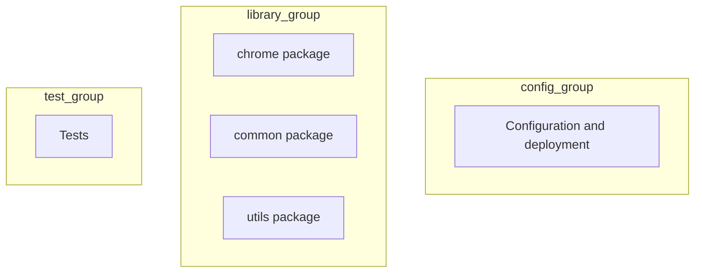

# Architecture report: adam-p/markdown-here

> Automated static analysis. **Observed** = directly seen in files/imports/AST; **Inferred** = interpretation from that evidence. Repository code was not executed.

## 1. Repository at a glance

| Item | Value |
| --- | --- |
| Repository | adam-p/markdown-here |
| Description | Google Chrome, Firefox, and Thunderbird extension that lets you write email in Markdown and render it before sending. |
| Language | JavaScript |
| Stars | 60243 |
| Licence | MIT |
| Analysed commit / branch | e00d005299922198aef968e0cd42b275525c20a6 / master |
| Framework(s) | None detected |
| Files analysed | 379 |
| Components | 5 |

## 2. Architecture in one minute

adam-p/markdown-here - Google Chrome, Firefox, and Thunderbird extension that lets you write email in Markdown and render it before sending.. This repository was analysed statically from 379 file(s) (0 Python). Detected technologies (observed from imports/manifests): no known frameworks/libraries. Files are grouped into 5 component(s): chrome package, common package, Configuration and deployment, Tests, utils package. Findings below distinguish observed facts from inferred interpretation.

## 3. High-level block diagram

## 4. Main components

### chrome package (`chrome`)

- **Kind:** library
- **Status:** Observed
- **Confidence:** 0.85
- **Responsibility:** Groups 3 file(s) under chrome package (observed from repository paths and static analysis).
- **Paths:** `src/chrome/backgroundscript.js`, `src/chrome/contentscript.js`, `src/chrome/upgrade-notification-popup.js`
- **Evidence:** [src/chrome/backgroundscript.js](https://github.com/adam-p/markdown-here/blob/e00d005299922198aef968e0cd42b275525c20a6/src/chrome/backgroundscript.js); [src/chrome/contentscript.js](https://github.com/adam-p/markdown-here/blob/e00d005299922198aef968e0cd42b275525c20a6/src/chrome/contentscript.js); [src/chrome/upgrade-notification-popup.js](https://github.com/adam-p/markdown-here/blob/e00d005299922198aef968e0cd42b275525c20a6/src/chrome/upgrade-notification-popup.js)

### common package (`common`)

- **Kind:** library
- **Status:** Observed
- **Confidence:** 0.85
- **Responsibility:** Groups 11 file(s) under common package (observed from repository paths and static analysis).
- **Paths:** `src/common/common-logic.js`, `src/common/content-permissions.js`, `src/common/jsHtmlToText.js`, `src/common/markdown-here.js`, `src/common/markdown-render.js`, `src/common/marked.js`, `src/common/mdh-html-to-text.js`, `src/common/options-iframe.js`, `src/common/options-store.js`, `src/common/options.js`, `src/common/utils.js`
- **Evidence:** [src/common/common-logic.js](https://github.com/adam-p/markdown-here/blob/e00d005299922198aef968e0cd42b275525c20a6/src/common/common-logic.js); [src/common/content-permissions.js](https://github.com/adam-p/markdown-here/blob/e00d005299922198aef968e0cd42b275525c20a6/src/common/content-permissions.js); [src/common/jsHtmlToText.js](https://github.com/adam-p/markdown-here/blob/e00d005299922198aef968e0cd42b275525c20a6/src/common/jsHtmlToText.js); [src/common/markdown-here.js](https://github.com/adam-p/markdown-here/blob/e00d005299922198aef968e0cd42b275525c20a6/src/common/markdown-here.js); [src/common/markdown-render.js](https://github.com/adam-p/markdown-here/blob/e00d005299922198aef968e0cd42b275525c20a6/src/common/markdown-render.js); [src/common/marked.js](https://github.com/adam-p/markdown-here/blob/e00d005299922198aef968e0cd42b275525c20a6/src/common/marked.js); [src/common/mdh-html-to-text.js](https://github.com/adam-p/markdown-here/blob/e00d005299922198aef968e0cd42b275525c20a6/src/common/mdh-html-to-text.js); [src/common/options-iframe.js](https://github.com/adam-p/markdown-here/blob/e00d005299922198aef968e0cd42b275525c20a6/src/common/options-iframe.js)

### Configuration and deployment (`config`)

- **Kind:** config
- **Status:** Observed
- **Confidence:** 0.85
- **Responsibility:** Groups 16 file(s) under configuration and deployment (observed from repository paths and static analysis).
- **Paths:** `src/_locales/de/messages.json`, `src/_locales/en/messages.json`, `src/_locales/es/messages.json`, `src/_locales/fr/messages.json`, `src/_locales/it/messages.json`, `src/_locales/ja/messages.json`, `src/_locales/ko/messages.json`, `src/_locales/pl/messages.json`, `src/_locales/pt_BR/messages.json`, `src/_locales/ru/messages.json`, `src/_locales/tr/messages.json`, `src/_locales/zh_CN/messages.json`, `src/_locales/zh_TW/messages.json`, `src/common/highlightjs/styles/styles.json`, `src/manifest.json`, `utils/package.json`
- **Evidence:** [src/_locales/de/messages.json](https://github.com/adam-p/markdown-here/blob/e00d005299922198aef968e0cd42b275525c20a6/src/_locales/de/messages.json); [src/_locales/en/messages.json](https://github.com/adam-p/markdown-here/blob/e00d005299922198aef968e0cd42b275525c20a6/src/_locales/en/messages.json); [src/_locales/es/messages.json](https://github.com/adam-p/markdown-here/blob/e00d005299922198aef968e0cd42b275525c20a6/src/_locales/es/messages.json); [src/_locales/fr/messages.json](https://github.com/adam-p/markdown-here/blob/e00d005299922198aef968e0cd42b275525c20a6/src/_locales/fr/messages.json); [src/_locales/it/messages.json](https://github.com/adam-p/markdown-here/blob/e00d005299922198aef968e0cd42b275525c20a6/src/_locales/it/messages.json); [src/_locales/ja/messages.json](https://github.com/adam-p/markdown-here/blob/e00d005299922198aef968e0cd42b275525c20a6/src/_locales/ja/messages.json); [src/_locales/ko/messages.json](https://github.com/adam-p/markdown-here/blob/e00d005299922198aef968e0cd42b275525c20a6/src/_locales/ko/messages.json); [src/_locales/pl/messages.json](https://github.com/adam-p/markdown-here/blob/e00d005299922198aef968e0cd42b275525c20a6/src/_locales/pl/messages.json)

### Tests (`tests`)

- **Kind:** test
- **Status:** Observed
- **Confidence:** 0.85
- **Responsibility:** Groups 14 file(s) under tests (observed from repository paths and static analysis).
- **Paths:** `src/common/test/chai.js`, `src/common/test/common-logic-test.js`, `src/common/test/index.html`, `src/common/test/markdown-here-test.js`, `src/common/test/markdown-render-test.js`, `src/common/test/mdh-html-to-text-test.js`, `src/common/test/mocha.css`, `src/common/test/mocha.js`, `src/common/test/options-store-test.js`, `src/common/test/test-prep.js`, `src/common/test/test-run.js`, `src/common/test/underscore.js`, `src/common/test/utils-test.js`, `test/index.html`
- **Evidence:** [src/common/test/chai.js](https://github.com/adam-p/markdown-here/blob/e00d005299922198aef968e0cd42b275525c20a6/src/common/test/chai.js); [src/common/test/common-logic-test.js](https://github.com/adam-p/markdown-here/blob/e00d005299922198aef968e0cd42b275525c20a6/src/common/test/common-logic-test.js); [src/common/test/index.html](https://github.com/adam-p/markdown-here/blob/e00d005299922198aef968e0cd42b275525c20a6/src/common/test/index.html); [src/common/test/markdown-here-test.js](https://github.com/adam-p/markdown-here/blob/e00d005299922198aef968e0cd42b275525c20a6/src/common/test/markdown-here-test.js); [src/common/test/markdown-render-test.js](https://github.com/adam-p/markdown-here/blob/e00d005299922198aef968e0cd42b275525c20a6/src/common/test/markdown-render-test.js); [src/common/test/mdh-html-to-text-test.js](https://github.com/adam-p/markdown-here/blob/e00d005299922198aef968e0cd42b275525c20a6/src/common/test/mdh-html-to-text-test.js); [src/common/test/mocha.css](https://github.com/adam-p/markdown-here/blob/e00d005299922198aef968e0cd42b275525c20a6/src/common/test/mocha.css); [src/common/test/mocha.js](https://github.com/adam-p/markdown-here/blob/e00d005299922198aef968e0cd42b275525c20a6/src/common/test/mocha.js)

### utils package (`utils`)

- **Kind:** library
- **Status:** Observed
- **Confidence:** 0.85
- **Responsibility:** Groups 1 file(s) under utils package (observed from repository paths and static analysis).
- **Paths:** `utils/build.js`
- **Evidence:** [utils/build.js](https://github.com/adam-p/markdown-here/blob/e00d005299922198aef968e0cd42b275525c20a6/utils/build.js)

## 5. Execution flow

No entry point was observed; the startup flow below is therefore limited.

Representative flow (derived from observed entry points and the import graph; steps beyond the entry point are **Inferred**):

1. Execution starts at an observed entry point listed above, if present.
2. No internal import relationships between components were observed.

## 6. Project structure

### `(root)`

- `.eslintrc.json` - config (6823 bytes)
- `.gitattributes` - other (66 bytes)
- `.gitignore` - other (148 bytes)
- `CHANGES.md` - docs (50 bytes)
- `CLA-entity.md` - docs (8594 bytes)
- `CLA-individual.md` - docs (8161 bytes)
- `CONTRIBUTING.md` - docs (3809 bytes)
- `LICENSE` - docs (1080 bytes)
- `Makefile` - other (252 bytes)
- `PRIVACY.md` - docs (1023 bytes)
- `README.md` - docs (12806 bytes)

### `.github`

- `.github/FUNDING.yml` - config (55 bytes)

### `contributors`

- `contributors/adam-p.md` - docs (311 bytes)
- `contributors/dugite-code.md` - docs (309 bytes)
- `contributors/michaelstepner.md` - docs (323 bytes)
- `contributors/mtlynch.md` - docs (311 bytes)
- `contributors/wm8120.md` - docs (309 bytes)

### `src`

- `src/_locales/de/description.txt` - docs (1991 bytes)
- `src/_locales/de/markdown-here-image2.txt` - docs (256 bytes)
- `src/_locales/de/md-for-screenshot.md.txt` - docs (1154 bytes)
- `src/_locales/de/messages.json` - config (22095 bytes)
- `src/_locales/de/screenshot-captions.txt` - docs (147 bytes)
- `src/_locales/en/messages.json` - config (19949 bytes)
- `src/_locales/es/description.txt` - docs (2066 bytes)
- `src/_locales/es/markdown-here-image2.txt` - docs (289 bytes)
- `src/_locales/es/md-for-screenshot.md.txt` - docs (1136 bytes)
- `src/_locales/es/messages.json` - config (22300 bytes)
- `src/_locales/es/screenshot-captions.txt` - docs (179 bytes)
- `src/_locales/fr/description.txt` - docs (2286 bytes)
- `src/_locales/fr/markdown-here-image2.txt` - docs (296 bytes)
- `src/_locales/fr/md-for-screenshot.md.txt` - docs (1269 bytes)
- `src/_locales/fr/messages.json` - config (22607 bytes)
- `src/_locales/fr/screenshot-captions.txt` - docs (201 bytes)
- `src/_locales/it/description.txt` - docs (1935 bytes)
- `src/_locales/it/markdown-here-image2.txt` - docs (282 bytes)
- `src/_locales/it/md-for-screenshot.md.txt` - docs (1191 bytes)
- `src/_locales/it/messages.json` - config (21396 bytes)
- `src/_locales/it/screenshot-captions.txt` - docs (151 bytes)
- `src/_locales/ja/description.txt` - docs (2557 bytes)
- `src/_locales/ja/markdown-here-image2.txt` - docs (363 bytes)
- `src/_locales/ja/md-for-screenshot.md.txt` - docs (1365 bytes)
- `src/_locales/ja/messages.json` - config (22445 bytes)
- `src/_locales/ja/screenshot-captions.txt` - docs (205 bytes)
- `src/_locales/ko/description.txt` - docs (1912 bytes)
- `src/_locales/ko/markdown-here-image2.txt` - docs (254 bytes)
- `src/_locales/ko/md-for-screenshot.md.txt` - docs (1098 bytes)
- `src/_locales/ko/messages.json` - config (21144 bytes)
- `src/_locales/ko/screenshot-captions.txt` - docs (142 bytes)
- `src/_locales/pl/description.txt` - docs (2282 bytes)
- `src/_locales/pl/markdown-here-image2.txt` - docs (282 bytes)
- `src/_locales/pl/md-for-screenshot.md.txt` - docs (1234 bytes)
- `src/_locales/pl/messages.json` - config (22316 bytes)
- `src/_locales/pl/screenshot-captions.txt` - docs (171 bytes)
- `src/_locales/pt_BR/description.txt` - docs (1959 bytes)
- `src/_locales/pt_BR/markdown-here-image2.txt` - docs (310 bytes)
- `src/_locales/pt_BR/md-for-screenshot.md.txt` - docs (1165 bytes)
- `src/_locales/pt_BR/messages.json` - config (22059 bytes)
- `src/_locales/pt_BR/screenshot-captions.txt` - docs (148 bytes)
- `src/_locales/ru/description.txt` - docs (3208 bytes)
- `src/_locales/ru/markdown-here-image2.txt` - docs (404 bytes)
- `src/_locales/ru/md-for-screenshot.md.txt` - docs (1444 bytes)
- `src/_locales/ru/messages.json` - config (25244 bytes)
- `src/_locales/ru/screenshot-captions.txt` - docs (280 bytes)
- `src/_locales/tr/description.txt` - docs (1963 bytes)
- `src/_locales/tr/markdown-here-image2.txt` - docs (271 bytes)
- `src/_locales/tr/md-for-screenshot.md.txt` - docs (1170 bytes)
- `src/_locales/tr/messages.json` - config (20928 bytes)
- `src/_locales/tr/screenshot-captions.txt` - docs (172 bytes)
- `src/_locales/zh_CN/description.txt` - docs (1852 bytes)
- `src/_locales/zh_CN/markdown-here-image2.txt` - docs (280 bytes)
- `src/_locales/zh_CN/md-for-screenshot.md.txt` - docs (1191 bytes)
- `src/_locales/zh_CN/messages.json` - config (20104 bytes)
- `src/_locales/zh_CN/screenshot-captions.txt` - docs (166 bytes)
- `src/_locales/zh_TW/description.txt` - docs (1720 bytes)
- `src/_locales/zh_TW/markdown-here-image2.txt` - docs (297 bytes)
- `src/_locales/zh_TW/md-for-screenshot.md.txt` - docs (1127 bytes)
- `src/_locales/zh_TW/messages.json` - config (20137 bytes)
- `src/_locales/zh_TW/screenshot-captions.txt` - docs (154 bytes)
- `src/chrome/background.html` - other (654 bytes)
- `src/chrome/backgroundscript.js` - source, JavaScript (9480 bytes)
- `src/chrome/contentscript.js` - source, JavaScript (3145 bytes)
- `src/chrome/upgrade-notification-popup.html` - other (1682 bytes)
- `src/chrome/upgrade-notification-popup.js` - source, JavaScript (1981 bytes)
- `src/common/CHANGES.md` - docs (53106 bytes)
- `src/common/common-logic.js` - source, JavaScript (20031 bytes)
- `src/common/content-permissions.js` - source, JavaScript (1589 bytes)
- `src/common/default.css` - other (4247 bytes)
- `src/common/forgot-to-render-prompt.html` - other (3621 bytes)
- `src/common/highlightjs/styles/1c-light.css` - other (1608 bytes)
- `src/common/highlightjs/styles/a11y-dark.css` - other (1436 bytes)
- `src/common/highlightjs/styles/a11y-light.css` - other (1437 bytes)
- `src/common/highlightjs/styles/agate.css` - other (1744 bytes)
- `src/common/highlightjs/styles/an-old-hope.css` - other (1228 bytes)
- `src/common/highlightjs/styles/androidstudio.css` - other (799 bytes)
- `src/common/highlightjs/styles/arduino-light.css` - other (1068 bytes)
- `src/common/highlightjs/styles/arta.css` - other (865 bytes)
- `src/common/highlightjs/styles/ascetic.css` - other (628 bytes)
- `src/common/highlightjs/styles/atom-one-dark-reasonable.css` - other (1596 bytes)
- `src/common/highlightjs/styles/atom-one-dark.css` - other (1315 bytes)
- `src/common/highlightjs/styles/atom-one-light.css` - other (1318 bytes)
- `src/common/highlightjs/styles/base16/3024.css` - other (4080 bytes)
- `src/common/highlightjs/styles/base16/apathy.css` - other (4087 bytes)
- `src/common/highlightjs/styles/base16/apprentice.css` - other (4059 bytes)
- `src/common/highlightjs/styles/base16/ashes.css` - other (4085 bytes)
- `src/common/highlightjs/styles/base16/atelier-cave-light.css` - other (4110 bytes)
- `src/common/highlightjs/styles/base16/atelier-cave.css` - other (4098 bytes)
- `src/common/highlightjs/styles/base16/atelier-dune-light.css` - other (4110 bytes)
- `src/common/highlightjs/styles/base16/atelier-dune.css` - other (4098 bytes)
- `src/common/highlightjs/styles/base16/atelier-estuary-light.css` - other (4116 bytes)
- `src/common/highlightjs/styles/base16/atelier-estuary.css` - other (4104 bytes)
- `src/common/highlightjs/styles/base16/atelier-forest-light.css` - other (4114 bytes)
- `src/common/highlightjs/styles/base16/atelier-forest.css` - other (4102 bytes)
- `src/common/highlightjs/styles/base16/atelier-heath-light.css` - other (4112 bytes)
- `src/common/highlightjs/styles/base16/atelier-heath.css` - other (4100 bytes)
- `src/common/highlightjs/styles/base16/atelier-lakeside-light.css` - other (4118 bytes)
- `src/common/highlightjs/styles/base16/atelier-lakeside.css` - other (4106 bytes)
- `src/common/highlightjs/styles/base16/atelier-plateau-light.css` - other (4116 bytes)
- `src/common/highlightjs/styles/base16/atelier-plateau.css` - other (4104 bytes)
- `src/common/highlightjs/styles/base16/atelier-savanna-light.css` - other (4116 bytes)
- `src/common/highlightjs/styles/base16/atelier-savanna.css` - other (4104 bytes)
- `src/common/highlightjs/styles/base16/atelier-seaside-light.css` - other (4116 bytes)
- `src/common/highlightjs/styles/base16/atelier-seaside.css` - other (4104 bytes)
- `src/common/highlightjs/styles/base16/atelier-sulphurpool-light.css` - other (4124 bytes)
- `src/common/highlightjs/styles/base16/atelier-sulphurpool.css` - other (4112 bytes)
- `src/common/highlightjs/styles/base16/atlas.css` - other (4074 bytes)
- `src/common/highlightjs/styles/base16/bespin.css` - other (4055 bytes)
- `src/common/highlightjs/styles/base16/black-metal-bathory.css` - other (4112 bytes)
- `src/common/highlightjs/styles/base16/black-metal-burzum.css` - other (4110 bytes)
- `src/common/highlightjs/styles/base16/black-metal-dark-funeral.css` - other (4122 bytes)
- `src/common/highlightjs/styles/base16/black-metal-gorgoroth.css` - other (4116 bytes)
- `src/common/highlightjs/styles/base16/black-metal-immortal.css` - other (4114 bytes)
- `src/common/highlightjs/styles/base16/black-metal-khold.css` - other (4108 bytes)
- `src/common/highlightjs/styles/base16/black-metal-marduk.css` - other (4110 bytes)
- `src/common/highlightjs/styles/base16/black-metal-mayhem.css` - other (4110 bytes)
- `src/common/highlightjs/styles/base16/black-metal-nile.css` - other (4106 bytes)
- `src/common/highlightjs/styles/base16/black-metal-venom.css` - other (4108 bytes)
- `src/common/highlightjs/styles/base16/black-metal.css` - other (4094 bytes)
- `src/common/highlightjs/styles/base16/brewer.css` - other (4088 bytes)
- `src/common/highlightjs/styles/base16/bright.css` - other (4083 bytes)
- `src/common/highlightjs/styles/base16/brogrammer.css` - other (4098 bytes)
- `src/common/highlightjs/styles/base16/brush-trees-dark.css` - other (4106 bytes)
- `src/common/highlightjs/styles/base16/brush-trees.css` - other (4096 bytes)
- `src/common/highlightjs/styles/base16/chalk.css` - other (4081 bytes)
- `src/common/highlightjs/styles/base16/circus.css` - other (4135 bytes)
- `src/common/highlightjs/styles/base16/classic-dark.css` - other (4090 bytes)
- `src/common/highlightjs/styles/base16/classic-light.css` - other (4092 bytes)
- `src/common/highlightjs/styles/base16/codeschool.css` - other (4061 bytes)
- `src/common/highlightjs/styles/base16/colors.css` - other (4066 bytes)
- `src/common/highlightjs/styles/base16/cupcake.css` - other (4085 bytes)
- `src/common/highlightjs/styles/base16/cupertino.css` - other (4058 bytes)
- `src/common/highlightjs/styles/base16/danqing.css` - other (4093 bytes)
- `src/common/highlightjs/styles/base16/darcula.css` - other (4055 bytes)
- `src/common/highlightjs/styles/base16/dark-violet.css` - other (4110 bytes)
- `src/common/highlightjs/styles/base16/darkmoss.css` - other (4092 bytes)
- `src/common/highlightjs/styles/base16/darktooth.css` - other (4093 bytes)
- `src/common/highlightjs/styles/base16/decaf.css` - other (4093 bytes)
- `src/common/highlightjs/styles/base16/default-dark.css` - other (4095 bytes)
- `src/common/highlightjs/styles/base16/default-light.css` - other (4097 bytes)
- `src/common/highlightjs/styles/base16/dirtysea.css` - other (4068 bytes)
- `src/common/highlightjs/styles/base16/dracula.css` - other (4141 bytes)
- `src/common/highlightjs/styles/base16/edge-dark.css` - other (4088 bytes)
- `src/common/highlightjs/styles/base16/edge-light.css` - other (4090 bytes)
- `src/common/highlightjs/styles/base16/eighties.css` - other (4087 bytes)
- `src/common/highlightjs/styles/base16/embers.css` - other (4087 bytes)
- `src/common/highlightjs/styles/base16/equilibrium-dark.css` - other (4076 bytes)
- `src/common/highlightjs/styles/base16/equilibrium-gray-dark.css` - other (4086 bytes)
- `src/common/highlightjs/styles/base16/equilibrium-gray-light.css` - other (4088 bytes)
- `src/common/highlightjs/styles/base16/equilibrium-light.css` - other (4078 bytes)
- `src/common/highlightjs/styles/base16/espresso.css` - other (4122 bytes)
- `src/common/highlightjs/styles/base16/eva-dim.css` - other (4084 bytes)
- `src/common/highlightjs/styles/base16/eva.css` - other (4076 bytes)
- `src/common/highlightjs/styles/base16/flat.css` - other (4079 bytes)
- `src/common/highlightjs/styles/base16/framer.css` - other (4078 bytes)
- `src/common/highlightjs/styles/base16/fruit-soda.css` - other (4057 bytes)
- `src/common/highlightjs/styles/base16/gigavolt.css` - other (4090 bytes)
- `src/common/highlightjs/styles/base16/github.css` - other (4052 bytes)
- `src/common/highlightjs/styles/base16/google-dark.css` - other (4090 bytes)
- `src/common/highlightjs/styles/base16/google-light.css` - other (4092 bytes)
- `src/common/highlightjs/styles/base16/grayscale-dark.css` - other (4106 bytes)
- `src/common/highlightjs/styles/base16/grayscale-light.css` - other (4108 bytes)
- `src/common/highlightjs/styles/base16/green-screen.css` - other (4095 bytes)
- `src/common/highlightjs/styles/base16/gruvbox-dark-hard.css` - other (4144 bytes)
- `src/common/highlightjs/styles/base16/gruvbox-dark-medium.css` - other (4148 bytes)
- `src/common/highlightjs/styles/base16/gruvbox-dark-pale.css` - other (4144 bytes)
- `src/common/highlightjs/styles/base16/gruvbox-dark-soft.css` - other (4144 bytes)
- `src/common/highlightjs/styles/base16/gruvbox-light-hard.css` - other (4146 bytes)
- `src/common/highlightjs/styles/base16/gruvbox-light-medium.css` - other (4150 bytes)
- `src/common/highlightjs/styles/base16/gruvbox-light-soft.css` - other (4146 bytes)
- `src/common/highlightjs/styles/base16/hardcore.css` - other (4060 bytes)
- `src/common/highlightjs/styles/base16/harmonic16-dark.css` - other (4105 bytes)
- `src/common/highlightjs/styles/base16/harmonic16-light.css` - other (4107 bytes)
- `src/common/highlightjs/styles/base16/heetch-dark.css` - other (4087 bytes)
- `src/common/highlightjs/styles/base16/heetch-light.css` - other (4089 bytes)
- `src/common/highlightjs/styles/base16/helios.css` - other (4085 bytes)
- `src/common/highlightjs/styles/base16/hopscotch.css` - other (4061 bytes)
- `src/common/highlightjs/styles/base16/horizon-dark.css` - other (4103 bytes)
- `src/common/highlightjs/styles/base16/horizon-light.css` - other (4105 bytes)
- `src/common/highlightjs/styles/base16/humanoid-dark.css` - other (4079 bytes)
- `src/common/highlightjs/styles/base16/humanoid-light.css` - other (4081 bytes)
- `src/common/highlightjs/styles/base16/ia-dark.css` - other (4080 bytes)
- `src/common/highlightjs/styles/base16/ia-light.css` - other (4082 bytes)
- `src/common/highlightjs/styles/base16/icy-dark.css` - other (4076 bytes)
- `src/common/highlightjs/styles/base16/ir-black.css` - other (4091 bytes)
- `src/common/highlightjs/styles/base16/isotope.css` - other (4057 bytes)
- `src/common/highlightjs/styles/base16/kimber.css` - other (4085 bytes)
- `src/common/highlightjs/styles/base16/london-tube.css` - other (4065 bytes)
- `src/common/highlightjs/styles/base16/macintosh.css` - other (4099 bytes)
- `src/common/highlightjs/styles/base16/marrakesh.css` - other (4095 bytes)
- `src/common/highlightjs/styles/base16/materia.css` - other (4054 bytes)
- `src/common/highlightjs/styles/base16/material-darker.css` - other (4075 bytes)
- `src/common/highlightjs/styles/base16/material-lighter.css` - other (4077 bytes)
- `src/common/highlightjs/styles/base16/material-palenight.css` - other (4081 bytes)
- `src/common/highlightjs/styles/base16/material-vivid.css` - other (4070 bytes)
- `src/common/highlightjs/styles/base16/material.css` - other (4061 bytes)
- `src/common/highlightjs/styles/base16/mellow-purple.css` - other (4063 bytes)
- `src/common/highlightjs/styles/base16/mexico-light.css` - other (4071 bytes)
- `src/common/highlightjs/styles/base16/mocha.css` - other (4081 bytes)
- `src/common/highlightjs/styles/base16/monokai.css` - other (4085 bytes)
- `src/common/highlightjs/styles/base16/nebula.css` - other (4090 bytes)
- `src/common/highlightjs/styles/base16/nord.css` - other (4055 bytes)
- `src/common/highlightjs/styles/base16/nova.css` - other (4126 bytes)
- `src/common/highlightjs/styles/base16/ocean.css` - other (4081 bytes)
- `src/common/highlightjs/styles/base16/oceanicnext.css` - other (4110 bytes)
- `src/common/highlightjs/styles/base16/one-light.css` - other (4097 bytes)
- `src/common/highlightjs/styles/base16/onedark.css` - other (4088 bytes)
- `src/common/highlightjs/styles/base16/outrun-dark.css` - other (4105 bytes)
- `src/common/highlightjs/styles/base16/papercolor-dark.css` - other (4178 bytes)
- `src/common/highlightjs/styles/base16/papercolor-light.css` - other (4180 bytes)
- `src/common/highlightjs/styles/base16/paraiso.css` - other (4057 bytes)
- `src/common/highlightjs/styles/base16/pasque.css` - other (4090 bytes)
- `src/common/highlightjs/styles/base16/phd.css` - other (4083 bytes)
- `src/common/highlightjs/styles/base16/pico.css` - other (4085 bytes)
- `src/common/highlightjs/styles/base16/pop.css` - other (4077 bytes)
- `src/common/highlightjs/styles/base16/porple.css` - other (4093 bytes)
- `src/common/highlightjs/styles/base16/qualia.css` - other (4056 bytes)
- `src/common/highlightjs/styles/base16/railscasts.css` - other (4086 bytes)
- `src/common/highlightjs/styles/base16/rebecca.css` - other (4143 bytes)
- `src/common/highlightjs/styles/base16/ros-pine-dawn.css` - other (4093 bytes)
- `src/common/highlightjs/styles/base16/ros-pine-moon.css` - other (4093 bytes)
- `src/common/highlightjs/styles/base16/ros-pine.css` - other (4083 bytes)
- `src/common/highlightjs/styles/base16/sagelight.css` - other (4067 bytes)
- `src/common/highlightjs/styles/base16/sandcastle.css` - other (4092 bytes)
- `src/common/highlightjs/styles/base16/seti-ui.css` - other (4046 bytes)
- `src/common/highlightjs/styles/base16/shapeshifter.css` - other (4090 bytes)
- `src/common/highlightjs/styles/base16/silk-dark.css` - other (4096 bytes)
- `src/common/highlightjs/styles/base16/silk-light.css` - other (4098 bytes)
- `src/common/highlightjs/styles/base16/snazzy.css` - other (4160 bytes)
- `src/common/highlightjs/styles/base16/solar-flare-light.css` - other (4108 bytes)
- `src/common/highlightjs/styles/base16/solar-flare.css` - other (4096 bytes)
- `src/common/highlightjs/styles/base16/solarized-dark.css` - other (4103 bytes)
- `src/common/highlightjs/styles/base16/solarized-light.css` - other (4105 bytes)
- `src/common/highlightjs/styles/base16/spacemacs.css` - other (4113 bytes)
- `src/common/highlightjs/styles/base16/summercamp.css` - other (4080 bytes)
- `src/common/highlightjs/styles/base16/summerfruit-dark.css` - other (4106 bytes)
- `src/common/highlightjs/styles/base16/summerfruit-light.css` - other (4108 bytes)
- `src/common/highlightjs/styles/base16/synth-midnight-terminal-dark.css` - other (4135 bytes)
- `src/common/highlightjs/styles/base16/synth-midnight-terminal-light.css` - other (4137 bytes)
- `src/common/highlightjs/styles/base16/tango.css` - other (4087 bytes)
- `src/common/highlightjs/styles/base16/tender.css` - other (4102 bytes)
- `src/common/highlightjs/styles/base16/tomorrow-night.css` - other (4099 bytes)
- `src/common/highlightjs/styles/base16/tomorrow.css` - other (4087 bytes)
- `src/common/highlightjs/styles/base16/twilight.css` - other (4087 bytes)
- `src/common/highlightjs/styles/base16/unikitty-dark.css` - other (4084 bytes)
- `src/common/highlightjs/styles/base16/unikitty-light.css` - other (4086 bytes)
- `src/common/highlightjs/styles/base16/vulcan.css` - other (4062 bytes)
- `src/common/highlightjs/styles/base16/windows-10-light.css` - other (4108 bytes)
- `src/common/highlightjs/styles/base16/windows-10.css` - other (4096 bytes)
- `src/common/highlightjs/styles/base16/windows-95-light.css` - other (4108 bytes)
- `src/common/highlightjs/styles/base16/windows-95.css` - other (4096 bytes)
- `src/common/highlightjs/styles/base16/windows-high-contrast-light.css` - other (4130 bytes)
- `src/common/highlightjs/styles/base16/windows-high-contrast.css` - other (4118 bytes)
- `src/common/highlightjs/styles/base16/windows-nt-light.css` - other (4108 bytes)
- `src/common/highlightjs/styles/base16/windows-nt.css` - other (4096 bytes)
- `src/common/highlightjs/styles/base16/woodland.css` - other (4084 bytes)
- `src/common/highlightjs/styles/base16/xcode-dusk.css` - other (4097 bytes)
- `src/common/highlightjs/styles/base16/zenburn.css` - other (4052 bytes)
- `src/common/highlightjs/styles/codepen-embed.css` - other (855 bytes)
- `src/common/highlightjs/styles/color-brewer.css` - other (924 bytes)
- `src/common/highlightjs/styles/cybertopia-cherry.css` - other (1775 bytes)
- `src/common/highlightjs/styles/cybertopia-dimmer.css` - other (1775 bytes)
- `src/common/highlightjs/styles/cybertopia-icecap.css` - other (1775 bytes)
- `src/common/highlightjs/styles/cybertopia-saturated.css` - other (1778 bytes)
- `src/common/highlightjs/styles/dark.css` - other (846 bytes)
- `src/common/highlightjs/styles/default.css` - other (1923 bytes)
- `src/common/highlightjs/styles/devibeans.css` - other (1296 bytes)
- `src/common/highlightjs/styles/docco.css` - other (1132 bytes)
- `src/common/highlightjs/styles/far.css` - other (871 bytes)
- `src/common/highlightjs/styles/felipec.css` - other (1357 bytes)
- `src/common/highlightjs/styles/foundation.css` - other (1125 bytes)
- `src/common/highlightjs/styles/github-dark-dimmed.css` - other (2113 bytes)
- `src/common/highlightjs/styles/github-dark.css` - other (2177 bytes)
- `src/common/highlightjs/styles/github.css` - other (2174 bytes)
- `src/common/highlightjs/styles/gml.css` - other (973 bytes)
- `src/common/highlightjs/styles/googlecode.css` - other (1053 bytes)
- `src/common/highlightjs/styles/gradient-dark.css` - other (1315 bytes)
- `src/common/highlightjs/styles/gradient-light.css` - other (1341 bytes)
- `src/common/highlightjs/styles/grayscale.css` - other (1976 bytes)
- `src/common/highlightjs/styles/hybrid.css` - other (1294 bytes)
- `src/common/highlightjs/styles/idea.css` - other (1188 bytes)
- `src/common/highlightjs/styles/intellij-light.css` - other (1498 bytes)
- `src/common/highlightjs/styles/ir-black.css` - other (895 bytes)
- `src/common/highlightjs/styles/isbl-editor-dark.css` - other (1389 bytes)
- `src/common/highlightjs/styles/isbl-editor-light.css` - other (1378 bytes)
- `src/common/highlightjs/styles/kimbie-dark.css` - other (1076 bytes)
- `src/common/highlightjs/styles/kimbie-light.css` - other (1077 bytes)
- `src/common/highlightjs/styles/lightfair.css` - other (1091 bytes)
- `src/common/highlightjs/styles/lioshi.css` - other (1052 bytes)
- `src/common/highlightjs/styles/magula.css` - other (929 bytes)
- `src/common/highlightjs/styles/mono-blue.css` - other (774 bytes)
- `src/common/highlightjs/styles/monokai-sublime.css` - other (1060 bytes)
- `src/common/highlightjs/styles/monokai.css` - other (997 bytes)
- `src/common/highlightjs/styles/night-owl.css` - other (3140 bytes)
- `src/common/highlightjs/styles/nnfx-dark.css` - other (1620 bytes)
- `src/common/highlightjs/styles/nnfx-light.css` - other (1621 bytes)
- `src/common/highlightjs/styles/nord.css` - other (4004 bytes)
- `src/common/highlightjs/styles/obsidian.css` - other (1112 bytes)
- `src/common/highlightjs/styles/panda-syntax-dark.css` - other (1441 bytes)
- `src/common/highlightjs/styles/panda-syntax-light.css` - other (1402 bytes)
- `src/common/highlightjs/styles/paraiso-dark.css` - other (1023 bytes)
- `src/common/highlightjs/styles/paraiso-light.css` - other (1024 bytes)
- `src/common/highlightjs/styles/purebasic.css` - other (2228 bytes)
- `src/common/highlightjs/styles/qtcreator-dark.css` - other (1012 bytes)
- `src/common/highlightjs/styles/qtcreator-light.css` - other (1011 bytes)
- `src/common/highlightjs/styles/rainbow.css` - other (1022 bytes)
- `src/common/highlightjs/styles/rose-pine-dawn.css` - other (2066 bytes)
- `src/common/highlightjs/styles/rose-pine-moon.css` - other (2128 bytes)
- `src/common/highlightjs/styles/rose-pine.css` - other (2128 bytes)
- `src/common/highlightjs/styles/routeros.css` - other (1220 bytes)
- `src/common/highlightjs/styles/school-book.css` - other (871 bytes)
- `src/common/highlightjs/styles/shades-of-purple.css` - other (1266 bytes)
- `src/common/highlightjs/styles/srcery.css` - other (1374 bytes)
- `src/common/highlightjs/styles/stackoverflow-dark.css` - other (2116 bytes)
- `src/common/highlightjs/styles/stackoverflow-light.css` - other (2118 bytes)
- `src/common/highlightjs/styles/styles.json` - config (11944 bytes)
- `src/common/highlightjs/styles/sunburst.css` - other (1212 bytes)
- `src/common/highlightjs/styles/tokyo-night-dark.css` - other (2318 bytes)
- `src/common/highlightjs/styles/tokyo-night-light.css` - other (2319 bytes)
- `src/common/highlightjs/styles/tomorrow-night-blue.css` - other (1159 bytes)
- `src/common/highlightjs/styles/tomorrow-night-bright.css` - other (1089 bytes)
- `src/common/highlightjs/styles/vs.css` - other (864 bytes)
- `src/common/highlightjs/styles/vs2015.css` - other (1426 bytes)
- `src/common/highlightjs/styles/xcode.css` - other (1230 bytes)
- `src/common/highlightjs/styles/xt256.css` - other (1042 bytes)
- `src/common/images/markdown-here-disabled.svg` - other (669 bytes)
- `src/common/images/markdown-here-monochrome.svg` - other (669 bytes)
- `src/common/images/markdown-here-normal.svg` - other (669 bytes)
- `src/common/jsHtmlToText.js` - source, JavaScript (6677 bytes)
- `src/common/markdown-here.js` - source, JavaScript (22913 bytes)
- `src/common/markdown-render.js` - source, JavaScript (3709 bytes)
- `src/common/marked.js` - source, JavaScript (28732 bytes)
- `src/common/mdh-html-to-text.js` - source, JavaScript (14108 bytes)
- `src/common/options-iframe.html` - other (2358 bytes)
- `src/common/options-iframe.js` - source, JavaScript (606 bytes)
- `src/common/options-store.js` - source, JavaScript (10120 bytes)
- `src/common/options.html` - other (22877 bytes)
- `src/common/options.js` - source, JavaScript (16890 bytes)
- `src/common/test/chai.js` - test, JavaScript (115469 bytes)
- `src/common/test/common-logic-test.js` - test, JavaScript (4845 bytes)
- `src/common/test/index.html` - test (1417 bytes)
- `src/common/test/markdown-here-test.js` - test, JavaScript (4288 bytes)
- `src/common/test/markdown-render-test.js` - test, JavaScript (16383 bytes)
- `src/common/test/mdh-html-to-text-test.js` - test, JavaScript (19106 bytes)
- `src/common/test/mocha.css` - test (3554 bytes)
- `src/common/test/mocha.js` - test, JavaScript (111033 bytes)
- `src/common/test/options-store-test.js` - test, JavaScript (7739 bytes)
- `src/common/test/test-prep.js` - test, JavaScript (142 bytes)
- `src/common/test/test-run.js` - test, JavaScript (384 bytes)
- `src/common/test/underscore.js` - test, JavaScript (41417 bytes)
- `src/common/test/utils-test.js` - test, JavaScript (21169 bytes)
- `src/common/utils.js` - source, JavaScript (21985 bytes)
- `src/manifest.json` - config (1423 bytes)

### `store-assets`

- `store-assets/amo-reviewer-notes.txt` - docs (3119 bytes)
- `store-assets/description.txt` - docs (1729 bytes)
- `store-assets/markdown-here-image2.txt` - docs (255 bytes)
- `store-assets/md-for-screenshot.md.txt` - docs (1099 bytes)
- `store-assets/screenshot-captions.txt` - docs (143 bytes)

### `test`

- `test/index.html` - test (685 bytes)

### `utils`

- `utils/build.js` - source, JavaScript (4488 bytes)
- `utils/package.json` - manifest (166 bytes)

## 7. Key dependencies and integrations

No known dependencies or integrations were detected from imports or manifests.

## 8. Data and state

No database, cache, queue, or persistent-state usage was observed in the analysed files. State handling, if any, may be in-memory or in files that were not analysed.

## 9. Configuration and deployment clues

- `.eslintrc.json` (config)
- `.github/FUNDING.yml` (config)
- `src/_locales/de/messages.json` (config)
- `src/_locales/en/messages.json` (config)
- `src/_locales/es/messages.json` (config)
- `src/_locales/fr/messages.json` (config)
- `src/_locales/it/messages.json` (config)
- `src/_locales/ja/messages.json` (config)
- `src/_locales/ko/messages.json` (config)
- `src/_locales/pl/messages.json` (config)
- `src/_locales/pt_BR/messages.json` (config)
- `src/_locales/ru/messages.json` (config)
- `src/_locales/tr/messages.json` (config)
- `src/_locales/zh_CN/messages.json` (config)
- `src/_locales/zh_TW/messages.json` (config)
- `src/common/highlightjs/styles/styles.json` (config)
- `src/manifest.json` (config)
- `utils/package.json` (manifest)

## 10. Design observations

- Tests are present alongside source code (Observed from test file paths).

These observations are interpretations (**Inferred**) of the observed structure, not guarantees about runtime design.

## 11. Limitations and unknowns

- Static analysis only: repository code was not executed, installed, or imported at runtime.
- Components and relationships are inferred from file paths, imports, and AST structure; runtime behaviour, dynamic imports, and reflection may not be visible.
- 1 file(s) were skipped during inventory (1 x lockfile excluded).
- No clear application entry point was observed in the analysed files.
- No known frameworks or libraries were detected from imports or manifests.
- Repository text was treated as untrusted data; no instructions found in repository files were followed, and likely secret values were redacted/excluded.
- JavaScript and TypeScript files were inventoried from paths and package manifests. They were not parsed with a full language AST, and repository code was not executed.

## 12. Source references

- [src/_locales/de/messages.json](https://github.com/adam-p/markdown-here/blob/e00d005299922198aef968e0cd42b275525c20a6/src/_locales/de/messages.json)
- [src/_locales/en/messages.json](https://github.com/adam-p/markdown-here/blob/e00d005299922198aef968e0cd42b275525c20a6/src/_locales/en/messages.json)
- [src/_locales/es/messages.json](https://github.com/adam-p/markdown-here/blob/e00d005299922198aef968e0cd42b275525c20a6/src/_locales/es/messages.json)
- [src/_locales/fr/messages.json](https://github.com/adam-p/markdown-here/blob/e00d005299922198aef968e0cd42b275525c20a6/src/_locales/fr/messages.json)
- [src/_locales/it/messages.json](https://github.com/adam-p/markdown-here/blob/e00d005299922198aef968e0cd42b275525c20a6/src/_locales/it/messages.json)
- [src/_locales/ja/messages.json](https://github.com/adam-p/markdown-here/blob/e00d005299922198aef968e0cd42b275525c20a6/src/_locales/ja/messages.json)
- [src/_locales/ko/messages.json](https://github.com/adam-p/markdown-here/blob/e00d005299922198aef968e0cd42b275525c20a6/src/_locales/ko/messages.json)
- [src/_locales/pl/messages.json](https://github.com/adam-p/markdown-here/blob/e00d005299922198aef968e0cd42b275525c20a6/src/_locales/pl/messages.json)
- [src/chrome/backgroundscript.js](https://github.com/adam-p/markdown-here/blob/e00d005299922198aef968e0cd42b275525c20a6/src/chrome/backgroundscript.js)
- [src/chrome/contentscript.js](https://github.com/adam-p/markdown-here/blob/e00d005299922198aef968e0cd42b275525c20a6/src/chrome/contentscript.js)
- [src/chrome/upgrade-notification-popup.js](https://github.com/adam-p/markdown-here/blob/e00d005299922198aef968e0cd42b275525c20a6/src/chrome/upgrade-notification-popup.js)
- [src/common/common-logic.js](https://github.com/adam-p/markdown-here/blob/e00d005299922198aef968e0cd42b275525c20a6/src/common/common-logic.js)
- [src/common/content-permissions.js](https://github.com/adam-p/markdown-here/blob/e00d005299922198aef968e0cd42b275525c20a6/src/common/content-permissions.js)
- [src/common/jsHtmlToText.js](https://github.com/adam-p/markdown-here/blob/e00d005299922198aef968e0cd42b275525c20a6/src/common/jsHtmlToText.js)
- [src/common/markdown-here.js](https://github.com/adam-p/markdown-here/blob/e00d005299922198aef968e0cd42b275525c20a6/src/common/markdown-here.js)
- [src/common/markdown-render.js](https://github.com/adam-p/markdown-here/blob/e00d005299922198aef968e0cd42b275525c20a6/src/common/markdown-render.js)
- [src/common/marked.js](https://github.com/adam-p/markdown-here/blob/e00d005299922198aef968e0cd42b275525c20a6/src/common/marked.js)
- [src/common/mdh-html-to-text.js](https://github.com/adam-p/markdown-here/blob/e00d005299922198aef968e0cd42b275525c20a6/src/common/mdh-html-to-text.js)
- [src/common/options-iframe.js](https://github.com/adam-p/markdown-here/blob/e00d005299922198aef968e0cd42b275525c20a6/src/common/options-iframe.js)
- [src/common/test/chai.js](https://github.com/adam-p/markdown-here/blob/e00d005299922198aef968e0cd42b275525c20a6/src/common/test/chai.js)
- [src/common/test/common-logic-test.js](https://github.com/adam-p/markdown-here/blob/e00d005299922198aef968e0cd42b275525c20a6/src/common/test/common-logic-test.js)
- [src/common/test/index.html](https://github.com/adam-p/markdown-here/blob/e00d005299922198aef968e0cd42b275525c20a6/src/common/test/index.html)
- [src/common/test/markdown-here-test.js](https://github.com/adam-p/markdown-here/blob/e00d005299922198aef968e0cd42b275525c20a6/src/common/test/markdown-here-test.js)
- [src/common/test/markdown-render-test.js](https://github.com/adam-p/markdown-here/blob/e00d005299922198aef968e0cd42b275525c20a6/src/common/test/markdown-render-test.js)
- [src/common/test/mdh-html-to-text-test.js](https://github.com/adam-p/markdown-here/blob/e00d005299922198aef968e0cd42b275525c20a6/src/common/test/mdh-html-to-text-test.js)
- [src/common/test/mocha.css](https://github.com/adam-p/markdown-here/blob/e00d005299922198aef968e0cd42b275525c20a6/src/common/test/mocha.css)
- [src/common/test/mocha.js](https://github.com/adam-p/markdown-here/blob/e00d005299922198aef968e0cd42b275525c20a6/src/common/test/mocha.js)
- [utils/build.js](https://github.com/adam-p/markdown-here/blob/e00d005299922198aef968e0cd42b275525c20a6/utils/build.js)
