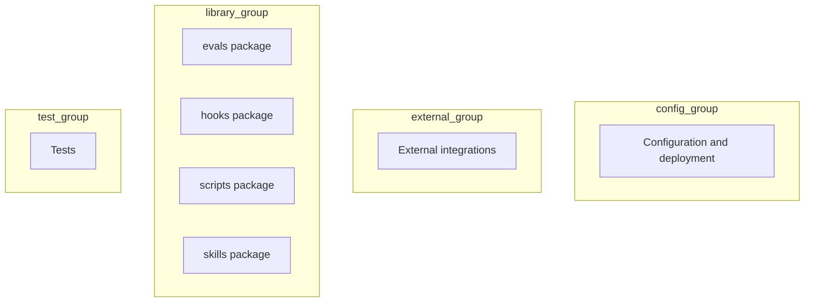

# Architecture report: addyosmani/agent-skills

> Automated static analysis. **Observed** = directly seen in files/imports/AST; **Inferred** = interpretation from that evidence. Repository code was not executed.

## 1. Repository at a glance

| Item | Value |
| --- | --- |
| Repository | addyosmani/agent-skills |
| Description | Production-grade engineering skills for AI coding agents. |
| Language | JavaScript |
| Stars | 117506 |
| Licence | MIT |
| Analysed commit / branch | 39b723ceebf81474d0557c1fecd01eddab585563 / main |
| Framework(s) | None detected |
| Files analysed | 251 |
| Components | 7 |

## 2. Architecture in one minute

addyosmani/agent-skills - Production-grade engineering skills for AI coding agents.. This repository was analysed statically from 251 file(s) (7 Python). Detected technologies (observed from imports/manifests): GitHub Actions, SQLite, unittest. Files are grouped into 7 component(s): Configuration and deployment, evals package, External integrations, hooks package, scripts package, skills package, Tests. Findings below distinguish observed facts from inferred interpretation.

## 3. High-level block diagram

## 4. Main components

### Configuration and deployment (`config`)

- **Kind:** config
- **Status:** Observed
- **Confidence:** 0.85
- **Responsibility:** Groups 37 file(s) under configuration and deployment (observed from repository paths and static analysis).
- **Paths:** `commands/build.toml`, `commands/code-simplify.toml`, `commands/constraints.toml`, `commands/planning.toml`, `commands/review.toml`, `commands/ship.toml`, `commands/spec.toml`, `commands/test.toml`, `commands/webperf.toml`, `evals/cases/api-and-interface-design.json`, `evals/cases/browser-testing-with-devtools.json`, `evals/cases/ci-cd-and-automation.json`, `evals/cases/code-review-and-quality.json`, `evals/cases/code-simplification.json`, `evals/cases/constraint-driven-development.json`, `evals/cases/context-engineering.json`, `evals/cases/debugging-and-error-recovery.json`, `evals/cases/deprecation-and-migration.json`, `evals/cases/documentation-and-adrs.json`, `evals/cases/doubt-driven-development.json`, `evals/cases/frontend-ui-engineering.json`, `evals/cases/git-workflow-and-versioning.json`, `evals/cases/idea-refine.json`, `evals/cases/incremental-implementation.json`, `evals/cases/interview-me.json`, `evals/cases/observability-and-instrumentation.json`, `evals/cases/performance-optimization.json`, `evals/cases/planning-and-task-breakdown.json`, `evals/cases/security-and-hardening.json`, `evals/cases/shipping-and-launch.json`, `evals/cases/source-driven-development.json`, `evals/cases/spec-driven-development.json`, `evals/cases/test-driven-development.json`, `evals/cases/using-agent-skills.json`, `evals/fixtures/ci-cd-and-automation/package.json`, `evals/fixtures/test-driven-development/package.json`, `plugin.json`
- **Evidence:** [commands/build.toml](https://github.com/addyosmani/agent-skills/blob/39b723ceebf81474d0557c1fecd01eddab585563/commands/build.toml); [commands/code-simplify.toml](https://github.com/addyosmani/agent-skills/blob/39b723ceebf81474d0557c1fecd01eddab585563/commands/code-simplify.toml); [commands/constraints.toml](https://github.com/addyosmani/agent-skills/blob/39b723ceebf81474d0557c1fecd01eddab585563/commands/constraints.toml); [commands/planning.toml](https://github.com/addyosmani/agent-skills/blob/39b723ceebf81474d0557c1fecd01eddab585563/commands/planning.toml); [commands/review.toml](https://github.com/addyosmani/agent-skills/blob/39b723ceebf81474d0557c1fecd01eddab585563/commands/review.toml); [commands/ship.toml](https://github.com/addyosmani/agent-skills/blob/39b723ceebf81474d0557c1fecd01eddab585563/commands/ship.toml); [commands/spec.toml](https://github.com/addyosmani/agent-skills/blob/39b723ceebf81474d0557c1fecd01eddab585563/commands/spec.toml); [commands/test.toml](https://github.com/addyosmani/agent-skills/blob/39b723ceebf81474d0557c1fecd01eddab585563/commands/test.toml)

### evals package (`evals`)

- **Kind:** library
- **Status:** Observed
- **Confidence:** 0.85
- **Responsibility:** Groups 25 file(s) under evals package (observed from repository paths and static analysis). Observed top-level functions: allowed, apply_entries, fee, initialize, lookup, replace_secret.
- **Paths:** `evals/fixtures/browser-testing-with-devtools/server.js`, `evals/fixtures/ci-cd-and-automation/src/slug.js`, `evals/fixtures/code-simplification/config-parser.js`, `evals/fixtures/code-simplification/config-parser.test.js`, `evals/fixtures/debugging-and-error-recovery/pagination.js`, `evals/fixtures/debugging-and-error-recovery/pagination.test.js`, `evals/fixtures/documentation-and-adrs/prose-review/queue.js`, `evals/fixtures/documentation-and-adrs/rate-limiter.js`, `evals/fixtures/frontend-ui-engineering/Button.tsx`, `evals/fixtures/git-workflow-and-versioning/app.js`, `evals/fixtures/git-workflow-and-versioning/app.test.js`, `evals/fixtures/incremental-implementation-pressure/draft-export.js`, `evals/fixtures/incremental-implementation/reports.js`, `evals/fixtures/incremental-implementation/reports.test.js`, `evals/fixtures/observability-and-instrumentation/payment-retry.js`, `evals/fixtures/performance-optimization/benchmark.js`, `evals/fixtures/performance-optimization/products.js`, `evals/fixtures/review-evidence/after.py`, `evals/fixtures/review-evidence/before.py`, `evals/fixtures/review-evidence/clean.py`, `evals/fixtures/security-and-hardening/webhook.js`, `evals/fixtures/security-and-hardening/webhook.test.js`, `evals/fixtures/test-driven-development-ecosystem/ledger.py`, `evals/fixtures/test-driven-development-persistence/vault.py`, `evals/fixtures/test-driven-development/src/split.js`
- **Evidence:** [evals/fixtures/browser-testing-with-devtools/server.js](https://github.com/addyosmani/agent-skills/blob/39b723ceebf81474d0557c1fecd01eddab585563/evals/fixtures/browser-testing-with-devtools/server.js); [evals/fixtures/ci-cd-and-automation/src/slug.js](https://github.com/addyosmani/agent-skills/blob/39b723ceebf81474d0557c1fecd01eddab585563/evals/fixtures/ci-cd-and-automation/src/slug.js); [evals/fixtures/code-simplification/config-parser.js](https://github.com/addyosmani/agent-skills/blob/39b723ceebf81474d0557c1fecd01eddab585563/evals/fixtures/code-simplification/config-parser.js); [evals/fixtures/code-simplification/config-parser.test.js](https://github.com/addyosmani/agent-skills/blob/39b723ceebf81474d0557c1fecd01eddab585563/evals/fixtures/code-simplification/config-parser.test.js); [evals/fixtures/debugging-and-error-recovery/pagination.js](https://github.com/addyosmani/agent-skills/blob/39b723ceebf81474d0557c1fecd01eddab585563/evals/fixtures/debugging-and-error-recovery/pagination.js); [evals/fixtures/debugging-and-error-recovery/pagination.test.js](https://github.com/addyosmani/agent-skills/blob/39b723ceebf81474d0557c1fecd01eddab585563/evals/fixtures/debugging-and-error-recovery/pagination.test.js); [evals/fixtures/documentation-and-adrs/prose-review/queue.js](https://github.com/addyosmani/agent-skills/blob/39b723ceebf81474d0557c1fecd01eddab585563/evals/fixtures/documentation-and-adrs/prose-review/queue.js); [evals/fixtures/documentation-and-adrs/rate-limiter.js](https://github.com/addyosmani/agent-skills/blob/39b723ceebf81474d0557c1fecd01eddab585563/evals/fixtures/documentation-and-adrs/rate-limiter.js)

### External integrations (`external_integrations`)

- **Kind:** external
- **Status:** Inferred
- **Confidence:** 0.70
- **Responsibility:** Groups 0 file(s) under external integrations (observed from repository paths and static analysis).
- **Evidence:** [evals/fixtures/test-driven-development-persistence/vault.py:1](https://github.com/addyosmani/agent-skills/blob/39b723ceebf81474d0557c1fecd01eddab585563/evals/fixtures/test-driven-development-persistence/vault.py#L1)

### hooks package (`hooks`)

- **Kind:** library
- **Status:** Observed
- **Confidence:** 0.85
- **Responsibility:** Groups 7 file(s) under hooks package (observed from repository paths and static analysis).
- **Paths:** `hooks/sdd-cache-post.sh`, `hooks/sdd-cache-pre.sh`, `hooks/sdd-cache-test.sh`, `hooks/session-start-test.sh`, `hooks/session-start.sh`, `hooks/simplify-ignore-test.sh`, `hooks/simplify-ignore.sh`
- **Evidence:** [hooks/sdd-cache-post.sh](https://github.com/addyosmani/agent-skills/blob/39b723ceebf81474d0557c1fecd01eddab585563/hooks/sdd-cache-post.sh); [hooks/sdd-cache-pre.sh](https://github.com/addyosmani/agent-skills/blob/39b723ceebf81474d0557c1fecd01eddab585563/hooks/sdd-cache-pre.sh); [hooks/sdd-cache-test.sh](https://github.com/addyosmani/agent-skills/blob/39b723ceebf81474d0557c1fecd01eddab585563/hooks/sdd-cache-test.sh); [hooks/session-start-test.sh](https://github.com/addyosmani/agent-skills/blob/39b723ceebf81474d0557c1fecd01eddab585563/hooks/session-start-test.sh); [hooks/session-start.sh](https://github.com/addyosmani/agent-skills/blob/39b723ceebf81474d0557c1fecd01eddab585563/hooks/session-start.sh); [hooks/simplify-ignore-test.sh](https://github.com/addyosmani/agent-skills/blob/39b723ceebf81474d0557c1fecd01eddab585563/hooks/simplify-ignore-test.sh); [hooks/simplify-ignore.sh](https://github.com/addyosmani/agent-skills/blob/39b723ceebf81474d0557c1fecd01eddab585563/hooks/simplify-ignore.sh)

### scripts package (`scripts`)

- **Kind:** library
- **Status:** Observed
- **Confidence:** 0.85
- **Responsibility:** Groups 18 file(s) under scripts package (observed from repository paths and static analysis).
- **Paths:** `scripts/floor-guard-reference-test.js`, `scripts/lib/execution-status.js`, `scripts/lib/skill-lint-test.js`, `scripts/lib/skill-lint.js`, `scripts/lib/skill-resources.js`, `scripts/quality-gate-test.js`, `scripts/run-evals-test.js`, `scripts/run-evals.js`, `scripts/staged-secret-scan-test.js`, `scripts/validate-artifact-paths-test.js`, `scripts/validate-artifact-paths.js`, `scripts/validate-commands-test.js`, `scripts/validate-commands.js`, `scripts/validate-reference-links-test.js`, `scripts/validate-reference-links.js`, `scripts/validate-skills.js`, `scripts/validate-versions-test.js`, `scripts/validate-versions.js`
- **Evidence:** [scripts/floor-guard-reference-test.js](https://github.com/addyosmani/agent-skills/blob/39b723ceebf81474d0557c1fecd01eddab585563/scripts/floor-guard-reference-test.js); [scripts/lib/execution-status.js](https://github.com/addyosmani/agent-skills/blob/39b723ceebf81474d0557c1fecd01eddab585563/scripts/lib/execution-status.js); [scripts/lib/skill-lint-test.js](https://github.com/addyosmani/agent-skills/blob/39b723ceebf81474d0557c1fecd01eddab585563/scripts/lib/skill-lint-test.js); [scripts/lib/skill-lint.js](https://github.com/addyosmani/agent-skills/blob/39b723ceebf81474d0557c1fecd01eddab585563/scripts/lib/skill-lint.js); [scripts/lib/skill-resources.js](https://github.com/addyosmani/agent-skills/blob/39b723ceebf81474d0557c1fecd01eddab585563/scripts/lib/skill-resources.js); [scripts/quality-gate-test.js](https://github.com/addyosmani/agent-skills/blob/39b723ceebf81474d0557c1fecd01eddab585563/scripts/quality-gate-test.js); [scripts/run-evals-test.js](https://github.com/addyosmani/agent-skills/blob/39b723ceebf81474d0557c1fecd01eddab585563/scripts/run-evals-test.js); [scripts/run-evals.js](https://github.com/addyosmani/agent-skills/blob/39b723ceebf81474d0557c1fecd01eddab585563/scripts/run-evals.js)

### skills package (`skills`)

- **Kind:** library
- **Status:** Observed
- **Confidence:** 0.85
- **Responsibility:** Groups 2 file(s) under skills package (observed from repository paths and static analysis).
- **Paths:** `skills/constraint-driven-development/scripts/quality-gate.mjs`, `skills/idea-refine/scripts/idea-refine.sh`
- **Evidence:** [skills/constraint-driven-development/scripts/quality-gate.mjs](https://github.com/addyosmani/agent-skills/blob/39b723ceebf81474d0557c1fecd01eddab585563/skills/constraint-driven-development/scripts/quality-gate.mjs); [skills/idea-refine/scripts/idea-refine.sh](https://github.com/addyosmani/agent-skills/blob/39b723ceebf81474d0557c1fecd01eddab585563/skills/idea-refine/scripts/idea-refine.sh)

### Tests (`tests`)

- **Kind:** test
- **Status:** Observed
- **Confidence:** 0.85
- **Responsibility:** Groups 4 file(s) under tests (observed from repository paths and static analysis). Observed top-level classes: ApplyEntriesTest, ReplaceSecretTest.
- **Paths:** `evals/fixtures/ci-cd-and-automation/test/slug.test.js`, `evals/fixtures/test-driven-development-ecosystem/test_ledger.py`, `evals/fixtures/test-driven-development-persistence/test_vault.py`, `evals/fixtures/test-driven-development/test/split.test.js`
- **Evidence:** [evals/fixtures/ci-cd-and-automation/test/slug.test.js](https://github.com/addyosmani/agent-skills/blob/39b723ceebf81474d0557c1fecd01eddab585563/evals/fixtures/ci-cd-and-automation/test/slug.test.js); [evals/fixtures/test-driven-development-ecosystem/test_ledger.py:6](https://github.com/addyosmani/agent-skills/blob/39b723ceebf81474d0557c1fecd01eddab585563/evals/fixtures/test-driven-development-ecosystem/test_ledger.py#L6); [evals/fixtures/test-driven-development-persistence/test_vault.py:8](https://github.com/addyosmani/agent-skills/blob/39b723ceebf81474d0557c1fecd01eddab585563/evals/fixtures/test-driven-development-persistence/test_vault.py#L8); [evals/fixtures/test-driven-development/test/split.test.js](https://github.com/addyosmani/agent-skills/blob/39b723ceebf81474d0557c1fecd01eddab585563/evals/fixtures/test-driven-development/test/split.test.js)

## 5. Execution flow

**Observed** entry point(s):

- [evals/fixtures/browser-testing-with-devtools/server.js](https://github.com/addyosmani/agent-skills/blob/39b723ceebf81474d0557c1fecd01eddab585563/evals/fixtures/browser-testing-with-devtools/server.js)
- [evals/fixtures/git-workflow-and-versioning/app.js](https://github.com/addyosmani/agent-skills/blob/39b723ceebf81474d0557c1fecd01eddab585563/evals/fixtures/git-workflow-and-versioning/app.js)

Representative flow (derived from observed entry points and the import graph; steps beyond the entry point are **Inferred**):

1. Execution starts at an observed entry point listed above, if present.
2. No internal import relationships between components were observed.

## 6. Project structure

### `(root)`

- `.gitattributes` - other (19 bytes)
- `.gitignore` - other (143 bytes)
- `AGENTS.md` - docs (5386 bytes)
- `CLAUDE.md` - docs (4094 bytes)
- `CONTRIBUTING.md` - docs (9404 bytes)
- `LICENSE` - docs (1068 bytes)
- `README.md` - docs (25930 bytes)
- `plugin.json` - config (547 bytes)

### `.agents`

- `.agents/plugins/marketplace.json` - config (536 bytes)

### `.claude`

- `.claude/commands/build.md` - docs (4799 bytes)
- `.claude/commands/code-simplify.md` - docs (1099 bytes)
- `.claude/commands/constraints.md` - docs (2793 bytes)
- `.claude/commands/plan.md` - docs (836 bytes)
- `.claude/commands/review.md` - docs (879 bytes)
- `.claude/commands/ship.md` - docs (4631 bytes)
- `.claude/commands/spec.md` - docs (1389 bytes)
- `.claude/commands/test.md` - docs (696 bytes)
- `.claude/commands/webperf.md` - docs (2005 bytes)
- `.claude/rules/skills-contributing.md` - docs (988 bytes)

### `.claude-plugin`

- `.claude-plugin/marketplace.json` - config (857 bytes)
- `.claude-plugin/plugin.json` - config (517 bytes)

### `.codex-plugin`

- `.codex-plugin/plugin.json` - config (1120 bytes)

### `.gemini`

- `.gemini/commands/build.toml` - config (4637 bytes)
- `.gemini/commands/code-simplify.toml` - config (1066 bytes)
- `.gemini/commands/constraints.toml` - config (2775 bytes)
- `.gemini/commands/planning.toml` - config (804 bytes)
- `.gemini/commands/review.toml` - config (846 bytes)
- `.gemini/commands/ship.toml` - config (4779 bytes)
- `.gemini/commands/spec.toml` - config (1348 bytes)
- `.gemini/commands/test.toml` - config (650 bytes)
- `.gemini/commands/webperf.toml` - config (1884 bytes)

### `.github`

- `.github/ISSUE_TEMPLATE/skill-gap.yml` - config (2669 bytes)
- `.github/workflows/test-plugin-install.yml` - ci, YAML (5885 bytes)

### `agents`

- `agents/code-reviewer.md` - docs (4058 bytes)
- `agents/security-auditor.md` - docs (4992 bytes)
- `agents/test-engineer.md` - docs (3351 bytes)
- `agents/web-performance-auditor.md` - docs (12278 bytes)

### `commands`

- `commands/build.toml` - config (4637 bytes)
- `commands/code-simplify.toml` - config (1066 bytes)
- `commands/constraints.toml` - config (2775 bytes)
- `commands/planning.toml` - config (804 bytes)
- `commands/review.toml` - config (846 bytes)
- `commands/ship.toml` - config (4711 bytes)
- `commands/spec.toml` - config (1348 bytes)
- `commands/test.toml` - config (650 bytes)
- `commands/webperf.toml` - config (2031 bytes)

### `docs`

- `docs/adoption-guide.md` - docs (11566 bytes)
- `docs/advanced-per-agent-configuration.md` - docs (7110 bytes)
- `docs/agents.md` - docs (7164 bytes)
- `docs/antigravity-setup.md` - docs (6893 bytes)
- `docs/codex-setup.md` - docs (2447 bytes)
- `docs/commandcode-setup.md` - docs (2437 bytes)
- `docs/comparison.md` - docs (15362 bytes)
- `docs/copilot-cli-setup.md` - docs (3819 bytes)
- `docs/copilot-setup.md` - docs (11478 bytes)
- `docs/cursor-setup.md` - docs (9061 bytes)
- `docs/developer-onboarding.md` - docs (9948 bytes)
- `docs/gemini-cli-setup.md` - docs (5915 bytes)
- `docs/getting-started.md` - docs (11199 bytes)
- `docs/opencode-setup.md` - docs (9547 bytes)
- `docs/other-hosts.md` - docs (934 bytes)
- `docs/skill-anatomy.md` - docs (11244 bytes)
- `docs/windsurf-setup.md` - docs (1479 bytes)

### `evals`

- `evals/README.md` - docs (23843 bytes)
- `evals/cases/api-and-interface-design.json` - config (1494 bytes)
- `evals/cases/browser-testing-with-devtools.json` - config (1455 bytes)
- `evals/cases/ci-cd-and-automation.json` - config (1349 bytes)
- `evals/cases/code-review-and-quality.json` - config (4714 bytes)
- `evals/cases/code-simplification.json` - config (1627 bytes)
- `evals/cases/constraint-driven-development.json` - config (3353 bytes)
- `evals/cases/context-engineering.json` - config (2487 bytes)
- `evals/cases/debugging-and-error-recovery.json` - config (2489 bytes)
- `evals/cases/deprecation-and-migration.json` - config (1502 bytes)
- `evals/cases/documentation-and-adrs.json` - config (5787 bytes)
- `evals/cases/doubt-driven-development.json` - config (1322 bytes)
- `evals/cases/frontend-ui-engineering.json` - config (1478 bytes)
- `evals/cases/git-workflow-and-versioning.json` - config (1635 bytes)
- `evals/cases/idea-refine.json` - config (1269 bytes)
- `evals/cases/incremental-implementation.json` - config (1942 bytes)
- `evals/cases/interview-me.json` - config (1197 bytes)
- `evals/cases/observability-and-instrumentation.json` - config (1278 bytes)
- `evals/cases/performance-optimization.json` - config (1688 bytes)
- `evals/cases/planning-and-task-breakdown.json` - config (1276 bytes)
- `evals/cases/security-and-hardening.json` - config (1651 bytes)
- `evals/cases/shipping-and-launch.json` - config (1816 bytes)
- `evals/cases/source-driven-development.json` - config (1287 bytes)
- `evals/cases/spec-driven-development.json` - config (2964 bytes)
- `evals/cases/test-driven-development.json` - config (5621 bytes)
- `evals/cases/using-agent-skills.json` - config (1262 bytes)
- `evals/fixtures/api-and-interface-design/service-brief.md` - docs (693 bytes)
- `evals/fixtures/browser-testing-with-devtools/README.md` - docs (186 bytes)
- `evals/fixtures/browser-testing-with-devtools/index.html` - other (869 bytes)
- `evals/fixtures/browser-testing-with-devtools/server.js` - source, JavaScript (511 bytes)
- `evals/fixtures/ci-cd-and-automation/package.json` - manifest (132 bytes)
- `evals/fixtures/ci-cd-and-automation/src/slug.js` - source, JavaScript (93 bytes)
- `evals/fixtures/ci-cd-and-automation/test/slug.test.js` - test, JavaScript (234 bytes)
- `evals/fixtures/code-review-and-quality/user-search.diff` - other (513 bytes)
- `evals/fixtures/code-simplification/config-parser.js` - source, JavaScript (1592 bytes)
- `evals/fixtures/code-simplification/config-parser.test.js` - source, JavaScript (452 bytes)
- `evals/fixtures/context-budget/budget-notes.md` - docs (759 bytes)
- `evals/fixtures/context-engineering/context-audit.md` - docs (653 bytes)
- `evals/fixtures/debugging-and-error-recovery/pagination.js` - source, JavaScript (172 bytes)
- `evals/fixtures/debugging-and-error-recovery/pagination.test.js` - source, JavaScript (290 bytes)
- `evals/fixtures/debugging-and-error-recovery/time-pressure.md` - docs (276 bytes)
- `evals/fixtures/deprecation-and-migration/api-inventory.md` - docs (504 bytes)
- `evals/fixtures/documentation-and-adrs/decision-context.md` - docs (757 bytes)
- `evals/fixtures/documentation-and-adrs/prose-review/README.md` - docs (663 bytes)
- `evals/fixtures/documentation-and-adrs/prose-review/queue.js` - source, JavaScript (838 bytes)
- `evals/fixtures/documentation-and-adrs/rate-limiter.js` - source, JavaScript (724 bytes)
- `evals/fixtures/documentation-and-adrs/rate-limiter.md` - docs (1156 bytes)
- `evals/fixtures/doubt-driven-development/migration-plan.md` - docs (672 bytes)
- `evals/fixtures/frontend-ui-engineering/Button.tsx` - source, TypeScript (306 bytes)
- `evals/fixtures/frontend-ui-engineering/design-system.md` - docs (530 bytes)
- `evals/fixtures/git-workflow-and-versioning/.eval/working-tree.patch` - other (571 bytes)
- `evals/fixtures/git-workflow-and-versioning/app.js` - source, JavaScript (129 bytes)
- `evals/fixtures/git-workflow-and-versioning/app.test.js` - source, JavaScript (228 bytes)
- `evals/fixtures/incremental-implementation-pressure/draft-export.js` - source, JavaScript (552 bytes)
- `evals/fixtures/incremental-implementation-pressure/scenario.md` - docs (419 bytes)
- `evals/fixtures/incremental-implementation/reports.js` - source, JavaScript (145 bytes)
- `evals/fixtures/incremental-implementation/reports.test.js` - source, JavaScript (325 bytes)
- `evals/fixtures/incremental-implementation/tasks/plan.md` - docs (311 bytes)
- `evals/fixtures/observability-and-instrumentation/operations.md` - docs (422 bytes)
- `evals/fixtures/observability-and-instrumentation/payment-retry.js` - source, JavaScript (339 bytes)
- `evals/fixtures/performance-optimization/benchmark.js` - source, JavaScript (464 bytes)
- `evals/fixtures/performance-optimization/products.js` - source, JavaScript (393 bytes)
- `evals/fixtures/planning-and-task-breakdown/notifications-spec.md` - docs (854 bytes)
- `evals/fixtures/review-evidence/CONTRACT.md` - docs (430 bytes)
- `evals/fixtures/review-evidence/after.py` - source, Python (524 bytes)
- `evals/fixtures/review-evidence/before.py` - source, Python (454 bytes)
- `evals/fixtures/review-evidence/clean.py` - source, Python (465 bytes)
- `evals/fixtures/security-and-hardening/webhook.js` - source, JavaScript (271 bytes)
- `evals/fixtures/security-and-hardening/webhook.test.js` - source, JavaScript (414 bytes)
- `evals/fixtures/shipping-and-launch/authority-pressure.md` - docs (288 bytes)
- `evals/fixtures/shipping-and-launch/launch-status.md` - docs (554 bytes)
- `evals/fixtures/source-driven-development/framework-task.md` - docs (535 bytes)
- `evals/fixtures/spec-driven-development-decomposition/portal-brief.md` - docs (1067 bytes)
- `evals/fixtures/spec-driven-development/billing-brief.md` - docs (689 bytes)
- `evals/fixtures/test-driven-development-ecosystem/README.md` - docs (131 bytes)
- `evals/fixtures/test-driven-development-ecosystem/ledger.py` - source, Python (457 bytes)
- `evals/fixtures/test-driven-development-ecosystem/test_ledger.py` - test, Python (533 bytes)
- `evals/fixtures/test-driven-development-persistence/BUG.md` - docs (509 bytes)
- `evals/fixtures/test-driven-development-persistence/README.md` - docs (533 bytes)
- `evals/fixtures/test-driven-development-persistence/test_vault.py` - test, Python (941 bytes)
- `evals/fixtures/test-driven-development-persistence/vault.py` - source, Python (1143 bytes)
- `evals/fixtures/test-driven-development/BUG.md` - docs (394 bytes)
- `evals/fixtures/test-driven-development/README.md` - docs (787 bytes)
- `evals/fixtures/test-driven-development/package.json` - manifest (189 bytes)
- `evals/fixtures/test-driven-development/src/split.js` - source, JavaScript (181 bytes)
- `evals/fixtures/test-driven-development/test/split.test.js` - test, JavaScript (398 bytes)
- `evals/fixtures/using-agent-skills/incident.md` - docs (321 bytes)
- `evals/plugin/code-review-fires-on-plain-request/graders/skill-fired.md` - docs (103 bytes)
- `evals/plugin/code-review-fires-on-plain-request/prompt.md` - docs (1079 bytes)
- `evals/plugin/code-review-fires/graders/off-by-one.md` - docs (455 bytes)
- `evals/plugin/code-review-fires/graders/severity-labels.md` - docs (142 bytes)
- `evals/plugin/code-review-fires/graders/skill-fired.md` - docs (103 bytes)
- `evals/plugin/code-review-fires/prompt.md` - docs (1240 bytes)
- `evals/plugin/code-review-stays-quiet-on-commit-message/graders/not-fired.md` - docs (127 bytes)
- `evals/plugin/code-review-stays-quiet-on-commit-message/prompt.md` - docs (914 bytes)
- `evals/plugin/code-review-stays-quiet/graders/not-fired.md` - docs (127 bytes)
- `evals/plugin/code-review-stays-quiet/graders/tdd-fired.md` - docs (118 bytes)
- `evals/plugin/code-review-stays-quiet/prompt.md` - docs (389 bytes)
- `evals/plugin/debugging-fires-on-pasted-diff/graders/diagnosis-and-regression-guard.md` - docs (984 bytes)
- `evals/plugin/debugging-fires-on-pasted-diff/graders/skill-fired.md` - docs (108 bytes)
- `evals/plugin/debugging-fires-on-pasted-diff/prompt.md` - docs (1116 bytes)
- `evals/plugin/debugging-stays-quiet-on-review/graders/not-fired.md` - docs (132 bytes)
- `evals/plugin/debugging-stays-quiet-on-review/prompt.md` - docs (933 bytes)
- `evals/plugin/gitflow-fires-on-commit-message/graders/skill-fired.md` - docs (107 bytes)
- `evals/plugin/gitflow-fires-on-commit-message/graders/typed-why-and-split.md` - docs (820 bytes)
- `evals/plugin/gitflow-fires-on-commit-message/prompt.md` - docs (1866 bytes)
- `evals/plugin/gitflow-stays-quiet-on-what-broke/graders/not-fired.md` - docs (131 bytes)
- `evals/plugin/gitflow-stays-quiet-on-what-broke/prompt.md` - docs (1042 bytes)
- `evals/plugin/simplify-fires-on-pasted-function/graders/behavior-kept-and-explained.md` - docs (1220 bytes)
- `evals/plugin/simplify-fires-on-pasted-function/graders/skill-fired.md` - docs (99 bytes)
- `evals/plugin/simplify-fires-on-pasted-function/prompt.md` - docs (1206 bytes)
- `evals/plugin/simplify-stays-quiet-on-make-it-fast/graders/not-fired.md` - docs (123 bytes)
- `evals/plugin/simplify-stays-quiet-on-make-it-fast/prompt.md` - docs (738 bytes)
- `evals/plugin/tdd-fires-on-pasted-bug/graders/failing-test-first.md` - docs (418 bytes)
- `evals/plugin/tdd-fires-on-pasted-bug/graders/skill-fired.md` - docs (103 bytes)
- `evals/plugin/tdd-fires-on-pasted-bug/prompt.md` - docs (639 bytes)
- `evals/plugin/tdd-stays-quiet-on-debug/graders/not-fired.md` - docs (127 bytes)
- `evals/plugin/tdd-stays-quiet-on-debug/prompt.md` - docs (1034 bytes)
- `evals/plugin/tdd-stays-quiet-on-refactor/graders/not-fired.md` - docs (127 bytes)
- `evals/plugin/tdd-stays-quiet-on-refactor/prompt.md` - docs (914 bytes)
- `evals/skill-impact.md` - docs (400 bytes)

### `hooks`

- `hooks/SDD-CACHE.md` - docs (8397 bytes)
- `hooks/SIMPLIFY-IGNORE.md` - docs (4990 bytes)
- `hooks/sdd-cache-post.sh` - source, Shell (4567 bytes)
- `hooks/sdd-cache-pre.sh` - source, Shell (4261 bytes)
- `hooks/sdd-cache-test.sh` - source, Shell (11298 bytes)
- `hooks/session-start-test.sh` - source, Shell (1436 bytes)
- `hooks/session-start.sh` - source, Shell (1675 bytes)
- `hooks/simplify-ignore-test.sh` - source, Shell (26190 bytes)
- `hooks/simplify-ignore.sh` - source, Shell (19828 bytes)

### `references`

- `references/accessibility-checklist.md` - docs (5332 bytes)
- `references/definition-of-done.md` - docs (3798 bytes)
- `references/observability-checklist.md` - docs (5129 bytes)
- `references/orchestration-patterns.md` - docs (18201 bytes)
- `references/performance-checklist.md` - docs (13292 bytes)
- `references/security-checklist.md` - docs (14993 bytes)
- `references/testing-patterns.md` - docs (7543 bytes)

### `scripts`

- `scripts/floor-guard-reference-test.js` - source, JavaScript (12781 bytes)
- `scripts/lib/execution-status.js` - source, JavaScript (2061 bytes)
- `scripts/lib/skill-lint-test.js` - source, JavaScript (30180 bytes)
- `scripts/lib/skill-lint.js` - source, JavaScript (27198 bytes)
- `scripts/lib/skill-resources.js` - source, JavaScript (1442 bytes)
- `scripts/quality-gate-test.js` - source, JavaScript (3784 bytes)
- `scripts/run-evals-test.js` - source, JavaScript (52020 bytes)
- `scripts/run-evals.js` - source, JavaScript (31496 bytes)
- `scripts/staged-secret-scan-test.js` - source, JavaScript (3351 bytes)
- `scripts/validate-artifact-paths-test.js` - source, JavaScript (7977 bytes)
- `scripts/validate-artifact-paths.js` - source, JavaScript (5056 bytes)
- `scripts/validate-commands-test.js` - source, JavaScript (10250 bytes)
- `scripts/validate-commands.js` - source, JavaScript (8307 bytes)
- `scripts/validate-reference-links-test.js` - source, JavaScript (20509 bytes)
- `scripts/validate-reference-links.js` - source, JavaScript (8187 bytes)
- `scripts/validate-skills.js` - source, JavaScript (3614 bytes)
- `scripts/validate-versions-test.js` - source, JavaScript (905 bytes)
- `scripts/validate-versions.js` - source, JavaScript (919 bytes)

### `skills`

- `skills/api-and-interface-design/SKILL.md` - docs (14938 bytes)
- `skills/browser-testing-with-devtools/SKILL.md` - docs (14640 bytes)
- `skills/ci-cd-and-automation/SKILL.md` - docs (11512 bytes)
- `skills/code-review-and-quality/SKILL.md` - docs (21312 bytes)
- `skills/code-simplification/SKILL.md` - docs (13719 bytes)
- `skills/constraint-driven-development/SKILL.md` - docs (22205 bytes)
- `skills/constraint-driven-development/references/floor-guard.md` - docs (10701 bytes)
- `skills/constraint-driven-development/scripts/quality-gate.mjs` - source, JavaScript (1927 bytes)
- `skills/context-engineering/SKILL.md` - docs (15514 bytes)
- `skills/debugging-and-error-recovery/SKILL.md` - docs (11169 bytes)
- `skills/deprecation-and-migration/SKILL.md` - docs (12839 bytes)
- `skills/documentation-and-adrs/SKILL.md` - docs (12594 bytes)
- `skills/doubt-driven-development/SKILL.md` - docs (16753 bytes)
- `skills/frontend-ui-engineering/SKILL.md` - docs (12572 bytes)
- `skills/git-workflow-and-versioning/SKILL.md` - docs (14403 bytes)
- `skills/idea-refine/SKILL.md` - docs (9404 bytes)
- `skills/idea-refine/examples.md` - docs (20284 bytes)
- `skills/idea-refine/frameworks.md` - docs (5404 bytes)
- `skills/idea-refine/refinement-criteria.md` - docs (5738 bytes)
- `skills/idea-refine/scripts/idea-refine.sh` - source, Shell (342 bytes)
- `skills/incremental-implementation/SKILL.md` - docs (9629 bytes)
- `skills/interview-me/SKILL.md` - docs (15080 bytes)
- `skills/observability-and-instrumentation/SKILL.md` - docs (13948 bytes)
- `skills/performance-optimization/SKILL.md` - docs (16783 bytes)
- `skills/performance-optimization/references/optimization-patterns.md` - docs (9692 bytes)
- `skills/planning-and-task-breakdown/SKILL.md` - docs (10677 bytes)
- `skills/security-and-hardening/SKILL.md` - docs (17592 bytes)
- `skills/security-and-hardening/references/hardening-patterns.md` - docs (13462 bytes)
- `skills/shipping-and-launch/SKILL.md` - docs (11540 bytes)
- `skills/source-driven-development/SKILL.md` - docs (10104 bytes)
- `skills/spec-driven-development/SKILL.md` - docs (16893 bytes)
- `skills/test-driven-development/SKILL.md` - docs (16984 bytes)
- `skills/using-agent-skills/SKILL.md` - docs (10446 bytes)

## 7. Key dependencies and integrations

| Name | Category | Status | Confidence | Evidence |
| --- | --- | --- | --- | --- |
| GitHub Actions | ci | Observed | 0.85 | [.github/workflows/test-plugin-install.yml](https://github.com/addyosmani/agent-skills/blob/39b723ceebf81474d0557c1fecd01eddab585563/.github/workflows/test-plugin-install.yml) |
| SQLite | database | Observed | 0.90 | [evals/fixtures/test-driven-development-persistence/vault.py:1](https://github.com/addyosmani/agent-skills/blob/39b723ceebf81474d0557c1fecd01eddab585563/evals/fixtures/test-driven-development-persistence/vault.py#L1) |
| unittest | tooling | Observed | 0.95 | [evals/fixtures/test-driven-development-ecosystem/test_ledger.py:1](https://github.com/addyosmani/agent-skills/blob/39b723ceebf81474d0557c1fecd01eddab585563/evals/fixtures/test-driven-development-ecosystem/test_ledger.py#L1); [evals/fixtures/test-driven-development-persistence/test_vault.py:3](https://github.com/addyosmani/agent-skills/blob/39b723ceebf81474d0557c1fecd01eddab585563/evals/fixtures/test-driven-development-persistence/test_vault.py#L3) |

## 8. Data and state

- **SQLite** (Observed, confidence 0.90) - evidence: [evals/fixtures/test-driven-development-persistence/vault.py:1](https://github.com/addyosmani/agent-skills/blob/39b723ceebf81474d0557c1fecd01eddab585563/evals/fixtures/test-driven-development-persistence/vault.py#L1)

## 9. Configuration and deployment clues

- `.agents/plugins/marketplace.json` (config)
- `.claude-plugin/marketplace.json` (config)
- `.claude-plugin/plugin.json` (config)
- `.codex-plugin/plugin.json` (config)
- `.gemini/commands/build.toml` (config)
- `.gemini/commands/code-simplify.toml` (config)
- `.gemini/commands/constraints.toml` (config)
- `.gemini/commands/planning.toml` (config)
- `.gemini/commands/review.toml` (config)
- `.gemini/commands/ship.toml` (config)
- `.gemini/commands/spec.toml` (config)
- `.gemini/commands/test.toml` (config)
- `.gemini/commands/webperf.toml` (config)
- `.github/ISSUE_TEMPLATE/skill-gap.yml` (config)
- `.github/workflows/test-plugin-install.yml` (ci)
- `commands/build.toml` (config)
- `commands/code-simplify.toml` (config)
- `commands/constraints.toml` (config)
- `commands/planning.toml` (config)
- `commands/review.toml` (config)
- `commands/ship.toml` (config)
- `commands/spec.toml` (config)
- `commands/test.toml` (config)
- `commands/webperf.toml` (config)
- `evals/cases/api-and-interface-design.json` (config)
- `evals/cases/browser-testing-with-devtools.json` (config)
- `evals/cases/ci-cd-and-automation.json` (config)
- `evals/cases/code-review-and-quality.json` (config)
- `evals/cases/code-simplification.json` (config)
- `evals/cases/constraint-driven-development.json` (config)
- `evals/cases/context-engineering.json` (config)
- `evals/cases/debugging-and-error-recovery.json` (config)
- `evals/cases/deprecation-and-migration.json` (config)
- `evals/cases/documentation-and-adrs.json` (config)
- `evals/cases/doubt-driven-development.json` (config)
- `evals/cases/frontend-ui-engineering.json` (config)
- `evals/cases/git-workflow-and-versioning.json` (config)
- `evals/cases/idea-refine.json` (config)
- `evals/cases/incremental-implementation.json` (config)
- `evals/cases/interview-me.json` (config)
- `evals/cases/observability-and-instrumentation.json` (config)
- `evals/cases/performance-optimization.json` (config)
- `evals/cases/planning-and-task-breakdown.json` (config)
- `evals/cases/security-and-hardening.json` (config)
- `evals/cases/shipping-and-launch.json` (config)
- `evals/cases/source-driven-development.json` (config)
- `evals/cases/spec-driven-development.json` (config)
- `evals/cases/test-driven-development.json` (config)
- `evals/cases/using-agent-skills.json` (config)
- `evals/fixtures/ci-cd-and-automation/package.json` (manifest)
- `evals/fixtures/test-driven-development/package.json` (manifest)
- `plugin.json` (config)

## 10. Design observations

- Tests are present alongside source code (Observed from test file paths).
- External integrations appear isolated behind a boundary component (Inferred from imports/paths).

These observations are interpretations (**Inferred**) of the observed structure, not guarantees about runtime design.

## 11. Limitations and unknowns

- Static analysis only: repository code was not executed, installed, or imported at runtime.
- Components and relationships are inferred from file paths, imports, and AST structure; runtime behaviour, dynamic imports, and reflection may not be visible.
- No clear application entry point was observed in the analysed files.
- Repository text was treated as untrusted data; no instructions found in repository files were followed, and likely secret values were redacted/excluded.

## 12. Source references

- [.github/workflows/test-plugin-install.yml](https://github.com/addyosmani/agent-skills/blob/39b723ceebf81474d0557c1fecd01eddab585563/.github/workflows/test-plugin-install.yml)
- [commands/build.toml](https://github.com/addyosmani/agent-skills/blob/39b723ceebf81474d0557c1fecd01eddab585563/commands/build.toml)
- [commands/code-simplify.toml](https://github.com/addyosmani/agent-skills/blob/39b723ceebf81474d0557c1fecd01eddab585563/commands/code-simplify.toml)
- [commands/constraints.toml](https://github.com/addyosmani/agent-skills/blob/39b723ceebf81474d0557c1fecd01eddab585563/commands/constraints.toml)
- [commands/planning.toml](https://github.com/addyosmani/agent-skills/blob/39b723ceebf81474d0557c1fecd01eddab585563/commands/planning.toml)
- [commands/review.toml](https://github.com/addyosmani/agent-skills/blob/39b723ceebf81474d0557c1fecd01eddab585563/commands/review.toml)
- [commands/ship.toml](https://github.com/addyosmani/agent-skills/blob/39b723ceebf81474d0557c1fecd01eddab585563/commands/ship.toml)
- [commands/spec.toml](https://github.com/addyosmani/agent-skills/blob/39b723ceebf81474d0557c1fecd01eddab585563/commands/spec.toml)
- [commands/test.toml](https://github.com/addyosmani/agent-skills/blob/39b723ceebf81474d0557c1fecd01eddab585563/commands/test.toml)
- [evals/fixtures/browser-testing-with-devtools/server.js](https://github.com/addyosmani/agent-skills/blob/39b723ceebf81474d0557c1fecd01eddab585563/evals/fixtures/browser-testing-with-devtools/server.js)
- [evals/fixtures/ci-cd-and-automation/src/slug.js](https://github.com/addyosmani/agent-skills/blob/39b723ceebf81474d0557c1fecd01eddab585563/evals/fixtures/ci-cd-and-automation/src/slug.js)
- [evals/fixtures/ci-cd-and-automation/test/slug.test.js](https://github.com/addyosmani/agent-skills/blob/39b723ceebf81474d0557c1fecd01eddab585563/evals/fixtures/ci-cd-and-automation/test/slug.test.js)
- [evals/fixtures/code-simplification/config-parser.js](https://github.com/addyosmani/agent-skills/blob/39b723ceebf81474d0557c1fecd01eddab585563/evals/fixtures/code-simplification/config-parser.js)
- [evals/fixtures/code-simplification/config-parser.test.js](https://github.com/addyosmani/agent-skills/blob/39b723ceebf81474d0557c1fecd01eddab585563/evals/fixtures/code-simplification/config-parser.test.js)
- [evals/fixtures/debugging-and-error-recovery/pagination.js](https://github.com/addyosmani/agent-skills/blob/39b723ceebf81474d0557c1fecd01eddab585563/evals/fixtures/debugging-and-error-recovery/pagination.js)
- [evals/fixtures/debugging-and-error-recovery/pagination.test.js](https://github.com/addyosmani/agent-skills/blob/39b723ceebf81474d0557c1fecd01eddab585563/evals/fixtures/debugging-and-error-recovery/pagination.test.js)
- [evals/fixtures/documentation-and-adrs/prose-review/queue.js](https://github.com/addyosmani/agent-skills/blob/39b723ceebf81474d0557c1fecd01eddab585563/evals/fixtures/documentation-and-adrs/prose-review/queue.js)
- [evals/fixtures/documentation-and-adrs/rate-limiter.js](https://github.com/addyosmani/agent-skills/blob/39b723ceebf81474d0557c1fecd01eddab585563/evals/fixtures/documentation-and-adrs/rate-limiter.js)
- [evals/fixtures/git-workflow-and-versioning/app.js](https://github.com/addyosmani/agent-skills/blob/39b723ceebf81474d0557c1fecd01eddab585563/evals/fixtures/git-workflow-and-versioning/app.js)
- [evals/fixtures/test-driven-development-ecosystem/test_ledger.py:1](https://github.com/addyosmani/agent-skills/blob/39b723ceebf81474d0557c1fecd01eddab585563/evals/fixtures/test-driven-development-ecosystem/test_ledger.py#L1)
- [evals/fixtures/test-driven-development-ecosystem/test_ledger.py:6](https://github.com/addyosmani/agent-skills/blob/39b723ceebf81474d0557c1fecd01eddab585563/evals/fixtures/test-driven-development-ecosystem/test_ledger.py#L6)
- [evals/fixtures/test-driven-development-persistence/test_vault.py:3](https://github.com/addyosmani/agent-skills/blob/39b723ceebf81474d0557c1fecd01eddab585563/evals/fixtures/test-driven-development-persistence/test_vault.py#L3)
- [evals/fixtures/test-driven-development-persistence/test_vault.py:8](https://github.com/addyosmani/agent-skills/blob/39b723ceebf81474d0557c1fecd01eddab585563/evals/fixtures/test-driven-development-persistence/test_vault.py#L8)
- [evals/fixtures/test-driven-development-persistence/vault.py:1](https://github.com/addyosmani/agent-skills/blob/39b723ceebf81474d0557c1fecd01eddab585563/evals/fixtures/test-driven-development-persistence/vault.py#L1)
- [evals/fixtures/test-driven-development/test/split.test.js](https://github.com/addyosmani/agent-skills/blob/39b723ceebf81474d0557c1fecd01eddab585563/evals/fixtures/test-driven-development/test/split.test.js)
- [hooks/sdd-cache-post.sh](https://github.com/addyosmani/agent-skills/blob/39b723ceebf81474d0557c1fecd01eddab585563/hooks/sdd-cache-post.sh)
- [hooks/sdd-cache-pre.sh](https://github.com/addyosmani/agent-skills/blob/39b723ceebf81474d0557c1fecd01eddab585563/hooks/sdd-cache-pre.sh)
- [hooks/sdd-cache-test.sh](https://github.com/addyosmani/agent-skills/blob/39b723ceebf81474d0557c1fecd01eddab585563/hooks/sdd-cache-test.sh)
- [hooks/session-start-test.sh](https://github.com/addyosmani/agent-skills/blob/39b723ceebf81474d0557c1fecd01eddab585563/hooks/session-start-test.sh)
- [hooks/session-start.sh](https://github.com/addyosmani/agent-skills/blob/39b723ceebf81474d0557c1fecd01eddab585563/hooks/session-start.sh)
- [hooks/simplify-ignore-test.sh](https://github.com/addyosmani/agent-skills/blob/39b723ceebf81474d0557c1fecd01eddab585563/hooks/simplify-ignore-test.sh)
- [hooks/simplify-ignore.sh](https://github.com/addyosmani/agent-skills/blob/39b723ceebf81474d0557c1fecd01eddab585563/hooks/simplify-ignore.sh)
- [scripts/floor-guard-reference-test.js](https://github.com/addyosmani/agent-skills/blob/39b723ceebf81474d0557c1fecd01eddab585563/scripts/floor-guard-reference-test.js)
- [scripts/lib/execution-status.js](https://github.com/addyosmani/agent-skills/blob/39b723ceebf81474d0557c1fecd01eddab585563/scripts/lib/execution-status.js)
- [scripts/lib/skill-lint-test.js](https://github.com/addyosmani/agent-skills/blob/39b723ceebf81474d0557c1fecd01eddab585563/scripts/lib/skill-lint-test.js)
- [scripts/lib/skill-lint.js](https://github.com/addyosmani/agent-skills/blob/39b723ceebf81474d0557c1fecd01eddab585563/scripts/lib/skill-lint.js)
- [scripts/lib/skill-resources.js](https://github.com/addyosmani/agent-skills/blob/39b723ceebf81474d0557c1fecd01eddab585563/scripts/lib/skill-resources.js)
- [scripts/quality-gate-test.js](https://github.com/addyosmani/agent-skills/blob/39b723ceebf81474d0557c1fecd01eddab585563/scripts/quality-gate-test.js)
- [scripts/run-evals-test.js](https://github.com/addyosmani/agent-skills/blob/39b723ceebf81474d0557c1fecd01eddab585563/scripts/run-evals-test.js)
- [scripts/run-evals.js](https://github.com/addyosmani/agent-skills/blob/39b723ceebf81474d0557c1fecd01eddab585563/scripts/run-evals.js)
- [skills/constraint-driven-development/scripts/quality-gate.mjs](https://github.com/addyosmani/agent-skills/blob/39b723ceebf81474d0557c1fecd01eddab585563/skills/constraint-driven-development/scripts/quality-gate.mjs)
- [skills/idea-refine/scripts/idea-refine.sh](https://github.com/addyosmani/agent-skills/blob/39b723ceebf81474d0557c1fecd01eddab585563/skills/idea-refine/scripts/idea-refine.sh)
