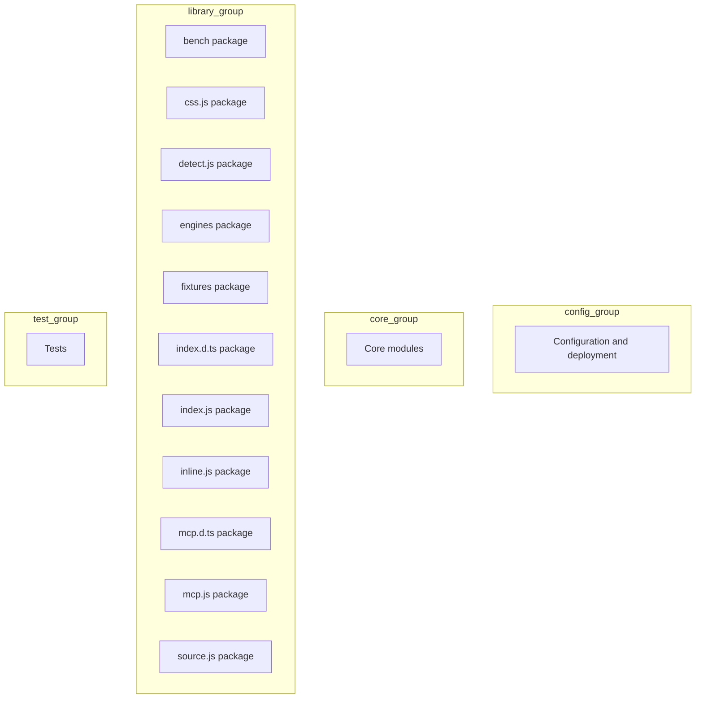

# Architecture report: addyosmani/critical

> Automated static analysis. **Observed** = directly seen in files/imports/AST; **Inferred** = interpretation from that evidence. Repository code was not executed.

## 1. Repository at a glance

| Item | Value |
| --- | --- |
| Repository | addyosmani/critical |
| Description | Extract & Inline Critical-path CSS in HTML pages |
| Language | JavaScript |
| Stars | 10302 |
| Licence | Apache-2.0 |
| Analysed commit / branch | 03897c82e255416ca7104774a9d19142bd1e2744 / master |
| Framework(s) | None detected |
| Files analysed | 49 |
| Components | 14 |

## 2. Architecture in one minute

addyosmani/critical - Extract & Inline Critical-path CSS in HTML pages. This repository was analysed statically from 49 file(s) (0 Python). Detected technologies (observed from imports/manifests): GitHub Actions, Docker, Vite, Vitest. Files are grouped into 14 component(s): bench package, Configuration and deployment, Core modules, css.js package, detect.js package, engines package, fixtures package, index.d.ts package. Findings below distinguish observed facts from inferred interpretation.

## 3. High-level block diagram

## 4. Main components

### bench package (`bench`)

- **Kind:** library
- **Status:** Observed
- **Confidence:** 0.85
- **Responsibility:** Groups 2 file(s) under bench package (observed from repository paths and static analysis).
- **Paths:** `bench/lib.mjs`, `bench/vs-beasties.mjs`
- **Evidence:** [bench/lib.mjs](https://github.com/addyosmani/critical/blob/03897c82e255416ca7104774a9d19142bd1e2744/bench/lib.mjs); [bench/vs-beasties.mjs](https://github.com/addyosmani/critical/blob/03897c82e255416ca7104774a9d19142bd1e2744/bench/vs-beasties.mjs)

### Configuration and deployment (`config`)

- **Kind:** config
- **Status:** Observed
- **Confidence:** 0.85
- **Responsibility:** Groups 3 file(s) under configuration and deployment (observed from repository paths and static analysis).
- **Paths:** `Dockerfile`, `package.json`, `pnpm-workspace.yaml`
- **Evidence:** [Dockerfile](https://github.com/addyosmani/critical/blob/03897c82e255416ca7104774a9d19142bd1e2744/Dockerfile); [package.json](https://github.com/addyosmani/critical/blob/03897c82e255416ca7104774a9d19142bd1e2744/package.json); [pnpm-workspace.yaml](https://github.com/addyosmani/critical/blob/03897c82e255416ca7104774a9d19142bd1e2744/pnpm-workspace.yaml)

### Core modules (`core`)

- **Kind:** core
- **Status:** Observed
- **Confidence:** 0.85
- **Responsibility:** Groups 2 file(s) under core modules (observed from repository paths and static analysis).
- **Paths:** `cli.js`, `vite.config.ts`
- **Evidence:** [cli.js](https://github.com/addyosmani/critical/blob/03897c82e255416ca7104774a9d19142bd1e2744/cli.js); [vite.config.ts](https://github.com/addyosmani/critical/blob/03897c82e255416ca7104774a9d19142bd1e2744/vite.config.ts)

### css.js package (`css_js`)

- **Kind:** library
- **Status:** Observed
- **Confidence:** 0.85
- **Responsibility:** Groups 1 file(s) under css.js package (observed from repository paths and static analysis).
- **Paths:** `src/css.js`
- **Evidence:** [src/css.js](https://github.com/addyosmani/critical/blob/03897c82e255416ca7104774a9d19142bd1e2744/src/css.js)

### detect.js package (`detect_js`)

- **Kind:** library
- **Status:** Observed
- **Confidence:** 0.85
- **Responsibility:** Groups 1 file(s) under detect.js package (observed from repository paths and static analysis).
- **Paths:** `src/detect.js`
- **Evidence:** [src/detect.js](https://github.com/addyosmani/critical/blob/03897c82e255416ca7104774a9d19142bd1e2744/src/detect.js)

### engines package (`engines`)

- **Kind:** library
- **Status:** Observed
- **Confidence:** 0.85
- **Responsibility:** Groups 2 file(s) under engines package (observed from repository paths and static analysis).
- **Paths:** `src/engines/render.js`, `src/engines/static.js`
- **Evidence:** [src/engines/render.js](https://github.com/addyosmani/critical/blob/03897c82e255416ca7104774a9d19142bd1e2744/src/engines/render.js); [src/engines/static.js](https://github.com/addyosmani/critical/blob/03897c82e255416ca7104774a9d19142bd1e2744/src/engines/static.js)

### fixtures package (`fixtures`)

- **Kind:** library
- **Status:** Observed
- **Confidence:** 0.85
- **Responsibility:** Groups 1 file(s) under fixtures package (observed from repository paths and static analysis).
- **Paths:** `fixtures/spa-external.js`
- **Evidence:** [fixtures/spa-external.js](https://github.com/addyosmani/critical/blob/03897c82e255416ca7104774a9d19142bd1e2744/fixtures/spa-external.js)

### index.d.ts package (`index_d_ts`)

- **Kind:** library
- **Status:** Observed
- **Confidence:** 0.85
- **Responsibility:** Groups 1 file(s) under index.d.ts package (observed from repository paths and static analysis).
- **Paths:** `src/index.d.ts`
- **Evidence:** [src/index.d.ts](https://github.com/addyosmani/critical/blob/03897c82e255416ca7104774a9d19142bd1e2744/src/index.d.ts)

### index.js package (`index_js`)

- **Kind:** library
- **Status:** Observed
- **Confidence:** 0.85
- **Responsibility:** Groups 1 file(s) under index.js package (observed from repository paths and static analysis).
- **Paths:** `src/index.js`
- **Evidence:** [src/index.js](https://github.com/addyosmani/critical/blob/03897c82e255416ca7104774a9d19142bd1e2744/src/index.js)

### inline.js package (`inline_js`)

- **Kind:** library
- **Status:** Observed
- **Confidence:** 0.85
- **Responsibility:** Groups 1 file(s) under inline.js package (observed from repository paths and static analysis).
- **Paths:** `src/inline.js`
- **Evidence:** [src/inline.js](https://github.com/addyosmani/critical/blob/03897c82e255416ca7104774a9d19142bd1e2744/src/inline.js)

### mcp.d.ts package (`mcp_d_ts`)

- **Kind:** library
- **Status:** Observed
- **Confidence:** 0.85
- **Responsibility:** Groups 1 file(s) under mcp.d.ts package (observed from repository paths and static analysis).
- **Paths:** `src/mcp.d.ts`
- **Evidence:** [src/mcp.d.ts](https://github.com/addyosmani/critical/blob/03897c82e255416ca7104774a9d19142bd1e2744/src/mcp.d.ts)

### mcp.js package (`mcp_js`)

- **Kind:** library
- **Status:** Observed
- **Confidence:** 0.85
- **Responsibility:** Groups 1 file(s) under mcp.js package (observed from repository paths and static analysis).
- **Paths:** `src/mcp.js`
- **Evidence:** [src/mcp.js](https://github.com/addyosmani/critical/blob/03897c82e255416ca7104774a9d19142bd1e2744/src/mcp.js)

### source.js package (`source_js`)

- **Kind:** library
- **Status:** Observed
- **Confidence:** 0.85
- **Responsibility:** Groups 1 file(s) under source.js package (observed from repository paths and static analysis).
- **Paths:** `src/source.js`
- **Evidence:** [src/source.js](https://github.com/addyosmani/critical/blob/03897c82e255416ca7104774a9d19142bd1e2744/src/source.js)

### Tests (`tests`)

- **Kind:** test
- **Status:** Observed
- **Confidence:** 0.85
- **Responsibility:** Groups 11 file(s) under tests (observed from repository paths and static analysis).
- **Paths:** `test/api.test.js`, `test/cli.test.js`, `test/critical.test.js`, `test/css-option.test.js`, `test/fold-aware.test.js`, `test/issues.test.js`, `test/mcp.test.js`, `test/remote.test.js`, `test/source.test.js`, `test/spa.test.js`, `test/vs-beasties.test.js`
- **Evidence:** [test/api.test.js](https://github.com/addyosmani/critical/blob/03897c82e255416ca7104774a9d19142bd1e2744/test/api.test.js); [test/cli.test.js](https://github.com/addyosmani/critical/blob/03897c82e255416ca7104774a9d19142bd1e2744/test/cli.test.js); [test/critical.test.js](https://github.com/addyosmani/critical/blob/03897c82e255416ca7104774a9d19142bd1e2744/test/critical.test.js); [test/css-option.test.js](https://github.com/addyosmani/critical/blob/03897c82e255416ca7104774a9d19142bd1e2744/test/css-option.test.js); [test/fold-aware.test.js](https://github.com/addyosmani/critical/blob/03897c82e255416ca7104774a9d19142bd1e2744/test/fold-aware.test.js); [test/issues.test.js](https://github.com/addyosmani/critical/blob/03897c82e255416ca7104774a9d19142bd1e2744/test/issues.test.js); [test/mcp.test.js](https://github.com/addyosmani/critical/blob/03897c82e255416ca7104774a9d19142bd1e2744/test/mcp.test.js); [test/remote.test.js](https://github.com/addyosmani/critical/blob/03897c82e255416ca7104774a9d19142bd1e2744/test/remote.test.js)

## 5. Execution flow

**Observed** entry point(s):

- [cli.js](https://github.com/addyosmani/critical/blob/03897c82e255416ca7104774a9d19142bd1e2744/cli.js)
- [src/index.js](https://github.com/addyosmani/critical/blob/03897c82e255416ca7104774a9d19142bd1e2744/src/index.js)

Representative flow (derived from observed entry points and the import graph; steps beyond the entry point are **Inferred**):

1. Execution starts at an observed entry point listed above, if present.
2. No internal import relationships between components were observed.

## 6. Project structure

### `(root)`

- `.editorconfig` - config (279 bytes)
- `.gitattributes` - other (43 bytes)
- `.gitignore` - other (226 bytes)
- `CHANGELOG.md` - docs (10878 bytes)
- `COMPARISON.md` - docs (9508 bytes)
- `CONTRIBUTING.md` - docs (1158 bytes)
- `Dockerfile` - container (995 bytes)
- `README.md` - docs (15925 bytes)
- `cli.js` - source, JavaScript (5963 bytes)
- `license` - docs (10829 bytes)
- `package.json` - manifest (1630 bytes)
- `pnpm-workspace.yaml` - config (452 bytes)
- `vite.config.ts` - source, TypeScript (696 bytes)

### `.github`

- `.github/workflows/docker.yml` - ci, YAML (1690 bytes)
- `.github/workflows/test.yml` - ci, YAML (1054 bytes)

### `.vite-hooks`

- `.vite-hooks/pre-commit` - other (10 bytes)

### `bench`

- `bench/lib.mjs` - source, JavaScript (2019 bytes)
- `bench/vs-beasties.mjs` - source, JavaScript (3148 bytes)

### `fixtures`

- `fixtures/app.css` - other (3758 bytes)
- `fixtures/index.html` - other (419 bytes)
- `fixtures/long.html` - other (2572 bytes)
- `fixtures/rebase/index.html` - other (233 bytes)
- `fixtures/rebase/styles/hero.css` - other (401 bytes)
- `fixtures/spa-app.html` - other (1926 bytes)
- `fixtures/spa-external.html` - other (463 bytes)
- `fixtures/spa-external.js` - source, JavaScript (649 bytes)
- `fixtures/spa.html` - other (278 bytes)
- `fixtures/styles.css` - other (1107 bytes)

### `src`

- `src/css.js` - source, JavaScript (4712 bytes)
- `src/detect.js` - source, JavaScript (3006 bytes)
- `src/engines/render.js` - source, JavaScript (5318 bytes)
- `src/engines/static.js` - source, JavaScript (2864 bytes)
- `src/index.d.ts` - source, TypeScript (6602 bytes)
- `src/index.js` - source, JavaScript (4421 bytes)
- `src/inline.js` - source, JavaScript (2760 bytes)
- `src/mcp.d.ts` - source, TypeScript (1304 bytes)
- `src/mcp.js` - source, JavaScript (3474 bytes)
- `src/source.js` - source, JavaScript (8049 bytes)

### `test`

- `test/api.test.js` - test, JavaScript (3751 bytes)
- `test/cli.test.js` - test, JavaScript (6360 bytes)
- `test/critical.test.js` - test, JavaScript (3376 bytes)
- `test/css-option.test.js` - test, JavaScript (3453 bytes)
- `test/fold-aware.test.js` - test, JavaScript (3086 bytes)
- `test/issues.test.js` - test, JavaScript (2161 bytes)
- `test/mcp.test.js` - test, JavaScript (3209 bytes)
- `test/remote.test.js` - test, JavaScript (2720 bytes)
- `test/source.test.js` - test, JavaScript (4517 bytes)
- `test/spa.test.js` - test, JavaScript (2629 bytes)
- `test/vs-beasties.test.js` - test, JavaScript (2572 bytes)

## 7. Key dependencies and integrations

| Name | Category | Status | Confidence | Evidence |
| --- | --- | --- | --- | --- |
| GitHub Actions | ci | Observed | 0.90 | [.github/workflows/docker.yml](https://github.com/addyosmani/critical/blob/03897c82e255416ca7104774a9d19142bd1e2744/.github/workflows/docker.yml); [.github/workflows/test.yml](https://github.com/addyosmani/critical/blob/03897c82e255416ca7104774a9d19142bd1e2744/.github/workflows/test.yml) |
| Docker | tooling | Observed | 0.90 | [.github/workflows/docker.yml:1](https://github.com/addyosmani/critical/blob/03897c82e255416ca7104774a9d19142bd1e2744/.github/workflows/docker.yml#L1); [Dockerfile](https://github.com/addyosmani/critical/blob/03897c82e255416ca7104774a9d19142bd1e2744/Dockerfile) |
| Vite | tooling | Observed | 0.85 | [package.json:51](https://github.com/addyosmani/critical/blob/03897c82e255416ca7104774a9d19142bd1e2744/package.json#L51) |
| Vitest | tooling | Observed | 0.85 | [package.json:51](https://github.com/addyosmani/critical/blob/03897c82e255416ca7104774a9d19142bd1e2744/package.json#L51) |

## 8. Data and state

No database, cache, queue, or persistent-state usage was observed in the analysed files. State handling, if any, may be in-memory or in files that were not analysed.

## 9. Configuration and deployment clues

- `.editorconfig` (config)
- `.github/workflows/docker.yml` (ci)
- `.github/workflows/test.yml` (ci)
- `Dockerfile` (container)
- `package.json` (manifest)
- `pnpm-workspace.yaml` (config)

## 10. Design observations

- Tests are present alongside source code (Observed from test file paths).

These observations are interpretations (**Inferred**) of the observed structure, not guarantees about runtime design.

## 11. Limitations and unknowns

- Static analysis only: repository code was not executed, installed, or imported at runtime.
- Components and relationships are inferred from file paths, imports, and AST structure; runtime behaviour, dynamic imports, and reflection may not be visible.
- 2 file(s) were skipped during inventory (1 x likely secret file excluded; 1 x lockfile excluded).
- No clear application entry point was observed in the analysed files.
- Repository text was treated as untrusted data; no instructions found in repository files were followed, and likely secret values were redacted/excluded.
- JavaScript and TypeScript files were inventoried from paths and package manifests. They were not parsed with a full language AST, and repository code was not executed.

## 12. Source references

- [.github/workflows/docker.yml](https://github.com/addyosmani/critical/blob/03897c82e255416ca7104774a9d19142bd1e2744/.github/workflows/docker.yml)
- [.github/workflows/docker.yml:1](https://github.com/addyosmani/critical/blob/03897c82e255416ca7104774a9d19142bd1e2744/.github/workflows/docker.yml#L1)
- [.github/workflows/test.yml](https://github.com/addyosmani/critical/blob/03897c82e255416ca7104774a9d19142bd1e2744/.github/workflows/test.yml)
- [Dockerfile](https://github.com/addyosmani/critical/blob/03897c82e255416ca7104774a9d19142bd1e2744/Dockerfile)
- [bench/lib.mjs](https://github.com/addyosmani/critical/blob/03897c82e255416ca7104774a9d19142bd1e2744/bench/lib.mjs)
- [bench/vs-beasties.mjs](https://github.com/addyosmani/critical/blob/03897c82e255416ca7104774a9d19142bd1e2744/bench/vs-beasties.mjs)
- [cli.js](https://github.com/addyosmani/critical/blob/03897c82e255416ca7104774a9d19142bd1e2744/cli.js)
- [fixtures/spa-external.js](https://github.com/addyosmani/critical/blob/03897c82e255416ca7104774a9d19142bd1e2744/fixtures/spa-external.js)
- [package.json](https://github.com/addyosmani/critical/blob/03897c82e255416ca7104774a9d19142bd1e2744/package.json)
- [package.json:51](https://github.com/addyosmani/critical/blob/03897c82e255416ca7104774a9d19142bd1e2744/package.json#L51)
- [pnpm-workspace.yaml](https://github.com/addyosmani/critical/blob/03897c82e255416ca7104774a9d19142bd1e2744/pnpm-workspace.yaml)
- [src/css.js](https://github.com/addyosmani/critical/blob/03897c82e255416ca7104774a9d19142bd1e2744/src/css.js)
- [src/detect.js](https://github.com/addyosmani/critical/blob/03897c82e255416ca7104774a9d19142bd1e2744/src/detect.js)
- [src/engines/render.js](https://github.com/addyosmani/critical/blob/03897c82e255416ca7104774a9d19142bd1e2744/src/engines/render.js)
- [src/engines/static.js](https://github.com/addyosmani/critical/blob/03897c82e255416ca7104774a9d19142bd1e2744/src/engines/static.js)
- [src/index.d.ts](https://github.com/addyosmani/critical/blob/03897c82e255416ca7104774a9d19142bd1e2744/src/index.d.ts)
- [src/index.js](https://github.com/addyosmani/critical/blob/03897c82e255416ca7104774a9d19142bd1e2744/src/index.js)
- [src/inline.js](https://github.com/addyosmani/critical/blob/03897c82e255416ca7104774a9d19142bd1e2744/src/inline.js)
- [src/mcp.d.ts](https://github.com/addyosmani/critical/blob/03897c82e255416ca7104774a9d19142bd1e2744/src/mcp.d.ts)
- [src/mcp.js](https://github.com/addyosmani/critical/blob/03897c82e255416ca7104774a9d19142bd1e2744/src/mcp.js)
- [src/source.js](https://github.com/addyosmani/critical/blob/03897c82e255416ca7104774a9d19142bd1e2744/src/source.js)
- [test/api.test.js](https://github.com/addyosmani/critical/blob/03897c82e255416ca7104774a9d19142bd1e2744/test/api.test.js)
- [test/cli.test.js](https://github.com/addyosmani/critical/blob/03897c82e255416ca7104774a9d19142bd1e2744/test/cli.test.js)
- [test/critical.test.js](https://github.com/addyosmani/critical/blob/03897c82e255416ca7104774a9d19142bd1e2744/test/critical.test.js)
- [test/css-option.test.js](https://github.com/addyosmani/critical/blob/03897c82e255416ca7104774a9d19142bd1e2744/test/css-option.test.js)
- [test/fold-aware.test.js](https://github.com/addyosmani/critical/blob/03897c82e255416ca7104774a9d19142bd1e2744/test/fold-aware.test.js)
- [test/issues.test.js](https://github.com/addyosmani/critical/blob/03897c82e255416ca7104774a9d19142bd1e2744/test/issues.test.js)
- [test/mcp.test.js](https://github.com/addyosmani/critical/blob/03897c82e255416ca7104774a9d19142bd1e2744/test/mcp.test.js)
- [test/remote.test.js](https://github.com/addyosmani/critical/blob/03897c82e255416ca7104774a9d19142bd1e2744/test/remote.test.js)
- [vite.config.ts](https://github.com/addyosmani/critical/blob/03897c82e255416ca7104774a9d19142bd1e2744/vite.config.ts)
