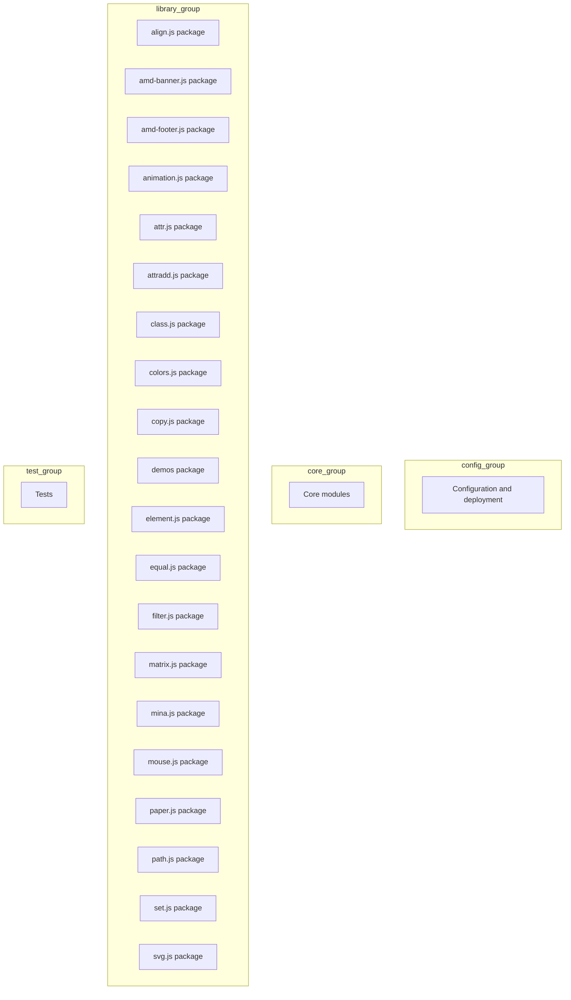

# Architecture report: adobe-webplatform/Snap.svg

> Automated static analysis. **Observed** = directly seen in files/imports/AST; **Inferred** = interpretation from that evidence. Repository code was not executed.

## 1. Repository at a glance

| Item | Value |
| --- | --- |
| Repository | adobe-webplatform/Snap.svg |
| Description | The JavaScript library for modern SVG graphics. |
| Language | JavaScript |
| Stars | 14001 |
| Licence | Apache-2.0 |
| Analysed commit / branch | c8e483c9694517e24b282f8f59f985629f4994ce / master |
| Framework(s) | None detected |
| Files analysed | 114 |
| Components | 23 |

## 2. Architecture in one minute

adobe-webplatform/Snap.svg - The JavaScript library for modern SVG graphics.. This repository was analysed statically from 114 file(s) (0 Python). Detected technologies (observed from imports/manifests): no known frameworks/libraries. Files are grouped into 23 component(s): align.js package, amd-banner.js package, amd-footer.js package, animation.js package, attr.js package, attradd.js package, class.js package, colors.js package. Findings below distinguish observed facts from inferred interpretation.

## 3. High-level block diagram

## 4. Main components

### align.js package (`align_js`)

- **Kind:** library
- **Status:** Observed
- **Confidence:** 0.85
- **Responsibility:** Groups 1 file(s) under align.js package (observed from repository paths and static analysis).
- **Paths:** `src/align.js`
- **Evidence:** [src/align.js](https://github.com/adobe-webplatform/Snap.svg/blob/c8e483c9694517e24b282f8f59f985629f4994ce/src/align.js)

### amd-banner.js package (`amd_banner_js`)

- **Kind:** library
- **Status:** Observed
- **Confidence:** 0.85
- **Responsibility:** Groups 1 file(s) under amd-banner.js package (observed from repository paths and static analysis).
- **Paths:** `src/amd-banner.js`
- **Evidence:** [src/amd-banner.js](https://github.com/adobe-webplatform/Snap.svg/blob/c8e483c9694517e24b282f8f59f985629f4994ce/src/amd-banner.js)

### amd-footer.js package (`amd_footer_js`)

- **Kind:** library
- **Status:** Observed
- **Confidence:** 0.85
- **Responsibility:** Groups 1 file(s) under amd-footer.js package (observed from repository paths and static analysis).
- **Paths:** `src/amd-footer.js`
- **Evidence:** [src/amd-footer.js](https://github.com/adobe-webplatform/Snap.svg/blob/c8e483c9694517e24b282f8f59f985629f4994ce/src/amd-footer.js)

### animation.js package (`animation_js`)

- **Kind:** library
- **Status:** Observed
- **Confidence:** 0.85
- **Responsibility:** Groups 1 file(s) under animation.js package (observed from repository paths and static analysis).
- **Paths:** `src/animation.js`
- **Evidence:** [src/animation.js](https://github.com/adobe-webplatform/Snap.svg/blob/c8e483c9694517e24b282f8f59f985629f4994ce/src/animation.js)

### attr.js package (`attr_js`)

- **Kind:** library
- **Status:** Observed
- **Confidence:** 0.85
- **Responsibility:** Groups 1 file(s) under attr.js package (observed from repository paths and static analysis).
- **Paths:** `src/attr.js`
- **Evidence:** [src/attr.js](https://github.com/adobe-webplatform/Snap.svg/blob/c8e483c9694517e24b282f8f59f985629f4994ce/src/attr.js)

### attradd.js package (`attradd_js`)

- **Kind:** library
- **Status:** Observed
- **Confidence:** 0.85
- **Responsibility:** Groups 1 file(s) under attradd.js package (observed from repository paths and static analysis).
- **Paths:** `src/attradd.js`
- **Evidence:** [src/attradd.js](https://github.com/adobe-webplatform/Snap.svg/blob/c8e483c9694517e24b282f8f59f985629f4994ce/src/attradd.js)

### class.js package (`class_js`)

- **Kind:** library
- **Status:** Observed
- **Confidence:** 0.85
- **Responsibility:** Groups 1 file(s) under class.js package (observed from repository paths and static analysis).
- **Paths:** `src/class.js`
- **Evidence:** [src/class.js](https://github.com/adobe-webplatform/Snap.svg/blob/c8e483c9694517e24b282f8f59f985629f4994ce/src/class.js)

### colors.js package (`colors_js`)

- **Kind:** library
- **Status:** Observed
- **Confidence:** 0.85
- **Responsibility:** Groups 1 file(s) under colors.js package (observed from repository paths and static analysis).
- **Paths:** `src/colors.js`
- **Evidence:** [src/colors.js](https://github.com/adobe-webplatform/Snap.svg/blob/c8e483c9694517e24b282f8f59f985629f4994ce/src/colors.js)

### Configuration and deployment (`config`)

- **Kind:** config
- **Status:** Observed
- **Confidence:** 0.85
- **Responsibility:** Groups 5 file(s) under configuration and deployment (observed from repository paths and static analysis).
- **Paths:** `bower.json`, `component.json`, `demos/snap-ad/package.json`, `dr.json`, `package.json`
- **Evidence:** [bower.json](https://github.com/adobe-webplatform/Snap.svg/blob/c8e483c9694517e24b282f8f59f985629f4994ce/bower.json); [component.json](https://github.com/adobe-webplatform/Snap.svg/blob/c8e483c9694517e24b282f8f59f985629f4994ce/component.json); [demos/snap-ad/package.json](https://github.com/adobe-webplatform/Snap.svg/blob/c8e483c9694517e24b282f8f59f985629f4994ce/demos/snap-ad/package.json); [dr.json](https://github.com/adobe-webplatform/Snap.svg/blob/c8e483c9694517e24b282f8f59f985629f4994ce/dr.json); [package.json](https://github.com/adobe-webplatform/Snap.svg/blob/c8e483c9694517e24b282f8f59f985629f4994ce/package.json)

### copy.js package (`copy_js`)

- **Kind:** library
- **Status:** Observed
- **Confidence:** 0.85
- **Responsibility:** Groups 1 file(s) under copy.js package (observed from repository paths and static analysis).
- **Paths:** `src/copy.js`
- **Evidence:** [src/copy.js](https://github.com/adobe-webplatform/Snap.svg/blob/c8e483c9694517e24b282f8f59f985629f4994ce/src/copy.js)

### Core modules (`core`)

- **Kind:** core
- **Status:** Observed
- **Confidence:** 0.85
- **Responsibility:** Groups 1 file(s) under core modules (observed from repository paths and static analysis).
- **Paths:** `Gruntfile.js`
- **Evidence:** [Gruntfile.js](https://github.com/adobe-webplatform/Snap.svg/blob/c8e483c9694517e24b282f8f59f985629f4994ce/Gruntfile.js)

### demos package (`demos`)

- **Kind:** library
- **Status:** Observed
- **Confidence:** 0.85
- **Responsibility:** Groups 15 file(s) under demos package (observed from repository paths and static analysis).
- **Paths:** `demos/animated-game/js/backbone.js`, `demos/animated-game/js/main.js`, `demos/animated-game/js/path-animal.js`, `demos/animated-game/js/seedrandom.js`, `demos/animated-game/js/tree-face.js`, `demos/animated-game/js/underscore.js`, `demos/snap-ad/Gruntfile.js`, `demos/snap-ad/src/config.rb`, `demos/snap-ad/src/js/app/app.js`, `demos/snap-ad/src/js/app/burst.js`, `demos/snap-ad/src/js/app/device.js`, `demos/snap-ad/src/js/app/heart.js`, `demos/snap-ad/src/js/app/logo.js`, `demos/snap-ad/src/js/app/mesh.js`, `demos/snap-ad/src/js/main.js`
- **Evidence:** [demos/animated-game/js/backbone.js](https://github.com/adobe-webplatform/Snap.svg/blob/c8e483c9694517e24b282f8f59f985629f4994ce/demos/animated-game/js/backbone.js); [demos/animated-game/js/main.js](https://github.com/adobe-webplatform/Snap.svg/blob/c8e483c9694517e24b282f8f59f985629f4994ce/demos/animated-game/js/main.js); [demos/animated-game/js/path-animal.js](https://github.com/adobe-webplatform/Snap.svg/blob/c8e483c9694517e24b282f8f59f985629f4994ce/demos/animated-game/js/path-animal.js); [demos/animated-game/js/seedrandom.js](https://github.com/adobe-webplatform/Snap.svg/blob/c8e483c9694517e24b282f8f59f985629f4994ce/demos/animated-game/js/seedrandom.js); [demos/animated-game/js/tree-face.js](https://github.com/adobe-webplatform/Snap.svg/blob/c8e483c9694517e24b282f8f59f985629f4994ce/demos/animated-game/js/tree-face.js); [demos/animated-game/js/underscore.js](https://github.com/adobe-webplatform/Snap.svg/blob/c8e483c9694517e24b282f8f59f985629f4994ce/demos/animated-game/js/underscore.js); [demos/snap-ad/Gruntfile.js](https://github.com/adobe-webplatform/Snap.svg/blob/c8e483c9694517e24b282f8f59f985629f4994ce/demos/snap-ad/Gruntfile.js); [demos/snap-ad/src/config.rb](https://github.com/adobe-webplatform/Snap.svg/blob/c8e483c9694517e24b282f8f59f985629f4994ce/demos/snap-ad/src/config.rb)

### element.js package (`element_js`)

- **Kind:** library
- **Status:** Observed
- **Confidence:** 0.85
- **Responsibility:** Groups 1 file(s) under element.js package (observed from repository paths and static analysis).
- **Paths:** `src/element.js`
- **Evidence:** [src/element.js](https://github.com/adobe-webplatform/Snap.svg/blob/c8e483c9694517e24b282f8f59f985629f4994ce/src/element.js)

### equal.js package (`equal_js`)

- **Kind:** library
- **Status:** Observed
- **Confidence:** 0.85
- **Responsibility:** Groups 1 file(s) under equal.js package (observed from repository paths and static analysis).
- **Paths:** `src/equal.js`
- **Evidence:** [src/equal.js](https://github.com/adobe-webplatform/Snap.svg/blob/c8e483c9694517e24b282f8f59f985629f4994ce/src/equal.js)

### filter.js package (`filter_js`)

- **Kind:** library
- **Status:** Observed
- **Confidence:** 0.85
- **Responsibility:** Groups 1 file(s) under filter.js package (observed from repository paths and static analysis).
- **Paths:** `src/filter.js`
- **Evidence:** [src/filter.js](https://github.com/adobe-webplatform/Snap.svg/blob/c8e483c9694517e24b282f8f59f985629f4994ce/src/filter.js)

### matrix.js package (`matrix_js`)

- **Kind:** library
- **Status:** Observed
- **Confidence:** 0.85
- **Responsibility:** Groups 1 file(s) under matrix.js package (observed from repository paths and static analysis).
- **Paths:** `src/matrix.js`
- **Evidence:** [src/matrix.js](https://github.com/adobe-webplatform/Snap.svg/blob/c8e483c9694517e24b282f8f59f985629f4994ce/src/matrix.js)

### mina.js package (`mina_js`)

- **Kind:** library
- **Status:** Observed
- **Confidence:** 0.85
- **Responsibility:** Groups 1 file(s) under mina.js package (observed from repository paths and static analysis).
- **Paths:** `src/mina.js`
- **Evidence:** [src/mina.js](https://github.com/adobe-webplatform/Snap.svg/blob/c8e483c9694517e24b282f8f59f985629f4994ce/src/mina.js)

### mouse.js package (`mouse_js`)

- **Kind:** library
- **Status:** Observed
- **Confidence:** 0.85
- **Responsibility:** Groups 1 file(s) under mouse.js package (observed from repository paths and static analysis).
- **Paths:** `src/mouse.js`
- **Evidence:** [src/mouse.js](https://github.com/adobe-webplatform/Snap.svg/blob/c8e483c9694517e24b282f8f59f985629f4994ce/src/mouse.js)

### paper.js package (`paper_js`)

- **Kind:** library
- **Status:** Observed
- **Confidence:** 0.85
- **Responsibility:** Groups 1 file(s) under paper.js package (observed from repository paths and static analysis).
- **Paths:** `src/paper.js`
- **Evidence:** [src/paper.js](https://github.com/adobe-webplatform/Snap.svg/blob/c8e483c9694517e24b282f8f59f985629f4994ce/src/paper.js)

### path.js package (`path_js`)

- **Kind:** library
- **Status:** Observed
- **Confidence:** 0.85
- **Responsibility:** Groups 1 file(s) under path.js package (observed from repository paths and static analysis).
- **Paths:** `src/path.js`
- **Evidence:** [src/path.js](https://github.com/adobe-webplatform/Snap.svg/blob/c8e483c9694517e24b282f8f59f985629f4994ce/src/path.js)

### set.js package (`set_js`)

- **Kind:** library
- **Status:** Observed
- **Confidence:** 0.85
- **Responsibility:** Groups 1 file(s) under set.js package (observed from repository paths and static analysis).
- **Paths:** `src/set.js`
- **Evidence:** [src/set.js](https://github.com/adobe-webplatform/Snap.svg/blob/c8e483c9694517e24b282f8f59f985629f4994ce/src/set.js)

### svg.js package (`svg_js`)

- **Kind:** library
- **Status:** Observed
- **Confidence:** 0.85
- **Responsibility:** Groups 1 file(s) under svg.js package (observed from repository paths and static analysis).
- **Paths:** `src/svg.js`
- **Evidence:** [src/svg.js](https://github.com/adobe-webplatform/Snap.svg/blob/c8e483c9694517e24b282f8f59f985629f4994ce/src/svg.js)

### Tests (`tests`)

- **Kind:** test
- **Status:** Observed
- **Confidence:** 0.85
- **Responsibility:** Groups 19 file(s) under tests (observed from repository paths and static analysis).
- **Paths:** `test/attradd.js`, `test/attrs.js`, `test/class.js`, `test/colors.js`, `test/element.js`, `test/filter.js`, `test/gradients.js`, `test/matrix.js`, `test/mina.js`, `test/paper.js`, `test/path.js`, `test/primitives.js`, `test/res/external-svg.svg`, `test/res/file-for-ajax.txt`, `test/set.js`, `test/snap-tests.js`, `test/system.js`, `test/test.html`, `test/test.js`
- **Evidence:** [test/attradd.js](https://github.com/adobe-webplatform/Snap.svg/blob/c8e483c9694517e24b282f8f59f985629f4994ce/test/attradd.js); [test/attrs.js](https://github.com/adobe-webplatform/Snap.svg/blob/c8e483c9694517e24b282f8f59f985629f4994ce/test/attrs.js); [test/class.js](https://github.com/adobe-webplatform/Snap.svg/blob/c8e483c9694517e24b282f8f59f985629f4994ce/test/class.js); [test/colors.js](https://github.com/adobe-webplatform/Snap.svg/blob/c8e483c9694517e24b282f8f59f985629f4994ce/test/colors.js); [test/element.js](https://github.com/adobe-webplatform/Snap.svg/blob/c8e483c9694517e24b282f8f59f985629f4994ce/test/element.js); [test/filter.js](https://github.com/adobe-webplatform/Snap.svg/blob/c8e483c9694517e24b282f8f59f985629f4994ce/test/filter.js); [test/gradients.js](https://github.com/adobe-webplatform/Snap.svg/blob/c8e483c9694517e24b282f8f59f985629f4994ce/test/gradients.js); [test/matrix.js](https://github.com/adobe-webplatform/Snap.svg/blob/c8e483c9694517e24b282f8f59f985629f4994ce/test/matrix.js)

## 5. Execution flow

**Observed** entry point(s):

- [demos/animated-game/js/main.js](https://github.com/adobe-webplatform/Snap.svg/blob/c8e483c9694517e24b282f8f59f985629f4994ce/demos/animated-game/js/main.js)
- [demos/snap-ad/Gruntfile.js](https://github.com/adobe-webplatform/Snap.svg/blob/c8e483c9694517e24b282f8f59f985629f4994ce/demos/snap-ad/Gruntfile.js)

Representative flow (derived from observed entry points and the import graph; steps beyond the entry point are **Inferred**):

1. Execution starts at an observed entry point listed above, if present.
2. No internal import relationships between components were observed.

## 6. Project structure

### `(root)`

- `.gitignore` - other (50 bytes)
- `.gitmodules` - other (323 bytes)
- `.travis.yml` - ci, YAML (218 bytes)
- `CONTRIBUTING` - other (170 bytes)
- `Gruntfile.js` - source, JavaScript (2622 bytes)
- `LICENSE` - docs (11356 bytes)
- `NOTICE` - docs (8460 bytes)
- `README.md` - docs (3999 bytes)
- `bower.json` - config (460 bytes)
- `component.json` - config (330 bytes)
- `dr.json` - config (1921 bytes)
- `history.md` - docs (1901 bytes)
- `package.json` - manifest (1530 bytes)
- `template.dot` - other (8823 bytes)

### `demos`

- `demos/animated-game/index.html` - other (95864 bytes)
- `demos/animated-game/js/backbone.js` - source, JavaScript (59594 bytes)
- `demos/animated-game/js/main.js` - source, JavaScript (2470 bytes)
- `demos/animated-game/js/path-animal.js` - source, JavaScript (2612 bytes)
- `demos/animated-game/js/seedrandom.js` - source, JavaScript (11541 bytes)
- `demos/animated-game/js/tree-face.js` - source, JavaScript (1600 bytes)
- `demos/animated-game/js/underscore.js` - source, JavaScript (41662 bytes)
- `demos/animated-map/index.html` - other (3978 bytes)
- `demos/animated-map/map.svg` - other (58147 bytes)
- `demos/clock/index.html` - other (2962 bytes)
- `demos/illustrated-infographic-coffee/demo.svg` - other (18891 bytes)
- `demos/illustrated-infographic-coffee/index.html` - other (15818 bytes)
- `demos/pattern/demo-card.svg` - other (86947 bytes)
- `demos/pattern/index.html` - other (3831 bytes)
- `demos/snap-ad/Gruntfile.js` - source, JavaScript (2187 bytes)
- `demos/snap-ad/README.md` - docs (98 bytes)
- `demos/snap-ad/SnapAd.tmproj` - other (2507 bytes)
- `demos/snap-ad/package.json` - manifest (405 bytes)
- `demos/snap-ad/site/assets/computer.svg` - other (1222 bytes)
- `demos/snap-ad/site/assets/heart.svg` - other (649 bytes)
- `demos/snap-ad/site/assets/phone.svg` - other (928 bytes)
- `demos/snap-ad/site/assets/tablet.svg` - other (931 bytes)
- `demos/snap-ad/site/css/screen.css` - other (2091 bytes)
- `demos/snap-ad/site/index.html` - other (9920 bytes)
- `demos/snap-ad/src/assets/computer.svg` - other (1222 bytes)
- `demos/snap-ad/src/assets/heart.svg` - other (649 bytes)
- `demos/snap-ad/src/assets/phone.svg` - other (928 bytes)
- `demos/snap-ad/src/assets/tablet.svg` - other (931 bytes)
- `demos/snap-ad/src/config.rb` - source, Ruby (851 bytes)
- `demos/snap-ad/src/css/screen.css` - other (2000 bytes)
- `demos/snap-ad/src/index.html` - other (10015 bytes)
- `demos/snap-ad/src/js/app/app.js` - source, JavaScript (5469 bytes)
- `demos/snap-ad/src/js/app/burst.js` - source, JavaScript (777 bytes)
- `demos/snap-ad/src/js/app/device.js` - source, JavaScript (4423 bytes)
- `demos/snap-ad/src/js/app/heart.js` - source, JavaScript (1878 bytes)
- `demos/snap-ad/src/js/app/logo.js` - source, JavaScript (1131 bytes)
- `demos/snap-ad/src/js/app/mesh.js` - source, JavaScript (3368 bytes)
- `demos/snap-ad/src/js/main.js` - source, JavaScript (3741 bytes)
- `demos/snap-ad/src/sass/screen.scss` - other (941 bytes)
- `demos/snap-mascot/crocodile-1.html` - other (9962 bytes)
- `demos/snap-mascot/crocodile-2.html` - other (27328 bytes)
- `demos/snap-mascot/index.html` - other (1005 bytes)
- `demos/snap-mascot/snap-logo.html` - other (5323 bytes)
- `demos/snap-mascot/style.css` - other (234 bytes)
- `demos/tutorial/1.html` - other (7081 bytes)
- `demos/tutorial/2.html` - other (7343 bytes)
- `demos/tutorial/3.html` - other (7647 bytes)
- `demos/tutorial/4.html` - other (6855 bytes)
- `demos/tutorial/index.html` - other (9502 bytes)
- `demos/tutorial/mascot.svg` - other (6809 bytes)
- `demos/tutorial/tutorial.html` - other (1378 bytes)

### `doc`

- `doc/css/dr.css` - other (2615 bytes)
- `doc/css/prism.css` - other (3635 bytes)
- `doc/css/topcoat-desktop-light.css` - other (86052 bytes)
- `doc/fonts/sourcecodepro-regular-webfont.svg` - other (53926 bytes)
- `doc/fonts/sourcesanspro-light-webfont.svg` - other (58559 bytes)
- `doc/fonts/sourcesanspro-regular-webfont.svg` - other (57056 bytes)
- `doc/fonts/sourcesanspro-semibold-webfont.svg` - other (56584 bytes)
- `doc/fonts/stylesheet.css` - other (1849 bytes)
- `doc/img/search.svg` - other (1150 bytes)
- `doc/img/search_dark.svg` - other (1290 bytes)
- `doc/js/prism.js` - source, JavaScript (5399 bytes)

### `src`

- `src/align.js` - source, JavaScript (3185 bytes)
- `src/amd-banner.js` - source, JavaScript (577 bytes)
- `src/amd-footer.js` - source, JavaScript (17 bytes)
- `src/animation.js` - source, JavaScript (7402 bytes)
- `src/attr.js` - source, JavaScript (16001 bytes)
- `src/attradd.js` - source, JavaScript (3013 bytes)
- `src/class.js` - source, JavaScript (4717 bytes)
- `src/colors.js` - source, JavaScript (6300 bytes)
- `src/copy.js` - source, JavaScript (677 bytes)
- `src/element.js` - source, JavaScript (25189 bytes)
- `src/equal.js` - source, JavaScript (6710 bytes)
- `src/filter.js` - source, JavaScript (11000 bytes)
- `src/matrix.js` - source, JavaScript (12011 bytes)
- `src/mina.js` - source, JavaScript (10080 bytes)
- `src/mouse.js` - source, JavaScript (16281 bytes)
- `src/paper.js` - source, JavaScript (25373 bytes)
- `src/path.js` - source, JavaScript (53048 bytes)
- `src/set.js` - source, JavaScript (10654 bytes)
- `src/svg.js` - source, JavaScript (54662 bytes)

### `test`

- `test/attradd.js` - test, JavaScript (1132 bytes)
- `test/attrs.js` - test, JavaScript (6508 bytes)
- `test/class.js` - test, JavaScript (1859 bytes)
- `test/colors.js` - test, JavaScript (6244 bytes)
- `test/element.js` - test, JavaScript (24637 bytes)
- `test/filter.js` - test, JavaScript (7295 bytes)
- `test/gradients.js` - test, JavaScript (2623 bytes)
- `test/matrix.js` - test, JavaScript (6329 bytes)
- `test/mina.js` - test, JavaScript (2944 bytes)
- `test/paper.js` - test, JavaScript (5239 bytes)
- `test/path.js` - test, JavaScript (16559 bytes)
- `test/primitives.js` - test, JavaScript (5550 bytes)
- `test/res/external-svg.svg` - test (146 bytes)
- `test/res/file-for-ajax.txt` - test (7 bytes)
- `test/set.js` - test, JavaScript (8386 bytes)
- `test/snap-tests.js` - test, JavaScript (16222 bytes)
- `test/system.js` - test, JavaScript (299 bytes)
- `test/test.html` - test (2052 bytes)
- `test/test.js` - test, JavaScript (330 bytes)

## 7. Key dependencies and integrations

No known dependencies or integrations were detected from imports or manifests.

## 8. Data and state

No database, cache, queue, or persistent-state usage was observed in the analysed files. State handling, if any, may be in-memory or in files that were not analysed.

## 9. Configuration and deployment clues

- `.travis.yml` (ci)
- `bower.json` (config)
- `component.json` (config)
- `demos/snap-ad/package.json` (manifest)
- `dr.json` (config)
- `package.json` (manifest)

## 10. Design observations

- Tests are present alongside source code (Observed from test file paths).

These observations are interpretations (**Inferred**) of the observed structure, not guarantees about runtime design.

## 11. Limitations and unknowns

- Static analysis only: repository code was not executed, installed, or imported at runtime.
- Components and relationships are inferred from file paths, imports, and AST structure; runtime behaviour, dynamic imports, and reflection may not be visible.
- 21 file(s) were skipped during inventory (21 x vendored/generated directory excluded).
- No clear application entry point was observed in the analysed files.
- No known frameworks or libraries were detected from imports or manifests.
- Repository text was treated as untrusted data; no instructions found in repository files were followed, and likely secret values were redacted/excluded.
- JavaScript and TypeScript files were inventoried from paths and package manifests. They were not parsed with a full language AST, and repository code was not executed.

## 12. Source references

- [Gruntfile.js](https://github.com/adobe-webplatform/Snap.svg/blob/c8e483c9694517e24b282f8f59f985629f4994ce/Gruntfile.js)
- [bower.json](https://github.com/adobe-webplatform/Snap.svg/blob/c8e483c9694517e24b282f8f59f985629f4994ce/bower.json)
- [component.json](https://github.com/adobe-webplatform/Snap.svg/blob/c8e483c9694517e24b282f8f59f985629f4994ce/component.json)
- [demos/animated-game/js/backbone.js](https://github.com/adobe-webplatform/Snap.svg/blob/c8e483c9694517e24b282f8f59f985629f4994ce/demos/animated-game/js/backbone.js)
- [demos/animated-game/js/main.js](https://github.com/adobe-webplatform/Snap.svg/blob/c8e483c9694517e24b282f8f59f985629f4994ce/demos/animated-game/js/main.js)
- [demos/animated-game/js/path-animal.js](https://github.com/adobe-webplatform/Snap.svg/blob/c8e483c9694517e24b282f8f59f985629f4994ce/demos/animated-game/js/path-animal.js)
- [demos/animated-game/js/seedrandom.js](https://github.com/adobe-webplatform/Snap.svg/blob/c8e483c9694517e24b282f8f59f985629f4994ce/demos/animated-game/js/seedrandom.js)
- [demos/animated-game/js/tree-face.js](https://github.com/adobe-webplatform/Snap.svg/blob/c8e483c9694517e24b282f8f59f985629f4994ce/demos/animated-game/js/tree-face.js)
- [demos/animated-game/js/underscore.js](https://github.com/adobe-webplatform/Snap.svg/blob/c8e483c9694517e24b282f8f59f985629f4994ce/demos/animated-game/js/underscore.js)
- [demos/snap-ad/Gruntfile.js](https://github.com/adobe-webplatform/Snap.svg/blob/c8e483c9694517e24b282f8f59f985629f4994ce/demos/snap-ad/Gruntfile.js)
- [demos/snap-ad/package.json](https://github.com/adobe-webplatform/Snap.svg/blob/c8e483c9694517e24b282f8f59f985629f4994ce/demos/snap-ad/package.json)
- [demos/snap-ad/src/config.rb](https://github.com/adobe-webplatform/Snap.svg/blob/c8e483c9694517e24b282f8f59f985629f4994ce/demos/snap-ad/src/config.rb)
- [dr.json](https://github.com/adobe-webplatform/Snap.svg/blob/c8e483c9694517e24b282f8f59f985629f4994ce/dr.json)
- [package.json](https://github.com/adobe-webplatform/Snap.svg/blob/c8e483c9694517e24b282f8f59f985629f4994ce/package.json)
- [src/align.js](https://github.com/adobe-webplatform/Snap.svg/blob/c8e483c9694517e24b282f8f59f985629f4994ce/src/align.js)
- [src/amd-banner.js](https://github.com/adobe-webplatform/Snap.svg/blob/c8e483c9694517e24b282f8f59f985629f4994ce/src/amd-banner.js)
- [src/amd-footer.js](https://github.com/adobe-webplatform/Snap.svg/blob/c8e483c9694517e24b282f8f59f985629f4994ce/src/amd-footer.js)
- [src/animation.js](https://github.com/adobe-webplatform/Snap.svg/blob/c8e483c9694517e24b282f8f59f985629f4994ce/src/animation.js)
- [src/attr.js](https://github.com/adobe-webplatform/Snap.svg/blob/c8e483c9694517e24b282f8f59f985629f4994ce/src/attr.js)
- [src/attradd.js](https://github.com/adobe-webplatform/Snap.svg/blob/c8e483c9694517e24b282f8f59f985629f4994ce/src/attradd.js)
- [src/class.js](https://github.com/adobe-webplatform/Snap.svg/blob/c8e483c9694517e24b282f8f59f985629f4994ce/src/class.js)
- [src/colors.js](https://github.com/adobe-webplatform/Snap.svg/blob/c8e483c9694517e24b282f8f59f985629f4994ce/src/colors.js)
- [src/copy.js](https://github.com/adobe-webplatform/Snap.svg/blob/c8e483c9694517e24b282f8f59f985629f4994ce/src/copy.js)
- [src/element.js](https://github.com/adobe-webplatform/Snap.svg/blob/c8e483c9694517e24b282f8f59f985629f4994ce/src/element.js)
- [src/equal.js](https://github.com/adobe-webplatform/Snap.svg/blob/c8e483c9694517e24b282f8f59f985629f4994ce/src/equal.js)
- [src/filter.js](https://github.com/adobe-webplatform/Snap.svg/blob/c8e483c9694517e24b282f8f59f985629f4994ce/src/filter.js)
- [src/matrix.js](https://github.com/adobe-webplatform/Snap.svg/blob/c8e483c9694517e24b282f8f59f985629f4994ce/src/matrix.js)
- [src/mina.js](https://github.com/adobe-webplatform/Snap.svg/blob/c8e483c9694517e24b282f8f59f985629f4994ce/src/mina.js)
- [src/mouse.js](https://github.com/adobe-webplatform/Snap.svg/blob/c8e483c9694517e24b282f8f59f985629f4994ce/src/mouse.js)
- [src/paper.js](https://github.com/adobe-webplatform/Snap.svg/blob/c8e483c9694517e24b282f8f59f985629f4994ce/src/paper.js)
- [src/path.js](https://github.com/adobe-webplatform/Snap.svg/blob/c8e483c9694517e24b282f8f59f985629f4994ce/src/path.js)
- [src/set.js](https://github.com/adobe-webplatform/Snap.svg/blob/c8e483c9694517e24b282f8f59f985629f4994ce/src/set.js)
- [src/svg.js](https://github.com/adobe-webplatform/Snap.svg/blob/c8e483c9694517e24b282f8f59f985629f4994ce/src/svg.js)
- [test/attradd.js](https://github.com/adobe-webplatform/Snap.svg/blob/c8e483c9694517e24b282f8f59f985629f4994ce/test/attradd.js)
- [test/attrs.js](https://github.com/adobe-webplatform/Snap.svg/blob/c8e483c9694517e24b282f8f59f985629f4994ce/test/attrs.js)
- [test/class.js](https://github.com/adobe-webplatform/Snap.svg/blob/c8e483c9694517e24b282f8f59f985629f4994ce/test/class.js)
- [test/colors.js](https://github.com/adobe-webplatform/Snap.svg/blob/c8e483c9694517e24b282f8f59f985629f4994ce/test/colors.js)
- [test/element.js](https://github.com/adobe-webplatform/Snap.svg/blob/c8e483c9694517e24b282f8f59f985629f4994ce/test/element.js)
- [test/filter.js](https://github.com/adobe-webplatform/Snap.svg/blob/c8e483c9694517e24b282f8f59f985629f4994ce/test/filter.js)
- [test/gradients.js](https://github.com/adobe-webplatform/Snap.svg/blob/c8e483c9694517e24b282f8f59f985629f4994ce/test/gradients.js)
- [test/matrix.js](https://github.com/adobe-webplatform/Snap.svg/blob/c8e483c9694517e24b282f8f59f985629f4994ce/test/matrix.js)
