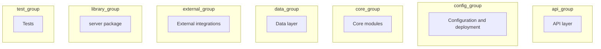

# Architecture report: advplyr/audiobookshelf

> Automated static analysis. **Observed** = directly seen in files/imports/AST; **Inferred** = interpretation from that evidence. Repository code was not executed.

## 1. Repository at a glance

| Item | Value |
| --- | --- |
| Repository | advplyr/audiobookshelf |
| Description | Self-hosted audiobook and podcast server |
| Language | JavaScript |
| Stars | 15005 |
| Licence | GPL-3.0 |
| Analysed commit / branch | c5e6e463e44de153006ea5aa739021d9a769e82b / master |
| Framework(s) | Express |
| Files analysed | 791 |
| Components | 7 |

## 2. Architecture in one minute

advplyr/audiobookshelf - Self-hosted audiobook and podcast server. This repository was analysed statically from 791 file(s) (0 Python). Detected technologies (observed from imports/manifests): GitHub Actions, SQLite, Express, axios, Tailwind CSS, Docker. Files are grouped into 7 component(s): API layer, Configuration and deployment, Core modules, Data layer, External integrations, server package, Tests. Findings below distinguish observed facts from inferred interpretation.

## 3. High-level block diagram

## 4. Main components

### API layer (`api_layer`)

- **Kind:** api
- **Status:** Observed
- **Confidence:** 0.85
- **Responsibility:** Groups 23 file(s) under api layer (observed from repository paths and static analysis).
- **Paths:** `server/controllers/ApiKeyController.js`, `server/controllers/AuthorController.js`, `server/controllers/BackupController.js`, `server/controllers/CacheController.js`, `server/controllers/CollectionController.js`, `server/controllers/CustomMetadataProviderController.js`, `server/controllers/EmailController.js`, `server/controllers/FileSystemController.js`, `server/controllers/LibraryController.js`, `server/controllers/LibraryItemController.js`, `server/controllers/MeController.js`, `server/controllers/MiscController.js`, `server/controllers/NotificationController.js`, `server/controllers/PlaylistController.js`, `server/controllers/PodcastController.js`, `server/controllers/RSSFeedController.js`, `server/controllers/SearchController.js`, `server/controllers/SeriesController.js`, `server/controllers/SessionController.js`, `server/controllers/ShareController.js`, `server/controllers/StatsController.js`, `server/controllers/ToolsController.js`, `server/controllers/UserController.js`
- **Evidence:** [server/controllers/ApiKeyController.js](https://github.com/advplyr/audiobookshelf/blob/c5e6e463e44de153006ea5aa739021d9a769e82b/server/controllers/ApiKeyController.js); [server/controllers/AuthorController.js](https://github.com/advplyr/audiobookshelf/blob/c5e6e463e44de153006ea5aa739021d9a769e82b/server/controllers/AuthorController.js); [server/controllers/BackupController.js](https://github.com/advplyr/audiobookshelf/blob/c5e6e463e44de153006ea5aa739021d9a769e82b/server/controllers/BackupController.js); [server/controllers/CacheController.js](https://github.com/advplyr/audiobookshelf/blob/c5e6e463e44de153006ea5aa739021d9a769e82b/server/controllers/CacheController.js); [server/controllers/CollectionController.js](https://github.com/advplyr/audiobookshelf/blob/c5e6e463e44de153006ea5aa739021d9a769e82b/server/controllers/CollectionController.js); [server/controllers/CustomMetadataProviderController.js](https://github.com/advplyr/audiobookshelf/blob/c5e6e463e44de153006ea5aa739021d9a769e82b/server/controllers/CustomMetadataProviderController.js); [server/controllers/EmailController.js](https://github.com/advplyr/audiobookshelf/blob/c5e6e463e44de153006ea5aa739021d9a769e82b/server/controllers/EmailController.js); [server/controllers/FileSystemController.js](https://github.com/advplyr/audiobookshelf/blob/c5e6e463e44de153006ea5aa739021d9a769e82b/server/controllers/FileSystemController.js)

### Configuration and deployment (`config`)

- **Kind:** config
- **Status:** Observed
- **Confidence:** 0.85
- **Responsibility:** Groups 48 file(s) under configuration and deployment (observed from repository paths and static analysis).
- **Paths:** `Dockerfile`, `client/package.json`, `client/strings/ar.json`, `client/strings/be.json`, `client/strings/bg.json`, `client/strings/bn.json`, `client/strings/ca.json`, `client/strings/cs.json`, `client/strings/da.json`, `client/strings/de.json`, `client/strings/el.json`, `client/strings/en-us.json`, `client/strings/es.json`, `client/strings/et.json`, `client/strings/eu.json`, `client/strings/fa.json`, `client/strings/fi.json`, `client/strings/fr.json`, `client/strings/gu.json`, `client/strings/he.json`, `client/strings/hi.json`, `client/strings/hr.json`, `client/strings/hu.json`, `client/strings/is.json`, `client/strings/it.json`, `client/strings/ja.json`, `client/strings/ko.json`, `client/strings/lt.json`, `client/strings/lv.json`, `client/strings/nl.json`, `client/strings/no.json`, `client/strings/pl.json`, `client/strings/pt-br.json`, `client/strings/ro.json`, `client/strings/ru.json`, `client/strings/sk.json`, `client/strings/sl.json`, `client/strings/sv.json`, `client/strings/ta.json`, `client/strings/tr.json`, `client/strings/uk.json`, `client/strings/uz.json`, `client/strings/vi-vn.json`, `client/strings/zh-cn.json`, `client/strings/zh-tw.json`, `custom-metadata-provider-specification.yaml`, `docker-compose.yml`, `package.json`
- **Evidence:** [Dockerfile](https://github.com/advplyr/audiobookshelf/blob/c5e6e463e44de153006ea5aa739021d9a769e82b/Dockerfile); [client/package.json](https://github.com/advplyr/audiobookshelf/blob/c5e6e463e44de153006ea5aa739021d9a769e82b/client/package.json); [client/strings/ar.json](https://github.com/advplyr/audiobookshelf/blob/c5e6e463e44de153006ea5aa739021d9a769e82b/client/strings/ar.json); [client/strings/be.json](https://github.com/advplyr/audiobookshelf/blob/c5e6e463e44de153006ea5aa739021d9a769e82b/client/strings/be.json); [client/strings/bg.json](https://github.com/advplyr/audiobookshelf/blob/c5e6e463e44de153006ea5aa739021d9a769e82b/client/strings/bg.json); [client/strings/bn.json](https://github.com/advplyr/audiobookshelf/blob/c5e6e463e44de153006ea5aa739021d9a769e82b/client/strings/bn.json); [client/strings/ca.json](https://github.com/advplyr/audiobookshelf/blob/c5e6e463e44de153006ea5aa739021d9a769e82b/client/strings/ca.json); [client/strings/cs.json](https://github.com/advplyr/audiobookshelf/blob/c5e6e463e44de153006ea5aa739021d9a769e82b/client/strings/cs.json)

### Core modules (`core`)

- **Kind:** core
- **Status:** Observed
- **Confidence:** 0.85
- **Responsibility:** Groups 3 file(s) under core modules (observed from repository paths and static analysis).
- **Paths:** `eslint.config.mjs`, `index.js`, `prod.js`
- **Evidence:** [eslint.config.mjs](https://github.com/advplyr/audiobookshelf/blob/c5e6e463e44de153006ea5aa739021d9a769e82b/eslint.config.mjs); [index.js](https://github.com/advplyr/audiobookshelf/blob/c5e6e463e44de153006ea5aa739021d9a769e82b/index.js); [prod.js](https://github.com/advplyr/audiobookshelf/blob/c5e6e463e44de153006ea5aa739021d9a769e82b/prod.js)

### Data layer (`data_layer`)

- **Kind:** data
- **Status:** Observed
- **Confidence:** 0.85
- **Responsibility:** Groups 27 file(s) under data layer (observed from repository paths and static analysis).
- **Paths:** `server/libs/umzug/storage/contract.js`, `server/libs/umzug/storage/index.js`, `server/libs/umzug/storage/json.js`, `server/libs/umzug/storage/memory.js`, `server/libs/umzug/storage/mongodb.js`, `server/libs/umzug/storage/sequelize.js`, `server/models/ApiKey.js`, `server/models/Author.js`, `server/models/Book.js`, `server/models/BookAuthor.js`, `server/models/BookSeries.js`, `server/models/Collection.js`, `server/models/CollectionBook.js`, `server/models/CustomMetadataProvider.js`, `server/models/Device.js`, `server/models/Feed.js`, `server/models/FeedEpisode.js`, `server/models/Library.js`, `server/models/LibraryFolder.js`, `server/models/LibraryItem.js`, `server/models/MediaItemShare.js`, `server/models/MediaProgress.js`, `server/models/PlaybackSession.js`, `server/models/Playlist.js`, `server/models/PlaylistMediaItem.js`, `server/models/Podcast.js`, `server/models/PodcastEpisode.js`
- **Evidence:** [server/libs/umzug/storage/contract.js](https://github.com/advplyr/audiobookshelf/blob/c5e6e463e44de153006ea5aa739021d9a769e82b/server/libs/umzug/storage/contract.js); [server/libs/umzug/storage/index.js](https://github.com/advplyr/audiobookshelf/blob/c5e6e463e44de153006ea5aa739021d9a769e82b/server/libs/umzug/storage/index.js); [server/libs/umzug/storage/json.js](https://github.com/advplyr/audiobookshelf/blob/c5e6e463e44de153006ea5aa739021d9a769e82b/server/libs/umzug/storage/json.js); [server/libs/umzug/storage/memory.js](https://github.com/advplyr/audiobookshelf/blob/c5e6e463e44de153006ea5aa739021d9a769e82b/server/libs/umzug/storage/memory.js); [server/libs/umzug/storage/mongodb.js](https://github.com/advplyr/audiobookshelf/blob/c5e6e463e44de153006ea5aa739021d9a769e82b/server/libs/umzug/storage/mongodb.js); [server/libs/umzug/storage/sequelize.js](https://github.com/advplyr/audiobookshelf/blob/c5e6e463e44de153006ea5aa739021d9a769e82b/server/libs/umzug/storage/sequelize.js); [server/models/ApiKey.js](https://github.com/advplyr/audiobookshelf/blob/c5e6e463e44de153006ea5aa739021d9a769e82b/server/models/ApiKey.js); [server/models/Author.js](https://github.com/advplyr/audiobookshelf/blob/c5e6e463e44de153006ea5aa739021d9a769e82b/server/models/Author.js)

### External integrations (`external_integrations`)

- **Kind:** external
- **Status:** Observed
- **Confidence:** 0.85
- **Responsibility:** Groups 264 file(s) under external integrations (observed from repository paths and static analysis).
- **Paths:** `client/assets/ebooks/basic.js`, `client/assets/ebooks/htmlParser.js`, `client/assets/ebooks/mobi.js`, `client/components/app/Appbar.vue`, `client/components/app/BookShelfCategorized.vue`, `client/components/app/BookShelfRow.vue`, `client/components/app/BookShelfToolbar.vue`, `client/components/app/ConfigSideNav.vue`, `client/components/app/LazyBookshelf.vue`, `client/components/app/MediaPlayerContainer.vue`, `client/components/app/SettingsContent.vue`, `client/components/app/SideRail.vue`, `client/components/cards/AuthorCard.vue`, `client/components/cards/AuthorSearchCard.vue`, `client/components/cards/BookMatchCard.vue`, `client/components/cards/EpisodeSearchCard.vue`, `client/components/cards/GenreSearchCard.vue`, `client/components/cards/GroupCard.vue`, `client/components/cards/ItemSearchCard.vue`, `client/components/cards/ItemTaskRunningCard.vue`, `client/components/cards/ItemUploadCard.vue`, `client/components/cards/LazyBookCard.vue`, `client/components/cards/LazyCollectionCard.vue`, `client/components/cards/LazyPlaylistCard.vue`, `client/components/cards/LazySeriesCard.vue`, `client/components/cards/NarratorCard.vue`, `client/components/cards/NarratorSearchCard.vue`, `client/components/cards/NotificationCard.vue`, `client/components/cards/PodcastFeedSummaryCard.vue`, `client/components/cards/SeriesSearchCard.vue`, `client/components/cards/TagSearchCard.vue`, `client/components/content/LibraryItemDetails.vue`, `client/components/controls/FilterSelect.vue`, `client/components/controls/GlobalSearch.vue`, `client/components/controls/LibraryFilterSelect.vue`, `client/components/controls/LibrarySortSelect.vue`, `client/components/controls/PlaybackSpeedControl.vue`, `client/components/controls/SortSelect.vue`, `client/components/controls/VolumeControl.vue`, `client/components/covers/AuthorImage.vue`, `client/components/covers/BookCover.vue`, `client/components/covers/CollectionCover.vue`, `client/components/covers/GroupCover.vue`, `client/components/covers/PlaylistCover.vue`, `client/components/covers/PreviewCover.vue`, `client/components/modals/AccountModal.vue`, `client/components/modals/AddCustomMetadataProviderModal.vue`, `client/components/modals/ApiKeyCreatedModal.vue`, `client/components/modals/ApiKeyModal.vue`, `client/components/modals/AudioFileDataModal.vue`, `client/components/modals/BackupScheduleModal.vue`, `client/components/modals/BatchQuickMatchModel.vue`, `client/components/modals/BookmarksModal.vue`, `client/components/modals/ChaptersModal.vue`, `client/components/modals/Dialog.vue`, `client/components/modals/EditSeriesInputInnerModal.vue`, `client/components/modals/ListeningSessionModal.vue`, `client/components/modals/Modal.vue`, `client/components/modals/PlayerSettingsModal.vue`, `client/components/modals/RawCoverPreviewModal.vue`, `client/components/modals/ShareModal.vue`, `client/components/modals/SleepTimerModal.vue`, `client/components/modals/UploadImageModal.vue`, `client/components/modals/authors/EditModal.vue`, `client/components/modals/bookmarks/BookmarkItem.vue`, `client/components/modals/changelog/ViewModal.vue`, `client/components/modals/collections/AddCreateModal.vue`, `client/components/modals/collections/CollectionItem.vue`, `client/components/modals/collections/EditModal.vue`, `client/components/modals/emails/EReaderDeviceModal.vue`, `client/components/modals/emails/UserEReaderDeviceModal.vue`, `client/components/modals/item/EditModal.vue`, `client/components/modals/item/tabs/Chapters.vue`, `client/components/modals/item/tabs/Cover.vue`, `client/components/modals/item/tabs/Details.vue`, `client/components/modals/item/tabs/Episodes.vue`, `client/components/modals/item/tabs/Files.vue`, `client/components/modals/item/tabs/Match.vue`, `client/components/modals/item/tabs/Schedule.vue`, `client/components/modals/item/tabs/Tools.vue`, `client/components/modals/libraries/EditLibrary.vue`, `client/components/modals/libraries/EditModal.vue`, `client/components/modals/libraries/LazyFolderChooser.vue`, `client/components/modals/libraries/LibraryScannerSettings.vue`, `client/components/modals/libraries/LibrarySettings.vue`, `client/components/modals/libraries/LibraryTools.vue`, `client/components/modals/libraries/ScheduleScan.vue`, `client/components/modals/notification/NotificationEditModal.vue`, `client/components/modals/player/QueueItemRow.vue`, `client/components/modals/player/QueueItemsModal.vue`, `client/components/modals/playlists/AddCreateModal.vue`, `client/components/modals/playlists/EditModal.vue`, `client/components/modals/playlists/UserPlaylistItem.vue`, `client/components/modals/podcast/EditEpisode.vue`, `client/components/modals/podcast/EpisodeFeed.vue`, `client/components/modals/podcast/NewModal.vue`, `client/components/modals/podcast/OpmlFeedsModal.vue`, `client/components/modals/podcast/RemoveEpisode.vue`, `client/components/modals/podcast/ViewEpisode.vue`, `client/components/modals/podcast/tabs/EpisodeDetails.vue`, `client/components/modals/podcast/tabs/EpisodeMatch.vue`, `client/components/modals/rssfeed/OpenCloseModal.vue`, `client/components/modals/rssfeed/ViewFeedModal.vue`, `client/components/player/PlayerPlaybackControls.vue`, `client/components/player/PlayerTrackBar.vue`, `client/components/player/PlayerUi.vue`, `client/components/prompt/Confirm.vue`, `client/components/prompt/Dialog.vue`, `client/components/readers/ComicReader.vue`, `client/components/readers/EpubReader.vue`, `client/components/readers/MobiReader.vue`, `client/components/readers/PdfReader.vue`, `client/components/readers/Reader.vue`, `client/components/stats/DailyListeningChart.vue`, `client/components/stats/Heatmap.vue`, `client/components/stats/PreviewIcons.vue`, `client/components/stats/YearInReview.vue`, `client/components/stats/YearInReviewBanner.vue`, `client/components/stats/YearInReviewServer.vue`, `client/components/stats/YearInReviewShort.vue`, `client/components/tables/ApiKeysTable.vue`, `client/components/tables/AudioTracksTableRow.vue`, `client/components/tables/BackupsTable.vue`, `client/components/tables/ChaptersTable.vue`, `client/components/tables/CollectionBooksTable.vue`, `client/components/tables/CustomMetadataProviderTable.vue`, `client/components/tables/EbookFilesTable.vue`, `client/components/tables/EbookFilesTableRow.vue`, `client/components/tables/LibraryFilesTable.vue`, `client/components/tables/LibraryFilesTableRow.vue`, `client/components/tables/PlaylistItemsTable.vue`, `client/components/tables/TracksTable.vue`, `client/components/tables/UploadedFilesTable.vue`, `client/components/tables/UsersTable.vue`, `client/components/tables/collection/BookTableRow.vue`, `client/components/tables/library/LibrariesTable.vue`, `client/components/tables/library/LibraryItem.vue`, `client/components/tables/playlist/ItemTableRow.vue`, `client/components/tables/podcast/DownloadQueueTable.vue`, `client/components/tables/podcast/LazyEpisodeRow.vue`, `client/components/tables/podcast/LazyEpisodesTable.vue`, `client/components/ui/Btn.vue`, `client/components/ui/Checkbox.vue`, `client/components/ui/ContextMenuDropdown.vue`, `client/components/ui/Dropdown.vue`, `client/components/ui/EditableText.vue`, `client/components/ui/FileInput.vue`, `client/components/ui/IconBtn.vue`, `client/components/ui/InputDropdown.vue`, `client/components/ui/LibrariesDropdown.vue`, `client/components/ui/LibraryIcon.vue`, `client/components/ui/LoadingIndicator.vue`, `client/components/ui/MediaIconPicker.vue`, `client/components/ui/MultiSelect.vue`, `client/components/ui/MultiSelectDropdown.vue`, `client/components/ui/MultiSelectQueryInput.vue`, `client/components/ui/QueryInput.vue`, `client/components/ui/RangeInput.vue`, `client/components/ui/ReadIconBtn.vue`, `client/components/ui/RichTextEditor.vue`, `client/components/ui/SelectInput.vue`, `client/components/ui/TextInput.vue`, `client/components/ui/TextInputWithLabel.vue`, `client/components/ui/TextareaInput.vue`, `client/components/ui/TextareaWithLabel.vue`, `client/components/ui/TimePicker.vue`, `client/components/ui/ToggleBtns.vue`, `client/components/ui/ToggleSwitch.vue`, `client/components/ui/Tooltip.vue`, `client/components/ui/VueTrix.vue`, `client/components/widgets/AbridgedIndicator.vue`, `client/components/widgets/Alert.vue`, `client/components/widgets/AlreadyInLibraryIndicator.vue`, `client/components/widgets/BookDetailsEdit.vue`, `client/components/widgets/CoverSizeWidget.vue`, `client/components/widgets/CronExpressionBuilder.vue`, `client/components/widgets/EncoderOptionsCard.vue`, `client/components/widgets/ExplicitIndicator.vue`, `client/components/widgets/ItemSlider.vue`, `client/components/widgets/LoadingSpinner.vue`, `client/components/widgets/MoreMenu.vue`, `client/components/widgets/NotificationWidget.vue`, `client/components/widgets/OnlineIndicator.vue`, `client/components/widgets/PodcastDetailsEdit.vue`, `client/components/widgets/PodcastTypeIndicator.vue`, `client/components/widgets/RssFeedMetadataBuilder.vue`, `client/components/widgets/SeriesInputWidget.vue`, `client/cypress.config.js`, `client/cypress/support/commands.js`, `client/cypress/support/component.js`, `client/layouts/blank.vue`, `client/layouts/default.vue`, `client/layouts/error.vue`, `client/middleware/authenticated.js`, `client/mixins/bookshelfCardsHelpers.js`, `client/mixins/menuKeyboardNavigation.js`, `client/mixins/uploadHelpers.js`, `client/nuxt.config.js`, `client/pages/account.vue`, `client/pages/audiobook/_id/chapters.vue`, `client/pages/audiobook/_id/edit.vue`, `client/pages/audiobook/_id/manage.vue`, `client/pages/author/_id.vue`, `client/pages/batch/index.vue`, `client/pages/collection/_id.vue`, `client/pages/config.vue`, `client/pages/config/api-keys/index.vue`, `client/pages/config/authentication.vue`, `client/pages/config/backups.vue`, `client/pages/config/email.vue`, `client/pages/config/index.vue`, `client/pages/config/item-metadata-utils/custom-metadata-providers.vue`, `client/pages/config/item-metadata-utils/genres.vue`, `client/pages/config/item-metadata-utils/index.vue`, `client/pages/config/item-metadata-utils/tags.vue`, `client/pages/config/libraries.vue`, `client/pages/config/log.vue`, `client/pages/config/notifications.vue`, `client/pages/config/rss-feeds.vue`, `client/pages/config/sessions.vue`, `client/pages/config/stats.vue`, `client/pages/config/users/_id/index.vue`, `client/pages/config/users/_id/sessions.vue`, `client/pages/config/users/index.vue`, `client/pages/index.vue`, `client/pages/item/_id/index.vue`, `client/pages/library/_library/bookshelf/_id.vue`, `client/pages/library/_library/index.vue`, `client/pages/library/_library/narrators.vue`, `client/pages/library/_library/podcast/download-queue.vue`, `client/pages/library/_library/podcast/latest.vue`, `client/pages/library/_library/podcast/search.vue`, `client/pages/library/_library/search.vue`, `client/pages/library/_library/series/_id.vue`, `client/pages/library/_library/stats.vue`, `client/pages/login.vue`, `client/pages/oops.vue`, `client/pages/playlist/_id.vue`, `client/pages/share/_slug.vue`, `client/pages/upload/index.vue`, `client/players/AudioTrack.js`, `client/players/CastPlayer.js`, `client/players/LocalAudioPlayer.js`, `client/players/PlayerHandler.js`, `client/players/castUtils.js`, `client/plugins/axios.js`, `client/plugins/chromecast.js`, `client/plugins/constants.js`, `client/plugins/i18n.js`, `client/plugins/init.client.js`, `client/plugins/toast.js`, `client/plugins/utils.js`, `client/plugins/version.js`, `client/postcss.config.js`, `client/static/libarchive/wasm-gen/libarchive.js`, `client/static/libarchive/worker-bundle.js`, `client/static/libs/marked/index.js`, `client/store/globals.js`, `client/store/index.js`, `client/store/libraries.js`, `client/store/scanners.js`, `client/store/tasks.js`, `client/store/user.js`, `client/store/users.js`
- **Evidence:** [client/assets/ebooks/basic.js](https://github.com/advplyr/audiobookshelf/blob/c5e6e463e44de153006ea5aa739021d9a769e82b/client/assets/ebooks/basic.js); [client/assets/ebooks/htmlParser.js](https://github.com/advplyr/audiobookshelf/blob/c5e6e463e44de153006ea5aa739021d9a769e82b/client/assets/ebooks/htmlParser.js); [client/assets/ebooks/mobi.js](https://github.com/advplyr/audiobookshelf/blob/c5e6e463e44de153006ea5aa739021d9a769e82b/client/assets/ebooks/mobi.js); [client/components/app/Appbar.vue](https://github.com/advplyr/audiobookshelf/blob/c5e6e463e44de153006ea5aa739021d9a769e82b/client/components/app/Appbar.vue); [client/components/app/BookShelfCategorized.vue](https://github.com/advplyr/audiobookshelf/blob/c5e6e463e44de153006ea5aa739021d9a769e82b/client/components/app/BookShelfCategorized.vue); [client/components/app/BookShelfRow.vue](https://github.com/advplyr/audiobookshelf/blob/c5e6e463e44de153006ea5aa739021d9a769e82b/client/components/app/BookShelfRow.vue); [client/components/app/BookShelfToolbar.vue](https://github.com/advplyr/audiobookshelf/blob/c5e6e463e44de153006ea5aa739021d9a769e82b/client/components/app/BookShelfToolbar.vue); [client/components/app/ConfigSideNav.vue](https://github.com/advplyr/audiobookshelf/blob/c5e6e463e44de153006ea5aa739021d9a769e82b/client/components/app/ConfigSideNav.vue)

### server package (`server`)

- **Kind:** library
- **Status:** Observed
- **Confidence:** 0.85
- **Responsibility:** Groups 284 file(s) under server package (observed from repository paths and static analysis).
- **Paths:** `server/Auth.js`, `server/Database.js`, `server/Logger.js`, `server/Server.js`, `server/SocketAuthority.js`, `server/Watcher.js`, `server/auth/LocalAuthStrategy.js`, `server/auth/OidcAuthStrategy.js`, `server/auth/TokenManager.js`, `server/finders/AuthorFinder.js`, `server/finders/BookFinder.js`, `server/finders/PodcastFinder.js`, `server/libs/archiver/archiverUtils/balancedMatch/index.js`, `server/libs/archiver/archiverUtils/braceExpansion/index.js`, `server/libs/archiver/archiverUtils/file.js`, `server/libs/archiver/archiverUtils/fsRealpath/index.js`, `server/libs/archiver/archiverUtils/fsRealpath/old.js`, `server/libs/archiver/archiverUtils/glob/common.js`, `server/libs/archiver/archiverUtils/glob/index.js`, `server/libs/archiver/archiverUtils/glob/sync.js`, `server/libs/archiver/archiverUtils/index.js`, `server/libs/archiver/archiverUtils/inflight/index.js`, `server/libs/archiver/archiverUtils/lazystream/index.js`, `server/libs/archiver/archiverUtils/lazystream/readable-stream/lib/_stream_duplex.js`, `server/libs/archiver/archiverUtils/lazystream/readable-stream/lib/_stream_passthrough.js`, `server/libs/archiver/archiverUtils/lazystream/readable-stream/lib/_stream_readable.js`, `server/libs/archiver/archiverUtils/lazystream/readable-stream/lib/_stream_transform.js`, `server/libs/archiver/archiverUtils/lazystream/readable-stream/lib/_stream_writable.js`, `server/libs/archiver/archiverUtils/lazystream/readable-stream/lib/internal/streams/BufferList.js`, `server/libs/archiver/archiverUtils/lazystream/readable-stream/lib/internal/streams/destroy.js`, `server/libs/archiver/archiverUtils/lazystream/readable-stream/lib/internal/streams/stream-browser.js`, `server/libs/archiver/archiverUtils/lazystream/readable-stream/lib/internal/streams/stream.js`, `server/libs/archiver/archiverUtils/lazystream/readable-stream/passthrough.js`, `server/libs/archiver/archiverUtils/lazystream/readable-stream/readable.js`, `server/libs/archiver/archiverUtils/lodash.difference/index.js`, `server/libs/archiver/archiverUtils/lodash.flatten/index.js`, `server/libs/archiver/archiverUtils/lodash.isplainobject/index.js`, `server/libs/archiver/archiverUtils/lodash.union/index.js`, `server/libs/archiver/archiverUtils/minimatch/index.js`, `server/libs/archiver/archiverUtils/readableStream/_stream_duplex.js`, `server/libs/archiver/archiverUtils/readableStream/_stream_passthrough.js`, `server/libs/archiver/archiverUtils/readableStream/_stream_readable.js`, `server/libs/archiver/archiverUtils/readableStream/_stream_transform.js`, `server/libs/archiver/archiverUtils/readableStream/_stream_writable.js`, `server/libs/archiver/archiverUtils/readableStream/index.js`, `server/libs/archiver/archiverUtils/readableStream/internal/streams/add-abort-signal.js`, `server/libs/archiver/archiverUtils/readableStream/internal/streams/buffer_list.js`, `server/libs/archiver/archiverUtils/readableStream/internal/streams/compose.js`, `server/libs/archiver/archiverUtils/readableStream/internal/streams/destroy.js`, `server/libs/archiver/archiverUtils/readableStream/internal/streams/duplex.js`, `server/libs/archiver/archiverUtils/readableStream/internal/streams/duplexify.js`, `server/libs/archiver/archiverUtils/readableStream/internal/streams/end-of-stream.js`, `server/libs/archiver/archiverUtils/readableStream/internal/streams/from.js`, `server/libs/archiver/archiverUtils/readableStream/internal/streams/lazy_transform.js`, `server/libs/archiver/archiverUtils/readableStream/internal/streams/legacy.js`, `server/libs/archiver/archiverUtils/readableStream/internal/streams/operators.js`, `server/libs/archiver/archiverUtils/readableStream/internal/streams/passthrough.js`, `server/libs/archiver/archiverUtils/readableStream/internal/streams/pipeline.js`, `server/libs/archiver/archiverUtils/readableStream/internal/streams/readable.js`, `server/libs/archiver/archiverUtils/readableStream/internal/streams/state.js`, `server/libs/archiver/archiverUtils/readableStream/internal/streams/transform.js`, `server/libs/archiver/archiverUtils/readableStream/internal/streams/utils.js`, `server/libs/archiver/archiverUtils/readableStream/internal/streams/writable.js`, `server/libs/archiver/archiverUtils/readableStream/internal/validators.js`, `server/libs/archiver/archiverUtils/readableStream/ours/browser.js`, `server/libs/archiver/archiverUtils/readableStream/ours/errors.js`, `server/libs/archiver/archiverUtils/readableStream/ours/primordials.js`, `server/libs/archiver/archiverUtils/readableStream/ours/util.js`, `server/libs/archiver/archiverUtils/readableStream/stream.js`, `server/libs/archiver/archiverUtils/readableStream/stream/promises.js`, `server/libs/archiver/archiverUtils/safeBuffer/index.js`, `server/libs/archiver/archiverUtils/stringDecoder/index.js`, `server/libs/archiver/archiverUtils/wrappy/index.js`, `server/libs/archiver/buffer-crc32/index.js`, `server/libs/archiver/compress-commons/archivers/archive-entry.js`, `server/libs/archiver/compress-commons/archivers/archive-output-stream.js`, `server/libs/archiver/compress-commons/archivers/zip/constants.js`, `server/libs/archiver/compress-commons/archivers/zip/general-purpose-bit.js`, `server/libs/archiver/compress-commons/archivers/zip/unix-stat.js`, `server/libs/archiver/compress-commons/archivers/zip/util.js`, `server/libs/archiver/compress-commons/archivers/zip/zip-archive-entry.js`, `server/libs/archiver/compress-commons/archivers/zip/zip-archive-output-stream.js`, `server/libs/archiver/compress-commons/index.js`, `server/libs/archiver/compress-commons/util/index.js`, `server/libs/archiver/crc32-stream/crc32-stream.js`, `server/libs/archiver/crc32-stream/deflate-crc32-stream.js`, `server/libs/archiver/crc32-stream/index.js`, `server/libs/archiver/crc32/index.js`, `server/libs/archiver/index.js`, `server/libs/archiver/lib/core.js`, `server/libs/archiver/lib/error.js`, `server/libs/archiver/lib/plugins/json.js`, `server/libs/archiver/lib/plugins/zip.js`, `server/libs/archiver/normalize-path/index.js`, `server/libs/archiver/readdir-glob/index.js`, `server/libs/archiver/zip-stream/index.js`, `server/libs/async/index.js`, `server/libs/bcryptjs/index.js`, `server/libs/busboy/index.js`, `server/libs/busboy/types/multipart.js`, `server/libs/busboy/types/urlencoded.js`, `server/libs/busboy/utils.js`, `server/libs/commandLineArgs/index.js`, `server/libs/dateAndTime/index.js`, `server/libs/expressFileupload/fileFactory.js`, `server/libs/expressFileupload/index.js`, `server/libs/expressFileupload/isEligibleRequest.js`, `server/libs/expressFileupload/memHandler.js`, `server/libs/expressFileupload/processMultipart.js`, `server/libs/expressFileupload/processNested.js`, `server/libs/expressFileupload/tempFileHandler.js`, `server/libs/expressFileupload/uploadtimer.js`, `server/libs/expressFileupload/utilities.js`, `server/libs/fastSort/index.js`, `server/libs/fluentFfmpeg/capabilities.js`, `server/libs/fluentFfmpeg/ffprobe.js`, `server/libs/fluentFfmpeg/index.d.ts`, `server/libs/fluentFfmpeg/index.js`, `server/libs/fluentFfmpeg/options/audio.js`, `server/libs/fluentFfmpeg/options/custom.js`, `server/libs/fluentFfmpeg/options/inputs.js`, `server/libs/fluentFfmpeg/options/misc.js`, `server/libs/fluentFfmpeg/options/output.js`, `server/libs/fluentFfmpeg/options/video.js`, `server/libs/fluentFfmpeg/options/videosize.js`, `server/libs/fluentFfmpeg/presets/divx.js`, `server/libs/fluentFfmpeg/presets/flashvideo.js`, `server/libs/fluentFfmpeg/presets/podcast.js`, `server/libs/fluentFfmpeg/processor.js`, `server/libs/fluentFfmpeg/recipes.js`, `server/libs/fluentFfmpeg/utils.js`, `server/libs/fsExtra/copy/copy-sync.js`, `server/libs/fsExtra/copy/copy.js`, `server/libs/fsExtra/copy/index.js`, `server/libs/fsExtra/empty/index.js`, `server/libs/fsExtra/ensure/file.js`, `server/libs/fsExtra/ensure/index.js`, `server/libs/fsExtra/ensure/link.js`, `server/libs/fsExtra/ensure/symlink-paths.js`, `server/libs/fsExtra/ensure/symlink-type.js`, `server/libs/fsExtra/ensure/symlink.js`, `server/libs/fsExtra/fs/index.js`, `server/libs/fsExtra/index.js`, `server/libs/fsExtra/mkdirs/index.js`, `server/libs/fsExtra/mkdirs/make-dir.js`, `server/libs/fsExtra/mkdirs/utils.js`, `server/libs/fsExtra/move/index.js`, `server/libs/fsExtra/move/move-sync.js`, `server/libs/fsExtra/move/move.js`, `server/libs/fsExtra/path-exists/index.js`, `server/libs/fsExtra/remove/index.js`, `server/libs/fsExtra/remove/rimraf.js`, `server/libs/fsExtra/util/stat.js`, `server/libs/fsExtra/util/utimes.js`, `server/libs/fusejs/index.js`, `server/libs/imageType/fileType.js`, `server/libs/imageType/index.js`, `server/libs/isexe/index.js`, `server/libs/isexe/mode.js`, `server/libs/isexe/windows.js`, `server/libs/jsonwebtoken/decode.js`, `server/libs/jsonwebtoken/index.js`, `server/libs/jsonwebtoken/lib/JsonWebTokenError.js`, `server/libs/jsonwebtoken/lib/NotBeforeError.js`, `server/libs/jsonwebtoken/lib/TokenExpiredError.js`, `server/libs/jsonwebtoken/lib/timespan.js`, `server/libs/jsonwebtoken/sign.js`, `server/libs/jsonwebtoken/verify.js`, `server/libs/jwa/buffer-equal-constant-time/index.js`, `server/libs/jwa/ecdsa-sig-formatter/index.js`, `server/libs/jwa/ecdsa-sig-formatter/param-bytes-for-alg.js`, `server/libs/jwa/index.js`, `server/libs/jws/index.js`, `server/libs/jws/lib/data-stream.js`, `server/libs/jws/lib/sign-stream.js`, `server/libs/jws/lib/tostring.js`, `server/libs/jws/lib/verify-stream.js`, `server/libs/libarchive/archive.js`, `server/libs/libarchive/libarchiveWorker.js`, `server/libs/libarchive/wasm-libarchive.js`, `server/libs/libarchive/wasm-module.js`, `server/libs/lodash.once/index.js`, `server/libs/memorystore/index.js`, `server/libs/nodeCron/background-scheduled-task/daemon.js`, `server/libs/nodeCron/background-scheduled-task/index.js`, `server/libs/nodeCron/convert-expression/asterisk-to-range-conversion.js`, `server/libs/nodeCron/convert-expression/index.js`, `server/libs/nodeCron/convert-expression/month-names-conversion.js`, `server/libs/nodeCron/convert-expression/range-conversion.js`, `server/libs/nodeCron/convert-expression/step-values-conversion.js`, `server/libs/nodeCron/convert-expression/week-day-names-conversion.js`, `server/libs/nodeCron/index.js`, `server/libs/nodeCron/pattern-validation.js`, `server/libs/nodeCron/scheduled-task.js`, `server/libs/nodeCron/scheduler.js`, `server/libs/nodeCron/storage.js`, `server/libs/nodeCron/task.js`, `server/libs/nodeCron/time-matcher.js`, `server/libs/nodeFfprobe/index.js`, `server/libs/nodeStreamZip/index.js`, `server/libs/passportLocal/index.js`, `server/libs/passportLocal/strategy.js`, `server/libs/readChunk/index.js`, `server/libs/readChunk/pify.js`, `server/libs/readChunk/withOpenFile.js`, `server/libs/recursiveReaddirAsync/index.js`, `server/libs/requestIp/index.js`, `server/libs/requestIp/isJs.js`, `server/libs/rss/index.js`, `server/libs/sanitizeHtml/index.js`, `server/libs/streamsearch/index.js`, `server/libs/uaParser/index.js`, `server/libs/umzug/index.js`, `server/libs/umzug/templates.js`, `server/libs/umzug/types.js`, `server/libs/umzug/umzug.js`, `server/libs/universalify/index.js`, `server/libs/watcher/aborter/controller.js`, `server/libs/watcher/aborter/signal.js`, `server/libs/watcher/are-shallow-equal.js`, `server/libs/watcher/atomically/consts.js`, `server/libs/watcher/atomically/index.js`, `server/libs/watcher/atomically/utils/attemptify.js`, `server/libs/watcher/atomically/utils/fs.js`, `server/libs/watcher/atomically/utils/fs_handlers.js`, `server/libs/watcher/atomically/utils/lang.js`, `server/libs/watcher/atomically/utils/retryify.js`, `server/libs/watcher/atomically/utils/retryify_queue.js`, `server/libs/watcher/atomically/utils/scheduler.js`, `server/libs/watcher/atomically/utils/temp.js`, `server/libs/watcher/constants.js`, `server/libs/watcher/debounce.js`, `server/libs/watcher/enums.js`, `server/libs/watcher/is-primitive.js`, `server/libs/watcher/promise-concurrency-limiter.js`, `server/libs/watcher/ripstat/consts.js`, `server/libs/watcher/ripstat/index.js`, `server/libs/watcher/ripstat/stats.js`, `server/libs/watcher/string-indexes.js`, `server/libs/watcher/tiny-readdir.js`, `server/libs/watcher/types.js`, `server/libs/watcher/utils.js`, `server/libs/watcher/watcher.js`, `server/libs/watcher/watcher_handler.js`, `server/libs/watcher/watcher_locker.js`, `server/libs/watcher/watcher_locks_resolver.js`, `server/libs/watcher/watcher_poller.js`, `server/libs/watcher/watcher_stats.js`, `server/libs/which/index.js`, `server/libs/xml/escapeForXML.js`, `server/libs/xml/index.js`, `server/managers/AbMergeManager.js`, `server/managers/ApiCacheManager.js`, `server/managers/AudioMetadataManager.js`, `server/managers/BackupManager.js`, `server/managers/BinaryManager.js`, `server/managers/CacheManager.js`, `server/managers/CoverManager.js`, `server/managers/CoverSearchManager.js`, `server/managers/CronManager.js`, `server/managers/EmailManager.js`, `server/managers/LogManager.js`, `server/managers/MigrationManager.js`, `server/managers/NotificationManager.js`, `server/managers/PlaybackSessionManager.js`, `server/managers/PodcastManager.js`, `server/managers/RssFeedManager.js`, `server/managers/ShareManager.js`, `server/managers/TaskManager.js`, `server/migrations/v2.15.0-series-column-unique.js`, `server/migrations/v2.15.1-reindex-nocase.js`, `server/migrations/v2.15.2-index-creation.js`, `server/migrations/v2.17.0-uuid-replacement.js`, `server/migrations/v2.17.3-fk-constraints.js`, `server/migrations/v2.17.4-use-subfolder-for-oidc-redirect-uris.js`, `server/migrations/v2.17.5-remove-host-from-feed-urls.js`, `server/migrations/v2.17.6-share-add-isdownloadable.js`, `server/migrations/v2.17.7-add-indices.js`, `server/migrations/v2.19.1-copy-title-to-library-items.js`, `server/migrations/v2.19.4-improve-podcast-queries.js`, `server/migrations/v2.20.0-improve-author-sort-queries.js`, `server/migrations/v2.26.0-create-auth-tables.js`, `server/migrations/v2.33.0-add-discover-query-indexes.js`, `server/migrations/v2.35.0-add-last-refresh-token.js`
- **Evidence:** [server/Auth.js](https://github.com/advplyr/audiobookshelf/blob/c5e6e463e44de153006ea5aa739021d9a769e82b/server/Auth.js); [server/Database.js](https://github.com/advplyr/audiobookshelf/blob/c5e6e463e44de153006ea5aa739021d9a769e82b/server/Database.js); [server/Logger.js](https://github.com/advplyr/audiobookshelf/blob/c5e6e463e44de153006ea5aa739021d9a769e82b/server/Logger.js); [server/Server.js](https://github.com/advplyr/audiobookshelf/blob/c5e6e463e44de153006ea5aa739021d9a769e82b/server/Server.js); [server/SocketAuthority.js](https://github.com/advplyr/audiobookshelf/blob/c5e6e463e44de153006ea5aa739021d9a769e82b/server/SocketAuthority.js); [server/Watcher.js](https://github.com/advplyr/audiobookshelf/blob/c5e6e463e44de153006ea5aa739021d9a769e82b/server/Watcher.js); [server/auth/LocalAuthStrategy.js](https://github.com/advplyr/audiobookshelf/blob/c5e6e463e44de153006ea5aa739021d9a769e82b/server/auth/LocalAuthStrategy.js); [server/auth/OidcAuthStrategy.js](https://github.com/advplyr/audiobookshelf/blob/c5e6e463e44de153006ea5aa739021d9a769e82b/server/auth/OidcAuthStrategy.js)

### Tests (`tests`)

- **Kind:** test
- **Status:** Observed
- **Confidence:** 0.85
- **Responsibility:** Groups 6 file(s) under tests (observed from repository paths and static analysis).
- **Paths:** `client/cypress/tests/components/cards/AuthorCard.cy.js`, `client/cypress/tests/components/cards/ItemSlider.cy.js`, `client/cypress/tests/components/cards/LazyBookCard.cy.js`, `client/cypress/tests/components/cards/LazySeriesCard.cy.js`, `client/cypress/tests/components/cards/NarratorCard.cy.js`, `client/cypress/tests/utils/ElapsedPrettyExtended.cy.js`
- **Evidence:** [client/cypress/tests/components/cards/AuthorCard.cy.js](https://github.com/advplyr/audiobookshelf/blob/c5e6e463e44de153006ea5aa739021d9a769e82b/client/cypress/tests/components/cards/AuthorCard.cy.js); [client/cypress/tests/components/cards/ItemSlider.cy.js](https://github.com/advplyr/audiobookshelf/blob/c5e6e463e44de153006ea5aa739021d9a769e82b/client/cypress/tests/components/cards/ItemSlider.cy.js); [client/cypress/tests/components/cards/LazyBookCard.cy.js](https://github.com/advplyr/audiobookshelf/blob/c5e6e463e44de153006ea5aa739021d9a769e82b/client/cypress/tests/components/cards/LazyBookCard.cy.js); [client/cypress/tests/components/cards/LazySeriesCard.cy.js](https://github.com/advplyr/audiobookshelf/blob/c5e6e463e44de153006ea5aa739021d9a769e82b/client/cypress/tests/components/cards/LazySeriesCard.cy.js); [client/cypress/tests/components/cards/NarratorCard.cy.js](https://github.com/advplyr/audiobookshelf/blob/c5e6e463e44de153006ea5aa739021d9a769e82b/client/cypress/tests/components/cards/NarratorCard.cy.js); [client/cypress/tests/utils/ElapsedPrettyExtended.cy.js](https://github.com/advplyr/audiobookshelf/blob/c5e6e463e44de153006ea5aa739021d9a769e82b/client/cypress/tests/utils/ElapsedPrettyExtended.cy.js)

## 5. Execution flow

**Observed** entry point(s):

- [client/store/index.js](https://github.com/advplyr/audiobookshelf/blob/c5e6e463e44de153006ea5aa739021d9a769e82b/client/store/index.js)
- [index.js](https://github.com/advplyr/audiobookshelf/blob/c5e6e463e44de153006ea5aa739021d9a769e82b/index.js)
- [server/Server.js](https://github.com/advplyr/audiobookshelf/blob/c5e6e463e44de153006ea5aa739021d9a769e82b/server/Server.js)
- [server/libs/archiver/index.js](https://github.com/advplyr/audiobookshelf/blob/c5e6e463e44de153006ea5aa739021d9a769e82b/server/libs/archiver/index.js)
- [server/libs/async/index.js](https://github.com/advplyr/audiobookshelf/blob/c5e6e463e44de153006ea5aa739021d9a769e82b/server/libs/async/index.js)
- [server/libs/bcryptjs/index.js](https://github.com/advplyr/audiobookshelf/blob/c5e6e463e44de153006ea5aa739021d9a769e82b/server/libs/bcryptjs/index.js)
- [server/libs/busboy/index.js](https://github.com/advplyr/audiobookshelf/blob/c5e6e463e44de153006ea5aa739021d9a769e82b/server/libs/busboy/index.js)
- [server/libs/commandLineArgs/index.js](https://github.com/advplyr/audiobookshelf/blob/c5e6e463e44de153006ea5aa739021d9a769e82b/server/libs/commandLineArgs/index.js)
- [server/libs/dateAndTime/index.js](https://github.com/advplyr/audiobookshelf/blob/c5e6e463e44de153006ea5aa739021d9a769e82b/server/libs/dateAndTime/index.js)
- [server/libs/expressFileupload/index.js](https://github.com/advplyr/audiobookshelf/blob/c5e6e463e44de153006ea5aa739021d9a769e82b/server/libs/expressFileupload/index.js)
- [server/libs/fastSort/index.js](https://github.com/advplyr/audiobookshelf/blob/c5e6e463e44de153006ea5aa739021d9a769e82b/server/libs/fastSort/index.js)
- [server/libs/fluentFfmpeg/index.js](https://github.com/advplyr/audiobookshelf/blob/c5e6e463e44de153006ea5aa739021d9a769e82b/server/libs/fluentFfmpeg/index.js)

Representative flow (derived from observed entry points and the import graph; steps beyond the entry point are **Inferred**):

1. Execution starts at an observed entry point listed above, if present.
2. No internal import relationships between components were observed.

## 6. Project structure

### `(root)`

- `.dockerignore` - container (156 bytes)
- `.editorconfig` - config (129 bytes)
- `.gitattributes` - other (196 bytes)
- `.gitignore` - other (299 bytes)
- `.prettierrc` - other (297 bytes)
- `Dockerfile` - container (2169 bytes)
- `LICENSE` - docs (35104 bytes)
- `custom-metadata-provider-specification.yaml` - config (2986 bytes)
- `docker-compose.yml` - container (1180 bytes)
- `docker-template.xml` - other (3031 bytes)
- `eslint.config.mjs` - source, JavaScript (1236 bytes)
- `index.js` - source, JavaScript (2839 bytes)
- `package.json` - manifest (2816 bytes)
- `prod.js` - source, JavaScript (1270 bytes)
- `readme.md` - docs (8032 bytes)

### `.devcontainer`

- `.devcontainer/Dockerfile` - container (504 bytes)
- `.devcontainer/dev.js` - source, JavaScript (321 bytes)
- `.devcontainer/devcontainer.json` - config (1458 bytes)
- `.devcontainer/post-create.sh` - source, Shell (729 bytes)

### `.github`

- `.github/ISSUE_TEMPLATE/bug.yaml` - config (2980 bytes)
- `.github/ISSUE_TEMPLATE/config.yml` - config (185 bytes)
- `.github/ISSUE_TEMPLATE/feature.yml` - config (2060 bytes)
- `.github/pull_request_template.md` - docs (1045 bytes)
- `.github/workflows/apply_comments.yaml` - ci, YAML (2136 bytes)
- `.github/workflows/close-issues-on-release.yml` - ci, YAML (494 bytes)
- `.github/workflows/close_blank_issues.yaml` - ci, YAML (1401 bytes)
- `.github/workflows/codeql.yml` - ci, YAML (2897 bytes)
- `.github/workflows/component-tests.yml` - ci, YAML (1030 bytes)
- `.github/workflows/docker-build-v3.yml` - ci, YAML (3127 bytes)
- `.github/workflows/docker-build.yml` - ci, YAML (2350 bytes)
- `.github/workflows/i18n-integration.yml` - ci, YAML (867 bytes)
- `.github/workflows/integration-test.yml` - ci, YAML (1363 bytes)
- `.github/workflows/lint-openapi.yml` - ci, YAML (964 bytes)
- `.github/workflows/notify-abs-windows.yml` - ci, YAML (419 bytes)
- `.github/workflows/translate-credits.yml` - ci, YAML (595 bytes)
- `.github/workflows/unit-tests.yml` - ci, YAML (843 bytes)

### `.vscode`

- `.vscode/extensions.json` - config (112 bytes)
- `.vscode/launch.json` - config (961 bytes)
- `.vscode/settings.json` - config (639 bytes)
- `.vscode/tasks.json` - config (645 bytes)

### `client`

- `client/assets/absicons.css` - other (1801 bytes)
- `client/assets/app.css` - other (4757 bytes)
- `client/assets/defaultStyles.css` - other (1333 bytes)
- `client/assets/draggable.css` - other (835 bytes)
- `client/assets/ebooks/basic.js` - source, JavaScript (9450 bytes)
- `client/assets/ebooks/htmlParser.js` - source, JavaScript (7060 bytes)
- `client/assets/ebooks/mobi.js` - source, JavaScript (11327 bytes)
- `client/assets/fonts.css` - other (8727 bytes)
- `client/assets/tailwind.css` - other (1995 bytes)
- `client/assets/transitions.css` - other (1530 bytes)
- `client/assets/trix.css` - other (16044 bytes)
- `client/components/app/Appbar.vue` - source, Vue (15710 bytes)
- `client/components/app/BookShelfCategorized.vue` - source, Vue (18578 bytes)
- `client/components/app/BookShelfRow.vue` - source, Vue (8739 bytes)
- `client/components/app/BookShelfToolbar.vue` - source, Vue (23978 bytes)
- `client/components/app/ConfigSideNav.vue` - source, Vue (5666 bytes)
- `client/components/app/LazyBookshelf.vue` - source, Vue (36181 bytes)
- `client/components/app/MediaPlayerContainer.vue` - source, Vue (20615 bytes)
- `client/components/app/SettingsContent.vue` - source, Vue (870 bytes)
- `client/components/app/SideRail.vue` - source, Vue (11526 bytes)
- `client/components/cards/AuthorCard.vue` - source, Vue (5761 bytes)
- `client/components/cards/AuthorSearchCard.vue` - source, Vue (901 bytes)
- `client/components/cards/BookMatchCard.vue` - source, Vue (4553 bytes)
- `client/components/cards/EpisodeSearchCard.vue` - source, Vue (1331 bytes)
- `client/components/cards/GenreSearchCard.vue` - source, Vue (762 bytes)
- `client/components/cards/GroupCard.vue` - source, Vue (2795 bytes)
- `client/components/cards/ItemSearchCard.vue` - source, Vue (1698 bytes)
- `client/components/cards/ItemTaskRunningCard.vue` - source, Vue (4401 bytes)
- `client/components/cards/ItemUploadCard.vue` - source, Vue (8170 bytes)
- `client/components/cards/LazyBookCard.vue` - source, Vue (44284 bytes)
- `client/components/cards/LazyCollectionCard.vue` - source, Vue (4448 bytes)
- `client/components/cards/LazyPlaylistCard.vue` - source, Vue (4070 bytes)
- `client/components/cards/LazySeriesCard.vue` - source, Vue (7754 bytes)
- `client/components/cards/NarratorCard.vue` - source, Vue (1812 bytes)
- `client/components/cards/NarratorSearchCard.vue` - source, Vue (785 bytes)
- `client/components/cards/NotificationCard.vue` - source, Vue (6102 bytes)
- `client/components/cards/PodcastFeedSummaryCard.vue` - source, Vue (1797 bytes)
- `client/components/cards/SeriesSearchCard.vue` - source, Vue (917 bytes)
- `client/components/cards/TagSearchCard.vue` - source, Vue (761 bytes)
- `client/components/content/LibraryItemDetails.vue` - source, Vue (5920 bytes)
- `client/components/controls/FilterSelect.vue` - source, Vue (3598 bytes)
- `client/components/controls/GlobalSearch.vue` - source, Vue (9628 bytes)
- `client/components/controls/LibraryFilterSelect.vue` - source, Vue (17103 bytes)
- `client/components/controls/LibrarySortSelect.vue` - source, Vue (6370 bytes)
- `client/components/controls/PlaybackSpeedControl.vue` - source, Vue (4387 bytes)
- `client/components/controls/SortSelect.vue` - source, Vue (2830 bytes)
- `client/components/controls/VolumeControl.vue` - source, Vue (4577 bytes)
- `client/components/covers/AuthorImage.vue` - source, Vue (3359 bytes)
- `client/components/covers/BookCover.vue` - source, Vue (5931 bytes)
- `client/components/covers/CollectionCover.vue` - source, Vue (2155 bytes)
- `client/components/covers/GroupCover.vue` - source, Vue (6413 bytes)
- `client/components/covers/PlaylistCover.vue` - source, Vue (1559 bytes)
- `client/components/covers/PreviewCover.vue` - source, Vue (3845 bytes)
- `client/components/modals/AccountModal.vue` - source, Vue (14862 bytes)
- `client/components/modals/AddCustomMetadataProviderModal.vue` - source, Vue (3276 bytes)
- `client/components/modals/ApiKeyCreatedModal.vue` - source, Vue (1597 bytes)
- `client/components/modals/ApiKeyModal.vue` - source, Vue (6119 bytes)
- `client/components/modals/AudioFileDataModal.vue` - source, Vue (5838 bytes)
- `client/components/modals/BackupScheduleModal.vue` - source, Vue (2553 bytes)
- `client/components/modals/BatchQuickMatchModel.vue` - source, Vue (4681 bytes)
- `client/components/modals/BookmarksModal.vue` - source, Vue (4190 bytes)
- `client/components/modals/ChaptersModal.vue` - source, Vue (2780 bytes)
- `client/components/modals/Dialog.vue` - source, Vue (1654 bytes)
- `client/components/modals/EditSeriesInputInnerModal.vue` - source, Vue (4528 bytes)
- `client/components/modals/ListeningSessionModal.vue` - source, Vue (9013 bytes)
- `client/components/modals/Modal.vue` - source, Vue (4742 bytes)
- `client/components/modals/PlayerSettingsModal.vue` - source, Vue (3627 bytes)
- `client/components/modals/RawCoverPreviewModal.vue` - source, Vue (704 bytes)
- `client/components/modals/ShareModal.vue` - source, Vue (7955 bytes)
- `client/components/modals/SleepTimerModal.vue` - source, Vue (5132 bytes)
- `client/components/modals/UploadImageModal.vue` - source, Vue (3436 bytes)
- `client/components/modals/authors/EditModal.vue` - source, Vue (8513 bytes)
- `client/components/modals/bookmarks/BookmarkItem.vue` - source, Vue (3256 bytes)
- `client/components/modals/changelog/ViewModal.vue` - source, Vue (2241 bytes)
- `client/components/modals/collections/AddCreateModal.vue` - source, Vue (8864 bytes)
- `client/components/modals/collections/CollectionItem.vue` - source, Vue (1897 bytes)
- `client/components/modals/collections/EditModal.vue` - source, Vue (5302 bytes)
- `client/components/modals/emails/EReaderDeviceModal.vue` - source, Vue (6639 bytes)
- `client/components/modals/emails/UserEReaderDeviceModal.vue` - source, Vue (5411 bytes)
- `client/components/modals/item/EditModal.vue` - source, Vue (10419 bytes)
- `client/components/modals/item/tabs/Chapters.vue` - source, Vue (1183 bytes)
- `client/components/modals/item/tabs/Cover.vue` - source, Vue (17288 bytes)
- `client/components/modals/item/tabs/Details.vue` - source, Vue (7153 bytes)
- `client/components/modals/item/tabs/Episodes.vue` - source, Vue (5364 bytes)
- `client/components/modals/item/tabs/Files.vue` - source, Vue (999 bytes)
- `client/components/modals/item/tabs/Match.vue` - source, Vue (31641 bytes)
- `client/components/modals/item/tabs/Schedule.vue` - source, Vue (7111 bytes)
- `client/components/modals/item/tabs/Tools.vue` - source, Vue (4133 bytes)
- `client/components/modals/libraries/EditLibrary.vue` - source, Vue (5635 bytes)
- `client/components/modals/libraries/EditModal.vue` - source, Vue (8552 bytes)
- `client/components/modals/libraries/LazyFolderChooser.vue` - source, Vue (6734 bytes)
- `client/components/modals/libraries/LibraryScannerSettings.vue` - source, Vue (5429 bytes)
- `client/components/modals/libraries/LibrarySettings.vue` - source, Vue (8959 bytes)
- `client/components/modals/libraries/LibraryTools.vue` - source, Vue (2476 bytes)
- `client/components/modals/libraries/ScheduleScan.vue` - source, Vue (1712 bytes)
- `client/components/modals/notification/NotificationEditModal.vue` - source, Vue (6005 bytes)
- `client/components/modals/player/QueueItemRow.vue` - source, Vue (2985 bytes)
- `client/components/modals/player/QueueItemsModal.vue` - source, Vue (1873 bytes)
- `client/components/modals/playlists/AddCreateModal.vue` - source, Vue (7621 bytes)
- `client/components/modals/playlists/EditModal.vue` - source, Vue (4154 bytes)
- `client/components/modals/playlists/UserPlaylistItem.vue` - source, Vue (1769 bytes)
- `client/components/modals/podcast/EditEpisode.vue` - source, Vue (7540 bytes)
- `client/components/modals/podcast/EpisodeFeed.vue` - source, Vue (12824 bytes)
- `client/components/modals/podcast/NewModal.vue` - source, Vue (8918 bytes)
- `client/components/modals/podcast/OpmlFeedsModal.vue` - source, Vue (3959 bytes)
- `client/components/modals/podcast/RemoveEpisode.vue` - source, Vue (3111 bytes)
- `client/components/modals/podcast/ViewEpisode.vue` - source, Vue (4778 bytes)
- `client/components/modals/podcast/tabs/EpisodeDetails.vue` - source, Vue (5883 bytes)
- `client/components/modals/podcast/tabs/EpisodeMatch.vue` - source, Vue (5261 bytes)
- `client/components/modals/rssfeed/OpenCloseModal.vue` - source, Vue (6063 bytes)
- `client/components/modals/rssfeed/ViewFeedModal.vue` - source, Vue (3111 bytes)
- `client/components/player/PlayerPlaybackControls.vue` - source, Vue (3832 bytes)
- `client/components/player/PlayerTrackBar.vue` - source, Vue (8114 bytes)
- `client/components/player/PlayerUi.vue` - source, Vue (14970 bytes)
- `client/components/prompt/Confirm.vue` - source, Vue (4775 bytes)
- `client/components/prompt/Dialog.vue` - source, Vue (1918 bytes)
- `client/components/readers/ComicReader.vue` - source, Vue (13511 bytes)
- `client/components/readers/EpubReader.vue` - source, Vue (15822 bytes)
- `client/components/readers/MobiReader.vue` - source, Vue (4280 bytes)
- `client/components/readers/PdfReader.vue` - source, Vue (6662 bytes)
- `client/components/readers/Reader.vue` - source, Vue (15418 bytes)
- `client/components/stats/DailyListeningChart.vue` - source, Vue (7759 bytes)
- `client/components/stats/Heatmap.vue` - source, Vue (10147 bytes)
- `client/components/stats/PreviewIcons.vue` - source, Vue (3144 bytes)
- `client/components/stats/YearInReview.vue` - source, Vue (11103 bytes)
- `client/components/stats/YearInReviewBanner.vue` - source, Vue (8482 bytes)
- `client/components/stats/YearInReviewServer.vue` - source, Vue (9868 bytes)
- `client/components/stats/YearInReviewShort.vue` - source, Vue (6639 bytes)
- `client/components/tables/ApiKeysTable.vue` - source, Vue (5223 bytes)
- `client/components/tables/AudioTracksTableRow.vue` - source, Vue (3172 bytes)
- `client/components/tables/BackupsTable.vue` - source, Vue (8183 bytes)
- `client/components/tables/ChaptersTable.vue` - source, Vue (3948 bytes)
- `client/components/tables/CollectionBooksTable.vue` - source, Vue (3053 bytes)
- `client/components/tables/CustomMetadataProviderTable.vue` - source, Vue (3227 bytes)
- `client/components/tables/EbookFilesTable.vue` - source, Vue (3318 bytes)
- `client/components/tables/EbookFilesTableRow.vue` - source, Vue (4120 bytes)
- `client/components/tables/LibraryFilesTable.vue` - source, Vue (3567 bytes)
- `client/components/tables/LibraryFilesTableRow.vue` - source, Vue (2966 bytes)
- `client/components/tables/PlaylistItemsTable.vue` - source, Vue (3622 bytes)
- `client/components/tables/TracksTable.vue` - source, Vue (3462 bytes)
- `client/components/tables/UploadedFilesTable.vue` - source, Vue (1651 bytes)
- `client/components/tables/UsersTable.vue` - source, Vue (7149 bytes)
- `client/components/tables/collection/BookTableRow.vue` - source, Vue (7475 bytes)
- `client/components/tables/library/LibrariesTable.vue` - source, Vue (3221 bytes)
- `client/components/tables/library/LibraryItem.vue` - source, Vue (5687 bytes)
- `client/components/tables/playlist/ItemTableRow.vue` - source, Vue (8180 bytes)
- `client/components/tables/podcast/DownloadQueueTable.vue` - source, Vue (2318 bytes)
- `client/components/tables/podcast/LazyEpisodeRow.vue` - source, Vue (9622 bytes)
- `client/components/tables/podcast/LazyEpisodesTable.vue` - source, Vue (22478 bytes)
- `client/components/ui/Btn.vue` - source, Vue (2311 bytes)
- `client/components/ui/Checkbox.vue` - source, Vue (2683 bytes)
- `client/components/ui/ContextMenuDropdown.vue` - source, Vue (4615 bytes)
- `client/components/ui/Dropdown.vue` - source, Vue (4065 bytes)
- `client/components/ui/EditableText.vue` - source, Vue (1151 bytes)
- `client/components/ui/FileInput.vue` - source, Vue (984 bytes)
- `client/components/ui/IconBtn.vue` - source, Vue (2188 bytes)
- `client/components/ui/InputDropdown.vue` - source, Vue (4545 bytes)
- `client/components/ui/LibrariesDropdown.vue` - source, Vue (4039 bytes)
- `client/components/ui/LibraryIcon.vue` - source, Vue (866 bytes)
- `client/components/ui/LoadingIndicator.vue` - source, Vue (1803 bytes)
- `client/components/ui/MediaIconPicker.vue` - source, Vue (2116 bytes)
- `client/components/ui/MultiSelect.vue` - source, Vue (10729 bytes)
- `client/components/ui/MultiSelectDropdown.vue` - source, Vue (4921 bytes)
- `client/components/ui/MultiSelectQueryInput.vue` - source, Vue (11467 bytes)
- `client/components/ui/QueryInput.vue` - source, Vue (4874 bytes)
- `client/components/ui/RangeInput.vue` - source, Vue (1693 bytes)
- `client/components/ui/ReadIconBtn.vue` - source, Vue (1277 bytes)
- `client/components/ui/RichTextEditor.vue` - source, Vue (902 bytes)
- `client/components/ui/SelectInput.vue` - source, Vue (5208 bytes)
- `client/components/ui/TextInput.vue` - source, Vue (4592 bytes)
- `client/components/ui/TextInputWithLabel.vue` - source, Vue (1579 bytes)
- `client/components/ui/TextareaInput.vue` - source, Vue (1097 bytes)
- `client/components/ui/TextareaWithLabel.vue` - source, Vue (813 bytes)
- `client/components/ui/TimePicker.vue` - source, Vue (6922 bytes)
- `client/components/ui/ToggleBtns.vue` - source, Vue (2249 bytes)
- `client/components/ui/ToggleSwitch.vue` - source, Vue (1723 bytes)
- `client/components/ui/Tooltip.vue` - source, Vue (4873 bytes)
- `client/components/ui/VueTrix.vue` - source, Vue (12472 bytes)
- `client/components/widgets/AbridgedIndicator.vue` - source, Vue (2957 bytes)
- `client/components/widgets/Alert.vue` - source, Vue (1067 bytes)
- `client/components/widgets/AlreadyInLibraryIndicator.vue` - source, Vue (329 bytes)
- `client/components/widgets/BookDetailsEdit.vue` - source, Vue (11305 bytes)
- `client/components/widgets/CoverSizeWidget.vue` - source, Vue (1988 bytes)
- `client/components/widgets/CronExpressionBuilder.vue` - source, Vue (12132 bytes)
- `client/components/widgets/EncoderOptionsCard.vue` - source, Vue (7566 bytes)
- `client/components/widgets/ExplicitIndicator.vue` - source, Vue (305 bytes)
- `client/components/widgets/ItemSlider.vue` - source, Vue (6904 bytes)
- `client/components/widgets/LoadingSpinner.vue` - source, Vue (5006 bytes)
- `client/components/widgets/MoreMenu.vue` - source, Vue (3378 bytes)
- `client/components/widgets/NotificationWidget.vue` - source, Vue (4521 bytes)
- `client/components/widgets/OnlineIndicator.vue` - source, Vue (670 bytes)
- `client/components/widgets/PodcastDetailsEdit.vue` - source, Vue (8829 bytes)
- `client/components/widgets/PodcastTypeIndicator.vue` - source, Vue (657 bytes)
- `client/components/widgets/RssFeedMetadataBuilder.vue` - source, Vue (2824 bytes)
- `client/components/widgets/SeriesInputWidget.vue` - source, Vue (3431 bytes)
- `client/cypress.config.js` - source, JavaScript (217 bytes)
- `client/cypress/support/commands.js` - source, JavaScript (1087 bytes)
- `client/cypress/support/component-index.html` - other (315 bytes)
- `client/cypress/support/component.js` - source, JavaScript (1144 bytes)
- `client/cypress/tests/components/cards/AuthorCard.cy.js` - test, JavaScript (6242 bytes)
- `client/cypress/tests/components/cards/ItemSlider.cy.js` - test, JavaScript (2506 bytes)
- `client/cypress/tests/components/cards/LazyBookCard.cy.js` - test, JavaScript (12649 bytes)
- `client/cypress/tests/components/cards/LazySeriesCard.cy.js` - test, JavaScript (7482 bytes)
- `client/cypress/tests/components/cards/NarratorCard.cy.js` - test, JavaScript (2548 bytes)
- `client/cypress/tests/utils/ElapsedPrettyExtended.cy.js` - test, JavaScript (6783 bytes)
- `client/layouts/blank.vue` - source, Vue (284 bytes)
- `client/layouts/default.vue` - source, Vue (24397 bytes)
- `client/layouts/error.vue` - source, Vue (1186 bytes)
- `client/middleware/authenticated.js` - source, JavaScript (310 bytes)
- `client/mixins/bookshelfCardsHelpers.js` - source, JavaScript (5204 bytes)
- `client/mixins/menuKeyboardNavigation.js` - source, JavaScript (3043 bytes)
- `client/mixins/uploadHelpers.js` - source, JavaScript (9283 bytes)
- `client/nuxt.config.js` - source, JavaScript (3699 bytes)
- `client/package.json` - manifest (1419 bytes)
- `client/pages/account.vue` - source, Vue (15376 bytes)
- `client/pages/audiobook/_id/chapters.vue` - source, Vue (43130 bytes)
- `client/pages/audiobook/_id/edit.vue` - source, Vue (9227 bytes)
- `client/pages/audiobook/_id/manage.vue` - source, Vue (19103 bytes)
- `client/pages/author/_id.vue` - source, Vue (5232 bytes)
- `client/pages/batch/index.vue` - source, Vue (20265 bytes)
- `client/pages/collection/_id.vue` - source, Vue (9198 bytes)
- `client/pages/config.vue` - source, Vue (3197 bytes)
- `client/pages/config/api-keys/index.vue` - source, Vue (2645 bytes)
- `client/pages/config/authentication.vue` - source, Vue (17335 bytes)
- `client/pages/config/backups.vue` - source, Vue (8986 bytes)
- `client/pages/config/email.vue` - source, Vue (12394 bytes)
- `client/pages/config/index.vue` - source, Vue (21977 bytes)
- `client/pages/config/item-metadata-utils/custom-metadata-providers.vue` - source, Vue (2284 bytes)
- `client/pages/config/item-metadata-utils/genres.vue` - source, Vue (5948 bytes)
- `client/pages/config/item-metadata-utils/index.vue` - source, Vue (1537 bytes)
- `client/pages/config/item-metadata-utils/tags.vue` - source, Vue (5740 bytes)
- `client/pages/config/libraries.vue` - source, Vue (1286 bytes)
- `client/pages/config/log.vue` - source, Vue (6221 bytes)
- `client/pages/config/notifications.vue` - source, Vue (6498 bytes)
- `client/pages/config/rss-feeds.vue` - source, Vue (6239 bytes)
- `client/pages/config/sessions.vue` - source, Vue (23699 bytes)
- `client/pages/config/stats.vue` - source, Vue (5033 bytes)
- `client/pages/config/users/_id/index.vue` - source, Vue (7547 bytes)
- `client/pages/config/users/_id/sessions.vue` - source, Vue (10445 bytes)
- `client/pages/config/users/index.vue` - source, Vue (1618 bytes)
- `client/pages/index.vue` - source, Vue (533 bytes)
- `client/pages/item/_id/index.vue` - source, Vue (33798 bytes)
- `client/pages/library/_library/bookshelf/_id.vue` - source, Vue (1455 bytes)
- `client/pages/library/_library/index.vue` - source, Vue (687 bytes)
- `client/pages/library/_library/narrators.vue` - source, Vue (5633 bytes)
- `client/pages/library/_library/podcast/download-queue.vue` - source, Vue (6017 bytes)
- `client/pages/library/_library/podcast/latest.vue` - source, Vue (12801 bytes)
- `client/pages/library/_library/podcast/search.vue` - source, Vue (8395 bytes)
- `client/pages/library/_library/search.vue` - source, Vue (2444 bytes)
- `client/pages/library/_library/series/_id.vue` - source, Vue (1461 bytes)
- `client/pages/library/_library/stats.vue` - source, Vue (7439 bytes)
- `client/pages/login.vue` - source, Vue (12290 bytes)
- `client/pages/oops.vue` - source, Vue (407 bytes)
- `client/pages/playlist/_id.vue` - source, Vue (6831 bytes)
- `client/pages/share/_slug.vue` - source, Vue (13755 bytes)
- `client/pages/upload/index.vue` - source, Vue (15581 bytes)
- `client/players/AudioTrack.js` - source, JavaScript (1076 bytes)
- `client/players/CastPlayer.js` - source, JavaScript (4282 bytes)
- `client/players/LocalAudioPlayer.js` - source, JavaScript (10251 bytes)
- `client/players/PlayerHandler.js` - source, JavaScript (11686 bytes)
- `client/players/castUtils.js` - source, JavaScript (3677 bytes)
- `client/plugins/axios.js` - source, JavaScript (3399 bytes)
- `client/plugins/chromecast.js` - source, JavaScript (2857 bytes)
- `client/plugins/constants.js` - source, JavaScript (1746 bytes)
- `client/plugins/i18n.js` - source, JavaScript (6531 bytes)
- `client/plugins/init.client.js` - source, JavaScript (6231 bytes)
- `client/plugins/toast.js` - source, JavaScript (194 bytes)
- `client/plugins/utils.js` - source, JavaScript (6761 bytes)
- `client/plugins/version.js` - source, JavaScript (2583 bytes)
- `client/postcss.config.js` - source, JavaScript (69 bytes)
- `client/static/fonts/Source_Sans_Pro/OFL.txt` - docs (4420 bytes)
- `client/static/fonts/Ubuntu_Mono/UFL.txt` - docs (4673 bytes)
- `client/static/fonts/absicons/absicons.svg` - other (13228 bytes)
- `client/static/icon.svg` - other (2458 bytes)
- `client/static/libarchive/wasm-gen/libarchive.js` - source, JavaScript (119100 bytes)
- `client/static/libarchive/worker-bundle.js` - source, JavaScript (86588 bytes)
- `client/static/libs/marked/LICENSE` - docs (2941 bytes)
- `client/static/libs/marked/index.js` - source, JavaScript (47939 bytes)
- `client/static/robots.txt` - docs (27 bytes)
- `client/store/globals.js` - source, JavaScript (7084 bytes)
- `client/store/index.js` - source, JavaScript (7745 bytes)
- `client/store/libraries.js` - source, JavaScript (11574 bytes)
- `client/store/scanners.js` - source, JavaScript (1779 bytes)
- `client/store/tasks.js` - source, JavaScript (2691 bytes)
- `client/store/user.js` - source, JavaScript (7016 bytes)
- `client/store/users.js` - source, JavaScript (649 bytes)
- `client/strings/ar.json` - config (90869 bytes)
- `client/strings/be.json` - config (105196 bytes)
- `client/strings/bg.json` - config (104977 bytes)
- `client/strings/bn.json` - config (130530 bytes)
- `client/strings/ca.json` - config (67290 bytes)
- `client/strings/cs.json` - config (75119 bytes)
- `client/strings/da.json` - config (71270 bytes)
- `client/strings/de.json` - config (78384 bytes)
- `client/strings/el.json` - config (20753 bytes)
- `client/strings/en-us.json` - config (68507 bytes)
- `client/strings/es.json` - config (77687 bytes)
- `client/strings/et.json` - config (43441 bytes)
- `client/strings/eu.json` - config (3 bytes)
- `client/strings/fa.json` - config (901 bytes)
- `client/strings/fi.json` - config (75187 bytes)
- `client/strings/fr.json` - config (81626 bytes)
- `client/strings/gu.json` - config (13178 bytes)
- `client/strings/he.json` - config (66268 bytes)
- `client/strings/hi.json` - config (6809 bytes)
- `client/strings/hr.json` - config (75025 bytes)
- `client/strings/hu.json` - config (79806 bytes)
- `client/strings/is.json` - config (1287 bytes)
- `client/strings/it.json` - config (75216 bytes)
- `client/strings/ja.json` - config (86004 bytes)
- `client/strings/ko.json` - config (79033 bytes)
- `client/strings/lt.json` - config (41324 bytes)
- `client/strings/lv.json` - config (3 bytes)
- `client/strings/nl.json` - config (74108 bytes)
- `client/strings/no.json` - config (71287 bytes)
- `client/strings/pl.json` - config (77139 bytes)
- `client/strings/pt-br.json` - config (76462 bytes)
- `client/strings/ro.json` - config (33985 bytes)
- `client/strings/ru.json` - config (104690 bytes)
- `client/strings/sk.json` - config (76317 bytes)
- `client/strings/sl.json` - config (74595 bytes)
- `client/strings/sv.json` - config (74815 bytes)
- `client/strings/ta.json` - config (147020 bytes)
- `client/strings/tr.json` - config (75703 bytes)
- `client/strings/uk.json` - config (100823 bytes)
- `client/strings/uz.json` - config (3 bytes)
- `client/strings/vi-vn.json` - config (47946 bytes)
- `client/strings/zh-cn.json` - config (67458 bytes)
- `client/strings/zh-tw.json` - config (42557 bytes)

### `docs`

- `docs/README.md` - docs (1660 bytes)
- `docs/controllers/AuthorController.yaml` - config (10606 bytes)
- `docs/controllers/EmailController.yaml` - config (3028 bytes)
- `docs/controllers/LibraryController.yaml` - config (16269 bytes)
- `docs/controllers/NotificationController.yaml` - config (8137 bytes)
- `docs/controllers/PodcastController.yaml` - config (10862 bytes)
- `docs/controllers/SeriesController.yaml` - config (2213 bytes)
- `docs/objects/Folder.yaml` - config (624 bytes)
- `docs/objects/Library.yaml` - config (4089 bytes)
- `docs/objects/LibraryItem.yaml` - config (2943 bytes)
- `docs/objects/Notification.yaml` - config (5485 bytes)
- `docs/objects/entities/Author.yaml` - config (3618 bytes)
- `docs/objects/entities/PodcastEpisode.yaml` - config (2558 bytes)
- `docs/objects/entities/Series.yaml` - config (4274 bytes)
- `docs/objects/files/AudioFile.yaml` - config (3579 bytes)
- `docs/objects/files/AudioTrack.yaml` - config (1394 bytes)
- `docs/objects/files/EBookFile.yaml` - config (545 bytes)
- `docs/objects/mediaTypes/Book.yaml` - config (2556 bytes)
- `docs/objects/mediaTypes/Podcast.yaml` - config (2747 bytes)
- `docs/objects/mediaTypes/media.yaml` - config (302 bytes)
- `docs/objects/metadata/AudioMetaTags.yaml` - config (2555 bytes)
- `docs/objects/metadata/BookMetadata.yaml` - config (5143 bytes)
- `docs/objects/metadata/FileMetadata.yaml` - config (1500 bytes)
- `docs/objects/metadata/PodcastMetadata.yaml` - config (1739 bytes)
- `docs/objects/settings/EmailSettings.yaml` - config (2597 bytes)
- `docs/openapi.json` - config (126270 bytes)
- `docs/root.yaml` - config (4244 bytes)
- `docs/schemas.yaml` - config (2114 bytes)

### `images`

- `images/banner.svg` - other (3749 bytes)

### `server`

- `server/Auth.js` - source, JavaScript (20213 bytes)
- `server/Database.js` - source, JavaScript (34068 bytes)
- `server/Logger.js` - source, JavaScript (3414 bytes)
- `server/Server.js` - source, JavaScript (21565 bytes)
- `server/SocketAuthority.js` - source, JavaScript (15905 bytes)
- `server/Watcher.js` - source, JavaScript (13145 bytes)
- `server/auth/LocalAuthStrategy.js` - source, JavaScript (5043 bytes)
- `server/auth/OidcAuthStrategy.js` - source, JavaScript (20240 bytes)
- `server/auth/TokenManager.js` - source, JavaScript (18258 bytes)
- `server/controllers/ApiKeyController.js` - source, JavaScript (6091 bytes)
- `server/controllers/AuthorController.js` - source, JavaScript (14863 bytes)
- `server/controllers/BackupController.js` - source, JavaScript (4863 bytes)
- `server/controllers/CacheController.js` - source, JavaScript (893 bytes)
- `server/controllers/CollectionController.js` - source, JavaScript (14928 bytes)
- `server/controllers/CustomMetadataProviderController.js` - source, JavaScript (3195 bytes)
- `server/controllers/EmailController.js` - source, JavaScript (3697 bytes)
- `server/controllers/FileSystemController.js` - source, JavaScript (5222 bytes)
- `server/controllers/LibraryController.js` - source, JavaScript (53281 bytes)
- `server/controllers/LibraryItemController.js` - source, JavaScript (45248 bytes)
- `server/controllers/MeController.js` - source, JavaScript (21428 bytes)
- `server/controllers/MiscController.js` - source, JavaScript (26023 bytes)
- `server/controllers/NotificationController.js` - source, JavaScript (3776 bytes)
- `server/controllers/PlaylistController.js` - source, JavaScript (21683 bytes)
- `server/controllers/PodcastController.js` - source, JavaScript (20611 bytes)
- `server/controllers/RSSFeedController.js` - source, JavaScript (7053 bytes)
- `server/controllers/SearchController.js` - source, JavaScript (8038 bytes)
- `server/controllers/SeriesController.js` - source, JavaScript (3906 bytes)
- `server/controllers/SessionController.js` - source, JavaScript (12365 bytes)
- `server/controllers/ShareController.js` - source, JavaScript (14342 bytes)
- `server/controllers/StatsController.js` - source, JavaScript (1869 bytes)
- `server/controllers/ToolsController.js` - source, JavaScript (6025 bytes)
- `server/controllers/UserController.js` - source, JavaScript (17809 bytes)
- `server/finders/AuthorFinder.js` - source, JavaScript (1905 bytes)
- `server/finders/BookFinder.js` - source, JavaScript (27575 bytes)
- `server/finders/PodcastFinder.js` - source, JavaScript (1043 bytes)
- `server/libs/archiver/LICENSE` - docs (1079 bytes)
- `server/libs/archiver/archiverUtils/balancedMatch/LICENSE` - docs (1095 bytes)
- `server/libs/archiver/archiverUtils/balancedMatch/index.js` - source, JavaScript (1440 bytes)
- `server/libs/archiver/archiverUtils/braceExpansion/LICENSE` - docs (1095 bytes)
- `server/libs/archiver/archiverUtils/braceExpansion/index.js` - source, JavaScript (5373 bytes)
- `server/libs/archiver/archiverUtils/file.js` - source, JavaScript (6630 bytes)
- `server/libs/archiver/archiverUtils/fsRealpath/LICENSE` - docs (2146 bytes)
- `server/libs/archiver/archiverUtils/fsRealpath/index.js` - source, JavaScript (1047 bytes)
- `server/libs/archiver/archiverUtils/fsRealpath/old.js` - source, JavaScript (8541 bytes)
- `server/libs/archiver/archiverUtils/glob/LICENSE` - docs (774 bytes)
- `server/libs/archiver/archiverUtils/glob/common.js` - source, JavaScript (6170 bytes)
- `server/libs/archiver/archiverUtils/glob/index.js` - source, JavaScript (19424 bytes)
- `server/libs/archiver/archiverUtils/glob/sync.js` - source, JavaScript (11874 bytes)
- `server/libs/archiver/archiverUtils/index.js` - source, JavaScript (3926 bytes)
- `server/libs/archiver/archiverUtils/inflight/LICENSE` - docs (747 bytes)
- `server/libs/archiver/archiverUtils/inflight/index.js` - source, JavaScript (1379 bytes)
- `server/libs/archiver/archiverUtils/lazystream/LICENSE` - docs (1073 bytes)
- `server/libs/archiver/archiverUtils/lazystream/index.js` - source, JavaScript (1388 bytes)
- `server/libs/archiver/archiverUtils/lazystream/readable-stream/lib/_stream_duplex.js` - source, JavaScript (4070 bytes)
- `server/libs/archiver/archiverUtils/lazystream/readable-stream/lib/_stream_passthrough.js` - source, JavaScript (1732 bytes)
- `server/libs/archiver/archiverUtils/lazystream/readable-stream/lib/_stream_readable.js` - source, JavaScript (31487 bytes)
- `server/libs/archiver/archiverUtils/lazystream/readable-stream/lib/_stream_transform.js` - source, JavaScript (7775 bytes)
- `server/libs/archiver/archiverUtils/lazystream/readable-stream/lib/_stream_writable.js` - source, JavaScript (20378 bytes)
- `server/libs/archiver/archiverUtils/lazystream/readable-stream/lib/internal/streams/BufferList.js` - source, JavaScript (2076 bytes)
- `server/libs/archiver/archiverUtils/lazystream/readable-stream/lib/internal/streams/destroy.js` - source, JavaScript (1870 bytes)
- `server/libs/archiver/archiverUtils/lazystream/readable-stream/lib/internal/streams/stream-browser.js` - source, JavaScript (49 bytes)
- `server/libs/archiver/archiverUtils/lazystream/readable-stream/lib/internal/streams/stream.js` - source, JavaScript (36 bytes)
- `server/libs/archiver/archiverUtils/lazystream/readable-stream/passthrough.js` - source, JavaScript (51 bytes)
- `server/libs/archiver/archiverUtils/lazystream/readable-stream/readable.js` - source, JavaScript (771 bytes)
- `server/libs/archiver/archiverUtils/lodash.difference/LICENSE` - docs (1951 bytes)
- `server/libs/archiver/archiverUtils/lodash.difference/index.js` - source, JavaScript (29510 bytes)
- `server/libs/archiver/archiverUtils/lodash.flatten/LICENSE` - docs (1951 bytes)
- `server/libs/archiver/archiverUtils/lodash.flatten/index.js` - source, JavaScript (8882 bytes)
- `server/libs/archiver/archiverUtils/lodash.isplainobject/LICENSE` - docs (1951 bytes)
- `server/libs/archiver/archiverUtils/lodash.isplainobject/index.js` - source, JavaScript (3671 bytes)
- `server/libs/archiver/archiverUtils/lodash.union/LICENSE` - docs (1951 bytes)
- `server/libs/archiver/archiverUtils/lodash.union/index.js` - source, JavaScript (29265 bytes)
- `server/libs/archiver/archiverUtils/minimatch/LICENSE` - docs (774 bytes)
- `server/libs/archiver/archiverUtils/minimatch/index.js` - source, JavaScript (27565 bytes)
- `server/libs/archiver/archiverUtils/readableStream/LICENSE` - docs (2336 bytes)
- `server/libs/archiver/archiverUtils/readableStream/_stream_duplex.js` - source, JavaScript (116 bytes)
- `server/libs/archiver/archiverUtils/readableStream/_stream_passthrough.js` - source, JavaScript (121 bytes)
- `server/libs/archiver/archiverUtils/readableStream/_stream_readable.js` - source, JavaScript (118 bytes)
- `server/libs/archiver/archiverUtils/readableStream/_stream_transform.js` - source, JavaScript (119 bytes)
- `server/libs/archiver/archiverUtils/readableStream/_stream_writable.js` - source, JavaScript (118 bytes)
- `server/libs/archiver/archiverUtils/readableStream/index.js` - source, JavaScript (2434 bytes)
- `server/libs/archiver/archiverUtils/readableStream/internal/streams/add-abort-signal.js` - source, JavaScript (1359 bytes)
- `server/libs/archiver/archiverUtils/readableStream/internal/streams/buffer_list.js` - source, JavaScript (3840 bytes)
- `server/libs/archiver/archiverUtils/readableStream/internal/streams/compose.js` - source, JavaScript (3411 bytes)
- `server/libs/archiver/archiverUtils/readableStream/internal/streams/destroy.js` - source, JavaScript (6726 bytes)
- `server/libs/archiver/archiverUtils/readableStream/internal/streams/duplex.js` - source, JavaScript (4533 bytes)
- `server/libs/archiver/archiverUtils/readableStream/internal/streams/duplexify.js` - source, JavaScript (9125 bytes)
- `server/libs/archiver/archiverUtils/readableStream/internal/streams/end-of-stream.js` - source, JavaScript (6771 bytes)
- `server/libs/archiver/archiverUtils/readableStream/internal/streams/from.js` - source, JavaScript (2494 bytes)
- `server/libs/archiver/archiverUtils/readableStream/internal/streams/lazy_transform.js` - source, JavaScript (1503 bytes)
- `server/libs/archiver/archiverUtils/readableStream/internal/streams/legacy.js` - source, JavaScript (2899 bytes)
- `server/libs/archiver/archiverUtils/readableStream/internal/streams/operators.js` - source, JavaScript (12064 bytes)
- `server/libs/archiver/archiverUtils/readableStream/internal/streams/passthrough.js` - source, JavaScript (1751 bytes)
- `server/libs/archiver/archiverUtils/readableStream/internal/streams/pipeline.js` - source, JavaScript (10219 bytes)
- `server/libs/archiver/archiverUtils/readableStream/internal/streams/readable.js` - source, JavaScript (40364 bytes)
- `server/libs/archiver/archiverUtils/readableStream/internal/streams/state.js` - source, JavaScript (906 bytes)
- `server/libs/archiver/archiverUtils/readableStream/internal/streams/transform.js` - source, JavaScript (6176 bytes)
- `server/libs/archiver/archiverUtils/readableStream/internal/streams/utils.js` - source, JavaScript (10076 bytes)
- `server/libs/archiver/archiverUtils/readableStream/internal/streams/writable.js` - source, JavaScript (25494 bytes)
- `server/libs/archiver/archiverUtils/readableStream/internal/validators.js` - source, JavaScript (7538 bytes)
- `server/libs/archiver/archiverUtils/readableStream/ours/browser.js` - source, JavaScript (1302 bytes)
- `server/libs/archiver/archiverUtils/readableStream/ours/errors.js` - source, JavaScript (9900 bytes)
- `server/libs/archiver/archiverUtils/readableStream/ours/primordials.js` - source, JavaScript (2670 bytes)
- `server/libs/archiver/archiverUtils/readableStream/ours/util.js` - source, JavaScript (3316 bytes)
- `server/libs/archiver/archiverUtils/readableStream/stream.js` - source, JavaScript (4242 bytes)
- `server/libs/archiver/archiverUtils/readableStream/stream/promises.js` - source, JavaScript (910 bytes)
- `server/libs/archiver/archiverUtils/safeBuffer/LICENSE` - docs (1080 bytes)
- `server/libs/archiver/archiverUtils/safeBuffer/index.js` - source, JavaScript (1675 bytes)
- `server/libs/archiver/archiverUtils/stringDecoder/LICENSE` - docs (2337 bytes)
- `server/libs/archiver/archiverUtils/stringDecoder/index.js` - source, JavaScript (9480 bytes)
- `server/libs/archiver/archiverUtils/wrappy/LICENSE` - docs (764 bytes)
- `server/libs/archiver/archiverUtils/wrappy/index.js` - source, JavaScript (798 bytes)
- `server/libs/archiver/buffer-crc32/LICENSE` - docs (1084 bytes)
- `server/libs/archiver/buffer-crc32/index.js` - source, JavaScript (4698 bytes)
- `server/libs/archiver/compress-commons/LICENSE` - docs (1074 bytes)
- `server/libs/archiver/compress-commons/archivers/archive-entry.js` - source, JavaScript (466 bytes)
- `server/libs/archiver/compress-commons/archivers/archive-output-stream.js` - source, JavaScript (2788 bytes)
- `server/libs/archiver/compress-commons/archivers/zip/constants.js` - source, JavaScript (1968 bytes)
- `server/libs/archiver/compress-commons/archivers/zip/general-purpose-bit.js` - source, JavaScript (2837 bytes)
- `server/libs/archiver/compress-commons/archivers/zip/unix-stat.js` - source, JavaScript (1188 bytes)
- `server/libs/archiver/compress-commons/archivers/zip/util.js` - source, JavaScript (1995 bytes)
- `server/libs/archiver/compress-commons/archivers/zip/zip-archive-entry.js` - source, JavaScript (8571 bytes)
- `server/libs/archiver/compress-commons/archivers/zip/zip-archive-output-stream.js` - source, JavaScript (11619 bytes)
- `server/libs/archiver/compress-commons/index.js` - source, JavaScript (492 bytes)
- `server/libs/archiver/compress-commons/util/index.js` - source, JavaScript (786 bytes)
- `server/libs/archiver/crc32-stream/LICENSE` - docs (1074 bytes)
- `server/libs/archiver/crc32-stream/crc32-stream.js` - source, JavaScript (1018 bytes)
- `server/libs/archiver/crc32-stream/deflate-crc32-stream.js` - source, JavaScript (1292 bytes)
- `server/libs/archiver/crc32-stream/index.js` - source, JavaScript (331 bytes)
- `server/libs/archiver/crc32/LICENSE` - docs (11354 bytes)
- `server/libs/archiver/crc32/index.js` - source, JavaScript (3565 bytes)
- `server/libs/archiver/index.js` - source, JavaScript (2124 bytes)
- `server/libs/archiver/lib/core.js` - source, JavaScript (24159 bytes)
- `server/libs/archiver/lib/error.js` - source, JavaScript (1613 bytes)
- `server/libs/archiver/lib/plugins/json.js` - source, JavaScript (2105 bytes)
- `server/libs/archiver/lib/plugins/zip.js` - source, JavaScript (4189 bytes)
- `server/libs/archiver/normalize-path/LICENSE` - docs (1087 bytes)
- `server/libs/archiver/normalize-path/index.js` - source, JavaScript (1024 bytes)
- `server/libs/archiver/readdir-glob/LICENSE` - docs (11341 bytes)
- `server/libs/archiver/readdir-glob/index.js` - source, JavaScript (7024 bytes)
- `server/libs/archiver/zip-stream/LICENSE` - docs (1074 bytes)
- `server/libs/archiver/zip-stream/index.js` - source, JavaScript (5255 bytes)
- `server/libs/async/LICENSE` - docs (1062 bytes)
- `server/libs/async/index.js` - source, JavaScript (21694 bytes)
- `server/libs/bcryptjs/LICENSE` - docs (2614 bytes)
- `server/libs/bcryptjs/index.js` - source, JavaScript (25628 bytes)
- `server/libs/busboy/LICENSE` - docs (1067 bytes)
- `server/libs/busboy/index.js` - source, JavaScript (1653 bytes)
- `server/libs/busboy/types/multipart.js` - source, JavaScript (18706 bytes)
- `server/libs/busboy/types/urlencoded.js` - source, JavaScript (10705 bytes)
- `server/libs/busboy/utils.js` - source, JavaScript (16220 bytes)
- `server/libs/commandLineArgs/index.js` - source, JavaScript (38663 bytes)
- `server/libs/dateAndTime/LICENSE` - docs (1080 bytes)
- `server/libs/dateAndTime/index.js` - source, JavaScript (6913 bytes)
- `server/libs/expressFileupload/LICENSE` - docs (1081 bytes)
- `server/libs/expressFileupload/fileFactory.js` - source, JavaScript (2566 bytes)
- `server/libs/expressFileupload/index.js` - source, JavaScript (1193 bytes)
- `server/libs/expressFileupload/isEligibleRequest.js` - source, JavaScript (1123 bytes)
- `server/libs/expressFileupload/memHandler.js` - source, JavaScript (1218 bytes)
- `server/libs/expressFileupload/processMultipart.js` - source, JavaScript (6121 bytes)
- `server/libs/expressFileupload/processNested.js` - source, JavaScript (902 bytes)
- `server/libs/expressFileupload/tempFileHandler.js` - source, JavaScript (2865 bytes)
- `server/libs/expressFileupload/uploadtimer.js` - source, JavaScript (606 bytes)
- `server/libs/expressFileupload/utilities.js` - source, JavaScript (9654 bytes)
- `server/libs/fastSort/LICENSE` - docs (1073 bytes)
- `server/libs/fastSort/index.js` - source, JavaScript (5497 bytes)
- `server/libs/fluentFfmpeg/LICENSE` - docs (1097 bytes)
- `server/libs/fluentFfmpeg/capabilities.js` - source, JavaScript (20272 bytes)
- `server/libs/fluentFfmpeg/ffprobe.js` - source, JavaScript (7081 bytes)
- `server/libs/fluentFfmpeg/index.d.ts` - source, TypeScript (21842 bytes)
- `server/libs/fluentFfmpeg/index.js` - source, JavaScript (6629 bytes)
- `server/libs/fluentFfmpeg/options/audio.js` - source, JavaScript (3957 bytes)
- `server/libs/fluentFfmpeg/options/custom.js` - source, JavaScript (6698 bytes)
- `server/libs/fluentFfmpeg/options/inputs.js` - source, JavaScript (3985 bytes)
- `server/libs/fluentFfmpeg/options/misc.js` - source, JavaScript (917 bytes)
- `server/libs/fluentFfmpeg/options/output.js` - source, JavaScript (3930 bytes)
- `server/libs/fluentFfmpeg/options/video.js` - source, JavaScript (4120 bytes)
- `server/libs/fluentFfmpeg/options/videosize.js` - source, JavaScript (7764 bytes)
- `server/libs/fluentFfmpeg/presets/divx.js` - source, JavaScript (286 bytes)
- `server/libs/fluentFfmpeg/presets/flashvideo.js` - source, JavaScript (300 bytes)
- `server/libs/fluentFfmpeg/presets/podcast.js` - source, JavaScript (531 bytes)
- `server/libs/fluentFfmpeg/processor.js` - source, JavaScript (20208 bytes)
- `server/libs/fluentFfmpeg/recipes.js` - source, JavaScript (14635 bytes)
- `server/libs/fluentFfmpeg/utils.js` - source, JavaScript (13185 bytes)
- `server/libs/fsExtra/LICENSE` - docs (1083 bytes)
- `server/libs/fsExtra/copy/copy-sync.js` - source, JavaScript (5776 bytes)
- `server/libs/fsExtra/copy/copy.js` - source, JavaScript (8218 bytes)
- `server/libs/fsExtra/copy/index.js` - source, JavaScript (153 bytes)
- `server/libs/fsExtra/empty/index.js` - source, JavaScript (751 bytes)
- `server/libs/fsExtra/ensure/file.js` - source, JavaScript (1713 bytes)
- `server/libs/fsExtra/ensure/index.js` - source, JavaScript (542 bytes)
- `server/libs/fsExtra/ensure/link.js` - source, JavaScript (1656 bytes)
- `server/libs/fsExtra/ensure/symlink-paths.js` - source, JavaScript (3374 bytes)
- `server/libs/fsExtra/ensure/symlink-type.js` - source, JavaScript (694 bytes)
- `server/libs/fsExtra/ensure/symlink.js` - source, JavaScript (2526 bytes)
- `server/libs/fsExtra/fs/index.js` - source, JavaScript (3379 bytes)
- `server/libs/fsExtra/index.js` - source, JavaScript (303 bytes)
- `server/libs/fsExtra/mkdirs/index.js` - source, JavaScript (334 bytes)
- `server/libs/fsExtra/mkdirs/make-dir.js` - source, JavaScript (545 bytes)
- `server/libs/fsExtra/mkdirs/utils.js` - source, JavaScript (1655 bytes)
- `server/libs/fsExtra/move/index.js` - source, JavaScript (153 bytes)
- `server/libs/fsExtra/move/move-sync.js` - source, JavaScript (1485 bytes)
- `server/libs/fsExtra/move/move.js` - source, JavaScript (2034 bytes)
- `server/libs/fsExtra/path-exists/index.js` - source, JavaScript (268 bytes)
- `server/libs/fsExtra/remove/index.js` - source, JavaScript (493 bytes)
- `server/libs/fsExtra/remove/rimraf.js` - source, JavaScript (7443 bytes)
- `server/libs/fsExtra/util/stat.js` - source, JavaScript (5226 bytes)
- `server/libs/fsExtra/util/utimes.js` - source, JavaScript (615 bytes)
- `server/libs/fusejs/index.js` - source, JavaScript (17846 bytes)
- `server/libs/imageType/LICENSE` - docs (1108 bytes)
- `server/libs/imageType/fileType.js` - source, JavaScript (21873 bytes)
- `server/libs/imageType/index.js` - source, JavaScript (566 bytes)
- `server/libs/isexe/LICENSE` - docs (774 bytes)
- `server/libs/isexe/index.js` - source, JavaScript (1233 bytes)
- `server/libs/isexe/mode.js` - source, JavaScript (904 bytes)
- `server/libs/isexe/windows.js` - source, JavaScript (885 bytes)
- `server/libs/jsonwebtoken/LICENSE` - docs (1121 bytes)
- `server/libs/jsonwebtoken/decode.js` - source, JavaScript (772 bytes)
- `server/libs/jsonwebtoken/index.js` - source, JavaScript (450 bytes)
- `server/libs/jsonwebtoken/lib/JsonWebTokenError.js` - source, JavaScript (428 bytes)
- `server/libs/jsonwebtoken/lib/NotBeforeError.js` - source, JavaScript (362 bytes)
- `server/libs/jsonwebtoken/lib/TokenExpiredError.js` - source, JavaScript (395 bytes)
- `server/libs/jsonwebtoken/lib/timespan.js` - source, JavaScript (406 bytes)
- `server/libs/jsonwebtoken/sign.js` - source, JavaScript (6992 bytes)
- `server/libs/jsonwebtoken/verify.js` - source, JavaScript (6873 bytes)
- `server/libs/jwa/LICENSE` - docs (1067 bytes)
- `server/libs/jwa/buffer-equal-constant-time/LICENSE` - docs (1518 bytes)
- `server/libs/jwa/buffer-equal-constant-time/index.js` - source, JavaScript (1047 bytes)
- `server/libs/jwa/ecdsa-sig-formatter/LICENSE` - docs (11311 bytes)
- `server/libs/jwa/ecdsa-sig-formatter/index.js` - source, JavaScript (5172 bytes)
- `server/libs/jwa/ecdsa-sig-formatter/param-bytes-for-alg.js` - source, JavaScript (466 bytes)
- `server/libs/jwa/index.js` - source, JavaScript (6571 bytes)
- `server/libs/jws/LICENSE` - docs (1067 bytes)
- `server/libs/jws/index.js` - source, JavaScript (684 bytes)
- `server/libs/jws/lib/data-stream.js` - source, JavaScript (1242 bytes)
- `server/libs/jws/lib/sign-stream.js` - source, JavaScript (2206 bytes)
- `server/libs/jws/lib/tostring.js` - source, JavaScript (261 bytes)
- `server/libs/jws/lib/verify-stream.js` - source, JavaScript (3235 bytes)
- `server/libs/libarchive/LICENSE` - docs (1068 bytes)
- `server/libs/libarchive/archive.js` - source, JavaScript (7326 bytes)
- `server/libs/libarchive/libarchiveWorker.js` - source, JavaScript (1909 bytes)
- `server/libs/libarchive/wasm-libarchive.js` - source, JavaScript (119170 bytes)
- `server/libs/libarchive/wasm-module.js` - source, JavaScript (7707 bytes)
- `server/libs/lodash.once/LICENSE` - docs (1951 bytes)
- `server/libs/lodash.once/index.js` - source, JavaScript (7121 bytes)
- `server/libs/memorystore/LICENSE` - docs (1071 bytes)
- `server/libs/memorystore/index.js` - source, JavaScript (2829 bytes)
- `server/libs/nodeCron/LICENSE` - docs (777 bytes)
- `server/libs/nodeCron/background-scheduled-task/daemon.js` - source, JavaScript (506 bytes)
- `server/libs/nodeCron/background-scheduled-task/index.js` - source, JavaScript (1629 bytes)
- `server/libs/nodeCron/convert-expression/asterisk-to-range-conversion.js` - source, JavaScript (765 bytes)
- `server/libs/nodeCron/convert-expression/index.js` - source, JavaScript (2290 bytes)
- `server/libs/nodeCron/convert-expression/month-names-conversion.js` - source, JavaScript (788 bytes)
- `server/libs/nodeCron/convert-expression/range-conversion.js` - source, JavaScript (1070 bytes)
- `server/libs/nodeCron/convert-expression/step-values-conversion.js` - source, JavaScript (1050 bytes)
- `server/libs/nodeCron/convert-expression/week-day-names-conversion.js` - source, JavaScript (721 bytes)
- `server/libs/nodeCron/index.js` - source, JavaScript (1683 bytes)
- `server/libs/nodeCron/pattern-validation.js` - source, JavaScript (3294 bytes)
- `server/libs/nodeCron/scheduled-task.js` - source, JavaScript (1219 bytes)
- `server/libs/nodeCron/scheduler.js` - source, JavaScript (1580 bytes)
- `server/libs/nodeCron/storage.js` - source, JavaScript (489 bytes)
- `server/libs/nodeCron/task.js` - source, JavaScript (785 bytes)
- `server/libs/nodeCron/time-matcher.js` - source, JavaScript (1794 bytes)
- `server/libs/nodeFfprobe/LICENSE` - docs (1084 bytes)
- `server/libs/nodeFfprobe/index.js` - source, JavaScript (1038 bytes)
- `server/libs/nodeStreamZip/LICENSE` - docs (2241 bytes)
- `server/libs/nodeStreamZip/index.js` - source, JavaScript (34478 bytes)
- `server/libs/passportLocal/LICENSE` - docs (1084 bytes)
- `server/libs/passportLocal/index.js` - source, JavaScript (318 bytes)
- `server/libs/passportLocal/strategy.js` - source, JavaScript (3270 bytes)
- `server/libs/readChunk/LICENSE` - docs (1116 bytes)
- `server/libs/readChunk/index.js` - source, JavaScript (1045 bytes)
- `server/libs/readChunk/pify.js` - source, JavaScript (1855 bytes)
- `server/libs/readChunk/withOpenFile.js` - source, JavaScript (836 bytes)
- `server/libs/recursiveReaddirAsync/LICENSE` - docs (1065 bytes)
- `server/libs/recursiveReaddirAsync/index.js` - source, JavaScript (13414 bytes)
- `server/libs/requestIp/LICENSE` - docs (1111 bytes)
- `server/libs/requestIp/index.js` - source, JavaScript (5486 bytes)
- `server/libs/requestIp/isJs.js` - source, JavaScript (15163 bytes)
- `server/libs/rss/LICENSE` - docs (1098 bytes)
- `server/libs/rss/index.js` - source, JavaScript (6865 bytes)
- `server/libs/sanitizeHtml/LICENSE` - docs (1071 bytes)
- `server/libs/sanitizeHtml/index.js` - source, JavaScript (26469 bytes)
- `server/libs/streamsearch/LICENSE` - docs (1067 bytes)
- `server/libs/streamsearch/index.js` - source, JavaScript (9548 bytes)
- `server/libs/uaParser/LICENSE` - docs (1094 bytes)
- `server/libs/uaParser/index.js` - source, JavaScript (21432 bytes)
- `server/libs/umzug/LICENSE` - docs (1094 bytes)
- `server/libs/umzug/index.js` - source, JavaScript (1029 bytes)
- `server/libs/umzug/storage/contract.js` - source, JavaScript (609 bytes)
- `server/libs/umzug/storage/index.js` - source, JavaScript (1063 bytes)
- `server/libs/umzug/storage/json.js` - source, JavaScript (2693 bytes)
- `server/libs/umzug/storage/memory.js` - source, JavaScript (495 bytes)
- `server/libs/umzug/storage/mongodb.js` - source, JavaScript (1317 bytes)
- `server/libs/umzug/storage/sequelize.js` - source, JavaScript (3651 bytes)
- `server/libs/umzug/templates.js` - source, JavaScript (955 bytes)
- `server/libs/umzug/types.js` - source, JavaScript (520 bytes)
- `server/libs/umzug/umzug.js` - source, JavaScript (16274 bytes)
- `server/libs/universalify/LICENSE` - docs (1099 bytes)
- `server/libs/universalify/index.js` - source, JavaScript (788 bytes)
- `server/libs/watcher/LICENSE` - docs (1090 bytes)
- `server/libs/watcher/aborter/controller.js` - source, JavaScript (524 bytes)
- `server/libs/watcher/aborter/signal.js` - source, JavaScript (1137 bytes)
- `server/libs/watcher/are-shallow-equal.js` - source, JavaScript (580 bytes)
- `server/libs/watcher/atomically/consts.js` - source, JavaScript (1572 bytes)
- `server/libs/watcher/atomically/index.js` - source, JavaScript (7780 bytes)
- `server/libs/watcher/atomically/utils/attemptify.js` - source, JavaScript (788 bytes)
- `server/libs/watcher/atomically/utils/fs.js` - source, JavaScript (3037 bytes)
- `server/libs/watcher/atomically/utils/fs_handlers.js` - source, JavaScript (865 bytes)
- `server/libs/watcher/atomically/utils/lang.js` - source, JavaScript (356 bytes)
- `server/libs/watcher/atomically/utils/retryify.js` - source, JavaScript (1653 bytes)
- `server/libs/watcher/atomically/utils/retryify_queue.js` - source, JavaScript (1836 bytes)
- `server/libs/watcher/atomically/utils/scheduler.js` - source, JavaScript (860 bytes)
- `server/libs/watcher/atomically/utils/temp.js` - source, JavaScript (2458 bytes)
- `server/libs/watcher/constants.js` - source, JavaScript (2162 bytes)
- `server/libs/watcher/debounce.js` - source, JavaScript (1840 bytes)
- `server/libs/watcher/enums.js` - source, JavaScript (291 bytes)
- `server/libs/watcher/is-primitive.js` - source, JavaScript (319 bytes)
- `server/libs/watcher/promise-concurrency-limiter.js` - source, JavaScript (942 bytes)
- `server/libs/watcher/ripstat/consts.js` - source, JavaScript (882 bytes)
- `server/libs/watcher/ripstat/index.js` - source, JavaScript (1699 bytes)
- `server/libs/watcher/ripstat/stats.js` - source, JavaScript (1832 bytes)
- `server/libs/watcher/string-indexes.js` - source, JavaScript (457 bytes)
- `server/libs/watcher/tiny-readdir.js` - source, JavaScript (4525 bytes)
- `server/libs/watcher/types.js` - source, JavaScript (857 bytes)
- `server/libs/watcher/utils.js` - source, JavaScript (6556 bytes)
- `server/libs/watcher/watcher.js` - source, JavaScript (39690 bytes)
- `server/libs/watcher/watcher_handler.js` - source, JavaScript (23526 bytes)
- `server/libs/watcher/watcher_locker.js` - source, JavaScript (9938 bytes)
- `server/libs/watcher/watcher_locks_resolver.js` - source, JavaScript (3214 bytes)
- `server/libs/watcher/watcher_poller.js` - source, JavaScript (8865 bytes)
- `server/libs/watcher/watcher_stats.js` - source, JavaScript (2042 bytes)
- `server/libs/which/LICENSE` - docs (764 bytes)
- `server/libs/which/index.js` - source, JavaScript (3234 bytes)
- `server/libs/xml/LICENSE` - docs (1098 bytes)
- `server/libs/xml/escapeForXML.js` - source, JavaScript (325 bytes)
- `server/libs/xml/index.js` - source, JavaScript (6254 bytes)
- `server/managers/AbMergeManager.js` - source, JavaScript (11493 bytes)
- `server/managers/ApiCacheManager.js` - source, JavaScript (4295 bytes)
- `server/managers/AudioMetadataManager.js` - source, JavaScript (10310 bytes)
- `server/managers/BackupManager.js` - source, JavaScript (18252 bytes)
- `server/managers/BinaryManager.js` - source, JavaScript (14769 bytes)
- `server/managers/CacheManager.js` - source, JavaScript (6465 bytes)
- `server/managers/CoverManager.js` - source, JavaScript (11762 bytes)
- `server/managers/CoverSearchManager.js` - source, JavaScript (7679 bytes)
- `server/managers/CronManager.js` - source, JavaScript (9289 bytes)
- `server/managers/EmailManager.js` - source, JavaScript (2397 bytes)
- `server/managers/LogManager.js` - source, JavaScript (5211 bytes)
- `server/managers/MigrationManager.js` - source, JavaScript (13159 bytes)
- `server/managers/NotificationManager.js` - source, JavaScript (8704 bytes)
- `server/managers/PlaybackSessionManager.js` - source, JavaScript (19383 bytes)
- `server/managers/PodcastManager.js` - source, JavaScript (30921 bytes)
- `server/managers/RssFeedManager.js` - source, JavaScript (11772 bytes)
- `server/managers/ShareManager.js` - source, JavaScript (6946 bytes)
- `server/managers/TaskManager.js` - source, JavaScript (1794 bytes)
- `server/migrations/changelog.md` - docs (2669 bytes)
- `server/migrations/readme.md` - docs (3474 bytes)
- `server/migrations/v2.15.0-series-column-unique.js` - source, JavaScript (7633 bytes)
- `server/migrations/v2.15.1-reindex-nocase.js` - source, JavaScript (1741 bytes)
- `server/migrations/v2.15.2-index-creation.js` - source, JavaScript (3996 bytes)
- `server/migrations/v2.17.0-uuid-replacement.js` - source, JavaScript (3785 bytes)
- `server/migrations/v2.17.3-fk-constraints.js` - source, JavaScript (10096 bytes)
- `server/migrations/v2.17.4-use-subfolder-for-oidc-redirect-uris.js` - source, JavaScript (3592 bytes)
- `server/migrations/v2.17.5-remove-host-from-feed-urls.js` - source, JavaScript (3401 bytes)
- `server/migrations/v2.17.6-share-add-isdownloadable.js` - source, JavaScript (2878 bytes)
- `server/migrations/v2.17.7-add-indices.js` - source, JavaScript (3359 bytes)
- `server/migrations/v2.19.1-copy-title-to-library-items.js` - source, JavaScript (8174 bytes)
- `server/migrations/v2.19.4-improve-podcast-queries.js` - source, JavaScript (11064 bytes)
- `server/migrations/v2.20.0-improve-author-sort-queries.js` - source, JavaScript (11424 bytes)
- `server/migrations/v2.26.0-create-auth-tables.js` - source, JavaScript (4769 bytes)
- `server/migrations/v2.33.0-add-discover-query-indexes.js` - source, JavaScript (2310 bytes)
- `server/migrations/v2.35.0-add-last-refresh-token.js` - source, JavaScript (3451 bytes)
- `server/models/ApiKey.js` - source, JavaScript (6605 bytes)
- `server/models/Author.js` - source, JavaScript (4604 bytes)
- `server/models/Book.js` - source, JavaScript (22864 bytes)
- `server/models/BookAuthor.js` - source, JavaScript (2465 bytes)
- `server/models/BookSeries.js` - source, JavaScript (1817 bytes)
- `server/models/Collection.js` - source, JavaScript (7090 bytes)
- `server/models/CollectionBook.js` - source, JavaScript (1333 bytes)
- `server/models/CustomMetadataProvider.js` - source, JavaScript (2325 bytes)
- `server/models/Device.js` - source, JavaScript (4645 bytes)
- `server/models/Feed.js` - source, JavaScript (22332 bytes)
- `server/models/FeedEpisode.js` - source, JavaScript (12459 bytes)
- `server/models/Library.js` - source, JavaScript (6056 bytes)
- `server/models/LibraryFolder.js` - source, JavaScript (1138 bytes)
- `server/models/LibraryItem.js` - source, JavaScript (34396 bytes)
- `server/models/MediaItemShare.js` - source, JavaScript (4960 bytes)
- `server/models/MediaProgress.js` - source, JavaScript (9155 bytes)
- `server/models/PlaybackSession.js` - source, JavaScript (8019 bytes)
- `server/models/Playlist.js` - source, JavaScript (10544 bytes)
- `server/models/PlaylistMediaItem.js` - source, JavaScript (2888 bytes)
- `server/models/Podcast.js` - source, JavaScript (16566 bytes)
- `server/models/PodcastEpisode.js` - source, JavaScript (6638 bytes)

## 7. Key dependencies and integrations

| Name | Category | Status | Confidence | Evidence |
| --- | --- | --- | --- | --- |
| GitHub Actions | ci | Observed | 0.90 | [.github/workflows/apply_comments.yaml](https://github.com/advplyr/audiobookshelf/blob/c5e6e463e44de153006ea5aa739021d9a769e82b/.github/workflows/apply_comments.yaml); [.github/workflows/close-issues-on-release.yml](https://github.com/advplyr/audiobookshelf/blob/c5e6e463e44de153006ea5aa739021d9a769e82b/.github/workflows/close-issues-on-release.yml); [.github/workflows/close_blank_issues.yaml](https://github.com/advplyr/audiobookshelf/blob/c5e6e463e44de153006ea5aa739021d9a769e82b/.github/workflows/close_blank_issues.yaml); [.github/workflows/codeql.yml](https://github.com/advplyr/audiobookshelf/blob/c5e6e463e44de153006ea5aa739021d9a769e82b/.github/workflows/codeql.yml) |
| SQLite | database | Observed | 0.85 | [package.json:29](https://github.com/advplyr/audiobookshelf/blob/c5e6e463e44de153006ea5aa739021d9a769e82b/package.json#L29) |
| Express | framework | Observed | 0.85 | [package.json:45](https://github.com/advplyr/audiobookshelf/blob/c5e6e463e44de153006ea5aa739021d9a769e82b/package.json#L45) |
| axios | library | Observed | 0.85 | [package.json:43](https://github.com/advplyr/audiobookshelf/blob/c5e6e463e44de153006ea5aa739021d9a769e82b/package.json#L43) |
| Tailwind CSS | library | Observed | 0.85 | [client/package.json:15](https://github.com/advplyr/audiobookshelf/blob/c5e6e463e44de153006ea5aa739021d9a769e82b/client/package.json#L15) |
| Docker | tooling | Observed | 0.90 | [.devcontainer/Dockerfile](https://github.com/advplyr/audiobookshelf/blob/c5e6e463e44de153006ea5aa739021d9a769e82b/.devcontainer/Dockerfile); [.github/workflows/apply_comments.yaml:51](https://github.com/advplyr/audiobookshelf/blob/c5e6e463e44de153006ea5aa739021d9a769e82b/.github/workflows/apply_comments.yaml#L51); [.github/workflows/docker-build-v3.yml:3](https://github.com/advplyr/audiobookshelf/blob/c5e6e463e44de153006ea5aa739021d9a769e82b/.github/workflows/docker-build-v3.yml#L3); [.github/workflows/docker-build.yml:2](https://github.com/advplyr/audiobookshelf/blob/c5e6e463e44de153006ea5aa739021d9a769e82b/.github/workflows/docker-build.yml#L2) |
| Docker Compose | tooling | Observed | 0.85 | [docker-compose.yml](https://github.com/advplyr/audiobookshelf/blob/c5e6e463e44de153006ea5aa739021d9a769e82b/docker-compose.yml) |
| TypeScript | tooling | Observed | 0.85 | [package.json:72](https://github.com/advplyr/audiobookshelf/blob/c5e6e463e44de153006ea5aa739021d9a769e82b/package.json#L72) |

## 8. Data and state

- **SQLite** (Observed, confidence 0.85) - evidence: [package.json:29](https://github.com/advplyr/audiobookshelf/blob/c5e6e463e44de153006ea5aa739021d9a769e82b/package.json#L29)
- Data component `data_layer` (Observed): Groups 27 file(s) under data layer (observed from repository paths and static analysis).

## 9. Configuration and deployment clues

- `.devcontainer/Dockerfile` (container)
- `.devcontainer/devcontainer.json` (config)
- `.dockerignore` (container)
- `.editorconfig` (config)
- `.github/ISSUE_TEMPLATE/bug.yaml` (config)
- `.github/ISSUE_TEMPLATE/config.yml` (config)
- `.github/ISSUE_TEMPLATE/feature.yml` (config)
- `.github/workflows/apply_comments.yaml` (ci)
- `.github/workflows/close-issues-on-release.yml` (ci)
- `.github/workflows/close_blank_issues.yaml` (ci)
- `.github/workflows/codeql.yml` (ci)
- `.github/workflows/component-tests.yml` (ci)
- `.github/workflows/docker-build-v3.yml` (ci)
- `.github/workflows/docker-build.yml` (ci)
- `.github/workflows/i18n-integration.yml` (ci)
- `.github/workflows/integration-test.yml` (ci)
- `.github/workflows/lint-openapi.yml` (ci)
- `.github/workflows/notify-abs-windows.yml` (ci)
- `.github/workflows/translate-credits.yml` (ci)
- `.github/workflows/unit-tests.yml` (ci)
- `.vscode/extensions.json` (config)
- `.vscode/launch.json` (config)
- `.vscode/settings.json` (config)
- `.vscode/tasks.json` (config)
- `Dockerfile` (container)
- `client/package.json` (manifest)
- `client/strings/ar.json` (config)
- `client/strings/be.json` (config)
- `client/strings/bg.json` (config)
- `client/strings/bn.json` (config)
- `client/strings/ca.json` (config)
- `client/strings/cs.json` (config)
- `client/strings/da.json` (config)
- `client/strings/de.json` (config)
- `client/strings/el.json` (config)
- `client/strings/en-us.json` (config)
- `client/strings/es.json` (config)
- `client/strings/et.json` (config)
- `client/strings/eu.json` (config)
- `client/strings/fa.json` (config)
- `client/strings/fi.json` (config)
- `client/strings/fr.json` (config)
- `client/strings/gu.json` (config)
- `client/strings/he.json` (config)
- `client/strings/hi.json` (config)
- `client/strings/hr.json` (config)
- `client/strings/hu.json` (config)
- `client/strings/is.json` (config)
- `client/strings/it.json` (config)
- `client/strings/ja.json` (config)
- `client/strings/ko.json` (config)
- `client/strings/lt.json` (config)
- `client/strings/lv.json` (config)
- `client/strings/nl.json` (config)
- `client/strings/no.json` (config)
- `client/strings/pl.json` (config)
- `client/strings/pt-br.json` (config)
- `client/strings/ro.json` (config)
- `client/strings/ru.json` (config)
- `client/strings/sk.json` (config)
- `client/strings/sl.json` (config)
- `client/strings/sv.json` (config)
- `client/strings/ta.json` (config)
- `client/strings/tr.json` (config)
- `client/strings/uk.json` (config)
- `client/strings/uz.json` (config)
- `client/strings/vi-vn.json` (config)
- `client/strings/zh-cn.json` (config)
- `client/strings/zh-tw.json` (config)
- `custom-metadata-provider-specification.yaml` (config)
- `docker-compose.yml` (container)
- `docs/controllers/AuthorController.yaml` (config)
- `docs/controllers/EmailController.yaml` (config)
- `docs/controllers/LibraryController.yaml` (config)
- `docs/controllers/NotificationController.yaml` (config)
- `docs/controllers/PodcastController.yaml` (config)
- `docs/controllers/SeriesController.yaml` (config)
- `docs/objects/Folder.yaml` (config)
- `docs/objects/Library.yaml` (config)
- `docs/objects/LibraryItem.yaml` (config)
- `docs/objects/Notification.yaml` (config)
- `docs/objects/entities/Author.yaml` (config)
- `docs/objects/entities/PodcastEpisode.yaml` (config)
- `docs/objects/entities/Series.yaml` (config)
- `docs/objects/files/AudioFile.yaml` (config)
- `docs/objects/files/AudioTrack.yaml` (config)
- `docs/objects/files/EBookFile.yaml` (config)
- `docs/objects/mediaTypes/Book.yaml` (config)
- `docs/objects/mediaTypes/Podcast.yaml` (config)
- `docs/objects/mediaTypes/media.yaml` (config)
- `docs/objects/metadata/AudioMetaTags.yaml` (config)
- `docs/objects/metadata/BookMetadata.yaml` (config)
- `docs/objects/metadata/FileMetadata.yaml` (config)
- `docs/objects/metadata/PodcastMetadata.yaml` (config)
- `docs/objects/settings/EmailSettings.yaml` (config)
- `docs/openapi.json` (config)
- `docs/root.yaml` (config)
- `docs/schemas.yaml` (config)
- `package.json` (manifest)

## 10. Design observations

- An entry/API layer is separated from other code (Inferred from paths and decorators).
- Data-related code is grouped separately, suggesting a data-layer boundary (Inferred).
- Tests are present alongside source code (Observed from test file paths).
- External integrations appear isolated behind a boundary component (Inferred from imports/paths).

These observations are interpretations (**Inferred**) of the observed structure, not guarantees about runtime design.

## 11. Limitations and unknowns

- Static analysis only: repository code was not executed, installed, or imported at runtime.
- Components and relationships are inferred from file paths, imports, and AST structure; runtime behaviour, dynamic imports, and reflection may not be visible.
- 9 file(s) were skipped during inventory (9 x vendored/generated directory excluded).
- No clear application entry point was observed in the analysed files.
- Repository text was treated as untrusted data; no instructions found in repository files were followed, and likely secret values were redacted/excluded.
- JavaScript and TypeScript files were inventoried from paths and package manifests. They were not parsed with a full language AST, and repository code was not executed.

## 12. Source references

- [.devcontainer/Dockerfile](https://github.com/advplyr/audiobookshelf/blob/c5e6e463e44de153006ea5aa739021d9a769e82b/.devcontainer/Dockerfile)
- [.github/workflows/apply_comments.yaml](https://github.com/advplyr/audiobookshelf/blob/c5e6e463e44de153006ea5aa739021d9a769e82b/.github/workflows/apply_comments.yaml)
- [.github/workflows/apply_comments.yaml:51](https://github.com/advplyr/audiobookshelf/blob/c5e6e463e44de153006ea5aa739021d9a769e82b/.github/workflows/apply_comments.yaml#L51)
- [.github/workflows/close-issues-on-release.yml](https://github.com/advplyr/audiobookshelf/blob/c5e6e463e44de153006ea5aa739021d9a769e82b/.github/workflows/close-issues-on-release.yml)
- [.github/workflows/close_blank_issues.yaml](https://github.com/advplyr/audiobookshelf/blob/c5e6e463e44de153006ea5aa739021d9a769e82b/.github/workflows/close_blank_issues.yaml)
- [.github/workflows/codeql.yml](https://github.com/advplyr/audiobookshelf/blob/c5e6e463e44de153006ea5aa739021d9a769e82b/.github/workflows/codeql.yml)
- [.github/workflows/component-tests.yml](https://github.com/advplyr/audiobookshelf/blob/c5e6e463e44de153006ea5aa739021d9a769e82b/.github/workflows/component-tests.yml)
- [.github/workflows/docker-build-v3.yml](https://github.com/advplyr/audiobookshelf/blob/c5e6e463e44de153006ea5aa739021d9a769e82b/.github/workflows/docker-build-v3.yml)
- [.github/workflows/docker-build-v3.yml:3](https://github.com/advplyr/audiobookshelf/blob/c5e6e463e44de153006ea5aa739021d9a769e82b/.github/workflows/docker-build-v3.yml#L3)
- [.github/workflows/docker-build.yml](https://github.com/advplyr/audiobookshelf/blob/c5e6e463e44de153006ea5aa739021d9a769e82b/.github/workflows/docker-build.yml)
- [.github/workflows/docker-build.yml:2](https://github.com/advplyr/audiobookshelf/blob/c5e6e463e44de153006ea5aa739021d9a769e82b/.github/workflows/docker-build.yml#L2)
- [.github/workflows/i18n-integration.yml](https://github.com/advplyr/audiobookshelf/blob/c5e6e463e44de153006ea5aa739021d9a769e82b/.github/workflows/i18n-integration.yml)
- [Dockerfile](https://github.com/advplyr/audiobookshelf/blob/c5e6e463e44de153006ea5aa739021d9a769e82b/Dockerfile)
- [client/assets/ebooks/basic.js](https://github.com/advplyr/audiobookshelf/blob/c5e6e463e44de153006ea5aa739021d9a769e82b/client/assets/ebooks/basic.js)
- [client/assets/ebooks/htmlParser.js](https://github.com/advplyr/audiobookshelf/blob/c5e6e463e44de153006ea5aa739021d9a769e82b/client/assets/ebooks/htmlParser.js)
- [client/assets/ebooks/mobi.js](https://github.com/advplyr/audiobookshelf/blob/c5e6e463e44de153006ea5aa739021d9a769e82b/client/assets/ebooks/mobi.js)
- [client/components/app/Appbar.vue](https://github.com/advplyr/audiobookshelf/blob/c5e6e463e44de153006ea5aa739021d9a769e82b/client/components/app/Appbar.vue)
- [client/components/app/BookShelfCategorized.vue](https://github.com/advplyr/audiobookshelf/blob/c5e6e463e44de153006ea5aa739021d9a769e82b/client/components/app/BookShelfCategorized.vue)
- [client/components/app/BookShelfRow.vue](https://github.com/advplyr/audiobookshelf/blob/c5e6e463e44de153006ea5aa739021d9a769e82b/client/components/app/BookShelfRow.vue)
- [client/components/app/BookShelfToolbar.vue](https://github.com/advplyr/audiobookshelf/blob/c5e6e463e44de153006ea5aa739021d9a769e82b/client/components/app/BookShelfToolbar.vue)
- [client/components/app/ConfigSideNav.vue](https://github.com/advplyr/audiobookshelf/blob/c5e6e463e44de153006ea5aa739021d9a769e82b/client/components/app/ConfigSideNav.vue)
- [client/cypress/tests/components/cards/AuthorCard.cy.js](https://github.com/advplyr/audiobookshelf/blob/c5e6e463e44de153006ea5aa739021d9a769e82b/client/cypress/tests/components/cards/AuthorCard.cy.js)
- [client/cypress/tests/components/cards/ItemSlider.cy.js](https://github.com/advplyr/audiobookshelf/blob/c5e6e463e44de153006ea5aa739021d9a769e82b/client/cypress/tests/components/cards/ItemSlider.cy.js)
- [client/cypress/tests/components/cards/LazyBookCard.cy.js](https://github.com/advplyr/audiobookshelf/blob/c5e6e463e44de153006ea5aa739021d9a769e82b/client/cypress/tests/components/cards/LazyBookCard.cy.js)
- [client/cypress/tests/components/cards/LazySeriesCard.cy.js](https://github.com/advplyr/audiobookshelf/blob/c5e6e463e44de153006ea5aa739021d9a769e82b/client/cypress/tests/components/cards/LazySeriesCard.cy.js)
- [client/cypress/tests/components/cards/NarratorCard.cy.js](https://github.com/advplyr/audiobookshelf/blob/c5e6e463e44de153006ea5aa739021d9a769e82b/client/cypress/tests/components/cards/NarratorCard.cy.js)
- [client/cypress/tests/utils/ElapsedPrettyExtended.cy.js](https://github.com/advplyr/audiobookshelf/blob/c5e6e463e44de153006ea5aa739021d9a769e82b/client/cypress/tests/utils/ElapsedPrettyExtended.cy.js)
- [client/package.json](https://github.com/advplyr/audiobookshelf/blob/c5e6e463e44de153006ea5aa739021d9a769e82b/client/package.json)
- [client/package.json:15](https://github.com/advplyr/audiobookshelf/blob/c5e6e463e44de153006ea5aa739021d9a769e82b/client/package.json#L15)
- [client/store/index.js](https://github.com/advplyr/audiobookshelf/blob/c5e6e463e44de153006ea5aa739021d9a769e82b/client/store/index.js)
- [client/strings/ar.json](https://github.com/advplyr/audiobookshelf/blob/c5e6e463e44de153006ea5aa739021d9a769e82b/client/strings/ar.json)
- [client/strings/be.json](https://github.com/advplyr/audiobookshelf/blob/c5e6e463e44de153006ea5aa739021d9a769e82b/client/strings/be.json)
- [client/strings/bg.json](https://github.com/advplyr/audiobookshelf/blob/c5e6e463e44de153006ea5aa739021d9a769e82b/client/strings/bg.json)
- [client/strings/bn.json](https://github.com/advplyr/audiobookshelf/blob/c5e6e463e44de153006ea5aa739021d9a769e82b/client/strings/bn.json)
- [client/strings/ca.json](https://github.com/advplyr/audiobookshelf/blob/c5e6e463e44de153006ea5aa739021d9a769e82b/client/strings/ca.json)
- [client/strings/cs.json](https://github.com/advplyr/audiobookshelf/blob/c5e6e463e44de153006ea5aa739021d9a769e82b/client/strings/cs.json)
- [docker-compose.yml](https://github.com/advplyr/audiobookshelf/blob/c5e6e463e44de153006ea5aa739021d9a769e82b/docker-compose.yml)
- [eslint.config.mjs](https://github.com/advplyr/audiobookshelf/blob/c5e6e463e44de153006ea5aa739021d9a769e82b/eslint.config.mjs)
- [index.js](https://github.com/advplyr/audiobookshelf/blob/c5e6e463e44de153006ea5aa739021d9a769e82b/index.js)
- [package.json:29](https://github.com/advplyr/audiobookshelf/blob/c5e6e463e44de153006ea5aa739021d9a769e82b/package.json#L29)
- [package.json:43](https://github.com/advplyr/audiobookshelf/blob/c5e6e463e44de153006ea5aa739021d9a769e82b/package.json#L43)
- [package.json:45](https://github.com/advplyr/audiobookshelf/blob/c5e6e463e44de153006ea5aa739021d9a769e82b/package.json#L45)
- [package.json:72](https://github.com/advplyr/audiobookshelf/blob/c5e6e463e44de153006ea5aa739021d9a769e82b/package.json#L72)
- [prod.js](https://github.com/advplyr/audiobookshelf/blob/c5e6e463e44de153006ea5aa739021d9a769e82b/prod.js)
- [server/Auth.js](https://github.com/advplyr/audiobookshelf/blob/c5e6e463e44de153006ea5aa739021d9a769e82b/server/Auth.js)
- [server/Database.js](https://github.com/advplyr/audiobookshelf/blob/c5e6e463e44de153006ea5aa739021d9a769e82b/server/Database.js)
- [server/Logger.js](https://github.com/advplyr/audiobookshelf/blob/c5e6e463e44de153006ea5aa739021d9a769e82b/server/Logger.js)
- [server/Server.js](https://github.com/advplyr/audiobookshelf/blob/c5e6e463e44de153006ea5aa739021d9a769e82b/server/Server.js)
- [server/SocketAuthority.js](https://github.com/advplyr/audiobookshelf/blob/c5e6e463e44de153006ea5aa739021d9a769e82b/server/SocketAuthority.js)
- [server/Watcher.js](https://github.com/advplyr/audiobookshelf/blob/c5e6e463e44de153006ea5aa739021d9a769e82b/server/Watcher.js)
- [server/auth/LocalAuthStrategy.js](https://github.com/advplyr/audiobookshelf/blob/c5e6e463e44de153006ea5aa739021d9a769e82b/server/auth/LocalAuthStrategy.js)
- [server/auth/OidcAuthStrategy.js](https://github.com/advplyr/audiobookshelf/blob/c5e6e463e44de153006ea5aa739021d9a769e82b/server/auth/OidcAuthStrategy.js)
- [server/controllers/ApiKeyController.js](https://github.com/advplyr/audiobookshelf/blob/c5e6e463e44de153006ea5aa739021d9a769e82b/server/controllers/ApiKeyController.js)
- [server/controllers/AuthorController.js](https://github.com/advplyr/audiobookshelf/blob/c5e6e463e44de153006ea5aa739021d9a769e82b/server/controllers/AuthorController.js)
- [server/controllers/BackupController.js](https://github.com/advplyr/audiobookshelf/blob/c5e6e463e44de153006ea5aa739021d9a769e82b/server/controllers/BackupController.js)
- [server/controllers/CacheController.js](https://github.com/advplyr/audiobookshelf/blob/c5e6e463e44de153006ea5aa739021d9a769e82b/server/controllers/CacheController.js)
- [server/controllers/CollectionController.js](https://github.com/advplyr/audiobookshelf/blob/c5e6e463e44de153006ea5aa739021d9a769e82b/server/controllers/CollectionController.js)
- [server/controllers/CustomMetadataProviderController.js](https://github.com/advplyr/audiobookshelf/blob/c5e6e463e44de153006ea5aa739021d9a769e82b/server/controllers/CustomMetadataProviderController.js)
- [server/controllers/EmailController.js](https://github.com/advplyr/audiobookshelf/blob/c5e6e463e44de153006ea5aa739021d9a769e82b/server/controllers/EmailController.js)
- [server/controllers/FileSystemController.js](https://github.com/advplyr/audiobookshelf/blob/c5e6e463e44de153006ea5aa739021d9a769e82b/server/controllers/FileSystemController.js)
- [server/libs/archiver/index.js](https://github.com/advplyr/audiobookshelf/blob/c5e6e463e44de153006ea5aa739021d9a769e82b/server/libs/archiver/index.js)
- [server/libs/async/index.js](https://github.com/advplyr/audiobookshelf/blob/c5e6e463e44de153006ea5aa739021d9a769e82b/server/libs/async/index.js)
- [server/libs/bcryptjs/index.js](https://github.com/advplyr/audiobookshelf/blob/c5e6e463e44de153006ea5aa739021d9a769e82b/server/libs/bcryptjs/index.js)
- [server/libs/busboy/index.js](https://github.com/advplyr/audiobookshelf/blob/c5e6e463e44de153006ea5aa739021d9a769e82b/server/libs/busboy/index.js)
- [server/libs/commandLineArgs/index.js](https://github.com/advplyr/audiobookshelf/blob/c5e6e463e44de153006ea5aa739021d9a769e82b/server/libs/commandLineArgs/index.js)
- [server/libs/dateAndTime/index.js](https://github.com/advplyr/audiobookshelf/blob/c5e6e463e44de153006ea5aa739021d9a769e82b/server/libs/dateAndTime/index.js)
- [server/libs/expressFileupload/index.js](https://github.com/advplyr/audiobookshelf/blob/c5e6e463e44de153006ea5aa739021d9a769e82b/server/libs/expressFileupload/index.js)
- [server/libs/fastSort/index.js](https://github.com/advplyr/audiobookshelf/blob/c5e6e463e44de153006ea5aa739021d9a769e82b/server/libs/fastSort/index.js)
- [server/libs/fluentFfmpeg/index.js](https://github.com/advplyr/audiobookshelf/blob/c5e6e463e44de153006ea5aa739021d9a769e82b/server/libs/fluentFfmpeg/index.js)
- [server/libs/umzug/storage/contract.js](https://github.com/advplyr/audiobookshelf/blob/c5e6e463e44de153006ea5aa739021d9a769e82b/server/libs/umzug/storage/contract.js)
- [server/libs/umzug/storage/index.js](https://github.com/advplyr/audiobookshelf/blob/c5e6e463e44de153006ea5aa739021d9a769e82b/server/libs/umzug/storage/index.js)
- [server/libs/umzug/storage/json.js](https://github.com/advplyr/audiobookshelf/blob/c5e6e463e44de153006ea5aa739021d9a769e82b/server/libs/umzug/storage/json.js)
- [server/libs/umzug/storage/memory.js](https://github.com/advplyr/audiobookshelf/blob/c5e6e463e44de153006ea5aa739021d9a769e82b/server/libs/umzug/storage/memory.js)
- [server/libs/umzug/storage/mongodb.js](https://github.com/advplyr/audiobookshelf/blob/c5e6e463e44de153006ea5aa739021d9a769e82b/server/libs/umzug/storage/mongodb.js)
- [server/libs/umzug/storage/sequelize.js](https://github.com/advplyr/audiobookshelf/blob/c5e6e463e44de153006ea5aa739021d9a769e82b/server/libs/umzug/storage/sequelize.js)
- [server/models/ApiKey.js](https://github.com/advplyr/audiobookshelf/blob/c5e6e463e44de153006ea5aa739021d9a769e82b/server/models/ApiKey.js)
- [server/models/Author.js](https://github.com/advplyr/audiobookshelf/blob/c5e6e463e44de153006ea5aa739021d9a769e82b/server/models/Author.js)
