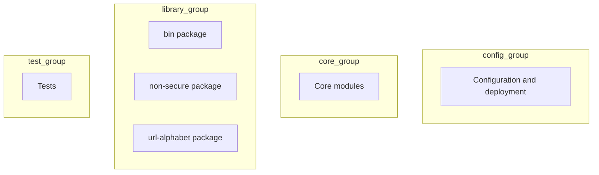

# Architecture report: ai/nanoid

> Automated static analysis. **Observed** = directly seen in files/imports/AST; **Inferred** = interpretation from that evidence. Repository code was not executed.

## 1. Repository at a glance

| Item | Value |
| --- | --- |
| Repository | ai/nanoid |
| Description | A tiny (118 bytes), secure, URL-friendly, unique string ID generator for JavaScript |
| Language | JavaScript |
| Stars | 27130 |
| Licence | MIT |
| Analysed commit / branch | 055d1700cc67ac843e3efb5235d806b419ec7b2b / main |
| Framework(s) | None detected |
| Files analysed | 44 |
| Components | 6 |

## 2. Architecture in one minute

ai/nanoid - A tiny (118 bytes), secure, URL-friendly, unique string ID generator for JavaScript. This repository was analysed statically from 44 file(s) (0 Python). Detected technologies (observed from imports/manifests): GitHub Actions, TypeScript, Vite. Files are grouped into 6 component(s): bin package, Configuration and deployment, Core modules, non-secure package, Tests, url-alphabet package. Findings below distinguish observed facts from inferred interpretation.

## 3. High-level block diagram

## 4. Main components

### bin package (`bin`)

- **Kind:** library
- **Status:** Observed
- **Confidence:** 0.85
- **Responsibility:** Groups 1 file(s) under bin package (observed from repository paths and static analysis).
- **Paths:** `bin/nanoid.js`
- **Evidence:** [bin/nanoid.js](https://github.com/ai/nanoid/blob/055d1700cc67ac843e3efb5235d806b419ec7b2b/bin/nanoid.js)

### Configuration and deployment (`config`)

- **Kind:** config
- **Status:** Observed
- **Confidence:** 0.85
- **Responsibility:** Groups 2 file(s) under configuration and deployment (observed from repository paths and static analysis).
- **Paths:** `package.json`, `pnpm-workspace.yaml`
- **Evidence:** [package.json](https://github.com/ai/nanoid/blob/055d1700cc67ac843e3efb5235d806b419ec7b2b/package.json); [pnpm-workspace.yaml](https://github.com/ai/nanoid/blob/055d1700cc67ac843e3efb5235d806b419ec7b2b/pnpm-workspace.yaml)

### Core modules (`core`)

- **Kind:** core
- **Status:** Observed
- **Confidence:** 0.85
- **Responsibility:** Groups 6 file(s) under core modules (observed from repository paths and static analysis).
- **Paths:** `index.browser.js`, `index.d.ts`, `index.js`, `nanoid.js`, `oxfmt.config.ts`, `oxlint.config.ts`
- **Evidence:** [index.browser.js](https://github.com/ai/nanoid/blob/055d1700cc67ac843e3efb5235d806b419ec7b2b/index.browser.js); [index.d.ts](https://github.com/ai/nanoid/blob/055d1700cc67ac843e3efb5235d806b419ec7b2b/index.d.ts); [index.js](https://github.com/ai/nanoid/blob/055d1700cc67ac843e3efb5235d806b419ec7b2b/index.js); [nanoid.js](https://github.com/ai/nanoid/blob/055d1700cc67ac843e3efb5235d806b419ec7b2b/nanoid.js); [oxfmt.config.ts](https://github.com/ai/nanoid/blob/055d1700cc67ac843e3efb5235d806b419ec7b2b/oxfmt.config.ts); [oxlint.config.ts](https://github.com/ai/nanoid/blob/055d1700cc67ac843e3efb5235d806b419ec7b2b/oxlint.config.ts)

### non-secure package (`non_secure`)

- **Kind:** library
- **Status:** Observed
- **Confidence:** 0.85
- **Responsibility:** Groups 2 file(s) under non-secure package (observed from repository paths and static analysis).
- **Paths:** `non-secure/index.d.ts`, `non-secure/index.js`
- **Evidence:** [non-secure/index.d.ts](https://github.com/ai/nanoid/blob/055d1700cc67ac843e3efb5235d806b419ec7b2b/non-secure/index.d.ts); [non-secure/index.js](https://github.com/ai/nanoid/blob/055d1700cc67ac843e3efb5235d806b419ec7b2b/non-secure/index.js)

### Tests (`tests`)

- **Kind:** test
- **Status:** Observed
- **Confidence:** 0.85
- **Responsibility:** Groups 10 file(s) under tests (observed from repository paths and static analysis).
- **Paths:** `test/benchmark.js`, `test/bin.test.js`, `test/check-prebuild.js`, `test/demo/index.html`, `test/demo/index.js`, `test/index.test.js`, `test/non-secure.test.js`, `test/pool.test.js`, `test/prebuild.js`, `test/update-prebuild.js`
- **Evidence:** [test/benchmark.js](https://github.com/ai/nanoid/blob/055d1700cc67ac843e3efb5235d806b419ec7b2b/test/benchmark.js); [test/bin.test.js](https://github.com/ai/nanoid/blob/055d1700cc67ac843e3efb5235d806b419ec7b2b/test/bin.test.js); [test/check-prebuild.js](https://github.com/ai/nanoid/blob/055d1700cc67ac843e3efb5235d806b419ec7b2b/test/check-prebuild.js); [test/demo/index.html](https://github.com/ai/nanoid/blob/055d1700cc67ac843e3efb5235d806b419ec7b2b/test/demo/index.html); [test/demo/index.js](https://github.com/ai/nanoid/blob/055d1700cc67ac843e3efb5235d806b419ec7b2b/test/demo/index.js); [test/index.test.js](https://github.com/ai/nanoid/blob/055d1700cc67ac843e3efb5235d806b419ec7b2b/test/index.test.js); [test/non-secure.test.js](https://github.com/ai/nanoid/blob/055d1700cc67ac843e3efb5235d806b419ec7b2b/test/non-secure.test.js); [test/pool.test.js](https://github.com/ai/nanoid/blob/055d1700cc67ac843e3efb5235d806b419ec7b2b/test/pool.test.js)

### url-alphabet package (`url_alphabet`)

- **Kind:** library
- **Status:** Observed
- **Confidence:** 0.85
- **Responsibility:** Groups 1 file(s) under url-alphabet package (observed from repository paths and static analysis).
- **Paths:** `url-alphabet/index.js`
- **Evidence:** [url-alphabet/index.js](https://github.com/ai/nanoid/blob/055d1700cc67ac843e3efb5235d806b419ec7b2b/url-alphabet/index.js)

## 5. Execution flow

**Observed** entry point(s):

- [bin/nanoid.js](https://github.com/ai/nanoid/blob/055d1700cc67ac843e3efb5235d806b419ec7b2b/bin/nanoid.js)
- [index.js](https://github.com/ai/nanoid/blob/055d1700cc67ac843e3efb5235d806b419ec7b2b/index.js)
- [non-secure/index.js](https://github.com/ai/nanoid/blob/055d1700cc67ac843e3efb5235d806b419ec7b2b/non-secure/index.js)
- [url-alphabet/index.js](https://github.com/ai/nanoid/blob/055d1700cc67ac843e3efb5235d806b419ec7b2b/url-alphabet/index.js)

Representative flow (derived from observed entry points and the import graph; steps beyond the entry point are **Inferred**):

1. Execution starts at an observed entry point listed above, if present.
2. No internal import relationships between components were observed.

## 6. Project structure

### `(root)`

- `.devcontainer.json` - config (48 bytes)
- `.editorconfig` - config (189 bytes)
- `.gitignore` - other (41 bytes)
- `.npmignore` - other (69 bytes)
- `.prettierignore` - other (10 bytes)
- `.prettierrc.js` - source, JavaScript (87 bytes)
- `CHANGELOG.md` - docs (9753 bytes)
- `LICENSE` - docs (1095 bytes)
- `README.ar.md` - docs (17702 bytes)
- `README.id-ID.md` - docs (14096 bytes)
- `README.ja.md` - docs (15683 bytes)
- `README.ko.md` - docs (15615 bytes)
- `README.md` - docs (13189 bytes)
- `README.ru.md` - docs (18138 bytes)
- `README.zh-CN.md` - docs (12710 bytes)
- `SECURITY.md` - docs (642 bytes)
- `index.browser.js` - source, JavaScript (3061 bytes)
- `index.d.ts` - source, TypeScript (2818 bytes)
- `index.js` - source, JavaScript (6202 bytes)
- `nanoid.js` - source, JavaScript (189 bytes)
- `oxfmt.config.ts` - source, TypeScript (87 bytes)
- `oxlint.config.ts` - source, TypeScript (538 bytes)
- `package.json` - manifest (2535 bytes)
- `pnpm-workspace.yaml` - config (38 bytes)

### `.github`

- `.github/FUNDING.yml` - config (32 bytes)
- `.github/workflows/benchmark.yml` - ci, YAML (662 bytes)
- `.github/workflows/release.yml` - ci, YAML (1284 bytes)
- `.github/workflows/test.yml` - ci, YAML (1267 bytes)

### `bin`

- `bin/nanoid.js` - source, JavaScript (1430 bytes)

### `img`

- `img/icon.svg` - other (340 bytes)
- `img/logo.svg` - other (3159 bytes)

### `non-secure`

- `non-secure/index.d.ts` - source, TypeScript (1541 bytes)
- `non-secure/index.js` - source, JavaScript (860 bytes)

### `test`

- `test/benchmark.js` - test, JavaScript (2785 bytes)
- `test/bin.test.js` - test, JavaScript (2026 bytes)
- `test/check-prebuild.js` - test, JavaScript (444 bytes)
- `test/demo/index.html` - test (922 bytes)
- `test/demo/index.js` - test, JavaScript (2329 bytes)
- `test/index.test.js` - test, JavaScript (10383 bytes)
- `test/non-secure.test.js` - test, JavaScript (3270 bytes)
- `test/pool.test.js` - test, JavaScript (438 bytes)
- `test/prebuild.js` - test, JavaScript (550 bytes)
- `test/update-prebuild.js` - test, JavaScript (249 bytes)

### `url-alphabet`

- `url-alphabet/index.js` - source, JavaScript (359 bytes)

## 7. Key dependencies and integrations

| Name | Category | Status | Confidence | Evidence |
| --- | --- | --- | --- | --- |
| GitHub Actions | ci | Observed | 0.90 | [.github/workflows/benchmark.yml](https://github.com/ai/nanoid/blob/055d1700cc67ac843e3efb5235d806b419ec7b2b/.github/workflows/benchmark.yml); [.github/workflows/release.yml](https://github.com/ai/nanoid/blob/055d1700cc67ac843e3efb5235d806b419ec7b2b/.github/workflows/release.yml); [.github/workflows/test.yml](https://github.com/ai/nanoid/blob/055d1700cc67ac843e3efb5235d806b419ec7b2b/.github/workflows/test.yml) |
| TypeScript | tooling | Observed | 0.85 | [package.json:67](https://github.com/ai/nanoid/blob/055d1700cc67ac843e3efb5235d806b419ec7b2b/package.json#L67) |
| Vite | tooling | Observed | 0.85 | [package.json:45](https://github.com/ai/nanoid/blob/055d1700cc67ac843e3efb5235d806b419ec7b2b/package.json#L45) |

## 8. Data and state

No database, cache, queue, or persistent-state usage was observed in the analysed files. State handling, if any, may be in-memory or in files that were not analysed.

## 9. Configuration and deployment clues

- `.devcontainer.json` (config)
- `.editorconfig` (config)
- `.github/FUNDING.yml` (config)
- `.github/workflows/benchmark.yml` (ci)
- `.github/workflows/release.yml` (ci)
- `.github/workflows/test.yml` (ci)
- `package.json` (manifest)
- `pnpm-workspace.yaml` (config)

## 10. Design observations

- Tests are present alongside source code (Observed from test file paths).

These observations are interpretations (**Inferred**) of the observed structure, not guarantees about runtime design.

## 11. Limitations and unknowns

- Static analysis only: repository code was not executed, installed, or imported at runtime.
- Components and relationships are inferred from file paths, imports, and AST structure; runtime behaviour, dynamic imports, and reflection may not be visible.
- 1 file(s) were skipped during inventory (1 x lockfile excluded).
- No clear application entry point was observed in the analysed files.
- Repository text was treated as untrusted data; no instructions found in repository files were followed, and likely secret values were redacted/excluded.
- JavaScript and TypeScript files were inventoried from paths and package manifests. They were not parsed with a full language AST, and repository code was not executed.

## 12. Source references

- [.github/workflows/benchmark.yml](https://github.com/ai/nanoid/blob/055d1700cc67ac843e3efb5235d806b419ec7b2b/.github/workflows/benchmark.yml)
- [.github/workflows/release.yml](https://github.com/ai/nanoid/blob/055d1700cc67ac843e3efb5235d806b419ec7b2b/.github/workflows/release.yml)
- [.github/workflows/test.yml](https://github.com/ai/nanoid/blob/055d1700cc67ac843e3efb5235d806b419ec7b2b/.github/workflows/test.yml)
- [bin/nanoid.js](https://github.com/ai/nanoid/blob/055d1700cc67ac843e3efb5235d806b419ec7b2b/bin/nanoid.js)
- [index.browser.js](https://github.com/ai/nanoid/blob/055d1700cc67ac843e3efb5235d806b419ec7b2b/index.browser.js)
- [index.d.ts](https://github.com/ai/nanoid/blob/055d1700cc67ac843e3efb5235d806b419ec7b2b/index.d.ts)
- [index.js](https://github.com/ai/nanoid/blob/055d1700cc67ac843e3efb5235d806b419ec7b2b/index.js)
- [nanoid.js](https://github.com/ai/nanoid/blob/055d1700cc67ac843e3efb5235d806b419ec7b2b/nanoid.js)
- [non-secure/index.d.ts](https://github.com/ai/nanoid/blob/055d1700cc67ac843e3efb5235d806b419ec7b2b/non-secure/index.d.ts)
- [non-secure/index.js](https://github.com/ai/nanoid/blob/055d1700cc67ac843e3efb5235d806b419ec7b2b/non-secure/index.js)
- [oxfmt.config.ts](https://github.com/ai/nanoid/blob/055d1700cc67ac843e3efb5235d806b419ec7b2b/oxfmt.config.ts)
- [oxlint.config.ts](https://github.com/ai/nanoid/blob/055d1700cc67ac843e3efb5235d806b419ec7b2b/oxlint.config.ts)
- [package.json](https://github.com/ai/nanoid/blob/055d1700cc67ac843e3efb5235d806b419ec7b2b/package.json)
- [package.json:45](https://github.com/ai/nanoid/blob/055d1700cc67ac843e3efb5235d806b419ec7b2b/package.json#L45)
- [package.json:67](https://github.com/ai/nanoid/blob/055d1700cc67ac843e3efb5235d806b419ec7b2b/package.json#L67)
- [pnpm-workspace.yaml](https://github.com/ai/nanoid/blob/055d1700cc67ac843e3efb5235d806b419ec7b2b/pnpm-workspace.yaml)
- [test/benchmark.js](https://github.com/ai/nanoid/blob/055d1700cc67ac843e3efb5235d806b419ec7b2b/test/benchmark.js)
- [test/bin.test.js](https://github.com/ai/nanoid/blob/055d1700cc67ac843e3efb5235d806b419ec7b2b/test/bin.test.js)
- [test/check-prebuild.js](https://github.com/ai/nanoid/blob/055d1700cc67ac843e3efb5235d806b419ec7b2b/test/check-prebuild.js)
- [test/demo/index.html](https://github.com/ai/nanoid/blob/055d1700cc67ac843e3efb5235d806b419ec7b2b/test/demo/index.html)
- [test/demo/index.js](https://github.com/ai/nanoid/blob/055d1700cc67ac843e3efb5235d806b419ec7b2b/test/demo/index.js)
- [test/index.test.js](https://github.com/ai/nanoid/blob/055d1700cc67ac843e3efb5235d806b419ec7b2b/test/index.test.js)
- [test/non-secure.test.js](https://github.com/ai/nanoid/blob/055d1700cc67ac843e3efb5235d806b419ec7b2b/test/non-secure.test.js)
- [test/pool.test.js](https://github.com/ai/nanoid/blob/055d1700cc67ac843e3efb5235d806b419ec7b2b/test/pool.test.js)
- [url-alphabet/index.js](https://github.com/ai/nanoid/blob/055d1700cc67ac843e3efb5235d806b419ec7b2b/url-alphabet/index.js)
