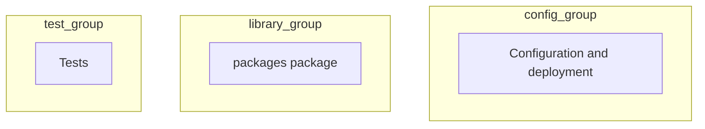

# Architecture report: airbnb/javascript

> Automated static analysis. **Observed** = directly seen in files/imports/AST; **Inferred** = interpretation from that evidence. Repository code was not executed.

## 1. Repository at a glance

| Item | Value |
| --- | --- |
| Repository | airbnb/javascript |
| Description | JavaScript Style Guide |
| Language | JavaScript |
| Stars | 148006 |
| Licence | MIT |
| Analysed commit / branch | 8ed19247bef145e3cc41b24a02dd1fe6d9b5e681 / master |
| Framework(s) | React |
| Files analysed | 58 |
| Components | 3 |

## 2. Architecture in one minute

airbnb/javascript - JavaScript Style Guide. This repository was analysed statically from 58 file(s) (0 Python). Detected technologies (observed from imports/manifests): GitHub Actions, React. Files are grouped into 3 component(s): Configuration and deployment, packages package, Tests. Findings below distinguish observed facts from inferred interpretation.

## 3. High-level block diagram

## 4. Main components

### Configuration and deployment (`config`)

- **Kind:** config
- **Status:** Observed
- **Confidence:** 0.85
- **Responsibility:** Groups 4 file(s) under configuration and deployment (observed from repository paths and static analysis).
- **Paths:** `linters/.markdownlint.json`, `package.json`, `packages/eslint-config-airbnb-base/package.json`, `packages/eslint-config-airbnb/package.json`
- **Evidence:** [linters/.markdownlint.json](https://github.com/airbnb/javascript/blob/8ed19247bef145e3cc41b24a02dd1fe6d9b5e681/linters/.markdownlint.json); [package.json](https://github.com/airbnb/javascript/blob/8ed19247bef145e3cc41b24a02dd1fe6d9b5e681/package.json); [packages/eslint-config-airbnb-base/package.json](https://github.com/airbnb/javascript/blob/8ed19247bef145e3cc41b24a02dd1fe6d9b5e681/packages/eslint-config-airbnb-base/package.json); [packages/eslint-config-airbnb/package.json](https://github.com/airbnb/javascript/blob/8ed19247bef145e3cc41b24a02dd1fe6d9b5e681/packages/eslint-config-airbnb/package.json)

### packages package (`packages`)

- **Kind:** library
- **Status:** Observed
- **Confidence:** 0.85
- **Responsibility:** Groups 23 file(s) under packages package (observed from repository paths and static analysis).
- **Paths:** `packages/eslint-config-airbnb-base/index.js`, `packages/eslint-config-airbnb-base/legacy.js`, `packages/eslint-config-airbnb-base/rules/best-practices.js`, `packages/eslint-config-airbnb-base/rules/errors.js`, `packages/eslint-config-airbnb-base/rules/es6.js`, `packages/eslint-config-airbnb-base/rules/imports.js`, `packages/eslint-config-airbnb-base/rules/node.js`, `packages/eslint-config-airbnb-base/rules/strict.js`, `packages/eslint-config-airbnb-base/rules/style.js`, `packages/eslint-config-airbnb-base/rules/variables.js`, `packages/eslint-config-airbnb-base/whitespace-async.js`, `packages/eslint-config-airbnb-base/whitespace.js`, `packages/eslint-config-airbnb-base/whitespaceRules.js`, `packages/eslint-config-airbnb/base.js`, `packages/eslint-config-airbnb/hooks.js`, `packages/eslint-config-airbnb/index.js`, `packages/eslint-config-airbnb/legacy.js`, `packages/eslint-config-airbnb/rules/react-a11y.js`, `packages/eslint-config-airbnb/rules/react-hooks.js`, `packages/eslint-config-airbnb/rules/react.js`, `packages/eslint-config-airbnb/whitespace-async.js`, `packages/eslint-config-airbnb/whitespace.js`, `packages/eslint-config-airbnb/whitespaceRules.js`
- **Evidence:** [packages/eslint-config-airbnb-base/index.js](https://github.com/airbnb/javascript/blob/8ed19247bef145e3cc41b24a02dd1fe6d9b5e681/packages/eslint-config-airbnb-base/index.js); [packages/eslint-config-airbnb-base/legacy.js](https://github.com/airbnb/javascript/blob/8ed19247bef145e3cc41b24a02dd1fe6d9b5e681/packages/eslint-config-airbnb-base/legacy.js); [packages/eslint-config-airbnb-base/rules/best-practices.js](https://github.com/airbnb/javascript/blob/8ed19247bef145e3cc41b24a02dd1fe6d9b5e681/packages/eslint-config-airbnb-base/rules/best-practices.js); [packages/eslint-config-airbnb-base/rules/errors.js](https://github.com/airbnb/javascript/blob/8ed19247bef145e3cc41b24a02dd1fe6d9b5e681/packages/eslint-config-airbnb-base/rules/errors.js); [packages/eslint-config-airbnb-base/rules/es6.js](https://github.com/airbnb/javascript/blob/8ed19247bef145e3cc41b24a02dd1fe6d9b5e681/packages/eslint-config-airbnb-base/rules/es6.js); [packages/eslint-config-airbnb-base/rules/imports.js](https://github.com/airbnb/javascript/blob/8ed19247bef145e3cc41b24a02dd1fe6d9b5e681/packages/eslint-config-airbnb-base/rules/imports.js); [packages/eslint-config-airbnb-base/rules/node.js](https://github.com/airbnb/javascript/blob/8ed19247bef145e3cc41b24a02dd1fe6d9b5e681/packages/eslint-config-airbnb-base/rules/node.js); [packages/eslint-config-airbnb-base/rules/strict.js](https://github.com/airbnb/javascript/blob/8ed19247bef145e3cc41b24a02dd1fe6d9b5e681/packages/eslint-config-airbnb-base/rules/strict.js)

### Tests (`tests`)

- **Kind:** test
- **Status:** Observed
- **Confidence:** 0.85
- **Responsibility:** Groups 7 file(s) under tests (observed from repository paths and static analysis).
- **Paths:** `packages/eslint-config-airbnb-base/test/.eslintrc`, `packages/eslint-config-airbnb-base/test/requires.js`, `packages/eslint-config-airbnb-base/test/test-base.js`, `packages/eslint-config-airbnb/test/.eslintrc`, `packages/eslint-config-airbnb/test/requires.js`, `packages/eslint-config-airbnb/test/test-base.js`, `packages/eslint-config-airbnb/test/test-react-order.js`
- **Evidence:** [packages/eslint-config-airbnb-base/test/.eslintrc](https://github.com/airbnb/javascript/blob/8ed19247bef145e3cc41b24a02dd1fe6d9b5e681/packages/eslint-config-airbnb-base/test/.eslintrc); [packages/eslint-config-airbnb-base/test/requires.js](https://github.com/airbnb/javascript/blob/8ed19247bef145e3cc41b24a02dd1fe6d9b5e681/packages/eslint-config-airbnb-base/test/requires.js); [packages/eslint-config-airbnb-base/test/test-base.js](https://github.com/airbnb/javascript/blob/8ed19247bef145e3cc41b24a02dd1fe6d9b5e681/packages/eslint-config-airbnb-base/test/test-base.js); [packages/eslint-config-airbnb/test/.eslintrc](https://github.com/airbnb/javascript/blob/8ed19247bef145e3cc41b24a02dd1fe6d9b5e681/packages/eslint-config-airbnb/test/.eslintrc); [packages/eslint-config-airbnb/test/requires.js](https://github.com/airbnb/javascript/blob/8ed19247bef145e3cc41b24a02dd1fe6d9b5e681/packages/eslint-config-airbnb/test/requires.js); [packages/eslint-config-airbnb/test/test-base.js](https://github.com/airbnb/javascript/blob/8ed19247bef145e3cc41b24a02dd1fe6d9b5e681/packages/eslint-config-airbnb/test/test-base.js); [packages/eslint-config-airbnb/test/test-react-order.js](https://github.com/airbnb/javascript/blob/8ed19247bef145e3cc41b24a02dd1fe6d9b5e681/packages/eslint-config-airbnb/test/test-react-order.js)

## 5. Execution flow

**Observed** entry point(s):

- [packages/eslint-config-airbnb-base/index.js](https://github.com/airbnb/javascript/blob/8ed19247bef145e3cc41b24a02dd1fe6d9b5e681/packages/eslint-config-airbnb-base/index.js)
- [packages/eslint-config-airbnb/index.js](https://github.com/airbnb/javascript/blob/8ed19247bef145e3cc41b24a02dd1fe6d9b5e681/packages/eslint-config-airbnb/index.js)

Representative flow (derived from observed entry points and the import graph; steps beyond the entry point are **Inferred**):

1. Execution starts at an observed entry point listed above, if present.
2. No internal import relationships between components were observed.

## 6. Project structure

### `(root)`

- `.editorconfig` - config (268 bytes)
- `.gitignore` - other (89 bytes)
- `CODE_OF_CONDUCT.md` - docs (628 bytes)
- `LICENSE.md` - docs (1063 bytes)
- `README.md` - docs (129525 bytes)
- `package.json` - manifest (1700 bytes)

### `.github`

- `.github/workflows/node-pretest.yml` - ci, YAML (593 bytes)
- `.github/workflows/node.yml` - ci, YAML (4563 bytes)
- `.github/workflows/rebase.yml` - ci, YAML (439 bytes)
- `.github/workflows/require-allow-edits.yml` - ci, YAML (330 bytes)

### `css-in-javascript`

- `css-in-javascript/README.md` - docs (9710 bytes)

### `linters`

- `linters/.eslintrc` - other (146 bytes)
- `linters/.jshintrc` - other (1219 bytes)
- `linters/.markdownlint.json` - config (5045 bytes)
- `linters/SublimeLinter/SublimeLinter.sublime-settings` - other (1947 bytes)

### `packages`

- `packages/eslint-config-airbnb-base/.babelrc` - other (28 bytes)
- `packages/eslint-config-airbnb-base/.eslintrc` - other (245 bytes)
- `packages/eslint-config-airbnb-base/CHANGELOG.md` - docs (16927 bytes)
- `packages/eslint-config-airbnb-base/LICENSE.md` - docs (1063 bytes)
- `packages/eslint-config-airbnb-base/README.md` - docs (4662 bytes)
- `packages/eslint-config-airbnb-base/index.js` - source, JavaScript (329 bytes)
- `packages/eslint-config-airbnb-base/legacy.js` - source, JavaScript (824 bytes)
- `packages/eslint-config-airbnb-base/package.json` - manifest (2645 bytes)
- `packages/eslint-config-airbnb-base/rules/best-practices.js` - source, JavaScript (14608 bytes)
- `packages/eslint-config-airbnb-base/rules/errors.js` - source, JavaScript (6983 bytes)
- `packages/eslint-config-airbnb-base/rules/es6.js` - source, JavaScript (6172 bytes)
- `packages/eslint-config-airbnb-base/rules/imports.js` - source, JavaScript (13022 bytes)
- `packages/eslint-config-airbnb-base/rules/node.js` - source, JavaScript (1152 bytes)
- `packages/eslint-config-airbnb-base/rules/strict.js` - source, JavaScript (112 bytes)
- `packages/eslint-config-airbnb-base/rules/style.js` - source, JavaScript (18854 bytes)
- `packages/eslint-config-airbnb-base/rules/variables.js` - source, JavaScript (2021 bytes)
- `packages/eslint-config-airbnb-base/test/.eslintrc` - test (233 bytes)
- `packages/eslint-config-airbnb-base/test/requires.js` - test, JavaScript (358 bytes)
- `packages/eslint-config-airbnb-base/test/test-base.js` - test, JavaScript (1083 bytes)
- `packages/eslint-config-airbnb-base/whitespace-async.js` - source, JavaScript (1345 bytes)
- `packages/eslint-config-airbnb-base/whitespace.js` - source, JavaScript (1775 bytes)
- `packages/eslint-config-airbnb-base/whitespaceRules.js` - source, JavaScript (1180 bytes)
- `packages/eslint-config-airbnb/.babelrc` - other (28 bytes)
- `packages/eslint-config-airbnb/.eslintrc` - other (226 bytes)
- `packages/eslint-config-airbnb/CHANGELOG.md` - docs (25623 bytes)
- `packages/eslint-config-airbnb/LICENSE.md` - docs (1063 bytes)
- `packages/eslint-config-airbnb/README.md` - docs (4039 bytes)
- `packages/eslint-config-airbnb/base.js` - source, JavaScript (98 bytes)
- `packages/eslint-config-airbnb/hooks.js` - source, JavaScript (103 bytes)
- `packages/eslint-config-airbnb/index.js` - source, JavaScript (153 bytes)
- `packages/eslint-config-airbnb/legacy.js` - source, JavaScript (105 bytes)
- `packages/eslint-config-airbnb/package.json` - manifest (3044 bytes)
- `packages/eslint-config-airbnb/rules/react-a11y.js` - source, JavaScript (11463 bytes)
- `packages/eslint-config-airbnb/rules/react-hooks.js` - source, JavaScript (629 bytes)
- `packages/eslint-config-airbnb/rules/react.js` - source, JavaScript (28295 bytes)
- `packages/eslint-config-airbnb/test/.eslintrc` - test (233 bytes)
- `packages/eslint-config-airbnb/test/requires.js` - test, JavaScript (494 bytes)
- `packages/eslint-config-airbnb/test/test-base.js` - test, JavaScript (1071 bytes)
- `packages/eslint-config-airbnb/test/test-react-order.js` - test, JavaScript (3904 bytes)
- `packages/eslint-config-airbnb/whitespace-async.js` - source, JavaScript (1345 bytes)
- `packages/eslint-config-airbnb/whitespace.js` - source, JavaScript (1775 bytes)
- `packages/eslint-config-airbnb/whitespaceRules.js` - source, JavaScript (1636 bytes)

### `react`

- `react/README.md` - docs (24223 bytes)

## 7. Key dependencies and integrations

| Name | Category | Status | Confidence | Evidence |
| --- | --- | --- | --- | --- |
| GitHub Actions | ci | Observed | 0.90 | [.github/workflows/node-pretest.yml](https://github.com/airbnb/javascript/blob/8ed19247bef145e3cc41b24a02dd1fe6d9b5e681/.github/workflows/node-pretest.yml); [.github/workflows/node.yml](https://github.com/airbnb/javascript/blob/8ed19247bef145e3cc41b24a02dd1fe6d9b5e681/.github/workflows/node.yml); [.github/workflows/rebase.yml](https://github.com/airbnb/javascript/blob/8ed19247bef145e3cc41b24a02dd1fe6d9b5e681/.github/workflows/rebase.yml); [.github/workflows/require-allow-edits.yml](https://github.com/airbnb/javascript/blob/8ed19247bef145e3cc41b24a02dd1fe6d9b5e681/.github/workflows/require-allow-edits.yml) |
| React | framework | Observed | 0.85 | [packages/eslint-config-airbnb/package.json:12](https://github.com/airbnb/javascript/blob/8ed19247bef145e3cc41b24a02dd1fe6d9b5e681/packages/eslint-config-airbnb/package.json#L12) |

## 8. Data and state

No database, cache, queue, or persistent-state usage was observed in the analysed files. State handling, if any, may be in-memory or in files that were not analysed.

## 9. Configuration and deployment clues

- `.editorconfig` (config)
- `.github/workflows/node-pretest.yml` (ci)
- `.github/workflows/node.yml` (ci)
- `.github/workflows/rebase.yml` (ci)
- `.github/workflows/require-allow-edits.yml` (ci)
- `linters/.markdownlint.json` (config)
- `package.json` (manifest)
- `packages/eslint-config-airbnb-base/package.json` (manifest)
- `packages/eslint-config-airbnb/package.json` (manifest)

## 10. Design observations

- Tests are present alongside source code (Observed from test file paths).

These observations are interpretations (**Inferred**) of the observed structure, not guarantees about runtime design.

## 11. Limitations and unknowns

- Static analysis only: repository code was not executed, installed, or imported at runtime.
- Components and relationships are inferred from file paths, imports, and AST structure; runtime behaviour, dynamic imports, and reflection may not be visible.
- 1 file(s) were skipped during inventory (1 x likely secret file excluded).
- No clear application entry point was observed in the analysed files.
- Repository text was treated as untrusted data; no instructions found in repository files were followed, and likely secret values were redacted/excluded.
- JavaScript and TypeScript files were inventoried from paths and package manifests. They were not parsed with a full language AST, and repository code was not executed.

## 12. Source references

- [.github/workflows/node-pretest.yml](https://github.com/airbnb/javascript/blob/8ed19247bef145e3cc41b24a02dd1fe6d9b5e681/.github/workflows/node-pretest.yml)
- [.github/workflows/node.yml](https://github.com/airbnb/javascript/blob/8ed19247bef145e3cc41b24a02dd1fe6d9b5e681/.github/workflows/node.yml)
- [.github/workflows/rebase.yml](https://github.com/airbnb/javascript/blob/8ed19247bef145e3cc41b24a02dd1fe6d9b5e681/.github/workflows/rebase.yml)
- [.github/workflows/require-allow-edits.yml](https://github.com/airbnb/javascript/blob/8ed19247bef145e3cc41b24a02dd1fe6d9b5e681/.github/workflows/require-allow-edits.yml)
- [linters/.markdownlint.json](https://github.com/airbnb/javascript/blob/8ed19247bef145e3cc41b24a02dd1fe6d9b5e681/linters/.markdownlint.json)
- [package.json](https://github.com/airbnb/javascript/blob/8ed19247bef145e3cc41b24a02dd1fe6d9b5e681/package.json)
- [packages/eslint-config-airbnb-base/index.js](https://github.com/airbnb/javascript/blob/8ed19247bef145e3cc41b24a02dd1fe6d9b5e681/packages/eslint-config-airbnb-base/index.js)
- [packages/eslint-config-airbnb-base/legacy.js](https://github.com/airbnb/javascript/blob/8ed19247bef145e3cc41b24a02dd1fe6d9b5e681/packages/eslint-config-airbnb-base/legacy.js)
- [packages/eslint-config-airbnb-base/package.json](https://github.com/airbnb/javascript/blob/8ed19247bef145e3cc41b24a02dd1fe6d9b5e681/packages/eslint-config-airbnb-base/package.json)
- [packages/eslint-config-airbnb-base/rules/best-practices.js](https://github.com/airbnb/javascript/blob/8ed19247bef145e3cc41b24a02dd1fe6d9b5e681/packages/eslint-config-airbnb-base/rules/best-practices.js)
- [packages/eslint-config-airbnb-base/rules/errors.js](https://github.com/airbnb/javascript/blob/8ed19247bef145e3cc41b24a02dd1fe6d9b5e681/packages/eslint-config-airbnb-base/rules/errors.js)
- [packages/eslint-config-airbnb-base/rules/es6.js](https://github.com/airbnb/javascript/blob/8ed19247bef145e3cc41b24a02dd1fe6d9b5e681/packages/eslint-config-airbnb-base/rules/es6.js)
- [packages/eslint-config-airbnb-base/rules/imports.js](https://github.com/airbnb/javascript/blob/8ed19247bef145e3cc41b24a02dd1fe6d9b5e681/packages/eslint-config-airbnb-base/rules/imports.js)
- [packages/eslint-config-airbnb-base/rules/node.js](https://github.com/airbnb/javascript/blob/8ed19247bef145e3cc41b24a02dd1fe6d9b5e681/packages/eslint-config-airbnb-base/rules/node.js)
- [packages/eslint-config-airbnb-base/rules/strict.js](https://github.com/airbnb/javascript/blob/8ed19247bef145e3cc41b24a02dd1fe6d9b5e681/packages/eslint-config-airbnb-base/rules/strict.js)
- [packages/eslint-config-airbnb-base/test/.eslintrc](https://github.com/airbnb/javascript/blob/8ed19247bef145e3cc41b24a02dd1fe6d9b5e681/packages/eslint-config-airbnb-base/test/.eslintrc)
- [packages/eslint-config-airbnb-base/test/requires.js](https://github.com/airbnb/javascript/blob/8ed19247bef145e3cc41b24a02dd1fe6d9b5e681/packages/eslint-config-airbnb-base/test/requires.js)
- [packages/eslint-config-airbnb-base/test/test-base.js](https://github.com/airbnb/javascript/blob/8ed19247bef145e3cc41b24a02dd1fe6d9b5e681/packages/eslint-config-airbnb-base/test/test-base.js)
- [packages/eslint-config-airbnb/index.js](https://github.com/airbnb/javascript/blob/8ed19247bef145e3cc41b24a02dd1fe6d9b5e681/packages/eslint-config-airbnb/index.js)
- [packages/eslint-config-airbnb/package.json](https://github.com/airbnb/javascript/blob/8ed19247bef145e3cc41b24a02dd1fe6d9b5e681/packages/eslint-config-airbnb/package.json)
- [packages/eslint-config-airbnb/package.json:12](https://github.com/airbnb/javascript/blob/8ed19247bef145e3cc41b24a02dd1fe6d9b5e681/packages/eslint-config-airbnb/package.json#L12)
- [packages/eslint-config-airbnb/test/.eslintrc](https://github.com/airbnb/javascript/blob/8ed19247bef145e3cc41b24a02dd1fe6d9b5e681/packages/eslint-config-airbnb/test/.eslintrc)
- [packages/eslint-config-airbnb/test/requires.js](https://github.com/airbnb/javascript/blob/8ed19247bef145e3cc41b24a02dd1fe6d9b5e681/packages/eslint-config-airbnb/test/requires.js)
- [packages/eslint-config-airbnb/test/test-base.js](https://github.com/airbnb/javascript/blob/8ed19247bef145e3cc41b24a02dd1fe6d9b5e681/packages/eslint-config-airbnb/test/test-base.js)
- [packages/eslint-config-airbnb/test/test-react-order.js](https://github.com/airbnb/javascript/blob/8ed19247bef145e3cc41b24a02dd1fe6d9b5e681/packages/eslint-config-airbnb/test/test-react-order.js)
