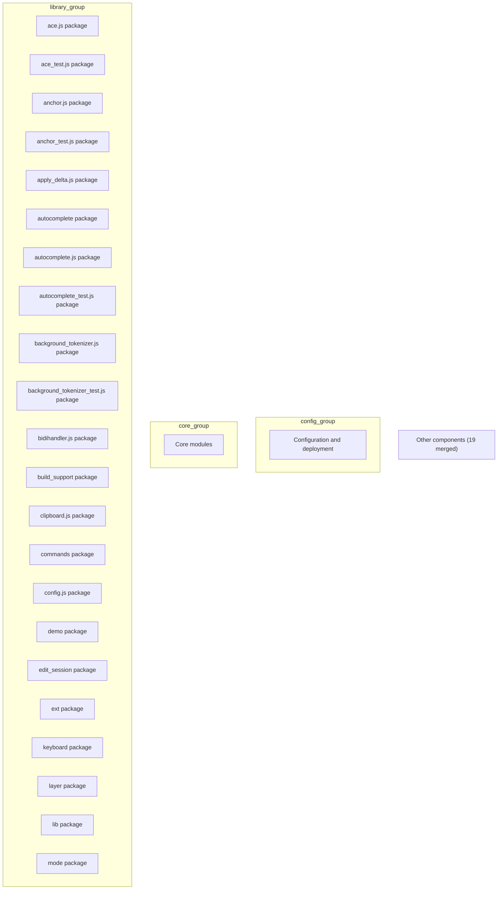

# Architecture report: ajaxorg/ace

> Automated static analysis. **Observed** = directly seen in files/imports/AST; **Inferred** = interpretation from that evidence. Repository code was not executed.

## 1. Repository at a glance

| Item | Value |
| --- | --- |
| Repository | ajaxorg/ace |
| Description | Ace (Ajax.org Cloud9 Editor) |
| Language | JavaScript |
| Stars | 27134 |
| Licence | Other |
| Analysed commit / branch | 2e1b35190636654b14b089383e031ff3f065369b / master |
| Framework(s) | None detected |
| Files analysed | 799 |
| Components | 43 |

## 2. Architecture in one minute

ajaxorg/ace - Ace (Ajax.org Cloud9 Editor). This repository was analysed statically from 799 file(s) (1 Python). Detected technologies (observed from imports/manifests): GitHub Actions, Docker, TypeScript, webpack. Files are grouped into 43 component(s): ace.js package, ace_test.js package, anchor.js package, anchor_test.js package, apply_delta.js package, autocomplete package, autocomplete.js package, autocomplete_test.js package. Findings below distinguish observed facts from inferred interpretation.

## 3. High-level block diagram

## 4. Main components

### ace.js package (`ace_js`)

- **Kind:** library
- **Status:** Observed
- **Confidence:** 0.85
- **Responsibility:** Groups 1 file(s) under ace.js package (observed from repository paths and static analysis).
- **Paths:** `src/ace.js`
- **Evidence:** [src/ace.js](https://github.com/ajaxorg/ace/blob/2e1b35190636654b14b089383e031ff3f065369b/src/ace.js)

### ace_test.js package (`ace_test_js`)

- **Kind:** library
- **Status:** Observed
- **Confidence:** 0.85
- **Responsibility:** Groups 1 file(s) under ace_test.js package (observed from repository paths and static analysis).
- **Paths:** `src/ace_test.js`
- **Evidence:** [src/ace_test.js](https://github.com/ajaxorg/ace/blob/2e1b35190636654b14b089383e031ff3f065369b/src/ace_test.js)

### anchor.js package (`anchor_js`)

- **Kind:** library
- **Status:** Observed
- **Confidence:** 0.85
- **Responsibility:** Groups 1 file(s) under anchor.js package (observed from repository paths and static analysis).
- **Paths:** `src/anchor.js`
- **Evidence:** [src/anchor.js](https://github.com/ajaxorg/ace/blob/2e1b35190636654b14b089383e031ff3f065369b/src/anchor.js)

### anchor_test.js package (`anchor_test_js`)

- **Kind:** library
- **Status:** Observed
- **Confidence:** 0.85
- **Responsibility:** Groups 1 file(s) under anchor_test.js package (observed from repository paths and static analysis).
- **Paths:** `src/anchor_test.js`
- **Evidence:** [src/anchor_test.js](https://github.com/ajaxorg/ace/blob/2e1b35190636654b14b089383e031ff3f065369b/src/anchor_test.js)

### apply_delta.js package (`apply_delta_js`)

- **Kind:** library
- **Status:** Observed
- **Confidence:** 0.85
- **Responsibility:** Groups 1 file(s) under apply_delta.js package (observed from repository paths and static analysis).
- **Paths:** `src/apply_delta.js`
- **Evidence:** [src/apply_delta.js](https://github.com/ajaxorg/ace/blob/2e1b35190636654b14b089383e031ff3f065369b/src/apply_delta.js)

### autocomplete package (`autocomplete`)

- **Kind:** library
- **Status:** Observed
- **Confidence:** 0.85
- **Responsibility:** Groups 7 file(s) under autocomplete package (observed from repository paths and static analysis).
- **Paths:** `src/autocomplete/inline.js`, `src/autocomplete/inline_screenreader.js`, `src/autocomplete/inline_test.js`, `src/autocomplete/popup.js`, `src/autocomplete/popup_test.js`, `src/autocomplete/text_completer.js`, `src/autocomplete/util.js`
- **Evidence:** [src/autocomplete/inline.js](https://github.com/ajaxorg/ace/blob/2e1b35190636654b14b089383e031ff3f065369b/src/autocomplete/inline.js); [src/autocomplete/inline_screenreader.js](https://github.com/ajaxorg/ace/blob/2e1b35190636654b14b089383e031ff3f065369b/src/autocomplete/inline_screenreader.js); [src/autocomplete/inline_test.js](https://github.com/ajaxorg/ace/blob/2e1b35190636654b14b089383e031ff3f065369b/src/autocomplete/inline_test.js); [src/autocomplete/popup.js](https://github.com/ajaxorg/ace/blob/2e1b35190636654b14b089383e031ff3f065369b/src/autocomplete/popup.js); [src/autocomplete/popup_test.js](https://github.com/ajaxorg/ace/blob/2e1b35190636654b14b089383e031ff3f065369b/src/autocomplete/popup_test.js); [src/autocomplete/text_completer.js](https://github.com/ajaxorg/ace/blob/2e1b35190636654b14b089383e031ff3f065369b/src/autocomplete/text_completer.js); [src/autocomplete/util.js](https://github.com/ajaxorg/ace/blob/2e1b35190636654b14b089383e031ff3f065369b/src/autocomplete/util.js)

### autocomplete.js package (`autocomplete_js`)

- **Kind:** library
- **Status:** Observed
- **Confidence:** 0.85
- **Responsibility:** Groups 1 file(s) under autocomplete.js package (observed from repository paths and static analysis).
- **Paths:** `src/autocomplete.js`
- **Evidence:** [src/autocomplete.js](https://github.com/ajaxorg/ace/blob/2e1b35190636654b14b089383e031ff3f065369b/src/autocomplete.js)

### autocomplete_test.js package (`autocomplete_test_js`)

- **Kind:** library
- **Status:** Observed
- **Confidence:** 0.85
- **Responsibility:** Groups 1 file(s) under autocomplete_test.js package (observed from repository paths and static analysis).
- **Paths:** `src/autocomplete_test.js`
- **Evidence:** [src/autocomplete_test.js](https://github.com/ajaxorg/ace/blob/2e1b35190636654b14b089383e031ff3f065369b/src/autocomplete_test.js)

### background_tokenizer.js package (`background_tokenizer_js`)

- **Kind:** library
- **Status:** Observed
- **Confidence:** 0.85
- **Responsibility:** Groups 1 file(s) under background_tokenizer.js package (observed from repository paths and static analysis).
- **Paths:** `src/background_tokenizer.js`
- **Evidence:** [src/background_tokenizer.js](https://github.com/ajaxorg/ace/blob/2e1b35190636654b14b089383e031ff3f065369b/src/background_tokenizer.js)

### background_tokenizer_test.js package (`background_tokenizer_test_js`)

- **Kind:** library
- **Status:** Observed
- **Confidence:** 0.85
- **Responsibility:** Groups 1 file(s) under background_tokenizer_test.js package (observed from repository paths and static analysis).
- **Paths:** `src/background_tokenizer_test.js`
- **Evidence:** [src/background_tokenizer_test.js](https://github.com/ajaxorg/ace/blob/2e1b35190636654b14b089383e031ff3f065369b/src/background_tokenizer_test.js)

### bidihandler.js package (`bidihandler_js`)

- **Kind:** library
- **Status:** Observed
- **Confidence:** 0.85
- **Responsibility:** Groups 1 file(s) under bidihandler.js package (observed from repository paths and static analysis).
- **Paths:** `src/bidihandler.js`
- **Evidence:** [src/bidihandler.js](https://github.com/ajaxorg/ace/blob/2e1b35190636654b14b089383e031ff3f065369b/src/bidihandler.js)

### build_support package (`build_support`)

- **Kind:** library
- **Status:** Observed
- **Confidence:** 0.85
- **Responsibility:** Groups 1 file(s) under build_support package (observed from repository paths and static analysis).
- **Paths:** `build_support/mini_require.js`
- **Evidence:** [build_support/mini_require.js](https://github.com/ajaxorg/ace/blob/2e1b35190636654b14b089383e031ff3f065369b/build_support/mini_require.js)

### clipboard.js package (`clipboard_js`)

- **Kind:** library
- **Status:** Observed
- **Confidence:** 0.85
- **Responsibility:** Groups 1 file(s) under clipboard.js package (observed from repository paths and static analysis).
- **Paths:** `src/clipboard.js`
- **Evidence:** [src/clipboard.js](https://github.com/ajaxorg/ace/blob/2e1b35190636654b14b089383e031ff3f065369b/src/clipboard.js)

### commands package (`commands`)

- **Kind:** library
- **Status:** Observed
- **Confidence:** 0.85
- **Responsibility:** Groups 6 file(s) under commands package (observed from repository paths and static analysis).
- **Paths:** `src/commands/command_manager.js`, `src/commands/command_manager_test.js`, `src/commands/default_commands.js`, `src/commands/incremental_search_commands.js`, `src/commands/multi_select_commands.js`, `src/commands/occur_commands.js`
- **Evidence:** [src/commands/command_manager.js](https://github.com/ajaxorg/ace/blob/2e1b35190636654b14b089383e031ff3f065369b/src/commands/command_manager.js); [src/commands/command_manager_test.js](https://github.com/ajaxorg/ace/blob/2e1b35190636654b14b089383e031ff3f065369b/src/commands/command_manager_test.js); [src/commands/default_commands.js](https://github.com/ajaxorg/ace/blob/2e1b35190636654b14b089383e031ff3f065369b/src/commands/default_commands.js); [src/commands/incremental_search_commands.js](https://github.com/ajaxorg/ace/blob/2e1b35190636654b14b089383e031ff3f065369b/src/commands/incremental_search_commands.js); [src/commands/multi_select_commands.js](https://github.com/ajaxorg/ace/blob/2e1b35190636654b14b089383e031ff3f065369b/src/commands/multi_select_commands.js); [src/commands/occur_commands.js](https://github.com/ajaxorg/ace/blob/2e1b35190636654b14b089383e031ff3f065369b/src/commands/occur_commands.js)

### Configuration and deployment (`config`)

- **Kind:** config
- **Status:** Observed
- **Confidence:** 0.85
- **Responsibility:** Groups 202 file(s) under configuration and deployment (observed from repository paths and static analysis).
- **Paths:** `_config.yml`, `amplify.yml`, `demo/kitchen-sink/docs/Dockerfile`, `demo/kitchen-sink/docs/ini.ini`, `demo/kitchen-sink/docs/json.json`, `demo/kitchen-sink/docs/toml.toml`, `demo/kitchen-sink/docs/yaml.yaml`, `demo/test_ace_builds/package.json`, `demo/test_ace_builds/tsconfig.json`, `demo/test_package/package.json`, `demo/test_package/tsconfig.json`, `demo/webpack/package.json`, `lib/ace/mode/_test/tokens_jsoniq.json`, `lib/ace/mode/_test/tokens_xquery.json`, `package.json`, `src/mode/_test/tokens_abap.json`, `src/mode/_test/tokens_abc.json`, `src/mode/_test/tokens_actionscript.json`, `src/mode/_test/tokens_ada.json`, `src/mode/_test/tokens_alda.json`, `src/mode/_test/tokens_apex.json`, `src/mode/_test/tokens_aql.json`, `src/mode/_test/tokens_asciidoc.json`, `src/mode/_test/tokens_asl.json`, `src/mode/_test/tokens_assembly_x86.json`, `src/mode/_test/tokens_autohotkey.json`, `src/mode/_test/tokens_basic.json`, `src/mode/_test/tokens_batchfile.json`, `src/mode/_test/tokens_bibtex.json`, `src/mode/_test/tokens_c9search.json`, `src/mode/_test/tokens_c_cpp.json`, `src/mode/_test/tokens_cirru.json`, `src/mode/_test/tokens_clojure.json`, `src/mode/_test/tokens_cobol.json`, `src/mode/_test/tokens_coffee.json`, `src/mode/_test/tokens_coldfusion.json`, `src/mode/_test/tokens_crystal.json`, `src/mode/_test/tokens_csharp.json`, `src/mode/_test/tokens_csound_document.json`, `src/mode/_test/tokens_csound_orchestra.json`, `src/mode/_test/tokens_csound_score.json`, `src/mode/_test/tokens_csp.json`, `src/mode/_test/tokens_css.json`, `src/mode/_test/tokens_csv.json`, `src/mode/_test/tokens_curly.json`, `src/mode/_test/tokens_d.json`, `src/mode/_test/tokens_dart.json`, `src/mode/_test/tokens_diff.json`, `src/mode/_test/tokens_django.json`, `src/mode/_test/tokens_dot.json`, `src/mode/_test/tokens_drools.json`, `src/mode/_test/tokens_edifact.json`, `src/mode/_test/tokens_eiffel.json`, `src/mode/_test/tokens_ejs.json`, `src/mode/_test/tokens_elixir.json`, `src/mode/_test/tokens_elm.json`, `src/mode/_test/tokens_erlang.json`, `src/mode/_test/tokens_flix.json`, `src/mode/_test/tokens_forth.json`, `src/mode/_test/tokens_fortran.json`, `src/mode/_test/tokens_fsharp.json`, `src/mode/_test/tokens_fsl.json`, `src/mode/_test/tokens_ftl.json`, `src/mode/_test/tokens_gcode.json`, `src/mode/_test/tokens_gdresource.json`, `src/mode/_test/tokens_gdscript.json`, `src/mode/_test/tokens_gdshader.json`, `src/mode/_test/tokens_gherkin.json`, `src/mode/_test/tokens_gitignore.json`, `src/mode/_test/tokens_glsl.json`, `src/mode/_test/tokens_gobstones.json`, `src/mode/_test/tokens_golang.json`, `src/mode/_test/tokens_graphqlschema.json`, `src/mode/_test/tokens_groovy.json`, `src/mode/_test/tokens_groq.json`, `src/mode/_test/tokens_haml.json`, `src/mode/_test/tokens_handlebars.json`, `src/mode/_test/tokens_haskell.json`, `src/mode/_test/tokens_haskell_cabal.json`, `src/mode/_test/tokens_haxe.json`, `src/mode/_test/tokens_hjson.json`, `src/mode/_test/tokens_html.json`, `src/mode/_test/tokens_html_elixir.json`, `src/mode/_test/tokens_html_ruby.json`, `src/mode/_test/tokens_ini.json`, `src/mode/_test/tokens_io.json`, `src/mode/_test/tokens_ion.json`, `src/mode/_test/tokens_jack.json`, `src/mode/_test/tokens_jade.json`, `src/mode/_test/tokens_java.json`, `src/mode/_test/tokens_javascript.json`, `src/mode/_test/tokens_jexl.json`, `src/mode/_test/tokens_json.json`, `src/mode/_test/tokens_json5.json`, `src/mode/_test/tokens_jsp.json`, `src/mode/_test/tokens_jssm.json`, `src/mode/_test/tokens_jsx.json`, `src/mode/_test/tokens_julia.json`, `src/mode/_test/tokens_kotlin.json`, `src/mode/_test/tokens_latex.json`, `src/mode/_test/tokens_latte.json`, `src/mode/_test/tokens_less.json`, `src/mode/_test/tokens_liquid.json`, `src/mode/_test/tokens_lisp.json`, `src/mode/_test/tokens_livescript.json`, `src/mode/_test/tokens_logiql.json`, `src/mode/_test/tokens_logtalk.json`, `src/mode/_test/tokens_lsl.json`, `src/mode/_test/tokens_lua.json`, `src/mode/_test/tokens_luapage.json`, `src/mode/_test/tokens_lucene.json`, `src/mode/_test/tokens_markdown.json`, `src/mode/_test/tokens_mask.json`, `src/mode/_test/tokens_matlab.json`, `src/mode/_test/tokens_maze.json`, `src/mode/_test/tokens_mediawiki.json`, `src/mode/_test/tokens_mel.json`, `src/mode/_test/tokens_mips.json`, `src/mode/_test/tokens_mixal.json`, `src/mode/_test/tokens_mushcode.json`, `src/mode/_test/tokens_mysql.json`, `src/mode/_test/tokens_nasal.json`, `src/mode/_test/tokens_nginx.json`, `src/mode/_test/tokens_nim.json`, `src/mode/_test/tokens_nix.json`, `src/mode/_test/tokens_nsis.json`, `src/mode/_test/tokens_nunjucks.json`, `src/mode/_test/tokens_objectivec.json`, `src/mode/_test/tokens_ocaml.json`, `src/mode/_test/tokens_odin.json`, `src/mode/_test/tokens_partiql.json`, `src/mode/_test/tokens_pascal.json`, `src/mode/_test/tokens_perl.json`, `src/mode/_test/tokens_pgsql.json`, `src/mode/_test/tokens_php.json`, `src/mode/_test/tokens_php_laravel_blade.json`, `src/mode/_test/tokens_pig.json`, `src/mode/_test/tokens_plsql.json`, `src/mode/_test/tokens_powershell.json`, `src/mode/_test/tokens_praat.json`, `src/mode/_test/tokens_prisma.json`, `src/mode/_test/tokens_prolog.json`, `src/mode/_test/tokens_properties.json`, `src/mode/_test/tokens_protobuf.json`, `src/mode/_test/tokens_puppet.json`, `src/mode/_test/tokens_python.json`, `src/mode/_test/tokens_qml.json`, `src/mode/_test/tokens_r.json`, `src/mode/_test/tokens_raku.json`, `src/mode/_test/tokens_razor.json`, `src/mode/_test/tokens_rdoc.json`, `src/mode/_test/tokens_red.json`, `src/mode/_test/tokens_rhtml.json`, `src/mode/_test/tokens_robot.json`, `src/mode/_test/tokens_rst.json`, `src/mode/_test/tokens_ruby.json`, `src/mode/_test/tokens_rust.json`, `src/mode/_test/tokens_sac.json`, `src/mode/_test/tokens_sass.json`, `src/mode/_test/tokens_scad.json`, `src/mode/_test/tokens_scala.json`, `src/mode/_test/tokens_scheme.json`, `src/mode/_test/tokens_scrypt.json`, `src/mode/_test/tokens_scss.json`, `src/mode/_test/tokens_sh.json`, `src/mode/_test/tokens_sjs.json`, `src/mode/_test/tokens_slim.json`, `src/mode/_test/tokens_smarty.json`, `src/mode/_test/tokens_smithy.json`, `src/mode/_test/tokens_snippets.json`, `src/mode/_test/tokens_soy_template.json`, `src/mode/_test/tokens_space.json`, `src/mode/_test/tokens_sparql.json`, `src/mode/_test/tokens_sql.json`, `src/mode/_test/tokens_sqlserver.json`, `src/mode/_test/tokens_stylus.json`, `src/mode/_test/tokens_svg.json`, `src/mode/_test/tokens_swift.json`, `src/mode/_test/tokens_tcl.json`, `src/mode/_test/tokens_terraform.json`, `src/mode/_test/tokens_tex.json`, `src/mode/_test/tokens_text.json`, `src/mode/_test/tokens_textile.json`, `src/mode/_test/tokens_toml.json`, `src/mode/_test/tokens_tsv.json`, `src/mode/_test/tokens_tsx.json`, `src/mode/_test/tokens_turtle.json`, `src/mode/_test/tokens_twig.json`, `src/mode/_test/tokens_typescript.json`, `src/mode/_test/tokens_vala.json`, `src/mode/_test/tokens_vbscript.json`, `src/mode/_test/tokens_velocity.json`, `src/mode/_test/tokens_verilog.json`, `src/mode/_test/tokens_vhdl.json`, `src/mode/_test/tokens_visualforce.json`, `src/mode/_test/tokens_vue.json`, `src/mode/_test/tokens_wollok.json`, `src/mode/_test/tokens_xml.json`, `src/mode/_test/tokens_yaml.json`, `src/mode/_test/tokens_zeek.json`, `src/mode/dockerfile.js`, `src/mode/dockerfile_highlight_rules.js`
- **Evidence:** [_config.yml](https://github.com/ajaxorg/ace/blob/2e1b35190636654b14b089383e031ff3f065369b/_config.yml); [amplify.yml](https://github.com/ajaxorg/ace/blob/2e1b35190636654b14b089383e031ff3f065369b/amplify.yml); [demo/kitchen-sink/docs/Dockerfile](https://github.com/ajaxorg/ace/blob/2e1b35190636654b14b089383e031ff3f065369b/demo/kitchen-sink/docs/Dockerfile); [demo/kitchen-sink/docs/ini.ini](https://github.com/ajaxorg/ace/blob/2e1b35190636654b14b089383e031ff3f065369b/demo/kitchen-sink/docs/ini.ini); [demo/kitchen-sink/docs/json.json](https://github.com/ajaxorg/ace/blob/2e1b35190636654b14b089383e031ff3f065369b/demo/kitchen-sink/docs/json.json); [demo/kitchen-sink/docs/toml.toml](https://github.com/ajaxorg/ace/blob/2e1b35190636654b14b089383e031ff3f065369b/demo/kitchen-sink/docs/toml.toml); [demo/kitchen-sink/docs/yaml.yaml](https://github.com/ajaxorg/ace/blob/2e1b35190636654b14b089383e031ff3f065369b/demo/kitchen-sink/docs/yaml.yaml); [demo/test_ace_builds/package.json](https://github.com/ajaxorg/ace/blob/2e1b35190636654b14b089383e031ff3f065369b/demo/test_ace_builds/package.json)

### config.js package (`config_js`)

- **Kind:** library
- **Status:** Observed
- **Confidence:** 0.85
- **Responsibility:** Groups 1 file(s) under config.js package (observed from repository paths and static analysis).
- **Paths:** `src/config.js`
- **Evidence:** [src/config.js](https://github.com/ajaxorg/ace/blob/2e1b35190636654b14b089383e031ff3f065369b/src/config.js)

### config_test.js package (`config_test_js`)

- **Kind:** library
- **Status:** Observed
- **Confidence:** 0.85
- **Responsibility:** Groups 1 file(s) under config_test.js package (observed from repository paths and static analysis).
- **Paths:** `src/config_test.js`
- **Evidence:** [src/config_test.js](https://github.com/ajaxorg/ace/blob/2e1b35190636654b14b089383e031ff3f065369b/src/config_test.js)

### Core modules (`core`)

- **Kind:** core
- **Status:** Observed
- **Confidence:** 0.85
- **Responsibility:** Groups 4 file(s) under core modules (observed from repository paths and static analysis).
- **Paths:** `Makefile.dryice.js`, `ace-internal.d.ts`, `ace-modes.d.ts`, `ace.d.ts`
- **Evidence:** [Makefile.dryice.js](https://github.com/ajaxorg/ace/blob/2e1b35190636654b14b089383e031ff3f065369b/Makefile.dryice.js); [ace-internal.d.ts](https://github.com/ajaxorg/ace/blob/2e1b35190636654b14b089383e031ff3f065369b/ace-internal.d.ts); [ace-modes.d.ts](https://github.com/ajaxorg/ace/blob/2e1b35190636654b14b089383e031ff3f065369b/ace-modes.d.ts); [ace.d.ts](https://github.com/ajaxorg/ace/blob/2e1b35190636654b14b089383e031ff3f065369b/ace.d.ts)

### css package (`css`)

- **Kind:** library
- **Status:** Observed
- **Confidence:** 0.85
- **Responsibility:** Groups 1 file(s) under css package (observed from repository paths and static analysis).
- **Paths:** `src/css/editor-css.js`
- **Evidence:** [src/css/editor-css.js](https://github.com/ajaxorg/ace/blob/2e1b35190636654b14b089383e031ff3f065369b/src/css/editor-css.js)

### demo package (`demo`)

- **Kind:** library
- **Status:** Observed
- **Confidence:** 0.85
- **Responsibility:** Groups 21 file(s) under demo package (observed from repository paths and static analysis).
- **Paths:** `demo/diff/examples/editor.16.js`, `demo/diff/examples/editor.17.js`, `demo/diff/examples/editor.40.js`, `demo/kitchen-sink/demo.js`, `demo/kitchen-sink/dev_util.js`, `demo/kitchen-sink/doclist.js`, `demo/kitchen-sink/docs/python.py`, `demo/kitchen-sink/file_drop.js`, `demo/kitchen-sink/inline_editor.js`, `demo/kitchen-sink/layout.js`, `demo/kitchen-sink/require.js`, `demo/kitchen-sink/token_tooltip.js`, `demo/kitchen-sink/util.js`, `demo/r.js/build.js`, `demo/show_own_source.js`, `demo/static-highlighter/server.js`, `demo/test_ace_builds/index.ts`, `demo/test_package/index.ts`, `demo/webpack/demo.js`, `demo/webpack/demo.ts`, `demo/webpack/webpack.config.js`
- **Evidence:** [demo/diff/examples/editor.16.js](https://github.com/ajaxorg/ace/blob/2e1b35190636654b14b089383e031ff3f065369b/demo/diff/examples/editor.16.js); [demo/diff/examples/editor.17.js](https://github.com/ajaxorg/ace/blob/2e1b35190636654b14b089383e031ff3f065369b/demo/diff/examples/editor.17.js); [demo/diff/examples/editor.40.js](https://github.com/ajaxorg/ace/blob/2e1b35190636654b14b089383e031ff3f065369b/demo/diff/examples/editor.40.js); [demo/kitchen-sink/demo.js](https://github.com/ajaxorg/ace/blob/2e1b35190636654b14b089383e031ff3f065369b/demo/kitchen-sink/demo.js); [demo/kitchen-sink/dev_util.js](https://github.com/ajaxorg/ace/blob/2e1b35190636654b14b089383e031ff3f065369b/demo/kitchen-sink/dev_util.js); [demo/kitchen-sink/doclist.js](https://github.com/ajaxorg/ace/blob/2e1b35190636654b14b089383e031ff3f065369b/demo/kitchen-sink/doclist.js); [demo/kitchen-sink/docs/python.py](https://github.com/ajaxorg/ace/blob/2e1b35190636654b14b089383e031ff3f065369b/demo/kitchen-sink/docs/python.py); [demo/kitchen-sink/file_drop.js](https://github.com/ajaxorg/ace/blob/2e1b35190636654b14b089383e031ff3f065369b/demo/kitchen-sink/file_drop.js)

### document.js package (`document_js`)

- **Kind:** library
- **Status:** Observed
- **Confidence:** 0.85
- **Responsibility:** Groups 1 file(s) under document.js package (observed from repository paths and static analysis).
- **Paths:** `src/document.js`
- **Evidence:** [src/document.js](https://github.com/ajaxorg/ace/blob/2e1b35190636654b14b089383e031ff3f065369b/src/document.js)

### document_test.js package (`document_test_js`)

- **Kind:** library
- **Status:** Observed
- **Confidence:** 0.85
- **Responsibility:** Groups 1 file(s) under document_test.js package (observed from repository paths and static analysis).
- **Paths:** `src/document_test.js`
- **Evidence:** [src/document_test.js](https://github.com/ajaxorg/ace/blob/2e1b35190636654b14b089383e031ff3f065369b/src/document_test.js)

### edit_session package (`edit_session`)

- **Kind:** library
- **Status:** Observed
- **Confidence:** 0.85
- **Responsibility:** Groups 4 file(s) under edit_session package (observed from repository paths and static analysis).
- **Paths:** `src/edit_session/bracket_match.js`, `src/edit_session/fold.js`, `src/edit_session/fold_line.js`, `src/edit_session/folding.js`
- **Evidence:** [src/edit_session/bracket_match.js](https://github.com/ajaxorg/ace/blob/2e1b35190636654b14b089383e031ff3f065369b/src/edit_session/bracket_match.js); [src/edit_session/fold.js](https://github.com/ajaxorg/ace/blob/2e1b35190636654b14b089383e031ff3f065369b/src/edit_session/fold.js); [src/edit_session/fold_line.js](https://github.com/ajaxorg/ace/blob/2e1b35190636654b14b089383e031ff3f065369b/src/edit_session/fold_line.js); [src/edit_session/folding.js](https://github.com/ajaxorg/ace/blob/2e1b35190636654b14b089383e031ff3f065369b/src/edit_session/folding.js)

### edit_session.js package (`edit_session_js`)

- **Kind:** library
- **Status:** Observed
- **Confidence:** 0.85
- **Responsibility:** Groups 1 file(s) under edit_session.js package (observed from repository paths and static analysis).
- **Paths:** `src/edit_session.js`
- **Evidence:** [src/edit_session.js](https://github.com/ajaxorg/ace/blob/2e1b35190636654b14b089383e031ff3f065369b/src/edit_session.js)

### edit_session_test.js package (`edit_session_test_js`)

- **Kind:** library
- **Status:** Observed
- **Confidence:** 0.85
- **Responsibility:** Groups 1 file(s) under edit_session_test.js package (observed from repository paths and static analysis).
- **Paths:** `src/edit_session_test.js`
- **Evidence:** [src/edit_session_test.js](https://github.com/ajaxorg/ace/blob/2e1b35190636654b14b089383e031ff3f065369b/src/edit_session_test.js)

### editor_change_document_test.js package (`editor_change_document_test_js`)

- **Kind:** library
- **Status:** Observed
- **Confidence:** 0.85
- **Responsibility:** Groups 1 file(s) under editor_change_document_test.js package (observed from repository paths and static analysis).
- **Paths:** `src/editor_change_document_test.js`
- **Evidence:** [src/editor_change_document_test.js](https://github.com/ajaxorg/ace/blob/2e1b35190636654b14b089383e031ff3f065369b/src/editor_change_document_test.js)

### editor_commands_test.js package (`editor_commands_test_js`)

- **Kind:** library
- **Status:** Observed
- **Confidence:** 0.85
- **Responsibility:** Groups 1 file(s) under editor_commands_test.js package (observed from repository paths and static analysis).
- **Paths:** `src/editor_commands_test.js`
- **Evidence:** [src/editor_commands_test.js](https://github.com/ajaxorg/ace/blob/2e1b35190636654b14b089383e031ff3f065369b/src/editor_commands_test.js)

### editor_highlight_selected_word_test.js package (`editor_highlight_selected_word_test_js`)

- **Kind:** library
- **Status:** Observed
- **Confidence:** 0.85
- **Responsibility:** Groups 1 file(s) under editor_highlight_selected_word_test.js package (observed from repository paths and static analysis).
- **Paths:** `src/editor_highlight_selected_word_test.js`
- **Evidence:** [src/editor_highlight_selected_word_test.js](https://github.com/ajaxorg/ace/blob/2e1b35190636654b14b089383e031ff3f065369b/src/editor_highlight_selected_word_test.js)

### editor.js package (`editor_js`)

- **Kind:** library
- **Status:** Observed
- **Confidence:** 0.85
- **Responsibility:** Groups 1 file(s) under editor.js package (observed from repository paths and static analysis).
- **Paths:** `src/editor.js`
- **Evidence:** [src/editor.js](https://github.com/ajaxorg/ace/blob/2e1b35190636654b14b089383e031ff3f065369b/src/editor.js)

### editor_navigation_test.js package (`editor_navigation_test_js`)

- **Kind:** library
- **Status:** Observed
- **Confidence:** 0.85
- **Responsibility:** Groups 1 file(s) under editor_navigation_test.js package (observed from repository paths and static analysis).
- **Paths:** `src/editor_navigation_test.js`
- **Evidence:** [src/editor_navigation_test.js](https://github.com/ajaxorg/ace/blob/2e1b35190636654b14b089383e031ff3f065369b/src/editor_navigation_test.js)

### editor_options_test.js package (`editor_options_test_js`)

- **Kind:** library
- **Status:** Observed
- **Confidence:** 0.85
- **Responsibility:** Groups 1 file(s) under editor_options_test.js package (observed from repository paths and static analysis).
- **Paths:** `src/editor_options_test.js`
- **Evidence:** [src/editor_options_test.js](https://github.com/ajaxorg/ace/blob/2e1b35190636654b14b089383e031ff3f065369b/src/editor_options_test.js)

### editor_text_edit_test.js package (`editor_text_edit_test_js`)

- **Kind:** library
- **Status:** Observed
- **Confidence:** 0.85
- **Responsibility:** Groups 1 file(s) under editor_text_edit_test.js package (observed from repository paths and static analysis).
- **Paths:** `src/editor_text_edit_test.js`
- **Evidence:** [src/editor_text_edit_test.js](https://github.com/ajaxorg/ace/blob/2e1b35190636654b14b089383e031ff3f065369b/src/editor_text_edit_test.js)

### experiments package (`experiments`)

- **Kind:** library
- **Status:** Observed
- **Confidence:** 0.85
- **Responsibility:** Groups 1 file(s) under experiments package (observed from repository paths and static analysis).
- **Paths:** `experiments/worker.js`
- **Evidence:** [experiments/worker.js](https://github.com/ajaxorg/ace/blob/2e1b35190636654b14b089383e031ff3f065369b/experiments/worker.js)

### ext package (`ext`)

- **Kind:** library
- **Status:** Observed
- **Confidence:** 0.85
- **Responsibility:** Groups 52 file(s) under ext package (observed from repository paths and static analysis).
- **Paths:** `src/ext/beautify.js`, `src/ext/beautify_test.js`, `src/ext/code_lens.js`, `src/ext/code_lens_test.js`, `src/ext/command_bar.js`, `src/ext/command_bar_test.js`, `src/ext/diff.js`, `src/ext/diff/base_diff_view.js`, `src/ext/diff/diff_test.js`, `src/ext/diff/gutter_decorator.js`, `src/ext/diff/inline_diff_view.js`, `src/ext/diff/providers/default.js`, `src/ext/diff/scroll_diff_decorator.js`, `src/ext/diff/split_diff_view.js`, `src/ext/diff/styles-css.js`, `src/ext/diff_test.js`, `src/ext/elastic_tabstops_lite.js`, `src/ext/emmet.js`, `src/ext/emmet_test.js`, `src/ext/error_marker.js`, `src/ext/error_marker_test.js`, `src/ext/hardwrap.js`, `src/ext/hardwrap_test.js`, `src/ext/inline_autocomplete.js`, `src/ext/inline_autocomplete_test.js`, `src/ext/keybinding_menu.js`, `src/ext/language_tools.js`, `src/ext/linking.js`, `src/ext/menu_tools/get_editor_keyboard_shortcuts.js`, `src/ext/menu_tools/overlay_page.js`, `src/ext/menu_tools/settings_menu.css.js`, `src/ext/modelist.js`, `src/ext/options.js`, `src/ext/prompt.js`, `src/ext/rtl.js`, `src/ext/searchbox-css.js`, `src/ext/searchbox.js`, `src/ext/settings_menu.js`, `src/ext/simple_tokenizer.js`, `src/ext/simple_tokenizer_test.js`, `src/ext/spellcheck.js`, `src/ext/split.js`, `src/ext/static-css.js`, `src/ext/static_highlight.js`, `src/ext/static_highlight_test.js`, `src/ext/statusbar.js`, `src/ext/textarea.js`, `src/ext/themelist.js`, `src/ext/whitespace.js`, `src/ext/whitespace_test.js`, `src/ext/whitespaces_in_selection.js`, `src/ext/whitespaces_in_selection_test.js`
- **Evidence:** [src/ext/beautify.js](https://github.com/ajaxorg/ace/blob/2e1b35190636654b14b089383e031ff3f065369b/src/ext/beautify.js); [src/ext/beautify_test.js](https://github.com/ajaxorg/ace/blob/2e1b35190636654b14b089383e031ff3f065369b/src/ext/beautify_test.js); [src/ext/code_lens.js](https://github.com/ajaxorg/ace/blob/2e1b35190636654b14b089383e031ff3f065369b/src/ext/code_lens.js); [src/ext/code_lens_test.js](https://github.com/ajaxorg/ace/blob/2e1b35190636654b14b089383e031ff3f065369b/src/ext/code_lens_test.js); [src/ext/command_bar.js](https://github.com/ajaxorg/ace/blob/2e1b35190636654b14b089383e031ff3f065369b/src/ext/command_bar.js); [src/ext/command_bar_test.js](https://github.com/ajaxorg/ace/blob/2e1b35190636654b14b089383e031ff3f065369b/src/ext/command_bar_test.js); [src/ext/diff.js](https://github.com/ajaxorg/ace/blob/2e1b35190636654b14b089383e031ff3f065369b/src/ext/diff.js); [src/ext/diff/base_diff_view.js](https://github.com/ajaxorg/ace/blob/2e1b35190636654b14b089383e031ff3f065369b/src/ext/diff/base_diff_view.js)

### incremental_search.js package (`incremental_search_js`)

- **Kind:** library
- **Status:** Observed
- **Confidence:** 0.85
- **Responsibility:** Groups 1 file(s) under incremental_search.js package (observed from repository paths and static analysis).
- **Paths:** `src/incremental_search.js`
- **Evidence:** [src/incremental_search.js](https://github.com/ajaxorg/ace/blob/2e1b35190636654b14b089383e031ff3f065369b/src/incremental_search.js)

### incremental_search_test.js package (`incremental_search_test_js`)

- **Kind:** library
- **Status:** Observed
- **Confidence:** 0.85
- **Responsibility:** Groups 1 file(s) under incremental_search_test.js package (observed from repository paths and static analysis).
- **Paths:** `src/incremental_search_test.js`
- **Evidence:** [src/incremental_search_test.js](https://github.com/ajaxorg/ace/blob/2e1b35190636654b14b089383e031ff3f065369b/src/incremental_search_test.js)

### keyboard package (`keyboard`)

- **Kind:** library
- **Status:** Observed
- **Confidence:** 0.85
- **Responsibility:** Groups 14 file(s) under keyboard package (observed from repository paths and static analysis).
- **Paths:** `src/keyboard/emacs.js`, `src/keyboard/emacs_test.js`, `src/keyboard/gutter_handler.js`, `src/keyboard/gutter_handler_test.js`, `src/keyboard/hash_handler.js`, `src/keyboard/keybinding.js`, `src/keyboard/keybinding_test.js`, `src/keyboard/sublime.js`, `src/keyboard/sublime_test.js`, `src/keyboard/textarea.js`, `src/keyboard/textinput.js`, `src/keyboard/textinput_test.js`, `src/keyboard/vim_ace_test.js`, `src/keyboard/vscode.js`
- **Evidence:** [src/keyboard/emacs.js](https://github.com/ajaxorg/ace/blob/2e1b35190636654b14b089383e031ff3f065369b/src/keyboard/emacs.js); [src/keyboard/emacs_test.js](https://github.com/ajaxorg/ace/blob/2e1b35190636654b14b089383e031ff3f065369b/src/keyboard/emacs_test.js); [src/keyboard/gutter_handler.js](https://github.com/ajaxorg/ace/blob/2e1b35190636654b14b089383e031ff3f065369b/src/keyboard/gutter_handler.js); [src/keyboard/gutter_handler_test.js](https://github.com/ajaxorg/ace/blob/2e1b35190636654b14b089383e031ff3f065369b/src/keyboard/gutter_handler_test.js); [src/keyboard/hash_handler.js](https://github.com/ajaxorg/ace/blob/2e1b35190636654b14b089383e031ff3f065369b/src/keyboard/hash_handler.js); [src/keyboard/keybinding.js](https://github.com/ajaxorg/ace/blob/2e1b35190636654b14b089383e031ff3f065369b/src/keyboard/keybinding.js); [src/keyboard/keybinding_test.js](https://github.com/ajaxorg/ace/blob/2e1b35190636654b14b089383e031ff3f065369b/src/keyboard/keybinding_test.js); [src/keyboard/sublime.js](https://github.com/ajaxorg/ace/blob/2e1b35190636654b14b089383e031ff3f065369b/src/keyboard/sublime.js)

### layer package (`layer`)

- **Kind:** library
- **Status:** Observed
- **Confidence:** 0.85
- **Responsibility:** Groups 12 file(s) under layer package (observed from repository paths and static analysis).
- **Paths:** `src/layer/cursor.js`, `src/layer/decorators.js`, `src/layer/font_metrics.js`, `src/layer/gutter.js`, `src/layer/gutter_test.js`, `src/layer/lines.js`, `src/layer/marker.js`, `src/layer/text.js`, `src/layer/text_markers.js`, `src/layer/text_markers_test.js`, `src/layer/text_test.js`, `src/layer/text_util.js`
- **Evidence:** [src/layer/cursor.js](https://github.com/ajaxorg/ace/blob/2e1b35190636654b14b089383e031ff3f065369b/src/layer/cursor.js); [src/layer/decorators.js](https://github.com/ajaxorg/ace/blob/2e1b35190636654b14b089383e031ff3f065369b/src/layer/decorators.js); [src/layer/font_metrics.js](https://github.com/ajaxorg/ace/blob/2e1b35190636654b14b089383e031ff3f065369b/src/layer/font_metrics.js); [src/layer/gutter.js](https://github.com/ajaxorg/ace/blob/2e1b35190636654b14b089383e031ff3f065369b/src/layer/gutter.js); [src/layer/gutter_test.js](https://github.com/ajaxorg/ace/blob/2e1b35190636654b14b089383e031ff3f065369b/src/layer/gutter_test.js); [src/layer/lines.js](https://github.com/ajaxorg/ace/blob/2e1b35190636654b14b089383e031ff3f065369b/src/layer/lines.js); [src/layer/marker.js](https://github.com/ajaxorg/ace/blob/2e1b35190636654b14b089383e031ff3f065369b/src/layer/marker.js); [src/layer/text.js](https://github.com/ajaxorg/ace/blob/2e1b35190636654b14b089383e031ff3f065369b/src/layer/text.js)

### lib package (`lib`)

- **Kind:** library
- **Status:** Observed
- **Confidence:** 0.85
- **Responsibility:** Groups 33 file(s) under lib package (observed from repository paths and static analysis).
- **Paths:** `lib/ace/loader_build.js`, `lib/ace/mode/coffee/parser_test.js`, `lib/ace/mode/coffee_worker.js`, `lib/ace/mode/jsoniq.js`, `lib/ace/mode/xquery.js`, `lib/ace/mode/xquery_worker.js`, `lib/ace/snippets/jsoniq.js`, `lib/ace/snippets/jsoniq.snippets.js`, `lib/ace/snippets/xquery.js`, `lib/ace/snippets/xquery.snippets.js`, `lib/ace/worker/mirror.js`, `lib/ace/worker/worker.js`, `lib/ace/worker/worker_client.js`, `lib/ace/worker/worker_client_v2.js`, `lib/ace/worker/worker_test.js`, `lib/ace/worker/worker_v2.js`, `src/lib/app_config.js`, `src/lib/bidiutil.js`, `src/lib/deep_copy.js`, `src/lib/default_english_messages.js`, `src/lib/dom.js`, `src/lib/es6-shim.js`, `src/lib/event.js`, `src/lib/event_emitter.js`, `src/lib/event_emitter_test.js`, `src/lib/fixoldbrowsers.js`, `src/lib/keys.js`, `src/lib/lang.js`, `src/lib/net.js`, `src/lib/oop.js`, `src/lib/report_error.js`, `src/lib/scroll.js`, `src/lib/useragent.js`
- **Evidence:** [lib/ace/loader_build.js](https://github.com/ajaxorg/ace/blob/2e1b35190636654b14b089383e031ff3f065369b/lib/ace/loader_build.js); [lib/ace/mode/coffee/parser_test.js](https://github.com/ajaxorg/ace/blob/2e1b35190636654b14b089383e031ff3f065369b/lib/ace/mode/coffee/parser_test.js); [lib/ace/mode/coffee_worker.js](https://github.com/ajaxorg/ace/blob/2e1b35190636654b14b089383e031ff3f065369b/lib/ace/mode/coffee_worker.js); [lib/ace/mode/jsoniq.js](https://github.com/ajaxorg/ace/blob/2e1b35190636654b14b089383e031ff3f065369b/lib/ace/mode/jsoniq.js); [lib/ace/mode/xquery.js](https://github.com/ajaxorg/ace/blob/2e1b35190636654b14b089383e031ff3f065369b/lib/ace/mode/xquery.js); [lib/ace/mode/xquery_worker.js](https://github.com/ajaxorg/ace/blob/2e1b35190636654b14b089383e031ff3f065369b/lib/ace/mode/xquery_worker.js); [lib/ace/snippets/jsoniq.js](https://github.com/ajaxorg/ace/blob/2e1b35190636654b14b089383e031ff3f065369b/lib/ace/snippets/jsoniq.js); [lib/ace/snippets/jsoniq.snippets.js](https://github.com/ajaxorg/ace/blob/2e1b35190636654b14b089383e031ff3f065369b/lib/ace/snippets/jsoniq.snippets.js)

### line_widgets.js package (`line_widgets_js`)

- **Kind:** library
- **Status:** Observed
- **Confidence:** 0.85
- **Responsibility:** Groups 1 file(s) under line_widgets.js package (observed from repository paths and static analysis).
- **Paths:** `src/line_widgets.js`
- **Evidence:** [src/line_widgets.js](https://github.com/ajaxorg/ace/blob/2e1b35190636654b14b089383e031ff3f065369b/src/line_widgets.js)

### marker_group.js package (`marker_group_js`)

- **Kind:** library
- **Status:** Observed
- **Confidence:** 0.85
- **Responsibility:** Groups 1 file(s) under marker_group.js package (observed from repository paths and static analysis).
- **Paths:** `src/marker_group.js`
- **Evidence:** [src/marker_group.js](https://github.com/ajaxorg/ace/blob/2e1b35190636654b14b089383e031ff3f065369b/src/marker_group.js)

### marker_group_test.js package (`marker_group_test_js`)

- **Kind:** library
- **Status:** Observed
- **Confidence:** 0.85
- **Responsibility:** Groups 1 file(s) under marker_group_test.js package (observed from repository paths and static analysis).
- **Paths:** `src/marker_group_test.js`
- **Evidence:** [src/marker_group_test.js](https://github.com/ajaxorg/ace/blob/2e1b35190636654b14b089383e031ff3f065369b/src/marker_group_test.js)

### mode package (`mode`)

- **Kind:** library
- **Status:** Observed
- **Confidence:** 0.85
- **Responsibility:** Groups 108 file(s) under mode package (observed from repository paths and static analysis).
- **Paths:** `src/mode/_test/highlight_rules_test.js`, `src/mode/abap.js`, `src/mode/abap_highlight_rules.js`, `src/mode/abc.js`, `src/mode/abc_highlight_rules.js`, `src/mode/actionscript.js`, `src/mode/actionscript_highlight_rules.js`, `src/mode/ada.js`, `src/mode/ada_highlight_rules.js`, `src/mode/ada_test.js`, `src/mode/alda.js`, `src/mode/alda_highlight_rules.js`, `src/mode/apache_conf.js`, `src/mode/apache_conf_highlight_rules.js`, `src/mode/apex.js`, `src/mode/apex_highlight_rules.js`, `src/mode/applescript.js`, `src/mode/applescript_highlight_rules.js`, `src/mode/aql.js`, `src/mode/aql_highlight_rules.js`, `src/mode/asciidoc.js`, `src/mode/asciidoc_highlight_rules.js`, `src/mode/asl.js`, `src/mode/asl_highlight_rules.js`, `src/mode/assembly_arm32.js`, `src/mode/assembly_arm32_highlight_rules.js`, `src/mode/assembly_x86.js`, `src/mode/assembly_x86_highlight_rules.js`, `src/mode/astro.js`, `src/mode/astro_highlight_rules.js`, `src/mode/autohotkey.js`, `src/mode/autohotkey_highlight_rules.js`, `src/mode/basic.js`, `src/mode/basic_highlight_rules.js`, `src/mode/batchfile.js`, `src/mode/batchfile_highlight_rules.js`, `src/mode/behaviour.js`, `src/mode/behaviour/behaviour_test.js`, `src/mode/behaviour/css.js`, `src/mode/behaviour/cstyle.js`, `src/mode/behaviour/html.js`, `src/mode/behaviour/javascript.js`, `src/mode/behaviour/liquid.js`, `src/mode/behaviour/xml.js`, `src/mode/behaviour/xquery.js`, `src/mode/bibtex.js`, `src/mode/bibtex_highlight_rules.js`, `src/mode/c9search.js`, `src/mode/c9search_highlight_rules.js`, `src/mode/c_cpp.js`, `src/mode/c_cpp_highlight_rules.js`, `src/mode/cedar.js`, `src/mode/cedar_highlight_rules.js`, `src/mode/cedarschema.js`, `src/mode/cedarschema_highlight_rules.js`, `src/mode/cirru.js`, `src/mode/cirru_highlight_rules.js`, `src/mode/clojure.js`, `src/mode/clojure_highlight_rules.js`, `src/mode/clue.js`, `src/mode/clue_highlight_rules.js`, `src/mode/cobol.js`, `src/mode/cobol_highlight_rules.js`, `src/mode/coffee.js`, `src/mode/coffee_highlight_rules.js`, `src/mode/coldfusion.js`, `src/mode/coldfusion_highlight_rules.js`, `src/mode/coldfusion_test.js`, `src/mode/crystal.js`, `src/mode/crystal_highlight_rules.js`, `src/mode/csharp.js`, `src/mode/csharp_highlight_rules.js`, `src/mode/csound_document.js`, `src/mode/csound_document_highlight_rules.js`, `src/mode/csound_orchestra.js`, `src/mode/csound_orchestra_highlight_rules.js`, `src/mode/csound_preprocessor_highlight_rules.js`, `src/mode/csound_score.js`, `src/mode/csound_score_highlight_rules.js`, `src/mode/csp.js`, `src/mode/csp_highlight_rules.js`, `src/mode/css.js`, `src/mode/css_completions.js`, `src/mode/css_highlight_rules.js`, `src/mode/css_test.js`, `src/mode/csv.js`, `src/mode/csv_highlight_rules.js`, `src/mode/curly.js`, `src/mode/curly_highlight_rules.js`, `src/mode/cuttlefish.js`, `src/mode/cuttlefish_highlight_rules.js`, `src/mode/d.js`, `src/mode/d_highlight_rules.js`, `src/mode/dart.js`, `src/mode/dart_highlight_rules.js`, `src/mode/diff.js`, `src/mode/diff_highlight_rules.js`, `src/mode/django.js`, `src/mode/doc_comment_highlight_rules.js`, `src/mode/dot.js`, `src/mode/dot_highlight_rules.js`, `src/mode/drools.js`, `src/mode/drools_highlight_rules.js`, `src/mode/edifact.js`, `src/mode/edifact_highlight_rules.js`, `src/mode/eiffel.js`, `src/mode/eiffel_highlight_rules.js`, `src/mode/ejs.js`
- **Evidence:** [src/mode/_test/highlight_rules_test.js](https://github.com/ajaxorg/ace/blob/2e1b35190636654b14b089383e031ff3f065369b/src/mode/_test/highlight_rules_test.js); [src/mode/abap.js](https://github.com/ajaxorg/ace/blob/2e1b35190636654b14b089383e031ff3f065369b/src/mode/abap.js); [src/mode/abap_highlight_rules.js](https://github.com/ajaxorg/ace/blob/2e1b35190636654b14b089383e031ff3f065369b/src/mode/abap_highlight_rules.js); [src/mode/abc.js](https://github.com/ajaxorg/ace/blob/2e1b35190636654b14b089383e031ff3f065369b/src/mode/abc.js); [src/mode/abc_highlight_rules.js](https://github.com/ajaxorg/ace/blob/2e1b35190636654b14b089383e031ff3f065369b/src/mode/abc_highlight_rules.js); [src/mode/actionscript.js](https://github.com/ajaxorg/ace/blob/2e1b35190636654b14b089383e031ff3f065369b/src/mode/actionscript.js); [src/mode/actionscript_highlight_rules.js](https://github.com/ajaxorg/ace/blob/2e1b35190636654b14b089383e031ff3f065369b/src/mode/actionscript_highlight_rules.js); [src/mode/ada.js](https://github.com/ajaxorg/ace/blob/2e1b35190636654b14b089383e031ff3f065369b/src/mode/ada.js)

## 5. Execution flow

**Observed** entry point(s):

- [demo/static-highlighter/server.js](https://github.com/ajaxorg/ace/blob/2e1b35190636654b14b089383e031ff3f065369b/demo/static-highlighter/server.js)
- [demo/test_ace_builds/index.ts](https://github.com/ajaxorg/ace/blob/2e1b35190636654b14b089383e031ff3f065369b/demo/test_ace_builds/index.ts)
- [demo/test_package/index.ts](https://github.com/ajaxorg/ace/blob/2e1b35190636654b14b089383e031ff3f065369b/demo/test_package/index.ts)
- [src/ace.js](https://github.com/ajaxorg/ace/blob/2e1b35190636654b14b089383e031ff3f065369b/src/ace.js)

Representative flow (derived from observed entry points and the import graph; steps beyond the entry point are **Inferred**):

1. Execution starts at an observed entry point listed above, if present.
2. No internal import relationships between components were observed.

## 6. Project structure

### `(root)`

- `.eslintignore` - other (417 bytes)
- `.eslintrc` - other (7193 bytes)
- `.gitignore` - other (320 bytes)
- `.gitmodules` - other (170 bytes)
- `.nojekyll` - other (27 bytes)
- `CHANGELOG.md` - docs (81105 bytes)
- `CNAME` - other (9 bytes)
- `CODE_OF_CONDUCT.md` - docs (311 bytes)
- `CONTRIBUTING.md` - docs (717 bytes)
- `LICENSE` - docs (1490 bytes)
- `Makefile` - other (1115 bytes)
- `Makefile.dryice.js` - source, JavaScript (34169 bytes)
- `Readme.md` - docs (6872 bytes)
- `_config.yml` - config (303 bytes)
- `ace-internal.d.ts` - source, TypeScript (57905 bytes)
- `ace-modes.d.ts` - source, TypeScript (60163 bytes)
- `ace.d.ts` - source, TypeScript (49245 bytes)
- `amplify.yml` - config (352 bytes)
- `index.html` - other (90169 bytes)
- `kitchen-sink.html` - other (4151 bytes)
- `package.json` - manifest (2327 bytes)

### `.github`

- `.github/ISSUE_TEMPLATE/add-to-website.yml` - config (1806 bytes)
- `.github/ISSUE_TEMPLATE/bug-report.yml` - config (2022 bytes)
- `.github/ISSUE_TEMPLATE/config.yml` - config (212 bytes)
- `.github/ISSUE_TEMPLATE/documentation.yml` - config (555 bytes)
- `.github/ISSUE_TEMPLATE/feature-request.yml` - config (1545 bytes)
- `.github/PULL_REQUEST_TEMPLATE.md` - docs (572 bytes)
- `.github/workflows/backwards-compatibility-commenter.yml` - ci, YAML (615 bytes)
- `.github/workflows/close-stale-issues.yml` - ci, YAML (1800 bytes)
- `.github/workflows/issue-reprioritization.yml` - ci, YAML (623 bytes)
- `.github/workflows/link-comment.yml` - ci, YAML (1413 bytes)
- `.github/workflows/nodejs.yml` - ci, YAML (2229 bytes)
- `.github/workflows/publish.yml` - ci, YAML (756 bytes)

### `build_support`

- `build_support/editor.html` - other (804 bytes)
- `build_support/mini_require.js` - source, JavaScript (5818 bytes)

### `demo`

- `demo/autocompletion.html` - other (1020 bytes)
- `demo/autoresize.html` - other (2217 bytes)
- `demo/code_lens.html` - other (3340 bytes)
- `demo/csp.html` - other (930 bytes)
- `demo/diff/examples/editor.16.js` - source, JavaScript (98720 bytes)
- `demo/diff/examples/editor.17.js` - source, JavaScript (98022 bytes)
- `demo/diff/examples/editor.40.js` - source, JavaScript (104789 bytes)
- `demo/diff/index.html` - other (8762 bytes)
- `demo/emmet.html` - other (915 bytes)
- `demo/i18n.html` - other (6573 bytes)
- `demo/inline_autocompletion.html` - other (1117 bytes)
- `demo/keyboard_shortcuts.html` - other (1260 bytes)
- `demo/kitchen-sink/demo.js` - source, JavaScript (27647 bytes)
- `demo/kitchen-sink/dev_util.js` - source, JavaScript (11945 bytes)
- `demo/kitchen-sink/doclist.js` - source, JavaScript (4957 bytes)
- `demo/kitchen-sink/docs/.gitignore` - docs (127 bytes)
- `demo/kitchen-sink/docs/Dockerfile` - container (2493 bytes)
- `demo/kitchen-sink/docs/Makefile` - docs (4566 bytes)
- `demo/kitchen-sink/docs/abap.abap` - docs (1037 bytes)
- `demo/kitchen-sink/docs/abc.abc` - docs (5431 bytes)
- `demo/kitchen-sink/docs/actionscript.as` - docs (1133 bytes)
- `demo/kitchen-sink/docs/ada.ada` - docs (99 bytes)
- `demo/kitchen-sink/docs/alda.alda` - docs (248 bytes)
- `demo/kitchen-sink/docs/apex.apex` - docs (1542 bytes)
- `demo/kitchen-sink/docs/aql.aql` - docs (67 bytes)
- `demo/kitchen-sink/docs/asl.dsl` - docs (2416 bytes)
- `demo/kitchen-sink/docs/assembly_arm32.s` - docs (1491 bytes)
- `demo/kitchen-sink/docs/assembly_x86.asm` - docs (506 bytes)
- `demo/kitchen-sink/docs/astro.astro` - docs (156 bytes)
- `demo/kitchen-sink/docs/autohotkey.ahk` - docs (720 bytes)
- `demo/kitchen-sink/docs/basic.bas` - docs (1250 bytes)
- `demo/kitchen-sink/docs/batchfile.bat` - docs (260 bytes)
- `demo/kitchen-sink/docs/bibtex.bib` - docs (684 bytes)
- `demo/kitchen-sink/docs/c9search.c9search_results` - docs (817 bytes)
- `demo/kitchen-sink/docs/c_cpp.cpp` - docs (808 bytes)
- `demo/kitchen-sink/docs/cedar.cedar` - docs (1377 bytes)
- `demo/kitchen-sink/docs/cedarschema.cedarschema` - docs (1876 bytes)
- `demo/kitchen-sink/docs/cirru.cirru` - docs (520 bytes)
- `demo/kitchen-sink/docs/clojure.clj` - docs (867 bytes)
- `demo/kitchen-sink/docs/clue.clue` - docs (8347 bytes)
- `demo/kitchen-sink/docs/cobol.CBL` - docs (1420 bytes)
- `demo/kitchen-sink/docs/coffee.coffee` - docs (403 bytes)
- `demo/kitchen-sink/docs/coldfusion.cfm` - docs (86 bytes)
- `demo/kitchen-sink/docs/crystal.cr` - docs (746 bytes)
- `demo/kitchen-sink/docs/csharp.cs` - docs (83 bytes)
- `demo/kitchen-sink/docs/csound_document.csd` - docs (173 bytes)
- `demo/kitchen-sink/docs/csound_orchestra.orc` - docs (1077 bytes)
- `demo/kitchen-sink/docs/csound_score.sco` - docs (281 bytes)
- `demo/kitchen-sink/docs/css.css` - docs (738 bytes)
- `demo/kitchen-sink/docs/csv.csv` - docs (431 bytes)
- `demo/kitchen-sink/docs/curly.curly` - docs (301 bytes)
- `demo/kitchen-sink/docs/cuttlefish.conf` - docs (203 bytes)
- `demo/kitchen-sink/docs/d.d` - docs (324 bytes)
- `demo/kitchen-sink/docs/dart.dart` - docs (489 bytes)
- `demo/kitchen-sink/docs/diff.diff` - docs (2487 bytes)
- `demo/kitchen-sink/docs/django.djt` - docs (358 bytes)
- `demo/kitchen-sink/docs/dot.dot` - docs (5910 bytes)
- `demo/kitchen-sink/docs/drools.drl` - docs (3061 bytes)
- `demo/kitchen-sink/docs/edifact.edi` - docs (541 bytes)
- `demo/kitchen-sink/docs/eiffel.e` - docs (375 bytes)
- `demo/kitchen-sink/docs/ejs.ejs` - docs (752 bytes)
- `demo/kitchen-sink/docs/elixir.ex` - docs (692 bytes)
- `demo/kitchen-sink/docs/elm.elm` - docs (487 bytes)
- `demo/kitchen-sink/docs/erlang.erl` - docs (590 bytes)
- `demo/kitchen-sink/docs/flix.flix` - docs (1032 bytes)
- `demo/kitchen-sink/docs/forth.frt` - docs (979 bytes)
- `demo/kitchen-sink/docs/fortran.f` - docs (713 bytes)
- `demo/kitchen-sink/docs/fsharp.fsi` - docs (390 bytes)
- `demo/kitchen-sink/docs/fsl.fsl` - docs (1180 bytes)
- `demo/kitchen-sink/docs/ftl.ftl` - docs (1017 bytes)
- `demo/kitchen-sink/docs/gcode.gcode` - docs (521 bytes)
- `demo/kitchen-sink/docs/gdresource.tres` - docs (1116 bytes)
- `demo/kitchen-sink/docs/gdscript.gd` - docs (666 bytes)
- `demo/kitchen-sink/docs/gdshader.gdshader` - docs (1574 bytes)
- `demo/kitchen-sink/docs/gherkin.feature` - docs (699 bytes)
- `demo/kitchen-sink/docs/glsl.glsl` - docs (512 bytes)
- `demo/kitchen-sink/docs/gobstones.gbs` - docs (4219 bytes)
- `demo/kitchen-sink/docs/golang.go` - docs (641 bytes)
- `demo/kitchen-sink/docs/graphqlschema.gql` - docs (1265 bytes)
- `demo/kitchen-sink/docs/groovy.groovy` - docs (1080 bytes)
- `demo/kitchen-sink/docs/groq.groq` - docs (1650 bytes)
- `demo/kitchen-sink/docs/haml.haml` - docs (1240 bytes)
- `demo/kitchen-sink/docs/handlebars.hbs` - docs (173 bytes)
- `demo/kitchen-sink/docs/haskell.hs` - docs (512 bytes)
- `demo/kitchen-sink/docs/haskell_cabal.cabal` - docs (2593 bytes)
- `demo/kitchen-sink/docs/haxe.hx` - docs (447 bytes)
- `demo/kitchen-sink/docs/hjson.hjson` - docs (319 bytes)
- `demo/kitchen-sink/docs/htaccess` - docs (229 bytes)
- `demo/kitchen-sink/docs/html.html` - docs (313 bytes)
- `demo/kitchen-sink/docs/html_elixir.eex` - docs (595 bytes)
- `demo/kitchen-sink/docs/html_ruby.erb` - docs (518 bytes)
- `demo/kitchen-sink/docs/ini.ini` - config (74 bytes)
- `demo/kitchen-sink/docs/io.io` - docs (140 bytes)
- `demo/kitchen-sink/docs/ion.ion` - docs (1391 bytes)
- `demo/kitchen-sink/docs/jack.jack` - docs (4760 bytes)
- `demo/kitchen-sink/docs/jade.jade` - docs (584 bytes)
- `demo/kitchen-sink/docs/java.java` - docs (1427 bytes)
- `demo/kitchen-sink/docs/javascript.js` - docs (180 bytes)
- `demo/kitchen-sink/docs/jexl.jexl` - docs (387 bytes)
- `demo/kitchen-sink/docs/json.json` - config (1304 bytes)
- `demo/kitchen-sink/docs/json5.json5` - docs (411 bytes)
- `demo/kitchen-sink/docs/jsoniq.jq` - docs (2235 bytes)
- `demo/kitchen-sink/docs/jsp.jsp` - docs (2709 bytes)
- `demo/kitchen-sink/docs/jssm.jssm` - docs (561 bytes)
- `demo/kitchen-sink/docs/jsx.jsx` - docs (178 bytes)
- `demo/kitchen-sink/docs/julia.jl` - docs (210 bytes)
- `demo/kitchen-sink/docs/kotlin.kt` - docs (3641 bytes)
- `demo/kitchen-sink/docs/latex.tex` - docs (875 bytes)
- `demo/kitchen-sink/docs/latte.latte` - docs (794 bytes)
- `demo/kitchen-sink/docs/less.less` - docs (552 bytes)
- `demo/kitchen-sink/docs/liquid.liquid` - docs (2853 bytes)
- `demo/kitchen-sink/docs/lisp.lisp` - docs (632 bytes)
- `demo/kitchen-sink/docs/livescript.ls` - docs (5745 bytes)
- `demo/kitchen-sink/docs/logiql.logic` - docs (399 bytes)
- `demo/kitchen-sink/docs/logtalk.lgt` - docs (599 bytes)
- `demo/kitchen-sink/docs/lsl.lsl` - docs (2080 bytes)
- `demo/kitchen-sink/docs/lua.lua` - docs (983 bytes)
- `demo/kitchen-sink/docs/luapage.lp` - docs (1865 bytes)
- `demo/kitchen-sink/docs/lucene.lucene` - docs (51 bytes)
- `demo/kitchen-sink/docs/mariadb.mariadb` - docs (5506 bytes)
- `demo/kitchen-sink/docs/markdown.md` - docs (7743 bytes)
- `demo/kitchen-sink/docs/mask.mask` - docs (597 bytes)
- `demo/kitchen-sink/docs/matlab.matlab` - docs (203 bytes)
- `demo/kitchen-sink/docs/maze.mz` - docs (401 bytes)
- `demo/kitchen-sink/docs/mediawiki.wiki` - docs (1743 bytes)
- `demo/kitchen-sink/docs/mel.mel` - docs (945 bytes)
- `demo/kitchen-sink/docs/mips.s` - docs (943 bytes)
- `demo/kitchen-sink/docs/mixal.mixal` - docs (137 bytes)
- `demo/kitchen-sink/docs/mushcode.mc` - docs (1751 bytes)
- `demo/kitchen-sink/docs/mysql.mysql` - docs (3813 bytes)
- `demo/kitchen-sink/docs/nasal.nas` - docs (177 bytes)
- `demo/kitchen-sink/docs/nginx.nginx` - docs (1833 bytes)
- `demo/kitchen-sink/docs/nim.nim` - docs (354 bytes)
- `demo/kitchen-sink/docs/nix.nix` - docs (2212 bytes)
- `demo/kitchen-sink/docs/nsis.nsi` - docs (486 bytes)
- `demo/kitchen-sink/docs/nunjucks.nunjucks` - docs (2463 bytes)
- `demo/kitchen-sink/docs/objectivec.m` - docs (2672 bytes)
- `demo/kitchen-sink/docs/ocaml.ml` - docs (539 bytes)
- `demo/kitchen-sink/docs/odin.odin` - docs (423 bytes)
- `demo/kitchen-sink/docs/partiql.partiql` - docs (1635 bytes)
- `demo/kitchen-sink/docs/pascal.pas` - docs (1412 bytes)
- `demo/kitchen-sink/docs/perl.pl` - docs (703 bytes)
- `demo/kitchen-sink/docs/pgsql.pgsql` - docs (2667 bytes)
- `demo/kitchen-sink/docs/php.php` - docs (351 bytes)
- `demo/kitchen-sink/docs/php_laravel_blade.blade.php` - docs (1804 bytes)
- `demo/kitchen-sink/docs/pig.pig` - docs (277 bytes)
- `demo/kitchen-sink/docs/plaintext.txt` - docs (3008 bytes)
- `demo/kitchen-sink/docs/plsql.plsql` - docs (381 bytes)
- `demo/kitchen-sink/docs/powershell.ps1` - docs (1701 bytes)
- `demo/kitchen-sink/docs/praat.praat` - docs (4016 bytes)
- `demo/kitchen-sink/docs/prisma.prisma` - docs (8345 bytes)
- `demo/kitchen-sink/docs/prolog.plg` - docs (498 bytes)
- `demo/kitchen-sink/docs/properties.properties` - docs (589 bytes)
- `demo/kitchen-sink/docs/protobuf.proto` - docs (274 bytes)
- `demo/kitchen-sink/docs/prql.prql` - docs (435 bytes)
- `demo/kitchen-sink/docs/puppet.epp` - docs (1393 bytes)
- `demo/kitchen-sink/docs/python.py` - docs (478 bytes)
- `demo/kitchen-sink/docs/qml.qml` - docs (433 bytes)
- `demo/kitchen-sink/docs/r.r` - docs (668 bytes)
- `demo/kitchen-sink/docs/raku.raku` - docs (1154 bytes)
- `demo/kitchen-sink/docs/razor.cshtml` - docs (68 bytes)
- `demo/kitchen-sink/docs/rdoc.Rd` - docs (1777 bytes)
- `demo/kitchen-sink/docs/red.red` - docs (1848 bytes)
- `demo/kitchen-sink/docs/rhtml.Rhtml` - docs (476 bytes)
- `demo/kitchen-sink/docs/robot.robot` - docs (6740 bytes)
- `demo/kitchen-sink/docs/rst.rst` - docs (11359 bytes)
- `demo/kitchen-sink/docs/ruby.rb` - docs (531 bytes)
- `demo/kitchen-sink/docs/rust.rs` - docs (1891 bytes)
- `demo/kitchen-sink/docs/sac.sac` - docs (1395 bytes)
- `demo/kitchen-sink/docs/sass.sass` - docs (770 bytes)
- `demo/kitchen-sink/docs/scad.scad` - docs (333 bytes)
- `demo/kitchen-sink/docs/scala.scala` - docs (1541 bytes)
- `demo/kitchen-sink/docs/scheme.scm` - docs (559 bytes)
- `demo/kitchen-sink/docs/scrypt.scrypt` - docs (1182 bytes)
- `demo/kitchen-sink/docs/scss.scss` - docs (393 bytes)
- `demo/kitchen-sink/docs/sh.sh` - docs (1154 bytes)
- `demo/kitchen-sink/docs/sjs.sjs` - docs (660 bytes)
- `demo/kitchen-sink/docs/slim.slim` - docs (762 bytes)
- `demo/kitchen-sink/docs/smarty.smarty` - docs (193 bytes)
- `demo/kitchen-sink/docs/smithy.smithy` - docs (2458 bytes)
- `demo/kitchen-sink/docs/snippets.snippets` - docs (428 bytes)
- `demo/kitchen-sink/docs/soy_template.soy` - docs (1072 bytes)
- `demo/kitchen-sink/docs/space.space` - docs (903 bytes)
- `demo/kitchen-sink/docs/sparql.rq` - docs (457 bytes)
- `demo/kitchen-sink/docs/sql.sql` - docs (132 bytes)
- `demo/kitchen-sink/docs/sqlserver.sqlserver` - docs (1930 bytes)
- `demo/kitchen-sink/docs/stylus.styl` - docs (682 bytes)
- `demo/kitchen-sink/docs/svg.svg` - docs (2870 bytes)
- `demo/kitchen-sink/docs/swift.swift` - docs (476 bytes)
- `demo/kitchen-sink/docs/tcl.tcl` - docs (899 bytes)
- `demo/kitchen-sink/docs/terraform.tf` - docs (1964 bytes)
- `demo/kitchen-sink/docs/tex.tex` - docs (470 bytes)
- `demo/kitchen-sink/docs/text.txt` - docs (143 bytes)
- `demo/kitchen-sink/docs/textile.textile` - docs (377 bytes)
- `demo/kitchen-sink/docs/toml.toml` - config (615 bytes)
- `demo/kitchen-sink/docs/tsv.tsv` - docs (431 bytes)
- `demo/kitchen-sink/docs/tsx.tsx` - docs (56 bytes)
- `demo/kitchen-sink/docs/turtle.ttl` - docs (522 bytes)
- `demo/kitchen-sink/docs/twig.twig` - docs (761 bytes)
- `demo/kitchen-sink/docs/typescript.ts` - docs (1616 bytes)
- `demo/kitchen-sink/docs/vala.vala` - docs (485 bytes)
- `demo/kitchen-sink/docs/vbscript.vbs` - docs (919 bytes)
- `demo/kitchen-sink/docs/velocity.vm` - docs (784 bytes)
- `demo/kitchen-sink/docs/verilog.v` - docs (274 bytes)
- `demo/kitchen-sink/docs/vhdl.vhd` - docs (838 bytes)
- `demo/kitchen-sink/docs/visualforce.vfp` - docs (829 bytes)
- `demo/kitchen-sink/docs/vue.vue` - docs (2173 bytes)
- `demo/kitchen-sink/docs/wollok.wlk` - docs (419 bytes)
- `demo/kitchen-sink/docs/xml.xml` - docs (2688 bytes)
- `demo/kitchen-sink/docs/xquery.xq` - docs (114 bytes)
- `demo/kitchen-sink/docs/yaml.yaml` - config (767 bytes)
- `demo/kitchen-sink/docs/zeek.zeek` - docs (3501 bytes)
- `demo/kitchen-sink/docs/zig.zig` - docs (151 bytes)
- `demo/kitchen-sink/file_drop.js` - source, JavaScript (1300 bytes)
- `demo/kitchen-sink/inline_editor.js` - source, JavaScript (2239 bytes)
- `demo/kitchen-sink/layout.js` - source, JavaScript (3301 bytes)
- `demo/kitchen-sink/require.js` - source, JavaScript (23334 bytes)
- `demo/kitchen-sink/styles.css` - other (2522 bytes)
- `demo/kitchen-sink/token_tooltip.js` - source, JavaScript (4061 bytes)
- `demo/kitchen-sink/util.js` - source, JavaScript (6002 bytes)
- `demo/modelist.html` - other (1392 bytes)
- `demo/r.js/build.js` - source, JavaScript (367 bytes)
- `demo/r.js/editor.html` - other (1447 bytes)
- `demo/requirejs+build.html` - other (1133 bytes)
- `demo/scrollable-page.html` - other (3926 bytes)
- `demo/settings_menu.html` - other (1083 bytes)
- `demo/shadow-dom.html` - other (3476 bytes)
- `demo/show_own_source.js` - source, JavaScript (2243 bytes)
- `demo/static-highlighter.html` - other (2223 bytes)
- `demo/static-highlighter/client.html` - other (1275 bytes)
- `demo/static-highlighter/server.js` - source, JavaScript (1584 bytes)
- `demo/statusbar.html` - other (1453 bytes)
- `demo/svg.svg` - other (485 bytes)
- `demo/test_ace_builds/index.ts` - source, TypeScript (2423 bytes)
- `demo/test_ace_builds/package.json` - manifest (343 bytes)
- `demo/test_ace_builds/tsconfig.json` - config (655 bytes)
- `demo/test_package/index.ts` - source, TypeScript (5275 bytes)
- `demo/test_package/package.json` - manifest (332 bytes)
- `demo/test_package/tsconfig.json` - config (655 bytes)
- `demo/toolbar.html` - other (2669 bytes)
- `demo/transform.html` - other (3873 bytes)
- `demo/webpack/demo.js` - source, JavaScript (1049 bytes)
- `demo/webpack/demo.ts` - source, TypeScript (1049 bytes)
- `demo/webpack/index.html` - other (87 bytes)
- `demo/webpack/package.json` - manifest (378 bytes)
- `demo/webpack/webpack.config.js` - source, JavaScript (569 bytes)
- `demo/xml.xml` - other (1071 bytes)

### `doc`

- `doc/README.md` - docs (426 bytes)
- `doc/additionalObjs.json` - config (2334 bytes)
- `doc/build.js` - source, JavaScript (2095 bytes)
- `doc/index.md` - docs (469 bytes)
- `doc/package.json` - manifest (141 bytes)
- `doc/site/css/font-awesome.css` - other (27231 bytes)
- `doc/site/images/habitat-logo.svg` - other (5909 bytes)
- `doc/site/iphone.css` - other (293 bytes)
- `doc/site/js/ga.js` - source, JavaScript (423 bytes)
- `doc/site/js/main.js` - source, JavaScript (6410 bytes)
- `doc/site/style.css` - other (10210 bytes)
- `doc/template/jade/common_layout.jade` - other (2267 bytes)
- `doc/template/jade/layout.jade` - other (181 bytes)
- `doc/template/jade/lib.jade` - other (9251 bytes)
- `doc/template/resources/csses/ace_api.css` - other (16995 bytes)
- `doc/template/resources/font/fontawesome-webfont.svg` - other (130151 bytes)
- `doc/template/resources/javascripts/bbq.js` - source, JavaScript (4514 bytes)
- `doc/template/resources/javascripts/bootstrap.js` - source, JavaScript (10564 bytes)
- `doc/template/resources/javascripts/clicker.js` - source, JavaScript (1941 bytes)
- `doc/template/resources/javascripts/disqus-ext.js` - source, JavaScript (710 bytes)
- `doc/template/resources/javascripts/jquery-scrollspy.js` - source, JavaScript (3273 bytes)
- `doc/template/resources/javascripts/jquery.collapse.js` - source, JavaScript (5585 bytes)
- `doc/template/resources/javascripts/jquery.cookie.js` - source, JavaScript (4246 bytes)
- `doc/template/resources/javascripts/plugins.js` - source, JavaScript (1318 bytes)
- `doc/template/resources/javascripts/prettify-extension.js` - source, JavaScript (604 bytes)
- `doc/template/resources/javascripts/prettify.js` - source, JavaScript (13632 bytes)
- `doc/template/resources/javascripts/ux.js` - source, JavaScript (4076 bytes)

### `experiments`

- `experiments/animate_folding.html` - other (7595 bytes)
- `experiments/basic_animation.html` - other (7895 bytes)
- `experiments/bidi.html` - other (4600 bytes)
- `experiments/capture.html` - other (914 bytes)
- `experiments/cut_copy.html` - other (3583 bytes)
- `experiments/debug_mem_leak.html` - other (1905 bytes)
- `experiments/dom.html` - other (12792 bytes)
- `experiments/transform.html` - other (15389 bytes)
- `experiments/triple_click.html` - other (775 bytes)
- `experiments/worker.html` - other (692 bytes)
- `experiments/worker.js` - source, JavaScript (71 bytes)

### `lib`

- `lib/ace/loader_build.js` - source, JavaScript (2837 bytes)
- `lib/ace/mode/_test/tokens_jsoniq.json` - config (53 bytes)
- `lib/ace/mode/_test/tokens_xquery.json` - config (819 bytes)
- `lib/ace/mode/coffee/parser_test.js` - source, JavaScript (3242 bytes)
- `lib/ace/mode/coffee_worker.js` - source, JavaScript (2701 bytes)
- `lib/ace/mode/jsoniq.js` - source, JavaScript (6206 bytes)
- `lib/ace/mode/xquery.js` - source, JavaScript (8432 bytes)
- `lib/ace/mode/xquery/Readme.md` - docs (103 bytes)
- `lib/ace/mode/xquery_worker.js` - source, JavaScript (4462 bytes)
- `lib/ace/snippets/jsoniq.js` - source, JavaScript (93 bytes)
- `lib/ace/snippets/jsoniq.snippets.js` - source, JavaScript (1803 bytes)
- `lib/ace/snippets/xquery.js` - source, JavaScript (93 bytes)
- `lib/ace/snippets/xquery.snippets.js` - source, JavaScript (1803 bytes)
- `lib/ace/worker/mirror.js` - source, JavaScript (2083 bytes)
- `lib/ace/worker/worker.js` - source, JavaScript (6465 bytes)
- `lib/ace/worker/worker_client.js` - source, JavaScript (9255 bytes)
- `lib/ace/worker/worker_client_v2.js` - source, JavaScript (8989 bytes)
- `lib/ace/worker/worker_test.js` - source, JavaScript (5514 bytes)
- `lib/ace/worker/worker_v2.js` - source, JavaScript (2309 bytes)

### `src`

- `src/ace.js` - source, JavaScript (2798 bytes)
- `src/ace_test.js` - source, JavaScript (7476 bytes)
- `src/anchor.js` - source, JavaScript (5618 bytes)
- `src/anchor_test.js` - source, JavaScript (6612 bytes)
- `src/apply_delta.js` - source, JavaScript (3274 bytes)
- `src/autocomplete.js` - source, JavaScript (43160 bytes)
- `src/autocomplete/inline.js` - source, JavaScript (2416 bytes)
- `src/autocomplete/inline_screenreader.js` - source, JavaScript (3029 bytes)
- `src/autocomplete/inline_test.js` - source, JavaScript (14446 bytes)
- `src/autocomplete/popup.js` - source, JavaScript (19061 bytes)
- `src/autocomplete/popup_test.js` - source, JavaScript (9675 bytes)
- `src/autocomplete/text_completer.js` - source, JavaScript (1410 bytes)
- `src/autocomplete/util.js` - source, JavaScript (2346 bytes)
- `src/autocomplete_test.js` - source, JavaScript (61552 bytes)
- `src/background_tokenizer.js` - source, JavaScript (6480 bytes)
- `src/background_tokenizer_test.js` - source, JavaScript (3603 bytes)
- `src/bidihandler.js` - source, JavaScript (4508 bytes)
- `src/clipboard.js` - source, JavaScript (317 bytes)
- `src/commands/command_manager.js` - source, JavaScript (4045 bytes)
- `src/commands/command_manager_test.js` - source, JavaScript (4979 bytes)
- `src/commands/default_commands.js` - source, JavaScript (29635 bytes)
- `src/commands/incremental_search_commands.js` - source, JavaScript (6630 bytes)
- `src/commands/multi_select_commands.js` - source, JavaScript (3639 bytes)
- `src/commands/occur_commands.js` - source, JavaScript (2310 bytes)
- `src/config.js` - source, JavaScript (6098 bytes)
- `src/config_test.js` - source, JavaScript (5392 bytes)
- `src/css/editor-css.js` - source, JavaScript (28571 bytes)
- `src/document.js` - source, JavaScript (23990 bytes)
- `src/document_test.js` - source, JavaScript (11962 bytes)
- `src/edit_session.js` - source, JavaScript (92324 bytes)
- `src/edit_session/bracket_match.js` - source, JavaScript (18984 bytes)
- `src/edit_session/fold.js` - source, JavaScript (3653 bytes)
- `src/edit_session/fold_line.js` - source, JavaScript (8327 bytes)
- `src/edit_session/folding.js` - source, JavaScript (32944 bytes)
- `src/edit_session_test.js` - source, JavaScript (54858 bytes)
- `src/editor.js` - source, JavaScript (105217 bytes)
- `src/editor_change_document_test.js` - source, JavaScript (4950 bytes)
- `src/editor_commands_test.js` - source, JavaScript (23281 bytes)
- `src/editor_highlight_selected_word_test.js` - source, JavaScript (6952 bytes)
- `src/editor_navigation_test.js` - source, JavaScript (8183 bytes)
- `src/editor_options_test.js` - source, JavaScript (2765 bytes)
- `src/editor_text_edit_test.js` - source, JavaScript (19566 bytes)
- `src/ext/beautify.js` - source, JavaScript (16293 bytes)
- `src/ext/beautify_test.js` - source, JavaScript (11479 bytes)
- `src/ext/code_lens.js` - source, JavaScript (9603 bytes)
- `src/ext/code_lens_test.js` - source, JavaScript (6858 bytes)
- `src/ext/command_bar.js` - source, JavaScript (22208 bytes)
- `src/ext/command_bar_test.js` - source, JavaScript (28609 bytes)
- `src/ext/diff.js` - source, JavaScript (3988 bytes)
- `src/ext/diff/base_diff_view.js` - source, JavaScript (42661 bytes)
- `src/ext/diff/diff_test.js` - source, JavaScript (26165 bytes)
- `src/ext/diff/gutter_decorator.js` - source, JavaScript (2024 bytes)
- `src/ext/diff/inline_diff_view.js` - source, JavaScript (15239 bytes)
- `src/ext/diff/providers/default.js` - source, JavaScript (99511 bytes)
- `src/ext/diff/scroll_diff_decorator.js` - source, JavaScript (5092 bytes)
- `src/ext/diff/split_diff_view.js` - source, JavaScript (7923 bytes)
- `src/ext/diff/styles-css.js` - source, JavaScript (2979 bytes)
- `src/ext/diff_test.js` - source, JavaScript (1020 bytes)
- `src/ext/elastic_tabstops_lite.js` - source, JavaScript (10335 bytes)
- `src/ext/emmet.js` - source, JavaScript (16360 bytes)
- `src/ext/emmet_test.js` - source, JavaScript (1088 bytes)
- `src/ext/error_marker.js` - source, JavaScript (6380 bytes)
- `src/ext/error_marker_test.js` - source, JavaScript (2467 bytes)
- `src/ext/hardwrap.js` - source, JavaScript (5182 bytes)
- `src/ext/hardwrap_test.js` - source, JavaScript (3306 bytes)
- `src/ext/inline_autocomplete.js` - source, JavaScript (15435 bytes)
- `src/ext/inline_autocomplete_test.js` - source, JavaScript (17837 bytes)
- `src/ext/keybinding_menu.js` - source, JavaScript (2648 bytes)
- `src/ext/language_tools.js` - source, JavaScript (9252 bytes)
- `src/ext/linking.js` - source, JavaScript (1992 bytes)
- `src/ext/menu_tools/get_editor_keyboard_shortcuts.js` - source, JavaScript (2591 bytes)
- `src/ext/menu_tools/overlay_page.js` - source, JavaScript (3126 bytes)
- `src/ext/menu_tools/settings_menu.css.js` - source, JavaScript (1468 bytes)
- `src/ext/modelist.js` - source, JavaScript (9344 bytes)
- `src/ext/options.js` - source, JavaScript (14201 bytes)
- `src/ext/prompt.js` - source, JavaScript (20175 bytes)
- `src/ext/rtl.js` - source, JavaScript (6517 bytes)
- `src/ext/searchbox-css.js` - source, JavaScript (3635 bytes)
- `src/ext/searchbox.js` - source, JavaScript (17384 bytes)
- `src/ext/settings_menu.js` - source, JavaScript (2010 bytes)
- `src/ext/simple_tokenizer.js` - source, JavaScript (2885 bytes)
- `src/ext/simple_tokenizer_test.js` - source, JavaScript (2531 bytes)
- `src/ext/spellcheck.js` - source, JavaScript (2912 bytes)
- `src/ext/split.js` - source, JavaScript (743 bytes)
- `src/ext/static-css.js` - source, JavaScript (910 bytes)
- `src/ext/static_highlight.js` - source, JavaScript (9223 bytes)
- `src/ext/static_highlight_test.js` - source, JavaScript (6321 bytes)
- `src/ext/statusbar.js` - source, JavaScript (2307 bytes)
- `src/ext/textarea.js` - source, JavaScript (18014 bytes)
- `src/ext/themelist.js` - source, JavaScript (4023 bytes)
- `src/ext/whitespace.js` - source, JavaScript (7743 bytes)
- `src/ext/whitespace_test.js` - source, JavaScript (6059 bytes)
- `src/ext/whitespaces_in_selection.js` - source, JavaScript (2202 bytes)
- `src/ext/whitespaces_in_selection_test.js` - source, JavaScript (1955 bytes)
- `src/incremental_search.js` - source, JavaScript (9527 bytes)
- `src/incremental_search_test.js` - source, JavaScript (6477 bytes)
- `src/keyboard/emacs.js` - source, JavaScript (21768 bytes)
- `src/keyboard/emacs_test.js` - source, JavaScript (6078 bytes)
- `src/keyboard/gutter_handler.js` - source, JavaScript (18465 bytes)
- `src/keyboard/gutter_handler_test.js` - source, JavaScript (16776 bytes)
- `src/keyboard/hash_handler.js` - source, JavaScript (9398 bytes)
- `src/keyboard/keybinding.js` - source, JavaScript (4534 bytes)
- `src/keyboard/keybinding_test.js` - source, JavaScript (1034 bytes)
- `src/keyboard/sublime.js` - source, JavaScript (10963 bytes)
- `src/keyboard/sublime_test.js` - source, JavaScript (1214 bytes)
- `src/keyboard/textarea.js` - source, JavaScript (1482 bytes)
- `src/keyboard/textinput.js` - source, JavaScript (32543 bytes)
- `src/keyboard/textinput_test.js` - source, JavaScript (55377 bytes)
- `src/keyboard/vim_ace_test.js` - source, JavaScript (16534 bytes)
- `src/keyboard/vscode.js` - source, JavaScript (9823 bytes)
- `src/layer/cursor.js` - source, JavaScript (7853 bytes)
- `src/layer/decorators.js` - source, JavaScript (5018 bytes)
- `src/layer/font_metrics.js` - source, JavaScript (26525 bytes)
- `src/layer/gutter.js` - source, JavaScript (30761 bytes)
- `src/layer/gutter_test.js` - source, JavaScript (7791 bytes)
- `src/layer/lines.js` - source, JavaScript (4824 bytes)
- `src/layer/marker.js` - source, JavaScript (11337 bytes)
- `src/layer/text.js` - source, JavaScript (28791 bytes)
- `src/layer/text_markers.js` - source, JavaScript (15247 bytes)
- `src/layer/text_markers_test.js` - source, JavaScript (9996 bytes)
- `src/layer/text_test.js` - source, JavaScript (3841 bytes)
- `src/layer/text_util.js` - source, JavaScript (236 bytes)
- `src/lib/app_config.js` - source, JavaScript (6139 bytes)
- `src/lib/bidiutil.js` - source, JavaScript (10233 bytes)
- `src/lib/deep_copy.js` - source, JavaScript (494 bytes)
- `src/lib/default_english_messages.js` - source, JavaScript (3051 bytes)
- `src/lib/dom.js` - source, JavaScript (11139 bytes)
- `src/lib/es6-shim.js` - source, JavaScript (3789 bytes)
- `src/lib/event.js` - source, JavaScript (10741 bytes)
- `src/lib/event_emitter.js` - source, JavaScript (3881 bytes)
- `src/lib/event_emitter_test.js` - source, JavaScript (607 bytes)
- `src/lib/fixoldbrowsers.js` - source, JavaScript (566 bytes)
- `src/lib/keys.js` - source, JavaScript (3872 bytes)
- `src/lib/lang.js` - source, JavaScript (4287 bytes)
- `src/lib/net.js` - source, JavaScript (1451 bytes)
- `src/lib/oop.js` - source, JavaScript (989 bytes)
- `src/lib/report_error.js` - source, JavaScript (230 bytes)
- `src/lib/scroll.js` - source, JavaScript (274 bytes)
- `src/lib/useragent.js` - source, JavaScript (2680 bytes)
- `src/line_widgets.js` - source, JavaScript (12709 bytes)
- `src/marker_group.js` - source, JavaScript (5269 bytes)
- `src/marker_group_test.js` - source, JavaScript (6869 bytes)
- `src/mode/_test/Readme.md` - docs (259 bytes)
- `src/mode/_test/highlight_rules_test.js` - source, JavaScript (12780 bytes)
- `src/mode/_test/text_alda.txt` - docs (211 bytes)
- `src/mode/_test/text_asciidoc.txt` - docs (1562 bytes)
- `src/mode/_test/text_coffee.txt` - docs (1227 bytes)
- `src/mode/_test/text_coldfusion.txt` - docs (186 bytes)
- `src/mode/_test/text_curly.txt` - docs (244 bytes)
- `src/mode/_test/text_ejs.txt` - docs (876 bytes)
- `src/mode/_test/text_gdscript.txt` - docs (1936 bytes)
- `src/mode/_test/text_gobstones.txt` - docs (4219 bytes)
- `src/mode/_test/text_html.txt` - docs (121 bytes)
- `src/mode/_test/text_javascript.txt` - docs (3719 bytes)
- `src/mode/_test/text_livescript.txt` - docs (10 bytes)
- `src/mode/_test/text_lucene.txt` - docs (722 bytes)
- `src/mode/_test/text_markdown.txt` - docs (484 bytes)
- `src/mode/_test/text_php.txt` - docs (661 bytes)
- `src/mode/_test/text_prisma.txt` - docs (8345 bytes)
- `src/mode/_test/text_razor.txt` - docs (398 bytes)
- `src/mode/_test/text_ruby.txt` - docs (720 bytes)
- `src/mode/_test/text_rust.txt` - docs (1037 bytes)
- `src/mode/_test/text_verilog.txt` - docs (424 bytes)
- `src/mode/_test/text_wollok.txt` - docs (419 bytes)
- `src/mode/_test/text_xml.txt` - docs (166 bytes)
- `src/mode/_test/text_yaml.txt` - docs (1211 bytes)
- `src/mode/_test/tokens_abap.json` - config (4222 bytes)
- `src/mode/_test/tokens_abc.json` - config (66158 bytes)
- `src/mode/_test/tokens_actionscript.json` - config (6937 bytes)
- `src/mode/_test/tokens_ada.json` - config (671 bytes)
- `src/mode/_test/tokens_alda.json` - config (1363 bytes)
- `src/mode/_test/tokens_apex.json` - config (11839 bytes)
- `src/mode/_test/tokens_aql.json` - config (484 bytes)
- `src/mode/_test/tokens_asciidoc.json` - config (7549 bytes)
- `src/mode/_test/tokens_asl.json` - config (10610 bytes)
- `src/mode/_test/tokens_assembly_x86.json` - config (2827 bytes)
- `src/mode/_test/tokens_autohotkey.json` - config (5352 bytes)
- `src/mode/_test/tokens_basic.json` - config (11076 bytes)
- `src/mode/_test/tokens_batchfile.json` - config (1529 bytes)
- `src/mode/_test/tokens_bibtex.json` - config (4092 bytes)
- `src/mode/_test/tokens_c9search.json` - config (3899 bytes)
- `src/mode/_test/tokens_c_cpp.json` - config (3996 bytes)
- `src/mode/_test/tokens_cirru.json` - config (5329 bytes)
- `src/mode/_test/tokens_clojure.json` - config (3884 bytes)
- `src/mode/_test/tokens_cobol.json` - config (41 bytes)
- `src/mode/_test/tokens_coffee.json` - config (11032 bytes)
- `src/mode/_test/tokens_coldfusion.json` - config (1655 bytes)
- `src/mode/_test/tokens_crystal.json` - config (4838 bytes)
- `src/mode/_test/tokens_csharp.json` - config (596 bytes)
- `src/mode/_test/tokens_csound_document.json` - config (2799 bytes)
- `src/mode/_test/tokens_csound_orchestra.json` - config (14864 bytes)
- `src/mode/_test/tokens_csound_score.json` - config (5026 bytes)
- `src/mode/_test/tokens_csp.json` - config (1659 bytes)
- `src/mode/_test/tokens_css.json` - config (4608 bytes)
- `src/mode/_test/tokens_csv.json` - config (5604 bytes)
- `src/mode/_test/tokens_curly.json` - config (1705 bytes)
- `src/mode/_test/tokens_d.json` - config (2275 bytes)
- `src/mode/_test/tokens_dart.json` - config (7133 bytes)
- `src/mode/_test/tokens_diff.json` - config (6046 bytes)
- `src/mode/_test/tokens_django.json` - config (2971 bytes)
- `src/mode/_test/tokens_dot.json` - config (52130 bytes)
- `src/mode/_test/tokens_drools.json` - config (18154 bytes)
- `src/mode/_test/tokens_edifact.json` - config (5840 bytes)
- `src/mode/_test/tokens_eiffel.json` - config (2411 bytes)
- `src/mode/_test/tokens_ejs.json` - config (8771 bytes)
- `src/mode/_test/tokens_elixir.json` - config (5490 bytes)
- `src/mode/_test/tokens_elm.json` - config (4120 bytes)
- `src/mode/_test/tokens_erlang.json` - config (7752 bytes)
- `src/mode/_test/tokens_flix.json` - config (8526 bytes)
- `src/mode/_test/tokens_forth.json` - config (6499 bytes)
- `src/mode/_test/tokens_fortran.json` - config (4068 bytes)
- `src/mode/_test/tokens_fsharp.json` - config (2759 bytes)
- `src/mode/_test/tokens_fsl.json` - config (8552 bytes)
- `src/mode/_test/tokens_ftl.json` - config (8338 bytes)
- `src/mode/_test/tokens_gcode.json` - config (5494 bytes)
- `src/mode/_test/tokens_gdresource.json` - config (12820 bytes)
- `src/mode/_test/tokens_gdscript.json` - config (16675 bytes)
- `src/mode/_test/tokens_gdshader.json` - config (16758 bytes)
- `src/mode/_test/tokens_gherkin.json` - config (2565 bytes)
- `src/mode/_test/tokens_gitignore.json` - config (429 bytes)
- `src/mode/_test/tokens_glsl.json` - config (2504 bytes)
- `src/mode/_test/tokens_gobstones.json` - config (27120 bytes)
- `src/mode/_test/tokens_golang.json` - config (4985 bytes)
- `src/mode/_test/tokens_graphqlschema.json` - config (6897 bytes)
- `src/mode/_test/tokens_groovy.json` - config (7668 bytes)
- `src/mode/_test/tokens_groq.json` - config (14194 bytes)
- `src/mode/_test/tokens_haml.json` - config (5209 bytes)
- `src/mode/_test/tokens_handlebars.json` - config (2406 bytes)
- `src/mode/_test/tokens_haskell.json` - config (3929 bytes)
- `src/mode/_test/tokens_haskell_cabal.json` - config (5839 bytes)
- `src/mode/_test/tokens_haxe.json` - config (2911 bytes)
- `src/mode/_test/tokens_hjson.json` - config (1520 bytes)
- `src/mode/_test/tokens_html.json` - config (1977 bytes)
- `src/mode/_test/tokens_html_elixir.json` - config (9577 bytes)
- `src/mode/_test/tokens_html_ruby.json` - config (7323 bytes)
- `src/mode/_test/tokens_ini.json` - config (609 bytes)
- `src/mode/_test/tokens_io.json` - config (1038 bytes)
- `src/mode/_test/tokens_ion.json` - config (20524 bytes)
- `src/mode/_test/tokens_jack.json` - config (33178 bytes)
- `src/mode/_test/tokens_jade.json` - config (3844 bytes)
- `src/mode/_test/tokens_java.json` - config (7121 bytes)
- `src/mode/_test/tokens_javascript.json` - config (33656 bytes)
- `src/mode/_test/tokens_jexl.json` - config (2905 bytes)
- `src/mode/_test/tokens_json.json` - config (7817 bytes)
- `src/mode/_test/tokens_json5.json` - config (2326 bytes)
- `src/mode/_test/tokens_jsp.json` - config (11671 bytes)
- `src/mode/_test/tokens_jssm.json` - config (4357 bytes)
- `src/mode/_test/tokens_jsx.json` - config (1360 bytes)
- `src/mode/_test/tokens_julia.json` - config (2695 bytes)
- `src/mode/_test/tokens_kotlin.json` - config (24288 bytes)
- `src/mode/_test/tokens_latex.json` - config (2725 bytes)
- `src/mode/_test/tokens_latte.json` - config (8549 bytes)
- `src/mode/_test/tokens_less.json` - config (4247 bytes)
- `src/mode/_test/tokens_liquid.json` - config (19582 bytes)
- `src/mode/_test/tokens_lisp.json` - config (5258 bytes)
- `src/mode/_test/tokens_livescript.json` - config (58 bytes)
- `src/mode/_test/tokens_logiql.json` - config (3874 bytes)
- `src/mode/_test/tokens_logtalk.json` - config (6506 bytes)
- `src/mode/_test/tokens_lsl.json` - config (12591 bytes)
- `src/mode/_test/tokens_lua.json` - config (7803 bytes)
- `src/mode/_test/tokens_luapage.json` - config (19353 bytes)
- `src/mode/_test/tokens_lucene.json` - config (6260 bytes)
- `src/mode/_test/tokens_markdown.json` - config (2318 bytes)
- `src/mode/_test/tokens_mask.json` - config (11719 bytes)
- `src/mode/_test/tokens_matlab.json` - config (1711 bytes)
- `src/mode/_test/tokens_maze.json` - config (5266 bytes)
- `src/mode/_test/tokens_mediawiki.json` - config (5158 bytes)
- `src/mode/_test/tokens_mel.json` - config (7012 bytes)
- `src/mode/_test/tokens_mips.json` - config (2596 bytes)
- `src/mode/_test/tokens_mixal.json` - config (715 bytes)
- `src/mode/_test/tokens_mushcode.json` - config (18155 bytes)
- `src/mode/_test/tokens_mysql.json` - config (25355 bytes)
- `src/mode/_test/tokens_nasal.json` - config (1542 bytes)
- `src/mode/_test/tokens_nginx.json` - config (7289 bytes)
- `src/mode/_test/tokens_nim.json` - config (2046 bytes)
- `src/mode/_test/tokens_nix.json` - config (7878 bytes)
- `src/mode/_test/tokens_nsis.json` - config (3352 bytes)
- `src/mode/_test/tokens_nunjucks.json` - config (24391 bytes)
- `src/mode/_test/tokens_objectivec.json` - config (19276 bytes)
- `src/mode/_test/tokens_ocaml.json` - config (3871 bytes)
- `src/mode/_test/tokens_odin.json` - config (3159 bytes)
- `src/mode/_test/tokens_partiql.json` - config (24731 bytes)
- `src/mode/_test/tokens_pascal.json` - config (8468 bytes)
- `src/mode/_test/tokens_perl.json` - config (4010 bytes)
- `src/mode/_test/tokens_pgsql.json` - config (18075 bytes)
- `src/mode/_test/tokens_php.json` - config (5166 bytes)
- `src/mode/_test/tokens_php_laravel_blade.json` - config (15543 bytes)
- `src/mode/_test/tokens_pig.json` - config (1937 bytes)
- `src/mode/_test/tokens_plsql.json` - config (3319 bytes)
- `src/mode/_test/tokens_powershell.json` - config (12107 bytes)
- `src/mode/_test/tokens_praat.json` - config (18179 bytes)
- `src/mode/_test/tokens_prisma.json` - config (65558 bytes)
- `src/mode/_test/tokens_prolog.json` - config (9694 bytes)
- `src/mode/_test/tokens_properties.json` - config (1523 bytes)
- `src/mode/_test/tokens_protobuf.json` - config (2785 bytes)
- `src/mode/_test/tokens_puppet.json` - config (10643 bytes)
- `src/mode/_test/tokens_python.json` - config (8683 bytes)
- `src/mode/_test/tokens_qml.json` - config (2320 bytes)
- `src/mode/_test/tokens_r.json` - config (5153 bytes)
- `src/mode/_test/tokens_raku.json` - config (6484 bytes)
- `src/mode/_test/tokens_razor.json` - config (2704 bytes)
- `src/mode/_test/tokens_rdoc.json` - config (9893 bytes)
- `src/mode/_test/tokens_red.json` - config (15603 bytes)
- `src/mode/_test/tokens_rhtml.json` - config (2985 bytes)
- `src/mode/_test/tokens_robot.json` - config (29343 bytes)
- `src/mode/_test/tokens_rst.json` - config (27620 bytes)
- `src/mode/_test/tokens_ruby.json` - config (6853 bytes)
- `src/mode/_test/tokens_rust.json` - config (9975 bytes)
- `src/mode/_test/tokens_sac.json` - config (11377 bytes)
- `src/mode/_test/tokens_sass.json` - config (4399 bytes)
- `src/mode/_test/tokens_scad.json` - config (3822 bytes)
- `src/mode/_test/tokens_scala.json` - config (10184 bytes)
- `src/mode/_test/tokens_scheme.json` - config (4277 bytes)
- `src/mode/_test/tokens_scrypt.json` - config (7576 bytes)
- `src/mode/_test/tokens_scss.json` - config (2244 bytes)
- `src/mode/_test/tokens_sh.json` - config (8187 bytes)
- `src/mode/_test/tokens_sjs.json` - config (5903 bytes)
- `src/mode/_test/tokens_slim.json` - config (3574 bytes)
- `src/mode/_test/tokens_smarty.json` - config (3630 bytes)
- `src/mode/_test/tokens_smithy.json` - config (26642 bytes)
- `src/mode/_test/tokens_snippets.json` - config (3060 bytes)
- `src/mode/_test/tokens_soy_template.json` - config (8641 bytes)
- `src/mode/_test/tokens_space.json` - config (6032 bytes)
- `src/mode/_test/tokens_sparql.json` - config (3847 bytes)
- `src/mode/_test/tokens_sql.json` - config (979 bytes)
- `src/mode/_test/tokens_sqlserver.json` - config (9087 bytes)
- `src/mode/_test/tokens_stylus.json` - config (4961 bytes)
- `src/mode/_test/tokens_svg.json` - config (19190 bytes)
- `src/mode/_test/tokens_swift.json` - config (3597 bytes)
- `src/mode/_test/tokens_tcl.json` - config (7410 bytes)
- `src/mode/_test/tokens_terraform.json` - config (15964 bytes)
- `src/mode/_test/tokens_tex.json` - config (2680 bytes)
- `src/mode/_test/tokens_text.json` - config (3254 bytes)
- `src/mode/_test/tokens_textile.json` - config (1737 bytes)
- `src/mode/_test/tokens_toml.json` - config (2530 bytes)
- `src/mode/_test/tokens_tsv.json` - config (5666 bytes)
- `src/mode/_test/tokens_tsx.json` - config (880 bytes)
- `src/mode/_test/tokens_turtle.json` - config (3211 bytes)
- `src/mode/_test/tokens_twig.json` - config (7642 bytes)
- `src/mode/_test/tokens_typescript.json` - config (11636 bytes)
- `src/mode/_test/tokens_vala.json` - config (3997 bytes)
- `src/mode/_test/tokens_vbscript.json` - config (6730 bytes)
- `src/mode/_test/tokens_velocity.json` - config (6114 bytes)
- `src/mode/_test/tokens_verilog.json` - config (3102 bytes)
- `src/mode/_test/tokens_vhdl.json` - config (5337 bytes)
- `src/mode/_test/tokens_visualforce.json` - config (8888 bytes)
- `src/mode/_test/tokens_vue.json` - config (17902 bytes)
- `src/mode/_test/tokens_wollok.json` - config (3567 bytes)
- `src/mode/_test/tokens_xml.json` - config (1454 bytes)
- `src/mode/_test/tokens_yaml.json` - config (5758 bytes)
- `src/mode/_test/tokens_zeek.json` - config (29585 bytes)
- `src/mode/abap.js` - source, JavaScript (648 bytes)
- `src/mode/abap_highlight_rules.js` - source, JavaScript (5546 bytes)
- `src/mode/abc.js` - source, JavaScript (708 bytes)
- `src/mode/abc_highlight_rules.js` - source, JavaScript (4137 bytes)
- `src/mode/actionscript.js` - source, JavaScript (734 bytes)
- `src/mode/actionscript_highlight_rules.js` - source, JavaScript (19607 bytes)
- `src/mode/ada.js` - source, JavaScript (1985 bytes)
- `src/mode/ada_highlight_rules.js` - source, JavaScript (2011 bytes)
- `src/mode/ada_test.js` - source, JavaScript (752 bytes)
- `src/mode/alda.js` - source, JavaScript (683 bytes)
- `src/mode/alda_highlight_rules.js` - source, JavaScript (5284 bytes)
- `src/mode/apache_conf.js` - source, JavaScript (651 bytes)
- `src/mode/apache_conf_highlight_rules.js` - source, JavaScript (14112 bytes)
- `src/mode/apex.js` - source, JavaScript (646 bytes)
- `src/mode/apex_highlight_rules.js` - source, JavaScript (8305 bytes)
- `src/mode/applescript.js` - source, JavaScript (652 bytes)
- `src/mode/applescript_highlight_rules.js` - source, JavaScript (4072 bytes)
- `src/mode/aql.js` - source, JavaScript (467 bytes)
- `src/mode/aql_highlight_rules.js` - source, JavaScript (4641 bytes)
- `src/mode/asciidoc.js` - source, JavaScript (921 bytes)
- `src/mode/asciidoc_highlight_rules.js` - source, JavaScript (8787 bytes)
- `src/mode/asl.js` - source, JavaScript (504 bytes)
- `src/mode/asl_highlight_rules.js` - source, JavaScript (9034 bytes)
- `src/mode/assembly_arm32.js` - source, JavaScript (631 bytes)
- `src/mode/assembly_arm32_highlight_rules.js` - source, JavaScript (4208 bytes)
- `src/mode/assembly_x86.js` - source, JavaScript (628 bytes)
- `src/mode/assembly_x86_highlight_rules.js` - source, JavaScript (8607 bytes)
- `src/mode/astro.js` - source, JavaScript (492 bytes)
- `src/mode/astro_highlight_rules.js` - source, JavaScript (3080 bytes)
- `src/mode/autohotkey.js` - source, JavaScript (669 bytes)
- `src/mode/autohotkey_highlight_rules.js` - source, JavaScript (62131 bytes)
- `src/mode/basic.js` - source, JavaScript (1178 bytes)
- `src/mode/basic_highlight_rules.js` - source, JavaScript (2473 bytes)
- `src/mode/batchfile.js` - source, JavaScript (643 bytes)
- `src/mode/batchfile_highlight_rules.js` - source, JavaScript (3276 bytes)
- `src/mode/behaviour.js` - source, JavaScript (1820 bytes)
- `src/mode/behaviour/behaviour_test.js` - source, JavaScript (18161 bytes)
- `src/mode/behaviour/css.js` - source, JavaScript (3426 bytes)
- `src/mode/behaviour/cstyle.js` - source, JavaScript (20277 bytes)
- `src/mode/behaviour/html.js` - source, JavaScript (344 bytes)
- `src/mode/behaviour/javascript.js` - source, JavaScript (1117 bytes)
- `src/mode/behaviour/liquid.js` - source, JavaScript (3795 bytes)
- `src/mode/behaviour/xml.js` - source, JavaScript (7059 bytes)
- `src/mode/behaviour/xquery.js` - source, JavaScript (2385 bytes)
- `src/mode/bibtex.js` - source, JavaScript (466 bytes)
- `src/mode/bibtex_highlight_rules.js` - source, JavaScript (5739 bytes)
- `src/mode/c9search.js` - source, JavaScript (987 bytes)
- `src/mode/c9search_highlight_rules.js` - source, JavaScript (5780 bytes)
- `src/mode/c_cpp.js` - source, JavaScript (1919 bytes)
- `src/mode/c_cpp_highlight_rules.js` - source, JavaScript (10563 bytes)
- `src/mode/cedar.js` - source, JavaScript (1166 bytes)
- `src/mode/cedar_highlight_rules.js` - source, JavaScript (3022 bytes)
- `src/mode/cedarschema.js` - source, JavaScript (1202 bytes)
- `src/mode/cedarschema_highlight_rules.js` - source, JavaScript (2263 bytes)
- `src/mode/cirru.js` - source, JavaScript (554 bytes)
- `src/mode/cirru_highlight_rules.js` - source, JavaScript (2409 bytes)
- `src/mode/clojure.js` - source, JavaScript (3292 bytes)
- `src/mode/clojure_highlight_rules.js` - source, JavaScript (9760 bytes)
- `src/mode/clue.js` - source, JavaScript (2429 bytes)
- `src/mode/clue_highlight_rules.js` - source, JavaScript (7687 bytes)
- `src/mode/cobol.js` - source, JavaScript (450 bytes)
- `src/mode/cobol_highlight_rules.js` - source, JavaScript (2593 bytes)
- `src/mode/coffee.js` - source, JavaScript (2923 bytes)
- `src/mode/coffee_highlight_rules.js` - source, JavaScript (8280 bytes)
- `src/mode/coldfusion.js` - source, JavaScript (1321 bytes)
- `src/mode/coldfusion_highlight_rules.js` - source, JavaScript (1865 bytes)
- `src/mode/coldfusion_test.js` - source, JavaScript (999 bytes)
- `src/mode/crystal.js` - source, JavaScript (2300 bytes)
- `src/mode/crystal_highlight_rules.js` - source, JavaScript (17354 bytes)
- `src/mode/csharp.js` - source, JavaScript (1595 bytes)
- `src/mode/csharp_highlight_rules.js` - source, JavaScript (4160 bytes)
- `src/mode/csound_document.js` - source, JavaScript (473 bytes)
- `src/mode/csound_document_highlight_rules.js` - source, JavaScript (3374 bytes)
- `src/mode/csound_orchestra.js` - source, JavaScript (564 bytes)
- `src/mode/csound_orchestra_highlight_rules.js` - source, JavaScript (45355 bytes)
- `src/mode/csound_preprocessor_highlight_rules.js` - source, JavaScript (10147 bytes)
- `src/mode/csound_score.js` - source, JavaScript (486 bytes)
- `src/mode/csound_score_highlight_rules.js` - source, JavaScript (4672 bytes)
- `src/mode/csp.js` - source, JavaScript (461 bytes)
- `src/mode/csp_highlight_rules.js` - source, JavaScript (1468 bytes)
- `src/mode/css.js` - source, JavaScript (2255 bytes)
- `src/mode/css_completions.js` - source, JavaScript (7620 bytes)
- `src/mode/css_highlight_rules.js` - source, JavaScript (12569 bytes)
- `src/mode/css_test.js` - source, JavaScript (1316 bytes)
- `src/mode/csv.js` - source, JavaScript (2693 bytes)
- `src/mode/csv_highlight_rules.js` - source, JavaScript (306 bytes)
- `src/mode/curly.js` - source, JavaScript (718 bytes)
- `src/mode/curly_highlight_rules.js` - source, JavaScript (575 bytes)
- `src/mode/cuttlefish.js` - source, JavaScript (533 bytes)
- `src/mode/cuttlefish_highlight_rules.js` - source, JavaScript (1060 bytes)
- `src/mode/d.js` - source, JavaScript (625 bytes)
- `src/mode/d_highlight_rules.js` - source, JavaScript (10796 bytes)
- `src/mode/dart.js` - source, JavaScript (716 bytes)
- `src/mode/dart_highlight_rules.js` - source, JavaScript (5394 bytes)
- `src/mode/diff.js` - source, JavaScript (520 bytes)
- `src/mode/diff_highlight_rules.js` - source, JavaScript (2465 bytes)
- `src/mode/django.js` - source, JavaScript (2353 bytes)
- `src/mode/doc_comment_highlight_rules.js` - source, JavaScript (1146 bytes)
- `src/mode/dockerfile.js` - container (521 bytes)
- `src/mode/dockerfile_highlight_rules.js` - container (775 bytes)
- `src/mode/dot.js` - source, JavaScript (1547 bytes)
- `src/mode/dot_highlight_rules.js` - source, JavaScript (4855 bytes)
- `src/mode/drools.js` - source, JavaScript (608 bytes)
- `src/mode/drools_highlight_rules.js` - source, JavaScript (9347 bytes)
- `src/mode/edifact.js` - source, JavaScript (478 bytes)
- `src/mode/edifact_highlight_rules.js` - source, JavaScript (3177 bytes)
- `src/mode/eiffel.js` - source, JavaScript (454 bytes)
- `src/mode/eiffel_highlight_rules.js` - source, JavaScript (4166 bytes)
- `src/mode/ejs.js` - source, JavaScript (1580 bytes)

## 7. Key dependencies and integrations

| Name | Category | Status | Confidence | Evidence |
| --- | --- | --- | --- | --- |
| GitHub Actions | ci | Observed | 0.90 | [.github/workflows/backwards-compatibility-commenter.yml](https://github.com/ajaxorg/ace/blob/2e1b35190636654b14b089383e031ff3f065369b/.github/workflows/backwards-compatibility-commenter.yml); [.github/workflows/close-stale-issues.yml](https://github.com/ajaxorg/ace/blob/2e1b35190636654b14b089383e031ff3f065369b/.github/workflows/close-stale-issues.yml); [.github/workflows/issue-reprioritization.yml](https://github.com/ajaxorg/ace/blob/2e1b35190636654b14b089383e031ff3f065369b/.github/workflows/issue-reprioritization.yml); [.github/workflows/link-comment.yml](https://github.com/ajaxorg/ace/blob/2e1b35190636654b14b089383e031ff3f065369b/.github/workflows/link-comment.yml) |
| Docker | tooling | Observed | 0.90 | [demo/kitchen-sink/docs/Dockerfile](https://github.com/ajaxorg/ace/blob/2e1b35190636654b14b089383e031ff3f065369b/demo/kitchen-sink/docs/Dockerfile); [src/mode/dockerfile.js](https://github.com/ajaxorg/ace/blob/2e1b35190636654b14b089383e031ff3f065369b/src/mode/dockerfile.js); [src/mode/dockerfile_highlight_rules.js](https://github.com/ajaxorg/ace/blob/2e1b35190636654b14b089383e031ff3f065369b/src/mode/dockerfile_highlight_rules.js) |
| TypeScript | tooling | Observed | 0.90 | [demo/test_ace_builds/package.json:14](https://github.com/ajaxorg/ace/blob/2e1b35190636654b14b089383e031ff3f065369b/demo/test_ace_builds/package.json#L14); [demo/test_package/package.json:14](https://github.com/ajaxorg/ace/blob/2e1b35190636654b14b089383e031ff3f065369b/demo/test_package/package.json#L14); [package.json:25](https://github.com/ajaxorg/ace/blob/2e1b35190636654b14b089383e031ff3f065369b/package.json#L25) |
| webpack | tooling | Observed | 0.85 | [demo/webpack/package.json:2](https://github.com/ajaxorg/ace/blob/2e1b35190636654b14b089383e031ff3f065369b/demo/webpack/package.json#L2) |

## 8. Data and state

No database, cache, queue, or persistent-state usage was observed in the analysed files. State handling, if any, may be in-memory or in files that were not analysed.

## 9. Configuration and deployment clues

- `.github/ISSUE_TEMPLATE/add-to-website.yml` (config)
- `.github/ISSUE_TEMPLATE/bug-report.yml` (config)
- `.github/ISSUE_TEMPLATE/config.yml` (config)
- `.github/ISSUE_TEMPLATE/documentation.yml` (config)
- `.github/ISSUE_TEMPLATE/feature-request.yml` (config)
- `.github/workflows/backwards-compatibility-commenter.yml` (ci)
- `.github/workflows/close-stale-issues.yml` (ci)
- `.github/workflows/issue-reprioritization.yml` (ci)
- `.github/workflows/link-comment.yml` (ci)
- `.github/workflows/nodejs.yml` (ci)
- `.github/workflows/publish.yml` (ci)
- `_config.yml` (config)
- `amplify.yml` (config)
- `demo/kitchen-sink/docs/Dockerfile` (container)
- `demo/kitchen-sink/docs/ini.ini` (config)
- `demo/kitchen-sink/docs/json.json` (config)
- `demo/kitchen-sink/docs/toml.toml` (config)
- `demo/kitchen-sink/docs/yaml.yaml` (config)
- `demo/test_ace_builds/package.json` (manifest)
- `demo/test_ace_builds/tsconfig.json` (config)
- `demo/test_package/package.json` (manifest)
- `demo/test_package/tsconfig.json` (config)
- `demo/webpack/package.json` (manifest)
- `doc/additionalObjs.json` (config)
- `doc/package.json` (manifest)
- `lib/ace/mode/_test/tokens_jsoniq.json` (config)
- `lib/ace/mode/_test/tokens_xquery.json` (config)
- `package.json` (manifest)
- `src/mode/_test/tokens_abap.json` (config)
- `src/mode/_test/tokens_abc.json` (config)
- `src/mode/_test/tokens_actionscript.json` (config)
- `src/mode/_test/tokens_ada.json` (config)
- `src/mode/_test/tokens_alda.json` (config)
- `src/mode/_test/tokens_apex.json` (config)
- `src/mode/_test/tokens_aql.json` (config)
- `src/mode/_test/tokens_asciidoc.json` (config)
- `src/mode/_test/tokens_asl.json` (config)
- `src/mode/_test/tokens_assembly_x86.json` (config)
- `src/mode/_test/tokens_autohotkey.json` (config)
- `src/mode/_test/tokens_basic.json` (config)
- `src/mode/_test/tokens_batchfile.json` (config)
- `src/mode/_test/tokens_bibtex.json` (config)
- `src/mode/_test/tokens_c9search.json` (config)
- `src/mode/_test/tokens_c_cpp.json` (config)
- `src/mode/_test/tokens_cirru.json` (config)
- `src/mode/_test/tokens_clojure.json` (config)
- `src/mode/_test/tokens_cobol.json` (config)
- `src/mode/_test/tokens_coffee.json` (config)
- `src/mode/_test/tokens_coldfusion.json` (config)
- `src/mode/_test/tokens_crystal.json` (config)
- `src/mode/_test/tokens_csharp.json` (config)
- `src/mode/_test/tokens_csound_document.json` (config)
- `src/mode/_test/tokens_csound_orchestra.json` (config)
- `src/mode/_test/tokens_csound_score.json` (config)
- `src/mode/_test/tokens_csp.json` (config)
- `src/mode/_test/tokens_css.json` (config)
- `src/mode/_test/tokens_csv.json` (config)
- `src/mode/_test/tokens_curly.json` (config)
- `src/mode/_test/tokens_d.json` (config)
- `src/mode/_test/tokens_dart.json` (config)
- `src/mode/_test/tokens_diff.json` (config)
- `src/mode/_test/tokens_django.json` (config)
- `src/mode/_test/tokens_dot.json` (config)
- `src/mode/_test/tokens_drools.json` (config)
- `src/mode/_test/tokens_edifact.json` (config)
- `src/mode/_test/tokens_eiffel.json` (config)
- `src/mode/_test/tokens_ejs.json` (config)
- `src/mode/_test/tokens_elixir.json` (config)
- `src/mode/_test/tokens_elm.json` (config)
- `src/mode/_test/tokens_erlang.json` (config)
- `src/mode/_test/tokens_flix.json` (config)
- `src/mode/_test/tokens_forth.json` (config)
- `src/mode/_test/tokens_fortran.json` (config)
- `src/mode/_test/tokens_fsharp.json` (config)
- `src/mode/_test/tokens_fsl.json` (config)
- `src/mode/_test/tokens_ftl.json` (config)
- `src/mode/_test/tokens_gcode.json` (config)
- `src/mode/_test/tokens_gdresource.json` (config)
- `src/mode/_test/tokens_gdscript.json` (config)
- `src/mode/_test/tokens_gdshader.json` (config)
- `src/mode/_test/tokens_gherkin.json` (config)
- `src/mode/_test/tokens_gitignore.json` (config)
- `src/mode/_test/tokens_glsl.json` (config)
- `src/mode/_test/tokens_gobstones.json` (config)
- `src/mode/_test/tokens_golang.json` (config)
- `src/mode/_test/tokens_graphqlschema.json` (config)
- `src/mode/_test/tokens_groovy.json` (config)
- `src/mode/_test/tokens_groq.json` (config)
- `src/mode/_test/tokens_haml.json` (config)
- `src/mode/_test/tokens_handlebars.json` (config)
- `src/mode/_test/tokens_haskell.json` (config)
- `src/mode/_test/tokens_haskell_cabal.json` (config)
- `src/mode/_test/tokens_haxe.json` (config)
- `src/mode/_test/tokens_hjson.json` (config)
- `src/mode/_test/tokens_html.json` (config)
- `src/mode/_test/tokens_html_elixir.json` (config)
- `src/mode/_test/tokens_html_ruby.json` (config)
- `src/mode/_test/tokens_ini.json` (config)
- `src/mode/_test/tokens_io.json` (config)
- `src/mode/_test/tokens_ion.json` (config)
- `src/mode/_test/tokens_jack.json` (config)
- `src/mode/_test/tokens_jade.json` (config)
- `src/mode/_test/tokens_java.json` (config)
- `src/mode/_test/tokens_javascript.json` (config)
- `src/mode/_test/tokens_jexl.json` (config)
- `src/mode/_test/tokens_json.json` (config)
- `src/mode/_test/tokens_json5.json` (config)
- `src/mode/_test/tokens_jsp.json` (config)
- `src/mode/_test/tokens_jssm.json` (config)
- `src/mode/_test/tokens_jsx.json` (config)
- `src/mode/_test/tokens_julia.json` (config)
- `src/mode/_test/tokens_kotlin.json` (config)
- `src/mode/_test/tokens_latex.json` (config)
- `src/mode/_test/tokens_latte.json` (config)
- `src/mode/_test/tokens_less.json` (config)
- `src/mode/_test/tokens_liquid.json` (config)
- `src/mode/_test/tokens_lisp.json` (config)
- `src/mode/_test/tokens_livescript.json` (config)
- `src/mode/_test/tokens_logiql.json` (config)
- `src/mode/_test/tokens_logtalk.json` (config)
- `src/mode/_test/tokens_lsl.json` (config)
- `src/mode/_test/tokens_lua.json` (config)
- `src/mode/_test/tokens_luapage.json` (config)
- `src/mode/_test/tokens_lucene.json` (config)
- `src/mode/_test/tokens_markdown.json` (config)
- `src/mode/_test/tokens_mask.json` (config)
- `src/mode/_test/tokens_matlab.json` (config)
- `src/mode/_test/tokens_maze.json` (config)
- `src/mode/_test/tokens_mediawiki.json` (config)
- `src/mode/_test/tokens_mel.json` (config)
- `src/mode/_test/tokens_mips.json` (config)
- `src/mode/_test/tokens_mixal.json` (config)
- `src/mode/_test/tokens_mushcode.json` (config)
- `src/mode/_test/tokens_mysql.json` (config)
- `src/mode/_test/tokens_nasal.json` (config)
- `src/mode/_test/tokens_nginx.json` (config)
- `src/mode/_test/tokens_nim.json` (config)
- `src/mode/_test/tokens_nix.json` (config)
- `src/mode/_test/tokens_nsis.json` (config)
- `src/mode/_test/tokens_nunjucks.json` (config)
- `src/mode/_test/tokens_objectivec.json` (config)
- `src/mode/_test/tokens_ocaml.json` (config)
- `src/mode/_test/tokens_odin.json` (config)
- `src/mode/_test/tokens_partiql.json` (config)
- `src/mode/_test/tokens_pascal.json` (config)
- `src/mode/_test/tokens_perl.json` (config)
- `src/mode/_test/tokens_pgsql.json` (config)
- `src/mode/_test/tokens_php.json` (config)
- `src/mode/_test/tokens_php_laravel_blade.json` (config)
- `src/mode/_test/tokens_pig.json` (config)
- `src/mode/_test/tokens_plsql.json` (config)
- `src/mode/_test/tokens_powershell.json` (config)
- `src/mode/_test/tokens_praat.json` (config)
- `src/mode/_test/tokens_prisma.json` (config)
- `src/mode/_test/tokens_prolog.json` (config)
- `src/mode/_test/tokens_properties.json` (config)
- `src/mode/_test/tokens_protobuf.json` (config)
- `src/mode/_test/tokens_puppet.json` (config)
- `src/mode/_test/tokens_python.json` (config)
- `src/mode/_test/tokens_qml.json` (config)
- `src/mode/_test/tokens_r.json` (config)
- `src/mode/_test/tokens_raku.json` (config)
- `src/mode/_test/tokens_razor.json` (config)
- `src/mode/_test/tokens_rdoc.json` (config)
- `src/mode/_test/tokens_red.json` (config)
- `src/mode/_test/tokens_rhtml.json` (config)
- `src/mode/_test/tokens_robot.json` (config)
- `src/mode/_test/tokens_rst.json` (config)
- `src/mode/_test/tokens_ruby.json` (config)
- `src/mode/_test/tokens_rust.json` (config)
- `src/mode/_test/tokens_sac.json` (config)
- `src/mode/_test/tokens_sass.json` (config)
- `src/mode/_test/tokens_scad.json` (config)
- `src/mode/_test/tokens_scala.json` (config)
- `src/mode/_test/tokens_scheme.json` (config)
- `src/mode/_test/tokens_scrypt.json` (config)
- `src/mode/_test/tokens_scss.json` (config)
- `src/mode/_test/tokens_sh.json` (config)
- `src/mode/_test/tokens_sjs.json` (config)
- `src/mode/_test/tokens_slim.json` (config)
- `src/mode/_test/tokens_smarty.json` (config)
- `src/mode/_test/tokens_smithy.json` (config)
- `src/mode/_test/tokens_snippets.json` (config)
- `src/mode/_test/tokens_soy_template.json` (config)
- `src/mode/_test/tokens_space.json` (config)
- `src/mode/_test/tokens_sparql.json` (config)
- `src/mode/_test/tokens_sql.json` (config)
- `src/mode/_test/tokens_sqlserver.json` (config)
- `src/mode/_test/tokens_stylus.json` (config)
- `src/mode/_test/tokens_svg.json` (config)
- `src/mode/_test/tokens_swift.json` (config)
- `src/mode/_test/tokens_tcl.json` (config)
- `src/mode/_test/tokens_terraform.json` (config)
- `src/mode/_test/tokens_tex.json` (config)
- `src/mode/_test/tokens_text.json` (config)
- `src/mode/_test/tokens_textile.json` (config)
- `src/mode/_test/tokens_toml.json` (config)
- `src/mode/_test/tokens_tsv.json` (config)
- `src/mode/_test/tokens_tsx.json` (config)
- `src/mode/_test/tokens_turtle.json` (config)
- `src/mode/_test/tokens_twig.json` (config)
- `src/mode/_test/tokens_typescript.json` (config)
- `src/mode/_test/tokens_vala.json` (config)
- `src/mode/_test/tokens_vbscript.json` (config)
- `src/mode/_test/tokens_velocity.json` (config)
- `src/mode/_test/tokens_verilog.json` (config)
- `src/mode/_test/tokens_vhdl.json` (config)
- `src/mode/_test/tokens_visualforce.json` (config)
- `src/mode/_test/tokens_vue.json` (config)
- `src/mode/_test/tokens_wollok.json` (config)
- `src/mode/_test/tokens_xml.json` (config)
- `src/mode/_test/tokens_yaml.json` (config)
- `src/mode/_test/tokens_zeek.json` (config)
- `src/mode/dockerfile.js` (container)
- `src/mode/dockerfile_highlight_rules.js` (container)

## 10. Design observations

- No strong design patterns could be established from the available evidence.

These observations are interpretations (**Inferred**) of the observed structure, not guarantees about runtime design.

## 11. Limitations and unknowns

- Static analysis only: repository code was not executed, installed, or imported at runtime.
- Components and relationships are inferred from file paths, imports, and AST structure; runtime behaviour, dynamic imports, and reflection may not be visible.
- 1 file(s) were skipped during inventory (1 x generated/minified file excluded).
- File demo/kitchen-sink/docs/python.py could not be parsed as Python (possible SyntaxError) and was skipped for AST analysis.
- No clear application entry point was observed in the analysed files.
- Repository text was treated as untrusted data; no instructions found in repository files were followed, and likely secret values were redacted/excluded.

## 12. Source references

- [.github/workflows/backwards-compatibility-commenter.yml](https://github.com/ajaxorg/ace/blob/2e1b35190636654b14b089383e031ff3f065369b/.github/workflows/backwards-compatibility-commenter.yml)
- [.github/workflows/close-stale-issues.yml](https://github.com/ajaxorg/ace/blob/2e1b35190636654b14b089383e031ff3f065369b/.github/workflows/close-stale-issues.yml)
- [.github/workflows/issue-reprioritization.yml](https://github.com/ajaxorg/ace/blob/2e1b35190636654b14b089383e031ff3f065369b/.github/workflows/issue-reprioritization.yml)
- [.github/workflows/link-comment.yml](https://github.com/ajaxorg/ace/blob/2e1b35190636654b14b089383e031ff3f065369b/.github/workflows/link-comment.yml)
- [.github/workflows/nodejs.yml](https://github.com/ajaxorg/ace/blob/2e1b35190636654b14b089383e031ff3f065369b/.github/workflows/nodejs.yml)
- [.github/workflows/publish.yml](https://github.com/ajaxorg/ace/blob/2e1b35190636654b14b089383e031ff3f065369b/.github/workflows/publish.yml)
- [Makefile.dryice.js](https://github.com/ajaxorg/ace/blob/2e1b35190636654b14b089383e031ff3f065369b/Makefile.dryice.js)
- [_config.yml](https://github.com/ajaxorg/ace/blob/2e1b35190636654b14b089383e031ff3f065369b/_config.yml)
- [ace-internal.d.ts](https://github.com/ajaxorg/ace/blob/2e1b35190636654b14b089383e031ff3f065369b/ace-internal.d.ts)
- [ace-modes.d.ts](https://github.com/ajaxorg/ace/blob/2e1b35190636654b14b089383e031ff3f065369b/ace-modes.d.ts)
- [ace.d.ts](https://github.com/ajaxorg/ace/blob/2e1b35190636654b14b089383e031ff3f065369b/ace.d.ts)
- [amplify.yml](https://github.com/ajaxorg/ace/blob/2e1b35190636654b14b089383e031ff3f065369b/amplify.yml)
- [build_support/mini_require.js](https://github.com/ajaxorg/ace/blob/2e1b35190636654b14b089383e031ff3f065369b/build_support/mini_require.js)
- [demo/diff/examples/editor.16.js](https://github.com/ajaxorg/ace/blob/2e1b35190636654b14b089383e031ff3f065369b/demo/diff/examples/editor.16.js)
- [demo/diff/examples/editor.17.js](https://github.com/ajaxorg/ace/blob/2e1b35190636654b14b089383e031ff3f065369b/demo/diff/examples/editor.17.js)
- [demo/diff/examples/editor.40.js](https://github.com/ajaxorg/ace/blob/2e1b35190636654b14b089383e031ff3f065369b/demo/diff/examples/editor.40.js)
- [demo/kitchen-sink/demo.js](https://github.com/ajaxorg/ace/blob/2e1b35190636654b14b089383e031ff3f065369b/demo/kitchen-sink/demo.js)
- [demo/kitchen-sink/dev_util.js](https://github.com/ajaxorg/ace/blob/2e1b35190636654b14b089383e031ff3f065369b/demo/kitchen-sink/dev_util.js)
- [demo/kitchen-sink/doclist.js](https://github.com/ajaxorg/ace/blob/2e1b35190636654b14b089383e031ff3f065369b/demo/kitchen-sink/doclist.js)
- [demo/kitchen-sink/docs/Dockerfile](https://github.com/ajaxorg/ace/blob/2e1b35190636654b14b089383e031ff3f065369b/demo/kitchen-sink/docs/Dockerfile)
- [demo/kitchen-sink/docs/ini.ini](https://github.com/ajaxorg/ace/blob/2e1b35190636654b14b089383e031ff3f065369b/demo/kitchen-sink/docs/ini.ini)
- [demo/kitchen-sink/docs/json.json](https://github.com/ajaxorg/ace/blob/2e1b35190636654b14b089383e031ff3f065369b/demo/kitchen-sink/docs/json.json)
- [demo/kitchen-sink/docs/python.py](https://github.com/ajaxorg/ace/blob/2e1b35190636654b14b089383e031ff3f065369b/demo/kitchen-sink/docs/python.py)
- [demo/kitchen-sink/docs/toml.toml](https://github.com/ajaxorg/ace/blob/2e1b35190636654b14b089383e031ff3f065369b/demo/kitchen-sink/docs/toml.toml)
- [demo/kitchen-sink/docs/yaml.yaml](https://github.com/ajaxorg/ace/blob/2e1b35190636654b14b089383e031ff3f065369b/demo/kitchen-sink/docs/yaml.yaml)
- [demo/kitchen-sink/file_drop.js](https://github.com/ajaxorg/ace/blob/2e1b35190636654b14b089383e031ff3f065369b/demo/kitchen-sink/file_drop.js)
- [demo/static-highlighter/server.js](https://github.com/ajaxorg/ace/blob/2e1b35190636654b14b089383e031ff3f065369b/demo/static-highlighter/server.js)
- [demo/test_ace_builds/index.ts](https://github.com/ajaxorg/ace/blob/2e1b35190636654b14b089383e031ff3f065369b/demo/test_ace_builds/index.ts)
- [demo/test_ace_builds/package.json](https://github.com/ajaxorg/ace/blob/2e1b35190636654b14b089383e031ff3f065369b/demo/test_ace_builds/package.json)
- [demo/test_ace_builds/package.json:14](https://github.com/ajaxorg/ace/blob/2e1b35190636654b14b089383e031ff3f065369b/demo/test_ace_builds/package.json#L14)
- [demo/test_package/index.ts](https://github.com/ajaxorg/ace/blob/2e1b35190636654b14b089383e031ff3f065369b/demo/test_package/index.ts)
- [demo/test_package/package.json:14](https://github.com/ajaxorg/ace/blob/2e1b35190636654b14b089383e031ff3f065369b/demo/test_package/package.json#L14)
- [demo/webpack/package.json:2](https://github.com/ajaxorg/ace/blob/2e1b35190636654b14b089383e031ff3f065369b/demo/webpack/package.json#L2)
- [experiments/worker.js](https://github.com/ajaxorg/ace/blob/2e1b35190636654b14b089383e031ff3f065369b/experiments/worker.js)
- [lib/ace/loader_build.js](https://github.com/ajaxorg/ace/blob/2e1b35190636654b14b089383e031ff3f065369b/lib/ace/loader_build.js)
- [lib/ace/mode/coffee/parser_test.js](https://github.com/ajaxorg/ace/blob/2e1b35190636654b14b089383e031ff3f065369b/lib/ace/mode/coffee/parser_test.js)
- [lib/ace/mode/coffee_worker.js](https://github.com/ajaxorg/ace/blob/2e1b35190636654b14b089383e031ff3f065369b/lib/ace/mode/coffee_worker.js)
- [lib/ace/mode/jsoniq.js](https://github.com/ajaxorg/ace/blob/2e1b35190636654b14b089383e031ff3f065369b/lib/ace/mode/jsoniq.js)
- [lib/ace/mode/xquery.js](https://github.com/ajaxorg/ace/blob/2e1b35190636654b14b089383e031ff3f065369b/lib/ace/mode/xquery.js)
- [lib/ace/mode/xquery_worker.js](https://github.com/ajaxorg/ace/blob/2e1b35190636654b14b089383e031ff3f065369b/lib/ace/mode/xquery_worker.js)
- [lib/ace/snippets/jsoniq.js](https://github.com/ajaxorg/ace/blob/2e1b35190636654b14b089383e031ff3f065369b/lib/ace/snippets/jsoniq.js)
- [lib/ace/snippets/jsoniq.snippets.js](https://github.com/ajaxorg/ace/blob/2e1b35190636654b14b089383e031ff3f065369b/lib/ace/snippets/jsoniq.snippets.js)
- [package.json:25](https://github.com/ajaxorg/ace/blob/2e1b35190636654b14b089383e031ff3f065369b/package.json#L25)
- [src/ace.js](https://github.com/ajaxorg/ace/blob/2e1b35190636654b14b089383e031ff3f065369b/src/ace.js)
- [src/ace_test.js](https://github.com/ajaxorg/ace/blob/2e1b35190636654b14b089383e031ff3f065369b/src/ace_test.js)
- [src/anchor.js](https://github.com/ajaxorg/ace/blob/2e1b35190636654b14b089383e031ff3f065369b/src/anchor.js)
- [src/anchor_test.js](https://github.com/ajaxorg/ace/blob/2e1b35190636654b14b089383e031ff3f065369b/src/anchor_test.js)
- [src/apply_delta.js](https://github.com/ajaxorg/ace/blob/2e1b35190636654b14b089383e031ff3f065369b/src/apply_delta.js)
- [src/autocomplete.js](https://github.com/ajaxorg/ace/blob/2e1b35190636654b14b089383e031ff3f065369b/src/autocomplete.js)
- [src/autocomplete/inline.js](https://github.com/ajaxorg/ace/blob/2e1b35190636654b14b089383e031ff3f065369b/src/autocomplete/inline.js)
- [src/autocomplete/inline_screenreader.js](https://github.com/ajaxorg/ace/blob/2e1b35190636654b14b089383e031ff3f065369b/src/autocomplete/inline_screenreader.js)
- [src/autocomplete/inline_test.js](https://github.com/ajaxorg/ace/blob/2e1b35190636654b14b089383e031ff3f065369b/src/autocomplete/inline_test.js)
- [src/autocomplete/popup.js](https://github.com/ajaxorg/ace/blob/2e1b35190636654b14b089383e031ff3f065369b/src/autocomplete/popup.js)
- [src/autocomplete/popup_test.js](https://github.com/ajaxorg/ace/blob/2e1b35190636654b14b089383e031ff3f065369b/src/autocomplete/popup_test.js)
- [src/autocomplete/text_completer.js](https://github.com/ajaxorg/ace/blob/2e1b35190636654b14b089383e031ff3f065369b/src/autocomplete/text_completer.js)
- [src/autocomplete/util.js](https://github.com/ajaxorg/ace/blob/2e1b35190636654b14b089383e031ff3f065369b/src/autocomplete/util.js)
- [src/autocomplete_test.js](https://github.com/ajaxorg/ace/blob/2e1b35190636654b14b089383e031ff3f065369b/src/autocomplete_test.js)
- [src/background_tokenizer.js](https://github.com/ajaxorg/ace/blob/2e1b35190636654b14b089383e031ff3f065369b/src/background_tokenizer.js)
- [src/background_tokenizer_test.js](https://github.com/ajaxorg/ace/blob/2e1b35190636654b14b089383e031ff3f065369b/src/background_tokenizer_test.js)
- [src/bidihandler.js](https://github.com/ajaxorg/ace/blob/2e1b35190636654b14b089383e031ff3f065369b/src/bidihandler.js)
- [src/clipboard.js](https://github.com/ajaxorg/ace/blob/2e1b35190636654b14b089383e031ff3f065369b/src/clipboard.js)
- [src/commands/command_manager.js](https://github.com/ajaxorg/ace/blob/2e1b35190636654b14b089383e031ff3f065369b/src/commands/command_manager.js)
- [src/commands/command_manager_test.js](https://github.com/ajaxorg/ace/blob/2e1b35190636654b14b089383e031ff3f065369b/src/commands/command_manager_test.js)
- [src/commands/default_commands.js](https://github.com/ajaxorg/ace/blob/2e1b35190636654b14b089383e031ff3f065369b/src/commands/default_commands.js)
- [src/commands/incremental_search_commands.js](https://github.com/ajaxorg/ace/blob/2e1b35190636654b14b089383e031ff3f065369b/src/commands/incremental_search_commands.js)
- [src/commands/multi_select_commands.js](https://github.com/ajaxorg/ace/blob/2e1b35190636654b14b089383e031ff3f065369b/src/commands/multi_select_commands.js)
- [src/commands/occur_commands.js](https://github.com/ajaxorg/ace/blob/2e1b35190636654b14b089383e031ff3f065369b/src/commands/occur_commands.js)
- [src/config.js](https://github.com/ajaxorg/ace/blob/2e1b35190636654b14b089383e031ff3f065369b/src/config.js)
- [src/config_test.js](https://github.com/ajaxorg/ace/blob/2e1b35190636654b14b089383e031ff3f065369b/src/config_test.js)
- [src/css/editor-css.js](https://github.com/ajaxorg/ace/blob/2e1b35190636654b14b089383e031ff3f065369b/src/css/editor-css.js)
- [src/document.js](https://github.com/ajaxorg/ace/blob/2e1b35190636654b14b089383e031ff3f065369b/src/document.js)
- [src/document_test.js](https://github.com/ajaxorg/ace/blob/2e1b35190636654b14b089383e031ff3f065369b/src/document_test.js)
- [src/edit_session.js](https://github.com/ajaxorg/ace/blob/2e1b35190636654b14b089383e031ff3f065369b/src/edit_session.js)
- [src/edit_session/bracket_match.js](https://github.com/ajaxorg/ace/blob/2e1b35190636654b14b089383e031ff3f065369b/src/edit_session/bracket_match.js)
- [src/edit_session/fold.js](https://github.com/ajaxorg/ace/blob/2e1b35190636654b14b089383e031ff3f065369b/src/edit_session/fold.js)
- [src/edit_session/fold_line.js](https://github.com/ajaxorg/ace/blob/2e1b35190636654b14b089383e031ff3f065369b/src/edit_session/fold_line.js)
- [src/edit_session/folding.js](https://github.com/ajaxorg/ace/blob/2e1b35190636654b14b089383e031ff3f065369b/src/edit_session/folding.js)
- [src/edit_session_test.js](https://github.com/ajaxorg/ace/blob/2e1b35190636654b14b089383e031ff3f065369b/src/edit_session_test.js)
- [src/editor.js](https://github.com/ajaxorg/ace/blob/2e1b35190636654b14b089383e031ff3f065369b/src/editor.js)
- [src/editor_change_document_test.js](https://github.com/ajaxorg/ace/blob/2e1b35190636654b14b089383e031ff3f065369b/src/editor_change_document_test.js)
- [src/editor_commands_test.js](https://github.com/ajaxorg/ace/blob/2e1b35190636654b14b089383e031ff3f065369b/src/editor_commands_test.js)
- [src/editor_highlight_selected_word_test.js](https://github.com/ajaxorg/ace/blob/2e1b35190636654b14b089383e031ff3f065369b/src/editor_highlight_selected_word_test.js)
- [src/editor_navigation_test.js](https://github.com/ajaxorg/ace/blob/2e1b35190636654b14b089383e031ff3f065369b/src/editor_navigation_test.js)
- [src/editor_options_test.js](https://github.com/ajaxorg/ace/blob/2e1b35190636654b14b089383e031ff3f065369b/src/editor_options_test.js)
- [src/editor_text_edit_test.js](https://github.com/ajaxorg/ace/blob/2e1b35190636654b14b089383e031ff3f065369b/src/editor_text_edit_test.js)
- [src/ext/beautify.js](https://github.com/ajaxorg/ace/blob/2e1b35190636654b14b089383e031ff3f065369b/src/ext/beautify.js)
- [src/ext/beautify_test.js](https://github.com/ajaxorg/ace/blob/2e1b35190636654b14b089383e031ff3f065369b/src/ext/beautify_test.js)
- [src/ext/code_lens.js](https://github.com/ajaxorg/ace/blob/2e1b35190636654b14b089383e031ff3f065369b/src/ext/code_lens.js)
- [src/ext/code_lens_test.js](https://github.com/ajaxorg/ace/blob/2e1b35190636654b14b089383e031ff3f065369b/src/ext/code_lens_test.js)
- [src/ext/command_bar.js](https://github.com/ajaxorg/ace/blob/2e1b35190636654b14b089383e031ff3f065369b/src/ext/command_bar.js)
- [src/ext/command_bar_test.js](https://github.com/ajaxorg/ace/blob/2e1b35190636654b14b089383e031ff3f065369b/src/ext/command_bar_test.js)
- [src/ext/diff.js](https://github.com/ajaxorg/ace/blob/2e1b35190636654b14b089383e031ff3f065369b/src/ext/diff.js)
- [src/ext/diff/base_diff_view.js](https://github.com/ajaxorg/ace/blob/2e1b35190636654b14b089383e031ff3f065369b/src/ext/diff/base_diff_view.js)
- [src/incremental_search.js](https://github.com/ajaxorg/ace/blob/2e1b35190636654b14b089383e031ff3f065369b/src/incremental_search.js)
- [src/incremental_search_test.js](https://github.com/ajaxorg/ace/blob/2e1b35190636654b14b089383e031ff3f065369b/src/incremental_search_test.js)
- [src/keyboard/emacs.js](https://github.com/ajaxorg/ace/blob/2e1b35190636654b14b089383e031ff3f065369b/src/keyboard/emacs.js)
- [src/keyboard/emacs_test.js](https://github.com/ajaxorg/ace/blob/2e1b35190636654b14b089383e031ff3f065369b/src/keyboard/emacs_test.js)
- [src/keyboard/gutter_handler.js](https://github.com/ajaxorg/ace/blob/2e1b35190636654b14b089383e031ff3f065369b/src/keyboard/gutter_handler.js)
- [src/keyboard/gutter_handler_test.js](https://github.com/ajaxorg/ace/blob/2e1b35190636654b14b089383e031ff3f065369b/src/keyboard/gutter_handler_test.js)
- [src/keyboard/hash_handler.js](https://github.com/ajaxorg/ace/blob/2e1b35190636654b14b089383e031ff3f065369b/src/keyboard/hash_handler.js)
- [src/keyboard/keybinding.js](https://github.com/ajaxorg/ace/blob/2e1b35190636654b14b089383e031ff3f065369b/src/keyboard/keybinding.js)
- [src/keyboard/keybinding_test.js](https://github.com/ajaxorg/ace/blob/2e1b35190636654b14b089383e031ff3f065369b/src/keyboard/keybinding_test.js)
- [src/keyboard/sublime.js](https://github.com/ajaxorg/ace/blob/2e1b35190636654b14b089383e031ff3f065369b/src/keyboard/sublime.js)
- [src/layer/cursor.js](https://github.com/ajaxorg/ace/blob/2e1b35190636654b14b089383e031ff3f065369b/src/layer/cursor.js)
- [src/layer/decorators.js](https://github.com/ajaxorg/ace/blob/2e1b35190636654b14b089383e031ff3f065369b/src/layer/decorators.js)
- [src/layer/font_metrics.js](https://github.com/ajaxorg/ace/blob/2e1b35190636654b14b089383e031ff3f065369b/src/layer/font_metrics.js)
- [src/layer/gutter.js](https://github.com/ajaxorg/ace/blob/2e1b35190636654b14b089383e031ff3f065369b/src/layer/gutter.js)
- [src/layer/gutter_test.js](https://github.com/ajaxorg/ace/blob/2e1b35190636654b14b089383e031ff3f065369b/src/layer/gutter_test.js)
- [src/layer/lines.js](https://github.com/ajaxorg/ace/blob/2e1b35190636654b14b089383e031ff3f065369b/src/layer/lines.js)
- [src/layer/marker.js](https://github.com/ajaxorg/ace/blob/2e1b35190636654b14b089383e031ff3f065369b/src/layer/marker.js)
- [src/layer/text.js](https://github.com/ajaxorg/ace/blob/2e1b35190636654b14b089383e031ff3f065369b/src/layer/text.js)
- [src/line_widgets.js](https://github.com/ajaxorg/ace/blob/2e1b35190636654b14b089383e031ff3f065369b/src/line_widgets.js)
- [src/marker_group.js](https://github.com/ajaxorg/ace/blob/2e1b35190636654b14b089383e031ff3f065369b/src/marker_group.js)
- [src/marker_group_test.js](https://github.com/ajaxorg/ace/blob/2e1b35190636654b14b089383e031ff3f065369b/src/marker_group_test.js)
- [src/mode/_test/highlight_rules_test.js](https://github.com/ajaxorg/ace/blob/2e1b35190636654b14b089383e031ff3f065369b/src/mode/_test/highlight_rules_test.js)
- [src/mode/abap.js](https://github.com/ajaxorg/ace/blob/2e1b35190636654b14b089383e031ff3f065369b/src/mode/abap.js)
- [src/mode/abap_highlight_rules.js](https://github.com/ajaxorg/ace/blob/2e1b35190636654b14b089383e031ff3f065369b/src/mode/abap_highlight_rules.js)
- [src/mode/abc.js](https://github.com/ajaxorg/ace/blob/2e1b35190636654b14b089383e031ff3f065369b/src/mode/abc.js)
- [src/mode/abc_highlight_rules.js](https://github.com/ajaxorg/ace/blob/2e1b35190636654b14b089383e031ff3f065369b/src/mode/abc_highlight_rules.js)
- [src/mode/actionscript.js](https://github.com/ajaxorg/ace/blob/2e1b35190636654b14b089383e031ff3f065369b/src/mode/actionscript.js)
- [src/mode/actionscript_highlight_rules.js](https://github.com/ajaxorg/ace/blob/2e1b35190636654b14b089383e031ff3f065369b/src/mode/actionscript_highlight_rules.js)
- [src/mode/ada.js](https://github.com/ajaxorg/ace/blob/2e1b35190636654b14b089383e031ff3f065369b/src/mode/ada.js)
- [src/mode/dockerfile.js](https://github.com/ajaxorg/ace/blob/2e1b35190636654b14b089383e031ff3f065369b/src/mode/dockerfile.js)
- [src/mode/dockerfile_highlight_rules.js](https://github.com/ajaxorg/ace/blob/2e1b35190636654b14b089383e031ff3f065369b/src/mode/dockerfile_highlight_rules.js)
