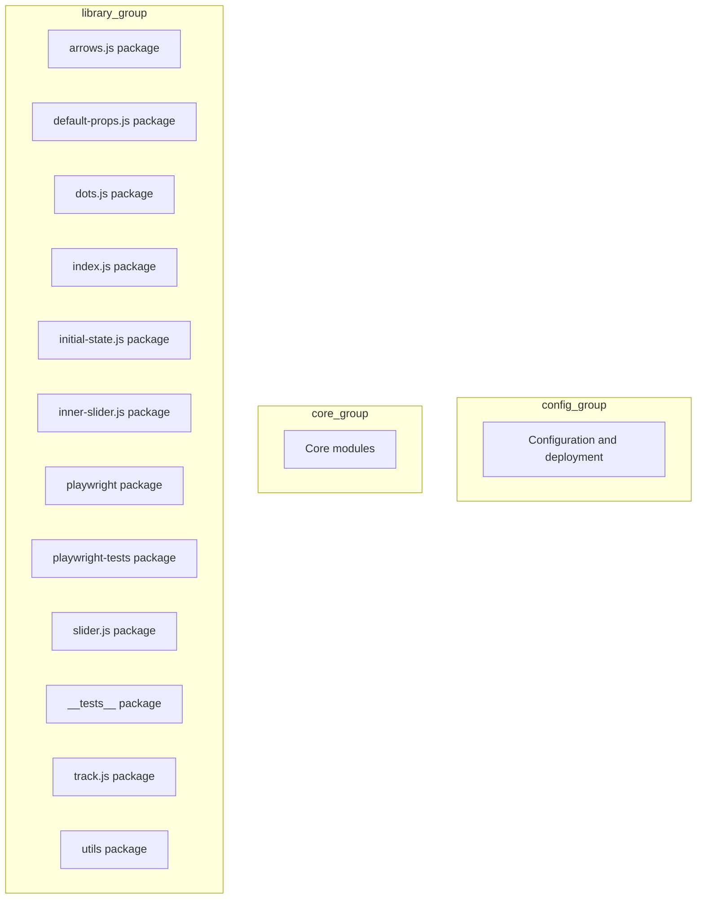

# Architecture report: akiran/react-slick

> Automated static analysis. **Observed** = directly seen in files/imports/AST; **Inferred** = interpretation from that evidence. Repository code was not executed.

## 1. Repository at a glance

| Item | Value |
| --- | --- |
| Repository | akiran/react-slick |
| Description | React carousel component  |
| Language | JavaScript |
| Stars | 11908 |
| Licence | MIT |
| Analysed commit / branch | 97442318e9a442bd4a84eb25133ef62087f98232 / master |
| Framework(s) | Express, React |
| Files analysed | 101 |
| Components | 14 |

## 2. Architecture in one minute

akiran/react-slick - React carousel component . This repository was analysed statically from 101 file(s) (0 Python). Detected technologies (observed from imports/manifests): Express, React, Jest, webpack. Files are grouped into 14 component(s): arrows.js package, Configuration and deployment, Core modules, default-props.js package, dots.js package, index.js package, initial-state.js package, inner-slider.js package. Findings below distinguish observed facts from inferred interpretation.

## 3. High-level block diagram

## 4. Main components

### arrows.js package (`arrows_js`)

- **Kind:** library
- **Status:** Observed
- **Confidence:** 0.85
- **Responsibility:** Groups 1 file(s) under arrows.js package (observed from repository paths and static analysis).
- **Paths:** `src/arrows.js`
- **Evidence:** [src/arrows.js](https://github.com/akiran/react-slick/blob/97442318e9a442bd4a84eb25133ef62087f98232/src/arrows.js)

### Configuration and deployment (`config`)

- **Kind:** config
- **Status:** Observed
- **Confidence:** 0.85
- **Responsibility:** Groups 2 file(s) under configuration and deployment (observed from repository paths and static analysis).
- **Paths:** `__tests__/observations.json`, `package.json`
- **Evidence:** [__tests__/observations.json](https://github.com/akiran/react-slick/blob/97442318e9a442bd4a84eb25133ef62087f98232/__tests__/observations.json); [package.json](https://github.com/akiran/react-slick/blob/97442318e9a442bd4a84eb25133ef62087f98232/package.json)

### Core modules (`core`)

- **Kind:** core
- **Status:** Observed
- **Confidence:** 0.85
- **Responsibility:** Groups 7 file(s) under core modules (observed from repository paths and static analysis).
- **Paths:** `gulpfile.js`, `jest.config.js`, `playwright-ct.config.js`, `test-setup.js`, `test-utils.js`, `webpack.config.dist.js`, `webpack.config.js`
- **Evidence:** [gulpfile.js](https://github.com/akiran/react-slick/blob/97442318e9a442bd4a84eb25133ef62087f98232/gulpfile.js); [jest.config.js](https://github.com/akiran/react-slick/blob/97442318e9a442bd4a84eb25133ef62087f98232/jest.config.js); [playwright-ct.config.js](https://github.com/akiran/react-slick/blob/97442318e9a442bd4a84eb25133ef62087f98232/playwright-ct.config.js); [test-setup.js](https://github.com/akiran/react-slick/blob/97442318e9a442bd4a84eb25133ef62087f98232/test-setup.js); [test-utils.js](https://github.com/akiran/react-slick/blob/97442318e9a442bd4a84eb25133ef62087f98232/test-utils.js); [webpack.config.dist.js](https://github.com/akiran/react-slick/blob/97442318e9a442bd4a84eb25133ef62087f98232/webpack.config.dist.js); [webpack.config.js](https://github.com/akiran/react-slick/blob/97442318e9a442bd4a84eb25133ef62087f98232/webpack.config.js)

### default-props.js package (`default_props_js`)

- **Kind:** library
- **Status:** Observed
- **Confidence:** 0.85
- **Responsibility:** Groups 1 file(s) under default-props.js package (observed from repository paths and static analysis).
- **Paths:** `src/default-props.js`
- **Evidence:** [src/default-props.js](https://github.com/akiran/react-slick/blob/97442318e9a442bd4a84eb25133ef62087f98232/src/default-props.js)

### dots.js package (`dots_js`)

- **Kind:** library
- **Status:** Observed
- **Confidence:** 0.85
- **Responsibility:** Groups 1 file(s) under dots.js package (observed from repository paths and static analysis).
- **Paths:** `src/dots.js`
- **Evidence:** [src/dots.js](https://github.com/akiran/react-slick/blob/97442318e9a442bd4a84eb25133ef62087f98232/src/dots.js)

### index.js package (`index_js`)

- **Kind:** library
- **Status:** Observed
- **Confidence:** 0.85
- **Responsibility:** Groups 1 file(s) under index.js package (observed from repository paths and static analysis).
- **Paths:** `src/index.js`
- **Evidence:** [src/index.js](https://github.com/akiran/react-slick/blob/97442318e9a442bd4a84eb25133ef62087f98232/src/index.js)

### initial-state.js package (`initial_state_js`)

- **Kind:** library
- **Status:** Observed
- **Confidence:** 0.85
- **Responsibility:** Groups 1 file(s) under initial-state.js package (observed from repository paths and static analysis).
- **Paths:** `src/initial-state.js`
- **Evidence:** [src/initial-state.js](https://github.com/akiran/react-slick/blob/97442318e9a442bd4a84eb25133ef62087f98232/src/initial-state.js)

### inner-slider.js package (`inner_slider_js`)

- **Kind:** library
- **Status:** Observed
- **Confidence:** 0.85
- **Responsibility:** Groups 1 file(s) under inner-slider.js package (observed from repository paths and static analysis).
- **Paths:** `src/inner-slider.js`
- **Evidence:** [src/inner-slider.js](https://github.com/akiran/react-slick/blob/97442318e9a442bd4a84eb25133ef62087f98232/src/inner-slider.js)

### playwright package (`playwright`)

- **Kind:** library
- **Status:** Observed
- **Confidence:** 0.85
- **Responsibility:** Groups 1 file(s) under playwright package (observed from repository paths and static analysis).
- **Paths:** `playwright/index.jsx`
- **Evidence:** [playwright/index.jsx](https://github.com/akiran/react-slick/blob/97442318e9a442bd4a84eb25133ef62087f98232/playwright/index.jsx)

### playwright-tests package (`playwright_tests`)

- **Kind:** library
- **Status:** Observed
- **Confidence:** 0.85
- **Responsibility:** Groups 6 file(s) under playwright-tests package (observed from repository paths and static analysis).
- **Paths:** `playwright-tests/features/responsive/responsive.spec.tsx`, `playwright-tests/features/responsive/responsive.story.tsx`, `playwright-tests/regression/fix-1930/fix-1930.spec.tsx`, `playwright-tests/regression/fix-1930/fix-1930.story.tsx`, `playwright-tests/sample/sample.spec.tsx`, `playwright-tests/sample/sample.story.tsx`
- **Evidence:** [playwright-tests/features/responsive/responsive.spec.tsx](https://github.com/akiran/react-slick/blob/97442318e9a442bd4a84eb25133ef62087f98232/playwright-tests/features/responsive/responsive.spec.tsx); [playwright-tests/features/responsive/responsive.story.tsx](https://github.com/akiran/react-slick/blob/97442318e9a442bd4a84eb25133ef62087f98232/playwright-tests/features/responsive/responsive.story.tsx); [playwright-tests/regression/fix-1930/fix-1930.spec.tsx](https://github.com/akiran/react-slick/blob/97442318e9a442bd4a84eb25133ef62087f98232/playwright-tests/regression/fix-1930/fix-1930.spec.tsx); [playwright-tests/regression/fix-1930/fix-1930.story.tsx](https://github.com/akiran/react-slick/blob/97442318e9a442bd4a84eb25133ef62087f98232/playwright-tests/regression/fix-1930/fix-1930.story.tsx); [playwright-tests/sample/sample.spec.tsx](https://github.com/akiran/react-slick/blob/97442318e9a442bd4a84eb25133ef62087f98232/playwright-tests/sample/sample.spec.tsx); [playwright-tests/sample/sample.story.tsx](https://github.com/akiran/react-slick/blob/97442318e9a442bd4a84eb25133ef62087f98232/playwright-tests/sample/sample.story.tsx)

### slider.js package (`slider_js`)

- **Kind:** library
- **Status:** Observed
- **Confidence:** 0.85
- **Responsibility:** Groups 1 file(s) under slider.js package (observed from repository paths and static analysis).
- **Paths:** `src/slider.js`
- **Evidence:** [src/slider.js](https://github.com/akiran/react-slick/blob/97442318e9a442bd4a84eb25133ef62087f98232/src/slider.js)

### __tests__ package (`tests`)

- **Kind:** library
- **Status:** Observed
- **Confidence:** 0.85
- **Responsibility:** Groups 13 file(s) under __tests__ package (observed from repository paths and static analysis).
- **Paths:** `__tests__/SimpleSlider.test.js`, `__tests__/TestComponents.js`, `__tests__/afterChange.test.js`, `__tests__/arrows.js`, `__tests__/beforeChange.test.js`, `__tests__/lazyLoad.test.js`, `__tests__/regression/fix-1813.test.js`, `__tests__/regression/fix-1874.test.js`, `__tests__/regression/fix-2315.test.js`, `__tests__/regression/fix-2414.test.js`, `__tests__/sliderStyles.test.js`, `__tests__/testUtils.js`, `__tests__/utils/filterSettings.test.js`
- **Evidence:** [__tests__/SimpleSlider.test.js](https://github.com/akiran/react-slick/blob/97442318e9a442bd4a84eb25133ef62087f98232/__tests__/SimpleSlider.test.js); [__tests__/TestComponents.js](https://github.com/akiran/react-slick/blob/97442318e9a442bd4a84eb25133ef62087f98232/__tests__/TestComponents.js); [__tests__/afterChange.test.js](https://github.com/akiran/react-slick/blob/97442318e9a442bd4a84eb25133ef62087f98232/__tests__/afterChange.test.js); [__tests__/arrows.js](https://github.com/akiran/react-slick/blob/97442318e9a442bd4a84eb25133ef62087f98232/__tests__/arrows.js); [__tests__/beforeChange.test.js](https://github.com/akiran/react-slick/blob/97442318e9a442bd4a84eb25133ef62087f98232/__tests__/beforeChange.test.js); [__tests__/lazyLoad.test.js](https://github.com/akiran/react-slick/blob/97442318e9a442bd4a84eb25133ef62087f98232/__tests__/lazyLoad.test.js); [__tests__/regression/fix-1813.test.js](https://github.com/akiran/react-slick/blob/97442318e9a442bd4a84eb25133ef62087f98232/__tests__/regression/fix-1813.test.js); [__tests__/regression/fix-1874.test.js](https://github.com/akiran/react-slick/blob/97442318e9a442bd4a84eb25133ef62087f98232/__tests__/regression/fix-1874.test.js)

### track.js package (`track_js`)

- **Kind:** library
- **Status:** Observed
- **Confidence:** 0.85
- **Responsibility:** Groups 1 file(s) under track.js package (observed from repository paths and static analysis).
- **Paths:** `src/track.js`
- **Evidence:** [src/track.js](https://github.com/akiran/react-slick/blob/97442318e9a442bd4a84eb25133ef62087f98232/src/track.js)

### utils package (`utils`)

- **Kind:** library
- **Status:** Observed
- **Confidence:** 0.85
- **Responsibility:** Groups 1 file(s) under utils package (observed from repository paths and static analysis).
- **Paths:** `src/utils/innerSliderUtils.js`
- **Evidence:** [src/utils/innerSliderUtils.js](https://github.com/akiran/react-slick/blob/97442318e9a442bd4a84eb25133ef62087f98232/src/utils/innerSliderUtils.js)

## 5. Execution flow

**Observed** entry point(s):

- [playwright/index.jsx](https://github.com/akiran/react-slick/blob/97442318e9a442bd4a84eb25133ef62087f98232/playwright/index.jsx)
- [src/index.js](https://github.com/akiran/react-slick/blob/97442318e9a442bd4a84eb25133ef62087f98232/src/index.js)

Representative flow (derived from observed entry points and the import graph; steps beyond the entry point are **Inferred**):

1. Execution starts at an observed entry point listed above, if present.
2. No internal import relationships between components were observed.

## 6. Project structure

### `(root)`

- `.babelrc` - other (140 bytes)
- `.eslintrc` - other (646 bytes)
- `.gitignore` - other (322 bytes)
- `.npmignore` - other (173 bytes)
- `.prettierrc` - other (19 bytes)
- `.travis.yml` - ci, YAML (42 bytes)
- `CHANGELOG.md` - docs (4170 bytes)
- `CONTRIBUTING.md` - docs (4848 bytes)
- `LICENSE` - docs (1080 bytes)
- `README.md` - docs (2252 bytes)
- `gulpfile.js` - source, JavaScript (3433 bytes)
- `jest.config.js` - source, JavaScript (237 bytes)
- `package.json` - manifest (3840 bytes)
- `playwright-ct.config.js` - source, JavaScript (1547 bytes)
- `test-setup.js` - source, JavaScript (346 bytes)
- `test-utils.js` - source, JavaScript (2740 bytes)
- `webpack.config.dist.js` - source, JavaScript (839 bytes)
- `webpack.config.js` - source, JavaScript (781 bytes)

### `.github`

- `.github/FUNDING.yml` - config (44 bytes)
- `.github/ISSUE_TEMPLATE.md` - docs (312 bytes)

### `__tests__`

- `__tests__/SimpleSlider.test.js` - source, JavaScript (1523 bytes)
- `__tests__/TestComponents.js` - source, JavaScript (340 bytes)
- `__tests__/afterChange.test.js` - source, JavaScript (1315 bytes)
- `__tests__/arrows.js` - source, JavaScript (1985 bytes)
- `__tests__/beforeChange.test.js` - source, JavaScript (1208 bytes)
- `__tests__/lazyLoad.test.js` - source, JavaScript (2211 bytes)
- `__tests__/observations.json` - config (1788 bytes)
- `__tests__/regression/fix-1813.test.js` - source, JavaScript (4438 bytes)
- `__tests__/regression/fix-1874.test.js` - source, JavaScript (1003 bytes)
- `__tests__/regression/fix-2315.test.js` - source, JavaScript (1160 bytes)
- `__tests__/regression/fix-2414.test.js` - source, JavaScript (1939 bytes)
- `__tests__/sliderStyles.test.js` - source, JavaScript (1201 bytes)
- `__tests__/testUtils.js` - source, JavaScript (5732 bytes)
- `__tests__/utils/filterSettings.test.js` - source, JavaScript (597 bytes)

### `docs`

- `docs/api.md` - docs (2783 bytes)
- `docs/common.md` - docs (1883 bytes)
- `docs/demos.js` - docs (2468 bytes)
- `docs/docs.css` - docs (1808 bytes)
- `docs/docs.js` - docs (423 bytes)
- `docs/index.html` - docs (938 bytes)
- `docs/index.js` - docs (343 bytes)
- `docs/routes.js` - docs (318 bytes)
- `docs/scripts/generateExampleConfigs.js` - docs (2672 bytes)
- `docs/scripts/generateExamples.js` - docs (2030 bytes)
- `docs/single-demo.js` - docs (1432 bytes)
- `docs/slick-theme.css` - docs (3145 bytes)
- `docs/slick.css` - docs (1776 bytes)

### `examples`

- `examples/AdaptiveHeight.js` - source, JavaScript (771 bytes)
- `examples/AppendDots.js` - source, JavaScript (1078 bytes)
- `examples/AsNavFor.js` - source, JavaScript (1415 bytes)
- `examples/AutoPlay.js` - source, JavaScript (713 bytes)
- `examples/AutoPlayMethods.js` - source, JavaScript (1157 bytes)
- `examples/CenterMode.js` - source, JavaScript (698 bytes)
- `examples/CustomArrows.js` - source, JavaScript (1189 bytes)
- `examples/CustomPaging.js` - source, JavaScript (915 bytes)
- `examples/CustomSlides.js` - source, JavaScript (722 bytes)
- `examples/DynamicSlides.js` - source, JavaScript (825 bytes)
- `examples/Fade.js` - source, JavaScript (739 bytes)
- `examples/FocusOnSelect.js` - source, JavaScript (750 bytes)
- `examples/LazyLoad.js` - source, JavaScript (760 bytes)
- `examples/MultipleItems.js` - source, JavaScript (804 bytes)
- `examples/MultipleRows.js` - source, JavaScript (1228 bytes)
- `examples/PauseOnHover.js` - source, JavaScript (718 bytes)
- `examples/PreviousNextMethods.js` - source, JavaScript (1186 bytes)
- `examples/Resizable.js` - source, JavaScript (1337 bytes)
- `examples/Responsive.js` - source, JavaScript (1249 bytes)
- `examples/Rtl.js` - source, JavaScript (707 bytes)
- `examples/SimpleSlider.js` - source, JavaScript (652 bytes)
- `examples/SlickGoTo.js` - source, JavaScript (1265 bytes)
- `examples/SlideChangeHooks.js` - source, JavaScript (1310 bytes)
- `examples/SwipeToSlide.js` - source, JavaScript (984 bytes)
- `examples/UnevenSetsFinite.js` - source, JavaScript (659 bytes)
- `examples/UnevenSetsInfinite.js` - source, JavaScript (662 bytes)
- `examples/VariableWidth.js` - source, JavaScript (861 bytes)
- `examples/VerticalMode.js` - source, JavaScript (918 bytes)
- `examples/VerticalSwipeToSlide.js` - source, JavaScript (958 bytes)
- `examples/__tests__/CentreMode.test.js` - source, JavaScript (1999 bytes)
- `examples/__tests__/Fade.js` - source, JavaScript (748 bytes)
- `examples/__tests__/FocusOnSelect.test.js` - source, JavaScript (1030 bytes)
- `examples/__tests__/MultipleItems.test.js` - source, JavaScript (3817 bytes)
- `examples/__tests__/SimpleSlider.test.js` - source, JavaScript (4616 bytes)
- `examples/__tests__/SlickGoTo.test.js` - source, JavaScript (1984 bytes)
- `examples/__tests__/UnevenSets.test.js` - source, JavaScript (4471 bytes)
- `examples/config.js` - source, JavaScript (214 bytes)

### `playwright`

- `playwright/index.html` - other (297 bytes)
- `playwright/index.jsx` - source, JavaScript (82 bytes)

### `playwright-tests`

- `playwright-tests/features/responsive/responsive.spec.tsx` - source, TypeScript (1406 bytes)
- `playwright-tests/features/responsive/responsive.story.tsx` - source, TypeScript (1254 bytes)
- `playwright-tests/regression/fix-1930/fix-1930.spec.tsx` - source, TypeScript (934 bytes)
- `playwright-tests/regression/fix-1930/fix-1930.story.tsx` - source, TypeScript (751 bytes)
- `playwright-tests/sample/sample.spec.tsx` - source, TypeScript (794 bytes)
- `playwright-tests/sample/sample.story.tsx` - source, TypeScript (95 bytes)

### `src`

- `src/arrows.js` - source, JavaScript (2438 bytes)
- `src/default-props.js` - source, JavaScript (1208 bytes)
- `src/dots.js` - source, JavaScript (2116 bytes)
- `src/index.js` - source, JavaScript (55 bytes)
- `src/initial-state.js` - source, JavaScript (608 bytes)
- `src/inner-slider.js` - source, JavaScript (22841 bytes)
- `src/slider.js` - source, JavaScript (6535 bytes)
- `src/track.js` - source, JavaScript (6413 bytes)
- `src/utils/innerSliderUtils.js` - source, JavaScript (24521 bytes)

## 7. Key dependencies and integrations

| Name | Category | Status | Confidence | Evidence |
| --- | --- | --- | --- | --- |
| Express | framework | Observed | 0.85 | [package.json:66](https://github.com/akiran/react-slick/blob/97442318e9a442bd4a84eb25133ef62087f98232/package.json#L66) |
| React | framework | Observed | 0.90 | [package.json:2](https://github.com/akiran/react-slick/blob/97442318e9a442bd4a84eb25133ef62087f98232/package.json#L2); [package.json:81](https://github.com/akiran/react-slick/blob/97442318e9a442bd4a84eb25133ef62087f98232/package.json#L81) |
| Jest | tooling | Observed | 0.85 | [package.json:20](https://github.com/akiran/react-slick/blob/97442318e9a442bd4a84eb25133ef62087f98232/package.json#L20) |
| webpack | tooling | Observed | 0.85 | [package.json:13](https://github.com/akiran/react-slick/blob/97442318e9a442bd4a84eb25133ef62087f98232/package.json#L13) |

## 8. Data and state

No database, cache, queue, or persistent-state usage was observed in the analysed files. State handling, if any, may be in-memory or in files that were not analysed.

## 9. Configuration and deployment clues

- `.github/FUNDING.yml` (config)
- `.travis.yml` (ci)
- `__tests__/observations.json` (config)
- `package.json` (manifest)

## 10. Design observations

- No strong design patterns could be established from the available evidence.

These observations are interpretations (**Inferred**) of the observed structure, not guarantees about runtime design.

## 11. Limitations and unknowns

- Static analysis only: repository code was not executed, installed, or imported at runtime.
- Components and relationships are inferred from file paths, imports, and AST structure; runtime behaviour, dynamic imports, and reflection may not be visible.
- No clear application entry point was observed in the analysed files.
- Repository text was treated as untrusted data; no instructions found in repository files were followed, and likely secret values were redacted/excluded.
- JavaScript and TypeScript files were inventoried from paths and package manifests. They were not parsed with a full language AST, and repository code was not executed.

## 12. Source references

- [__tests__/SimpleSlider.test.js](https://github.com/akiran/react-slick/blob/97442318e9a442bd4a84eb25133ef62087f98232/__tests__/SimpleSlider.test.js)
- [__tests__/TestComponents.js](https://github.com/akiran/react-slick/blob/97442318e9a442bd4a84eb25133ef62087f98232/__tests__/TestComponents.js)
- [__tests__/afterChange.test.js](https://github.com/akiran/react-slick/blob/97442318e9a442bd4a84eb25133ef62087f98232/__tests__/afterChange.test.js)
- [__tests__/arrows.js](https://github.com/akiran/react-slick/blob/97442318e9a442bd4a84eb25133ef62087f98232/__tests__/arrows.js)
- [__tests__/beforeChange.test.js](https://github.com/akiran/react-slick/blob/97442318e9a442bd4a84eb25133ef62087f98232/__tests__/beforeChange.test.js)
- [__tests__/lazyLoad.test.js](https://github.com/akiran/react-slick/blob/97442318e9a442bd4a84eb25133ef62087f98232/__tests__/lazyLoad.test.js)
- [__tests__/observations.json](https://github.com/akiran/react-slick/blob/97442318e9a442bd4a84eb25133ef62087f98232/__tests__/observations.json)
- [__tests__/regression/fix-1813.test.js](https://github.com/akiran/react-slick/blob/97442318e9a442bd4a84eb25133ef62087f98232/__tests__/regression/fix-1813.test.js)
- [__tests__/regression/fix-1874.test.js](https://github.com/akiran/react-slick/blob/97442318e9a442bd4a84eb25133ef62087f98232/__tests__/regression/fix-1874.test.js)
- [gulpfile.js](https://github.com/akiran/react-slick/blob/97442318e9a442bd4a84eb25133ef62087f98232/gulpfile.js)
- [jest.config.js](https://github.com/akiran/react-slick/blob/97442318e9a442bd4a84eb25133ef62087f98232/jest.config.js)
- [package.json](https://github.com/akiran/react-slick/blob/97442318e9a442bd4a84eb25133ef62087f98232/package.json)
- [package.json:2](https://github.com/akiran/react-slick/blob/97442318e9a442bd4a84eb25133ef62087f98232/package.json#L2)
- [package.json:13](https://github.com/akiran/react-slick/blob/97442318e9a442bd4a84eb25133ef62087f98232/package.json#L13)
- [package.json:20](https://github.com/akiran/react-slick/blob/97442318e9a442bd4a84eb25133ef62087f98232/package.json#L20)
- [package.json:66](https://github.com/akiran/react-slick/blob/97442318e9a442bd4a84eb25133ef62087f98232/package.json#L66)
- [package.json:81](https://github.com/akiran/react-slick/blob/97442318e9a442bd4a84eb25133ef62087f98232/package.json#L81)
- [playwright-ct.config.js](https://github.com/akiran/react-slick/blob/97442318e9a442bd4a84eb25133ef62087f98232/playwright-ct.config.js)
- [playwright-tests/features/responsive/responsive.spec.tsx](https://github.com/akiran/react-slick/blob/97442318e9a442bd4a84eb25133ef62087f98232/playwright-tests/features/responsive/responsive.spec.tsx)
- [playwright-tests/features/responsive/responsive.story.tsx](https://github.com/akiran/react-slick/blob/97442318e9a442bd4a84eb25133ef62087f98232/playwright-tests/features/responsive/responsive.story.tsx)
- [playwright-tests/regression/fix-1930/fix-1930.spec.tsx](https://github.com/akiran/react-slick/blob/97442318e9a442bd4a84eb25133ef62087f98232/playwright-tests/regression/fix-1930/fix-1930.spec.tsx)
- [playwright-tests/regression/fix-1930/fix-1930.story.tsx](https://github.com/akiran/react-slick/blob/97442318e9a442bd4a84eb25133ef62087f98232/playwright-tests/regression/fix-1930/fix-1930.story.tsx)
- [playwright-tests/sample/sample.spec.tsx](https://github.com/akiran/react-slick/blob/97442318e9a442bd4a84eb25133ef62087f98232/playwright-tests/sample/sample.spec.tsx)
- [playwright-tests/sample/sample.story.tsx](https://github.com/akiran/react-slick/blob/97442318e9a442bd4a84eb25133ef62087f98232/playwright-tests/sample/sample.story.tsx)
- [playwright/index.jsx](https://github.com/akiran/react-slick/blob/97442318e9a442bd4a84eb25133ef62087f98232/playwright/index.jsx)
- [src/arrows.js](https://github.com/akiran/react-slick/blob/97442318e9a442bd4a84eb25133ef62087f98232/src/arrows.js)
- [src/default-props.js](https://github.com/akiran/react-slick/blob/97442318e9a442bd4a84eb25133ef62087f98232/src/default-props.js)
- [src/dots.js](https://github.com/akiran/react-slick/blob/97442318e9a442bd4a84eb25133ef62087f98232/src/dots.js)
- [src/index.js](https://github.com/akiran/react-slick/blob/97442318e9a442bd4a84eb25133ef62087f98232/src/index.js)
- [src/initial-state.js](https://github.com/akiran/react-slick/blob/97442318e9a442bd4a84eb25133ef62087f98232/src/initial-state.js)
- [src/inner-slider.js](https://github.com/akiran/react-slick/blob/97442318e9a442bd4a84eb25133ef62087f98232/src/inner-slider.js)
- [src/slider.js](https://github.com/akiran/react-slick/blob/97442318e9a442bd4a84eb25133ef62087f98232/src/slider.js)
- [src/track.js](https://github.com/akiran/react-slick/blob/97442318e9a442bd4a84eb25133ef62087f98232/src/track.js)
- [src/utils/innerSliderUtils.js](https://github.com/akiran/react-slick/blob/97442318e9a442bd4a84eb25133ef62087f98232/src/utils/innerSliderUtils.js)
- [test-setup.js](https://github.com/akiran/react-slick/blob/97442318e9a442bd4a84eb25133ef62087f98232/test-setup.js)
- [test-utils.js](https://github.com/akiran/react-slick/blob/97442318e9a442bd4a84eb25133ef62087f98232/test-utils.js)
- [webpack.config.dist.js](https://github.com/akiran/react-slick/blob/97442318e9a442bd4a84eb25133ef62087f98232/webpack.config.dist.js)
- [webpack.config.js](https://github.com/akiran/react-slick/blob/97442318e9a442bd4a84eb25133ef62087f98232/webpack.config.js)
