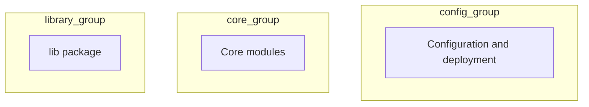

# Architecture report: aksakalli/gtop

> Automated static analysis. **Observed** = directly seen in files/imports/AST; **Inferred** = interpretation from that evidence. Repository code was not executed.

## 1. Repository at a glance

| Item | Value |
| --- | --- |
| Repository | aksakalli/gtop |
| Description | System monitoring dashboard for terminal |
| Language | JavaScript |
| Stars | 9936 |
| Licence | MIT |
| Analysed commit / branch | ac6c2e11a683d41ae25c41912646d6b320285f8b / master |
| Framework(s) | None detected |
| Files analysed | 23 |
| Components | 3 |

## 2. Architecture in one minute

aksakalli/gtop - System monitoring dashboard for terminal. This repository was analysed statically from 23 file(s) (0 Python). Detected technologies (observed from imports/manifests): GitHub Actions, Docker. Files are grouped into 3 component(s): Configuration and deployment, Core modules, lib package. Findings below distinguish observed facts from inferred interpretation.

## 3. High-level block diagram

## 4. Main components

### Configuration and deployment (`config`)

- **Kind:** config
- **Status:** Observed
- **Confidence:** 0.85
- **Responsibility:** Groups 3 file(s) under configuration and deployment (observed from repository paths and static analysis).
- **Paths:** `Dockerfile`, `package.json`, `snap/snapcraft.yaml`
- **Evidence:** [Dockerfile](https://github.com/aksakalli/gtop/blob/ac6c2e11a683d41ae25c41912646d6b320285f8b/Dockerfile); [package.json](https://github.com/aksakalli/gtop/blob/ac6c2e11a683d41ae25c41912646d6b320285f8b/package.json); [snap/snapcraft.yaml](https://github.com/aksakalli/gtop/blob/ac6c2e11a683d41ae25c41912646d6b320285f8b/snap/snapcraft.yaml)

### Core modules (`core`)

- **Kind:** core
- **Status:** Observed
- **Confidence:** 0.85
- **Responsibility:** Groups 1 file(s) under core modules (observed from repository paths and static analysis).
- **Paths:** `index.js`
- **Evidence:** [index.js](https://github.com/aksakalli/gtop/blob/ac6c2e11a683d41ae25c41912646d6b320285f8b/index.js)

### lib package (`lib`)

- **Kind:** library
- **Status:** Observed
- **Confidence:** 0.85
- **Responsibility:** Groups 8 file(s) under lib package (observed from repository paths and static analysis).
- **Paths:** `lib/gtop.js`, `lib/monitor/cpu.js`, `lib/monitor/disk.js`, `lib/monitor/index.js`, `lib/monitor/mem.js`, `lib/monitor/net.js`, `lib/monitor/proc.js`, `lib/utils.js`
- **Evidence:** [lib/gtop.js](https://github.com/aksakalli/gtop/blob/ac6c2e11a683d41ae25c41912646d6b320285f8b/lib/gtop.js); [lib/monitor/cpu.js](https://github.com/aksakalli/gtop/blob/ac6c2e11a683d41ae25c41912646d6b320285f8b/lib/monitor/cpu.js); [lib/monitor/disk.js](https://github.com/aksakalli/gtop/blob/ac6c2e11a683d41ae25c41912646d6b320285f8b/lib/monitor/disk.js); [lib/monitor/index.js](https://github.com/aksakalli/gtop/blob/ac6c2e11a683d41ae25c41912646d6b320285f8b/lib/monitor/index.js); [lib/monitor/mem.js](https://github.com/aksakalli/gtop/blob/ac6c2e11a683d41ae25c41912646d6b320285f8b/lib/monitor/mem.js); [lib/monitor/net.js](https://github.com/aksakalli/gtop/blob/ac6c2e11a683d41ae25c41912646d6b320285f8b/lib/monitor/net.js); [lib/monitor/proc.js](https://github.com/aksakalli/gtop/blob/ac6c2e11a683d41ae25c41912646d6b320285f8b/lib/monitor/proc.js); [lib/utils.js](https://github.com/aksakalli/gtop/blob/ac6c2e11a683d41ae25c41912646d6b320285f8b/lib/utils.js)

## 5. Execution flow

**Observed** entry point(s):

- [bin/gtop](https://github.com/aksakalli/gtop/blob/ac6c2e11a683d41ae25c41912646d6b320285f8b/bin/gtop)
- [index.js](https://github.com/aksakalli/gtop/blob/ac6c2e11a683d41ae25c41912646d6b320285f8b/index.js)
- [lib/monitor/index.js](https://github.com/aksakalli/gtop/blob/ac6c2e11a683d41ae25c41912646d6b320285f8b/lib/monitor/index.js)

Representative flow (derived from observed entry points and the import graph; steps beyond the entry point are **Inferred**):

1. Execution starts at an observed entry point listed above, if present.
2. No internal import relationships between components were observed.

## 6. Project structure

### `(root)`

- `.editorconfig` - config (233 bytes)
- `.gitignore` - other (884 bytes)
- `.npmignore` - other (57 bytes)
- `CLI.md` - docs (604 bytes)
- `Dockerfile` - container (225 bytes)
- `LICENSE` - docs (1077 bytes)
- `README.md` - docs (1457 bytes)
- `index.js` - source, JavaScript (40 bytes)
- `package.json` - manifest (1190 bytes)

### `.github`

- `.github/CONTRIBUTING.md` - docs (68 bytes)
- `.github/ISSUE_TEMPLATE.md` - docs (153 bytes)
- `.github/workflows/ci.yml` - ci, YAML (459 bytes)
- `.github/workflows/release.yml` - ci, YAML (438 bytes)

### `bin`

- `bin/gtop` - other (51 bytes)

### `lib`

- `lib/gtop.js` - source, JavaScript (2003 bytes)
- `lib/monitor/cpu.js` - source, JavaScript (1084 bytes)
- `lib/monitor/disk.js` - source, JavaScript (671 bytes)
- `lib/monitor/index.js` - source, JavaScript (151 bytes)
- `lib/monitor/mem.js` - source, JavaScript (1765 bytes)
- `lib/monitor/net.js` - source, JavaScript (1140 bytes)
- `lib/monitor/proc.js` - source, JavaScript (1413 bytes)
- `lib/utils.js` - source, JavaScript (517 bytes)

### `snap`

- `snap/snapcraft.yaml` - config (406 bytes)

## 7. Key dependencies and integrations

| Name | Category | Status | Confidence | Evidence |
| --- | --- | --- | --- | --- |
| GitHub Actions | ci | Observed | 0.90 | [.github/workflows/ci.yml](https://github.com/aksakalli/gtop/blob/ac6c2e11a683d41ae25c41912646d6b320285f8b/.github/workflows/ci.yml); [.github/workflows/release.yml](https://github.com/aksakalli/gtop/blob/ac6c2e11a683d41ae25c41912646d6b320285f8b/.github/workflows/release.yml) |
| Docker | tooling | Observed | 0.85 | [Dockerfile](https://github.com/aksakalli/gtop/blob/ac6c2e11a683d41ae25c41912646d6b320285f8b/Dockerfile) |

## 8. Data and state

No database, cache, queue, or persistent-state usage was observed in the analysed files. State handling, if any, may be in-memory or in files that were not analysed.

## 9. Configuration and deployment clues

- `.editorconfig` (config)
- `.github/workflows/ci.yml` (ci)
- `.github/workflows/release.yml` (ci)
- `Dockerfile` (container)
- `package.json` (manifest)
- `snap/snapcraft.yaml` (config)

## 10. Design observations

- No strong design patterns could be established from the available evidence.

These observations are interpretations (**Inferred**) of the observed structure, not guarantees about runtime design.

## 11. Limitations and unknowns

- Static analysis only: repository code was not executed, installed, or imported at runtime.
- Components and relationships are inferred from file paths, imports, and AST structure; runtime behaviour, dynamic imports, and reflection may not be visible.
- 1 file(s) were skipped during inventory (1 x lockfile excluded).
- No clear application entry point was observed in the analysed files.
- Repository text was treated as untrusted data; no instructions found in repository files were followed, and likely secret values were redacted/excluded.
- JavaScript and TypeScript files were inventoried from paths and package manifests. They were not parsed with a full language AST, and repository code was not executed.

## 12. Source references

- [.github/workflows/ci.yml](https://github.com/aksakalli/gtop/blob/ac6c2e11a683d41ae25c41912646d6b320285f8b/.github/workflows/ci.yml)
- [.github/workflows/release.yml](https://github.com/aksakalli/gtop/blob/ac6c2e11a683d41ae25c41912646d6b320285f8b/.github/workflows/release.yml)
- [Dockerfile](https://github.com/aksakalli/gtop/blob/ac6c2e11a683d41ae25c41912646d6b320285f8b/Dockerfile)
- [bin/gtop](https://github.com/aksakalli/gtop/blob/ac6c2e11a683d41ae25c41912646d6b320285f8b/bin/gtop)
- [index.js](https://github.com/aksakalli/gtop/blob/ac6c2e11a683d41ae25c41912646d6b320285f8b/index.js)
- [lib/gtop.js](https://github.com/aksakalli/gtop/blob/ac6c2e11a683d41ae25c41912646d6b320285f8b/lib/gtop.js)
- [lib/monitor/cpu.js](https://github.com/aksakalli/gtop/blob/ac6c2e11a683d41ae25c41912646d6b320285f8b/lib/monitor/cpu.js)
- [lib/monitor/disk.js](https://github.com/aksakalli/gtop/blob/ac6c2e11a683d41ae25c41912646d6b320285f8b/lib/monitor/disk.js)
- [lib/monitor/index.js](https://github.com/aksakalli/gtop/blob/ac6c2e11a683d41ae25c41912646d6b320285f8b/lib/monitor/index.js)
- [lib/monitor/mem.js](https://github.com/aksakalli/gtop/blob/ac6c2e11a683d41ae25c41912646d6b320285f8b/lib/monitor/mem.js)
- [lib/monitor/net.js](https://github.com/aksakalli/gtop/blob/ac6c2e11a683d41ae25c41912646d6b320285f8b/lib/monitor/net.js)
- [lib/monitor/proc.js](https://github.com/aksakalli/gtop/blob/ac6c2e11a683d41ae25c41912646d6b320285f8b/lib/monitor/proc.js)
- [lib/utils.js](https://github.com/aksakalli/gtop/blob/ac6c2e11a683d41ae25c41912646d6b320285f8b/lib/utils.js)
- [package.json](https://github.com/aksakalli/gtop/blob/ac6c2e11a683d41ae25c41912646d6b320285f8b/package.json)
- [snap/snapcraft.yaml](https://github.com/aksakalli/gtop/blob/ac6c2e11a683d41ae25c41912646d6b320285f8b/snap/snapcraft.yaml)
