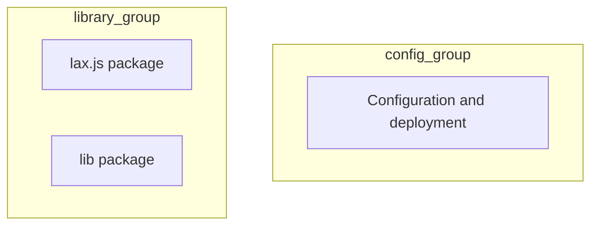

# Architecture report: alexfoxy/lax.js

> Automated static analysis. **Observed** = directly seen in files/imports/AST; **Inferred** = interpretation from that evidence. Repository code was not executed.

## 1. Repository at a glance

| Item | Value |
| --- | --- |
| Repository | alexfoxy/lax.js |
| Description | Simple & lightweight (<4kb gzipped) vanilla JavaScript library to create smooth & beautiful animations when you scroll. |
| Language | JavaScript |
| Stars | 10456 |
| Licence | MIT |
| Analysed commit / branch | 5d6d4c37727d3effdca7d00e8d4cf42f4bee4ece / dev |
| Framework(s) | None detected |
| Files analysed | 20 |
| Components | 3 |

## 2. Architecture in one minute

alexfoxy/lax.js - Simple & lightweight (<4kb gzipped) vanilla JavaScript library to create smooth & beautiful animations when you scroll.. This repository was analysed statically from 20 file(s) (0 Python). Detected technologies (observed from imports/manifests): no known frameworks/libraries. Files are grouped into 3 component(s): Configuration and deployment, lax.js package, lib package. Findings below distinguish observed facts from inferred interpretation.

## 3. High-level block diagram

## 4. Main components

### Configuration and deployment (`config`)

- **Kind:** config
- **Status:** Observed
- **Confidence:** 0.85
- **Responsibility:** Groups 2 file(s) under configuration and deployment (observed from repository paths and static analysis).
- **Paths:** `jsconfig.json`, `package.json`
- **Evidence:** [jsconfig.json](https://github.com/alexfoxy/lax.js/blob/5d6d4c37727d3effdca7d00e8d4cf42f4bee4ece/jsconfig.json); [package.json](https://github.com/alexfoxy/lax.js/blob/5d6d4c37727d3effdca7d00e8d4cf42f4bee4ece/package.json)

### lax.js package (`lax_js`)

- **Kind:** library
- **Status:** Observed
- **Confidence:** 0.85
- **Responsibility:** Groups 1 file(s) under lax.js package (observed from repository paths and static analysis).
- **Paths:** `src/lax.js`
- **Evidence:** [src/lax.js](https://github.com/alexfoxy/lax.js/blob/5d6d4c37727d3effdca7d00e8d4cf42f4bee4ece/src/lax.js)

### lib package (`lib`)

- **Kind:** library
- **Status:** Observed
- **Confidence:** 0.85
- **Responsibility:** Groups 1 file(s) under lib package (observed from repository paths and static analysis).
- **Paths:** `lib/lax.js`
- **Evidence:** [lib/lax.js](https://github.com/alexfoxy/lax.js/blob/5d6d4c37727d3effdca7d00e8d4cf42f4bee4ece/lib/lax.js)

## 5. Execution flow

No entry point was observed; the startup flow below is therefore limited.

Representative flow (derived from observed entry points and the import graph; steps beyond the entry point are **Inferred**):

1. Execution starts at an observed entry point listed above, if present.
2. No internal import relationships between components were observed.

## 6. Project structure

### `(root)`

- `.babelrc` - other (112 bytes)
- `.gitignore` - other (38 bytes)
- `LICENSE` - docs (1065 bytes)
- `README.md` - docs (12594 bytes)
- `jsconfig.json` - config (51 bytes)
- `package.json` - manifest (945 bytes)

### `.github`

- `.github/ISSUE_TEMPLATE/bug_report.md` - docs (337 bytes)
- `.github/ISSUE_TEMPLATE/feature_request.md` - docs (595 bytes)

### `docs`

- `docs/examples/cursor.html` - docs (3297 bytes)
- `docs/examples/html-inline.html` - docs (833 bytes)
- `docs/examples/inertia.html` - docs (1610 bytes)
- `docs/examples/input.html` - docs (1111 bytes)
- `docs/examples/on-update.html` - docs (1345 bytes)
- `docs/examples/scroll.html` - docs (2043 bytes)
- `docs/examples/snap-scroll.html` - docs (5287 bytes)
- `docs/examples/sprite.html` - docs (1257 bytes)
- `docs/index.html` - docs (11031 bytes)
- `docs/preset-explorer.html` - docs (11773 bytes)

### `lib`

- `lib/lax.js` - source, JavaScript (26749 bytes)

### `src`

- `src/lax.js` - source, JavaScript (17245 bytes)

## 7. Key dependencies and integrations

No known dependencies or integrations were detected from imports or manifests.

## 8. Data and state

No database, cache, queue, or persistent-state usage was observed in the analysed files. State handling, if any, may be in-memory or in files that were not analysed.

## 9. Configuration and deployment clues

- `jsconfig.json` (config)
- `package.json` (manifest)

## 10. Design observations

- No strong design patterns could be established from the available evidence.

These observations are interpretations (**Inferred**) of the observed structure, not guarantees about runtime design.

## 11. Limitations and unknowns

- Static analysis only: repository code was not executed, installed, or imported at runtime.
- Components and relationships are inferred from file paths, imports, and AST structure; runtime behaviour, dynamic imports, and reflection may not be visible.
- 1 file(s) were skipped during inventory (1 x lockfile excluded).
- No clear application entry point was observed in the analysed files.
- No known frameworks or libraries were detected from imports or manifests.
- Repository text was treated as untrusted data; no instructions found in repository files were followed, and likely secret values were redacted/excluded.
- JavaScript and TypeScript files were inventoried from paths and package manifests. They were not parsed with a full language AST, and repository code was not executed.
- The GitHub repository was marked archived at selection time.

## 12. Source references

- [jsconfig.json](https://github.com/alexfoxy/lax.js/blob/5d6d4c37727d3effdca7d00e8d4cf42f4bee4ece/jsconfig.json)
- [lib/lax.js](https://github.com/alexfoxy/lax.js/blob/5d6d4c37727d3effdca7d00e8d4cf42f4bee4ece/lib/lax.js)
- [package.json](https://github.com/alexfoxy/lax.js/blob/5d6d4c37727d3effdca7d00e8d4cf42f4bee4ece/package.json)
- [src/lax.js](https://github.com/alexfoxy/lax.js/blob/5d6d4c37727d3effdca7d00e8d4cf42f4bee4ece/src/lax.js)
