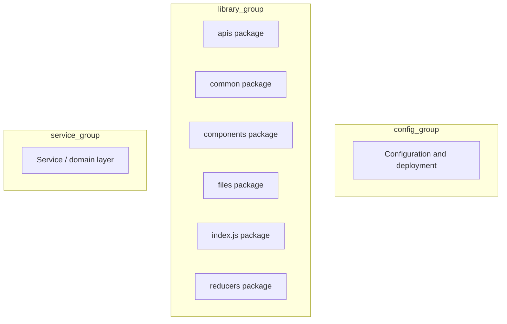

# Architecture report: algorithm-visualizer/algorithm-visualizer

> Automated static analysis. **Observed** = directly seen in files/imports/AST; **Inferred** = interpretation from that evidence. Repository code was not executed.

## 1. Repository at a glance

| Item | Value |
| --- | --- |
| Repository | algorithm-visualizer/algorithm-visualizer |
| Description | :fireworks:Interactive Online Platform that Visualizes Algorithms from Code |
| Language | JavaScript |
| Stars | 49507 |
| Licence | MIT |
| Analysed commit / branch | 18de2edf6b629e843ee4bcedfa2208d22b253f0f / master |
| Framework(s) | React |
| Files analysed | 95 |
| Components | 8 |

## 2. Architecture in one minute

algorithm-visualizer/algorithm-visualizer - :fireworks:Interactive Online Platform that Visualizes Algorithms from Code. This repository was analysed statically from 95 file(s) (0 Python). Detected technologies (observed from imports/manifests): React, axios, React Router, Redux. Files are grouped into 8 component(s): apis package, common package, components package, Configuration and deployment, files package, index.js package, reducers package, Service / domain layer. Findings below distinguish observed facts from inferred interpretation.

## 3. High-level block diagram

## 4. Main components

### apis package (`apis`)

- **Kind:** library
- **Status:** Observed
- **Confidence:** 0.85
- **Responsibility:** Groups 1 file(s) under apis package (observed from repository paths and static analysis).
- **Paths:** `src/apis/index.js`
- **Evidence:** [src/apis/index.js](https://github.com/algorithm-visualizer/algorithm-visualizer/blob/18de2edf6b629e843ee4bcedfa2208d22b253f0f/src/apis/index.js)

### common package (`common`)

- **Kind:** library
- **Status:** Observed
- **Confidence:** 0.85
- **Responsibility:** Groups 2 file(s) under common package (observed from repository paths and static analysis).
- **Paths:** `src/common/config.js`, `src/common/util.js`
- **Evidence:** [src/common/config.js](https://github.com/algorithm-visualizer/algorithm-visualizer/blob/18de2edf6b629e843ee4bcedfa2208d22b253f0f/src/common/config.js); [src/common/util.js](https://github.com/algorithm-visualizer/algorithm-visualizer/blob/18de2edf6b629e843ee4bcedfa2208d22b253f0f/src/common/util.js)

### components package (`components`)

- **Kind:** library
- **Status:** Observed
- **Confidence:** 0.85
- **Responsibility:** Groups 18 file(s) under components package (observed from repository paths and static analysis).
- **Paths:** `src/components/App/index.js`, `src/components/BaseComponent/index.js`, `src/components/Button/index.js`, `src/components/CodeEditor/index.js`, `src/components/Divider/index.js`, `src/components/Ellipsis/index.js`, `src/components/ExpandableListItem/index.js`, `src/components/FoldableAceEditor/index.js`, `src/components/Header/index.js`, `src/components/ListItem/index.js`, `src/components/Navigator/index.js`, `src/components/Player/index.js`, `src/components/ProgressBar/index.js`, `src/components/ResizableContainer/index.js`, `src/components/TabContainer/index.js`, `src/components/ToastContainer/index.js`, `src/components/VisualizationViewer/index.js`, `src/components/index.js`
- **Evidence:** [src/components/App/index.js](https://github.com/algorithm-visualizer/algorithm-visualizer/blob/18de2edf6b629e843ee4bcedfa2208d22b253f0f/src/components/App/index.js); [src/components/BaseComponent/index.js](https://github.com/algorithm-visualizer/algorithm-visualizer/blob/18de2edf6b629e843ee4bcedfa2208d22b253f0f/src/components/BaseComponent/index.js); [src/components/Button/index.js](https://github.com/algorithm-visualizer/algorithm-visualizer/blob/18de2edf6b629e843ee4bcedfa2208d22b253f0f/src/components/Button/index.js); [src/components/CodeEditor/index.js](https://github.com/algorithm-visualizer/algorithm-visualizer/blob/18de2edf6b629e843ee4bcedfa2208d22b253f0f/src/components/CodeEditor/index.js); [src/components/Divider/index.js](https://github.com/algorithm-visualizer/algorithm-visualizer/blob/18de2edf6b629e843ee4bcedfa2208d22b253f0f/src/components/Divider/index.js); [src/components/Ellipsis/index.js](https://github.com/algorithm-visualizer/algorithm-visualizer/blob/18de2edf6b629e843ee4bcedfa2208d22b253f0f/src/components/Ellipsis/index.js); [src/components/ExpandableListItem/index.js](https://github.com/algorithm-visualizer/algorithm-visualizer/blob/18de2edf6b629e843ee4bcedfa2208d22b253f0f/src/components/ExpandableListItem/index.js); [src/components/FoldableAceEditor/index.js](https://github.com/algorithm-visualizer/algorithm-visualizer/blob/18de2edf6b629e843ee4bcedfa2208d22b253f0f/src/components/FoldableAceEditor/index.js)

### Configuration and deployment (`config`)

- **Kind:** config
- **Status:** Observed
- **Confidence:** 0.85
- **Responsibility:** Groups 3 file(s) under configuration and deployment (observed from repository paths and static analysis).
- **Paths:** `jsconfig.json`, `package.json`, `public/manifest.json`
- **Evidence:** [jsconfig.json](https://github.com/algorithm-visualizer/algorithm-visualizer/blob/18de2edf6b629e843ee4bcedfa2208d22b253f0f/jsconfig.json); [package.json](https://github.com/algorithm-visualizer/algorithm-visualizer/blob/18de2edf6b629e843ee4bcedfa2208d22b253f0f/package.json); [public/manifest.json](https://github.com/algorithm-visualizer/algorithm-visualizer/blob/18de2edf6b629e843ee4bcedfa2208d22b253f0f/public/manifest.json)

### files package (`files`)

- **Kind:** library
- **Status:** Observed
- **Confidence:** 0.85
- **Responsibility:** Groups 4 file(s) under files package (observed from repository paths and static analysis).
- **Paths:** `src/files/index.js`, `src/files/skeletons/code.cpp`, `src/files/skeletons/code.java`, `src/files/skeletons/code.js`
- **Evidence:** [src/files/index.js](https://github.com/algorithm-visualizer/algorithm-visualizer/blob/18de2edf6b629e843ee4bcedfa2208d22b253f0f/src/files/index.js); [src/files/skeletons/code.cpp](https://github.com/algorithm-visualizer/algorithm-visualizer/blob/18de2edf6b629e843ee4bcedfa2208d22b253f0f/src/files/skeletons/code.cpp); [src/files/skeletons/code.java](https://github.com/algorithm-visualizer/algorithm-visualizer/blob/18de2edf6b629e843ee4bcedfa2208d22b253f0f/src/files/skeletons/code.java); [src/files/skeletons/code.js](https://github.com/algorithm-visualizer/algorithm-visualizer/blob/18de2edf6b629e843ee4bcedfa2208d22b253f0f/src/files/skeletons/code.js)

### index.js package (`index_js`)

- **Kind:** library
- **Status:** Observed
- **Confidence:** 0.85
- **Responsibility:** Groups 1 file(s) under index.js package (observed from repository paths and static analysis).
- **Paths:** `src/index.js`
- **Evidence:** [src/index.js](https://github.com/algorithm-visualizer/algorithm-visualizer/blob/18de2edf6b629e843ee4bcedfa2208d22b253f0f/src/index.js)

### reducers package (`reducers`)

- **Kind:** library
- **Status:** Observed
- **Confidence:** 0.85
- **Responsibility:** Groups 6 file(s) under reducers package (observed from repository paths and static analysis).
- **Paths:** `src/reducers/current.js`, `src/reducers/directory.js`, `src/reducers/env.js`, `src/reducers/index.js`, `src/reducers/player.js`, `src/reducers/toast.js`
- **Evidence:** [src/reducers/current.js](https://github.com/algorithm-visualizer/algorithm-visualizer/blob/18de2edf6b629e843ee4bcedfa2208d22b253f0f/src/reducers/current.js); [src/reducers/directory.js](https://github.com/algorithm-visualizer/algorithm-visualizer/blob/18de2edf6b629e843ee4bcedfa2208d22b253f0f/src/reducers/directory.js); [src/reducers/env.js](https://github.com/algorithm-visualizer/algorithm-visualizer/blob/18de2edf6b629e843ee4bcedfa2208d22b253f0f/src/reducers/env.js); [src/reducers/index.js](https://github.com/algorithm-visualizer/algorithm-visualizer/blob/18de2edf6b629e843ee4bcedfa2208d22b253f0f/src/reducers/index.js); [src/reducers/player.js](https://github.com/algorithm-visualizer/algorithm-visualizer/blob/18de2edf6b629e843ee4bcedfa2208d22b253f0f/src/reducers/player.js); [src/reducers/toast.js](https://github.com/algorithm-visualizer/algorithm-visualizer/blob/18de2edf6b629e843ee4bcedfa2208d22b253f0f/src/reducers/toast.js)

### Service / domain layer (`service_layer`)

- **Kind:** service
- **Status:** Observed
- **Confidence:** 0.85
- **Responsibility:** Groups 22 file(s) under service / domain layer (observed from repository paths and static analysis).
- **Paths:** `src/core/layouts/HorizontalLayout.js`, `src/core/layouts/Layout.js`, `src/core/layouts/VerticalLayout.js`, `src/core/layouts/index.js`, `src/core/renderers/Array1DRenderer/index.js`, `src/core/renderers/Array2DRenderer/index.js`, `src/core/renderers/ChartRenderer/index.js`, `src/core/renderers/GraphRenderer/index.js`, `src/core/renderers/LogRenderer/index.js`, `src/core/renderers/MarkdownRenderer/index.js`, `src/core/renderers/Renderer/index.js`, `src/core/renderers/ScatterRenderer/index.js`, `src/core/renderers/index.js`, `src/core/tracers/Array1DTracer.js`, `src/core/tracers/Array2DTracer.js`, `src/core/tracers/ChartTracer.js`, `src/core/tracers/GraphTracer.js`, `src/core/tracers/LogTracer.js`, `src/core/tracers/MarkdownTracer.js`, `src/core/tracers/ScatterTracer.js`, `src/core/tracers/Tracer.jsx`, `src/core/tracers/index.js`
- **Evidence:** [src/core/layouts/HorizontalLayout.js](https://github.com/algorithm-visualizer/algorithm-visualizer/blob/18de2edf6b629e843ee4bcedfa2208d22b253f0f/src/core/layouts/HorizontalLayout.js); [src/core/layouts/Layout.js](https://github.com/algorithm-visualizer/algorithm-visualizer/blob/18de2edf6b629e843ee4bcedfa2208d22b253f0f/src/core/layouts/Layout.js); [src/core/layouts/VerticalLayout.js](https://github.com/algorithm-visualizer/algorithm-visualizer/blob/18de2edf6b629e843ee4bcedfa2208d22b253f0f/src/core/layouts/VerticalLayout.js); [src/core/layouts/index.js](https://github.com/algorithm-visualizer/algorithm-visualizer/blob/18de2edf6b629e843ee4bcedfa2208d22b253f0f/src/core/layouts/index.js); [src/core/renderers/Array1DRenderer/index.js](https://github.com/algorithm-visualizer/algorithm-visualizer/blob/18de2edf6b629e843ee4bcedfa2208d22b253f0f/src/core/renderers/Array1DRenderer/index.js); [src/core/renderers/Array2DRenderer/index.js](https://github.com/algorithm-visualizer/algorithm-visualizer/blob/18de2edf6b629e843ee4bcedfa2208d22b253f0f/src/core/renderers/Array2DRenderer/index.js); [src/core/renderers/ChartRenderer/index.js](https://github.com/algorithm-visualizer/algorithm-visualizer/blob/18de2edf6b629e843ee4bcedfa2208d22b253f0f/src/core/renderers/ChartRenderer/index.js); [src/core/renderers/GraphRenderer/index.js](https://github.com/algorithm-visualizer/algorithm-visualizer/blob/18de2edf6b629e843ee4bcedfa2208d22b253f0f/src/core/renderers/GraphRenderer/index.js)

## 5. Execution flow

**Observed** entry point(s):

- [src/apis/index.js](https://github.com/algorithm-visualizer/algorithm-visualizer/blob/18de2edf6b629e843ee4bcedfa2208d22b253f0f/src/apis/index.js)
- [src/components/App/index.js](https://github.com/algorithm-visualizer/algorithm-visualizer/blob/18de2edf6b629e843ee4bcedfa2208d22b253f0f/src/components/App/index.js)
- [src/components/BaseComponent/index.js](https://github.com/algorithm-visualizer/algorithm-visualizer/blob/18de2edf6b629e843ee4bcedfa2208d22b253f0f/src/components/BaseComponent/index.js)
- [src/components/Button/index.js](https://github.com/algorithm-visualizer/algorithm-visualizer/blob/18de2edf6b629e843ee4bcedfa2208d22b253f0f/src/components/Button/index.js)
- [src/components/CodeEditor/index.js](https://github.com/algorithm-visualizer/algorithm-visualizer/blob/18de2edf6b629e843ee4bcedfa2208d22b253f0f/src/components/CodeEditor/index.js)
- [src/components/Divider/index.js](https://github.com/algorithm-visualizer/algorithm-visualizer/blob/18de2edf6b629e843ee4bcedfa2208d22b253f0f/src/components/Divider/index.js)
- [src/components/Ellipsis/index.js](https://github.com/algorithm-visualizer/algorithm-visualizer/blob/18de2edf6b629e843ee4bcedfa2208d22b253f0f/src/components/Ellipsis/index.js)
- [src/components/ExpandableListItem/index.js](https://github.com/algorithm-visualizer/algorithm-visualizer/blob/18de2edf6b629e843ee4bcedfa2208d22b253f0f/src/components/ExpandableListItem/index.js)
- [src/components/FoldableAceEditor/index.js](https://github.com/algorithm-visualizer/algorithm-visualizer/blob/18de2edf6b629e843ee4bcedfa2208d22b253f0f/src/components/FoldableAceEditor/index.js)
- [src/components/Header/index.js](https://github.com/algorithm-visualizer/algorithm-visualizer/blob/18de2edf6b629e843ee4bcedfa2208d22b253f0f/src/components/Header/index.js)
- [src/components/ListItem/index.js](https://github.com/algorithm-visualizer/algorithm-visualizer/blob/18de2edf6b629e843ee4bcedfa2208d22b253f0f/src/components/ListItem/index.js)
- [src/components/Navigator/index.js](https://github.com/algorithm-visualizer/algorithm-visualizer/blob/18de2edf6b629e843ee4bcedfa2208d22b253f0f/src/components/Navigator/index.js)

Representative flow (derived from observed entry points and the import graph; steps beyond the entry point are **Inferred**):

1. Execution starts at an observed entry point listed above, if present.
2. No internal import relationships between components were observed.

## 6. Project structure

### `(root)`

- `.gitignore` - other (251 bytes)
- `.gitpod.yml` - config (517 bytes)
- `CODE_OF_CONDUCT.md` - docs (3351 bytes)
- `CONTRIBUTING.md` - docs (2403 bytes)
- `LICENSE` - docs (1074 bytes)
- `README.md` - docs (3280 bytes)
- `jsconfig.json` - config (88 bytes)
- `package.json` - manifest (1891 bytes)

### `.github`

- `.github/FUNDING.yml` - config (715 bytes)

### `public`

- `public/index.html` - other (1286 bytes)
- `public/manifest.json` - config (675 bytes)
- `public/robots.txt` - docs (40 bytes)

### `src`

- `src/apis/index.js` - source, JavaScript (3056 bytes)
- `src/common/config.js` - source, JavaScript (395 bytes)
- `src/common/stylesheet/colors.scss` - other (627 bytes)
- `src/common/stylesheet/dimensions.scss` - other (181 bytes)
- `src/common/stylesheet/fonts.scss` - other (142 bytes)
- `src/common/stylesheet/index.scss` - other (56 bytes)
- `src/common/util.js` - source, JavaScript (1379 bytes)
- `src/components/App/App.module.scss` - other (417 bytes)
- `src/components/App/index.js` - source, JavaScript (8493 bytes)
- `src/components/BaseComponent/index.js` - source, JavaScript (583 bytes)
- `src/components/Button/Button.module.scss` - other (1194 bytes)
- `src/components/Button/index.js` - source, JavaScript (2759 bytes)
- `src/components/CodeEditor/CodeEditor.module.scss` - other (1148 bytes)
- `src/components/CodeEditor/index.js` - source, JavaScript (2977 bytes)
- `src/components/Divider/Divider.module.scss` - other (516 bytes)
- `src/components/Divider/index.js` - source, JavaScript (1132 bytes)
- `src/components/Ellipsis/Ellipsis.module.scss` - other (121 bytes)
- `src/components/Ellipsis/index.js` - source, JavaScript (362 bytes)
- `src/components/ExpandableListItem/ExpandableListItem.module.scss` - other (224 bytes)
- `src/components/ExpandableListItem/index.js` - source, JavaScript (1034 bytes)
- `src/components/FoldableAceEditor/index.js` - source, JavaScript (1355 bytes)
- `src/components/Header/Header.module.scss` - other (1265 bytes)
- `src/components/Header/index.js` - source, JavaScript (7234 bytes)
- `src/components/ListItem/ListItem.module.scss` - other (147 bytes)
- `src/components/ListItem/index.js` - source, JavaScript (537 bytes)
- `src/components/Navigator/Navigator.module.scss` - other (664 bytes)
- `src/components/Navigator/index.js` - source, JavaScript (5311 bytes)
- `src/components/Player/Player.module.scss` - other (923 bytes)
- `src/components/Player/index.js` - source, JavaScript (5802 bytes)
- `src/components/ProgressBar/ProgressBar.module.scss` - other (480 bytes)
- `src/components/ProgressBar/index.js` - source, JavaScript (1484 bytes)
- `src/components/ResizableContainer/ResizableContainer.module.scss` - other (399 bytes)
- `src/components/ResizableContainer/index.js` - source, JavaScript (2302 bytes)
- `src/components/TabContainer/TabContainer.module.scss` - other (1300 bytes)
- `src/components/TabContainer/index.js` - source, JavaScript (2233 bytes)
- `src/components/ToastContainer/ToastContainer.module.scss` - other (531 bytes)
- `src/components/ToastContainer/index.js` - source, JavaScript (984 bytes)
- `src/components/VisualizationViewer/VisualizationViewer.module.scss` - other (158 bytes)
- `src/components/VisualizationViewer/index.js` - source, JavaScript (2787 bytes)
- `src/components/index.js` - source, JavaScript (948 bytes)
- `src/core/layouts/HorizontalLayout.js` - source, JavaScript (116 bytes)
- `src/core/layouts/Layout.js` - source, JavaScript (1432 bytes)
- `src/core/layouts/VerticalLayout.js` - source, JavaScript (112 bytes)
- `src/core/layouts/index.js` - source, JavaScript (174 bytes)
- `src/core/renderers/Array1DRenderer/Array1DRenderer.module.scss` - other (36 bytes)
- `src/core/renderers/Array1DRenderer/index.js` - source, JavaScript (135 bytes)
- `src/core/renderers/Array2DRenderer/Array2DRenderer.module.scss` - other (656 bytes)
- `src/core/renderers/Array2DRenderer/index.js` - source, JavaScript (1895 bytes)
- `src/core/renderers/ChartRenderer/ChartRenderer.module.scss` - other (36 bytes)
- `src/core/renderers/ChartRenderer/index.js` - source, JavaScript (904 bytes)
- `src/core/renderers/GraphRenderer/GraphRenderer.module.scss` - other (1473 bytes)
- `src/core/renderers/GraphRenderer/index.js` - source, JavaScript (4686 bytes)
- `src/core/renderers/LogRenderer/LogRenderer.module.scss` - other (294 bytes)
- `src/core/renderers/LogRenderer/index.js` - source, JavaScript (711 bytes)
- `src/core/renderers/MarkdownRenderer/MarkdownRenderer.module.scss` - other (291 bytes)
- `src/core/renderers/MarkdownRenderer/index.js` - source, JavaScript (2371 bytes)
- `src/core/renderers/Renderer/Renderer.module.scss` - other (419 bytes)
- `src/core/renderers/Renderer/index.js` - source, JavaScript (2899 bytes)
- `src/core/renderers/ScatterRenderer/ScatterRenderer.module.scss` - other (36 bytes)
- `src/core/renderers/ScatterRenderer/index.js` - source, JavaScript (1161 bytes)
- `src/core/renderers/index.js` - source, JavaScript (484 bytes)
- `src/core/tracers/Array1DTracer.js` - source, JavaScript (813 bytes)
- `src/core/tracers/Array2DTracer.js` - source, JavaScript (1304 bytes)
- `src/core/tracers/ChartTracer.js` - source, JavaScript (221 bytes)
- `src/core/tracers/GraphTracer.js` - source, JavaScript (7771 bytes)
- `src/core/tracers/LogTracer.js` - source, JavaScript (479 bytes)
- `src/core/tracers/MarkdownTracer.js` - source, JavaScript (294 bytes)
- `src/core/tracers/ScatterTracer.js` - source, JavaScript (229 bytes)
- `src/core/tracers/Tracer.jsx` - source, JavaScript (538 bytes)
- `src/core/tracers/index.js` - source, JavaScript (451 bytes)
- `src/files/index.js` - source, JavaScript (729 bytes)
- `src/files/scratch-paper/README.md` - docs (1427 bytes)
- `src/files/skeletons/code.cpp` - source, C++ (973 bytes)
- `src/files/skeletons/code.java` - source, Java (1144 bytes)
- `src/files/skeletons/code.js` - source, JavaScript (915 bytes)
- `src/index.js` - source, JavaScript (809 bytes)
- `src/reducers/current.js` - source, JavaScript (3993 bytes)
- `src/reducers/directory.js` - source, JavaScript (623 bytes)
- `src/reducers/env.js` - source, JavaScript (607 bytes)
- `src/reducers/index.js` - source, JavaScript (625 bytes)
- `src/reducers/player.js` - source, JavaScript (720 bytes)
- `src/reducers/toast.js` - source, JavaScript (1076 bytes)
- `src/stylesheet.scss` - other (607 bytes)

## 7. Key dependencies and integrations

| Name | Category | Status | Confidence | Evidence |
| --- | --- | --- | --- | --- |
| React | framework | Observed | 0.90 | [package.json:7](https://github.com/algorithm-visualizer/algorithm-visualizer/blob/18de2edf6b629e843ee4bcedfa2208d22b253f0f/package.json#L7); [package.json:49](https://github.com/algorithm-visualizer/algorithm-visualizer/blob/18de2edf6b629e843ee4bcedfa2208d22b253f0f/package.json#L49) |
| axios | library | Observed | 0.85 | [package.json:38](https://github.com/algorithm-visualizer/algorithm-visualizer/blob/18de2edf6b629e843ee4bcedfa2208d22b253f0f/package.json#L38) |
| React Router | library | Observed | 0.90 | [package.json:55](https://github.com/algorithm-visualizer/algorithm-visualizer/blob/18de2edf6b629e843ee4bcedfa2208d22b253f0f/package.json#L55); [package.json:56](https://github.com/algorithm-visualizer/algorithm-visualizer/blob/18de2edf6b629e843ee4bcedfa2208d22b253f0f/package.json#L56) |
| Redux | library | Observed | 0.85 | [package.json:54](https://github.com/algorithm-visualizer/algorithm-visualizer/blob/18de2edf6b629e843ee4bcedfa2208d22b253f0f/package.json#L54) |

## 8. Data and state

No database, cache, queue, or persistent-state usage was observed in the analysed files. State handling, if any, may be in-memory or in files that were not analysed.

## 9. Configuration and deployment clues

- `.github/FUNDING.yml` (config)
- `.gitpod.yml` (config)
- `jsconfig.json` (config)
- `package.json` (manifest)
- `public/manifest.json` (config)

## 10. Design observations

- Service/domain code is distinct from entry and data code, suggesting layered separation (Inferred).

These observations are interpretations (**Inferred**) of the observed structure, not guarantees about runtime design.

## 11. Limitations and unknowns

- Static analysis only: repository code was not executed, installed, or imported at runtime.
- Components and relationships are inferred from file paths, imports, and AST structure; runtime behaviour, dynamic imports, and reflection may not be visible.
- No clear application entry point was observed in the analysed files.
- Repository text was treated as untrusted data; no instructions found in repository files were followed, and likely secret values were redacted/excluded.
- JavaScript and TypeScript files were inventoried from paths and package manifests. They were not parsed with a full language AST, and repository code was not executed.

## 12. Source references

- [jsconfig.json](https://github.com/algorithm-visualizer/algorithm-visualizer/blob/18de2edf6b629e843ee4bcedfa2208d22b253f0f/jsconfig.json)
- [package.json](https://github.com/algorithm-visualizer/algorithm-visualizer/blob/18de2edf6b629e843ee4bcedfa2208d22b253f0f/package.json)
- [package.json:7](https://github.com/algorithm-visualizer/algorithm-visualizer/blob/18de2edf6b629e843ee4bcedfa2208d22b253f0f/package.json#L7)
- [package.json:38](https://github.com/algorithm-visualizer/algorithm-visualizer/blob/18de2edf6b629e843ee4bcedfa2208d22b253f0f/package.json#L38)
- [package.json:49](https://github.com/algorithm-visualizer/algorithm-visualizer/blob/18de2edf6b629e843ee4bcedfa2208d22b253f0f/package.json#L49)
- [package.json:54](https://github.com/algorithm-visualizer/algorithm-visualizer/blob/18de2edf6b629e843ee4bcedfa2208d22b253f0f/package.json#L54)
- [package.json:55](https://github.com/algorithm-visualizer/algorithm-visualizer/blob/18de2edf6b629e843ee4bcedfa2208d22b253f0f/package.json#L55)
- [package.json:56](https://github.com/algorithm-visualizer/algorithm-visualizer/blob/18de2edf6b629e843ee4bcedfa2208d22b253f0f/package.json#L56)
- [public/manifest.json](https://github.com/algorithm-visualizer/algorithm-visualizer/blob/18de2edf6b629e843ee4bcedfa2208d22b253f0f/public/manifest.json)
- [src/apis/index.js](https://github.com/algorithm-visualizer/algorithm-visualizer/blob/18de2edf6b629e843ee4bcedfa2208d22b253f0f/src/apis/index.js)
- [src/common/config.js](https://github.com/algorithm-visualizer/algorithm-visualizer/blob/18de2edf6b629e843ee4bcedfa2208d22b253f0f/src/common/config.js)
- [src/common/util.js](https://github.com/algorithm-visualizer/algorithm-visualizer/blob/18de2edf6b629e843ee4bcedfa2208d22b253f0f/src/common/util.js)
- [src/components/App/index.js](https://github.com/algorithm-visualizer/algorithm-visualizer/blob/18de2edf6b629e843ee4bcedfa2208d22b253f0f/src/components/App/index.js)
- [src/components/BaseComponent/index.js](https://github.com/algorithm-visualizer/algorithm-visualizer/blob/18de2edf6b629e843ee4bcedfa2208d22b253f0f/src/components/BaseComponent/index.js)
- [src/components/Button/index.js](https://github.com/algorithm-visualizer/algorithm-visualizer/blob/18de2edf6b629e843ee4bcedfa2208d22b253f0f/src/components/Button/index.js)
- [src/components/CodeEditor/index.js](https://github.com/algorithm-visualizer/algorithm-visualizer/blob/18de2edf6b629e843ee4bcedfa2208d22b253f0f/src/components/CodeEditor/index.js)
- [src/components/Divider/index.js](https://github.com/algorithm-visualizer/algorithm-visualizer/blob/18de2edf6b629e843ee4bcedfa2208d22b253f0f/src/components/Divider/index.js)
- [src/components/Ellipsis/index.js](https://github.com/algorithm-visualizer/algorithm-visualizer/blob/18de2edf6b629e843ee4bcedfa2208d22b253f0f/src/components/Ellipsis/index.js)
- [src/components/ExpandableListItem/index.js](https://github.com/algorithm-visualizer/algorithm-visualizer/blob/18de2edf6b629e843ee4bcedfa2208d22b253f0f/src/components/ExpandableListItem/index.js)
- [src/components/FoldableAceEditor/index.js](https://github.com/algorithm-visualizer/algorithm-visualizer/blob/18de2edf6b629e843ee4bcedfa2208d22b253f0f/src/components/FoldableAceEditor/index.js)
- [src/components/Header/index.js](https://github.com/algorithm-visualizer/algorithm-visualizer/blob/18de2edf6b629e843ee4bcedfa2208d22b253f0f/src/components/Header/index.js)
- [src/components/ListItem/index.js](https://github.com/algorithm-visualizer/algorithm-visualizer/blob/18de2edf6b629e843ee4bcedfa2208d22b253f0f/src/components/ListItem/index.js)
- [src/components/Navigator/index.js](https://github.com/algorithm-visualizer/algorithm-visualizer/blob/18de2edf6b629e843ee4bcedfa2208d22b253f0f/src/components/Navigator/index.js)
- [src/core/layouts/HorizontalLayout.js](https://github.com/algorithm-visualizer/algorithm-visualizer/blob/18de2edf6b629e843ee4bcedfa2208d22b253f0f/src/core/layouts/HorizontalLayout.js)
- [src/core/layouts/Layout.js](https://github.com/algorithm-visualizer/algorithm-visualizer/blob/18de2edf6b629e843ee4bcedfa2208d22b253f0f/src/core/layouts/Layout.js)
- [src/core/layouts/VerticalLayout.js](https://github.com/algorithm-visualizer/algorithm-visualizer/blob/18de2edf6b629e843ee4bcedfa2208d22b253f0f/src/core/layouts/VerticalLayout.js)
- [src/core/layouts/index.js](https://github.com/algorithm-visualizer/algorithm-visualizer/blob/18de2edf6b629e843ee4bcedfa2208d22b253f0f/src/core/layouts/index.js)
- [src/core/renderers/Array1DRenderer/index.js](https://github.com/algorithm-visualizer/algorithm-visualizer/blob/18de2edf6b629e843ee4bcedfa2208d22b253f0f/src/core/renderers/Array1DRenderer/index.js)
- [src/core/renderers/Array2DRenderer/index.js](https://github.com/algorithm-visualizer/algorithm-visualizer/blob/18de2edf6b629e843ee4bcedfa2208d22b253f0f/src/core/renderers/Array2DRenderer/index.js)
- [src/core/renderers/ChartRenderer/index.js](https://github.com/algorithm-visualizer/algorithm-visualizer/blob/18de2edf6b629e843ee4bcedfa2208d22b253f0f/src/core/renderers/ChartRenderer/index.js)
- [src/core/renderers/GraphRenderer/index.js](https://github.com/algorithm-visualizer/algorithm-visualizer/blob/18de2edf6b629e843ee4bcedfa2208d22b253f0f/src/core/renderers/GraphRenderer/index.js)
- [src/files/index.js](https://github.com/algorithm-visualizer/algorithm-visualizer/blob/18de2edf6b629e843ee4bcedfa2208d22b253f0f/src/files/index.js)
- [src/files/skeletons/code.cpp](https://github.com/algorithm-visualizer/algorithm-visualizer/blob/18de2edf6b629e843ee4bcedfa2208d22b253f0f/src/files/skeletons/code.cpp)
- [src/files/skeletons/code.java](https://github.com/algorithm-visualizer/algorithm-visualizer/blob/18de2edf6b629e843ee4bcedfa2208d22b253f0f/src/files/skeletons/code.java)
- [src/files/skeletons/code.js](https://github.com/algorithm-visualizer/algorithm-visualizer/blob/18de2edf6b629e843ee4bcedfa2208d22b253f0f/src/files/skeletons/code.js)
- [src/index.js](https://github.com/algorithm-visualizer/algorithm-visualizer/blob/18de2edf6b629e843ee4bcedfa2208d22b253f0f/src/index.js)
- [src/reducers/current.js](https://github.com/algorithm-visualizer/algorithm-visualizer/blob/18de2edf6b629e843ee4bcedfa2208d22b253f0f/src/reducers/current.js)
- [src/reducers/directory.js](https://github.com/algorithm-visualizer/algorithm-visualizer/blob/18de2edf6b629e843ee4bcedfa2208d22b253f0f/src/reducers/directory.js)
- [src/reducers/env.js](https://github.com/algorithm-visualizer/algorithm-visualizer/blob/18de2edf6b629e843ee4bcedfa2208d22b253f0f/src/reducers/env.js)
- [src/reducers/index.js](https://github.com/algorithm-visualizer/algorithm-visualizer/blob/18de2edf6b629e843ee4bcedfa2208d22b253f0f/src/reducers/index.js)
- [src/reducers/player.js](https://github.com/algorithm-visualizer/algorithm-visualizer/blob/18de2edf6b629e843ee4bcedfa2208d22b253f0f/src/reducers/player.js)
- [src/reducers/toast.js](https://github.com/algorithm-visualizer/algorithm-visualizer/blob/18de2edf6b629e843ee4bcedfa2208d22b253f0f/src/reducers/toast.js)
