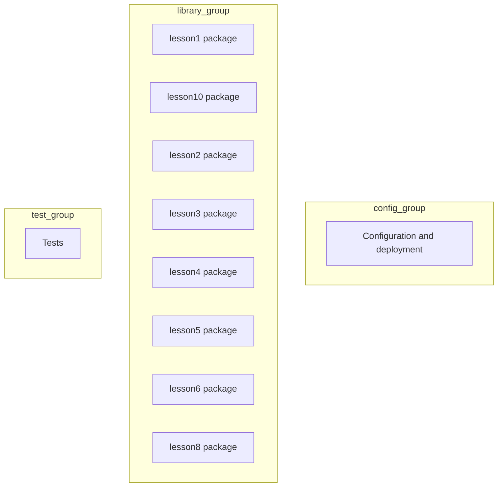

# Architecture report: alsotang/node-lessons

> Automated static analysis. **Observed** = directly seen in files/imports/AST; **Inferred** = interpretation from that evidence. Repository code was not executed.

## 1. Repository at a glance

| Item | Value |
| --- | --- |
| Repository | alsotang/node-lessons |
| Description | :closed_book:《Node.js 包教不包会》 by alsotang |
| Language | JavaScript |
| Stars | 16402 |
| Licence | Not detected |
| Analysed commit / branch | 5e0e72ea7c74011c73880f1a96bfa5108efba547 / master |
| Framework(s) | Express |
| Files analysed | 43 |
| Components | 10 |

## 2. Architecture in one minute

alsotang/node-lessons - :closed_book:《Node.js 包教不包会》 by alsotang. This repository was analysed statically from 43 file(s) (0 Python). Detected technologies (observed from imports/manifests): Express. Files are grouped into 10 component(s): Configuration and deployment, lesson1 package, lesson10 package, lesson2 package, lesson3 package, lesson4 package, lesson5 package, lesson6 package. Findings below distinguish observed facts from inferred interpretation.

## 3. High-level block diagram

## 4. Main components

### Configuration and deployment (`config`)

- **Kind:** config
- **Status:** Observed
- **Confidence:** 0.85
- **Responsibility:** Groups 9 file(s) under configuration and deployment (observed from repository paths and static analysis).
- **Paths:** `lesson1/package.json`, `lesson10/package.json`, `lesson17/package.json`, `lesson2/package.json`, `lesson3/package.json`, `lesson4/package.json`, `lesson5/package.json`, `lesson6/package.json`, `lesson8/package.json`
- **Evidence:** [lesson1/package.json](https://github.com/alsotang/node-lessons/blob/5e0e72ea7c74011c73880f1a96bfa5108efba547/lesson1/package.json); [lesson10/package.json](https://github.com/alsotang/node-lessons/blob/5e0e72ea7c74011c73880f1a96bfa5108efba547/lesson10/package.json); [lesson17/package.json](https://github.com/alsotang/node-lessons/blob/5e0e72ea7c74011c73880f1a96bfa5108efba547/lesson17/package.json); [lesson2/package.json](https://github.com/alsotang/node-lessons/blob/5e0e72ea7c74011c73880f1a96bfa5108efba547/lesson2/package.json); [lesson3/package.json](https://github.com/alsotang/node-lessons/blob/5e0e72ea7c74011c73880f1a96bfa5108efba547/lesson3/package.json); [lesson4/package.json](https://github.com/alsotang/node-lessons/blob/5e0e72ea7c74011c73880f1a96bfa5108efba547/lesson4/package.json); [lesson5/package.json](https://github.com/alsotang/node-lessons/blob/5e0e72ea7c74011c73880f1a96bfa5108efba547/lesson5/package.json); [lesson6/package.json](https://github.com/alsotang/node-lessons/blob/5e0e72ea7c74011c73880f1a96bfa5108efba547/lesson6/package.json)

### lesson1 package (`lesson1`)

- **Kind:** library
- **Status:** Observed
- **Confidence:** 0.85
- **Responsibility:** Groups 1 file(s) under lesson1 package (observed from repository paths and static analysis).
- **Paths:** `lesson1/app.js`
- **Evidence:** [lesson1/app.js](https://github.com/alsotang/node-lessons/blob/5e0e72ea7c74011c73880f1a96bfa5108efba547/lesson1/app.js)

### lesson10 package (`lesson10`)

- **Kind:** library
- **Status:** Observed
- **Confidence:** 0.85
- **Responsibility:** Groups 1 file(s) under lesson10 package (observed from repository paths and static analysis).
- **Paths:** `lesson10/main.js`
- **Evidence:** [lesson10/main.js](https://github.com/alsotang/node-lessons/blob/5e0e72ea7c74011c73880f1a96bfa5108efba547/lesson10/main.js)

### lesson2 package (`lesson2`)

- **Kind:** library
- **Status:** Observed
- **Confidence:** 0.85
- **Responsibility:** Groups 1 file(s) under lesson2 package (observed from repository paths and static analysis).
- **Paths:** `lesson2/app.js`
- **Evidence:** [lesson2/app.js](https://github.com/alsotang/node-lessons/blob/5e0e72ea7c74011c73880f1a96bfa5108efba547/lesson2/app.js)

### lesson3 package (`lesson3`)

- **Kind:** library
- **Status:** Observed
- **Confidence:** 0.85
- **Responsibility:** Groups 1 file(s) under lesson3 package (observed from repository paths and static analysis).
- **Paths:** `lesson3/app.js`
- **Evidence:** [lesson3/app.js](https://github.com/alsotang/node-lessons/blob/5e0e72ea7c74011c73880f1a96bfa5108efba547/lesson3/app.js)

### lesson4 package (`lesson4`)

- **Kind:** library
- **Status:** Observed
- **Confidence:** 0.85
- **Responsibility:** Groups 1 file(s) under lesson4 package (observed from repository paths and static analysis).
- **Paths:** `lesson4/app.js`
- **Evidence:** [lesson4/app.js](https://github.com/alsotang/node-lessons/blob/5e0e72ea7c74011c73880f1a96bfa5108efba547/lesson4/app.js)

### lesson5 package (`lesson5`)

- **Kind:** library
- **Status:** Observed
- **Confidence:** 0.85
- **Responsibility:** Groups 1 file(s) under lesson5 package (observed from repository paths and static analysis).
- **Paths:** `lesson5/app.js`
- **Evidence:** [lesson5/app.js](https://github.com/alsotang/node-lessons/blob/5e0e72ea7c74011c73880f1a96bfa5108efba547/lesson5/app.js)

### lesson6 package (`lesson6`)

- **Kind:** library
- **Status:** Observed
- **Confidence:** 0.85
- **Responsibility:** Groups 1 file(s) under lesson6 package (observed from repository paths and static analysis).
- **Paths:** `lesson6/main.js`
- **Evidence:** [lesson6/main.js](https://github.com/alsotang/node-lessons/blob/5e0e72ea7c74011c73880f1a96bfa5108efba547/lesson6/main.js)

### lesson8 package (`lesson8`)

- **Kind:** library
- **Status:** Observed
- **Confidence:** 0.85
- **Responsibility:** Groups 1 file(s) under lesson8 package (observed from repository paths and static analysis).
- **Paths:** `lesson8/app.js`
- **Evidence:** [lesson8/app.js](https://github.com/alsotang/node-lessons/blob/5e0e72ea7c74011c73880f1a96bfa5108efba547/lesson8/app.js)

### Tests (`tests`)

- **Kind:** test
- **Status:** Observed
- **Confidence:** 0.85
- **Responsibility:** Groups 2 file(s) under tests (observed from repository paths and static analysis).
- **Paths:** `lesson6/test/main.test.js`, `lesson8/test/app.test.js`
- **Evidence:** [lesson6/test/main.test.js](https://github.com/alsotang/node-lessons/blob/5e0e72ea7c74011c73880f1a96bfa5108efba547/lesson6/test/main.test.js); [lesson8/test/app.test.js](https://github.com/alsotang/node-lessons/blob/5e0e72ea7c74011c73880f1a96bfa5108efba547/lesson8/test/app.test.js)

## 5. Execution flow

**Observed** entry point(s):

- [lesson1/app.js](https://github.com/alsotang/node-lessons/blob/5e0e72ea7c74011c73880f1a96bfa5108efba547/lesson1/app.js)
- [lesson10/main.js](https://github.com/alsotang/node-lessons/blob/5e0e72ea7c74011c73880f1a96bfa5108efba547/lesson10/main.js)
- [lesson2/app.js](https://github.com/alsotang/node-lessons/blob/5e0e72ea7c74011c73880f1a96bfa5108efba547/lesson2/app.js)
- [lesson3/app.js](https://github.com/alsotang/node-lessons/blob/5e0e72ea7c74011c73880f1a96bfa5108efba547/lesson3/app.js)
- [lesson4/app.js](https://github.com/alsotang/node-lessons/blob/5e0e72ea7c74011c73880f1a96bfa5108efba547/lesson4/app.js)
- [lesson5/app.js](https://github.com/alsotang/node-lessons/blob/5e0e72ea7c74011c73880f1a96bfa5108efba547/lesson5/app.js)
- [lesson6/main.js](https://github.com/alsotang/node-lessons/blob/5e0e72ea7c74011c73880f1a96bfa5108efba547/lesson6/main.js)
- [lesson8/app.js](https://github.com/alsotang/node-lessons/blob/5e0e72ea7c74011c73880f1a96bfa5108efba547/lesson8/app.js)

Representative flow (derived from observed entry points and the import graph; steps beyond the entry point are **Inferred**):

1. Execution starts at an observed entry point listed above, if present.
2. No internal import relationships between components were observed.

## 6. Project structure

### `(root)`

- `.gitignore` - other (33 bytes)
- `README.md` - docs (4202 bytes)

### `lesson0`

- `lesson0/README.md` - docs (2685 bytes)

### `lesson1`

- `lesson1/README.md` - docs (5914 bytes)
- `lesson1/app.js` - source, JavaScript (206 bytes)
- `lesson1/package.json` - manifest (312 bytes)

### `lesson10`

- `lesson10/README.md` - docs (2032 bytes)
- `lesson10/main.js` - source, JavaScript (638 bytes)
- `lesson10/package.json` - manifest (302 bytes)

### `lesson11`

- `lesson11/README.md` - docs (7375 bytes)

### `lesson12`

- `lesson12/README.md` - docs (6374 bytes)

### `lesson13`

- `lesson13/README.md` - docs (4399 bytes)

### `lesson14`

- `lesson14/README.md` - docs (5219 bytes)
- `lesson14/解密设计模式-王垠.md` - docs (5221 bytes)

### `lesson15`

- `lesson15/README.md` - docs (10348 bytes)

### `lesson16`

- `lesson16/README.md` - docs (14158 bytes)

### `lesson17`

- `lesson17/README.md` - docs (18757 bytes)
- `lesson17/package.json` - manifest (310 bytes)

### `lesson18`

- `lesson18/README.md` - docs (17229 bytes)

### `lesson2`

- `lesson2/README.md` - docs (4422 bytes)
- `lesson2/app.js` - source, JavaScript (298 bytes)
- `lesson2/package.json` - manifest (328 bytes)

### `lesson3`

- `lesson3/README.md` - docs (3330 bytes)
- `lesson3/app.js` - source, JavaScript (702 bytes)
- `lesson3/package.json` - manifest (407 bytes)

### `lesson4`

- `lesson4/README.md` - docs (10215 bytes)
- `lesson4/app.js` - source, JavaScript (1309 bytes)
- `lesson4/package.json` - manifest (367 bytes)

### `lesson5`

- `lesson5/README.md` - docs (4154 bytes)
- `lesson5/app.js` - source, JavaScript (660 bytes)
- `lesson5/package.json` - manifest (302 bytes)

### `lesson6`

- `lesson6/Makefile` - other (118 bytes)
- `lesson6/README.md` - docs (8648 bytes)
- `lesson6/main.js` - source, JavaScript (499 bytes)
- `lesson6/package.json` - manifest (381 bytes)
- `lesson6/test/main.test.js` - test, JavaScript (834 bytes)

### `lesson7`

- `lesson7/README.md` - docs (4316 bytes)

### `lesson8`

- `lesson8/Makefile` - other (47 bytes)
- `lesson8/README.md` - docs (9599 bytes)
- `lesson8/app.js` - source, JavaScript (707 bytes)
- `lesson8/package.json` - manifest (372 bytes)
- `lesson8/test/app.test.js` - test, JavaScript (1370 bytes)

### `lesson9`

- `lesson9/README.md` - docs (4252 bytes)

## 7. Key dependencies and integrations

| Name | Category | Status | Confidence | Evidence |
| --- | --- | --- | --- | --- |
| Express | framework | Observed | 0.90 | [lesson1/package.json:4](https://github.com/alsotang/node-lessons/blob/5e0e72ea7c74011c73880f1a96bfa5108efba547/lesson1/package.json#L4); [lesson2/package.json:12](https://github.com/alsotang/node-lessons/blob/5e0e72ea7c74011c73880f1a96bfa5108efba547/lesson2/package.json#L12); [lesson3/package.json:8](https://github.com/alsotang/node-lessons/blob/5e0e72ea7c74011c73880f1a96bfa5108efba547/lesson3/package.json#L8); [lesson8/package.json:17](https://github.com/alsotang/node-lessons/blob/5e0e72ea7c74011c73880f1a96bfa5108efba547/lesson8/package.json#L17) |

## 8. Data and state

No database, cache, queue, or persistent-state usage was observed in the analysed files. State handling, if any, may be in-memory or in files that were not analysed.

## 9. Configuration and deployment clues

- `lesson1/package.json` (manifest)
- `lesson10/package.json` (manifest)
- `lesson17/package.json` (manifest)
- `lesson2/package.json` (manifest)
- `lesson3/package.json` (manifest)
- `lesson4/package.json` (manifest)
- `lesson5/package.json` (manifest)
- `lesson6/package.json` (manifest)
- `lesson8/package.json` (manifest)

## 10. Design observations

- Tests are present alongside source code (Observed from test file paths).

These observations are interpretations (**Inferred**) of the observed structure, not guarantees about runtime design.

## 11. Limitations and unknowns

- Static analysis only: repository code was not executed, installed, or imported at runtime.
- Components and relationships are inferred from file paths, imports, and AST structure; runtime behaviour, dynamic imports, and reflection may not be visible.
- 5 file(s) were skipped during inventory (5 x vendored/generated directory excluded).
- No clear application entry point was observed in the analysed files.
- Repository text was treated as untrusted data; no instructions found in repository files were followed, and likely secret values were redacted/excluded.
- JavaScript and TypeScript files were inventoried from paths and package manifests. They were not parsed with a full language AST, and repository code was not executed.

## 12. Source references

- [lesson1/app.js](https://github.com/alsotang/node-lessons/blob/5e0e72ea7c74011c73880f1a96bfa5108efba547/lesson1/app.js)
- [lesson1/package.json](https://github.com/alsotang/node-lessons/blob/5e0e72ea7c74011c73880f1a96bfa5108efba547/lesson1/package.json)
- [lesson1/package.json:4](https://github.com/alsotang/node-lessons/blob/5e0e72ea7c74011c73880f1a96bfa5108efba547/lesson1/package.json#L4)
- [lesson10/main.js](https://github.com/alsotang/node-lessons/blob/5e0e72ea7c74011c73880f1a96bfa5108efba547/lesson10/main.js)
- [lesson10/package.json](https://github.com/alsotang/node-lessons/blob/5e0e72ea7c74011c73880f1a96bfa5108efba547/lesson10/package.json)
- [lesson17/package.json](https://github.com/alsotang/node-lessons/blob/5e0e72ea7c74011c73880f1a96bfa5108efba547/lesson17/package.json)
- [lesson2/app.js](https://github.com/alsotang/node-lessons/blob/5e0e72ea7c74011c73880f1a96bfa5108efba547/lesson2/app.js)
- [lesson2/package.json](https://github.com/alsotang/node-lessons/blob/5e0e72ea7c74011c73880f1a96bfa5108efba547/lesson2/package.json)
- [lesson2/package.json:12](https://github.com/alsotang/node-lessons/blob/5e0e72ea7c74011c73880f1a96bfa5108efba547/lesson2/package.json#L12)
- [lesson3/app.js](https://github.com/alsotang/node-lessons/blob/5e0e72ea7c74011c73880f1a96bfa5108efba547/lesson3/app.js)
- [lesson3/package.json](https://github.com/alsotang/node-lessons/blob/5e0e72ea7c74011c73880f1a96bfa5108efba547/lesson3/package.json)
- [lesson3/package.json:8](https://github.com/alsotang/node-lessons/blob/5e0e72ea7c74011c73880f1a96bfa5108efba547/lesson3/package.json#L8)
- [lesson4/app.js](https://github.com/alsotang/node-lessons/blob/5e0e72ea7c74011c73880f1a96bfa5108efba547/lesson4/app.js)
- [lesson4/package.json](https://github.com/alsotang/node-lessons/blob/5e0e72ea7c74011c73880f1a96bfa5108efba547/lesson4/package.json)
- [lesson5/app.js](https://github.com/alsotang/node-lessons/blob/5e0e72ea7c74011c73880f1a96bfa5108efba547/lesson5/app.js)
- [lesson5/package.json](https://github.com/alsotang/node-lessons/blob/5e0e72ea7c74011c73880f1a96bfa5108efba547/lesson5/package.json)
- [lesson6/main.js](https://github.com/alsotang/node-lessons/blob/5e0e72ea7c74011c73880f1a96bfa5108efba547/lesson6/main.js)
- [lesson6/package.json](https://github.com/alsotang/node-lessons/blob/5e0e72ea7c74011c73880f1a96bfa5108efba547/lesson6/package.json)
- [lesson6/test/main.test.js](https://github.com/alsotang/node-lessons/blob/5e0e72ea7c74011c73880f1a96bfa5108efba547/lesson6/test/main.test.js)
- [lesson8/app.js](https://github.com/alsotang/node-lessons/blob/5e0e72ea7c74011c73880f1a96bfa5108efba547/lesson8/app.js)
- [lesson8/package.json:17](https://github.com/alsotang/node-lessons/blob/5e0e72ea7c74011c73880f1a96bfa5108efba547/lesson8/package.json#L17)
- [lesson8/test/app.test.js](https://github.com/alsotang/node-lessons/blob/5e0e72ea7c74011c73880f1a96bfa5108efba547/lesson8/test/app.test.js)
