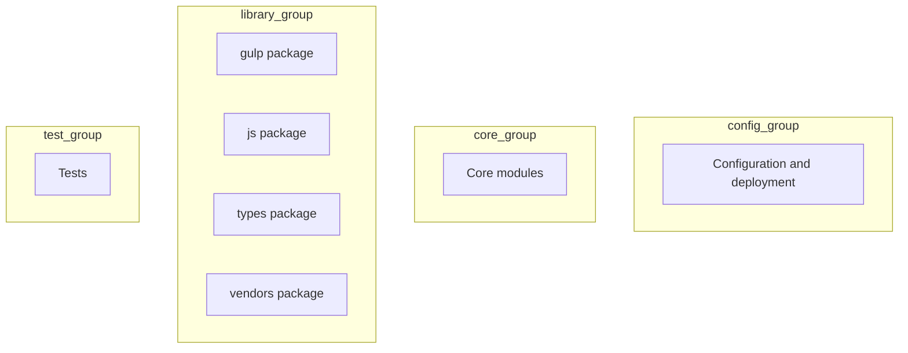

# Architecture report: alvarotrigo/fullPage.js

> Automated static analysis. **Observed** = directly seen in files/imports/AST; **Inferred** = interpretation from that evidence. Repository code was not executed.

## 1. Repository at a glance

| Item | Value |
| --- | --- |
| Repository | alvarotrigo/fullPage.js |
| Description | fullPage plugin by Alvaro Trigo. Create full screen pages fast and simple |
| Language | JavaScript |
| Stars | 35355 |
| Licence | GPL-3.0 |
| Analysed commit / branch | 49f15effa7b195def295a36f872c28153cf9fb00 / master |
| Framework(s) | None detected |
| Files analysed | 257 |
| Components | 7 |

## 2. Architecture in one minute

alvarotrigo/fullPage.js - fullPage plugin by Alvaro Trigo. Create full screen pages fast and simple. This repository was analysed statically from 257 file(s) (0 Python). Detected technologies (observed from imports/manifests): webpack. Files are grouped into 7 component(s): Configuration and deployment, Core modules, gulp package, js package, Tests, types package, vendors package. Findings below distinguish observed facts from inferred interpretation.

## 3. High-level block diagram

## 4. Main components

### Configuration and deployment (`config`)

- **Kind:** config
- **Status:** Observed
- **Confidence:** 0.85
- **Responsibility:** Groups 12 file(s) under configuration and deployment (observed from repository paths and static analysis).
- **Paths:** `FUNDING.yml`, `bower.json`, `lang/website/br.yml`, `lang/website/en.yml`, `lang/website/es.yml`, `lang/website/fr.yml`, `lang/website/ja.yml`, `lang/website/ko.yml`, `lang/website/ru.yml`, `lang/website/zh.yml`, `package.json`, `src/jsconfig.json`
- **Evidence:** [FUNDING.yml](https://github.com/alvarotrigo/fullPage.js/blob/49f15effa7b195def295a36f872c28153cf9fb00/FUNDING.yml); [bower.json](https://github.com/alvarotrigo/fullPage.js/blob/49f15effa7b195def295a36f872c28153cf9fb00/bower.json); [lang/website/br.yml](https://github.com/alvarotrigo/fullPage.js/blob/49f15effa7b195def295a36f872c28153cf9fb00/lang/website/br.yml); [lang/website/en.yml](https://github.com/alvarotrigo/fullPage.js/blob/49f15effa7b195def295a36f872c28153cf9fb00/lang/website/en.yml); [lang/website/es.yml](https://github.com/alvarotrigo/fullPage.js/blob/49f15effa7b195def295a36f872c28153cf9fb00/lang/website/es.yml); [lang/website/fr.yml](https://github.com/alvarotrigo/fullPage.js/blob/49f15effa7b195def295a36f872c28153cf9fb00/lang/website/fr.yml); [lang/website/ja.yml](https://github.com/alvarotrigo/fullPage.js/blob/49f15effa7b195def295a36f872c28153cf9fb00/lang/website/ja.yml); [lang/website/ko.yml](https://github.com/alvarotrigo/fullPage.js/blob/49f15effa7b195def295a36f872c28153cf9fb00/lang/website/ko.yml)

### Core modules (`core`)

- **Kind:** core
- **Status:** Observed
- **Confidence:** 0.85
- **Responsibility:** Groups 2 file(s) under core modules (observed from repository paths and static analysis).
- **Paths:** `gulpfile.js`, `rollup.config.js`
- **Evidence:** [gulpfile.js](https://github.com/alvarotrigo/fullPage.js/blob/49f15effa7b195def295a36f872c28153cf9fb00/gulpfile.js); [rollup.config.js](https://github.com/alvarotrigo/fullPage.js/blob/49f15effa7b195def295a36f872c28153cf9fb00/rollup.config.js)

### gulp package (`gulp`)

- **Kind:** library
- **Status:** Observed
- **Confidence:** 0.85
- **Responsibility:** Groups 1 file(s) under gulp package (observed from repository paths and static analysis).
- **Paths:** `gulp/build.js`
- **Evidence:** [gulp/build.js](https://github.com/alvarotrigo/fullPage.js/blob/49f15effa7b195def295a36f872c28153cf9fb00/gulp/build.js)

### js package (`js`)

- **Kind:** library
- **Status:** Observed
- **Confidence:** 0.85
- **Responsibility:** Groups 98 file(s) under js package (observed from repository paths and static analysis).
- **Paths:** `src/js/anchors/getAnchorsURL.js`, `src/js/anchors/index.js`, `src/js/anchors/setPageStatus.js`, `src/js/anchors/setRecordHistory.js`, `src/js/app.js`, `src/js/arrows.js`, `src/js/autoScrolling.js`, `src/js/beyondFullpage/beyondFullPageHandler.js`, `src/js/beyondFullpage/index.js`, `src/js/beyondFullpage/scrollBeyondFullPage.js`, `src/js/beyondFullpage/wheelDataHandler.js`, `src/js/bindings.js`, `src/js/callbacks/fireCallback.js`, `src/js/callbacks/fireCallbacksOncePerScroll.js`, `src/js/callbacks/nullOrSection.js`, `src/js/callbacks/nullOrSlide.js`, `src/js/common/addTableClass.js`, `src/js/common/cache.js`, `src/js/common/constants.js`, `src/js/common/eventEmitter.js`, `src/js/common/events.js`, `src/js/common/getSectionByAnchor.js`, `src/js/common/isScrollAllowed.js`, `src/js/common/item.js`, `src/js/common/options.js`, `src/js/common/scrollTo.js`, `src/js/common/selectors.js`, `src/js/common/silentScroll.js`, `src/js/common/state.js`, `src/js/common/supportsPassive.js`, `src/js/common/tick.js`, `src/js/common/transformContainer.js`, `src/js/common/utils.js`, `src/js/common/utilsFP.js`, `src/js/console.js`, `src/js/dom/addInternalSelectors.js`, `src/js/dom/afterRenderActions.js`, `src/js/dom/destroyStructure.js`, `src/js/dom/prepareDom.js`, `src/js/dynamic.js`, `src/js/easing.js`, `src/js/fitToSection.js`, `src/js/fullpage.js`, `src/js/infiniteScroll/createInfiniteSections.js`, `src/js/infiniteScroll/fixPosition.js`, `src/js/infiniteScroll/getPositions.js`, `src/js/instance.js`, `src/js/jquery-adaptor.js`, `src/js/keyboard/index.js`, `src/js/keyboard/setKeyboardScrolling.js`, `src/js/lazyLoad/lazyLoad.js`, `src/js/lazyLoad/lazyLoadOthers.js`, `src/js/media.js`, `src/js/menu/activateMenuAndNav.js`, `src/js/menu/index.js`, `src/js/menu/styleMenu.js`, `src/js/mixed/warnings.js`, `src/js/mixed/waterMark.js`, `src/js/mouse/move.js`, `src/js/mouse/wheel.js`, `src/js/nav/getBulletLinkName.js`, `src/js/nav/index.js`, `src/js/nav/sections.js`, `src/js/nav/slides.js`, `src/js/normalScrollElements.js`, `src/js/optionsDefault.js`, `src/js/polyfills/array.find.js`, `src/js/polyfills/array.foreach.js`, `src/js/polyfills/array.from.js`, `src/js/polyfills/index.js`, `src/js/polyfills/object.assign.js`, `src/js/polyfills/string.padStart.js`, `src/js/resize.js`, `src/js/responsive.js`, `src/js/scroll/index.js`, `src/js/scroll/moveSectionDown.js`, `src/js/scroll/moveSectionUp.js`, `src/js/scroll/moveTo.js`, `src/js/scroll/scrollHandler.js`, `src/js/scroll/scrollPage.js`, `src/js/scroll/scrollPageAndSlide.js`, `src/js/scroll/scrollToAnchor.js`, `src/js/scroll/scrolling.js`, `src/js/scroll/setAllowScrolling.js`, `src/js/scroll/silentMove.js`, `src/js/scroll/skipIntermediateItems.js`, `src/js/scrolloverflow.js`, `src/js/sections.js`, `src/js/slides/index.js`, `src/js/slides/landscapeScroll.js`, `src/js/slides/moveSlide.js`, `src/js/slides/scrollSlider.js`, `src/js/slides/silentLandscapeScroll.js`, `src/js/slides/styleSlides.js`, `src/js/speed.js`, `src/js/stateClasses.js`, `src/js/stateUpdates.js`, `src/js/touch.js`
- **Evidence:** [src/js/anchors/getAnchorsURL.js](https://github.com/alvarotrigo/fullPage.js/blob/49f15effa7b195def295a36f872c28153cf9fb00/src/js/anchors/getAnchorsURL.js); [src/js/anchors/index.js](https://github.com/alvarotrigo/fullPage.js/blob/49f15effa7b195def295a36f872c28153cf9fb00/src/js/anchors/index.js); [src/js/anchors/setPageStatus.js](https://github.com/alvarotrigo/fullPage.js/blob/49f15effa7b195def295a36f872c28153cf9fb00/src/js/anchors/setPageStatus.js); [src/js/anchors/setRecordHistory.js](https://github.com/alvarotrigo/fullPage.js/blob/49f15effa7b195def295a36f872c28153cf9fb00/src/js/anchors/setRecordHistory.js); [src/js/app.js](https://github.com/alvarotrigo/fullPage.js/blob/49f15effa7b195def295a36f872c28153cf9fb00/src/js/app.js); [src/js/arrows.js](https://github.com/alvarotrigo/fullPage.js/blob/49f15effa7b195def295a36f872c28153cf9fb00/src/js/arrows.js); [src/js/autoScrolling.js](https://github.com/alvarotrigo/fullPage.js/blob/49f15effa7b195def295a36f872c28153cf9fb00/src/js/autoScrolling.js); [src/js/beyondFullpage/beyondFullPageHandler.js](https://github.com/alvarotrigo/fullPage.js/blob/49f15effa7b195def295a36f872c28153cf9fb00/src/js/beyondFullpage/beyondFullPageHandler.js)

### Tests (`tests`)

- **Kind:** test
- **Status:** Observed
- **Confidence:** 0.85
- **Responsibility:** Groups 38 file(s) under tests (observed from repository paths and static analysis).
- **Paths:** `tests/index.html`, `tests/unit/arrows.js`, `tests/unit/bigSectionsDestination.js`, `tests/unit/callbacks.js`, `tests/unit/callbacksV3.js`, `tests/unit/continuousVertical.js`, `tests/unit/destroy.js`, `tests/unit/displayWarnings.js`, `tests/unit/easingcss3.js`, `tests/unit/fitToSection.js`, `tests/unit/fixedElements.js`, `tests/unit/keyboardScrolling.js`, `tests/unit/lazyload.js`, `tests/unit/lockAnchors.js`, `tests/unit/loopBottom.js`, `tests/unit/loopTop.js`, `tests/unit/menu.js`, `tests/unit/moveSectionDown.js`, `tests/unit/moveSectionUp.js`, `tests/unit/moveSlideLeft.js`, `tests/unit/moveSlideRight.js`, `tests/unit/moveTo.js`, `tests/unit/nav.js`, `tests/unit/normalScrollElements.js`, `tests/unit/paddings.js`, `tests/unit/recordHistory.js`, `tests/unit/responsiveHeight.js`, `tests/unit/responsiveWidth.js`, `tests/unit/scrollBar.js`, `tests/unit/scrollingSpeed.js`, `tests/unit/sectionsColor.js`, `tests/unit/selectors.js`, `tests/unit/setAllowScrolling.js`, `tests/unit/setAutoScrolling.js`, `tests/unit/silentMoveTo.js`, `tests/unit/slidesNavigation.js`, `tests/unit/verticalCentered.js`, `tests/utils.js`
- **Evidence:** [tests/index.html](https://github.com/alvarotrigo/fullPage.js/blob/49f15effa7b195def295a36f872c28153cf9fb00/tests/index.html); [tests/unit/arrows.js](https://github.com/alvarotrigo/fullPage.js/blob/49f15effa7b195def295a36f872c28153cf9fb00/tests/unit/arrows.js); [tests/unit/bigSectionsDestination.js](https://github.com/alvarotrigo/fullPage.js/blob/49f15effa7b195def295a36f872c28153cf9fb00/tests/unit/bigSectionsDestination.js); [tests/unit/callbacks.js](https://github.com/alvarotrigo/fullPage.js/blob/49f15effa7b195def295a36f872c28153cf9fb00/tests/unit/callbacks.js); [tests/unit/callbacksV3.js](https://github.com/alvarotrigo/fullPage.js/blob/49f15effa7b195def295a36f872c28153cf9fb00/tests/unit/callbacksV3.js); [tests/unit/continuousVertical.js](https://github.com/alvarotrigo/fullPage.js/blob/49f15effa7b195def295a36f872c28153cf9fb00/tests/unit/continuousVertical.js); [tests/unit/destroy.js](https://github.com/alvarotrigo/fullPage.js/blob/49f15effa7b195def295a36f872c28153cf9fb00/tests/unit/destroy.js); [tests/unit/displayWarnings.js](https://github.com/alvarotrigo/fullPage.js/blob/49f15effa7b195def295a36f872c28153cf9fb00/tests/unit/displayWarnings.js)

### types package (`types`)

- **Kind:** library
- **Status:** Observed
- **Confidence:** 0.85
- **Responsibility:** Groups 1 file(s) under types package (observed from repository paths and static analysis).
- **Paths:** `types/index.d.ts`
- **Evidence:** [types/index.d.ts](https://github.com/alvarotrigo/fullPage.js/blob/49f15effa7b195def295a36f872c28153cf9fb00/types/index.d.ts)

### vendors package (`vendors`)

- **Kind:** library
- **Status:** Observed
- **Confidence:** 0.85
- **Responsibility:** Groups 1 file(s) under vendors package (observed from repository paths and static analysis).
- **Paths:** `vendors/easings.js`
- **Evidence:** [vendors/easings.js](https://github.com/alvarotrigo/fullPage.js/blob/49f15effa7b195def295a36f872c28153cf9fb00/vendors/easings.js)

## 5. Execution flow

**Observed** entry point(s):

- [src/js/anchors/index.js](https://github.com/alvarotrigo/fullPage.js/blob/49f15effa7b195def295a36f872c28153cf9fb00/src/js/anchors/index.js)
- [src/js/app.js](https://github.com/alvarotrigo/fullPage.js/blob/49f15effa7b195def295a36f872c28153cf9fb00/src/js/app.js)
- [src/js/beyondFullpage/index.js](https://github.com/alvarotrigo/fullPage.js/blob/49f15effa7b195def295a36f872c28153cf9fb00/src/js/beyondFullpage/index.js)
- [src/js/keyboard/index.js](https://github.com/alvarotrigo/fullPage.js/blob/49f15effa7b195def295a36f872c28153cf9fb00/src/js/keyboard/index.js)
- [src/js/menu/index.js](https://github.com/alvarotrigo/fullPage.js/blob/49f15effa7b195def295a36f872c28153cf9fb00/src/js/menu/index.js)
- [src/js/nav/index.js](https://github.com/alvarotrigo/fullPage.js/blob/49f15effa7b195def295a36f872c28153cf9fb00/src/js/nav/index.js)
- [src/js/polyfills/index.js](https://github.com/alvarotrigo/fullPage.js/blob/49f15effa7b195def295a36f872c28153cf9fb00/src/js/polyfills/index.js)
- [src/js/scroll/index.js](https://github.com/alvarotrigo/fullPage.js/blob/49f15effa7b195def295a36f872c28153cf9fb00/src/js/scroll/index.js)
- [src/js/slides/index.js](https://github.com/alvarotrigo/fullPage.js/blob/49f15effa7b195def295a36f872c28153cf9fb00/src/js/slides/index.js)

Representative flow (derived from observed entry points and the import graph; steps beyond the entry point are **Inferred**):

1. Execution starts at an observed entry point listed above, if present.
2. No internal import relationships between components were observed.

## 6. Project structure

### `(root)`

- `. jshintrc` - other (23 bytes)
- `.gitattributes` - other (28 bytes)
- `.gitignore` - other (424 bytes)
- `BACKERS.md` - docs (1544 bytes)
- `CONTRIBUTING.md` - docs (645 bytes)
- `FUNDING.yml` - config (19 bytes)
- `LICENSE` - docs (35821 bytes)
- `README.md` - docs (62934 bytes)
- `SECURITY.md` - docs (55 bytes)
- `bower.json` - config (640 bytes)
- `gulpfile.js` - source, JavaScript (148 bytes)
- `package.json` - manifest (2351 bytes)
- `rollup.config.js` - source, JavaScript (6782 bytes)

### `.github`

- `.github/ISSUE_TEMPLATE.md` - docs (471 bytes)
- `.github/PULL_REQUEST_TEMPLATE.md` - docs (133 bytes)

### `examples`

- `examples/active-slide.html` - other (5761 bytes)
- `examples/angular-fullpage.html` - other (615 bytes)
- `examples/auto-height.html` - other (5494 bytes)
- `examples/autoplay-video-and-audio.html` - other (6388 bytes)
- `examples/background-video.html` - other (6734 bytes)
- `examples/backgrounds-fixed.html` - other (6587 bytes)
- `examples/backgrounds.html` - other (6329 bytes)
- `examples/callbacks.html` - other (10672 bytes)
- `examples/cards.html` - other (627 bytes)
- `examples/cinematic.html` - other (644 bytes)
- `examples/continuous-horizontal.html` - other (676 bytes)
- `examples/continuous-vertical.html` - other (5489 bytes)
- `examples/css3.html` - other (4801 bytes)
- `examples/custom-arrows.html` - other (5232 bytes)
- `examples/drag-and-move.html` - other (648 bytes)
- `examples/drop-effect.html` - other (652 bytes)
- `examples/easing-css3.html` - other (5525 bytes)
- `examples/easing-js.html` - other (5526 bytes)
- `examples/effects.html` - other (641 bytes)
- `examples/examples.css` - other (5358 bytes)
- `examples/examples.js` - source, JavaScript (238 bytes)
- `examples/fading-effect.html` - other (652 bytes)
- `examples/fixed-headers.html` - other (6165 bytes)
- `examples/gradient-backgrounds.html` - other (6318 bytes)
- `examples/hide-sections.html` - other (6565 bytes)
- `examples/imgs/copyright.txt` - docs (551 bytes)
- `examples/interlocked-slides.html` - other (660 bytes)
- `examples/jquery-adapter.html` - other (6759 bytes)
- `examples/lazy-load.html` - other (7643 bytes)
- `examples/looping.html` - other (5238 bytes)
- `examples/methods.html` - other (10529 bytes)
- `examples/module_loaders/browserify-example/README.md` - docs (915 bytes)
- `examples/module_loaders/browserify-example/package.json` - manifest (302 bytes)
- `examples/module_loaders/browserify-example/src/index.js` - source, JavaScript (649 bytes)
- `examples/module_loaders/requirejs-example/README.md` - docs (2039 bytes)
- `examples/module_loaders/requirejs-example/index.html` - other (920 bytes)
- `examples/module_loaders/requirejs-example/package.json` - manifest (269 bytes)
- `examples/module_loaders/requirejs-example/src/main.js` - source, JavaScript (958 bytes)
- `examples/module_loaders/requirejs-example/src/require.config.js` - source, JavaScript (497 bytes)
- `examples/module_loaders/webpack-example/.babelrc` - other (68 bytes)
- `examples/module_loaders/webpack-example/README.md` - docs (962 bytes)
- `examples/module_loaders/webpack-example/package.json` - manifest (491 bytes)
- `examples/module_loaders/webpack-example/src/index.js` - source, JavaScript (701 bytes)
- `examples/module_loaders/webpack-example/webpack.config.js` - source, JavaScript (281 bytes)
- `examples/navigation-horizontal.html` - other (6565 bytes)
- `examples/navigation-tooltips.html` - other (5449 bytes)
- `examples/navigation-vertical.html` - other (6065 bytes)
- `examples/no-anchor.html` - other (4868 bytes)
- `examples/normal-scroll.html` - other (6298 bytes)
- `examples/normalScrollElements.html` - other (5764 bytes)
- `examples/observer.html` - other (8198 bytes)
- `examples/offset-sections.html` - other (653 bytes)
- `examples/one-section.html` - other (15440 bytes)
- `examples/parallax.html` - other (634 bytes)
- `examples/react-fullpage.html` - other (611 bytes)
- `examples/reset-sliders.html` - other (651 bytes)
- `examples/responsive-auto-height.html` - other (6771 bytes)
- `examples/responsive-height.html` - other (5626 bytes)
- `examples/responsive-slides.html` - other (664 bytes)
- `examples/responsive-width.html` - other (5773 bytes)
- `examples/rtl.html` - other (5769 bytes)
- `examples/scroll-after-fullpage.html` - other (8162 bytes)
- `examples/scroll-horizontally.html` - other (661 bytes)
- `examples/scrollBar.html` - other (5570 bytes)
- `examples/scrollOverflow-reset.html` - other (673 bytes)
- `examples/scrollOverflow.html` - other (16485 bytes)
- `examples/scrolling-speed.html` - other (5426 bytes)
- `examples/simple.html` - other (4619 bytes)
- `examples/skipIntermediateItems.html` - other (5831 bytes)
- `examples/trigger-animations.html` - other (7139 bytes)
- `examples/vue-fullpage.html` - other (607 bytes)
- `examples/water-effect.html` - other (642 bytes)

### `gulp`

- `gulp/build.js` - source, JavaScript (2194 bytes)

### `lang`

- `lang/brazilian-portuguese/README.md` - docs (65352 bytes)
- `lang/brazilian-portuguese/how-to-activate-fullpage-extension.md` - docs (3273 bytes)
- `lang/brazilian-portuguese/parallax-extension.md` - docs (5609 bytes)
- `lang/chinese/README.md` - docs (59816 bytes)
- `lang/chinese/how-to-activate-fullpage-extension.md` - docs (2658 bytes)
- `lang/chinese/parallax-extensionmd.md` - docs (4646 bytes)
- `lang/french/README.md` - docs (66517 bytes)
- `lang/french/how-to-activate-fullpage-extension.md` - docs (3118 bytes)
- `lang/french/parallax-extension.md` - docs (5691 bytes)
- `lang/japanese/README.md` - docs (74771 bytes)
- `lang/japanese/how-to-activate-fullpage-extension.md` - docs (3623 bytes)
- `lang/japanese/parallax-extension.md` - docs (6274 bytes)
- `lang/korean/README.md` - docs (68417 bytes)
- `lang/korean/how-to-activate-fullpage-extension.md` - docs (2374 bytes)
- `lang/korean/parallax-extension.md` - docs (5617 bytes)
- `lang/russian/README.md` - docs (90198 bytes)
- `lang/russian/how-to-activate-fullpage-extension.md` - docs (2882 bytes)
- `lang/russian/parallax-extension.md` - docs (7653 bytes)
- `lang/spanish/README.md` - docs (69430 bytes)
- `lang/spanish/how-to-activate-fullpage-extension.md` - docs (3248 bytes)
- `lang/spanish/parallax-extension.md` - docs (5704 bytes)
- `lang/website/br.yml` - config (12027 bytes)
- `lang/website/en.yml` - config (11316 bytes)
- `lang/website/es.yml` - config (12076 bytes)
- `lang/website/fr.yml` - config (12731 bytes)
- `lang/website/ja.yml` - config (13647 bytes)
- `lang/website/ko.yml` - config (12638 bytes)
- `lang/website/ru.yml` - config (16212 bytes)
- `lang/website/zh.yml` - config (10552 bytes)

### `src`

- `src/css/fullpage.css` - other (7793 bytes)
- `src/js/anchors/getAnchorsURL.js` - source, JavaScript (832 bytes)
- `src/js/anchors/index.js` - source, JavaScript (4256 bytes)
- `src/js/anchors/setPageStatus.js` - source, JavaScript (1792 bytes)
- `src/js/anchors/setRecordHistory.js` - source, JavaScript (324 bytes)
- `src/js/app.js` - source, JavaScript (123 bytes)
- `src/js/arrows.js` - source, JavaScript (2909 bytes)
- `src/js/autoScrolling.js` - source, JavaScript (2253 bytes)
- `src/js/beyondFullpage/beyondFullPageHandler.js` - source, JavaScript (2631 bytes)
- `src/js/beyondFullpage/index.js` - source, JavaScript (670 bytes)
- `src/js/beyondFullpage/scrollBeyondFullPage.js` - source, JavaScript (1625 bytes)
- `src/js/beyondFullpage/wheelDataHandler.js` - source, JavaScript (1988 bytes)
- `src/js/bindings.js` - source, JavaScript (1042 bytes)
- `src/js/callbacks/fireCallback.js` - source, JavaScript (2300 bytes)
- `src/js/callbacks/fireCallbacksOncePerScroll.js` - source, JavaScript (613 bytes)
- `src/js/callbacks/nullOrSection.js` - source, JavaScript (324 bytes)
- `src/js/callbacks/nullOrSlide.js` - source, JavaScript (116 bytes)
- `src/js/common/addTableClass.js` - source, JavaScript (791 bytes)
- `src/js/common/cache.js` - source, JavaScript (278 bytes)
- `src/js/common/constants.js` - source, JavaScript (1549 bytes)
- `src/js/common/eventEmitter.js` - source, JavaScript (857 bytes)
- `src/js/common/events.js` - source, JavaScript (858 bytes)
- `src/js/common/getSectionByAnchor.js` - source, JavaScript (418 bytes)
- `src/js/common/isScrollAllowed.js` - source, JavaScript (747 bytes)
- `src/js/common/item.js` - source, JavaScript (2927 bytes)
- `src/js/common/options.js` - source, JavaScript (2585 bytes)
- `src/js/common/scrollTo.js` - source, JavaScript (2649 bytes)
- `src/js/common/selectors.js` - source, JavaScript (3449 bytes)
- `src/js/common/silentScroll.js` - source, JavaScript (1086 bytes)
- `src/js/common/state.js` - source, JavaScript (1424 bytes)
- `src/js/common/supportsPassive.js` - source, JavaScript (652 bytes)
- `src/js/common/tick.js` - source, JavaScript (1063 bytes)
- `src/js/common/transformContainer.js` - source, JavaScript (885 bytes)
- `src/js/common/utils.js` - source, JavaScript (14423 bytes)
- `src/js/common/utilsFP.js` - source, JavaScript (3118 bytes)
- `src/js/console.js` - source, JavaScript (3873 bytes)
- `src/js/dom/addInternalSelectors.js` - source, JavaScript (500 bytes)
- `src/js/dom/afterRenderActions.js` - source, JavaScript (2219 bytes)
- `src/js/dom/destroyStructure.js` - source, JavaScript (4206 bytes)
- `src/js/dom/prepareDom.js` - source, JavaScript (2624 bytes)
- `src/js/dynamic.js` - source, JavaScript (3654 bytes)
- `src/js/easing.js` - source, JavaScript (339 bytes)
- `src/js/fitToSection.js` - source, JavaScript (893 bytes)
- `src/js/fullpage.js` - source, JavaScript (2978 bytes)
- `src/js/infiniteScroll/createInfiniteSections.js` - source, JavaScript (2026 bytes)
- `src/js/infiniteScroll/fixPosition.js` - source, JavaScript (1537 bytes)
- `src/js/infiniteScroll/getPositions.js` - source, JavaScript (793 bytes)
- `src/js/instance.js` - source, JavaScript (2106 bytes)
- `src/js/jquery-adaptor.js` - source, JavaScript (909 bytes)
- `src/js/keyboard/index.js` - source, JavaScript (10689 bytes)
- `src/js/keyboard/setKeyboardScrolling.js` - source, JavaScript (954 bytes)
- `src/js/lazyLoad/lazyLoad.js` - source, JavaScript (1974 bytes)
- `src/js/lazyLoad/lazyLoadOthers.js` - source, JavaScript (1838 bytes)
- `src/js/media.js` - source, JavaScript (3138 bytes)
- `src/js/menu/activateMenuAndNav.js` - source, JavaScript (866 bytes)
- `src/js/menu/index.js` - source, JavaScript (1141 bytes)
- `src/js/menu/styleMenu.js` - source, JavaScript (1011 bytes)
- `src/js/mixed/warnings.js` - source, JavaScript (796 bytes)
- `src/js/mixed/waterMark.js` - source, JavaScript (1174 bytes)
- `src/js/mouse/move.js` - source, JavaScript (886 bytes)
- `src/js/mouse/wheel.js` - source, JavaScript (10541 bytes)
- `src/js/nav/getBulletLinkName.js` - source, JavaScript (458 bytes)
- `src/js/nav/index.js` - source, JavaScript (999 bytes)
- `src/js/nav/sections.js` - source, JavaScript (3220 bytes)
- `src/js/nav/slides.js` - source, JavaScript (2717 bytes)
- `src/js/normalScrollElements.js` - source, JavaScript (3137 bytes)
- `src/js/optionsDefault.js` - source, JavaScript (2642 bytes)
- `src/js/polyfills/array.find.js` - source, JavaScript (1509 bytes)
- `src/js/polyfills/array.foreach.js` - source, JavaScript (442 bytes)
- `src/js/polyfills/array.from.js` - source, JavaScript (3343 bytes)
- `src/js/polyfills/index.js` - source, JavaScript (140 bytes)
- `src/js/polyfills/object.assign.js` - source, JavaScript (1346 bytes)
- `src/js/polyfills/string.padStart.js` - source, JavaScript (949 bytes)
- `src/js/resize.js` - source, JavaScript (7585 bytes)
- `src/js/responsive.js` - source, JavaScript (2520 bytes)
- `src/js/scroll/index.js` - source, JavaScript (1366 bytes)
- `src/js/scroll/moveSectionDown.js` - source, JavaScript (1066 bytes)
- `src/js/scroll/moveSectionUp.js` - source, JavaScript (657 bytes)
- `src/js/scroll/moveTo.js` - source, JavaScript (624 bytes)
- `src/js/scroll/scrollHandler.js` - source, JavaScript (8075 bytes)
- `src/js/scroll/scrollPage.js` - source, JavaScript (10385 bytes)
- `src/js/scroll/scrollPageAndSlide.js` - source, JavaScript (1408 bytes)
- `src/js/scroll/scrollToAnchor.js` - source, JavaScript (841 bytes)
- `src/js/scroll/scrolling.js` - source, JavaScript (1045 bytes)
- `src/js/scroll/setAllowScrolling.js` - source, JavaScript (816 bytes)
- `src/js/scroll/silentMove.js` - source, JavaScript (548 bytes)
- `src/js/scroll/skipIntermediateItems.js` - source, JavaScript (1082 bytes)
- `src/js/scrolloverflow.js` - source, JavaScript (11915 bytes)
- `src/js/sections.js` - source, JavaScript (1788 bytes)
- `src/js/slides/index.js` - source, JavaScript (1382 bytes)
- `src/js/slides/landscapeScroll.js` - source, JavaScript (5993 bytes)
- `src/js/slides/moveSlide.js` - source, JavaScript (1823 bytes)
- `src/js/slides/scrollSlider.js` - source, JavaScript (401 bytes)
- `src/js/slides/silentLandscapeScroll.js` - source, JavaScript (945 bytes)
- `src/js/slides/styleSlides.js` - source, JavaScript (2547 bytes)
- `src/js/speed.js` - source, JavaScript (283 bytes)
- `src/js/stateClasses.js` - source, JavaScript (1422 bytes)
- `src/js/stateUpdates.js` - source, JavaScript (6957 bytes)
- `src/js/touch.js` - source, JavaScript (7564 bytes)
- `src/jsconfig.json` - config (130 bytes)

### `tests`

- `tests/index.html` - test (20372 bytes)
- `tests/unit/arrows.js` - test, JavaScript (2657 bytes)
- `tests/unit/bigSectionsDestination.js` - test, JavaScript (1239 bytes)
- `tests/unit/callbacks.js` - test, JavaScript (18182 bytes)
- `tests/unit/callbacksV3.js` - test, JavaScript (34380 bytes)
- `tests/unit/continuousVertical.js` - test, JavaScript (6988 bytes)
- `tests/unit/destroy.js` - test, JavaScript (8976 bytes)
- `tests/unit/displayWarnings.js` - test, JavaScript (10368 bytes)
- `tests/unit/easingcss3.js` - test, JavaScript (470 bytes)
- `tests/unit/fitToSection.js` - test, JavaScript (2620 bytes)
- `tests/unit/fixedElements.js` - test, JavaScript (461 bytes)
- `tests/unit/keyboardScrolling.js` - test, JavaScript (14766 bytes)
- `tests/unit/lazyload.js` - test, JavaScript (6677 bytes)
- `tests/unit/lockAnchors.js` - test, JavaScript (1512 bytes)
- `tests/unit/loopBottom.js` - test, JavaScript (768 bytes)
- `tests/unit/loopTop.js` - test, JavaScript (712 bytes)
- `tests/unit/menu.js` - test, JavaScript (8964 bytes)
- `tests/unit/moveSectionDown.js` - test, JavaScript (5410 bytes)
- `tests/unit/moveSectionUp.js` - test, JavaScript (5267 bytes)
- `tests/unit/moveSlideLeft.js` - test, JavaScript (3654 bytes)
- `tests/unit/moveSlideRight.js` - test, JavaScript (3753 bytes)
- `tests/unit/moveTo.js` - test, JavaScript (4669 bytes)
- `tests/unit/nav.js` - test, JavaScript (11860 bytes)
- `tests/unit/normalScrollElements.js` - test, JavaScript (3422 bytes)
- `tests/unit/paddings.js` - test, JavaScript (1525 bytes)
- `tests/unit/recordHistory.js` - test, JavaScript (512 bytes)
- `tests/unit/responsiveHeight.js` - test, JavaScript (2783 bytes)
- `tests/unit/responsiveWidth.js` - test, JavaScript (2878 bytes)
- `tests/unit/scrollBar.js` - test, JavaScript (1546 bytes)
- `tests/unit/scrollingSpeed.js` - test, JavaScript (904 bytes)
- `tests/unit/sectionsColor.js` - test, JavaScript (1516 bytes)
- `tests/unit/selectors.js` - test, JavaScript (1971 bytes)
- `tests/unit/setAllowScrolling.js` - test, JavaScript (6536 bytes)
- `tests/unit/setAutoScrolling.js` - test, JavaScript (3254 bytes)
- `tests/unit/silentMoveTo.js` - test, JavaScript (5648 bytes)
- `tests/unit/slidesNavigation.js` - test, JavaScript (8110 bytes)
- `tests/unit/verticalCentered.js` - test, JavaScript (2357 bytes)
- `tests/utils.js` - test, JavaScript (14638 bytes)

### `types`

- `types/index.d.ts` - source, TypeScript (7714 bytes)

### `vendors`

- `vendors/easings.js` - source, JavaScript (6842 bytes)

## 7. Key dependencies and integrations

| Name | Category | Status | Confidence | Evidence |
| --- | --- | --- | --- | --- |
| webpack | tooling | Observed | 0.85 | [examples/module_loaders/webpack-example/package.json:2](https://github.com/alvarotrigo/fullPage.js/blob/49f15effa7b195def295a36f872c28153cf9fb00/examples/module_loaders/webpack-example/package.json#L2) |

## 8. Data and state

No database, cache, queue, or persistent-state usage was observed in the analysed files. State handling, if any, may be in-memory or in files that were not analysed.

## 9. Configuration and deployment clues

- `FUNDING.yml` (config)
- `bower.json` (config)
- `examples/module_loaders/browserify-example/package.json` (manifest)
- `examples/module_loaders/requirejs-example/package.json` (manifest)
- `examples/module_loaders/webpack-example/package.json` (manifest)
- `lang/website/br.yml` (config)
- `lang/website/en.yml` (config)
- `lang/website/es.yml` (config)
- `lang/website/fr.yml` (config)
- `lang/website/ja.yml` (config)
- `lang/website/ko.yml` (config)
- `lang/website/ru.yml` (config)
- `lang/website/zh.yml` (config)
- `package.json` (manifest)
- `src/jsconfig.json` (config)

## 10. Design observations

- Tests are present alongside source code (Observed from test file paths).

These observations are interpretations (**Inferred**) of the observed structure, not guarantees about runtime design.

## 11. Limitations and unknowns

- Static analysis only: repository code was not executed, installed, or imported at runtime.
- Components and relationships are inferred from file paths, imports, and AST structure; runtime behaviour, dynamic imports, and reflection may not be visible.
- 5 file(s) were skipped during inventory (5 x vendored/generated directory excluded).
- No clear application entry point was observed in the analysed files.
- Repository text was treated as untrusted data; no instructions found in repository files were followed, and likely secret values were redacted/excluded.
- JavaScript and TypeScript files were inventoried from paths and package manifests. They were not parsed with a full language AST, and repository code was not executed.

## 12. Source references

- [FUNDING.yml](https://github.com/alvarotrigo/fullPage.js/blob/49f15effa7b195def295a36f872c28153cf9fb00/FUNDING.yml)
- [bower.json](https://github.com/alvarotrigo/fullPage.js/blob/49f15effa7b195def295a36f872c28153cf9fb00/bower.json)
- [examples/module_loaders/webpack-example/package.json:2](https://github.com/alvarotrigo/fullPage.js/blob/49f15effa7b195def295a36f872c28153cf9fb00/examples/module_loaders/webpack-example/package.json#L2)
- [gulp/build.js](https://github.com/alvarotrigo/fullPage.js/blob/49f15effa7b195def295a36f872c28153cf9fb00/gulp/build.js)
- [gulpfile.js](https://github.com/alvarotrigo/fullPage.js/blob/49f15effa7b195def295a36f872c28153cf9fb00/gulpfile.js)
- [lang/website/br.yml](https://github.com/alvarotrigo/fullPage.js/blob/49f15effa7b195def295a36f872c28153cf9fb00/lang/website/br.yml)
- [lang/website/en.yml](https://github.com/alvarotrigo/fullPage.js/blob/49f15effa7b195def295a36f872c28153cf9fb00/lang/website/en.yml)
- [lang/website/es.yml](https://github.com/alvarotrigo/fullPage.js/blob/49f15effa7b195def295a36f872c28153cf9fb00/lang/website/es.yml)
- [lang/website/fr.yml](https://github.com/alvarotrigo/fullPage.js/blob/49f15effa7b195def295a36f872c28153cf9fb00/lang/website/fr.yml)
- [lang/website/ja.yml](https://github.com/alvarotrigo/fullPage.js/blob/49f15effa7b195def295a36f872c28153cf9fb00/lang/website/ja.yml)
- [lang/website/ko.yml](https://github.com/alvarotrigo/fullPage.js/blob/49f15effa7b195def295a36f872c28153cf9fb00/lang/website/ko.yml)
- [rollup.config.js](https://github.com/alvarotrigo/fullPage.js/blob/49f15effa7b195def295a36f872c28153cf9fb00/rollup.config.js)
- [src/js/anchors/getAnchorsURL.js](https://github.com/alvarotrigo/fullPage.js/blob/49f15effa7b195def295a36f872c28153cf9fb00/src/js/anchors/getAnchorsURL.js)
- [src/js/anchors/index.js](https://github.com/alvarotrigo/fullPage.js/blob/49f15effa7b195def295a36f872c28153cf9fb00/src/js/anchors/index.js)
- [src/js/anchors/setPageStatus.js](https://github.com/alvarotrigo/fullPage.js/blob/49f15effa7b195def295a36f872c28153cf9fb00/src/js/anchors/setPageStatus.js)
- [src/js/anchors/setRecordHistory.js](https://github.com/alvarotrigo/fullPage.js/blob/49f15effa7b195def295a36f872c28153cf9fb00/src/js/anchors/setRecordHistory.js)
- [src/js/app.js](https://github.com/alvarotrigo/fullPage.js/blob/49f15effa7b195def295a36f872c28153cf9fb00/src/js/app.js)
- [src/js/arrows.js](https://github.com/alvarotrigo/fullPage.js/blob/49f15effa7b195def295a36f872c28153cf9fb00/src/js/arrows.js)
- [src/js/autoScrolling.js](https://github.com/alvarotrigo/fullPage.js/blob/49f15effa7b195def295a36f872c28153cf9fb00/src/js/autoScrolling.js)
- [src/js/beyondFullpage/beyondFullPageHandler.js](https://github.com/alvarotrigo/fullPage.js/blob/49f15effa7b195def295a36f872c28153cf9fb00/src/js/beyondFullpage/beyondFullPageHandler.js)
- [src/js/beyondFullpage/index.js](https://github.com/alvarotrigo/fullPage.js/blob/49f15effa7b195def295a36f872c28153cf9fb00/src/js/beyondFullpage/index.js)
- [src/js/keyboard/index.js](https://github.com/alvarotrigo/fullPage.js/blob/49f15effa7b195def295a36f872c28153cf9fb00/src/js/keyboard/index.js)
- [src/js/menu/index.js](https://github.com/alvarotrigo/fullPage.js/blob/49f15effa7b195def295a36f872c28153cf9fb00/src/js/menu/index.js)
- [src/js/nav/index.js](https://github.com/alvarotrigo/fullPage.js/blob/49f15effa7b195def295a36f872c28153cf9fb00/src/js/nav/index.js)
- [src/js/polyfills/index.js](https://github.com/alvarotrigo/fullPage.js/blob/49f15effa7b195def295a36f872c28153cf9fb00/src/js/polyfills/index.js)
- [src/js/scroll/index.js](https://github.com/alvarotrigo/fullPage.js/blob/49f15effa7b195def295a36f872c28153cf9fb00/src/js/scroll/index.js)
- [src/js/slides/index.js](https://github.com/alvarotrigo/fullPage.js/blob/49f15effa7b195def295a36f872c28153cf9fb00/src/js/slides/index.js)
- [tests/index.html](https://github.com/alvarotrigo/fullPage.js/blob/49f15effa7b195def295a36f872c28153cf9fb00/tests/index.html)
- [tests/unit/arrows.js](https://github.com/alvarotrigo/fullPage.js/blob/49f15effa7b195def295a36f872c28153cf9fb00/tests/unit/arrows.js)
- [tests/unit/bigSectionsDestination.js](https://github.com/alvarotrigo/fullPage.js/blob/49f15effa7b195def295a36f872c28153cf9fb00/tests/unit/bigSectionsDestination.js)
- [tests/unit/callbacks.js](https://github.com/alvarotrigo/fullPage.js/blob/49f15effa7b195def295a36f872c28153cf9fb00/tests/unit/callbacks.js)
- [tests/unit/callbacksV3.js](https://github.com/alvarotrigo/fullPage.js/blob/49f15effa7b195def295a36f872c28153cf9fb00/tests/unit/callbacksV3.js)
- [tests/unit/continuousVertical.js](https://github.com/alvarotrigo/fullPage.js/blob/49f15effa7b195def295a36f872c28153cf9fb00/tests/unit/continuousVertical.js)
- [tests/unit/destroy.js](https://github.com/alvarotrigo/fullPage.js/blob/49f15effa7b195def295a36f872c28153cf9fb00/tests/unit/destroy.js)
- [tests/unit/displayWarnings.js](https://github.com/alvarotrigo/fullPage.js/blob/49f15effa7b195def295a36f872c28153cf9fb00/tests/unit/displayWarnings.js)
- [types/index.d.ts](https://github.com/alvarotrigo/fullPage.js/blob/49f15effa7b195def295a36f872c28153cf9fb00/types/index.d.ts)
- [vendors/easings.js](https://github.com/alvarotrigo/fullPage.js/blob/49f15effa7b195def295a36f872c28153cf9fb00/vendors/easings.js)
