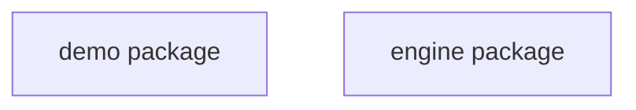

# Architecture report: alyssaxuu/flowy

> Automated static analysis. **Observed** = directly seen in files/imports/AST; **Inferred** = interpretation from that evidence. Repository code was not executed.

## 1. Repository at a glance

| Item | Value |
| --- | --- |
| Repository | alyssaxuu/flowy |
| Description | The minimal javascript library to create flowcharts ✨ |
| Language | JavaScript |
| Stars | 12148 |
| Licence | MIT |
| Analysed commit / branch | e977380e3a84043aabb32cfd25b813455df5ec6f / master |
| Framework(s) | None detected |
| Files analysed | 35 |
| Components | 2 |

## 2. Architecture in one minute

alyssaxuu/flowy - The minimal javascript library to create flowcharts ✨. This repository was analysed statically from 35 file(s) (0 Python). Detected technologies (observed from imports/manifests): no known frameworks/libraries. Files are grouped into 2 component(s): demo package, engine package. Findings below distinguish observed facts from inferred interpretation.

## 3. High-level block diagram

## 4. Main components

### demo package (`demo`)

- **Kind:** library
- **Status:** Observed
- **Confidence:** 0.85
- **Responsibility:** Groups 1 file(s) under demo package (observed from repository paths and static analysis).
- **Paths:** `demo/main.js`
- **Evidence:** [demo/main.js](https://github.com/alyssaxuu/flowy/blob/e977380e3a84043aabb32cfd25b813455df5ec6f/demo/main.js)

### engine package (`engine`)

- **Kind:** library
- **Status:** Observed
- **Confidence:** 0.85
- **Responsibility:** Groups 1 file(s) under engine package (observed from repository paths and static analysis).
- **Paths:** `engine/flowy.js`
- **Evidence:** [engine/flowy.js](https://github.com/alyssaxuu/flowy/blob/e977380e3a84043aabb32cfd25b813455df5ec6f/engine/flowy.js)

## 5. Execution flow

**Observed** entry point(s):

- [demo/main.js](https://github.com/alyssaxuu/flowy/blob/e977380e3a84043aabb32cfd25b813455df5ec6f/demo/main.js)

Representative flow (derived from observed entry points and the import graph; steps beyond the entry point are **Inferred**):

1. Execution starts at an observed entry point listed above, if present.
2. No internal import relationships between components were observed.

## 6. Project structure

### `(root)`

- `.gitattributes` - other (66 bytes)
- `LICENSE` - docs (1065 bytes)
- `README.md` - docs (7775 bytes)

### `.github`

- `.github/FUNDING.yml` - config (65 bytes)

### `demo`

- `demo/assets/action.svg` - other (509 bytes)
- `demo/assets/actionblue.svg` - other (500 bytes)
- `demo/assets/actionorange.svg` - other (512 bytes)
- `demo/assets/arrow.svg` - other (248 bytes)
- `demo/assets/checkoff.svg` - other (176 bytes)
- `demo/assets/checkon.svg` - other (286 bytes)
- `demo/assets/close.svg` - other (339 bytes)
- `demo/assets/closeleft.svg` - other (324 bytes)
- `demo/assets/database.svg` - other (988 bytes)
- `demo/assets/databaseorange.svg` - other (604 bytes)
- `demo/assets/dropdown.svg` - other (244 bytes)
- `demo/assets/error.svg` - other (980 bytes)
- `demo/assets/errorblue.svg` - other (993 bytes)
- `demo/assets/errorred.svg` - other (984 bytes)
- `demo/assets/eye.svg` - other (478 bytes)
- `demo/assets/eyeblue.svg` - other (501 bytes)
- `demo/assets/grabme.svg` - other (481 bytes)
- `demo/assets/heart.svg` - other (834 bytes)
- `demo/assets/log.svg` - other (355 bytes)
- `demo/assets/logred.svg` - other (315 bytes)
- `demo/assets/more.svg` - other (261 bytes)
- `demo/assets/search.svg` - other (496 bytes)
- `demo/assets/time.svg` - other (458 bytes)
- `demo/assets/timeblue.svg` - other (352 bytes)
- `demo/assets/twitter.svg` - other (964 bytes)
- `demo/assets/twitterorange.svg` - other (976 bytes)
- `demo/index.html` - other (7592 bytes)
- `demo/main.js` - source, JavaScript (14236 bytes)
- `demo/styles.css` - other (12814 bytes)

### `engine`

- `engine/flowy.css` - other (599 bytes)
- `engine/flowy.js` - source, JavaScript (41041 bytes)

## 7. Key dependencies and integrations

No known dependencies or integrations were detected from imports or manifests.

## 8. Data and state

No database, cache, queue, or persistent-state usage was observed in the analysed files. State handling, if any, may be in-memory or in files that were not analysed.

## 9. Configuration and deployment clues

- `.github/FUNDING.yml` (config)

## 10. Design observations

- No strong design patterns could be established from the available evidence.

These observations are interpretations (**Inferred**) of the observed structure, not guarantees about runtime design.

## 11. Limitations and unknowns

- Static analysis only: repository code was not executed, installed, or imported at runtime.
- Components and relationships are inferred from file paths, imports, and AST structure; runtime behaviour, dynamic imports, and reflection may not be visible.
- 2 file(s) were skipped during inventory (2 x generated/minified file excluded).
- No clear application entry point was observed in the analysed files.
- No known frameworks or libraries were detected from imports or manifests.
- Repository text was treated as untrusted data; no instructions found in repository files were followed, and likely secret values were redacted/excluded.
- JavaScript and TypeScript files were inventoried from paths and package manifests. They were not parsed with a full language AST, and repository code was not executed.

## 12. Source references

- [demo/main.js](https://github.com/alyssaxuu/flowy/blob/e977380e3a84043aabb32cfd25b813455df5ec6f/demo/main.js)
- [engine/flowy.js](https://github.com/alyssaxuu/flowy/blob/e977380e3a84043aabb32cfd25b813455df5ec6f/engine/flowy.js)
