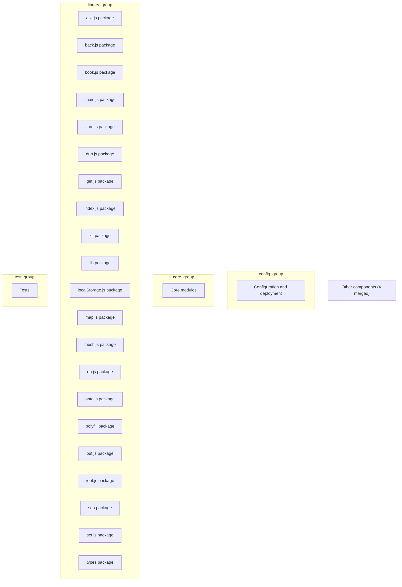

# Architecture report: amark/gun

> Automated static analysis. **Observed** = directly seen in files/imports/AST; **Inferred** = interpretation from that evidence. Repository code was not executed.

## 1. Repository at a glance

| Item | Value |
| --- | --- |
| Repository | amark/gun |
| Description | An open source cybersecurity protocol for syncing decentralized graph data. |
| Language | JavaScript |
| Stars | 19159 |
| Licence | Other |
| Analysed commit / branch | 56278eb4a37c0b2ad543e15678fc39d2eeb974a2 / master |
| Framework(s) | React, Vue |
| Files analysed | 568 |
| Components | 28 |

## 2. Architecture in one minute

amark/gun - An open source cybersecurity protocol for syncing decentralized graph data.. This repository was analysed statically from 568 file(s) (0 Python). Detected technologies (observed from imports/manifests): GitHub Actions, React, Vue, axios, Tailwind CSS, Docker. Files are grouped into 28 component(s): ask.js package, back.js package, book.js package, chain.js package, Configuration and deployment, Core modules, core.js package, dup.js package. Findings below distinguish observed facts from inferred interpretation.

## 3. High-level block diagram

## 4. Main components

### ask.js package (`ask_js`)

- **Kind:** library
- **Status:** Observed
- **Confidence:** 0.85
- **Responsibility:** Groups 1 file(s) under ask.js package (observed from repository paths and static analysis).
- **Paths:** `src/ask.js`
- **Evidence:** [src/ask.js](https://github.com/amark/gun/blob/56278eb4a37c0b2ad543e15678fc39d2eeb974a2/src/ask.js)

### back.js package (`back_js`)

- **Kind:** library
- **Status:** Observed
- **Confidence:** 0.85
- **Responsibility:** Groups 1 file(s) under back.js package (observed from repository paths and static analysis).
- **Paths:** `src/back.js`
- **Evidence:** [src/back.js](https://github.com/amark/gun/blob/56278eb4a37c0b2ad543e15678fc39d2eeb974a2/src/back.js)

### book.js package (`book_js`)

- **Kind:** library
- **Status:** Observed
- **Confidence:** 0.85
- **Responsibility:** Groups 1 file(s) under book.js package (observed from repository paths and static analysis).
- **Paths:** `src/book.js`
- **Evidence:** [src/book.js](https://github.com/amark/gun/blob/56278eb4a37c0b2ad543e15678fc39d2eeb974a2/src/book.js)

### chain.js package (`chain_js`)

- **Kind:** library
- **Status:** Observed
- **Confidence:** 0.85
- **Responsibility:** Groups 1 file(s) under chain.js package (observed from repository paths and static analysis).
- **Paths:** `src/chain.js`
- **Evidence:** [src/chain.js](https://github.com/amark/gun/blob/56278eb4a37c0b2ad543e15678fc39d2eeb974a2/src/chain.js)

### Configuration and deployment (`config`)

- **Kind:** config
- **Status:** Observed
- **Confidence:** 0.85
- **Responsibility:** Groups 6 file(s) under configuration and deployment (observed from repository paths and static analysis).
- **Paths:** `Dockerfile`, `app.json`, `bower.json`, `lib/text-encoding/package.json`, `package.json`, `tsconfig.json`
- **Evidence:** [Dockerfile](https://github.com/amark/gun/blob/56278eb4a37c0b2ad543e15678fc39d2eeb974a2/Dockerfile); [app.json](https://github.com/amark/gun/blob/56278eb4a37c0b2ad543e15678fc39d2eeb974a2/app.json); [bower.json](https://github.com/amark/gun/blob/56278eb4a37c0b2ad543e15678fc39d2eeb974a2/bower.json); [lib/text-encoding/package.json](https://github.com/amark/gun/blob/56278eb4a37c0b2ad543e15678fc39d2eeb974a2/lib/text-encoding/package.json); [package.json](https://github.com/amark/gun/blob/56278eb4a37c0b2ad543e15678fc39d2eeb974a2/package.json); [tsconfig.json](https://github.com/amark/gun/blob/56278eb4a37c0b2ad543e15678fc39d2eeb974a2/tsconfig.json)

### Core modules (`core`)

- **Kind:** core
- **Status:** Observed
- **Confidence:** 0.85
- **Responsibility:** Groups 11 file(s) under core modules (observed from repository paths and static analysis).
- **Paths:** `as.js`, `axe.js`, `browser.js`, `gun.d.ts`, `gun.js`, `index.d.ts`, `index.js`, `nts.js`, `rad.js`, `sea.d.ts`, `sea.js`
- **Evidence:** [as.js](https://github.com/amark/gun/blob/56278eb4a37c0b2ad543e15678fc39d2eeb974a2/as.js); [axe.js](https://github.com/amark/gun/blob/56278eb4a37c0b2ad543e15678fc39d2eeb974a2/axe.js); [browser.js](https://github.com/amark/gun/blob/56278eb4a37c0b2ad543e15678fc39d2eeb974a2/browser.js); [gun.d.ts](https://github.com/amark/gun/blob/56278eb4a37c0b2ad543e15678fc39d2eeb974a2/gun.d.ts); [gun.js](https://github.com/amark/gun/blob/56278eb4a37c0b2ad543e15678fc39d2eeb974a2/gun.js); [index.d.ts](https://github.com/amark/gun/blob/56278eb4a37c0b2ad543e15678fc39d2eeb974a2/index.d.ts); [index.js](https://github.com/amark/gun/blob/56278eb4a37c0b2ad543e15678fc39d2eeb974a2/index.js); [nts.js](https://github.com/amark/gun/blob/56278eb4a37c0b2ad543e15678fc39d2eeb974a2/nts.js)

### core.js package (`core_js`)

- **Kind:** library
- **Status:** Observed
- **Confidence:** 0.85
- **Responsibility:** Groups 1 file(s) under core.js package (observed from repository paths and static analysis).
- **Paths:** `src/core.js`
- **Evidence:** [src/core.js](https://github.com/amark/gun/blob/56278eb4a37c0b2ad543e15678fc39d2eeb974a2/src/core.js)

### dup.js package (`dup_js`)

- **Kind:** library
- **Status:** Observed
- **Confidence:** 0.85
- **Responsibility:** Groups 1 file(s) under dup.js package (observed from repository paths and static analysis).
- **Paths:** `src/dup.js`
- **Evidence:** [src/dup.js](https://github.com/amark/gun/blob/56278eb4a37c0b2ad543e15678fc39d2eeb974a2/src/dup.js)

### get.js package (`get_js`)

- **Kind:** library
- **Status:** Observed
- **Confidence:** 0.85
- **Responsibility:** Groups 1 file(s) under get.js package (observed from repository paths and static analysis).
- **Paths:** `src/get.js`
- **Evidence:** [src/get.js](https://github.com/amark/gun/blob/56278eb4a37c0b2ad543e15678fc39d2eeb974a2/src/get.js)

### index.js package (`index_js`)

- **Kind:** library
- **Status:** Observed
- **Confidence:** 0.85
- **Responsibility:** Groups 1 file(s) under index.js package (observed from repository paths and static analysis).
- **Paths:** `src/index.js`
- **Evidence:** [src/index.js](https://github.com/amark/gun/blob/56278eb4a37c0b2ad543e15678fc39d2eeb974a2/src/index.js)

### kit package (`kit`)

- **Kind:** library
- **Status:** Observed
- **Confidence:** 0.85
- **Responsibility:** Groups 1 file(s) under kit package (observed from repository paths and static analysis).
- **Paths:** `kit/web.js`
- **Evidence:** [kit/web.js](https://github.com/amark/gun/blob/56278eb4a37c0b2ad543e15678fc39d2eeb974a2/kit/web.js)

### lib package (`lib`)

- **Kind:** library
- **Status:** Observed
- **Confidence:** 0.85
- **Responsibility:** Groups 95 file(s) under lib package (observed from repository paths and static analysis).
- **Paths:** `lib/afore.js`, `lib/aws.js`, `lib/axe.js`, `lib/book.js`, `lib/bye.js`, `lib/crashed.js`, `lib/cryptomodules.js`, `lib/debug.js`, `lib/dom.js`, `lib/email.js`, `lib/erase.js`, `lib/evict.js`, `lib/file.js`, `lib/forget.js`, `lib/fork.js`, `lib/fsrm.js`, `lib/fun.js`, `lib/hot.js`, `lib/http.js`, `lib/hub.js`, `lib/ipfs.js`, `lib/ison.js`, `lib/jsonp.js`, `lib/later.d.ts`, `lib/later.js`, `lib/les.js`, `lib/level.js`, `lib/lex.js`, `lib/list.js`, `lib/load.d.ts`, `lib/load.js`, `lib/match.js`, `lib/memdisk.js`, `lib/meta.js`, `lib/mix.js`, `lib/mobile.js`, `lib/monotype.js`, `lib/multicast.js`, `lib/nomem.js`, `lib/normalize.js`, `lib/not.d.ts`, `lib/not.js`, `lib/open.d.ts`, `lib/open.js`, `lib/path.d.ts`, `lib/path.js`, `lib/promise.d.ts`, `lib/promise.js`, `lib/radisk.d.ts`, `lib/radisk.js`, `lib/radisk2.js`, `lib/radix.d.ts`, `lib/radix.js`, `lib/radix2.js`, `lib/radmigtmp.js`, `lib/ras.js`, `lib/reboot.js`, `lib/rfs.js`, `lib/rfsmix.js`, `lib/rindexed.d.ts`, `lib/rindexed.js`, `lib/rls.js`, `lib/rmem.js`, `lib/role.js`, `lib/rs3.js`, `lib/serve.js`, `lib/server.js`, `lib/service.js`, `lib/shim.js`, `lib/space.js`, `lib/stats.js`, `lib/store.d.ts`, `lib/store.js`, `lib/super.js`, `lib/text-encoding/index.js`, `lib/text-encoding/lib/encoding.js`, `lib/then.d.ts`, `lib/then.js`, `lib/time.js`, `lib/unbuild.js`, `lib/unset.d.ts`, `lib/unset.js`, `lib/untitled.js`, `lib/upload.js`, `lib/utils.js`, `lib/uws.js`, `lib/verify.js`, `lib/wave.js`, `lib/webrtc.d.ts`, `lib/webrtc.js`, `lib/wire.js`, `lib/ws.js`, `lib/wsp.js`, `lib/wsproto.js`, `lib/yson.js`
- **Evidence:** [lib/afore.js](https://github.com/amark/gun/blob/56278eb4a37c0b2ad543e15678fc39d2eeb974a2/lib/afore.js); [lib/aws.js](https://github.com/amark/gun/blob/56278eb4a37c0b2ad543e15678fc39d2eeb974a2/lib/aws.js); [lib/axe.js](https://github.com/amark/gun/blob/56278eb4a37c0b2ad543e15678fc39d2eeb974a2/lib/axe.js); [lib/book.js](https://github.com/amark/gun/blob/56278eb4a37c0b2ad543e15678fc39d2eeb974a2/lib/book.js); [lib/bye.js](https://github.com/amark/gun/blob/56278eb4a37c0b2ad543e15678fc39d2eeb974a2/lib/bye.js); [lib/crashed.js](https://github.com/amark/gun/blob/56278eb4a37c0b2ad543e15678fc39d2eeb974a2/lib/crashed.js); [lib/cryptomodules.js](https://github.com/amark/gun/blob/56278eb4a37c0b2ad543e15678fc39d2eeb974a2/lib/cryptomodules.js); [lib/debug.js](https://github.com/amark/gun/blob/56278eb4a37c0b2ad543e15678fc39d2eeb974a2/lib/debug.js)

### localStorage.js package (`localstorage_js`)

- **Kind:** library
- **Status:** Observed
- **Confidence:** 0.85
- **Responsibility:** Groups 1 file(s) under localstorage.js package (observed from repository paths and static analysis).
- **Paths:** `src/localStorage.js`
- **Evidence:** [src/localStorage.js](https://github.com/amark/gun/blob/56278eb4a37c0b2ad543e15678fc39d2eeb974a2/src/localStorage.js)

### map.js package (`map_js`)

- **Kind:** library
- **Status:** Observed
- **Confidence:** 0.85
- **Responsibility:** Groups 1 file(s) under map.js package (observed from repository paths and static analysis).
- **Paths:** `src/map.js`
- **Evidence:** [src/map.js](https://github.com/amark/gun/blob/56278eb4a37c0b2ad543e15678fc39d2eeb974a2/src/map.js)

### mesh.js package (`mesh_js`)

- **Kind:** library
- **Status:** Observed
- **Confidence:** 0.85
- **Responsibility:** Groups 1 file(s) under mesh.js package (observed from repository paths and static analysis).
- **Paths:** `src/mesh.js`
- **Evidence:** [src/mesh.js](https://github.com/amark/gun/blob/56278eb4a37c0b2ad543e15678fc39d2eeb974a2/src/mesh.js)

### on.js package (`on_js`)

- **Kind:** library
- **Status:** Observed
- **Confidence:** 0.85
- **Responsibility:** Groups 1 file(s) under on.js package (observed from repository paths and static analysis).
- **Paths:** `src/on.js`
- **Evidence:** [src/on.js](https://github.com/amark/gun/blob/56278eb4a37c0b2ad543e15678fc39d2eeb974a2/src/on.js)

### onto.js package (`onto_js`)

- **Kind:** library
- **Status:** Observed
- **Confidence:** 0.85
- **Responsibility:** Groups 1 file(s) under onto.js package (observed from repository paths and static analysis).
- **Paths:** `src/onto.js`
- **Evidence:** [src/onto.js](https://github.com/amark/gun/blob/56278eb4a37c0b2ad543e15678fc39d2eeb974a2/src/onto.js)

### polyfill package (`polyfill`)

- **Kind:** library
- **Status:** Observed
- **Confidence:** 0.85
- **Responsibility:** Groups 1 file(s) under polyfill package (observed from repository paths and static analysis).
- **Paths:** `src/polyfill/unbuild.js`
- **Evidence:** [src/polyfill/unbuild.js](https://github.com/amark/gun/blob/56278eb4a37c0b2ad543e15678fc39d2eeb974a2/src/polyfill/unbuild.js)

### put.js package (`put_js`)

- **Kind:** library
- **Status:** Observed
- **Confidence:** 0.85
- **Responsibility:** Groups 1 file(s) under put.js package (observed from repository paths and static analysis).
- **Paths:** `src/put.js`
- **Evidence:** [src/put.js](https://github.com/amark/gun/blob/56278eb4a37c0b2ad543e15678fc39d2eeb974a2/src/put.js)

### root.js package (`root_js`)

- **Kind:** library
- **Status:** Observed
- **Confidence:** 0.85
- **Responsibility:** Groups 1 file(s) under root.js package (observed from repository paths and static analysis).
- **Paths:** `src/root.js`
- **Evidence:** [src/root.js](https://github.com/amark/gun/blob/56278eb4a37c0b2ad543e15678fc39d2eeb974a2/src/root.js)

### sea package (`sea`)

- **Kind:** library
- **Status:** Observed
- **Confidence:** 0.85
- **Responsibility:** Groups 26 file(s) under sea package (observed from repository paths and static analysis).
- **Paths:** `sea/aeskey.js`, `sea/array.js`, `sea/auth.js`, `sea/base64.js`, `sea/buffer.js`, `sea/certify.js`, `sea/create.js`, `sea/decrypt.js`, `sea/encrypt.js`, `sea/https.js`, `sea/index.js`, `sea/pair.js`, `sea/recall.js`, `sea/root.js`, `sea/sea.js`, `sea/secret.js`, `sea/settings.js`, `sea/sha1.js`, `sea/sha256.js`, `sea/share.js`, `sea/shim.js`, `sea/sign.js`, `sea/then.js`, `sea/user.js`, `sea/verify.js`, `sea/work.js`
- **Evidence:** [sea/aeskey.js](https://github.com/amark/gun/blob/56278eb4a37c0b2ad543e15678fc39d2eeb974a2/sea/aeskey.js); [sea/array.js](https://github.com/amark/gun/blob/56278eb4a37c0b2ad543e15678fc39d2eeb974a2/sea/array.js); [sea/auth.js](https://github.com/amark/gun/blob/56278eb4a37c0b2ad543e15678fc39d2eeb974a2/sea/auth.js); [sea/base64.js](https://github.com/amark/gun/blob/56278eb4a37c0b2ad543e15678fc39d2eeb974a2/sea/base64.js); [sea/buffer.js](https://github.com/amark/gun/blob/56278eb4a37c0b2ad543e15678fc39d2eeb974a2/sea/buffer.js); [sea/certify.js](https://github.com/amark/gun/blob/56278eb4a37c0b2ad543e15678fc39d2eeb974a2/sea/certify.js); [sea/create.js](https://github.com/amark/gun/blob/56278eb4a37c0b2ad543e15678fc39d2eeb974a2/sea/create.js); [sea/decrypt.js](https://github.com/amark/gun/blob/56278eb4a37c0b2ad543e15678fc39d2eeb974a2/sea/decrypt.js)

### set.js package (`set_js`)

- **Kind:** library
- **Status:** Observed
- **Confidence:** 0.85
- **Responsibility:** Groups 1 file(s) under set.js package (observed from repository paths and static analysis).
- **Paths:** `src/set.js`
- **Evidence:** [src/set.js](https://github.com/amark/gun/blob/56278eb4a37c0b2ad543e15678fc39d2eeb974a2/src/set.js)

### shim.js package (`shim_js`)

- **Kind:** library
- **Status:** Observed
- **Confidence:** 0.85
- **Responsibility:** Groups 1 file(s) under shim.js package (observed from repository paths and static analysis).
- **Paths:** `src/shim.js`
- **Evidence:** [src/shim.js](https://github.com/amark/gun/blob/56278eb4a37c0b2ad543e15678fc39d2eeb974a2/src/shim.js)

### state.js package (`state_js`)

- **Kind:** library
- **Status:** Observed
- **Confidence:** 0.85
- **Responsibility:** Groups 1 file(s) under state.js package (observed from repository paths and static analysis).
- **Paths:** `src/state.js`
- **Evidence:** [src/state.js](https://github.com/amark/gun/blob/56278eb4a37c0b2ad543e15678fc39d2eeb974a2/src/state.js)

### Tests (`tests`)

- **Kind:** test
- **Status:** Observed
- **Confidence:** 0.85
- **Responsibility:** Groups 152 file(s) under tests (observed from repository paths and static analysis).
- **Paths:** `test/abc.js`, `test/bug/121.js`, `test/bug/1243.js`, `test/bug/322.js`, `test/bug/686.js`, `test/bug/783.js`, `test/bug/axe-offline-retry.js`, `test/debug/deep-set.html`, `test/download-log.html`, `test/expect.js`, `test/gun.html`, `test/https/ca.crt`, `test/https/ca.csr`, `test/https/server.crt`, `test/https/server.csr`, `test/https/server.key.passphrase`, `test/https/test.js`, `test/hub/.hubignore`, `test/hub/hub-test.js`, `test/hub/index.html`, `test/hub/whatever/aws-key.txt`, `test/index.js`, `test/json2.js`, `test/mocha.css`, `test/mocha.html`, `test/normalize/normalize.html`, `test/old/all.js`, `test/old/interface.js`, `test/old/performance.js`, `test/old/s3pricing.html`, `test/old/server.js`, `test/old/set.js`, `test/old/shoot.html`, `test/old/shoot.js`, `test/old/shotgun.js`, `test/old/timelines.txt`, `test/old/tmp.js`, `test/panic.html`, `test/panic/1putackget.js`, `test/panic/2getget.js`, `test/panic/3puts.js`, `test/panic/4putackdedup.js`, `test/panic/axe/1no_self.js`, `test/panic/axe/2no_dup.js`, `test/panic/axe/3get_turns.js`, `test/panic/axe/4get_subs.js`, `test/panic/axe/5mob.js`, `test/panic/axe/data_balance.js`, `test/panic/axe/data_balance_webrtc.js`, `test/panic/axe/index.html`, `test/panic/axe/load_balance.js`, `test/panic/b2s2s2b.js`, `test/panic/bulkimport.js`, `test/panic/chat-user.js`, `test/panic/chat.js`, `test/panic/curl-server.js`, `test/panic/e2e/distributed.js`, `test/panic/e2e/holy/grail.js`, `test/panic/e2e/holy/gun-server.js`, `test/panic/e2e/holy/index.html`, `test/panic/e2e/holy/ports.json`, `test/panic/e2e/package.json`, `test/panic/holy-grail.js`, `test/panic/index.html`, `test/panic/infinite-scroll/index.html`, `test/panic/infinite-scroll/index.js`, `test/panic/large-nodes.js`, `test/panic/latency.js`, `test/panic/level.js`, `test/panic/lexical.js`, `test/panic/livestream.js`, `test/panic/load.js`, `test/panic/map-late-subscribe.js`, `test/panic/no-override.js`, `test/panic/on-recovery.js`, `test/panic/radisk.js`, `test/panic/radisk_split_failure.js`, `test/panic/s2s-all-delayed-peer-add.js`, `test/panic/s2s-all.js`, `test/panic/scale.js`, `test/panic/set.js`, `test/panic/shocknet.js`, `test/panic/speak.js`, `test/panic/thread.js`, `test/panic/user-paste.js`, `test/panic/users.js`, `test/panic/util/load-browser-scripts.js`, `test/panic/util/open.js`, `test/panic/who.js`, `test/ptsd/benchmark.js`, `test/ptsd/memdisk.html`, `test/ptsd/memdisk.js`, `test/ptsd/memory.html`, `test/ptsd/perf.js`, `test/ptsd/ptsd.html`, `test/ptsd/ptsd.js`, `test/ptsd/radix.html`, `test/ptsd/radix.js`, `test/ptsd/spam.js`, `test/ptsd/stool.css`, `test/ptsd/streampipe.js`, `test/rad/2020and2021.js`, `test/rad/bench.js`, `test/rad/book.html`, `test/rad/book.js`, `test/rad/browser.html`, `test/rad/crash.js`, `test/rad/mocha.html`, `test/rad/old2020json/!`, `test/rad/old2020json/%1C`, `test/rad/parse.rad`, `test/rad/rad.book.spec.js`, `test/rad/rad.js`, `test/rad/recover.js`, `test/radix.js`, `test/sea/nodeauth.js`, `test/sea/sea-tmp.html`, `test/sea/sea.html`, `test/sea/sea.js`, `test/sea/sea_old.js`, `test/server/http.js`, `test/server/node-client.js`, `test/server/node-write.js`, `test/tmp/bigsync.js`, `test/tmp/contact.html`, `test/tmp/indexedDB.html`, `test/tmp/mitra/client_to_server.js`, `test/tmp/mitra/gun_https2.js`, `test/tmp/radisk.html`, `test/tmp/say.html`, `test/tmp/seanode.js`, `test/tmp/space.html`, `test/tmp/time.html`, `test/tmp/tmp.html`, `test/trace.html`, `test/trace.js`, `test/wire.txt`, `types/test/gun-back.test-d.ts`, `types/test/gun-get.test-d.ts`, `types/test/gun-instance.test-d.ts`, `types/test/gun-map.test-d.ts`, `types/test/gun-on.test-d.ts`, `types/test/gun-once.test-d.ts`, `types/test/gun-opt.test-d.ts`, `types/test/gun-put.test-d.ts`, `types/test/gun-set.test-d.ts`, `types/test/gun-user-auth.test-d.ts`, `types/test/gun-user-leave.test-d.ts`, `types/test/gun-user-recall.test-d.ts`, `types/test/gun-user.test-d.ts`, `types/test/sea-certify.test-d.ts`, `types/test/sea.test-d.ts`
- **Evidence:** [test/abc.js](https://github.com/amark/gun/blob/56278eb4a37c0b2ad543e15678fc39d2eeb974a2/test/abc.js); [test/bug/121.js](https://github.com/amark/gun/blob/56278eb4a37c0b2ad543e15678fc39d2eeb974a2/test/bug/121.js); [test/bug/1243.js](https://github.com/amark/gun/blob/56278eb4a37c0b2ad543e15678fc39d2eeb974a2/test/bug/1243.js); [test/bug/322.js](https://github.com/amark/gun/blob/56278eb4a37c0b2ad543e15678fc39d2eeb974a2/test/bug/322.js); [test/bug/686.js](https://github.com/amark/gun/blob/56278eb4a37c0b2ad543e15678fc39d2eeb974a2/test/bug/686.js); [test/bug/783.js](https://github.com/amark/gun/blob/56278eb4a37c0b2ad543e15678fc39d2eeb974a2/test/bug/783.js); [test/bug/axe-offline-retry.js](https://github.com/amark/gun/blob/56278eb4a37c0b2ad543e15678fc39d2eeb974a2/test/bug/axe-offline-retry.js); [test/debug/deep-set.html](https://github.com/amark/gun/blob/56278eb4a37c0b2ad543e15678fc39d2eeb974a2/test/debug/deep-set.html)

### types package (`types`)

- **Kind:** library
- **Status:** Observed
- **Confidence:** 0.85
- **Responsibility:** Groups 55 file(s) under types package (observed from repository paths and static analysis).
- **Paths:** `types/gun/GunCallbackGet.d.ts`, `types/gun/GunCallbackMap.d.ts`, `types/gun/GunCallbackOn.d.ts`, `types/gun/GunCallbackOnce.d.ts`, `types/gun/GunCallbackPut.d.ts`, `types/gun/GunDataNode.d.ts`, `types/gun/GunHookCallbackBye.d.ts`, `types/gun/GunHookCallbackCreate.d.ts`, `types/gun/GunHookCallbackGet.d.ts`, `types/gun/GunHookCallbackHi.d.ts`, `types/gun/GunHookCallbackIn.d.ts`, `types/gun/GunHookCallbackOpt.d.ts`, `types/gun/GunHookCallbackOut.d.ts`, `types/gun/GunHookCallbackPut.d.ts`, `types/gun/GunNodeGet.d.ts`, `types/gun/GunNodePut.d.ts`, `types/gun/GunOptions.d.ts`, `types/gun/GunOptionsOn.d.ts`, `types/gun/GunOptionsOnce.d.ts`, `types/gun/GunOptionsPut.d.ts`, `types/gun/GunPeer.d.ts`, `types/gun/GunSchema.d.ts`, `types/gun/GunSoul.d.ts`, `types/gun/GunValueSimple.d.ts`, `types/gun/IGun.d.ts`, `types/gun/IGunChain.d.ts`, `types/gun/IGunHookContext.d.ts`, `types/gun/IGunInstance.d.ts`, `types/gun/IGunInstanceHookHandler.d.ts`, `types/gun/IGunInstanceRoot.d.ts`, `types/gun/IGunMeta.d.ts`, `types/gun/IGunOnEvent.d.ts`, `types/gun/LEX.d.ts`, `types/gun/LEXQuery.d.ts`, `types/gun/_GunRoot.d.ts`, `types/gun/index.d.ts`, `types/gun/pany.d.ts`, `types/index.d.ts`, `types/sea/GunCallbackUserAuth.d.ts`, `types/sea/GunCallbackUserCreate.d.ts`, `types/sea/GunHookCallbackAuth.d.ts`, `types/sea/GunUser.d.ts`, `types/sea/IGun.d.ts`, `types/sea/IGunInstance.d.ts`, `types/sea/IGunInstanceHookHandler.d.ts`, `types/sea/IGunInstanceRoot.d.ts`, `types/sea/IGunUserInstance.d.ts`, `types/sea/IPolicy.d.ts`, `types/sea/ISEA.d.ts`, `types/sea/ISEAPair.d.ts`, `types/sea/OptionsUserAuth.d.ts`, `types/sea/OptionsUserRecall.d.ts`, `types/sea/Policy.d.ts`, `types/sea/index.d.ts`, `types/utils.d.ts`
- **Evidence:** [types/gun/GunCallbackGet.d.ts](https://github.com/amark/gun/blob/56278eb4a37c0b2ad543e15678fc39d2eeb974a2/types/gun/GunCallbackGet.d.ts); [types/gun/GunCallbackMap.d.ts](https://github.com/amark/gun/blob/56278eb4a37c0b2ad543e15678fc39d2eeb974a2/types/gun/GunCallbackMap.d.ts); [types/gun/GunCallbackOn.d.ts](https://github.com/amark/gun/blob/56278eb4a37c0b2ad543e15678fc39d2eeb974a2/types/gun/GunCallbackOn.d.ts); [types/gun/GunCallbackOnce.d.ts](https://github.com/amark/gun/blob/56278eb4a37c0b2ad543e15678fc39d2eeb974a2/types/gun/GunCallbackOnce.d.ts); [types/gun/GunCallbackPut.d.ts](https://github.com/amark/gun/blob/56278eb4a37c0b2ad543e15678fc39d2eeb974a2/types/gun/GunCallbackPut.d.ts); [types/gun/GunDataNode.d.ts](https://github.com/amark/gun/blob/56278eb4a37c0b2ad543e15678fc39d2eeb974a2/types/gun/GunDataNode.d.ts); [types/gun/GunHookCallbackBye.d.ts](https://github.com/amark/gun/blob/56278eb4a37c0b2ad543e15678fc39d2eeb974a2/types/gun/GunHookCallbackBye.d.ts); [types/gun/GunHookCallbackCreate.d.ts](https://github.com/amark/gun/blob/56278eb4a37c0b2ad543e15678fc39d2eeb974a2/types/gun/GunHookCallbackCreate.d.ts)

### valid.js package (`valid_js`)

- **Kind:** library
- **Status:** Observed
- **Confidence:** 0.85
- **Responsibility:** Groups 1 file(s) under valid.js package (observed from repository paths and static analysis).
- **Paths:** `src/valid.js`
- **Evidence:** [src/valid.js](https://github.com/amark/gun/blob/56278eb4a37c0b2ad543e15678fc39d2eeb974a2/src/valid.js)

### websocket.js package (`websocket_js`)

- **Kind:** library
- **Status:** Observed
- **Confidence:** 0.85
- **Responsibility:** Groups 1 file(s) under websocket.js package (observed from repository paths and static analysis).
- **Paths:** `src/websocket.js`
- **Evidence:** [src/websocket.js](https://github.com/amark/gun/blob/56278eb4a37c0b2ad543e15678fc39d2eeb974a2/src/websocket.js)

## 5. Execution flow

**Observed** entry point(s):

- [index.js](https://github.com/amark/gun/blob/56278eb4a37c0b2ad543e15678fc39d2eeb974a2/index.js)
- [lib/server.js](https://github.com/amark/gun/blob/56278eb4a37c0b2ad543e15678fc39d2eeb974a2/lib/server.js)
- [lib/text-encoding/index.js](https://github.com/amark/gun/blob/56278eb4a37c0b2ad543e15678fc39d2eeb974a2/lib/text-encoding/index.js)
- [sea/index.js](https://github.com/amark/gun/blob/56278eb4a37c0b2ad543e15678fc39d2eeb974a2/sea/index.js)
- [src/index.js](https://github.com/amark/gun/blob/56278eb4a37c0b2ad543e15678fc39d2eeb974a2/src/index.js)
- [test/panic/e2e/distributed.js](https://github.com/amark/gun/blob/56278eb4a37c0b2ad543e15678fc39d2eeb974a2/test/panic/e2e/distributed.js)

Representative flow (derived from observed entry points and the import graph; steps beyond the entry point are **Inferred**):

1. Execution starts at an observed entry point listed above, if present.
2. No internal import relationships between components were observed.

## 6. Project structure

### `(root)`

- `.dockerignore` - container (54 bytes)
- `.gitignore` - other (248 bytes)
- `.npmignore` - other (39 bytes)
- `.prettierignore` - other (1 bytes)
- `.travis.yml` - ci, YAML (123 bytes)
- `CHANGELOG.md` - docs (5918 bytes)
- `Dockerfile` - container (974 bytes)
- `LICENSE.md` - docs (2467 bytes)
- `Procfile` - other (36 bytes)
- `README.md` - docs (21746 bytes)
- `RELEASE.md` - docs (537 bytes)
- `SECURITY.md` - docs (1935 bytes)
- `app.json` - config (601 bytes)
- `as.js` - source, JavaScript (6820 bytes)
- `axe.js` - source, JavaScript (4128 bytes)
- `bower.json` - config (642 bytes)
- `browser.js` - source, JavaScript (163 bytes)
- `gun.d.ts` - source, TypeScript (449 bytes)
- `gun.js` - source, JavaScript (111793 bytes)
- `index.d.ts` - source, TypeScript (387 bytes)
- `index.js` - source, JavaScript (41 bytes)
- `nts.js` - source, JavaScript (3262 bytes)
- `package.json` - manifest (1982 bytes)
- `rad.js` - source, JavaScript (7426 bytes)
- `sea.d.ts` - source, TypeScript (389 bytes)
- `sea.js` - source, JavaScript (66668 bytes)
- `tsconfig.json` - config (444 bytes)

### `.github`

- `.github/FUNDING.yml` - config (559 bytes)
- `.github/workflows/ci.yml` - ci, YAML (3250 bytes)

### `examples`

- `examples/.gitignore` - other (43 bytes)
- `examples/Main.js` - source, JavaScript (9035 bytes)
- `examples/angular/.angular-cli.json` - config (1164 bytes)
- `examples/angular/.editorconfig` - config (245 bytes)
- `examples/angular/.gitignore` - other (516 bytes)
- `examples/angular/README.md` - docs (1077 bytes)
- `examples/angular/e2e/app.e2e-spec.ts` - source, TypeScript (305 bytes)
- `examples/angular/e2e/app.po.ts` - source, TypeScript (212 bytes)
- `examples/angular/e2e/tsconfig.e2e.json` - config (193 bytes)
- `examples/angular/example_package.json` - config (1375 bytes)
- `examples/angular/karma.conf.js` - source, JavaScript (1240 bytes)
- `examples/angular/protractor.conf.js` - source, JavaScript (756 bytes)
- `examples/angular/server.js` - source, JavaScript (613 bytes)
- `examples/angular/src/app/app.component.css` - other (271 bytes)
- `examples/angular/src/app/app.component.html` - other (489 bytes)
- `examples/angular/src/app/app.component.spec.ts` - source, TypeScript (1000 bytes)
- `examples/angular/src/app/app.component.ts` - source, TypeScript (927 bytes)
- `examples/angular/src/app/app.module.ts` - source, TypeScript (603 bytes)
- `examples/angular/src/app/gun.helper.ts` - source, TypeScript (998 bytes)
- `examples/angular/src/app/gun.service.ts` - source, TypeScript (169 bytes)
- `examples/angular/src/assets/.gitkeep` - other (0 bytes)
- `examples/angular/src/environments/environment.prod.ts` - source, TypeScript (51 bytes)
- `examples/angular/src/environments/environment.ts` - source, TypeScript (387 bytes)
- `examples/angular/src/index.html` - other (294 bytes)
- `examples/angular/src/main.ts` - source, TypeScript (455 bytes)
- `examples/angular/src/polyfills.ts` - source, TypeScript (2429 bytes)
- `examples/angular/src/styles.css` - other (80 bytes)
- `examples/angular/src/test.ts` - source, TypeScript (1081 bytes)
- `examples/angular/src/tsconfig.app.json` - config (209 bytes)
- `examples/angular/src/tsconfig.spec.json` - config (302 bytes)
- `examples/angular/src/typings.d.ts` - source, TypeScript (104 bytes)
- `examples/angular/tsconfig.json` - config (385 bytes)
- `examples/angular/tslint.json` - config (2710 bytes)
- `examples/axe.html` - other (1077 bytes)
- `examples/basic/chat.html` - other (942 bytes)
- `examples/basic/emoji.html` - other (70 bytes)
- `examples/basic/meet.html` - other (1518 bytes)
- `examples/basic/note.html` - other (419 bytes)
- `examples/basic/paste.html` - other (70 bytes)
- `examples/basic/poll.html` - other (3666 bytes)
- `examples/basic/post.html` - other (1206 bytes)
- `examples/basic/private.html` - other (5883 bytes)
- `examples/basic/schedule.html` - other (4289 bytes)
- `examples/basic/screen.html` - other (1584 bytes)
- `examples/basic/stream.html` - other (3917 bytes)
- `examples/basic/tables.html` - other (3335 bytes)
- `examples/basic/upload.html` - other (1241 bytes)
- `examples/basic/user.html` - other (70 bytes)
- `examples/basic/video.html` - other (1907 bytes)
- `examples/chat/index.html` - other (5213 bytes)
- `examples/chat/user.html` - other (905 bytes)
- `examples/contact/index.html` - other (10174 bytes)
- `examples/docs.html` - other (10501 bytes)
- `examples/express.js` - source, JavaScript (663 bytes)
- `examples/game/furball.html` - other (12898 bytes)
- `examples/game/nts.html` - other (608 bytes)
- `examples/game/space.html` - other (7223 bytes)
- `examples/game/win.html` - other (9083 bytes)
- `examples/hapi.js` - source, JavaScript (972 bytes)
- `examples/http.js` - source, JavaScript (1181 bytes)
- `examples/https.sh` - source, Shell (306 bytes)
- `examples/index.html` - other (173 bytes)
- `examples/infinite-scroll/ScrollWindow.js` - source, JavaScript (2989 bytes)
- `examples/infinite-scroll/index.html` - other (860 bytes)
- `examples/infinite-scroll/index.js` - source, JavaScript (5478 bytes)
- `examples/infinite-scroll/style.css` - other (888 bytes)
- `examples/install.sh` - source, Shell (1778 bytes)
- `examples/jquery.js` - source, JavaScript (97162 bytes)
- `examples/json/index.html` - other (2507 bytes)
- `examples/move/index.html` - other (7643 bytes)
- `examples/party.html` - other (26149 bytes)
- `examples/react-native/.babelrc` - other (60 bytes)
- `examples/react-native/.buckconfig` - other (114 bytes)
- `examples/react-native/.flowconfig` - other (2307 bytes)
- `examples/react-native/.gitattributes` - other (16 bytes)
- `examples/react-native/.gitignore` - other (793 bytes)
- `examples/react-native/.watchmanconfig` - other (2 bytes)
- `examples/react-native/README.md` - docs (1228 bytes)
- `examples/react-native/android/app/BUCK` - other (1572 bytes)
- `examples/react-native/android/app/build.gradle` - manifest (6063 bytes)
- `examples/react-native/android/app/proguard-rules.pro` - other (667 bytes)
- `examples/react-native/android/app/src/main/AndroidManifest.xml` - other (996 bytes)
- `examples/react-native/android/app/src/main/assets/html/blank.html` - other (0 bytes)
- `examples/react-native/android/app/src/main/java/com/gundemo/MainActivity.java` - source, Java (359 bytes)
- `examples/react-native/android/app/src/main/java/com/gundemo/MainApplication.java` - source, Java (1154 bytes)
- `examples/react-native/android/app/src/main/res/values/strings.xml` - other (70 bytes)
- `examples/react-native/android/app/src/main/res/values/styles.xml` - other (192 bytes)
- `examples/react-native/android/build.gradle` - manifest (974 bytes)
- `examples/react-native/android/gradle.properties` - other (856 bytes)
- `examples/react-native/android/gradle/wrapper/gradle-wrapper.properties` - other (200 bytes)
- `examples/react-native/android/gradlew` - other (5296 bytes)
- `examples/react-native/android/gradlew.bat` - other (2260 bytes)
- `examples/react-native/android/keystores/BUCK` - other (152 bytes)
- `examples/react-native/android/keystores/debug.keystore.properties` - other (105 bytes)
- `examples/react-native/android/settings.gradle` - other (225 bytes)
- `examples/react-native/app.json` - config (51 bytes)
- `examples/react-native/index.js` - source, JavaScript (232 bytes)
- `examples/react-native/ios/GunDemo-tvOS/Info.plist` - other (1611 bytes)
- `examples/react-native/ios/GunDemo-tvOSTests/Info.plist` - other (765 bytes)
- `examples/react-native/ios/GunDemo.xcodeproj/project.pbxproj` - other (63834 bytes)
- `examples/react-native/ios/GunDemo/AppDelegate.h` - source, C/C++ (325 bytes)
- `examples/react-native/ios/GunDemo/AppDelegate.m` - other (1256 bytes)
- `examples/react-native/ios/GunDemo/Base.lproj/LaunchScreen.xib` - other (3710 bytes)
- `examples/react-native/ios/GunDemo/Images.xcassets/AppIcon.appiconset/Contents.json` - config (585 bytes)
- `examples/react-native/ios/GunDemo/Images.xcassets/Contents.json` - config (63 bytes)
- `examples/react-native/ios/GunDemo/Info.plist` - other (1754 bytes)
- `examples/react-native/ios/GunDemo/main.m` - other (384 bytes)
- `examples/react-native/ios/GunDemoTests/GunDemoTests.m` - other (1935 bytes)
- `examples/react-native/ios/GunDemoTests/Info.plist` - other (733 bytes)
- `examples/react-native/package.json` - manifest (710 bytes)
- `examples/react-native/shim.js` - source, JavaScript (592 bytes)
- `examples/react-native/src/App/Demo.js` - source, JavaScript (4326 bytes)
- `examples/react-native/src/App/PolyFillCrypto.js` - source, JavaScript (2463 bytes)
- `examples/react-native/src/App/app.js` - source, JavaScript (404 bytes)
- `examples/react-native/src/App/index.js` - source, JavaScript (38 bytes)
- `examples/react-native/src/extensions/asyncStorageAdapter.js` - source, JavaScript (1341 bytes)
- `examples/react-native/src/extensions/sea.js` - source, JavaScript (47341 bytes)
- `examples/react-native/src/webview-crypto/MainWorker.d.ts` - source, TypeScript (406 bytes)
- `examples/react-native/src/webview-crypto/MainWorker.js` - source, JavaScript (5176 bytes)
- `examples/react-native/src/webview-crypto/WebViewWorker.d.ts` - source, TypeScript (206 bytes)
- `examples/react-native/src/webview-crypto/WebViewWorker.js` - source, JavaScript (2849 bytes)
- `examples/react-native/src/webview-crypto/asyncSerialize.d.ts` - source, TypeScript (366 bytes)
- `examples/react-native/src/webview-crypto/asyncSerialize.js` - source, JavaScript (2170 bytes)
- `examples/react-native/src/webview-crypto/compat.d.ts` - source, TypeScript (48 bytes)
- `examples/react-native/src/webview-crypto/compat.js` - source, JavaScript (126 bytes)
- `examples/react-native/src/webview-crypto/index.d.ts` - source, TypeScript (140 bytes)
- `examples/react-native/src/webview-crypto/index.js` - source, JavaScript (173 bytes)
- `examples/react-native/src/webview-crypto/serializeBinary.d.ts` - source, TypeScript (271 bytes)
- `examples/react-native/src/webview-crypto/serializeBinary.js` - source, JavaScript (5970 bytes)
- `examples/react-native/src/webview-crypto/webViewWorkerString.d.ts` - source, TypeScript (69566 bytes)
- `examples/react-native/src/webview-crypto/webViewWorkerString.js` - source, JavaScript (67021 bytes)
- `examples/react/README.md` - docs (415 bytes)
- `examples/react/public/index.html` - other (1231 bytes)
- `examples/react/src/App.js` - source, JavaScript (601 bytes)
- `examples/react/src/App.test.js` - source, JavaScript (208 bytes)
- `examples/react/src/Chat.js` - source, JavaScript (1725 bytes)
- `examples/react/src/Json.js` - source, JavaScript (1073 bytes)
- `examples/react/src/Todos.js` - source, JavaScript (1142 bytes)
- `examples/react/src/index.css` - other (63 bytes)
- `examples/react/src/index.js` - source, JavaScript (174 bytes)
- `examples/react/src/style.css` - other (271 bytes)
- `examples/react/todo.html` - other (1314 bytes)
- `examples/relay-sqlite-example/README.md` - docs (379 bytes)
- `examples/relay-sqlite-example/capacitor.config.ts` - source, TypeScript (1139 bytes)
- `examples/relay-sqlite-example/index.html` - other (917 bytes)
- `examples/relay-sqlite-example/package.json` - manifest (7104 bytes)
- `examples/relay-sqlite-example/src/App.vue` - source, Vue (2188 bytes)
- `examples/relay-sqlite-example/src/components/RelayMode.vue` - source, Vue (13215 bytes)
- `examples/relay-sqlite-example/src/composables/GunStorageAdapter.ts` - source, TypeScript (6990 bytes)
- `examples/relay-sqlite-example/src/composables/useNetwork.ts` - source, TypeScript (3263 bytes)
- `examples/relay-sqlite-example/src/composables/useNetworkStatus.ts` - source, TypeScript (18160 bytes)
- `examples/relay-sqlite-example/src/composables/useToast.ts` - source, TypeScript (2276 bytes)
- `examples/relay-sqlite-example/src/main.ts` - source, TypeScript (2754 bytes)
- `examples/relay-sqlite-example/src/pages/index.vue` - source, Vue (5919 bytes)
- `examples/relay-sqlite-example/src/router/index.ts` - source, TypeScript (1075 bytes)
- `examples/relay-sqlite-example/src/services/dbVersionService.ts` - source, TypeScript (686 bytes)
- `examples/relay-sqlite-example/src/services/globalServices.ts` - source, TypeScript (336 bytes)
- `examples/relay-sqlite-example/src/services/initializeAppService.ts` - source, TypeScript (1700 bytes)
- `examples/relay-sqlite-example/src/services/sqliteService.ts` - source, TypeScript (4568 bytes)
- `examples/relay-sqlite-example/src/services/storageService.ts` - source, TypeScript (4478 bytes)
- `examples/relay-sqlite-example/src/theme/variables.css` - other (7105 bytes)
- `examples/relay-sqlite-example/tsconfig.json` - config (590 bytes)
- `examples/relay-sqlite-example/tsconfig.node.json` - config (184 bytes)
- `examples/relay-sqlite-example/vite.config.ts` - source, TypeScript (1521 bytes)
- `examples/relay.service` - other (383 bytes)
- `examples/reliable-network-read.html` - other (5741 bytes)
- `examples/smoothie.js` - source, JavaScript (44603 bytes)
- `examples/start.js.html` - other (705 bytes)
- `examples/stats.html` - other (6564 bytes)
- `examples/style.css` - other (7114 bytes)
- `examples/todo/index.html` - other (4044 bytes)
- `examples/vanilla/screen.html` - other (2135 bytes)
- `examples/vanilla/todo.html` - other (1600 bytes)
- `examples/vanilla/user.html` - other (1670 bytes)
- `examples/vanilla/video.html` - other (2450 bytes)
- `examples/vue/index.html` - other (6462 bytes)
- `examples/vue/todo.html` - other (4102 bytes)
- `examples/wave.html` - other (1134 bytes)
- `examples/webpack/.gitignore` - other (37 bytes)
- `examples/webpack/package.json` - manifest (394 bytes)
- `examples/webpack/src/app.js` - source, JavaScript (199 bytes)
- `examples/webpack/src/index.html` - other (66 bytes)
- `examples/webpack/webpack.config.js` - source, JavaScript (680 bytes)
- `examples/where/index.html` - other (6466 bytes)

### `hooks`

- `hooks/post_push` - other (87 bytes)

### `kit`

- `kit/web.css` - other (4787 bytes)
- `kit/web.js` - source, JavaScript (9148 bytes)

### `lib`

- `lib/afore.js` - source, JavaScript (563 bytes)
- `lib/aws.js` - source, JavaScript (4271 bytes)
- `lib/axe.js` - source, JavaScript (13397 bytes)
- `lib/book.js` - source, JavaScript (76 bytes)
- `lib/bye.js` - source, JavaScript (817 bytes)
- `lib/crashed.js` - source, JavaScript (1151 bytes)
- `lib/cryptomodules.js` - source, JavaScript (47 bytes)
- `lib/debug.js` - source, JavaScript (1923 bytes)
- `lib/dom.js` - source, JavaScript (3395 bytes)
- `lib/email.js` - source, JavaScript (468 bytes)
- `lib/erase.js` - source, JavaScript (667 bytes)
- `lib/evict.js` - source, JavaScript (1849 bytes)
- `lib/file.js` - source, JavaScript (2333 bytes)
- `lib/forget.js` - source, JavaScript (462 bytes)
- `lib/fork.js` - source, JavaScript (2312 bytes)
- `lib/fsrm.js` - source, JavaScript (476 bytes)
- `lib/fun.js` - source, JavaScript (494 bytes)
- `lib/hot.js` - source, JavaScript (2714 bytes)
- `lib/http.js` - source, JavaScript (1649 bytes)
- `lib/hub.js` - source, JavaScript (4180 bytes)
- `lib/ipfs.js` - source, JavaScript (1567 bytes)
- `lib/ison.js` - source, JavaScript (19339 bytes)
- `lib/jsonp.js` - source, JavaScript (1341 bytes)
- `lib/later.d.ts` - source, TypeScript (1471 bytes)
- `lib/later.js` - source, JavaScript (252 bytes)
- `lib/les.js` - source, JavaScript (8295 bytes)
- `lib/level.js` - source, JavaScript (2456 bytes)
- `lib/lex.js` - source, JavaScript (2570 bytes)
- `lib/list.js` - source, JavaScript (1821 bytes)
- `lib/load.d.ts` - source, TypeScript (470 bytes)
- `lib/load.js` - source, JavaScript (215 bytes)
- `lib/match.js` - source, JavaScript (1543 bytes)
- `lib/memdisk.js` - source, JavaScript (1698 bytes)
- `lib/meta.js` - source, JavaScript (9321 bytes)
- `lib/mix.js` - source, JavaScript (502 bytes)
- `lib/mobile.js` - source, JavaScript (202 bytes)
- `lib/monotype.js` - source, JavaScript (8543 bytes)
- `lib/multicast.js` - source, JavaScript (3275 bytes)
- `lib/nomem.js` - source, JavaScript (274 bytes)
- `lib/normalize.js` - source, JavaScript (8323 bytes)
- `lib/not.d.ts` - source, TypeScript (817 bytes)
- `lib/not.js` - source, JavaScript (443 bytes)
- `lib/open.d.ts` - source, TypeScript (1243 bytes)
- `lib/open.js` - source, JavaScript (2369 bytes)
- `lib/path.d.ts` - source, TypeScript (2434 bytes)
- `lib/path.js` - source, JavaScript (666 bytes)
- `lib/promise.d.ts` - source, TypeScript (2928 bytes)
- `lib/promise.js` - source, JavaScript (4231 bytes)
- `lib/radisk.d.ts` - source, TypeScript (241 bytes)
- `lib/radisk.js` - source, JavaScript (20574 bytes)
- `lib/radisk2.js` - source, JavaScript (15654 bytes)
- `lib/radix.d.ts` - source, TypeScript (177 bytes)
- `lib/radix.js` - source, JavaScript (4250 bytes)
- `lib/radix2.js` - source, JavaScript (2673 bytes)
- `lib/radmigtmp.js` - source, JavaScript (727 bytes)
- `lib/ras.js` - source, JavaScript (993 bytes)
- `lib/reboot.js` - source, JavaScript (506 bytes)
- `lib/rfs.js` - source, JavaScript (2204 bytes)
- `lib/rfsmix.js` - source, JavaScript (540 bytes)
- `lib/rindexed.d.ts` - source, TypeScript (254 bytes)
- `lib/rindexed.js` - source, JavaScript (3017 bytes)
- `lib/rls.js` - source, JavaScript (681 bytes)
- `lib/rmem.js` - source, JavaScript (455 bytes)
- `lib/role.js` - source, JavaScript (3482 bytes)
- `lib/rs3.js` - source, JavaScript (3796 bytes)
- `lib/serve.js` - source, JavaScript (1987 bytes)
- `lib/server.js` - source, JavaScript (796 bytes)
- `lib/service.js` - source, JavaScript (1862 bytes)
- `lib/shim.js` - source, JavaScript (592 bytes)
- `lib/space.js` - source, JavaScript (3421 bytes)
- `lib/stats.js` - source, JavaScript (3467 bytes)
- `lib/store.d.ts` - source, TypeScript (53 bytes)
- `lib/store.js` - source, JavaScript (8433 bytes)
- `lib/super.js` - source, JavaScript (1029 bytes)
- `lib/text-encoding/LICENSE.md` - docs (12897 bytes)
- `lib/text-encoding/README.md` - docs (3759 bytes)
- `lib/text-encoding/index.js` - source, JavaScript (258 bytes)
- `lib/text-encoding/lib/encoding.js` - source, JavaScript (101503 bytes)
- `lib/text-encoding/package.json` - manifest (2303 bytes)
- `lib/then.d.ts` - source, TypeScript (784 bytes)
- `lib/then.js` - source, JavaScript (758 bytes)
- `lib/time.js` - source, JavaScript (3983 bytes)
- `lib/unbuild.js` - source, JavaScript (2431 bytes)
- `lib/unset.d.ts` - source, TypeScript (750 bytes)
- `lib/unset.js` - source, JavaScript (350 bytes)
- `lib/untitled.js` - source, JavaScript (1504 bytes)
- `lib/upload.js` - source, JavaScript (1859 bytes)
- `lib/utils.js` - source, JavaScript (15981 bytes)
- `lib/uws.js` - source, JavaScript (3028 bytes)
- `lib/verify.js` - source, JavaScript (4546 bytes)
- `lib/wave.js` - source, JavaScript (50222 bytes)
- `lib/webrtc.d.ts` - source, TypeScript (55 bytes)
- `lib/webrtc.js` - source, JavaScript (5543 bytes)
- `lib/wire.js` - source, JavaScript (3269 bytes)
- `lib/ws.js` - source, JavaScript (3078 bytes)
- `lib/wsp.js` - source, JavaScript (11886 bytes)
- `lib/wsproto.js` - source, JavaScript (2708 bytes)
- `lib/yson.js` - source, JavaScript (5593 bytes)

### `sea`

- `sea/aeskey.js` - source, JavaScript (671 bytes)
- `sea/array.js` - source, JavaScript (905 bytes)
- `sea/auth.js` - source, JavaScript (6884 bytes)
- `sea/base64.js` - source, JavaScript (441 bytes)
- `sea/buffer.js` - source, JavaScript (3672 bytes)
- `sea/certify.js` - source, JavaScript (4445 bytes)
- `sea/create.js` - source, JavaScript (4643 bytes)
- `sea/decrypt.js` - source, JavaScript (1598 bytes)
- `sea/encrypt.js` - source, JavaScript (1536 bytes)
- `sea/https.js` - source, JavaScript (545 bytes)
- `sea/index.js` - source, JavaScript (13930 bytes)
- `sea/pair.js` - source, JavaScript (2713 bytes)
- `sea/recall.js` - source, JavaScript (898 bytes)
- `sea/root.js` - source, JavaScript (683 bytes)
- `sea/sea.js` - source, JavaScript (2625 bytes)
- `sea/secret.js` - source, JavaScript (2139 bytes)
- `sea/settings.js` - source, JavaScript (1529 bytes)
- `sea/sha1.js` - source, JavaScript (325 bytes)
- `sea/sha256.js` - source, JavaScript (309 bytes)
- `sea/share.js` - source, JavaScript (4923 bytes)
- `sea/shim.js` - source, JavaScript (1889 bytes)
- `sea/sign.js` - source, JavaScript (1713 bytes)
- `sea/then.js` - source, JavaScript (312 bytes)
- `sea/user.js` - source, JavaScript (1387 bytes)
- `sea/verify.js` - source, JavaScript (3473 bytes)
- `sea/work.js` - source, JavaScript (1677 bytes)

### `src`

- `src/ask.js` - source, JavaScript (805 bytes)
- `src/back.js` - source, JavaScript (784 bytes)
- `src/book.js` - source, JavaScript (9016 bytes)
- `src/chain.js` - source, JavaScript (14972 bytes)
- `src/core.js` - source, JavaScript (148 bytes)
- `src/dup.js` - source, JavaScript (865 bytes)
- `src/get.js` - source, JavaScript (6815 bytes)
- `src/index.js` - source, JavaScript (348 bytes)
- `src/localStorage.js` - source, JavaScript (3210 bytes)
- `src/map.js` - source, JavaScript (1995 bytes)
- `src/mesh.js` - source, JavaScript (15936 bytes)
- `src/on.js` - source, JavaScript (5294 bytes)
- `src/onto.js` - source, JavaScript (918 bytes)
- `src/polyfill/unbuild.js` - source, JavaScript (332 bytes)
- `src/put.js` - source, JavaScript (6688 bytes)
- `src/root.js` - source, JavaScript (15279 bytes)
- `src/set.js` - source, JavaScript (912 bytes)
- `src/shim.js` - source, JavaScript (3035 bytes)
- `src/state.js` - source, JavaScript (1204 bytes)
- `src/valid.js` - source, JavaScript (712 bytes)
- `src/websocket.js` - source, JavaScript (1797 bytes)

### `test`

- `test/abc.js` - test, JavaScript (70 bytes)
- `test/bug/121.js` - test, JavaScript (1571 bytes)
- `test/bug/1243.js` - test, JavaScript (2755 bytes)
- `test/bug/322.js` - test, JavaScript (1617 bytes)
- `test/bug/686.js` - test, JavaScript (1908 bytes)
- `test/bug/783.js` - test, JavaScript (1424 bytes)
- `test/bug/axe-offline-retry.js` - test, JavaScript (2248 bytes)
- `test/debug/deep-set.html` - test (548 bytes)
- `test/download-log.html` - test (239 bytes)
- `test/expect.js` - test, JavaScript (37729 bytes)
- `test/gun.html` - test (142 bytes)
- `test/https/ca.crt` - test (948 bytes)
- `test/https/ca.csr` - test (761 bytes)
- `test/https/server.crt` - test (948 bytes)
- `test/https/server.csr` - test (761 bytes)
- `test/https/server.key.passphrase` - test (963 bytes)
- `test/https/test.js` - test, JavaScript (1052 bytes)
- `test/hub/.hubignore` - test (21 bytes)
- `test/hub/hub-test.js` - test, JavaScript (233 bytes)
- `test/hub/index.html` - test (277 bytes)
- `test/hub/whatever/aws-key.txt` - test (68 bytes)
- `test/index.js` - test, JavaScript (440 bytes)
- `test/json2.js` - test, JavaScript (17412 bytes)
- `test/mocha.css` - test (2921 bytes)
- `test/mocha.html` - test (1681 bytes)
- `test/normalize/normalize.html` - test (2429 bytes)
- `test/old/all.js` - test, JavaScript (2233 bytes)
- `test/old/interface.js` - test, JavaScript (151 bytes)
- `test/old/performance.js` - test, JavaScript (3864 bytes)
- `test/old/s3pricing.html` - test (1539 bytes)
- `test/old/server.js` - test, JavaScript (534 bytes)
- `test/old/set.js` - test, JavaScript (1115 bytes)
- `test/old/shoot.html` - test (2609 bytes)
- `test/old/shoot.js` - test, JavaScript (5120 bytes)
- `test/old/shotgun.js` - test, JavaScript (509 bytes)
- `test/old/timelines.txt` - test (1357 bytes)
- `test/old/tmp.js` - test, JavaScript (1495 bytes)
- `test/panic.html` - test (309 bytes)
- `test/panic/1putackget.js` - test, JavaScript (8072 bytes)
- `test/panic/2getget.js` - test, JavaScript (6263 bytes)
- `test/panic/3puts.js` - test, JavaScript (5037 bytes)
- `test/panic/4putackdedup.js` - test, JavaScript (7375 bytes)
- `test/panic/axe/1no_self.js` - test, JavaScript (3801 bytes)
- `test/panic/axe/2no_dup.js` - test, JavaScript (4414 bytes)
- `test/panic/axe/3get_turns.js` - test, JavaScript (7258 bytes)
- `test/panic/axe/4get_subs.js` - test, JavaScript (6369 bytes)
- `test/panic/axe/5mob.js` - test, JavaScript (9089 bytes)
- `test/panic/axe/data_balance.js` - test, JavaScript (9443 bytes)
- `test/panic/axe/data_balance_webrtc.js` - test, JavaScript (12501 bytes)
- `test/panic/axe/index.html` - test (528 bytes)
- `test/panic/axe/load_balance.js` - test, JavaScript (6600 bytes)
- `test/panic/b2s2s2b.js` - test, JavaScript (4935 bytes)
- `test/panic/bulkimport.js` - test, JavaScript (3713 bytes)
- `test/panic/chat-user.js` - test, JavaScript (8583 bytes)
- `test/panic/chat.js` - test, JavaScript (7886 bytes)
- `test/panic/curl-server.js` - test, JavaScript (2912 bytes)
- `test/panic/e2e/distributed.js` - test, JavaScript (1924 bytes)
- `test/panic/e2e/holy/grail.js` - test, JavaScript (3557 bytes)
- `test/panic/e2e/holy/gun-server.js` - test, JavaScript (313 bytes)
- `test/panic/e2e/holy/index.html` - test (636 bytes)
- `test/panic/e2e/holy/ports.json` - test (32 bytes)
- `test/panic/e2e/package.json` - test (237 bytes)
- `test/panic/holy-grail.js` - test, JavaScript (8786 bytes)
- `test/panic/index.html` - test (276 bytes)
- `test/panic/infinite-scroll/index.html` - test (871 bytes)
- `test/panic/infinite-scroll/index.js` - test, JavaScript (8519 bytes)
- `test/panic/large-nodes.js` - test, JavaScript (5146 bytes)
- `test/panic/latency.js` - test, JavaScript (5671 bytes)
- `test/panic/level.js` - test, JavaScript (6119 bytes)
- `test/panic/lexical.js` - test, JavaScript (16738 bytes)
- `test/panic/livestream.js` - test, JavaScript (5877 bytes)
- `test/panic/load.js` - test, JavaScript (10992 bytes)
- `test/panic/map-late-subscribe.js` - test, JavaScript (5292 bytes)
- `test/panic/no-override.js` - test, JavaScript (3398 bytes)
- `test/panic/on-recovery.js` - test, JavaScript (8860 bytes)
- `test/panic/radisk.js` - test, JavaScript (10879 bytes)
- `test/panic/radisk_split_failure.js` - test, JavaScript (1866 bytes)
- `test/panic/s2s-all-delayed-peer-add.js` - test, JavaScript (3822 bytes)
- `test/panic/s2s-all.js` - test, JavaScript (3647 bytes)
- `test/panic/scale.js` - test, JavaScript (6922 bytes)
- `test/panic/set.js` - test, JavaScript (5022 bytes)
- `test/panic/shocknet.js` - test, JavaScript (35525 bytes)
- `test/panic/speak.js` - test, JavaScript (9979 bytes)
- `test/panic/thread.js` - test, JavaScript (6883 bytes)
- `test/panic/user-paste.js` - test, JavaScript (6223 bytes)
- `test/panic/users.js` - test, JavaScript (6329 bytes)
- `test/panic/util/load-browser-scripts.js` - test, JavaScript (1288 bytes)
- `test/panic/util/open.js` - test, JavaScript (1360 bytes)
- `test/panic/who.js` - test, JavaScript (6055 bytes)
- `test/ptsd/benchmark.js` - test, JavaScript (113842 bytes)
- `test/ptsd/memdisk.html` - test (687 bytes)
- `test/ptsd/memdisk.js` - test, JavaScript (771 bytes)
- `test/ptsd/memory.html` - test (2397 bytes)
- `test/ptsd/perf.js` - test, JavaScript (60899 bytes)
- `test/ptsd/ptsd.html` - test (989 bytes)
- `test/ptsd/ptsd.js` - test, JavaScript (4676 bytes)
- `test/ptsd/radix.html` - test (1042 bytes)
- `test/ptsd/radix.js` - test, JavaScript (8258 bytes)
- `test/ptsd/spam.js` - test, JavaScript (991 bytes)
- `test/ptsd/stool.css` - test (651 bytes)
- `test/ptsd/streampipe.js` - test, JavaScript (2423 bytes)
- `test/rad/2020and2021.js` - test, JavaScript (193 bytes)
- `test/rad/bench.js` - test, JavaScript (4472 bytes)
- `test/rad/book.html` - test (604 bytes)
- `test/rad/book.js` - test, JavaScript (17717 bytes)
- `test/rad/browser.html` - test (639 bytes)
- `test/rad/crash.js` - test, JavaScript (2749 bytes)
- `test/rad/mocha.html` - test (1333 bytes)
- `test/rad/old2020json/!` - test (2954 bytes)
- `test/rad/old2020json/%1C` - test (12 bytes)
- `test/rad/parse.rad` - test (417 bytes)
- `test/rad/rad.book.spec.js` - test, JavaScript (9694 bytes)
- `test/rad/rad.js` - test, JavaScript (21034 bytes)
- `test/rad/recover.js` - test, JavaScript (3036 bytes)
- `test/radix.js` - test, JavaScript (420 bytes)
- `test/sea/nodeauth.js` - test, JavaScript (1612 bytes)
- `test/sea/sea-tmp.html` - test (657 bytes)
- `test/sea/sea.html` - test (973 bytes)
- `test/sea/sea.js` - test, JavaScript (31746 bytes)
- `test/sea/sea_old.js` - test, JavaScript (36382 bytes)
- `test/server/http.js` - test, JavaScript (359 bytes)
- `test/server/node-client.js` - test, JavaScript (295 bytes)
- `test/server/node-write.js` - test, JavaScript (228 bytes)
- `test/tmp/bigsync.js` - test, JavaScript (840 bytes)
- `test/tmp/contact.html` - test (2559 bytes)
- `test/tmp/indexedDB.html` - test (342 bytes)
- `test/tmp/mitra/client_to_server.js` - test, JavaScript (400 bytes)
- `test/tmp/mitra/gun_https2.js` - test, JavaScript (4099 bytes)
- `test/tmp/radisk.html` - test (1594 bytes)
- `test/tmp/say.html` - test (1768 bytes)
- `test/tmp/seanode.js` - test, JavaScript (686 bytes)
- `test/tmp/space.html` - test (1093 bytes)
- `test/tmp/time.html` - test (1821 bytes)
- `test/tmp/tmp.html` - test (2637 bytes)
- `test/trace.html` - test (5075 bytes)
- `test/trace.js` - test, JavaScript (2611 bytes)
- `test/wire.txt` - test (4549 bytes)

### `types`

- `types/gun/GunCallbackGet.d.ts` - source, TypeScript (487 bytes)
- `types/gun/GunCallbackMap.d.ts` - source, TypeScript (216 bytes)
- `types/gun/GunCallbackOn.d.ts` - source, TypeScript (242 bytes)
- `types/gun/GunCallbackOnce.d.ts` - source, TypeScript (160 bytes)
- `types/gun/GunCallbackPut.d.ts` - source, TypeScript (270 bytes)
- `types/gun/GunDataNode.d.ts` - source, TypeScript (457 bytes)
- `types/gun/GunHookCallbackBye.d.ts` - source, TypeScript (143 bytes)
- `types/gun/GunHookCallbackCreate.d.ts` - source, TypeScript (149 bytes)
- `types/gun/GunHookCallbackGet.d.ts` - source, TypeScript (397 bytes)
- `types/gun/GunHookCallbackHi.d.ts` - source, TypeScript (142 bytes)
- `types/gun/GunHookCallbackIn.d.ts` - source, TypeScript (587 bytes)
- `types/gun/GunHookCallbackOpt.d.ts` - source, TypeScript (140 bytes)
- `types/gun/GunHookCallbackOut.d.ts` - source, TypeScript (591 bytes)
- `types/gun/GunHookCallbackPut.d.ts` - source, TypeScript (267 bytes)
- `types/gun/GunNodeGet.d.ts` - source, TypeScript (98 bytes)
- `types/gun/GunNodePut.d.ts` - source, TypeScript (174 bytes)
- `types/gun/GunOptions.d.ts` - source, TypeScript (1114 bytes)
- `types/gun/GunOptionsOn.d.ts` - source, TypeScript (86 bytes)
- `types/gun/GunOptionsOnce.d.ts` - source, TypeScript (109 bytes)
- `types/gun/GunOptionsPut.d.ts` - source, TypeScript (134 bytes)
- `types/gun/GunPeer.d.ts` - source, TypeScript (118 bytes)
- `types/gun/GunSchema.d.ts` - source, TypeScript (387 bytes)
- `types/gun/GunSoul.d.ts` - source, TypeScript (123 bytes)
- `types/gun/GunValueSimple.d.ts` - source, TypeScript (63 bytes)
- `types/gun/IGun.d.ts` - source, TypeScript (715 bytes)
- `types/gun/IGunChain.d.ts` - source, TypeScript (7781 bytes)
- `types/gun/IGunHookContext.d.ts` - source, TypeScript (104 bytes)
- `types/gun/IGunInstance.d.ts` - source, TypeScript (185 bytes)
- `types/gun/IGunInstanceHookHandler.d.ts` - source, TypeScript (1821 bytes)
- `types/gun/IGunInstanceRoot.d.ts` - source, TypeScript (3099 bytes)
- `types/gun/IGunMeta.d.ts` - source, TypeScript (127 bytes)
- `types/gun/IGunOnEvent.d.ts` - source, TypeScript (48 bytes)
- `types/gun/LEX.d.ts` - source, TypeScript (229 bytes)
- `types/gun/LEXQuery.d.ts` - source, TypeScript (107 bytes)
- `types/gun/_GunRoot.d.ts` - source, TypeScript (199 bytes)
- `types/gun/index.d.ts` - source, TypeScript (1173 bytes)
- `types/gun/pany.d.ts` - source, TypeScript (33 bytes)
- `types/index.d.ts` - source, TypeScript (46 bytes)
- `types/sea/GunCallbackUserAuth.d.ts` - source, TypeScript (301 bytes)
- `types/sea/GunCallbackUserCreate.d.ts` - source, TypeScript (97 bytes)
- `types/sea/GunHookCallbackAuth.d.ts` - source, TypeScript (178 bytes)
- `types/sea/GunUser.d.ts` - source, TypeScript (209 bytes)
- `types/sea/IGun.d.ts` - source, TypeScript (135 bytes)
- `types/sea/IGunInstance.d.ts` - source, TypeScript (884 bytes)
- `types/sea/IGunInstanceHookHandler.d.ts` - source, TypeScript (307 bytes)
- `types/sea/IGunInstanceRoot.d.ts` - source, TypeScript (764 bytes)
- `types/sea/IGunUserInstance.d.ts` - source, TypeScript (2438 bytes)
- `types/sea/IPolicy.d.ts` - source, TypeScript (227 bytes)
- `types/sea/ISEA.d.ts` - source, TypeScript (5931 bytes)
- `types/sea/ISEAPair.d.ts` - source, TypeScript (206 bytes)
- `types/sea/OptionsUserAuth.d.ts` - source, TypeScript (50 bytes)
- `types/sea/OptionsUserRecall.d.ts` - source, TypeScript (61 bytes)
- `types/sea/Policy.d.ts` - source, TypeScript (92 bytes)
- `types/sea/index.d.ts` - source, TypeScript (458 bytes)
- `types/test/gun-back.test-d.ts` - test, TypeScript (474 bytes)
- `types/test/gun-get.test-d.ts` - test, TypeScript (144 bytes)
- `types/test/gun-instance.test-d.ts` - test, TypeScript (235 bytes)
- `types/test/gun-map.test-d.ts` - test, TypeScript (330 bytes)
- `types/test/gun-on.test-d.ts` - test, TypeScript (704 bytes)
- `types/test/gun-once.test-d.ts` - test, TypeScript (698 bytes)
- `types/test/gun-opt.test-d.ts` - test, TypeScript (135 bytes)
- `types/test/gun-put.test-d.ts` - test, TypeScript (312 bytes)
- `types/test/gun-set.test-d.ts` - test, TypeScript (272 bytes)
- `types/test/gun-user-auth.test-d.ts` - test, TypeScript (188 bytes)
- `types/test/gun-user-leave.test-d.ts` - test, TypeScript (99 bytes)
- `types/test/gun-user-recall.test-d.ts` - test, TypeScript (94 bytes)
- `types/test/gun-user.test-d.ts` - test, TypeScript (70 bytes)
- `types/test/sea-certify.test-d.ts` - test, TypeScript (906 bytes)
- `types/test/sea.test-d.ts` - test, TypeScript (1269 bytes)
- `types/utils.d.ts` - source, TypeScript (543 bytes)

## 7. Key dependencies and integrations

| Name | Category | Status | Confidence | Evidence |
| --- | --- | --- | --- | --- |
| GitHub Actions | ci | Observed | 0.85 | [.github/workflows/ci.yml](https://github.com/amark/gun/blob/56278eb4a37c0b2ad543e15678fc39d2eeb974a2/.github/workflows/ci.yml) |
| React | framework | Observed | 0.85 | [examples/react-native/package.json:6](https://github.com/amark/gun/blob/56278eb4a37c0b2ad543e15678fc39d2eeb974a2/examples/react-native/package.json#L6) |
| Vue | framework | Observed | 0.85 | [examples/relay-sqlite-example/package.json:10](https://github.com/amark/gun/blob/56278eb4a37c0b2ad543e15678fc39d2eeb974a2/examples/relay-sqlite-example/package.json#L10) |
| axios | library | Observed | 0.85 | [examples/relay-sqlite-example/package.json:92](https://github.com/amark/gun/blob/56278eb4a37c0b2ad543e15678fc39d2eeb974a2/examples/relay-sqlite-example/package.json#L92) |
| Tailwind CSS | library | Observed | 0.85 | [examples/relay-sqlite-example/package.json:187](https://github.com/amark/gun/blob/56278eb4a37c0b2ad543e15678fc39d2eeb974a2/examples/relay-sqlite-example/package.json#L187) |
| Docker | tooling | Observed | 0.90 | [.github/workflows/ci.yml:58](https://github.com/amark/gun/blob/56278eb4a37c0b2ad543e15678fc39d2eeb974a2/.github/workflows/ci.yml#L58); [Dockerfile](https://github.com/amark/gun/blob/56278eb4a37c0b2ad543e15678fc39d2eeb974a2/Dockerfile) |
| Jest | tooling | Observed | 0.85 | [examples/react-native/package.json:7](https://github.com/amark/gun/blob/56278eb4a37c0b2ad543e15678fc39d2eeb974a2/examples/react-native/package.json#L7) |
| TypeScript | tooling | Observed | 0.85 | [examples/relay-sqlite-example/package.json:173](https://github.com/amark/gun/blob/56278eb4a37c0b2ad543e15678fc39d2eeb974a2/examples/relay-sqlite-example/package.json#L173) |
| Vite | tooling | Observed | 0.85 | [examples/relay-sqlite-example/package.json:7](https://github.com/amark/gun/blob/56278eb4a37c0b2ad543e15678fc39d2eeb974a2/examples/relay-sqlite-example/package.json#L7) |
| Vitest | tooling | Observed | 0.85 | [examples/relay-sqlite-example/package.json:22](https://github.com/amark/gun/blob/56278eb4a37c0b2ad543e15678fc39d2eeb974a2/examples/relay-sqlite-example/package.json#L22) |
| webpack | tooling | Observed | 0.85 | [examples/webpack/package.json:2](https://github.com/amark/gun/blob/56278eb4a37c0b2ad543e15678fc39d2eeb974a2/examples/webpack/package.json#L2) |

## 8. Data and state

No database, cache, queue, or persistent-state usage was observed in the analysed files. State handling, if any, may be in-memory or in files that were not analysed.

## 9. Configuration and deployment clues

- `.dockerignore` (container)
- `.github/FUNDING.yml` (config)
- `.github/workflows/ci.yml` (ci)
- `.travis.yml` (ci)
- `Dockerfile` (container)
- `app.json` (config)
- `bower.json` (config)
- `examples/angular/.angular-cli.json` (config)
- `examples/angular/.editorconfig` (config)
- `examples/angular/e2e/tsconfig.e2e.json` (config)
- `examples/angular/example_package.json` (config)
- `examples/angular/src/tsconfig.app.json` (config)
- `examples/angular/src/tsconfig.spec.json` (config)
- `examples/angular/tsconfig.json` (config)
- `examples/angular/tslint.json` (config)
- `examples/react-native/android/app/build.gradle` (manifest)
- `examples/react-native/android/build.gradle` (manifest)
- `examples/react-native/app.json` (config)
- `examples/react-native/ios/GunDemo/Images.xcassets/AppIcon.appiconset/Contents.json` (config)
- `examples/react-native/ios/GunDemo/Images.xcassets/Contents.json` (config)
- `examples/react-native/package.json` (manifest)
- `examples/relay-sqlite-example/package.json` (manifest)
- `examples/relay-sqlite-example/tsconfig.json` (config)
- `examples/relay-sqlite-example/tsconfig.node.json` (config)
- `examples/webpack/package.json` (manifest)
- `lib/text-encoding/package.json` (manifest)
- `package.json` (manifest)
- `tsconfig.json` (config)

## 10. Design observations

- Tests are present alongside source code (Observed from test file paths).

These observations are interpretations (**Inferred**) of the observed structure, not guarantees about runtime design.

## 11. Limitations and unknowns

- Static analysis only: repository code was not executed, installed, or imported at runtime.
- Components and relationships are inferred from file paths, imports, and AST structure; runtime behaviour, dynamic imports, and reflection may not be visible.
- 4 file(s) were skipped during inventory (2 x likely secret file excluded; 1 x lockfile excluded; 1 x vendored/generated directory excluded).
- No clear application entry point was observed in the analysed files.
- Repository text was treated as untrusted data; no instructions found in repository files were followed, and likely secret values were redacted/excluded.
- JavaScript and TypeScript files were inventoried from paths and package manifests. They were not parsed with a full language AST, and repository code was not executed.

## 12. Source references

- [.github/workflows/ci.yml](https://github.com/amark/gun/blob/56278eb4a37c0b2ad543e15678fc39d2eeb974a2/.github/workflows/ci.yml)
- [.github/workflows/ci.yml:58](https://github.com/amark/gun/blob/56278eb4a37c0b2ad543e15678fc39d2eeb974a2/.github/workflows/ci.yml#L58)
- [Dockerfile](https://github.com/amark/gun/blob/56278eb4a37c0b2ad543e15678fc39d2eeb974a2/Dockerfile)
- [app.json](https://github.com/amark/gun/blob/56278eb4a37c0b2ad543e15678fc39d2eeb974a2/app.json)
- [as.js](https://github.com/amark/gun/blob/56278eb4a37c0b2ad543e15678fc39d2eeb974a2/as.js)
- [axe.js](https://github.com/amark/gun/blob/56278eb4a37c0b2ad543e15678fc39d2eeb974a2/axe.js)
- [bower.json](https://github.com/amark/gun/blob/56278eb4a37c0b2ad543e15678fc39d2eeb974a2/bower.json)
- [browser.js](https://github.com/amark/gun/blob/56278eb4a37c0b2ad543e15678fc39d2eeb974a2/browser.js)
- [examples/react-native/package.json:6](https://github.com/amark/gun/blob/56278eb4a37c0b2ad543e15678fc39d2eeb974a2/examples/react-native/package.json#L6)
- [examples/react-native/package.json:7](https://github.com/amark/gun/blob/56278eb4a37c0b2ad543e15678fc39d2eeb974a2/examples/react-native/package.json#L7)
- [examples/relay-sqlite-example/package.json:7](https://github.com/amark/gun/blob/56278eb4a37c0b2ad543e15678fc39d2eeb974a2/examples/relay-sqlite-example/package.json#L7)
- [examples/relay-sqlite-example/package.json:10](https://github.com/amark/gun/blob/56278eb4a37c0b2ad543e15678fc39d2eeb974a2/examples/relay-sqlite-example/package.json#L10)
- [examples/relay-sqlite-example/package.json:22](https://github.com/amark/gun/blob/56278eb4a37c0b2ad543e15678fc39d2eeb974a2/examples/relay-sqlite-example/package.json#L22)
- [examples/relay-sqlite-example/package.json:92](https://github.com/amark/gun/blob/56278eb4a37c0b2ad543e15678fc39d2eeb974a2/examples/relay-sqlite-example/package.json#L92)
- [examples/relay-sqlite-example/package.json:173](https://github.com/amark/gun/blob/56278eb4a37c0b2ad543e15678fc39d2eeb974a2/examples/relay-sqlite-example/package.json#L173)
- [examples/relay-sqlite-example/package.json:187](https://github.com/amark/gun/blob/56278eb4a37c0b2ad543e15678fc39d2eeb974a2/examples/relay-sqlite-example/package.json#L187)
- [examples/webpack/package.json:2](https://github.com/amark/gun/blob/56278eb4a37c0b2ad543e15678fc39d2eeb974a2/examples/webpack/package.json#L2)
- [gun.d.ts](https://github.com/amark/gun/blob/56278eb4a37c0b2ad543e15678fc39d2eeb974a2/gun.d.ts)
- [gun.js](https://github.com/amark/gun/blob/56278eb4a37c0b2ad543e15678fc39d2eeb974a2/gun.js)
- [index.d.ts](https://github.com/amark/gun/blob/56278eb4a37c0b2ad543e15678fc39d2eeb974a2/index.d.ts)
- [index.js](https://github.com/amark/gun/blob/56278eb4a37c0b2ad543e15678fc39d2eeb974a2/index.js)
- [kit/web.js](https://github.com/amark/gun/blob/56278eb4a37c0b2ad543e15678fc39d2eeb974a2/kit/web.js)
- [lib/afore.js](https://github.com/amark/gun/blob/56278eb4a37c0b2ad543e15678fc39d2eeb974a2/lib/afore.js)
- [lib/aws.js](https://github.com/amark/gun/blob/56278eb4a37c0b2ad543e15678fc39d2eeb974a2/lib/aws.js)
- [lib/axe.js](https://github.com/amark/gun/blob/56278eb4a37c0b2ad543e15678fc39d2eeb974a2/lib/axe.js)
- [lib/book.js](https://github.com/amark/gun/blob/56278eb4a37c0b2ad543e15678fc39d2eeb974a2/lib/book.js)
- [lib/bye.js](https://github.com/amark/gun/blob/56278eb4a37c0b2ad543e15678fc39d2eeb974a2/lib/bye.js)
- [lib/crashed.js](https://github.com/amark/gun/blob/56278eb4a37c0b2ad543e15678fc39d2eeb974a2/lib/crashed.js)
- [lib/cryptomodules.js](https://github.com/amark/gun/blob/56278eb4a37c0b2ad543e15678fc39d2eeb974a2/lib/cryptomodules.js)
- [lib/debug.js](https://github.com/amark/gun/blob/56278eb4a37c0b2ad543e15678fc39d2eeb974a2/lib/debug.js)
- [lib/server.js](https://github.com/amark/gun/blob/56278eb4a37c0b2ad543e15678fc39d2eeb974a2/lib/server.js)
- [lib/text-encoding/index.js](https://github.com/amark/gun/blob/56278eb4a37c0b2ad543e15678fc39d2eeb974a2/lib/text-encoding/index.js)
- [lib/text-encoding/package.json](https://github.com/amark/gun/blob/56278eb4a37c0b2ad543e15678fc39d2eeb974a2/lib/text-encoding/package.json)
- [nts.js](https://github.com/amark/gun/blob/56278eb4a37c0b2ad543e15678fc39d2eeb974a2/nts.js)
- [package.json](https://github.com/amark/gun/blob/56278eb4a37c0b2ad543e15678fc39d2eeb974a2/package.json)
- [sea/aeskey.js](https://github.com/amark/gun/blob/56278eb4a37c0b2ad543e15678fc39d2eeb974a2/sea/aeskey.js)
- [sea/array.js](https://github.com/amark/gun/blob/56278eb4a37c0b2ad543e15678fc39d2eeb974a2/sea/array.js)
- [sea/auth.js](https://github.com/amark/gun/blob/56278eb4a37c0b2ad543e15678fc39d2eeb974a2/sea/auth.js)
- [sea/base64.js](https://github.com/amark/gun/blob/56278eb4a37c0b2ad543e15678fc39d2eeb974a2/sea/base64.js)
- [sea/buffer.js](https://github.com/amark/gun/blob/56278eb4a37c0b2ad543e15678fc39d2eeb974a2/sea/buffer.js)
- [sea/certify.js](https://github.com/amark/gun/blob/56278eb4a37c0b2ad543e15678fc39d2eeb974a2/sea/certify.js)
- [sea/create.js](https://github.com/amark/gun/blob/56278eb4a37c0b2ad543e15678fc39d2eeb974a2/sea/create.js)
- [sea/decrypt.js](https://github.com/amark/gun/blob/56278eb4a37c0b2ad543e15678fc39d2eeb974a2/sea/decrypt.js)
- [sea/index.js](https://github.com/amark/gun/blob/56278eb4a37c0b2ad543e15678fc39d2eeb974a2/sea/index.js)
- [src/ask.js](https://github.com/amark/gun/blob/56278eb4a37c0b2ad543e15678fc39d2eeb974a2/src/ask.js)
- [src/back.js](https://github.com/amark/gun/blob/56278eb4a37c0b2ad543e15678fc39d2eeb974a2/src/back.js)
- [src/book.js](https://github.com/amark/gun/blob/56278eb4a37c0b2ad543e15678fc39d2eeb974a2/src/book.js)
- [src/chain.js](https://github.com/amark/gun/blob/56278eb4a37c0b2ad543e15678fc39d2eeb974a2/src/chain.js)
- [src/core.js](https://github.com/amark/gun/blob/56278eb4a37c0b2ad543e15678fc39d2eeb974a2/src/core.js)
- [src/dup.js](https://github.com/amark/gun/blob/56278eb4a37c0b2ad543e15678fc39d2eeb974a2/src/dup.js)
- [src/get.js](https://github.com/amark/gun/blob/56278eb4a37c0b2ad543e15678fc39d2eeb974a2/src/get.js)
- [src/index.js](https://github.com/amark/gun/blob/56278eb4a37c0b2ad543e15678fc39d2eeb974a2/src/index.js)
- [src/localStorage.js](https://github.com/amark/gun/blob/56278eb4a37c0b2ad543e15678fc39d2eeb974a2/src/localStorage.js)
- [src/map.js](https://github.com/amark/gun/blob/56278eb4a37c0b2ad543e15678fc39d2eeb974a2/src/map.js)
- [src/mesh.js](https://github.com/amark/gun/blob/56278eb4a37c0b2ad543e15678fc39d2eeb974a2/src/mesh.js)
- [src/on.js](https://github.com/amark/gun/blob/56278eb4a37c0b2ad543e15678fc39d2eeb974a2/src/on.js)
- [src/onto.js](https://github.com/amark/gun/blob/56278eb4a37c0b2ad543e15678fc39d2eeb974a2/src/onto.js)
- [src/polyfill/unbuild.js](https://github.com/amark/gun/blob/56278eb4a37c0b2ad543e15678fc39d2eeb974a2/src/polyfill/unbuild.js)
- [src/put.js](https://github.com/amark/gun/blob/56278eb4a37c0b2ad543e15678fc39d2eeb974a2/src/put.js)
- [src/root.js](https://github.com/amark/gun/blob/56278eb4a37c0b2ad543e15678fc39d2eeb974a2/src/root.js)
- [src/set.js](https://github.com/amark/gun/blob/56278eb4a37c0b2ad543e15678fc39d2eeb974a2/src/set.js)
- [src/shim.js](https://github.com/amark/gun/blob/56278eb4a37c0b2ad543e15678fc39d2eeb974a2/src/shim.js)
- [src/state.js](https://github.com/amark/gun/blob/56278eb4a37c0b2ad543e15678fc39d2eeb974a2/src/state.js)
- [src/valid.js](https://github.com/amark/gun/blob/56278eb4a37c0b2ad543e15678fc39d2eeb974a2/src/valid.js)
- [src/websocket.js](https://github.com/amark/gun/blob/56278eb4a37c0b2ad543e15678fc39d2eeb974a2/src/websocket.js)
- [test/abc.js](https://github.com/amark/gun/blob/56278eb4a37c0b2ad543e15678fc39d2eeb974a2/test/abc.js)
- [test/bug/121.js](https://github.com/amark/gun/blob/56278eb4a37c0b2ad543e15678fc39d2eeb974a2/test/bug/121.js)
- [test/bug/1243.js](https://github.com/amark/gun/blob/56278eb4a37c0b2ad543e15678fc39d2eeb974a2/test/bug/1243.js)
- [test/bug/322.js](https://github.com/amark/gun/blob/56278eb4a37c0b2ad543e15678fc39d2eeb974a2/test/bug/322.js)
- [test/bug/686.js](https://github.com/amark/gun/blob/56278eb4a37c0b2ad543e15678fc39d2eeb974a2/test/bug/686.js)
- [test/bug/783.js](https://github.com/amark/gun/blob/56278eb4a37c0b2ad543e15678fc39d2eeb974a2/test/bug/783.js)
- [test/bug/axe-offline-retry.js](https://github.com/amark/gun/blob/56278eb4a37c0b2ad543e15678fc39d2eeb974a2/test/bug/axe-offline-retry.js)
- [test/debug/deep-set.html](https://github.com/amark/gun/blob/56278eb4a37c0b2ad543e15678fc39d2eeb974a2/test/debug/deep-set.html)
- [test/panic/e2e/distributed.js](https://github.com/amark/gun/blob/56278eb4a37c0b2ad543e15678fc39d2eeb974a2/test/panic/e2e/distributed.js)
- [tsconfig.json](https://github.com/amark/gun/blob/56278eb4a37c0b2ad543e15678fc39d2eeb974a2/tsconfig.json)
- [types/gun/GunCallbackGet.d.ts](https://github.com/amark/gun/blob/56278eb4a37c0b2ad543e15678fc39d2eeb974a2/types/gun/GunCallbackGet.d.ts)
- [types/gun/GunCallbackMap.d.ts](https://github.com/amark/gun/blob/56278eb4a37c0b2ad543e15678fc39d2eeb974a2/types/gun/GunCallbackMap.d.ts)
- [types/gun/GunCallbackOn.d.ts](https://github.com/amark/gun/blob/56278eb4a37c0b2ad543e15678fc39d2eeb974a2/types/gun/GunCallbackOn.d.ts)
- [types/gun/GunCallbackOnce.d.ts](https://github.com/amark/gun/blob/56278eb4a37c0b2ad543e15678fc39d2eeb974a2/types/gun/GunCallbackOnce.d.ts)
- [types/gun/GunCallbackPut.d.ts](https://github.com/amark/gun/blob/56278eb4a37c0b2ad543e15678fc39d2eeb974a2/types/gun/GunCallbackPut.d.ts)
- [types/gun/GunDataNode.d.ts](https://github.com/amark/gun/blob/56278eb4a37c0b2ad543e15678fc39d2eeb974a2/types/gun/GunDataNode.d.ts)
- [types/gun/GunHookCallbackBye.d.ts](https://github.com/amark/gun/blob/56278eb4a37c0b2ad543e15678fc39d2eeb974a2/types/gun/GunHookCallbackBye.d.ts)
- [types/gun/GunHookCallbackCreate.d.ts](https://github.com/amark/gun/blob/56278eb4a37c0b2ad543e15678fc39d2eeb974a2/types/gun/GunHookCallbackCreate.d.ts)
