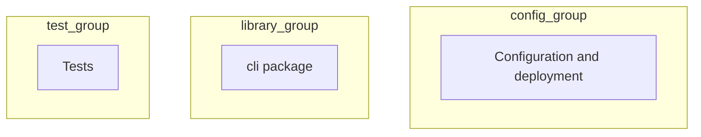

# Architecture report: andrewyng/context-hub

> Automated static analysis. **Observed** = directly seen in files/imports/AST; **Inferred** = interpretation from that evidence. Repository code was not executed.

## 1. Repository at a glance

| Item | Value |
| --- | --- |
| Repository | andrewyng/context-hub |
| Description | Not provided |
| Language | JavaScript |
| Stars | 13985 |
| Licence | MIT |
| Analysed commit / branch | 67dcbeb2eb42c808549f08397920ad58be7c2206 / main |
| Framework(s) | None detected |
| Files analysed | 799 |
| Components | 3 |

## 2. Architecture in one minute

andrewyng/context-hub. This repository was analysed statically from 799 file(s) (0 Python). Detected technologies (observed from imports/manifests): GitHub Actions, Vitest. Files are grouped into 3 component(s): cli package, Configuration and deployment, Tests. Findings below distinguish observed facts from inferred interpretation.

## 3. High-level block diagram

## 4. Main components

### cli package (`cli`)

- **Kind:** library
- **Status:** Observed
- **Confidence:** 0.85
- **Responsibility:** Groups 27 file(s) under cli package (observed from repository paths and static analysis).
- **Paths:** `cli/src/commands/annotate.js`, `cli/src/commands/build.js`, `cli/src/commands/cache.js`, `cli/src/commands/feedback.js`, `cli/src/commands/get.js`, `cli/src/commands/help.js`, `cli/src/commands/search.js`, `cli/src/commands/update.js`, `cli/src/index.js`, `cli/src/lib/analytics.js`, `cli/src/lib/annotations.js`, `cli/src/lib/bm25.js`, `cli/src/lib/cache.js`, `cli/src/lib/config.js`, `cli/src/lib/constants.js`, `cli/src/lib/frontmatter.js`, `cli/src/lib/help.js`, `cli/src/lib/identity.js`, `cli/src/lib/normalize.js`, `cli/src/lib/output.js`, `cli/src/lib/registry.js`, `cli/src/lib/removed-commands.js`, `cli/src/lib/telemetry.js`, `cli/src/lib/welcome.js`, `cli/src/mcp/server.js`, `cli/src/mcp/stdio-lifecycle.js`, `cli/src/mcp/tools.js`
- **Evidence:** [cli/src/commands/annotate.js](https://github.com/andrewyng/context-hub/blob/67dcbeb2eb42c808549f08397920ad58be7c2206/cli/src/commands/annotate.js); [cli/src/commands/build.js](https://github.com/andrewyng/context-hub/blob/67dcbeb2eb42c808549f08397920ad58be7c2206/cli/src/commands/build.js); [cli/src/commands/cache.js](https://github.com/andrewyng/context-hub/blob/67dcbeb2eb42c808549f08397920ad58be7c2206/cli/src/commands/cache.js); [cli/src/commands/feedback.js](https://github.com/andrewyng/context-hub/blob/67dcbeb2eb42c808549f08397920ad58be7c2206/cli/src/commands/feedback.js); [cli/src/commands/get.js](https://github.com/andrewyng/context-hub/blob/67dcbeb2eb42c808549f08397920ad58be7c2206/cli/src/commands/get.js); [cli/src/commands/help.js](https://github.com/andrewyng/context-hub/blob/67dcbeb2eb42c808549f08397920ad58be7c2206/cli/src/commands/help.js); [cli/src/commands/search.js](https://github.com/andrewyng/context-hub/blob/67dcbeb2eb42c808549f08397920ad58be7c2206/cli/src/commands/search.js); [cli/src/commands/update.js](https://github.com/andrewyng/context-hub/blob/67dcbeb2eb42c808549f08397920ad58be7c2206/cli/src/commands/update.js)

### Configuration and deployment (`config`)

- **Kind:** config
- **Status:** Observed
- **Confidence:** 0.85
- **Responsibility:** Groups 1 file(s) under configuration and deployment (observed from repository paths and static analysis).
- **Paths:** `cli/package.json`
- **Evidence:** [cli/package.json](https://github.com/andrewyng/context-hub/blob/67dcbeb2eb42c808549f08397920ad58be7c2206/cli/package.json)

### Tests (`tests`)

- **Kind:** test
- **Status:** Observed
- **Confidence:** 0.85
- **Responsibility:** Groups 38 file(s) under tests (observed from repository paths and static analysis).
- **Paths:** `cli/test/e2e.test.js`, `cli/test/fixtures/acme/docs/versioned-api/v1/DOC.md`, `cli/test/fixtures/acme/docs/versioned-api/v2/DOC.md`, `cli/test/fixtures/acme/docs/widgets/DOC.md`, `cli/test/fixtures/acme/docs/widgets/references/advanced.md`, `cli/test/fixtures/multilang/docs/client/go/DOC.md`, `cli/test/fixtures/multilang/docs/client/javascript/DOC.md`, `cli/test/fixtures/multilang/docs/client/python/DOC.md`, `cli/test/fixtures/testskills/skills/deploy/SKILL.md`, `cli/test/lib/bm25.test.js`, `cli/test/lib/frontmatter.test.js`, `cli/test/lib/normalize.test.js`, `cli/tests/commands/annotate.test.js`, `cli/tests/commands/build.test.js`, `cli/tests/commands/cache.test.js`, `cli/tests/commands/feedback.test.js`, `cli/tests/commands/get.test.js`, `cli/tests/commands/go-lang.test.js`, `cli/tests/commands/search.test.js`, `cli/tests/commands/update.test.js`, `cli/tests/lib/analytics.test.js`, `cli/tests/lib/annotations.test.js`, `cli/tests/lib/bm25.test.js`, `cli/tests/lib/cache.test.js`, `cli/tests/lib/config.test.js`, `cli/tests/lib/frontmatter.test.js`, `cli/tests/lib/help.test.js`, `cli/tests/lib/identity.test.js`, `cli/tests/lib/normalize.test.js`, `cli/tests/lib/output.test.js`, `cli/tests/lib/registry.multisource.test.js`, `cli/tests/lib/registry.search-behavior.test.js`, `cli/tests/lib/registry.test.js`, `cli/tests/lib/removed-commands.test.js`, `cli/tests/lib/telemetry.test.js`, `cli/tests/lib/welcome.test.js`, `cli/tests/mcp/stdio-lifecycle.test.js`, `cli/tests/mcp/tools.test.js`
- **Evidence:** [cli/test/e2e.test.js](https://github.com/andrewyng/context-hub/blob/67dcbeb2eb42c808549f08397920ad58be7c2206/cli/test/e2e.test.js); [cli/test/fixtures/acme/docs/versioned-api/v1/DOC.md](https://github.com/andrewyng/context-hub/blob/67dcbeb2eb42c808549f08397920ad58be7c2206/cli/test/fixtures/acme/docs/versioned-api/v1/DOC.md); [cli/test/fixtures/acme/docs/versioned-api/v2/DOC.md](https://github.com/andrewyng/context-hub/blob/67dcbeb2eb42c808549f08397920ad58be7c2206/cli/test/fixtures/acme/docs/versioned-api/v2/DOC.md); [cli/test/fixtures/acme/docs/widgets/DOC.md](https://github.com/andrewyng/context-hub/blob/67dcbeb2eb42c808549f08397920ad58be7c2206/cli/test/fixtures/acme/docs/widgets/DOC.md); [cli/test/fixtures/acme/docs/widgets/references/advanced.md](https://github.com/andrewyng/context-hub/blob/67dcbeb2eb42c808549f08397920ad58be7c2206/cli/test/fixtures/acme/docs/widgets/references/advanced.md); [cli/test/fixtures/multilang/docs/client/go/DOC.md](https://github.com/andrewyng/context-hub/blob/67dcbeb2eb42c808549f08397920ad58be7c2206/cli/test/fixtures/multilang/docs/client/go/DOC.md); [cli/test/fixtures/multilang/docs/client/javascript/DOC.md](https://github.com/andrewyng/context-hub/blob/67dcbeb2eb42c808549f08397920ad58be7c2206/cli/test/fixtures/multilang/docs/client/javascript/DOC.md); [cli/test/fixtures/multilang/docs/client/python/DOC.md](https://github.com/andrewyng/context-hub/blob/67dcbeb2eb42c808549f08397920ad58be7c2206/cli/test/fixtures/multilang/docs/client/python/DOC.md)

## 5. Execution flow

**Observed** entry point(s):

- [cli/bin/chub](https://github.com/andrewyng/context-hub/blob/67dcbeb2eb42c808549f08397920ad58be7c2206/cli/bin/chub)
- [cli/bin/chub-mcp](https://github.com/andrewyng/context-hub/blob/67dcbeb2eb42c808549f08397920ad58be7c2206/cli/bin/chub-mcp)
- [cli/src/index.js](https://github.com/andrewyng/context-hub/blob/67dcbeb2eb42c808549f08397920ad58be7c2206/cli/src/index.js)
- [cli/src/mcp/server.js](https://github.com/andrewyng/context-hub/blob/67dcbeb2eb42c808549f08397920ad58be7c2206/cli/src/mcp/server.js)

Representative flow (derived from observed entry points and the import graph; steps beyond the entry point are **Inferred**):

1. Execution starts at an observed entry point listed above, if present.
2. No internal import relationships between components were observed.

## 6. Project structure

### `(root)`

- `.gitignore` - other (71 bytes)
- `CODE_OF_CONDUCT.md` - docs (2051 bytes)
- `CONTRIBUTING.md` - docs (3633 bytes)
- `LICENSE` - docs (1081 bytes)
- `README.md` - docs (5124 bytes)
- `SECURITY.md` - docs (1005 bytes)

### `.github`

- `.github/ISSUE_TEMPLATE/bug_report.md` - docs (388 bytes)
- `.github/ISSUE_TEMPLATE/feature_request.md` - docs (382 bytes)
- `.github/PULL_REQUEST_TEMPLATE.md` - docs (270 bytes)
- `.github/workflows/ci.yml` - ci, YAML (529 bytes)
- `.github/workflows/deploy-content.yml` - ci, YAML (1946 bytes)
- `.github/workflows/publish.yml` - ci, YAML (1731 bytes)

### `cli`

- `cli/.npmignore` - other (37 bytes)
- `cli/README.md` - docs (1536 bytes)
- `cli/bin/chub` - other (46 bytes)
- `cli/bin/chub-mcp` - other (51 bytes)
- `cli/package.json` - manifest (1219 bytes)
- `cli/skills/get-api-docs/SKILL.md` - docs (3113 bytes)
- `cli/src/commands/annotate.js` - source, JavaScript (2419 bytes)
- `cli/src/commands/build.js` - source, JavaScript (13654 bytes)
- `cli/src/commands/cache.js` - source, JavaScript (1758 bytes)
- `cli/src/commands/feedback.js` - source, JavaScript (6342 bytes)
- `cli/src/commands/get.js` - source, JavaScript (9622 bytes)
- `cli/src/commands/help.js` - source, JavaScript (647 bytes)
- `cli/src/commands/search.js` - source, JavaScript (4859 bytes)
- `cli/src/commands/update.js` - source, JavaScript (2019 bytes)
- `cli/src/index.js` - source, JavaScript (5214 bytes)
- `cli/src/lib/analytics.js` - source, JavaScript (2667 bytes)
- `cli/src/lib/annotations.js` - source, JavaScript (1344 bytes)
- `cli/src/lib/bm25.js` - source, JavaScript (8256 bytes)
- `cli/src/lib/cache.js` - source, JavaScript (12835 bytes)
- `cli/src/lib/config.js` - source, JavaScript (2484 bytes)
- `cli/src/lib/constants.js` - source, JavaScript (97 bytes)
- `cli/src/lib/frontmatter.js` - source, JavaScript (1414 bytes)
- `cli/src/lib/help.js` - source, JavaScript (8834 bytes)
- `cli/src/lib/identity.js` - source, JavaScript (2261 bytes)
- `cli/src/lib/normalize.js` - source, JavaScript (431 bytes)
- `cli/src/lib/output.js` - source, JavaScript (796 bytes)
- `cli/src/lib/registry.js` - source, JavaScript (16477 bytes)
- `cli/src/lib/removed-commands.js` - source, JavaScript (1455 bytes)
- `cli/src/lib/telemetry.js` - source, JavaScript (3209 bytes)
- `cli/src/lib/welcome.js` - source, JavaScript (1553 bytes)
- `cli/src/mcp/server.js` - source, JavaScript (7553 bytes)
- `cli/src/mcp/stdio-lifecycle.js` - source, JavaScript (1443 bytes)
- `cli/src/mcp/tools.js` - source, JavaScript (9483 bytes)
- `cli/test/e2e.test.js` - test, JavaScript (20175 bytes)
- `cli/test/fixtures/acme/docs/versioned-api/v1/DOC.md` - test (366 bytes)
- `cli/test/fixtures/acme/docs/versioned-api/v2/DOC.md` - test (366 bytes)
- `cli/test/fixtures/acme/docs/widgets/DOC.md` - test (596 bytes)
- `cli/test/fixtures/acme/docs/widgets/references/advanced.md` - test (313 bytes)
- `cli/test/fixtures/multilang/docs/client/go/DOC.md` - test (300 bytes)
- `cli/test/fixtures/multilang/docs/client/javascript/DOC.md` - test (327 bytes)
- `cli/test/fixtures/multilang/docs/client/python/DOC.md` - test (293 bytes)
- `cli/test/fixtures/testskills/skills/deploy/SKILL.md` - test (296 bytes)
- `cli/test/lib/bm25.test.js` - test, JavaScript (8579 bytes)
- `cli/test/lib/frontmatter.test.js` - test, JavaScript (1505 bytes)
- `cli/test/lib/normalize.test.js` - test, JavaScript (1688 bytes)
- `cli/tests/commands/annotate.test.js` - test, JavaScript (5546 bytes)
- `cli/tests/commands/build.test.js` - test, JavaScript (6998 bytes)
- `cli/tests/commands/cache.test.js` - test, JavaScript (4310 bytes)
- `cli/tests/commands/feedback.test.js` - test, JavaScript (4019 bytes)
- `cli/tests/commands/get.test.js` - test, JavaScript (4363 bytes)
- `cli/tests/commands/go-lang.test.js` - test, JavaScript (10918 bytes)
- `cli/tests/commands/search.test.js` - test, JavaScript (10635 bytes)
- `cli/tests/commands/update.test.js` - test, JavaScript (6253 bytes)
- `cli/tests/lib/analytics.test.js` - test, JavaScript (4484 bytes)
- `cli/tests/lib/annotations.test.js` - test, JavaScript (4675 bytes)
- `cli/tests/lib/bm25.test.js` - test, JavaScript (2961 bytes)
- `cli/tests/lib/cache.test.js` - test, JavaScript (9531 bytes)
- `cli/tests/lib/config.test.js` - test, JavaScript (1961 bytes)
- `cli/tests/lib/frontmatter.test.js` - test, JavaScript (3087 bytes)
- `cli/tests/lib/help.test.js` - test, JavaScript (11134 bytes)
- `cli/tests/lib/identity.test.js` - test, JavaScript (6235 bytes)
- `cli/tests/lib/normalize.test.js` - test, JavaScript (2003 bytes)
- `cli/tests/lib/output.test.js` - test, JavaScript (4470 bytes)
- `cli/tests/lib/registry.multisource.test.js` - test, JavaScript (3985 bytes)
- `cli/tests/lib/registry.search-behavior.test.js` - test, JavaScript (3958 bytes)
- `cli/tests/lib/registry.test.js` - test, JavaScript (7340 bytes)
- `cli/tests/lib/removed-commands.test.js` - test, JavaScript (1971 bytes)
- `cli/tests/lib/telemetry.test.js` - test, JavaScript (7073 bytes)
- `cli/tests/lib/welcome.test.js` - test, JavaScript (3301 bytes)
- `cli/tests/mcp/stdio-lifecycle.test.js` - test, JavaScript (2966 bytes)
- `cli/tests/mcp/tools.test.js` - test, JavaScript (12351 bytes)

### `content`

- `content/accelerate/docs/package/python/DOC.md` - docs (10101 bytes)
- `content/aiofiles/docs/package/python/DOC.md` - docs (6934 bytes)
- `content/aiohttp-cors/docs/package/python/DOC.md` - docs (7341 bytes)
- `content/aiohttp/docs/cors/python/DOC.md` - docs (6838 bytes)
- `content/aiohttp/docs/package/python/DOC.md` - docs (11093 bytes)
- `content/aiomysql/docs/package/python/DOC.md` - docs (10630 bytes)
- `content/aiosignal/docs/package/python/DOC.md` - docs (4642 bytes)
- `content/aiosqlite/docs/package/python/DOC.md` - docs (8892 bytes)
- `content/airtable/docs/database/javascript/DOC.md` - docs (31754 bytes)
- `content/airtable/docs/database/python/DOC.md` - docs (41276 bytes)
- `content/albumentations/docs/package/python/DOC.md` - docs (9457 bytes)
- `content/alembic/docs/package/python/DOC.md` - docs (11045 bytes)
- `content/altair/docs/package/python/DOC.md` - docs (9193 bytes)
- `content/amplitude/docs/analytics/javascript/DOC.md` - docs (24082 bytes)
- `content/amplitude/docs/analytics/python/DOC.md` - docs (24013 bytes)
- `content/amqp/docs/package/python/DOC.md` - docs (7780 bytes)
- `content/angular/docs/core/typescript/DOC.md` - docs (6354 bytes)
- `content/annotated-types/docs/package/python/DOC.md` - docs (9163 bytes)
- `content/ansible/docs/package/python/DOC.md` - docs (7556 bytes)
- `content/antd/docs/antd/javascript/DOC.md` - docs (9709 bytes)
- `content/anthropic/docs/claude-api/javascript/DOC.md` - docs (14975 bytes)
- `content/anthropic/docs/claude-api/python/DOC.md` - docs (13852 bytes)
- `content/anthropic/docs/package/python/DOC.md` - docs (11930 bytes)
- `content/anyio/docs/package/python/DOC.md` - docs (8778 bytes)
- `content/apache-airflow/docs/package/python/DOC.md` - docs (10183 bytes)
- `content/apache-airflow/docs/providers-airbyte/python/DOC.md` - docs (7747 bytes)
- `content/apache-airflow/docs/providers-amazon/python/DOC.md` - docs (8451 bytes)
- `content/apache-airflow/docs/providers-apache-beam/python/DOC.md` - docs (7923 bytes)
- `content/apache-airflow/docs/providers-apache-cassandra/python/DOC.md` - docs (7819 bytes)
- `content/apache-airflow/docs/providers-apache-druid/python/DOC.md` - docs (7251 bytes)
- `content/apache-airflow/docs/providers-apache-flink/python/DOC.md` - docs (7058 bytes)
- `content/apache-airflow/docs/providers-apache-hdfs/python/DOC.md` - docs (8665 bytes)
- `content/apache-airflow/docs/providers-apache-hive/python/DOC.md` - docs (8882 bytes)
- `content/apache-airflow/docs/providers-apache-impala/python/DOC.md` - docs (8434 bytes)
- `content/apache-airflow/docs/providers-apache-kafka/python/DOC.md` - docs (12015 bytes)
- `content/apache-airflow/docs/providers-apache-kylin/python/DOC.md` - docs (8179 bytes)
- `content/apache-airflow/docs/providers-apache-livy/python/DOC.md` - docs (9688 bytes)
- `content/apache-airflow/docs/providers-apache-pig/python/DOC.md` - docs (8859 bytes)
- `content/apache-airflow/docs/providers-apache-pinot/python/DOC.md` - docs (10319 bytes)
- `content/apache-airflow/docs/providers-apache-spark/python/DOC.md` - docs (7745 bytes)
- `content/apache-airflow/docs/providers-apache-sqoop/python/DOC.md` - docs (10996 bytes)
- `content/apache-airflow/docs/providers-apprise/python/DOC.md` - docs (9318 bytes)
- `content/apache-airflow/docs/providers-asana/python/DOC.md` - docs (10634 bytes)
- `content/apache-airflow/docs/providers-atlassian-jira/python/DOC.md` - docs (12903 bytes)
- `content/apache-airflow/docs/providers-celery/python/DOC.md` - docs (6445 bytes)
- `content/apache-airflow/docs/providers-cloudant/python/DOC.md` - docs (9042 bytes)
- `content/apache-airflow/docs/providers-cncf-kubernetes/python/DOC.md` - docs (9947 bytes)
- `content/apache-airflow/docs/providers-cohere/python/DOC.md` - docs (8981 bytes)
- `content/apache-airflow/docs/providers-common-compat/python/DOC.md` - docs (8417 bytes)
- `content/apache-airflow/docs/providers-common-io/python/DOC.md` - docs (8742 bytes)
- `content/apache-airflow/docs/providers-common-sql/python/DOC.md` - docs (10575 bytes)
- `content/apache-airflow/docs/providers-daskexecutor/python/DOC.md` - docs (7905 bytes)
- `content/apache-airflow/docs/providers-databricks/python/DOC.md` - docs (5822 bytes)
- `content/apache-airflow/docs/providers-datadog/python/DOC.md` - docs (8829 bytes)
- `content/apache-airflow/docs/providers-dbt-cloud/python/DOC.md` - docs (8695 bytes)
- `content/apache-airflow/docs/providers-dingding/python/DOC.md` - docs (7567 bytes)
- `content/apache-airflow/docs/providers-discord/python/DOC.md` - docs (9684 bytes)
- `content/apache-airflow/docs/providers-docker/python/DOC.md` - docs (7592 bytes)
- `content/apache-airflow/docs/providers-edge3/python/DOC.md` - docs (9224 bytes)
- `content/apache-airflow/docs/providers-elasticsearch/python/DOC.md` - docs (9116 bytes)
- `content/apache-airflow/docs/providers-exasol/python/DOC.md` - docs (9547 bytes)
- `content/apache-airflow/docs/providers-fab/python/DOC.md` - docs (9784 bytes)
- `content/apache-airflow/docs/providers-facebook/python/DOC.md` - docs (9076 bytes)
- `content/apache-airflow/docs/providers-fivetran/python/DOC.md` - docs (6376 bytes)
- `content/apache-airflow/docs/providers-ftp/python/DOC.md` - docs (8144 bytes)
- `content/apache-airflow/docs/providers-github/python/DOC.md` - docs (8414 bytes)
- `content/apache-airflow/docs/providers-google/python/DOC.md` - docs (7327 bytes)
- `content/apache-airflow/docs/providers-grpc/python/DOC.md` - docs (7895 bytes)
- `content/apache-airflow/docs/providers-hashicorp/python/DOC.md` - docs (8160 bytes)
- `content/apache-airflow/docs/providers-http/python/DOC.md` - docs (8362 bytes)
- `content/apache-airflow/docs/providers-imap/python/DOC.md` - docs (8661 bytes)
- `content/apache-airflow/docs/providers-influxdb/python/DOC.md` - docs (8288 bytes)
- `content/apache-airflow/docs/providers-jdbc/python/DOC.md` - docs (9530 bytes)
- `content/apache-airflow/docs/providers-jira/python/DOC.md` - docs (8204 bytes)
- `content/apache-airflow/docs/providers-microsoft-azure/python/DOC.md` - docs (8053 bytes)
- `content/apache-airflow/docs/providers-microsoft-mssql/python/DOC.md` - docs (6682 bytes)
- `content/apache-airflow/docs/providers-microsoft-psrp/python/DOC.md` - docs (10623 bytes)
- `content/apache-airflow/docs/providers-microsoft-winrm/python/DOC.md` - docs (9602 bytes)
- `content/apache-airflow/docs/providers-mongo/python/DOC.md` - docs (7380 bytes)
- `content/apache-airflow/docs/providers-mysql/python/DOC.md` - docs (5736 bytes)
- `content/apache-airflow/docs/providers-neo4j/python/DOC.md` - docs (7296 bytes)
- `content/apache-airflow/docs/providers-odbc/python/DOC.md` - docs (7415 bytes)
- `content/apache-airflow/docs/providers-openfaas/python/DOC.md` - docs (9068 bytes)
- `content/apache-airflow/docs/providers-openlineage/python/DOC.md` - docs (10592 bytes)
- `content/apache-airflow/docs/providers-opensearch/python/DOC.md` - docs (6253 bytes)
- `content/apache-airflow/docs/providers-opsgenie/python/DOC.md` - docs (6688 bytes)
- `content/apache-airflow/docs/providers-oracle/python/DOC.md` - docs (9975 bytes)
- `content/apache-airflow/docs/providers-pagerduty/python/DOC.md` - docs (8363 bytes)
- `content/apache-airflow/docs/providers-papermill/python/DOC.md` - docs (7116 bytes)
- `content/apache-airflow/docs/providers-pinecone/python/DOC.md` - docs (8974 bytes)
- `content/apache-airflow/docs/providers-plexus/python/DOC.md` - docs (8637 bytes)
- `content/apache-airflow/docs/providers-postgres/python/DOC.md` - docs (6868 bytes)
- `content/apache-airflow/docs/providers-presto/python/DOC.md` - docs (7768 bytes)
- `content/apache-airflow/docs/providers-qdrant/python/DOC.md` - docs (10470 bytes)
- `content/apache-airflow/docs/providers-qubole/python/DOC.md` - docs (9455 bytes)
- `content/apache-airflow/docs/providers-redis/python/DOC.md` - docs (6882 bytes)
- `content/apache-airflow/docs/providers-salesforce/python/DOC.md` - docs (8625 bytes)
- `content/apache-airflow/docs/providers-samba/python/DOC.md` - docs (9754 bytes)
- `content/apache-airflow/docs/providers-segment/python/DOC.md` - docs (7537 bytes)
- `content/apache-airflow/docs/providers-sendgrid/python/DOC.md` - docs (6861 bytes)
- `content/apache-airflow/docs/providers-sftp/python/DOC.md` - docs (6352 bytes)
- `content/apache-airflow/docs/providers-singularity/python/DOC.md` - docs (7660 bytes)
- `content/apache-airflow/docs/providers-slack/python/DOC.md` - docs (7737 bytes)
- `content/apache-airflow/docs/providers-smtp/python/DOC.md` - docs (6722 bytes)
- `content/apache-airflow/docs/providers-snowflake/python/DOC.md` - docs (7359 bytes)
- `content/apache-airflow/docs/providers-sqlite/python/DOC.md` - docs (7422 bytes)
- `content/apache-airflow/docs/providers-ssh/python/DOC.md` - docs (11040 bytes)
- `content/apache-airflow/docs/providers-tableau/python/DOC.md` - docs (11598 bytes)
- `content/apache-airflow/docs/providers-telegram/python/DOC.md` - docs (6672 bytes)
- `content/apache-airflow/docs/providers-teradata/python/DOC.md` - docs (11608 bytes)
- `content/apache-airflow/docs/providers-trino/python/DOC.md` - docs (9624 bytes)
- `content/apache-airflow/docs/providers-vertica/python/DOC.md` - docs (8271 bytes)
- `content/apache-airflow/docs/providers-weaviate/python/DOC.md` - docs (12557 bytes)
- `content/apache-airflow/docs/providers-yandex/python/DOC.md` - docs (10983 bytes)
- `content/apache-airflow/docs/providers-zendesk/python/DOC.md` - docs (7835 bytes)
- `content/apache-beam/docs/package/python/DOC.md` - docs (8894 bytes)
- `content/appdirs/docs/package/python/DOC.md` - docs (6778 bytes)
- `content/applitools/docs/eyes-playwright/javascript/DOC.md` - docs (8726 bytes)
- `content/apscheduler/docs/package/python/DOC.md` - docs (8860 bytes)
- `content/ariadne/docs/package/python/DOC.md` - docs (5894 bytes)
- `content/arq/docs/package/python/DOC.md` - docs (9767 bytes)
- `content/arrow/docs/package/python/DOC.md` - docs (6519 bytes)
- `content/asana/docs/tasks/DOC.md` - docs (34626 bytes)
- `content/assemblyai/docs/transcription/DOC.md` - docs (14894 bytes)
- `content/astro/docs/astro/javascript/DOC.md` - docs (13168 bytes)
- `content/async-timeout/docs/package/python/DOC.md` - docs (5574 bytes)
- `content/asyncpg/docs/package/python/DOC.md` - docs (11849 bytes)
- `content/atlassian/docs/confluence/javascript/DOC.md` - docs (29970 bytes)
- `content/atlassian/docs/confluence/python/DOC.md` - docs (37671 bytes)
- `content/attrs/docs/package/python/DOC.md` - docs (6583 bytes)
- `content/auth0/docs/identity/javascript/DOC.md` - docs (21863 bytes)
- `content/auth0/docs/identity/python/DOC.md` - docs (28535 bytes)
- `content/authlib/docs/package/python/DOC.md` - docs (10300 bytes)
- `content/autogen/docs/package/python/DOC.md` - docs (10084 bytes)
- `content/autogen/docs/package/python/references/agents.md` - docs (11509 bytes)
- `content/autogen/docs/package/python/references/group-chat.md` - docs (19520 bytes)
- `content/autopep8/docs/package/python/DOC.md` - docs (5727 bytes)
- `content/av/docs/package/python/DOC.md` - docs (9676 bytes)
- `content/aws/docs/acm/javascript/DOC.md` - docs (9648 bytes)
- `content/aws/docs/aiobotocore/python/DOC.md` - docs (9429 bytes)
- `content/aws/docs/amplify/javascript/DOC.md` - docs (13097 bytes)
- `content/aws/docs/api-gateway/javascript/DOC.md` - docs (9873 bytes)
- `content/aws/docs/apigatewayv2/javascript/DOC.md` - docs (6733 bytes)
- `content/aws/docs/application-auto-scaling/javascript/DOC.md` - docs (11558 bytes)
- `content/aws/docs/apprunner/javascript/DOC.md` - docs (12928 bytes)
- `content/aws/docs/appstream/javascript/DOC.md` - docs (12173 bytes)
- `content/aws/docs/appsync/javascript/DOC.md` - docs (9858 bytes)
- `content/aws/docs/athena/javascript/DOC.md` - docs (8763 bytes)
- `content/aws/docs/auto-scaling/javascript/DOC.md` - docs (11048 bytes)
- `content/aws/docs/backup/javascript/DOC.md` - docs (14916 bytes)
- `content/aws/docs/batch/javascript/DOC.md` - docs (9267 bytes)
- `content/aws/docs/bedrock-runtime/javascript/DOC.md` - docs (10109 bytes)
- `content/aws/docs/bedrock/javascript/DOC.md` - docs (8438 bytes)
- `content/aws/docs/boto3-stubs/python/DOC.md` - docs (7207 bytes)
- `content/aws/docs/boto3/python/DOC.md` - docs (9384 bytes)
- `content/aws/docs/botocore/python/DOC.md` - docs (10985 bytes)
- `content/aws/docs/budgets/javascript/DOC.md` - docs (12145 bytes)
- `content/aws/docs/chime-sdk-messaging/javascript/DOC.md` - docs (17394 bytes)
- `content/aws/docs/cleanrooms/javascript/DOC.md` - docs (14772 bytes)
- `content/aws/docs/cli/python/DOC.md` - docs (8655 bytes)
- `content/aws/docs/cloudformation/javascript/DOC.md` - docs (5788 bytes)
- `content/aws/docs/cloudfront-signer/javascript/DOC.md` - docs (6170 bytes)
- `content/aws/docs/cloudfront/javascript/DOC.md` - docs (6016 bytes)
- `content/aws/docs/cloudtrail/javascript/DOC.md` - docs (8466 bytes)
- `content/aws/docs/cloudwatch/javascript/DOC.md` - docs (9403 bytes)
- `content/aws/docs/codebuild/javascript/DOC.md` - docs (7614 bytes)
- `content/aws/docs/codecommit/javascript/DOC.md` - docs (9372 bytes)
- `content/aws/docs/codedeploy/javascript/DOC.md` - docs (9608 bytes)
- `content/aws/docs/codepipeline/javascript/DOC.md` - docs (9565 bytes)
- `content/aws/docs/cognito-identity-provider/javascript/DOC.md` - docs (8917 bytes)
- `content/aws/docs/cognito-identity/javascript/DOC.md` - docs (7218 bytes)
- `content/aws/docs/comprehend/javascript/DOC.md` - docs (11835 bytes)
- `content/aws/docs/compute-optimizer/javascript/DOC.md` - docs (14236 bytes)
- `content/aws/docs/config-service/javascript/DOC.md` - docs (12715 bytes)
- `content/aws/docs/connect/javascript/DOC.md` - docs (11987 bytes)
- `content/aws/docs/controltower/javascript/DOC.md` - docs (15999 bytes)
- `content/aws/docs/cost-explorer/javascript/DOC.md` - docs (11974 bytes)
- `content/aws/docs/credential-providers/javascript/DOC.md` - docs (11419 bytes)
- `content/aws/docs/datasync/javascript/DOC.md` - docs (10306 bytes)
- `content/aws/docs/deadline/javascript/DOC.md` - docs (13716 bytes)
- `content/aws/docs/docdb/javascript/DOC.md` - docs (14946 bytes)
- `content/aws/docs/dynamodb/javascript/DOC.md` - docs (10958 bytes)
- `content/aws/docs/ec2/javascript/DOC.md` - docs (7835 bytes)
- `content/aws/docs/ecr/javascript/DOC.md` - docs (8120 bytes)
- `content/aws/docs/ecs/javascript/DOC.md` - docs (7640 bytes)
- `content/aws/docs/efs/javascript/DOC.md` - docs (12912 bytes)
- `content/aws/docs/eks/javascript/DOC.md` - docs (8269 bytes)
- `content/aws/docs/elastic-load-balancing-v2/javascript/DOC.md` - docs (10522 bytes)
- `content/aws/docs/elasticache/javascript/DOC.md` - docs (8421 bytes)
- `content/aws/docs/elasticsearch-service/javascript/DOC.md` - docs (14849 bytes)
- `content/aws/docs/emr/javascript/DOC.md` - docs (11600 bytes)
- `content/aws/docs/entityresolution/javascript/DOC.md` - docs (14282 bytes)
- `content/aws/docs/eventbridge/javascript/DOC.md` - docs (9000 bytes)
- `content/aws/docs/firehose/javascript/DOC.md` - docs (6901 bytes)
- `content/aws/docs/forecast/javascript/DOC.md` - docs (12770 bytes)
- `content/aws/docs/fsx/javascript/DOC.md` - docs (8457 bytes)
- `content/aws/docs/glue/javascript/DOC.md` - docs (8635 bytes)
- `content/aws/docs/guardduty/javascript/DOC.md` - docs (11804 bytes)
- `content/aws/docs/health/javascript/DOC.md` - docs (7161 bytes)
- `content/aws/docs/healthlake/javascript/DOC.md` - docs (12111 bytes)
- `content/aws/docs/iam/javascript/DOC.md` - docs (6557 bytes)
- `content/aws/docs/inspector2/javascript/DOC.md` - docs (12823 bytes)
- `content/aws/docs/iot-data-plane/javascript/DOC.md` - docs (10365 bytes)
- `content/aws/docs/iot-events/javascript/DOC.md` - docs (11922 bytes)
- `content/aws/docs/iot/javascript/DOC.md` - docs (8999 bytes)
- `content/aws/docs/ivs/javascript/DOC.md` - docs (12159 bytes)
- `content/aws/docs/keyspaces/javascript/DOC.md` - docs (12134 bytes)
- `content/aws/docs/kinesis/javascript/DOC.md` - docs (7226 bytes)
- `content/aws/docs/kms/javascript/DOC.md` - docs (8559 bytes)
- `content/aws/docs/lambda/javascript/DOC.md` - docs (7440 bytes)
- `content/aws/docs/lex-runtime-v2/javascript/DOC.md` - docs (8158 bytes)
- `content/aws/docs/lib-dynamodb/javascript/DOC.md` - docs (7983 bytes)
- `content/aws/docs/lib-storage/javascript/DOC.md` - docs (7733 bytes)
- `content/aws/docs/license-manager/javascript/DOC.md` - docs (10639 bytes)
- `content/aws/docs/lightsail/javascript/DOC.md` - docs (9521 bytes)
- `content/aws/docs/location/javascript/DOC.md` - docs (7985 bytes)
- `content/aws/docs/macie2/javascript/DOC.md` - docs (13018 bytes)
- `content/aws/docs/managedblockchain/javascript/DOC.md` - docs (12792 bytes)
- `content/aws/docs/marketplace-catalog/javascript/DOC.md` - docs (12290 bytes)
- `content/aws/docs/mediaconnect/javascript/DOC.md` - docs (12592 bytes)
- `content/aws/docs/mediaconvert/javascript/DOC.md` - docs (11722 bytes)
- `content/aws/docs/medialive/javascript/DOC.md` - docs (11068 bytes)
- `content/aws/docs/mediapackage/javascript/DOC.md` - docs (12035 bytes)
- `content/aws/docs/mediastore/javascript/DOC.md` - docs (15940 bytes)
- `content/aws/docs/memorydb/javascript/DOC.md` - docs (15357 bytes)
- `content/aws/docs/middleware-endpoint/javascript/DOC.md` - docs (5649 bytes)
- `content/aws/docs/middleware-retry/javascript/DOC.md` - docs (5178 bytes)
- `content/aws/docs/middleware-signing/javascript/DOC.md` - docs (5879 bytes)
- `content/aws/docs/middleware-stack/javascript/DOC.md` - docs (9903 bytes)
- `content/aws/docs/mwaa/javascript/DOC.md` - docs (9788 bytes)
- `content/aws/docs/mypy-boto3-accessanalyzer/python/DOC.md` - docs (10495 bytes)
- `content/aws/docs/mypy-boto3-acm/python/DOC.md` - docs (7910 bytes)
- `content/aws/docs/mypy-boto3-amplify/python/DOC.md` - docs (7897 bytes)
- `content/aws/docs/mypy-boto3-apigateway/python/DOC.md` - docs (6987 bytes)
- `content/aws/docs/mypy-boto3-apprunner/python/DOC.md` - docs (8718 bytes)
- `content/aws/docs/mypy-boto3-appstream/python/DOC.md` - docs (8676 bytes)
- `content/aws/docs/mypy-boto3-appsync/python/DOC.md` - docs (8336 bytes)
- `content/aws/docs/mypy-boto3-athena/python/DOC.md` - docs (8953 bytes)
- `content/aws/docs/mypy-boto3-autoscaling/python/DOC.md` - docs (7898 bytes)
- `content/aws/docs/mypy-boto3-backup/python/DOC.md` - docs (8621 bytes)
- `content/aws/docs/mypy-boto3-batch/python/DOC.md` - docs (8322 bytes)
- `content/aws/docs/mypy-boto3-bedrock-agent-runtime/python/DOC.md` - docs (10083 bytes)
- `content/aws/docs/mypy-boto3-bedrock-agent/python/DOC.md` - docs (9632 bytes)
- `content/aws/docs/mypy-boto3-bedrock-runtime/python/DOC.md` - docs (8410 bytes)
- `content/aws/docs/mypy-boto3-bedrock/python/DOC.md` - docs (7979 bytes)
- `content/aws/docs/mypy-boto3-cleanrooms/python/DOC.md` - docs (8779 bytes)
- `content/aws/docs/mypy-boto3-cloudformation/python/DOC.md` - docs (6648 bytes)
- `content/aws/docs/mypy-boto3-cloudfront/python/DOC.md` - docs (8290 bytes)
- `content/aws/docs/mypy-boto3-cloudwatch/python/DOC.md` - docs (9910 bytes)
- `content/aws/docs/mypy-boto3-codebuild/python/DOC.md` - docs (7027 bytes)
- `content/aws/docs/mypy-boto3-codepipeline/python/DOC.md` - docs (9421 bytes)
- `content/aws/docs/mypy-boto3-cognito-identity/python/DOC.md` - docs (9197 bytes)
- `content/aws/docs/mypy-boto3-cognito-idp/python/DOC.md` - docs (7655 bytes)
- `content/aws/docs/mypy-boto3-comprehend/python/DOC.md` - docs (8893 bytes)
- `content/aws/docs/mypy-boto3-config/python/DOC.md` - docs (8359 bytes)
- `content/aws/docs/mypy-boto3-connect/python/DOC.md` - docs (7871 bytes)
- `content/aws/docs/mypy-boto3-datasync/python/DOC.md` - docs (8261 bytes)
- `content/aws/docs/mypy-boto3-dynamodb/python/DOC.md` - docs (8553 bytes)
- `content/aws/docs/mypy-boto3-ec2/python/DOC.md` - docs (8820 bytes)
- `content/aws/docs/mypy-boto3-ecr/python/DOC.md` - docs (7289 bytes)
- `content/aws/docs/mypy-boto3-ecs/python/DOC.md` - docs (7468 bytes)
- `content/aws/docs/mypy-boto3-efs/python/DOC.md` - docs (8293 bytes)
- `content/aws/docs/mypy-boto3-eks/python/DOC.md` - docs (9781 bytes)
- `content/aws/docs/mypy-boto3-elasticache/python/DOC.md` - docs (8331 bytes)
- `content/aws/docs/mypy-boto3-elbv2/python/DOC.md` - docs (9686 bytes)
- `content/aws/docs/mypy-boto3-emr/python/DOC.md` - docs (8596 bytes)
- `content/aws/docs/mypy-boto3-events/python/DOC.md` - docs (7417 bytes)
- `content/aws/docs/mypy-boto3-evidently/python/DOC.md` - docs (8849 bytes)
- `content/aws/docs/mypy-boto3-firehose/python/DOC.md` - docs (7203 bytes)
- `content/aws/docs/mypy-boto3-forecast/python/DOC.md` - docs (8098 bytes)
- `content/aws/docs/mypy-boto3-fsx/python/DOC.md` - docs (6875 bytes)
- `content/aws/docs/mypy-boto3-glue/python/DOC.md` - docs (6862 bytes)
- `content/aws/docs/mypy-boto3-guardduty/python/DOC.md` - docs (9050 bytes)
- `content/aws/docs/mypy-boto3-iam/python/DOC.md` - docs (6975 bytes)
- `content/aws/docs/mypy-boto3-inspector2/python/DOC.md` - docs (7946 bytes)
- `content/aws/docs/mypy-boto3-iot/python/DOC.md` - docs (6601 bytes)
- `content/aws/docs/mypy-boto3-ivs/python/DOC.md` - docs (6877 bytes)
- `content/aws/docs/mypy-boto3-kinesis/python/DOC.md` - docs (9503 bytes)
- `content/aws/docs/mypy-boto3-kms/python/DOC.md` - docs (7213 bytes)
- `content/aws/docs/mypy-boto3-lambda/python/DOC.md` - docs (8500 bytes)
- `content/aws/docs/mypy-boto3-lex-runtime/python/DOC.md` - docs (8291 bytes)
- `content/aws/docs/mypy-boto3-lightsail/python/DOC.md` - docs (9230 bytes)
- `content/aws/docs/mypy-boto3-logs/python/DOC.md` - docs (8037 bytes)
- `content/aws/docs/mypy-boto3-macie2/python/DOC.md` - docs (8428 bytes)
- `content/aws/docs/mypy-boto3-mediaconvert/python/DOC.md` - docs (9939 bytes)
- `content/aws/docs/mypy-boto3-memorydb/python/DOC.md` - docs (7864 bytes)
- `content/aws/docs/mypy-boto3-mwaa/python/DOC.md` - docs (10228 bytes)
- `content/aws/docs/mypy-boto3-neptune/python/DOC.md` - docs (8447 bytes)
- `content/aws/docs/mypy-boto3-opensearch/python/DOC.md` - docs (7142 bytes)
- `content/aws/docs/mypy-boto3-organizations/python/DOC.md` - docs (9284 bytes)
- `content/aws/docs/mypy-boto3-personalize/python/DOC.md` - docs (6967 bytes)
- `content/aws/docs/mypy-boto3-pinpoint/python/DOC.md` - docs (9889 bytes)
- `content/aws/docs/mypy-boto3-pipes/python/DOC.md` - docs (7695 bytes)
- `content/aws/docs/mypy-boto3-polly/python/DOC.md` - docs (10526 bytes)
- `content/aws/docs/mypy-boto3-proton/python/DOC.md` - docs (8589 bytes)
- `content/aws/docs/mypy-boto3-qbusiness/python/DOC.md` - docs (10561 bytes)
- `content/aws/docs/mypy-boto3-qldb/python/DOC.md` - docs (7294 bytes)
- `content/aws/docs/mypy-boto3-rds/python/DOC.md` - docs (8261 bytes)
- `content/aws/docs/mypy-boto3-redshift/python/DOC.md` - docs (9351 bytes)
- `content/aws/docs/mypy-boto3-rekognition/python/DOC.md` - docs (6889 bytes)
- `content/aws/docs/mypy-boto3-route53/python/DOC.md` - docs (8910 bytes)
- `content/aws/docs/mypy-boto3-route53resolver/python/DOC.md` - docs (9446 bytes)
- `content/aws/docs/mypy-boto3-s3/python/DOC.md` - docs (7532 bytes)
- `content/aws/docs/mypy-boto3-sagemaker/python/DOC.md` - docs (7210 bytes)
- `content/aws/docs/mypy-boto3-scheduler/python/DOC.md` - docs (9938 bytes)
- `content/aws/docs/mypy-boto3-secretsmanager/python/DOC.md` - docs (8687 bytes)
- `content/aws/docs/mypy-boto3-securityhub/python/DOC.md` - docs (7980 bytes)
- `content/aws/docs/mypy-boto3-securitylake/python/DOC.md` - docs (8084 bytes)
- `content/aws/docs/mypy-boto3-servicediscovery/python/DOC.md` - docs (11011 bytes)
- `content/aws/docs/mypy-boto3-ses/python/DOC.md` - docs (7444 bytes)
- `content/aws/docs/mypy-boto3-sesv2/python/DOC.md` - docs (8481 bytes)
- `content/aws/docs/mypy-boto3-sns/python/DOC.md` - docs (6827 bytes)
- `content/aws/docs/mypy-boto3-sqs/python/DOC.md` - docs (8277 bytes)
- `content/aws/docs/mypy-boto3-ssm/python/DOC.md` - docs (7502 bytes)
- `content/aws/docs/mypy-boto3-sso-admin/python/DOC.md` - docs (10144 bytes)
- `content/aws/docs/mypy-boto3-sso/python/DOC.md` - docs (8074 bytes)
- `content/aws/docs/mypy-boto3-stepfunctions/python/DOC.md` - docs (8187 bytes)
- `content/aws/docs/mypy-boto3-sts/python/DOC.md` - docs (8336 bytes)
- `content/aws/docs/mypy-boto3-textract/python/DOC.md` - docs (8796 bytes)
- `content/aws/docs/mypy-boto3-timestream-write/python/DOC.md` - docs (10262 bytes)
- `content/aws/docs/mypy-boto3-transcribe/python/DOC.md` - docs (8341 bytes)
- `content/aws/docs/mypy-boto3-transfer/python/DOC.md` - docs (9773 bytes)
- `content/aws/docs/mypy-boto3-translate/python/DOC.md` - docs (7712 bytes)
- `content/aws/docs/mypy-boto3-wafv2/python/DOC.md` - docs (9646 bytes)
- `content/aws/docs/mypy-boto3-workspaces/python/DOC.md` - docs (7984 bytes)
- `content/aws/docs/neptune/javascript/DOC.md` - docs (9190 bytes)
- `content/aws/docs/network-firewall/javascript/DOC.md` - docs (11239 bytes)
- `content/aws/docs/omics/javascript/DOC.md` - docs (12967 bytes)
- `content/aws/docs/opensearch/javascript/DOC.md` - docs (6947 bytes)
- `content/aws/docs/organizations/javascript/DOC.md` - docs (10940 bytes)
- `content/aws/docs/payment-cryptography/javascript/DOC.md` - docs (11675 bytes)
- `content/aws/docs/personalize/javascript/DOC.md` - docs (14464 bytes)
- `content/aws/docs/pinpoint/javascript/DOC.md` - docs (9130 bytes)
- `content/aws/docs/polly/javascript/DOC.md` - docs (10851 bytes)
- `content/aws/docs/proton/javascript/DOC.md` - docs (12597 bytes)
- `content/aws/docs/qldb/javascript/DOC.md` - docs (7328 bytes)
- `content/aws/docs/ram/javascript/DOC.md` - docs (10993 bytes)
- `content/aws/docs/rds/javascript/DOC.md` - docs (7987 bytes)
- `content/aws/docs/redshift/javascript/DOC.md` - docs (7762 bytes)
- `content/aws/docs/rekognition/javascript/DOC.md` - docs (11138 bytes)
- `content/aws/docs/route-53/javascript/DOC.md` - docs (7252 bytes)
- `content/aws/docs/route53-recovery-control-config/javascript/DOC.md` - docs (10917 bytes)
- `content/aws/docs/s3-presigned-post/javascript/DOC.md` - docs (5957 bytes)
- `content/aws/docs/s3-request-presigner/javascript/DOC.md` - docs (5194 bytes)
- `content/aws/docs/s3/javascript/DOC.md` - docs (38074 bytes)
- `content/aws/docs/s3/python/DOC.md` - docs (39836 bytes)
- `content/aws/docs/s3transfer/python/DOC.md` - docs (7721 bytes)
- `content/aws/docs/sagemaker/javascript/DOC.md` - docs (9937 bytes)
- `content/aws/docs/secrets-manager/javascript/DOC.md` - docs (6562 bytes)
- `content/aws/docs/service-catalog/javascript/DOC.md` - docs (16334 bytes)
- `content/aws/docs/service-quotas/javascript/DOC.md` - docs (9720 bytes)
- `content/aws/docs/ses/javascript/DOC.md` - docs (6976 bytes)
- `content/aws/docs/sfn/javascript/DOC.md` - docs (10763 bytes)
- `content/aws/docs/shield/javascript/DOC.md` - docs (14050 bytes)
- `content/aws/docs/smithy-client/javascript/DOC.md` - docs (9371 bytes)
- `content/aws/docs/sns/javascript/DOC.md` - docs (6950 bytes)
- `content/aws/docs/sqs/javascript/DOC.md` - docs (7064 bytes)
- `content/aws/docs/ssm/javascript/DOC.md` - docs (4936 bytes)
- `content/aws/docs/sts/javascript/DOC.md` - docs (9128 bytes)
- `content/aws/docs/support/javascript/DOC.md` - docs (10732 bytes)
- `content/aws/docs/textract/javascript/DOC.md` - docs (9219 bytes)
- `content/aws/docs/timestream-query/javascript/DOC.md` - docs (9590 bytes)
- `content/aws/docs/timestream-write/javascript/DOC.md` - docs (11464 bytes)
- `content/aws/docs/transcribe/javascript/DOC.md` - docs (9252 bytes)
- `content/aws/docs/transfer/javascript/DOC.md` - docs (14085 bytes)
- `content/aws/docs/translate/javascript/DOC.md` - docs (9031 bytes)
- `content/aws/docs/types/javascript/DOC.md` - docs (7347 bytes)
- `content/aws/docs/util-base64/javascript/DOC.md` - docs (4052 bytes)
- `content/aws/docs/util-dynamodb/javascript/DOC.md` - docs (8225 bytes)
- `content/aws/docs/util-utf8/javascript/DOC.md` - docs (5965 bytes)
- `content/aws/docs/verifiedpermissions/javascript/DOC.md` - docs (11398 bytes)
- `content/aws/docs/wafv2/javascript/DOC.md` - docs (9589 bytes)
- `content/aws/docs/workspaces/javascript/DOC.md` - docs (13419 bytes)
- `content/aws/docs/xray/javascript/DOC.md` - docs (13160 bytes)
- `content/axios/docs/axios/javascript/DOC.md` - docs (12874 bytes)
- `content/azure/docs/abort-controller/javascript/DOC.md` - docs (6043 bytes)
- `content/azure/docs/ai-form-recognizer/javascript/DOC.md` - docs (11680 bytes)
- `content/azure/docs/ai-formrecognizer/python/DOC.md` - docs (12231 bytes)
- `content/azure/docs/ai-language-text/javascript/DOC.md` - docs (7276 bytes)
- `content/azure/docs/ai-language-text/python/DOC.md` - docs (8419 bytes)
- `content/azure/docs/ai-ml/python/DOC.md` - docs (9478 bytes)
- `content/azure/docs/ai-text-analytics/javascript/DOC.md` - docs (7817 bytes)
- `content/azure/docs/ai-textanalytics/python/DOC.md` - docs (9499 bytes)
- `content/azure/docs/app-configuration/javascript/DOC.md` - docs (6730 bytes)
- `content/azure/docs/appconfiguration/python/DOC.md` - docs (12087 bytes)
- `content/azure/docs/arm-appservice/javascript/DOC.md` - docs (8157 bytes)
- `content/azure/docs/arm-compute/javascript/DOC.md` - docs (10911 bytes)
- `content/azure/docs/arm-containerservice/javascript/DOC.md` - docs (11302 bytes)
- `content/azure/docs/arm-cosmosdb/javascript/DOC.md` - docs (8882 bytes)
- `content/azure/docs/arm-deviceprovisioningservices/javascript/DOC.md` - docs (7732 bytes)
- `content/azure/docs/arm-keyvault/javascript/DOC.md` - docs (9044 bytes)
- `content/azure/docs/arm-maps/javascript/DOC.md` - docs (10354 bytes)
- `content/azure/docs/arm-monitor/javascript/DOC.md` - docs (10487 bytes)
- `content/azure/docs/arm-network/javascript/DOC.md` - docs (8122 bytes)
- `content/azure/docs/arm-resources/javascript/DOC.md` - docs (7993 bytes)
- `content/azure/docs/arm-sql/javascript/DOC.md` - docs (9351 bytes)
- `content/azure/docs/arm-storage/javascript/DOC.md` - docs (8933 bytes)
- `content/azure/docs/cognitiveservices-speech/python/DOC.md` - docs (13153 bytes)
- `content/azure/docs/common/python/DOC.md` - docs (12862 bytes)
- `content/azure/docs/communication-chat/javascript/DOC.md` - docs (10313 bytes)
- `content/azure/docs/communication-common/javascript/DOC.md` - docs (7171 bytes)
- `content/azure/docs/communication-email/python/DOC.md` - docs (10212 bytes)
- `content/azure/docs/communication-sms/javascript/DOC.md` - docs (7960 bytes)
- `content/azure/docs/communication-sms/python/DOC.md` - docs (8014 bytes)
- `content/azure/docs/container-registry/javascript/DOC.md` - docs (5720 bytes)
- `content/azure/docs/containerregistry/python/DOC.md` - docs (9550 bytes)
- `content/azure/docs/core-auth/javascript/DOC.md` - docs (11611 bytes)
- `content/azure/docs/core-rest-pipeline/javascript/DOC.md` - docs (10743 bytes)
- `content/azure/docs/core-util/javascript/DOC.md` - docs (8203 bytes)
- `content/azure/docs/core/python/DOC.md` - docs (13006 bytes)
- `content/azure/docs/cosmos/javascript/DOC.md` - docs (6068 bytes)
- `content/azure/docs/cosmos/python/DOC.md` - docs (9101 bytes)
- `content/azure/docs/data-tables/javascript/DOC.md` - docs (9292 bytes)
- `content/azure/docs/data-tables/python/DOC.md` - docs (9471 bytes)
- `content/azure/docs/digital-twins-core/javascript/DOC.md` - docs (8425 bytes)
- `content/azure/docs/digitaltwins-core/python/DOC.md` - docs (10827 bytes)
- `content/azure/docs/event-hubs/javascript/DOC.md` - docs (12662 bytes)
- `content/azure/docs/eventhub/python/DOC.md` - docs (9287 bytes)
- `content/azure/docs/eventhubs-checkpointstore-blob/javascript/DOC.md` - docs (8360 bytes)
- `content/azure/docs/identity/javascript/DOC.md` - docs (13956 bytes)
- `content/azure/docs/identity/python/DOC.md` - docs (12409 bytes)
- `content/azure/docs/keyvault-certificates/javascript/DOC.md` - docs (8304 bytes)
- `content/azure/docs/keyvault-certificates/python/DOC.md` - docs (10141 bytes)
- `content/azure/docs/keyvault-keys/javascript/DOC.md` - docs (7759 bytes)
- `content/azure/docs/keyvault-keys/python/DOC.md` - docs (8137 bytes)
- `content/azure/docs/keyvault-secrets/javascript/DOC.md` - docs (7501 bytes)
- `content/azure/docs/keyvault-secrets/python/DOC.md` - docs (8296 bytes)
- `content/azure/docs/logger/javascript/DOC.md` - docs (6046 bytes)
- `content/azure/docs/maps-render/python/DOC.md` - docs (8403 bytes)
- `content/azure/docs/maps-route/python/DOC.md` - docs (9079 bytes)
- `content/azure/docs/maps-search/javascript/DOC.md` - docs (5427 bytes)
- `content/azure/docs/maps-search/python/DOC.md` - docs (9598 bytes)
- `content/azure/docs/mgmt-applicationinsights/python/DOC.md` - docs (10982 bytes)
- `content/azure/docs/mgmt-authorization/python/DOC.md` - docs (11145 bytes)
- `content/azure/docs/mgmt-batch/python/DOC.md` - docs (10576 bytes)
- `content/azure/docs/mgmt-cdn/python/DOC.md` - docs (13074 bytes)
- `content/azure/docs/mgmt-cognitiveservices/python/DOC.md` - docs (12607 bytes)
- `content/azure/docs/mgmt-communication/python/DOC.md` - docs (10064 bytes)
- `content/azure/docs/mgmt-compute/python/DOC.md` - docs (11256 bytes)
- `content/azure/docs/mgmt-containerinstance/python/DOC.md` - docs (16080 bytes)
- `content/azure/docs/mgmt-containerservice/python/DOC.md` - docs (11039 bytes)
- `content/azure/docs/mgmt-core/python/DOC.md` - docs (9042 bytes)
- `content/azure/docs/mgmt-cosmosdb/python/DOC.md` - docs (9070 bytes)
- `content/azure/docs/mgmt-datafactory/python/DOC.md` - docs (11459 bytes)
- `content/azure/docs/mgmt-datalake-analytics/python/DOC.md` - docs (11206 bytes)
- `content/azure/docs/mgmt-datalake-store/python/DOC.md` - docs (10620 bytes)
- `content/azure/docs/mgmt-devtestlabs/python/DOC.md` - docs (12607 bytes)
- `content/azure/docs/mgmt-dns/python/DOC.md` - docs (8475 bytes)
- `content/azure/docs/mgmt-eventgrid/python/DOC.md` - docs (12608 bytes)
- `content/azure/docs/mgmt-eventhub/python/DOC.md` - docs (9420 bytes)
- `content/azure/docs/mgmt-frontdoor/python/DOC.md` - docs (14833 bytes)
- `content/azure/docs/mgmt-hdinsight/python/DOC.md` - docs (14860 bytes)
- `content/azure/docs/mgmt-iothub/python/DOC.md` - docs (10505 bytes)
- `content/azure/docs/mgmt-keyvault/python/DOC.md` - docs (9842 bytes)
- `content/azure/docs/mgmt-kusto/python/DOC.md` - docs (10986 bytes)
- `content/azure/docs/mgmt-loganalytics/python/DOC.md` - docs (12327 bytes)
- `content/azure/docs/mgmt-logic/python/DOC.md` - docs (12667 bytes)
- `content/azure/docs/mgmt-machinelearningservices/python/DOC.md` - docs (15037 bytes)
- `content/azure/docs/mgmt-managedservices/python/DOC.md` - docs (12889 bytes)
- `content/azure/docs/mgmt-managementgroups/python/DOC.md` - docs (9480 bytes)
- `content/azure/docs/mgmt-maps/python/DOC.md` - docs (9527 bytes)
- `content/azure/docs/mgmt-marketplaceordering/python/DOC.md` - docs (11238 bytes)
- `content/azure/docs/mgmt-media/python/DOC.md` - docs (7050 bytes)
- `content/azure/docs/mgmt-monitor/python/DOC.md` - docs (11664 bytes)
- `content/azure/docs/mgmt-netapp/python/DOC.md` - docs (13018 bytes)
- `content/azure/docs/mgmt-network/python/DOC.md` - docs (12453 bytes)
- `content/azure/docs/mgmt-notificationhubs/python/DOC.md` - docs (9794 bytes)
- `content/azure/docs/mgmt-policyinsights/python/DOC.md` - docs (13137 bytes)
- `content/azure/docs/mgmt-privatedns/python/DOC.md` - docs (10246 bytes)
- `content/azure/docs/mgmt-rdbms/python/DOC.md` - docs (11307 bytes)
- `content/azure/docs/mgmt-recoveryservices/python/DOC.md` - docs (9879 bytes)
- `content/azure/docs/mgmt-recoveryservicesbackup/python/DOC.md` - docs (11825 bytes)
- `content/azure/docs/mgmt-redis/python/DOC.md` - docs (12601 bytes)
- `content/azure/docs/mgmt-relay/python/DOC.md` - docs (9755 bytes)
- `content/azure/docs/mgmt-resource-policy/python/DOC.md` - docs (13026 bytes)
- `content/azure/docs/mgmt-resource/python/DOC.md` - docs (8354 bytes)
- `content/azure/docs/mgmt-resourcegraph/python/DOC.md` - docs (11928 bytes)
- `content/azure/docs/mgmt-search/python/DOC.md` - docs (11933 bytes)
- `content/azure/docs/mgmt-security/python/DOC.md` - docs (11456 bytes)
- `content/azure/docs/mgmt-servicebus/python/DOC.md` - docs (13534 bytes)
- `content/azure/docs/mgmt-servicefabric/python/DOC.md` - docs (12069 bytes)
- `content/azure/docs/mgmt-signalr/python/DOC.md` - docs (12974 bytes)
- `content/azure/docs/mgmt-sql/python/DOC.md` - docs (10947 bytes)
- `content/azure/docs/mgmt-sqlvirtualmachine/python/DOC.md` - docs (11417 bytes)
- `content/azure/docs/mgmt-storage/python/DOC.md` - docs (8368 bytes)
- `content/azure/docs/mgmt-subscription/python/DOC.md` - docs (11022 bytes)
- `content/azure/docs/mgmt-trafficmanager/python/DOC.md` - docs (12931 bytes)
- `content/azure/docs/mgmt-web/python/DOC.md` - docs (15250 bytes)
- `content/azure/docs/monitor-opentelemetry/javascript/DOC.md` - docs (9442 bytes)
- `content/azure/docs/monitor-opentelemetry/python/DOC.md` - docs (11733 bytes)
- `content/azure/docs/monitor-query/javascript/DOC.md` - docs (9098 bytes)
- `content/azure/docs/monitor-query/python/DOC.md` - docs (10057 bytes)
- `content/azure/docs/notification-hubs/javascript/DOC.md` - docs (9618 bytes)
- `content/azure/docs/openai/javascript/DOC.md` - docs (7090 bytes)
- `content/azure/docs/openai/python/DOC.md` - docs (6477 bytes)
- `content/azure/docs/search-documents/javascript/DOC.md` - docs (10968 bytes)
- `content/azure/docs/search-documents/python/DOC.md` - docs (12961 bytes)
- `content/azure/docs/service-bus/javascript/DOC.md` - docs (9499 bytes)
- `content/azure/docs/servicebus/python/DOC.md` - docs (11416 bytes)
- `content/azure/docs/storage-blob/javascript/DOC.md` - docs (11274 bytes)
- `content/azure/docs/storage-blob/python/DOC.md` - docs (9742 bytes)
- `content/azure/docs/storage-file-datalake/javascript/DOC.md` - docs (9014 bytes)
- `content/azure/docs/storage-file-datalake/python/DOC.md` - docs (12682 bytes)
- `content/azure/docs/storage-file-share/javascript/DOC.md` - docs (10007 bytes)
- `content/azure/docs/storage-file-share/python/DOC.md` - docs (8566 bytes)
- `content/azure/docs/storage-queue/javascript/DOC.md` - docs (8725 bytes)
- `content/azure/docs/storage-queue/python/DOC.md` - docs (9262 bytes)
- `content/azure/docs/web-pubsub/javascript/DOC.md` - docs (5738 bytes)
- `content/babel/docs/helper-environment-visitor/javascript/DOC.md` - docs (5813 bytes)
- `content/babel/docs/helper-module-imports/javascript/DOC.md` - docs (6470 bytes)
- `content/babel/docs/helper-plugin-utils/javascript/DOC.md` - docs (5004 bytes)
- `content/babel/docs/helper-string-parser/javascript/DOC.md` - docs (6684 bytes)
- `content/babel/docs/helper-validator-identifier/javascript/DOC.md` - docs (6179 bytes)
- `content/babel/docs/plugin-proposal-decorators/javascript/DOC.md` - docs (4530 bytes)
- `content/babel/docs/plugin-proposal-pipeline-operator/javascript/DOC.md` - docs (5833 bytes)
- `content/babel/docs/plugin-proposal-record-and-tuple/javascript/DOC.md` - docs (5646 bytes)
- `content/babel/docs/plugin-syntax-class-properties/javascript/DOC.md` - docs (5791 bytes)
- `content/babel/docs/plugin-syntax-dynamic-import/javascript/DOC.md` - docs (5645 bytes)
- `content/babel/docs/plugin-syntax-import-meta/javascript/DOC.md` - docs (4047 bytes)
- `content/babel/docs/plugin-syntax-jsx/javascript/DOC.md` - docs (5006 bytes)
- `content/babel/docs/plugin-syntax-optional-chaining/javascript/DOC.md` - docs (4741 bytes)
- `content/babel/docs/plugin-syntax-top-level-await/javascript/DOC.md` - docs (5101 bytes)
- `content/babel/docs/plugin-syntax-typescript/javascript/DOC.md` - docs (5887 bytes)
- `content/babel/docs/plugin-transform-arrow-functions/javascript/DOC.md` - docs (4940 bytes)
- `content/babel/docs/plugin-transform-async-to-generator/javascript/DOC.md` - docs (4224 bytes)
- `content/babel/docs/plugin-transform-block-scoping/javascript/DOC.md` - docs (4481 bytes)
- `content/babel/docs/plugin-transform-class-properties/javascript/DOC.md` - docs (5968 bytes)
- `content/babel/docs/plugin-transform-classes/javascript/DOC.md` - docs (7063 bytes)
- `content/babel/docs/plugin-transform-destructuring/javascript/DOC.md` - docs (6144 bytes)
- `content/babel/docs/plugin-transform-dynamic-import/javascript/DOC.md` - docs (3879 bytes)
- `content/babel/docs/plugin-transform-exponentiation-operator/javascript/DOC.md` - docs (4008 bytes)
- `content/babel/docs/plugin-transform-export-namespace-from/javascript/DOC.md` - docs (3852 bytes)
- `content/babel/docs/plugin-transform-for-of/javascript/DOC.md` - docs (6053 bytes)
- `content/babel/docs/plugin-transform-json-strings/javascript/DOC.md` - docs (4830 bytes)
- `content/babel/docs/plugin-transform-logical-assignment-operators/javascript/DOC.md` - docs (4788 bytes)
- `content/babel/docs/plugin-transform-modules-commonjs/javascript/DOC.md` - docs (7261 bytes)
- `content/babel/docs/plugin-transform-nullish-coalescing-operator/javascript/DOC.md` - docs (6841 bytes)
- `content/babel/docs/plugin-transform-numeric-separator/javascript/DOC.md` - docs (3690 bytes)
- `content/babel/docs/plugin-transform-object-rest-spread/javascript/DOC.md` - docs (5120 bytes)
- `content/babel/docs/plugin-transform-optional-chaining/javascript/DOC.md` - docs (5842 bytes)
- `content/babel/docs/plugin-transform-parameters/javascript/DOC.md` - docs (6478 bytes)
- `content/babel/docs/plugin-transform-private-methods/javascript/DOC.md` - docs (4348 bytes)
- `content/babel/docs/plugin-transform-regenerator/javascript/DOC.md` - docs (4745 bytes)
- `content/babel/docs/plugin-transform-runtime/javascript/DOC.md` - docs (5812 bytes)
- `content/babel/docs/plugin-transform-shorthand-properties/javascript/DOC.md` - docs (3595 bytes)
- `content/babel/docs/plugin-transform-spread/javascript/DOC.md` - docs (6131 bytes)
- `content/babel/docs/plugin-transform-template-literals/javascript/DOC.md` - docs (7166 bytes)
- `content/babel/docs/plugin-transform-typeof-symbol/javascript/DOC.md` - docs (4408 bytes)
- `content/babel/docs/plugin-transform-unicode-regex/javascript/DOC.md` - docs (4018 bytes)
- `content/backoff/docs/package/python/DOC.md` - docs (7286 bytes)
- `content/bandit/docs/package/python/DOC.md` - docs (6068 bytes)
- `content/bcrypt/docs/package/python/DOC.md` - docs (5849 bytes)
- `content/beautifulsoup4/docs/package/python/DOC.md` - docs (8064 bytes)
- `content/bentoml/docs/package/python/DOC.md` - docs (7617 bytes)
- `content/billiard/docs/package/python/DOC.md` - docs (6044 bytes)
- `content/binance/docs/trading/javascript/DOC.md` - docs (34956 bytes)
- `content/binance/docs/trading/python/DOC.md` - docs (33675 bytes)
- `content/bitsandbytes/docs/package/python/DOC.md` - docs (9699 bytes)
- `content/black/docs/package/python/DOC.md` - docs (5540 bytes)
- `content/bokeh/docs/package/python/DOC.md` - docs (9629 bytes)
- `content/bottle/docs/package/python/DOC.md` - docs (10206 bytes)
- `content/braintree/docs/gateway/javascript/DOC.md` - docs (25845 bytes)
- `content/braintree/docs/gateway/python/DOC.md` - docs (26774 bytes)
- `content/cachetools/docs/package/python/DOC.md` - docs (8311 bytes)
- `content/cairosvg/docs/package/python/DOC.md` - docs (7185 bytes)
- `content/camelot-py/docs/package/python/DOC.md` - docs (6538 bytes)
- `content/cartopy/docs/package/python/DOC.md` - docs (10067 bytes)
- `content/cassandra-driver/docs/package/python/DOC.md` - docs (9545 bytes)
- `content/catboost/docs/package/python/DOC.md` - docs (9368 bytes)
- `content/cattrs/docs/package/python/DOC.md` - docs (5744 bytes)
- `content/cbor2/docs/package/python/DOC.md` - docs (7090 bytes)
- `content/celery/docs/package/python/DOC.md` - docs (14786 bytes)
- `content/cerberus/docs/package/python/DOC.md` - docs (10304 bytes)
- `content/certifi/docs/package/python/DOC.md` - docs (4033 bytes)
- `content/cffi/docs/package/python/DOC.md` - docs (9300 bytes)
- `content/cfgv/docs/package/python/DOC.md` - docs (6103 bytes)
- `content/chalk/docs/chalk/javascript/DOC.md` - docs (7051 bytes)
- `content/charset-normalizer/docs/package/python/DOC.md` - docs (7185 bytes)
- `content/chokidar/docs/chokidar/javascript/DOC.md` - docs (7237 bytes)
- `content/chromadb/docs/embeddings-db/javascript/DOC.md` - docs (24471 bytes)
- `content/chromadb/docs/embeddings-db/python/DOC.md` - docs (35401 bytes)
- `content/chromadb/docs/package/python/DOC.md` - docs (9264 bytes)
- `content/clearml/docs/package/python/DOC.md` - docs (6429 bytes)
- `content/clerk/docs/auth/javascript/DOC.md` - docs (34496 bytes)
- `content/clerk/docs/auth/python/DOC.md` - docs (8334 bytes)
- `content/click-plugins/docs/package/python/DOC.md` - docs (6800 bytes)
- `content/click/docs/package/python/DOC.md` - docs (9701 bytes)
- `content/clickhouse-connect/docs/package/python/DOC.md` - docs (10188 bytes)
- `content/cloudflare/docs/workers-runtime/javascript/DOC.md` - docs (13475 bytes)
- `content/cloudflare/docs/workers-runtime/python/DOC.md` - docs (8981 bytes)
- `content/cloudflare/docs/workers/javascript/DOC.md` - docs (19388 bytes)
- `content/cloudflare/docs/workers/python/DOC.md` - docs (20234 bytes)
- `content/cloudpickle/docs/package/python/DOC.md` - docs (5984 bytes)
- `content/cockroachdb/docs/distributed-db/DOC.md` - docs (32807 bytes)
- `content/cohere/docs/llm/DOC.md` - docs (34437 bytes)
- `content/cohere/docs/package/python/DOC.md` - docs (8611 bytes)
- `content/colorama/docs/package/python/DOC.md` - docs (7211 bytes)
- `content/colorlog/docs/package/python/DOC.md` - docs (5840 bytes)
- `content/comet-ml/docs/package/python/DOC.md` - docs (4643 bytes)
- `content/commander/docs/commander/javascript/DOC.md` - docs (9417 bytes)
- `content/commitizen/docs/package/python/DOC.md` - docs (7831 bytes)
- `content/confluent-kafka/docs/package/python/DOC.md` - docs (11199 bytes)
- `content/cookiecutter/docs/package/python/DOC.md` - docs (9903 bytes)
- `content/copier/docs/package/python/DOC.md` - docs (8451 bytes)
- `content/crewai/docs/package/python/DOC.md` - docs (8883 bytes)
- `content/croniter/docs/package/python/DOC.md` - docs (8299 bytes)
- `content/cryptography/docs/package/python/DOC.md` - docs (9851 bytes)
- `content/cssselect/docs/package/python/DOC.md` - docs (5774 bytes)
- `content/cypress/docs/cypress/javascript/DOC.md` - docs (8088 bytes)
- `content/cython/docs/package/python/DOC.md` - docs (8478 bytes)
- `content/cytoolz/docs/package/python/DOC.md` - docs (5896 bytes)
- `content/dagster/docs/airbyte/python/DOC.md` - docs (10020 bytes)
- `content/dagster/docs/aws/python/DOC.md` - docs (5592 bytes)
- `content/dagster/docs/azure/python/DOC.md` - docs (5197 bytes)
- `content/dagster/docs/celery/python/DOC.md` - docs (4991 bytes)
- `content/dagster/docs/dagit/python/DOC.md` - docs (4962 bytes)
- `content/dagster/docs/databricks/python/DOC.md` - docs (8458 bytes)
- `content/dagster/docs/dbt/python/DOC.md` - docs (7130 bytes)
- `content/dagster/docs/docker/python/DOC.md` - docs (8268 bytes)
- `content/dagster/docs/duckdb/python/DOC.md` - docs (6004 bytes)
- `content/dagster/docs/fivetran/python/DOC.md` - docs (5787 bytes)
- `content/dagster/docs/gcp/python/DOC.md` - docs (6958 bytes)
- `content/dagster/docs/graphql/python/DOC.md` - docs (9442 bytes)
- `content/dagster/docs/k8s/python/DOC.md` - docs (8800 bytes)
- `content/dagster/docs/mlflow/python/DOC.md` - docs (6866 bytes)
- `content/dagster/docs/openai/python/DOC.md` - docs (6541 bytes)
- `content/dagster/docs/package/python/DOC.md` - docs (7835 bytes)
- `content/dagster/docs/pagerduty/python/DOC.md` - docs (6467 bytes)
- `content/dagster/docs/pandas/python/DOC.md` - docs (5703 bytes)
- `content/dagster/docs/polars/python/DOC.md` - docs (7497 bytes)
- `content/dagster/docs/postgres/python/DOC.md` - docs (6652 bytes)
- `content/dagster/docs/slack/python/DOC.md` - docs (6280 bytes)
- `content/dagster/docs/snowflake/python/DOC.md` - docs (7551 bytes)
- `content/dagster/docs/spark/python/DOC.md` - docs (6827 bytes)
- `content/dagster/docs/wandb/python/DOC.md` - docs (6396 bytes)
- `content/dagster/docs/webserver/python/DOC.md` - docs (7612 bytes)
- `content/dash/docs/package/python/DOC.md` - docs (11089 bytes)
- `content/dask/docs/package/python/DOC.md` - docs (7305 bytes)
- `content/databases/docs/package/python/DOC.md` - docs (9424 bytes)
- `content/dataclasses-json/docs/package/python/DOC.md` - docs (7527 bytes)
- `content/datadog/docs/monitoring/javascript/DOC.md` - docs (41709 bytes)
- `content/datadog/docs/monitoring/python/DOC.md` - docs (51966 bytes)
- `content/datadog/docs/package/python/DOC.md` - docs (7893 bytes)
- `content/datahub/docs/sdk/python/DOC.md` - docs (14720 bytes)
- `content/datahub/docs/sdk/python/references/assertions.md` - docs (8150 bytes)
- `content/datahub/docs/sdk/python/references/entities.md` - docs (2860 bytes)
- `content/datahub/docs/sdk/python/references/lineage.md` - docs (4503 bytes)
- `content/datahub/docs/sdk/python/references/search.md` - docs (5919 bytes)
- `content/datasets/docs/package/python/DOC.md` - docs (8862 bytes)
- `content/datashader/docs/package/python/DOC.md` - docs (7439 bytes)
- `content/dateparser/docs/package/python/DOC.md` - docs (4835 bytes)
- `content/dbt-core/docs/package/python/DOC.md` - docs (9010 bytes)
- `content/debug/docs/debug/javascript/DOC.md` - docs (6227 bytes)
- `content/decorator/docs/package/python/DOC.md` - docs (9960 bytes)
- `content/deepgram/docs/speech/javascript/DOC.md` - docs (9111 bytes)
- `content/deepgram/docs/speech/python/DOC.md` - docs (10562 bytes)
- `content/deepl/docs/translation/javascript/DOC.md` - docs (21120 bytes)
- `content/deepl/docs/translation/python/DOC.md` - docs (22399 bytes)
- `content/deepseek/docs/llm/DOC.md` - docs (31545 bytes)
- `content/deepspeed/docs/package/python/DOC.md` - docs (9354 bytes)
- `content/deprecated/docs/package/python/DOC.md` - docs (6997 bytes)
- `content/detect-secrets/docs/package/python/DOC.md` - docs (4827 bytes)
- `content/devise/docs/package/DOC.md` - docs (6270 bytes)
- `content/diffusers/docs/package/python/DOC.md` - docs (10062 bytes)
- `content/dill/docs/package/python/DOC.md` - docs (5989 bytes)
- `content/directus/docs/headless-cms/javascript/DOC.md` - docs (25077 bytes)
- `content/directus/docs/headless-cms/python/DOC.md` - docs (27619 bytes)
- `content/dirty-equals/docs/package/python/DOC.md` - docs (7866 bytes)
- `content/discord/docs/bot/javascript/DOC.md` - docs (26152 bytes)
- `content/discord/docs/bot/python/DOC.md` - docs (27556 bytes)
- `content/diskcache/docs/package/python/DOC.md` - docs (5178 bytes)
- `content/django/docs/allauth/python/DOC.md` - docs (10841 bytes)
- `content/django/docs/axes/python/DOC.md` - docs (8070 bytes)
- `content/django/docs/cacheops/python/DOC.md` - docs (11143 bytes)
- `content/django/docs/celery-beat/python/DOC.md` - docs (8545 bytes)
- `content/django/docs/celery-results/python/DOC.md` - docs (9111 bytes)
- `content/django/docs/channels/python/DOC.md` - docs (6204 bytes)
- `content/django/docs/compressor/python/DOC.md` - docs (12583 bytes)
- `content/django/docs/cors-headers/python/DOC.md` - docs (6451 bytes)
- `content/django/docs/countries/python/DOC.md` - docs (13538 bytes)
- `content/django/docs/crispy-forms/python/DOC.md` - docs (8763 bytes)
- `content/django/docs/csp/python/DOC.md` - docs (9866 bytes)
- `content/django/docs/debug-toolbar/python/DOC.md` - docs (10441 bytes)
- `content/django/docs/environ/python/DOC.md` - docs (8327 bytes)
- `content/django/docs/extensions/python/DOC.md` - docs (10818 bytes)
- `content/django/docs/filter/python/DOC.md` - docs (10066 bytes)
- `content/django/docs/guardian/python/DOC.md` - docs (9683 bytes)
- `content/django/docs/haystack/python/DOC.md` - docs (8184 bytes)
- `content/django/docs/health-check/python/DOC.md` - docs (9914 bytes)
- `content/django/docs/import-export/python/DOC.md` - docs (8859 bytes)
- `content/django/docs/model-utils/python/DOC.md` - docs (11444 bytes)
- `content/django/docs/mptt/python/DOC.md` - docs (9227 bytes)
- `content/django/docs/ninja/python/DOC.md` - docs (9334 bytes)
- `content/django/docs/oauth-toolkit/python/DOC.md` - docs (11021 bytes)
- `content/django/docs/package/python/DOC.md` - docs (16719 bytes)
- `content/django/docs/phonenumber-field/python/DOC.md` - docs (9027 bytes)
- `content/django/docs/polymorphic/python/DOC.md` - docs (10149 bytes)
- `content/django/docs/q2/python/DOC.md` - docs (10729 bytes)
- `content/django/docs/redis/python/DOC.md` - docs (10557 bytes)
- `content/django/docs/rest-framework-simplejwt/python/DOC.md` - docs (10241 bytes)
- `content/django/docs/rest-framework-spectacular/python/DOC.md` - docs (11404 bytes)
- `content/django/docs/rest-framework-yasg/python/DOC.md` - docs (8733 bytes)
- `content/django/docs/rest-framework/python/DOC.md` - docs (11784 bytes)
- `content/django/docs/rest-knox/python/DOC.md` - docs (9995 bytes)
- `content/django/docs/silk/python/DOC.md` - docs (10405 bytes)
- `content/django/docs/simple-history/python/DOC.md` - docs (8651 bytes)
- `content/django/docs/storages/python/DOC.md` - docs (9830 bytes)
- `content/django/docs/taggit/python/DOC.md` - docs (7839 bytes)
- `content/django/docs/treebeard/python/DOC.md` - docs (7619 bytes)
- `content/django/docs/waffle/python/DOC.md` - docs (9416 bytes)
- `content/django/docs/webpack-loader/python/DOC.md` - docs (9867 bytes)
- `content/dlt/docs/package/python/DOC.md` - docs (9640 bytes)
- `content/docker/docs/package/python/DOC.md` - docs (8378 bytes)
- `content/docling/docs/package/python/DOC.md` - docs (7820 bytes)
- `content/docutils/docs/package/python/DOC.md` - docs (9220 bytes)
- `content/dramatiq/docs/package/python/DOC.md` - docs (9863 bytes)

## 7. Key dependencies and integrations

| Name | Category | Status | Confidence | Evidence |
| --- | --- | --- | --- | --- |
| GitHub Actions | ci | Observed | 0.90 | [.github/workflows/ci.yml](https://github.com/andrewyng/context-hub/blob/67dcbeb2eb42c808549f08397920ad58be7c2206/.github/workflows/ci.yml); [.github/workflows/deploy-content.yml](https://github.com/andrewyng/context-hub/blob/67dcbeb2eb42c808549f08397920ad58be7c2206/.github/workflows/deploy-content.yml); [.github/workflows/publish.yml](https://github.com/andrewyng/context-hub/blob/67dcbeb2eb42c808549f08397920ad58be7c2206/.github/workflows/publish.yml) |
| Vitest | tooling | Observed | 0.85 | [cli/package.json:40](https://github.com/andrewyng/context-hub/blob/67dcbeb2eb42c808549f08397920ad58be7c2206/cli/package.json#L40) |

## 8. Data and state

No database, cache, queue, or persistent-state usage was observed in the analysed files. State handling, if any, may be in-memory or in files that were not analysed.

## 9. Configuration and deployment clues

- `.github/workflows/ci.yml` (ci)
- `.github/workflows/deploy-content.yml` (ci)
- `.github/workflows/publish.yml` (ci)
- `cli/package.json` (manifest)

## 10. Design observations

- Tests are present alongside source code (Observed from test file paths).

These observations are interpretations (**Inferred**) of the observed structure, not guarantees about runtime design.

## 11. Limitations and unknowns

- Static analysis only: repository code was not executed, installed, or imported at runtime.
- Components and relationships are inferred from file paths, imports, and AST structure; runtime behaviour, dynamic imports, and reflection may not be visible.
- 1 file(s) were skipped during inventory (1 x vendored/generated directory excluded).
- No clear application entry point was observed in the analysed files.
- Repository text was treated as untrusted data; no instructions found in repository files were followed, and likely secret values were redacted/excluded.
- JavaScript and TypeScript files were inventoried from paths and package manifests. They were not parsed with a full language AST, and repository code was not executed.

## 12. Source references

- [.github/workflows/ci.yml](https://github.com/andrewyng/context-hub/blob/67dcbeb2eb42c808549f08397920ad58be7c2206/.github/workflows/ci.yml)
- [.github/workflows/deploy-content.yml](https://github.com/andrewyng/context-hub/blob/67dcbeb2eb42c808549f08397920ad58be7c2206/.github/workflows/deploy-content.yml)
- [.github/workflows/publish.yml](https://github.com/andrewyng/context-hub/blob/67dcbeb2eb42c808549f08397920ad58be7c2206/.github/workflows/publish.yml)
- [cli/bin/chub](https://github.com/andrewyng/context-hub/blob/67dcbeb2eb42c808549f08397920ad58be7c2206/cli/bin/chub)
- [cli/bin/chub-mcp](https://github.com/andrewyng/context-hub/blob/67dcbeb2eb42c808549f08397920ad58be7c2206/cli/bin/chub-mcp)
- [cli/package.json](https://github.com/andrewyng/context-hub/blob/67dcbeb2eb42c808549f08397920ad58be7c2206/cli/package.json)
- [cli/package.json:40](https://github.com/andrewyng/context-hub/blob/67dcbeb2eb42c808549f08397920ad58be7c2206/cli/package.json#L40)
- [cli/src/commands/annotate.js](https://github.com/andrewyng/context-hub/blob/67dcbeb2eb42c808549f08397920ad58be7c2206/cli/src/commands/annotate.js)
- [cli/src/commands/build.js](https://github.com/andrewyng/context-hub/blob/67dcbeb2eb42c808549f08397920ad58be7c2206/cli/src/commands/build.js)
- [cli/src/commands/cache.js](https://github.com/andrewyng/context-hub/blob/67dcbeb2eb42c808549f08397920ad58be7c2206/cli/src/commands/cache.js)
- [cli/src/commands/feedback.js](https://github.com/andrewyng/context-hub/blob/67dcbeb2eb42c808549f08397920ad58be7c2206/cli/src/commands/feedback.js)
- [cli/src/commands/get.js](https://github.com/andrewyng/context-hub/blob/67dcbeb2eb42c808549f08397920ad58be7c2206/cli/src/commands/get.js)
- [cli/src/commands/help.js](https://github.com/andrewyng/context-hub/blob/67dcbeb2eb42c808549f08397920ad58be7c2206/cli/src/commands/help.js)
- [cli/src/commands/search.js](https://github.com/andrewyng/context-hub/blob/67dcbeb2eb42c808549f08397920ad58be7c2206/cli/src/commands/search.js)
- [cli/src/commands/update.js](https://github.com/andrewyng/context-hub/blob/67dcbeb2eb42c808549f08397920ad58be7c2206/cli/src/commands/update.js)
- [cli/src/index.js](https://github.com/andrewyng/context-hub/blob/67dcbeb2eb42c808549f08397920ad58be7c2206/cli/src/index.js)
- [cli/src/mcp/server.js](https://github.com/andrewyng/context-hub/blob/67dcbeb2eb42c808549f08397920ad58be7c2206/cli/src/mcp/server.js)
- [cli/test/e2e.test.js](https://github.com/andrewyng/context-hub/blob/67dcbeb2eb42c808549f08397920ad58be7c2206/cli/test/e2e.test.js)
- [cli/test/fixtures/acme/docs/versioned-api/v1/DOC.md](https://github.com/andrewyng/context-hub/blob/67dcbeb2eb42c808549f08397920ad58be7c2206/cli/test/fixtures/acme/docs/versioned-api/v1/DOC.md)
- [cli/test/fixtures/acme/docs/versioned-api/v2/DOC.md](https://github.com/andrewyng/context-hub/blob/67dcbeb2eb42c808549f08397920ad58be7c2206/cli/test/fixtures/acme/docs/versioned-api/v2/DOC.md)
- [cli/test/fixtures/acme/docs/widgets/DOC.md](https://github.com/andrewyng/context-hub/blob/67dcbeb2eb42c808549f08397920ad58be7c2206/cli/test/fixtures/acme/docs/widgets/DOC.md)
- [cli/test/fixtures/acme/docs/widgets/references/advanced.md](https://github.com/andrewyng/context-hub/blob/67dcbeb2eb42c808549f08397920ad58be7c2206/cli/test/fixtures/acme/docs/widgets/references/advanced.md)
- [cli/test/fixtures/multilang/docs/client/go/DOC.md](https://github.com/andrewyng/context-hub/blob/67dcbeb2eb42c808549f08397920ad58be7c2206/cli/test/fixtures/multilang/docs/client/go/DOC.md)
- [cli/test/fixtures/multilang/docs/client/javascript/DOC.md](https://github.com/andrewyng/context-hub/blob/67dcbeb2eb42c808549f08397920ad58be7c2206/cli/test/fixtures/multilang/docs/client/javascript/DOC.md)
- [cli/test/fixtures/multilang/docs/client/python/DOC.md](https://github.com/andrewyng/context-hub/blob/67dcbeb2eb42c808549f08397920ad58be7c2206/cli/test/fixtures/multilang/docs/client/python/DOC.md)
