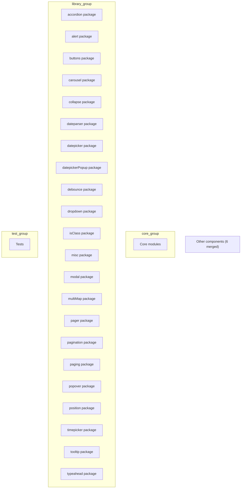

# Architecture report: angular-ui/bootstrap

> Automated static analysis. **Observed** = directly seen in files/imports/AST; **Inferred** = interpretation from that evidence. Repository code was not executed.

## 1. Repository at a glance

| Item | Value |
| --- | --- |
| Repository | angular-ui/bootstrap |
| Description | PLEASE READ THE PROJECT STATUS BELOW.  Native AngularJS (Angular) directives for Bootstrap. Smaller footprint (20kB gzipped), no 3rd party JS dependencies (jQuery, bootstrap JS) required. Please read the README.md file before submitting an issue! |
| Language | JavaScript |
| Stars | 14122 |
| Licence | MIT |
| Analysed commit / branch | baf0a567f9f4641848a9a4699695f9cde5f28f70 / master |
| Framework(s) | None detected |
| Files analysed | 226 |
| Components | 30 |

## 2. Architecture in one minute

angular-ui/bootstrap - PLEASE READ THE PROJECT STATUS BELOW.  Native AngularJS (Angular) directives for Bootstrap. Smaller footprint (20kB gzipped), no 3rd party JS dependencies (jQuery, bootstrap JS) required. Please read…. This repository was analysed statically from 226 file(s) (0 Python). Detected technologies (observed from imports/manifests): no known frameworks/libraries. Files are grouped into 30 component(s): accordion package, alert package, buttons package, carousel package, collapse package, Configuration and deployment, Core modules, dateparser package. Findings below distinguish observed facts from inferred interpretation.

## 3. High-level block diagram

## 4. Main components

### accordion package (`accordion`)

- **Kind:** library
- **Status:** Observed
- **Confidence:** 0.85
- **Responsibility:** Groups 2 file(s) under accordion package (observed from repository paths and static analysis).
- **Paths:** `src/accordion/accordion.js`, `src/accordion/index.js`
- **Evidence:** [src/accordion/accordion.js](https://github.com/angular-ui/bootstrap/blob/baf0a567f9f4641848a9a4699695f9cde5f28f70/src/accordion/accordion.js); [src/accordion/index.js](https://github.com/angular-ui/bootstrap/blob/baf0a567f9f4641848a9a4699695f9cde5f28f70/src/accordion/index.js)

### alert package (`alert`)

- **Kind:** library
- **Status:** Observed
- **Confidence:** 0.85
- **Responsibility:** Groups 2 file(s) under alert package (observed from repository paths and static analysis).
- **Paths:** `src/alert/alert.js`, `src/alert/index.js`
- **Evidence:** [src/alert/alert.js](https://github.com/angular-ui/bootstrap/blob/baf0a567f9f4641848a9a4699695f9cde5f28f70/src/alert/alert.js); [src/alert/index.js](https://github.com/angular-ui/bootstrap/blob/baf0a567f9f4641848a9a4699695f9cde5f28f70/src/alert/index.js)

### buttons package (`buttons`)

- **Kind:** library
- **Status:** Observed
- **Confidence:** 0.85
- **Responsibility:** Groups 2 file(s) under buttons package (observed from repository paths and static analysis).
- **Paths:** `src/buttons/buttons.js`, `src/buttons/index.js`
- **Evidence:** [src/buttons/buttons.js](https://github.com/angular-ui/bootstrap/blob/baf0a567f9f4641848a9a4699695f9cde5f28f70/src/buttons/buttons.js); [src/buttons/index.js](https://github.com/angular-ui/bootstrap/blob/baf0a567f9f4641848a9a4699695f9cde5f28f70/src/buttons/index.js)

### carousel package (`carousel`)

- **Kind:** library
- **Status:** Observed
- **Confidence:** 0.85
- **Responsibility:** Groups 3 file(s) under carousel package (observed from repository paths and static analysis).
- **Paths:** `src/carousel/carousel.js`, `src/carousel/index-nocss.js`, `src/carousel/index.js`
- **Evidence:** [src/carousel/carousel.js](https://github.com/angular-ui/bootstrap/blob/baf0a567f9f4641848a9a4699695f9cde5f28f70/src/carousel/carousel.js); [src/carousel/index-nocss.js](https://github.com/angular-ui/bootstrap/blob/baf0a567f9f4641848a9a4699695f9cde5f28f70/src/carousel/index-nocss.js); [src/carousel/index.js](https://github.com/angular-ui/bootstrap/blob/baf0a567f9f4641848a9a4699695f9cde5f28f70/src/carousel/index.js)

### collapse package (`collapse`)

- **Kind:** library
- **Status:** Observed
- **Confidence:** 0.85
- **Responsibility:** Groups 2 file(s) under collapse package (observed from repository paths and static analysis).
- **Paths:** `src/collapse/collapse.js`, `src/collapse/index.js`
- **Evidence:** [src/collapse/collapse.js](https://github.com/angular-ui/bootstrap/blob/baf0a567f9f4641848a9a4699695f9cde5f28f70/src/collapse/collapse.js); [src/collapse/index.js](https://github.com/angular-ui/bootstrap/blob/baf0a567f9f4641848a9a4699695f9cde5f28f70/src/collapse/index.js)

### Configuration and deployment (`config`)

- **Kind:** config
- **Status:** Observed
- **Confidence:** 0.85
- **Responsibility:** Groups 1 file(s) under configuration and deployment (observed from repository paths and static analysis).
- **Paths:** `package.json`
- **Evidence:** [package.json](https://github.com/angular-ui/bootstrap/blob/baf0a567f9f4641848a9a4699695f9cde5f28f70/package.json)

### Core modules (`core`)

- **Kind:** core
- **Status:** Observed
- **Confidence:** 0.85
- **Responsibility:** Groups 3 file(s) under core modules (observed from repository paths and static analysis).
- **Paths:** `Gruntfile.js`, `index.js`, `karma.conf.js`
- **Evidence:** [Gruntfile.js](https://github.com/angular-ui/bootstrap/blob/baf0a567f9f4641848a9a4699695f9cde5f28f70/Gruntfile.js); [index.js](https://github.com/angular-ui/bootstrap/blob/baf0a567f9f4641848a9a4699695f9cde5f28f70/index.js); [karma.conf.js](https://github.com/angular-ui/bootstrap/blob/baf0a567f9f4641848a9a4699695f9cde5f28f70/karma.conf.js)

### dateparser package (`dateparser`)

- **Kind:** library
- **Status:** Observed
- **Confidence:** 0.85
- **Responsibility:** Groups 2 file(s) under dateparser package (observed from repository paths and static analysis).
- **Paths:** `src/dateparser/dateparser.js`, `src/dateparser/index.js`
- **Evidence:** [src/dateparser/dateparser.js](https://github.com/angular-ui/bootstrap/blob/baf0a567f9f4641848a9a4699695f9cde5f28f70/src/dateparser/dateparser.js); [src/dateparser/index.js](https://github.com/angular-ui/bootstrap/blob/baf0a567f9f4641848a9a4699695f9cde5f28f70/src/dateparser/index.js)

### datepicker package (`datepicker`)

- **Kind:** library
- **Status:** Observed
- **Confidence:** 0.85
- **Responsibility:** Groups 3 file(s) under datepicker package (observed from repository paths and static analysis).
- **Paths:** `src/datepicker/datepicker.js`, `src/datepicker/index-nocss.js`, `src/datepicker/index.js`
- **Evidence:** [src/datepicker/datepicker.js](https://github.com/angular-ui/bootstrap/blob/baf0a567f9f4641848a9a4699695f9cde5f28f70/src/datepicker/datepicker.js); [src/datepicker/index-nocss.js](https://github.com/angular-ui/bootstrap/blob/baf0a567f9f4641848a9a4699695f9cde5f28f70/src/datepicker/index-nocss.js); [src/datepicker/index.js](https://github.com/angular-ui/bootstrap/blob/baf0a567f9f4641848a9a4699695f9cde5f28f70/src/datepicker/index.js)

### datepickerPopup package (`datepickerpopup`)

- **Kind:** library
- **Status:** Observed
- **Confidence:** 0.85
- **Responsibility:** Groups 3 file(s) under datepickerpopup package (observed from repository paths and static analysis).
- **Paths:** `src/datepickerPopup/index-nocss.js`, `src/datepickerPopup/index.js`, `src/datepickerPopup/popup.js`
- **Evidence:** [src/datepickerPopup/index-nocss.js](https://github.com/angular-ui/bootstrap/blob/baf0a567f9f4641848a9a4699695f9cde5f28f70/src/datepickerPopup/index-nocss.js); [src/datepickerPopup/index.js](https://github.com/angular-ui/bootstrap/blob/baf0a567f9f4641848a9a4699695f9cde5f28f70/src/datepickerPopup/index.js); [src/datepickerPopup/popup.js](https://github.com/angular-ui/bootstrap/blob/baf0a567f9f4641848a9a4699695f9cde5f28f70/src/datepickerPopup/popup.js)

### debounce package (`debounce`)

- **Kind:** library
- **Status:** Observed
- **Confidence:** 0.85
- **Responsibility:** Groups 2 file(s) under debounce package (observed from repository paths and static analysis).
- **Paths:** `src/debounce/debounce.js`, `src/debounce/index.js`
- **Evidence:** [src/debounce/debounce.js](https://github.com/angular-ui/bootstrap/blob/baf0a567f9f4641848a9a4699695f9cde5f28f70/src/debounce/debounce.js); [src/debounce/index.js](https://github.com/angular-ui/bootstrap/blob/baf0a567f9f4641848a9a4699695f9cde5f28f70/src/debounce/index.js)

### dropdown package (`dropdown`)

- **Kind:** library
- **Status:** Observed
- **Confidence:** 0.85
- **Responsibility:** Groups 3 file(s) under dropdown package (observed from repository paths and static analysis).
- **Paths:** `src/dropdown/dropdown.js`, `src/dropdown/index-nocss.js`, `src/dropdown/index.js`
- **Evidence:** [src/dropdown/dropdown.js](https://github.com/angular-ui/bootstrap/blob/baf0a567f9f4641848a9a4699695f9cde5f28f70/src/dropdown/dropdown.js); [src/dropdown/index-nocss.js](https://github.com/angular-ui/bootstrap/blob/baf0a567f9f4641848a9a4699695f9cde5f28f70/src/dropdown/index-nocss.js); [src/dropdown/index.js](https://github.com/angular-ui/bootstrap/blob/baf0a567f9f4641848a9a4699695f9cde5f28f70/src/dropdown/index.js)

### isClass package (`isclass`)

- **Kind:** library
- **Status:** Observed
- **Confidence:** 0.85
- **Responsibility:** Groups 2 file(s) under isclass package (observed from repository paths and static analysis).
- **Paths:** `src/isClass/index.js`, `src/isClass/isClass.js`
- **Evidence:** [src/isClass/index.js](https://github.com/angular-ui/bootstrap/blob/baf0a567f9f4641848a9a4699695f9cde5f28f70/src/isClass/index.js); [src/isClass/isClass.js](https://github.com/angular-ui/bootstrap/blob/baf0a567f9f4641848a9a4699695f9cde5f28f70/src/isClass/isClass.js)

### misc package (`misc`)

- **Kind:** library
- **Status:** Observed
- **Confidence:** 0.85
- **Responsibility:** Groups 11 file(s) under misc package (observed from repository paths and static analysis).
- **Paths:** `misc/demo/assets/app.js`, `misc/demo/assets/plunker.js`, `misc/demo/assets/rainbow-generic.js`, `misc/demo/assets/rainbow-html.js`, `misc/demo/assets/rainbow-javascript.js`, `misc/demo/assets/rainbow.js`, `misc/demo/assets/smoothscroll-angular-custom.js`, `misc/demo/assets/uglifyjs.js`, `misc/raw-files-generator.js`, `misc/test-lib/helpers.js`, `misc/validate-commit-msg.js`
- **Evidence:** [misc/demo/assets/app.js](https://github.com/angular-ui/bootstrap/blob/baf0a567f9f4641848a9a4699695f9cde5f28f70/misc/demo/assets/app.js); [misc/demo/assets/plunker.js](https://github.com/angular-ui/bootstrap/blob/baf0a567f9f4641848a9a4699695f9cde5f28f70/misc/demo/assets/plunker.js); [misc/demo/assets/rainbow-generic.js](https://github.com/angular-ui/bootstrap/blob/baf0a567f9f4641848a9a4699695f9cde5f28f70/misc/demo/assets/rainbow-generic.js); [misc/demo/assets/rainbow-html.js](https://github.com/angular-ui/bootstrap/blob/baf0a567f9f4641848a9a4699695f9cde5f28f70/misc/demo/assets/rainbow-html.js); [misc/demo/assets/rainbow-javascript.js](https://github.com/angular-ui/bootstrap/blob/baf0a567f9f4641848a9a4699695f9cde5f28f70/misc/demo/assets/rainbow-javascript.js); [misc/demo/assets/rainbow.js](https://github.com/angular-ui/bootstrap/blob/baf0a567f9f4641848a9a4699695f9cde5f28f70/misc/demo/assets/rainbow.js); [misc/demo/assets/smoothscroll-angular-custom.js](https://github.com/angular-ui/bootstrap/blob/baf0a567f9f4641848a9a4699695f9cde5f28f70/misc/demo/assets/smoothscroll-angular-custom.js); [misc/demo/assets/uglifyjs.js](https://github.com/angular-ui/bootstrap/blob/baf0a567f9f4641848a9a4699695f9cde5f28f70/misc/demo/assets/uglifyjs.js)

### modal package (`modal`)

- **Kind:** library
- **Status:** Observed
- **Confidence:** 0.85
- **Responsibility:** Groups 3 file(s) under modal package (observed from repository paths and static analysis).
- **Paths:** `src/modal/index-nocss.js`, `src/modal/index.js`, `src/modal/modal.js`
- **Evidence:** [src/modal/index-nocss.js](https://github.com/angular-ui/bootstrap/blob/baf0a567f9f4641848a9a4699695f9cde5f28f70/src/modal/index-nocss.js); [src/modal/index.js](https://github.com/angular-ui/bootstrap/blob/baf0a567f9f4641848a9a4699695f9cde5f28f70/src/modal/index.js); [src/modal/modal.js](https://github.com/angular-ui/bootstrap/blob/baf0a567f9f4641848a9a4699695f9cde5f28f70/src/modal/modal.js)

### multiMap package (`multimap`)

- **Kind:** library
- **Status:** Observed
- **Confidence:** 0.85
- **Responsibility:** Groups 2 file(s) under multimap package (observed from repository paths and static analysis).
- **Paths:** `src/multiMap/index.js`, `src/multiMap/multiMap.js`
- **Evidence:** [src/multiMap/index.js](https://github.com/angular-ui/bootstrap/blob/baf0a567f9f4641848a9a4699695f9cde5f28f70/src/multiMap/index.js); [src/multiMap/multiMap.js](https://github.com/angular-ui/bootstrap/blob/baf0a567f9f4641848a9a4699695f9cde5f28f70/src/multiMap/multiMap.js)

### pager package (`pager`)

- **Kind:** library
- **Status:** Observed
- **Confidence:** 0.85
- **Responsibility:** Groups 2 file(s) under pager package (observed from repository paths and static analysis).
- **Paths:** `src/pager/index.js`, `src/pager/pager.js`
- **Evidence:** [src/pager/index.js](https://github.com/angular-ui/bootstrap/blob/baf0a567f9f4641848a9a4699695f9cde5f28f70/src/pager/index.js); [src/pager/pager.js](https://github.com/angular-ui/bootstrap/blob/baf0a567f9f4641848a9a4699695f9cde5f28f70/src/pager/pager.js)

### pagination package (`pagination`)

- **Kind:** library
- **Status:** Observed
- **Confidence:** 0.85
- **Responsibility:** Groups 2 file(s) under pagination package (observed from repository paths and static analysis).
- **Paths:** `src/pagination/index.js`, `src/pagination/pagination.js`
- **Evidence:** [src/pagination/index.js](https://github.com/angular-ui/bootstrap/blob/baf0a567f9f4641848a9a4699695f9cde5f28f70/src/pagination/index.js); [src/pagination/pagination.js](https://github.com/angular-ui/bootstrap/blob/baf0a567f9f4641848a9a4699695f9cde5f28f70/src/pagination/pagination.js)

### paging package (`paging`)

- **Kind:** library
- **Status:** Observed
- **Confidence:** 0.85
- **Responsibility:** Groups 2 file(s) under paging package (observed from repository paths and static analysis).
- **Paths:** `src/paging/index.js`, `src/paging/paging.js`
- **Evidence:** [src/paging/index.js](https://github.com/angular-ui/bootstrap/blob/baf0a567f9f4641848a9a4699695f9cde5f28f70/src/paging/index.js); [src/paging/paging.js](https://github.com/angular-ui/bootstrap/blob/baf0a567f9f4641848a9a4699695f9cde5f28f70/src/paging/paging.js)

### popover package (`popover`)

- **Kind:** library
- **Status:** Observed
- **Confidence:** 0.85
- **Responsibility:** Groups 3 file(s) under popover package (observed from repository paths and static analysis).
- **Paths:** `src/popover/index-nocss.js`, `src/popover/index.js`, `src/popover/popover.js`
- **Evidence:** [src/popover/index-nocss.js](https://github.com/angular-ui/bootstrap/blob/baf0a567f9f4641848a9a4699695f9cde5f28f70/src/popover/index-nocss.js); [src/popover/index.js](https://github.com/angular-ui/bootstrap/blob/baf0a567f9f4641848a9a4699695f9cde5f28f70/src/popover/index.js); [src/popover/popover.js](https://github.com/angular-ui/bootstrap/blob/baf0a567f9f4641848a9a4699695f9cde5f28f70/src/popover/popover.js)

### position package (`position`)

- **Kind:** library
- **Status:** Observed
- **Confidence:** 0.85
- **Responsibility:** Groups 3 file(s) under position package (observed from repository paths and static analysis).
- **Paths:** `src/position/index-nocss.js`, `src/position/index.js`, `src/position/position.js`
- **Evidence:** [src/position/index-nocss.js](https://github.com/angular-ui/bootstrap/blob/baf0a567f9f4641848a9a4699695f9cde5f28f70/src/position/index-nocss.js); [src/position/index.js](https://github.com/angular-ui/bootstrap/blob/baf0a567f9f4641848a9a4699695f9cde5f28f70/src/position/index.js); [src/position/position.js](https://github.com/angular-ui/bootstrap/blob/baf0a567f9f4641848a9a4699695f9cde5f28f70/src/position/position.js)

### progressbar package (`progressbar`)

- **Kind:** library
- **Status:** Observed
- **Confidence:** 0.85
- **Responsibility:** Groups 2 file(s) under progressbar package (observed from repository paths and static analysis).
- **Paths:** `src/progressbar/index.js`, `src/progressbar/progressbar.js`
- **Evidence:** [src/progressbar/index.js](https://github.com/angular-ui/bootstrap/blob/baf0a567f9f4641848a9a4699695f9cde5f28f70/src/progressbar/index.js); [src/progressbar/progressbar.js](https://github.com/angular-ui/bootstrap/blob/baf0a567f9f4641848a9a4699695f9cde5f28f70/src/progressbar/progressbar.js)

### rating package (`rating`)

- **Kind:** library
- **Status:** Observed
- **Confidence:** 0.85
- **Responsibility:** Groups 2 file(s) under rating package (observed from repository paths and static analysis).
- **Paths:** `src/rating/index.js`, `src/rating/rating.js`
- **Evidence:** [src/rating/index.js](https://github.com/angular-ui/bootstrap/blob/baf0a567f9f4641848a9a4699695f9cde5f28f70/src/rating/index.js); [src/rating/rating.js](https://github.com/angular-ui/bootstrap/blob/baf0a567f9f4641848a9a4699695f9cde5f28f70/src/rating/rating.js)

### stackedMap package (`stackedmap`)

- **Kind:** library
- **Status:** Observed
- **Confidence:** 0.85
- **Responsibility:** Groups 2 file(s) under stackedmap package (observed from repository paths and static analysis).
- **Paths:** `src/stackedMap/index.js`, `src/stackedMap/stackedMap.js`
- **Evidence:** [src/stackedMap/index.js](https://github.com/angular-ui/bootstrap/blob/baf0a567f9f4641848a9a4699695f9cde5f28f70/src/stackedMap/index.js); [src/stackedMap/stackedMap.js](https://github.com/angular-ui/bootstrap/blob/baf0a567f9f4641848a9a4699695f9cde5f28f70/src/stackedMap/stackedMap.js)

### tabindex package (`tabindex`)

- **Kind:** library
- **Status:** Observed
- **Confidence:** 0.85
- **Responsibility:** Groups 2 file(s) under tabindex package (observed from repository paths and static analysis).
- **Paths:** `src/tabindex/index.js`, `src/tabindex/tabindex.js`
- **Evidence:** [src/tabindex/index.js](https://github.com/angular-ui/bootstrap/blob/baf0a567f9f4641848a9a4699695f9cde5f28f70/src/tabindex/index.js); [src/tabindex/tabindex.js](https://github.com/angular-ui/bootstrap/blob/baf0a567f9f4641848a9a4699695f9cde5f28f70/src/tabindex/tabindex.js)

### tabs package (`tabs`)

- **Kind:** library
- **Status:** Observed
- **Confidence:** 0.85
- **Responsibility:** Groups 2 file(s) under tabs package (observed from repository paths and static analysis).
- **Paths:** `src/tabs/index.js`, `src/tabs/tabs.js`
- **Evidence:** [src/tabs/index.js](https://github.com/angular-ui/bootstrap/blob/baf0a567f9f4641848a9a4699695f9cde5f28f70/src/tabs/index.js); [src/tabs/tabs.js](https://github.com/angular-ui/bootstrap/blob/baf0a567f9f4641848a9a4699695f9cde5f28f70/src/tabs/tabs.js)

### Tests (`tests`)

- **Kind:** test
- **Status:** Observed
- **Confidence:** 0.85
- **Responsibility:** Groups 36 file(s) under tests (observed from repository paths and static analysis).
- **Paths:** `src/accordion/test/accordion.spec.js`, `src/alert/test/alert.spec.js`, `src/buttons/test/buttons.spec.js`, `src/carousel/test/carousel.spec.js`, `src/collapse/test/collapse.spec.js`, `src/collapse/test/collapseHorizontally.spec.js`, `src/dateparser/test/dateparser.spec.js`, `src/datepicker/test/datepicker.spec.js`, `src/datepickerPopup/test/popup.spec.js`, `src/debounce/test/debounce.spec.js`, `src/dropdown/test/dropdown.spec.js`, `src/isClass/test/isClass.spec.js`, `src/modal/test/modal.spec.js`, `src/multiMap/test/multiMap.spec.js`, `src/pager/test/pager.spec.js`, `src/pagination/test/pagination.spec.js`, `src/paging/test/paging.spec.js`, `src/popover/test/popover-html.spec.js`, `src/popover/test/popover-template.spec.js`, `src/popover/test/popover.spec.js`, `src/position/test/position.spec.js`, `src/position/test/test.html`, `src/progressbar/test/progressbar.spec.js`, `src/rating/test/rating.spec.js`, `src/stackedMap/test/stackedMap.spec.js`, `src/tabindex/test/tabindex.spec.js`, `src/tabs/test/tabs.spec.js`, `src/timepicker/test/timepicker.spec.js`, `src/tooltip/test/tooltip-template.spec.js`, `src/tooltip/test/tooltip.spec.js`, `src/tooltip/test/tooltip2.spec.js`, `src/typeahead/test/typeahead-highlight-ngsanitize.spec.js`, `src/typeahead/test/typeahead-highlight.spec.js`, `src/typeahead/test/typeahead-parser.spec.js`, `src/typeahead/test/typeahead-popup.spec.js`, `src/typeahead/test/typeahead.spec.js`
- **Evidence:** [src/accordion/test/accordion.spec.js](https://github.com/angular-ui/bootstrap/blob/baf0a567f9f4641848a9a4699695f9cde5f28f70/src/accordion/test/accordion.spec.js); [src/alert/test/alert.spec.js](https://github.com/angular-ui/bootstrap/blob/baf0a567f9f4641848a9a4699695f9cde5f28f70/src/alert/test/alert.spec.js); [src/buttons/test/buttons.spec.js](https://github.com/angular-ui/bootstrap/blob/baf0a567f9f4641848a9a4699695f9cde5f28f70/src/buttons/test/buttons.spec.js); [src/carousel/test/carousel.spec.js](https://github.com/angular-ui/bootstrap/blob/baf0a567f9f4641848a9a4699695f9cde5f28f70/src/carousel/test/carousel.spec.js); [src/collapse/test/collapse.spec.js](https://github.com/angular-ui/bootstrap/blob/baf0a567f9f4641848a9a4699695f9cde5f28f70/src/collapse/test/collapse.spec.js); [src/collapse/test/collapseHorizontally.spec.js](https://github.com/angular-ui/bootstrap/blob/baf0a567f9f4641848a9a4699695f9cde5f28f70/src/collapse/test/collapseHorizontally.spec.js); [src/dateparser/test/dateparser.spec.js](https://github.com/angular-ui/bootstrap/blob/baf0a567f9f4641848a9a4699695f9cde5f28f70/src/dateparser/test/dateparser.spec.js); [src/datepicker/test/datepicker.spec.js](https://github.com/angular-ui/bootstrap/blob/baf0a567f9f4641848a9a4699695f9cde5f28f70/src/datepicker/test/datepicker.spec.js)

### timepicker package (`timepicker`)

- **Kind:** library
- **Status:** Observed
- **Confidence:** 0.85
- **Responsibility:** Groups 3 file(s) under timepicker package (observed from repository paths and static analysis).
- **Paths:** `src/timepicker/index-nocss.js`, `src/timepicker/index.js`, `src/timepicker/timepicker.js`
- **Evidence:** [src/timepicker/index-nocss.js](https://github.com/angular-ui/bootstrap/blob/baf0a567f9f4641848a9a4699695f9cde5f28f70/src/timepicker/index-nocss.js); [src/timepicker/index.js](https://github.com/angular-ui/bootstrap/blob/baf0a567f9f4641848a9a4699695f9cde5f28f70/src/timepicker/index.js); [src/timepicker/timepicker.js](https://github.com/angular-ui/bootstrap/blob/baf0a567f9f4641848a9a4699695f9cde5f28f70/src/timepicker/timepicker.js)

### tooltip package (`tooltip`)

- **Kind:** library
- **Status:** Observed
- **Confidence:** 0.85
- **Responsibility:** Groups 3 file(s) under tooltip package (observed from repository paths and static analysis).
- **Paths:** `src/tooltip/index-nocss.js`, `src/tooltip/index.js`, `src/tooltip/tooltip.js`
- **Evidence:** [src/tooltip/index-nocss.js](https://github.com/angular-ui/bootstrap/blob/baf0a567f9f4641848a9a4699695f9cde5f28f70/src/tooltip/index-nocss.js); [src/tooltip/index.js](https://github.com/angular-ui/bootstrap/blob/baf0a567f9f4641848a9a4699695f9cde5f28f70/src/tooltip/index.js); [src/tooltip/tooltip.js](https://github.com/angular-ui/bootstrap/blob/baf0a567f9f4641848a9a4699695f9cde5f28f70/src/tooltip/tooltip.js)

### typeahead package (`typeahead`)

- **Kind:** library
- **Status:** Observed
- **Confidence:** 0.85
- **Responsibility:** Groups 3 file(s) under typeahead package (observed from repository paths and static analysis).
- **Paths:** `src/typeahead/index-nocss.js`, `src/typeahead/index.js`, `src/typeahead/typeahead.js`
- **Evidence:** [src/typeahead/index-nocss.js](https://github.com/angular-ui/bootstrap/blob/baf0a567f9f4641848a9a4699695f9cde5f28f70/src/typeahead/index-nocss.js); [src/typeahead/index.js](https://github.com/angular-ui/bootstrap/blob/baf0a567f9f4641848a9a4699695f9cde5f28f70/src/typeahead/index.js); [src/typeahead/typeahead.js](https://github.com/angular-ui/bootstrap/blob/baf0a567f9f4641848a9a4699695f9cde5f28f70/src/typeahead/typeahead.js)

## 5. Execution flow

**Observed** entry point(s):

- [index.js](https://github.com/angular-ui/bootstrap/blob/baf0a567f9f4641848a9a4699695f9cde5f28f70/index.js)
- [misc/demo/assets/app.js](https://github.com/angular-ui/bootstrap/blob/baf0a567f9f4641848a9a4699695f9cde5f28f70/misc/demo/assets/app.js)
- [src/accordion/index.js](https://github.com/angular-ui/bootstrap/blob/baf0a567f9f4641848a9a4699695f9cde5f28f70/src/accordion/index.js)
- [src/alert/index.js](https://github.com/angular-ui/bootstrap/blob/baf0a567f9f4641848a9a4699695f9cde5f28f70/src/alert/index.js)
- [src/buttons/index.js](https://github.com/angular-ui/bootstrap/blob/baf0a567f9f4641848a9a4699695f9cde5f28f70/src/buttons/index.js)
- [src/carousel/index.js](https://github.com/angular-ui/bootstrap/blob/baf0a567f9f4641848a9a4699695f9cde5f28f70/src/carousel/index.js)
- [src/collapse/index.js](https://github.com/angular-ui/bootstrap/blob/baf0a567f9f4641848a9a4699695f9cde5f28f70/src/collapse/index.js)
- [src/dateparser/index.js](https://github.com/angular-ui/bootstrap/blob/baf0a567f9f4641848a9a4699695f9cde5f28f70/src/dateparser/index.js)
- [src/datepicker/index.js](https://github.com/angular-ui/bootstrap/blob/baf0a567f9f4641848a9a4699695f9cde5f28f70/src/datepicker/index.js)
- [src/datepickerPopup/index.js](https://github.com/angular-ui/bootstrap/blob/baf0a567f9f4641848a9a4699695f9cde5f28f70/src/datepickerPopup/index.js)
- [src/debounce/index.js](https://github.com/angular-ui/bootstrap/blob/baf0a567f9f4641848a9a4699695f9cde5f28f70/src/debounce/index.js)
- [src/dropdown/index.js](https://github.com/angular-ui/bootstrap/blob/baf0a567f9f4641848a9a4699695f9cde5f28f70/src/dropdown/index.js)

Representative flow (derived from observed entry points and the import graph; steps beyond the entry point are **Inferred**):

1. Execution starts at an observed entry point listed above, if present.
2. No internal import relationships between components were observed.

## 6. Project structure

### `(root)`

- `.editorconfig` - config (332 bytes)
- `.eslintrc` - other (1738 bytes)
- `.gitattributes` - other (96 bytes)
- `.gitignore` - other (181 bytes)
- `.jshintrc` - other (565 bytes)
- `.npmignore` - other (357 bytes)
- `.travis.yml` - ci, YAML (296 bytes)
- `CHANGELOG.md` - docs (194305 bytes)
- `CODE_OF_CONDUCT.md` - docs (1980 bytes)
- `CONTRIBUTING.md` - docs (3783 bytes)
- `Gruntfile.js` - source, JavaScript (16123 bytes)
- `LICENSE` - docs (1165 bytes)
- `README.md` - docs (7765 bytes)
- `index.js` - source, JavaScript (71 bytes)
- `karma.conf.js` - source, JavaScript (2068 bytes)
- `package.json` - manifest (1618 bytes)

### `.github`

- `.github/ISSUE_TEMPLATE.md` - docs (318 bytes)
- `.github/PULL_REQUEST_TEMPLATE.md` - docs (325 bytes)

### `misc`

- `misc/changelog.tpl.md` - docs (843 bytes)
- `misc/demo/assets/app.js` - source, JavaScript (8894 bytes)
- `misc/demo/assets/demo.css` - other (5848 bytes)
- `misc/demo/assets/plunker.js` - source, JavaScript (2388 bytes)
- `misc/demo/assets/rainbow-generic.js` - source, JavaScript (1622 bytes)
- `misc/demo/assets/rainbow-html.js` - source, JavaScript (1859 bytes)
- `misc/demo/assets/rainbow-javascript.js` - source, JavaScript (2546 bytes)
- `misc/demo/assets/rainbow.css` - other (1457 bytes)
- `misc/demo/assets/rainbow.js` - source, JavaScript (25938 bytes)
- `misc/demo/assets/smoothscroll-angular-custom.js` - source, JavaScript (3864 bytes)
- `misc/demo/assets/uglifyjs.js` - source, JavaScript (114316 bytes)
- `misc/demo/index.html` - other (23197 bytes)
- `misc/raw-files-generator.js` - source, JavaScript (978 bytes)
- `misc/test-lib/helpers.js` - source, JavaScript (1644 bytes)
- `misc/validate-commit-msg.js` - source, JavaScript (2686 bytes)

### `src`

- `src/accordion/accordion.js` - source, JavaScript (5078 bytes)
- `src/accordion/docs/demo.html` - docs (2932 bytes)
- `src/accordion/docs/demo.js` - docs (616 bytes)
- `src/accordion/docs/readme.md` - docs (2440 bytes)
- `src/accordion/index.js` - source, JavaScript (417 bytes)
- `src/accordion/test/accordion.spec.js` - test, JavaScript (22736 bytes)
- `src/alert/alert.js` - source, JavaScript (948 bytes)
- `src/alert/docs/demo.html` - docs (475 bytes)
- `src/alert/docs/demo.js` - docs (467 bytes)
- `src/alert/docs/readme.md` - docs (672 bytes)
- `src/alert/index.js` - source, JavaScript (233 bytes)
- `src/alert/test/alert.spec.js` - test, JavaScript (3900 bytes)
- `src/buttons/buttons.js` - source, JavaScript (2807 bytes)
- `src/buttons/docs/demo.html` - docs (1662 bytes)
- `src/buttons/docs/demo.js` - docs (483 bytes)
- `src/buttons/docs/readme.md` - docs (1671 bytes)
- `src/buttons/index.js` - source, JavaScript (159 bytes)
- `src/buttons/test/buttons.spec.js` - test, JavaScript (12911 bytes)
- `src/carousel/carousel.css` - other (120 bytes)
- `src/carousel/carousel.js` - source, JavaScript (9457 bytes)
- `src/carousel/docs/README.md` - docs (2034 bytes)
- `src/carousel/docs/demo.html` - docs (1081 bytes)
- `src/carousel/docs/demo.js` - docs (1377 bytes)
- `src/carousel/index-nocss.js` - source, JavaScript (340 bytes)
- `src/carousel/index.js` - source, JavaScript (73 bytes)
- `src/carousel/test/carousel.spec.js` - test, JavaScript (18663 bytes)
- `src/collapse/collapse.js` - source, JavaScript (4296 bytes)
- `src/collapse/docs/demo.html` - docs (1358 bytes)
- `src/collapse/docs/demo.js` - docs (193 bytes)
- `src/collapse/docs/readme.md` - docs (1622 bytes)
- `src/collapse/index.js` - source, JavaScript (162 bytes)
- `src/collapse/test/collapse.spec.js` - test, JavaScript (8066 bytes)
- `src/collapse/test/collapseHorizontally.spec.js` - test, JavaScript (7035 bytes)
- `src/dateparser/dateparser.js` - source, JavaScript (16151 bytes)
- `src/dateparser/docs/README.md` - docs (3513 bytes)
- `src/dateparser/docs/demo.html` - docs (375 bytes)
- `src/dateparser/docs/demo.js` - docs (168 bytes)
- `src/dateparser/index.js` - source, JavaScript (168 bytes)
- `src/dateparser/test/dateparser.spec.js` - test, JavaScript (43190 bytes)
- `src/datepicker/datepicker.css` - other (164 bytes)
- `src/datepicker/datepicker.js` - source, JavaScript (22218 bytes)
- `src/datepicker/docs/demo.html` - docs (961 bytes)
- `src/datepicker/docs/demo.js` - docs (1493 bytes)
- `src/datepicker/docs/readme.md` - docs (5828 bytes)
- `src/datepicker/index-nocss.js` - source, JavaScript (581 bytes)
- `src/datepicker/index.js` - source, JavaScript (75 bytes)
- `src/datepicker/test/datepicker.spec.js` - test, JavaScript (61590 bytes)
- `src/datepickerPopup/docs/demo.html` - docs (2097 bytes)
- `src/datepickerPopup/docs/demo.js` - docs (2117 bytes)
- `src/datepickerPopup/docs/readme.md` - docs (4455 bytes)
- `src/datepickerPopup/index-nocss.js` - source, JavaScript (390 bytes)
- `src/datepickerPopup/index.js` - source, JavaScript (148 bytes)
- `src/datepickerPopup/popup.css` - other (132 bytes)
- `src/datepickerPopup/popup.js` - source, JavaScript (14687 bytes)
- `src/datepickerPopup/test/popup.spec.js` - test, JavaScript (58015 bytes)
- `src/debounce/debounce.js` - source, JavaScript (567 bytes)
- `src/debounce/index.js` - source, JavaScript (162 bytes)
- `src/debounce/test/debounce.spec.js` - test, JavaScript (1075 bytes)
- `src/dropdown/docs/demo.html` - docs (6952 bytes)
- `src/dropdown/docs/demo.js` - docs (579 bytes)
- `src/dropdown/docs/readme.md` - docs (2427 bytes)
- `src/dropdown/dropdown.js` - source, JavaScript (12603 bytes)
- `src/dropdown/index-nocss.js` - source, JavaScript (225 bytes)
- `src/dropdown/index.js` - source, JavaScript (83 bytes)
- `src/dropdown/test/dropdown.spec.js` - test, JavaScript (35834 bytes)
- `src/isClass/index.js` - source, JavaScript (159 bytes)
- `src/isClass/isClass.js` - source, JavaScript (3039 bytes)
- `src/isClass/test/isClass.spec.js` - test, JavaScript (2560 bytes)
- `src/modal/docs/demo.html` - docs (2228 bytes)
- `src/modal/docs/demo.js` - docs (3322 bytes)
- `src/modal/docs/readme.md` - docs (7379 bytes)
- `src/modal/index-nocss.js` - source, JavaScript (324 bytes)
- `src/modal/index.js` - source, JavaScript (83 bytes)
- `src/modal/modal.js` - source, JavaScript (30502 bytes)
- `src/modal/test/modal.spec.js` - test, JavaScript (71786 bytes)
- `src/multiMap/index.js` - source, JavaScript (26 bytes)
- `src/multiMap/multiMap.js` - source, JavaScript (1248 bytes)
- `src/multiMap/test/multiMap.spec.js` - test, JavaScript (1362 bytes)
- `src/pager/docs/demo.html` - docs (185 bytes)
- `src/pager/docs/demo.js` - docs (139 bytes)
- `src/pager/docs/readme.md` - docs (1465 bytes)
- `src/pager/index.js` - source, JavaScript (279 bytes)
- `src/pager/pager.js` - source, JavaScript (1238 bytes)
- `src/pager/test/pager.spec.js` - test, JavaScript (9243 bytes)
- `src/pagination/docs/demo.html` - docs (2216 bytes)
- `src/pagination/docs/demo.js` - docs (409 bytes)
- `src/pagination/docs/readme.md` - docs (3301 bytes)
- `src/pagination/index.js` - source, JavaScript (314 bytes)
- `src/pagination/pagination.js` - source, JavaScript (5719 bytes)
- `src/pagination/test/pagination.spec.js` - test, JavaScript (34233 bytes)
- `src/paging/index.js` - source, JavaScript (156 bytes)
- `src/paging/paging.js` - source, JavaScript (2786 bytes)
- `src/paging/test/paging.spec.js` - test, JavaScript (7266 bytes)
- `src/popover/docs/demo.html` - docs (2590 bytes)
- `src/popover/docs/demo.js` - docs (645 bytes)
- `src/popover/docs/readme.md` - docs (5394 bytes)
- `src/popover/index-nocss.js` - source, JavaScript (489 bytes)
- `src/popover/index.js` - source, JavaScript (81 bytes)
- `src/popover/popover.js` - source, JavaScript (1333 bytes)
- `src/popover/test/popover-html.spec.js` - test, JavaScript (6237 bytes)
- `src/popover/test/popover-template.spec.js` - test, JavaScript (4297 bytes)
- `src/popover/test/popover.spec.js` - test, JavaScript (6509 bytes)
- `src/position/docs/demo.html` - docs (1161 bytes)
- `src/position/docs/demo.js` - docs (1071 bytes)
- `src/position/docs/readme.md` - docs (9005 bytes)
- `src/position/index-nocss.js` - source, JavaScript (162 bytes)
- `src/position/index.js` - source, JavaScript (73 bytes)
- `src/position/position.css` - other (429 bytes)
- `src/position/position.js` - source, JavaScript (26950 bytes)
- `src/position/test/position.spec.js` - test, JavaScript (19994 bytes)
- `src/position/test/test.html` - test (7247 bytes)
- `src/progressbar/docs/demo.html` - docs (1429 bytes)
- `src/progressbar/docs/demo.js` - docs (956 bytes)
- `src/progressbar/docs/readme.md` - docs (2038 bytes)
- `src/progressbar/index.js` - source, JavaScript (461 bytes)
- `src/progressbar/progressbar.js` - source, JavaScript (2783 bytes)
- `src/progressbar/test/progressbar.spec.js` - test, JavaScript (12985 bytes)
- `src/rating/docs/demo.html` - docs (1237 bytes)
- `src/rating/docs/demo.js` - docs (584 bytes)
- `src/rating/docs/readme.md` - docs (1675 bytes)
- `src/rating/index.js` - source, JavaScript (240 bytes)
- `src/rating/rating.js` - source, JavaScript (3308 bytes)
- `src/rating/test/rating.spec.js` - test, JavaScript (12177 bytes)
- `src/stackedMap/index.js` - source, JavaScript (168 bytes)
- `src/stackedMap/stackedMap.js` - source, JavaScript (1406 bytes)
- `src/stackedMap/test/stackedMap.spec.js` - test, JavaScript (1609 bytes)
- `src/tabindex/index.js` - source, JavaScript (162 bytes)
- `src/tabindex/tabindex.js` - source, JavaScript (294 bytes)
- `src/tabindex/test/tabindex.spec.js` - test, JavaScript (680 bytes)
- `src/tabs/docs/demo.html` - docs (2567 bytes)
- `src/tabs/docs/demo.js` - docs (430 bytes)
- `src/tabs/docs/readme.md` - docs (2365 bytes)
- `src/tabs/index.js` - source, JavaScript (304 bytes)
- `src/tabs/tabs.js` - source, JavaScript (6302 bytes)
- `src/tabs/test/tabs.spec.js` - test, JavaScript (36058 bytes)
- `src/timepicker/docs/demo.html` - docs (894 bytes)
- `src/timepicker/docs/demo.js` - docs (649 bytes)
- `src/timepicker/docs/readme.md` - docs (3786 bytes)
- `src/timepicker/index-nocss.js` - source, JavaScript (268 bytes)
- `src/timepicker/index.js` - source, JavaScript (75 bytes)
- `src/timepicker/test/timepicker.spec.js` - test, JavaScript (77234 bytes)
- `src/timepicker/timepicker.css` - other (35 bytes)
- `src/timepicker/timepicker.js` - source, JavaScript (17509 bytes)
- `src/tooltip/docs/demo.html` - docs (3587 bytes)
- `src/tooltip/docs/demo.js` - docs (540 bytes)
- `src/tooltip/docs/readme.md` - docs (5610 bytes)
- `src/tooltip/index-nocss.js` - source, JavaScript (552 bytes)
- `src/tooltip/index.js` - source, JavaScript (109 bytes)
- `src/tooltip/test/tooltip-template.spec.js` - test, JavaScript (2262 bytes)
- `src/tooltip/test/tooltip.spec.js` - test, JavaScript (36488 bytes)
- `src/tooltip/test/tooltip2.spec.js` - test, JavaScript (6946 bytes)
- `src/tooltip/tooltip.css` - other (2976 bytes)
- `src/tooltip/tooltip.js` - source, JavaScript (24929 bytes)
- `src/typeahead/docs/demo.html` - docs (3428 bytes)
- `src/typeahead/docs/demo.js` - docs (5848 bytes)
- `src/typeahead/docs/readme.md` - docs (4768 bytes)
- `src/typeahead/index-nocss.js` - source, JavaScript (444 bytes)
- `src/typeahead/index.js` - source, JavaScript (111 bytes)
- `src/typeahead/test/typeahead-highlight-ngsanitize.spec.js` - test, JavaScript (561 bytes)
- `src/typeahead/test/typeahead-highlight.spec.js` - test, JavaScript (2127 bytes)
- `src/typeahead/test/typeahead-parser.spec.js` - test, JavaScript (3033 bytes)
- `src/typeahead/test/typeahead-popup.spec.js` - test, JavaScript (2067 bytes)
- `src/typeahead/test/typeahead.spec.js` - test, JavaScript (63501 bytes)
- `src/typeahead/typeahead.css` - other (58 bytes)
- `src/typeahead/typeahead.js` - source, JavaScript (24498 bytes)

### `template`

- `template/accordion/accordion-group.html` - other (708 bytes)
- `template/accordion/accordion.html` - other (60 bytes)
- `template/alert/alert.html` - other (207 bytes)
- `template/carousel/carousel.html` - other (918 bytes)
- `template/carousel/slide.html` - other (46 bytes)
- `template/datepicker/datepicker.html` - other (301 bytes)
- `template/datepicker/day.html` - other (1870 bytes)
- `template/datepicker/month.html` - other (1539 bytes)
- `template/datepicker/year.html` - other (1527 bytes)
- `template/datepickerPopup/popup.html` - other (777 bytes)
- `template/modal/window.html` - other (119 bytes)
- `template/pager/pager.html` - other (406 bytes)
- `template/pagination/pagination.html` - other (1290 bytes)
- `template/popover/popover-html.html` - other (202 bytes)
- `template/popover/popover-template.html` - other (283 bytes)
- `template/popover/popover.html` - other (192 bytes)
- `template/progressbar/bar.html` - other (305 bytes)
- `template/progressbar/progress.html` - other (72 bytes)
- `template/progressbar/progressbar.html` - other (337 bytes)
- `template/rating/rating.html` - other (551 bytes)
- `template/tabs/tab.html` - other (191 bytes)
- `template/tabs/tabset.html` - other (361 bytes)
- `template/timepicker/timepicker.html` - other (3367 bytes)
- `template/tooltip/tooltip-html-popup.html` - other (96 bytes)
- `template/tooltip/tooltip-popup.html` - other (86 bytes)
- `template/tooltip/tooltip-template-popup.html` - other (169 bytes)
- `template/typeahead/typeahead-match.html` - other (125 bytes)
- `template/typeahead/typeahead-popup.html` - other (531 bytes)

## 7. Key dependencies and integrations

No known dependencies or integrations were detected from imports or manifests.

## 8. Data and state

No database, cache, queue, or persistent-state usage was observed in the analysed files. State handling, if any, may be in-memory or in files that were not analysed.

## 9. Configuration and deployment clues

- `.editorconfig` (config)
- `.travis.yml` (ci)
- `package.json` (manifest)

## 10. Design observations

- Tests are present alongside source code (Observed from test file paths).

These observations are interpretations (**Inferred**) of the observed structure, not guarantees about runtime design.

## 11. Limitations and unknowns

- Static analysis only: repository code was not executed, installed, or imported at runtime.
- Components and relationships are inferred from file paths, imports, and AST structure; runtime behaviour, dynamic imports, and reflection may not be visible.
- No clear application entry point was observed in the analysed files.
- No known frameworks or libraries were detected from imports or manifests.
- Repository text was treated as untrusted data; no instructions found in repository files were followed, and likely secret values were redacted/excluded.
- JavaScript and TypeScript files were inventoried from paths and package manifests. They were not parsed with a full language AST, and repository code was not executed.
- The GitHub repository was marked archived at selection time.

## 12. Source references

- [Gruntfile.js](https://github.com/angular-ui/bootstrap/blob/baf0a567f9f4641848a9a4699695f9cde5f28f70/Gruntfile.js)
- [index.js](https://github.com/angular-ui/bootstrap/blob/baf0a567f9f4641848a9a4699695f9cde5f28f70/index.js)
- [karma.conf.js](https://github.com/angular-ui/bootstrap/blob/baf0a567f9f4641848a9a4699695f9cde5f28f70/karma.conf.js)
- [misc/demo/assets/app.js](https://github.com/angular-ui/bootstrap/blob/baf0a567f9f4641848a9a4699695f9cde5f28f70/misc/demo/assets/app.js)
- [misc/demo/assets/plunker.js](https://github.com/angular-ui/bootstrap/blob/baf0a567f9f4641848a9a4699695f9cde5f28f70/misc/demo/assets/plunker.js)
- [misc/demo/assets/rainbow-generic.js](https://github.com/angular-ui/bootstrap/blob/baf0a567f9f4641848a9a4699695f9cde5f28f70/misc/demo/assets/rainbow-generic.js)
- [misc/demo/assets/rainbow-html.js](https://github.com/angular-ui/bootstrap/blob/baf0a567f9f4641848a9a4699695f9cde5f28f70/misc/demo/assets/rainbow-html.js)
- [misc/demo/assets/rainbow-javascript.js](https://github.com/angular-ui/bootstrap/blob/baf0a567f9f4641848a9a4699695f9cde5f28f70/misc/demo/assets/rainbow-javascript.js)
- [misc/demo/assets/rainbow.js](https://github.com/angular-ui/bootstrap/blob/baf0a567f9f4641848a9a4699695f9cde5f28f70/misc/demo/assets/rainbow.js)
- [misc/demo/assets/smoothscroll-angular-custom.js](https://github.com/angular-ui/bootstrap/blob/baf0a567f9f4641848a9a4699695f9cde5f28f70/misc/demo/assets/smoothscroll-angular-custom.js)
- [misc/demo/assets/uglifyjs.js](https://github.com/angular-ui/bootstrap/blob/baf0a567f9f4641848a9a4699695f9cde5f28f70/misc/demo/assets/uglifyjs.js)
- [package.json](https://github.com/angular-ui/bootstrap/blob/baf0a567f9f4641848a9a4699695f9cde5f28f70/package.json)
- [src/accordion/accordion.js](https://github.com/angular-ui/bootstrap/blob/baf0a567f9f4641848a9a4699695f9cde5f28f70/src/accordion/accordion.js)
- [src/accordion/index.js](https://github.com/angular-ui/bootstrap/blob/baf0a567f9f4641848a9a4699695f9cde5f28f70/src/accordion/index.js)
- [src/accordion/test/accordion.spec.js](https://github.com/angular-ui/bootstrap/blob/baf0a567f9f4641848a9a4699695f9cde5f28f70/src/accordion/test/accordion.spec.js)
- [src/alert/alert.js](https://github.com/angular-ui/bootstrap/blob/baf0a567f9f4641848a9a4699695f9cde5f28f70/src/alert/alert.js)
- [src/alert/index.js](https://github.com/angular-ui/bootstrap/blob/baf0a567f9f4641848a9a4699695f9cde5f28f70/src/alert/index.js)
- [src/alert/test/alert.spec.js](https://github.com/angular-ui/bootstrap/blob/baf0a567f9f4641848a9a4699695f9cde5f28f70/src/alert/test/alert.spec.js)
- [src/buttons/buttons.js](https://github.com/angular-ui/bootstrap/blob/baf0a567f9f4641848a9a4699695f9cde5f28f70/src/buttons/buttons.js)
- [src/buttons/index.js](https://github.com/angular-ui/bootstrap/blob/baf0a567f9f4641848a9a4699695f9cde5f28f70/src/buttons/index.js)
- [src/buttons/test/buttons.spec.js](https://github.com/angular-ui/bootstrap/blob/baf0a567f9f4641848a9a4699695f9cde5f28f70/src/buttons/test/buttons.spec.js)
- [src/carousel/carousel.js](https://github.com/angular-ui/bootstrap/blob/baf0a567f9f4641848a9a4699695f9cde5f28f70/src/carousel/carousel.js)
- [src/carousel/index-nocss.js](https://github.com/angular-ui/bootstrap/blob/baf0a567f9f4641848a9a4699695f9cde5f28f70/src/carousel/index-nocss.js)
- [src/carousel/index.js](https://github.com/angular-ui/bootstrap/blob/baf0a567f9f4641848a9a4699695f9cde5f28f70/src/carousel/index.js)
- [src/carousel/test/carousel.spec.js](https://github.com/angular-ui/bootstrap/blob/baf0a567f9f4641848a9a4699695f9cde5f28f70/src/carousel/test/carousel.spec.js)
- [src/collapse/collapse.js](https://github.com/angular-ui/bootstrap/blob/baf0a567f9f4641848a9a4699695f9cde5f28f70/src/collapse/collapse.js)
- [src/collapse/index.js](https://github.com/angular-ui/bootstrap/blob/baf0a567f9f4641848a9a4699695f9cde5f28f70/src/collapse/index.js)
- [src/collapse/test/collapse.spec.js](https://github.com/angular-ui/bootstrap/blob/baf0a567f9f4641848a9a4699695f9cde5f28f70/src/collapse/test/collapse.spec.js)
- [src/collapse/test/collapseHorizontally.spec.js](https://github.com/angular-ui/bootstrap/blob/baf0a567f9f4641848a9a4699695f9cde5f28f70/src/collapse/test/collapseHorizontally.spec.js)
- [src/dateparser/dateparser.js](https://github.com/angular-ui/bootstrap/blob/baf0a567f9f4641848a9a4699695f9cde5f28f70/src/dateparser/dateparser.js)
- [src/dateparser/index.js](https://github.com/angular-ui/bootstrap/blob/baf0a567f9f4641848a9a4699695f9cde5f28f70/src/dateparser/index.js)
- [src/dateparser/test/dateparser.spec.js](https://github.com/angular-ui/bootstrap/blob/baf0a567f9f4641848a9a4699695f9cde5f28f70/src/dateparser/test/dateparser.spec.js)
- [src/datepicker/datepicker.js](https://github.com/angular-ui/bootstrap/blob/baf0a567f9f4641848a9a4699695f9cde5f28f70/src/datepicker/datepicker.js)
- [src/datepicker/index-nocss.js](https://github.com/angular-ui/bootstrap/blob/baf0a567f9f4641848a9a4699695f9cde5f28f70/src/datepicker/index-nocss.js)
- [src/datepicker/index.js](https://github.com/angular-ui/bootstrap/blob/baf0a567f9f4641848a9a4699695f9cde5f28f70/src/datepicker/index.js)
- [src/datepicker/test/datepicker.spec.js](https://github.com/angular-ui/bootstrap/blob/baf0a567f9f4641848a9a4699695f9cde5f28f70/src/datepicker/test/datepicker.spec.js)
- [src/datepickerPopup/index-nocss.js](https://github.com/angular-ui/bootstrap/blob/baf0a567f9f4641848a9a4699695f9cde5f28f70/src/datepickerPopup/index-nocss.js)
- [src/datepickerPopup/index.js](https://github.com/angular-ui/bootstrap/blob/baf0a567f9f4641848a9a4699695f9cde5f28f70/src/datepickerPopup/index.js)
- [src/datepickerPopup/popup.js](https://github.com/angular-ui/bootstrap/blob/baf0a567f9f4641848a9a4699695f9cde5f28f70/src/datepickerPopup/popup.js)
- [src/debounce/debounce.js](https://github.com/angular-ui/bootstrap/blob/baf0a567f9f4641848a9a4699695f9cde5f28f70/src/debounce/debounce.js)
- [src/debounce/index.js](https://github.com/angular-ui/bootstrap/blob/baf0a567f9f4641848a9a4699695f9cde5f28f70/src/debounce/index.js)
- [src/dropdown/dropdown.js](https://github.com/angular-ui/bootstrap/blob/baf0a567f9f4641848a9a4699695f9cde5f28f70/src/dropdown/dropdown.js)
- [src/dropdown/index-nocss.js](https://github.com/angular-ui/bootstrap/blob/baf0a567f9f4641848a9a4699695f9cde5f28f70/src/dropdown/index-nocss.js)
- [src/dropdown/index.js](https://github.com/angular-ui/bootstrap/blob/baf0a567f9f4641848a9a4699695f9cde5f28f70/src/dropdown/index.js)
- [src/isClass/index.js](https://github.com/angular-ui/bootstrap/blob/baf0a567f9f4641848a9a4699695f9cde5f28f70/src/isClass/index.js)
- [src/isClass/isClass.js](https://github.com/angular-ui/bootstrap/blob/baf0a567f9f4641848a9a4699695f9cde5f28f70/src/isClass/isClass.js)
- [src/modal/index-nocss.js](https://github.com/angular-ui/bootstrap/blob/baf0a567f9f4641848a9a4699695f9cde5f28f70/src/modal/index-nocss.js)
- [src/modal/index.js](https://github.com/angular-ui/bootstrap/blob/baf0a567f9f4641848a9a4699695f9cde5f28f70/src/modal/index.js)
- [src/modal/modal.js](https://github.com/angular-ui/bootstrap/blob/baf0a567f9f4641848a9a4699695f9cde5f28f70/src/modal/modal.js)
- [src/multiMap/index.js](https://github.com/angular-ui/bootstrap/blob/baf0a567f9f4641848a9a4699695f9cde5f28f70/src/multiMap/index.js)
- [src/multiMap/multiMap.js](https://github.com/angular-ui/bootstrap/blob/baf0a567f9f4641848a9a4699695f9cde5f28f70/src/multiMap/multiMap.js)
- [src/pager/index.js](https://github.com/angular-ui/bootstrap/blob/baf0a567f9f4641848a9a4699695f9cde5f28f70/src/pager/index.js)
- [src/pager/pager.js](https://github.com/angular-ui/bootstrap/blob/baf0a567f9f4641848a9a4699695f9cde5f28f70/src/pager/pager.js)
- [src/pagination/index.js](https://github.com/angular-ui/bootstrap/blob/baf0a567f9f4641848a9a4699695f9cde5f28f70/src/pagination/index.js)
- [src/pagination/pagination.js](https://github.com/angular-ui/bootstrap/blob/baf0a567f9f4641848a9a4699695f9cde5f28f70/src/pagination/pagination.js)
- [src/paging/index.js](https://github.com/angular-ui/bootstrap/blob/baf0a567f9f4641848a9a4699695f9cde5f28f70/src/paging/index.js)
- [src/paging/paging.js](https://github.com/angular-ui/bootstrap/blob/baf0a567f9f4641848a9a4699695f9cde5f28f70/src/paging/paging.js)
- [src/popover/index-nocss.js](https://github.com/angular-ui/bootstrap/blob/baf0a567f9f4641848a9a4699695f9cde5f28f70/src/popover/index-nocss.js)
- [src/popover/index.js](https://github.com/angular-ui/bootstrap/blob/baf0a567f9f4641848a9a4699695f9cde5f28f70/src/popover/index.js)
- [src/popover/popover.js](https://github.com/angular-ui/bootstrap/blob/baf0a567f9f4641848a9a4699695f9cde5f28f70/src/popover/popover.js)
- [src/position/index-nocss.js](https://github.com/angular-ui/bootstrap/blob/baf0a567f9f4641848a9a4699695f9cde5f28f70/src/position/index-nocss.js)
- [src/position/index.js](https://github.com/angular-ui/bootstrap/blob/baf0a567f9f4641848a9a4699695f9cde5f28f70/src/position/index.js)
- [src/position/position.js](https://github.com/angular-ui/bootstrap/blob/baf0a567f9f4641848a9a4699695f9cde5f28f70/src/position/position.js)
- [src/progressbar/index.js](https://github.com/angular-ui/bootstrap/blob/baf0a567f9f4641848a9a4699695f9cde5f28f70/src/progressbar/index.js)
- [src/progressbar/progressbar.js](https://github.com/angular-ui/bootstrap/blob/baf0a567f9f4641848a9a4699695f9cde5f28f70/src/progressbar/progressbar.js)
- [src/rating/index.js](https://github.com/angular-ui/bootstrap/blob/baf0a567f9f4641848a9a4699695f9cde5f28f70/src/rating/index.js)
- [src/rating/rating.js](https://github.com/angular-ui/bootstrap/blob/baf0a567f9f4641848a9a4699695f9cde5f28f70/src/rating/rating.js)
- [src/stackedMap/index.js](https://github.com/angular-ui/bootstrap/blob/baf0a567f9f4641848a9a4699695f9cde5f28f70/src/stackedMap/index.js)
- [src/stackedMap/stackedMap.js](https://github.com/angular-ui/bootstrap/blob/baf0a567f9f4641848a9a4699695f9cde5f28f70/src/stackedMap/stackedMap.js)
- [src/tabindex/index.js](https://github.com/angular-ui/bootstrap/blob/baf0a567f9f4641848a9a4699695f9cde5f28f70/src/tabindex/index.js)
- [src/tabindex/tabindex.js](https://github.com/angular-ui/bootstrap/blob/baf0a567f9f4641848a9a4699695f9cde5f28f70/src/tabindex/tabindex.js)
- [src/tabs/index.js](https://github.com/angular-ui/bootstrap/blob/baf0a567f9f4641848a9a4699695f9cde5f28f70/src/tabs/index.js)
- [src/tabs/tabs.js](https://github.com/angular-ui/bootstrap/blob/baf0a567f9f4641848a9a4699695f9cde5f28f70/src/tabs/tabs.js)
- [src/timepicker/index-nocss.js](https://github.com/angular-ui/bootstrap/blob/baf0a567f9f4641848a9a4699695f9cde5f28f70/src/timepicker/index-nocss.js)
- [src/timepicker/index.js](https://github.com/angular-ui/bootstrap/blob/baf0a567f9f4641848a9a4699695f9cde5f28f70/src/timepicker/index.js)
- [src/timepicker/timepicker.js](https://github.com/angular-ui/bootstrap/blob/baf0a567f9f4641848a9a4699695f9cde5f28f70/src/timepicker/timepicker.js)
- [src/tooltip/index-nocss.js](https://github.com/angular-ui/bootstrap/blob/baf0a567f9f4641848a9a4699695f9cde5f28f70/src/tooltip/index-nocss.js)
- [src/tooltip/index.js](https://github.com/angular-ui/bootstrap/blob/baf0a567f9f4641848a9a4699695f9cde5f28f70/src/tooltip/index.js)
- [src/tooltip/tooltip.js](https://github.com/angular-ui/bootstrap/blob/baf0a567f9f4641848a9a4699695f9cde5f28f70/src/tooltip/tooltip.js)
- [src/typeahead/index-nocss.js](https://github.com/angular-ui/bootstrap/blob/baf0a567f9f4641848a9a4699695f9cde5f28f70/src/typeahead/index-nocss.js)
- [src/typeahead/index.js](https://github.com/angular-ui/bootstrap/blob/baf0a567f9f4641848a9a4699695f9cde5f28f70/src/typeahead/index.js)
- [src/typeahead/typeahead.js](https://github.com/angular-ui/bootstrap/blob/baf0a567f9f4641848a9a4699695f9cde5f28f70/src/typeahead/typeahead.js)
