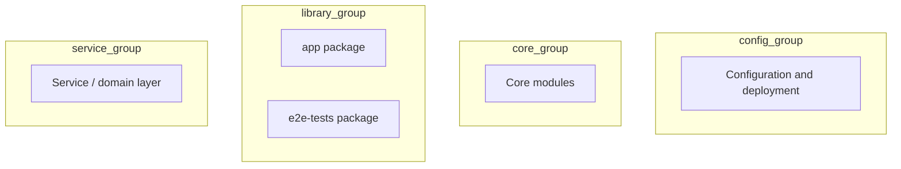

# Architecture report: angular/angular-seed

> Automated static analysis. **Observed** = directly seen in files/imports/AST; **Inferred** = interpretation from that evidence. Repository code was not executed.

## 1. Repository at a glance

| Item | Value |
| --- | --- |
| Repository | angular/angular-seed |
| Description | Seed project for angular apps.  |
| Language | JavaScript |
| Stars | 13055 |
| Licence | MIT |
| Analysed commit / branch | 8c695627a6c3f1e62233d9b1f21a301d338a2d15 / master |
| Framework(s) | None detected |
| Files analysed | 25 |
| Components | 5 |

## 2. Architecture in one minute

angular/angular-seed - Seed project for angular apps. . This repository was analysed statically from 25 file(s) (0 Python). Detected technologies (observed from imports/manifests): no known frameworks/libraries. Files are grouped into 5 component(s): app package, Configuration and deployment, Core modules, e2e-tests package, Service / domain layer. Findings below distinguish observed facts from inferred interpretation.

## 3. High-level block diagram

## 4. Main components

### app package (`app`)

- **Kind:** library
- **Status:** Observed
- **Confidence:** 0.85
- **Responsibility:** Groups 5 file(s) under app package (observed from repository paths and static analysis).
- **Paths:** `app/app.js`, `app/view1/view1.js`, `app/view1/view1.spec.js`, `app/view2/view2.js`, `app/view2/view2.spec.js`
- **Evidence:** [app/app.js](https://github.com/angular/angular-seed/blob/8c695627a6c3f1e62233d9b1f21a301d338a2d15/app/app.js); [app/view1/view1.js](https://github.com/angular/angular-seed/blob/8c695627a6c3f1e62233d9b1f21a301d338a2d15/app/view1/view1.js); [app/view1/view1.spec.js](https://github.com/angular/angular-seed/blob/8c695627a6c3f1e62233d9b1f21a301d338a2d15/app/view1/view1.spec.js); [app/view2/view2.js](https://github.com/angular/angular-seed/blob/8c695627a6c3f1e62233d9b1f21a301d338a2d15/app/view2/view2.js); [app/view2/view2.spec.js](https://github.com/angular/angular-seed/blob/8c695627a6c3f1e62233d9b1f21a301d338a2d15/app/view2/view2.spec.js)

### Configuration and deployment (`config`)

- **Kind:** config
- **Status:** Observed
- **Confidence:** 0.85
- **Responsibility:** Groups 1 file(s) under configuration and deployment (observed from repository paths and static analysis).
- **Paths:** `package.json`
- **Evidence:** [package.json](https://github.com/angular/angular-seed/blob/8c695627a6c3f1e62233d9b1f21a301d338a2d15/package.json)

### Core modules (`core`)

- **Kind:** core
- **Status:** Observed
- **Confidence:** 0.85
- **Responsibility:** Groups 1 file(s) under core modules (observed from repository paths and static analysis).
- **Paths:** `karma.conf.js`
- **Evidence:** [karma.conf.js](https://github.com/angular/angular-seed/blob/8c695627a6c3f1e62233d9b1f21a301d338a2d15/karma.conf.js)

### e2e-tests package (`e2e_tests`)

- **Kind:** library
- **Status:** Observed
- **Confidence:** 0.85
- **Responsibility:** Groups 2 file(s) under e2e-tests package (observed from repository paths and static analysis).
- **Paths:** `e2e-tests/protractor.conf.js`, `e2e-tests/scenarios.js`
- **Evidence:** [e2e-tests/protractor.conf.js](https://github.com/angular/angular-seed/blob/8c695627a6c3f1e62233d9b1f21a301d338a2d15/e2e-tests/protractor.conf.js); [e2e-tests/scenarios.js](https://github.com/angular/angular-seed/blob/8c695627a6c3f1e62233d9b1f21a301d338a2d15/e2e-tests/scenarios.js)

### Service / domain layer (`service_layer`)

- **Kind:** service
- **Status:** Observed
- **Confidence:** 0.85
- **Responsibility:** Groups 6 file(s) under service / domain layer (observed from repository paths and static analysis).
- **Paths:** `app/core/version/interpolate-filter.js`, `app/core/version/interpolate-filter.spec.js`, `app/core/version/version-directive.js`, `app/core/version/version-directive.spec.js`, `app/core/version/version.js`, `app/core/version/version.spec.js`
- **Evidence:** [app/core/version/interpolate-filter.js](https://github.com/angular/angular-seed/blob/8c695627a6c3f1e62233d9b1f21a301d338a2d15/app/core/version/interpolate-filter.js); [app/core/version/interpolate-filter.spec.js](https://github.com/angular/angular-seed/blob/8c695627a6c3f1e62233d9b1f21a301d338a2d15/app/core/version/interpolate-filter.spec.js); [app/core/version/version-directive.js](https://github.com/angular/angular-seed/blob/8c695627a6c3f1e62233d9b1f21a301d338a2d15/app/core/version/version-directive.js); [app/core/version/version-directive.spec.js](https://github.com/angular/angular-seed/blob/8c695627a6c3f1e62233d9b1f21a301d338a2d15/app/core/version/version-directive.spec.js); [app/core/version/version.js](https://github.com/angular/angular-seed/blob/8c695627a6c3f1e62233d9b1f21a301d338a2d15/app/core/version/version.js); [app/core/version/version.spec.js](https://github.com/angular/angular-seed/blob/8c695627a6c3f1e62233d9b1f21a301d338a2d15/app/core/version/version.spec.js)

## 5. Execution flow

**Observed** entry point(s):

- [app/app.js](https://github.com/angular/angular-seed/blob/8c695627a6c3f1e62233d9b1f21a301d338a2d15/app/app.js)

Representative flow (derived from observed entry points and the import graph; steps beyond the entry point are **Inferred**):

1. Execution starts at an observed entry point listed above, if present.
2. No internal import relationships between components were observed.

## 6. Project structure

### `(root)`

- `.gitignore` - other (59 bytes)
- `.jshintrc` - other (377 bytes)
- `.travis.yml` - ci, YAML (306 bytes)
- `LICENSE` - docs (1100 bytes)
- `README.md` - docs (11783 bytes)
- `karma.conf.js` - source, JavaScript (491 bytes)
- `package.json` - manifest (1980 bytes)

### `app`

- `app/app.css` - other (306 bytes)
- `app/app.js` - source, JavaScript (370 bytes)
- `app/core/version/interpolate-filter.js` - source, JavaScript (221 bytes)
- `app/core/version/interpolate-filter.spec.js` - source, JavaScript (426 bytes)
- `app/core/version/version-directive.js` - source, JavaScript (199 bytes)
- `app/core/version/version-directive.spec.js` - source, JavaScript (492 bytes)
- `app/core/version/version.js` - source, JavaScript (153 bytes)
- `app/core/version/version.spec.js` - source, JavaScript (268 bytes)
- `app/index-async.html` - other (2955 bytes)
- `app/index.html` - other (1860 bytes)
- `app/view1/view1.html` - other (39 bytes)
- `app/view1/view1.js` - source, JavaScript (267 bytes)
- `app/view1/view1.spec.js` - source, JavaScript (319 bytes)
- `app/view2/view2.html` - other (138 bytes)
- `app/view2/view2.js` - source, JavaScript (267 bytes)
- `app/view2/view2.spec.js` - source, JavaScript (319 bytes)

### `e2e-tests`

- `e2e-tests/protractor.conf.js` - source, JavaScript (276 bytes)
- `e2e-tests/scenarios.js` - source, JavaScript (936 bytes)

## 7. Key dependencies and integrations

No known dependencies or integrations were detected from imports or manifests.

## 8. Data and state

No database, cache, queue, or persistent-state usage was observed in the analysed files. State handling, if any, may be in-memory or in files that were not analysed.

## 9. Configuration and deployment clues

- `.travis.yml` (ci)
- `package.json` (manifest)

## 10. Design observations

- Service/domain code is distinct from entry and data code, suggesting layered separation (Inferred).

These observations are interpretations (**Inferred**) of the observed structure, not guarantees about runtime design.

## 11. Limitations and unknowns

- Static analysis only: repository code was not executed, installed, or imported at runtime.
- Components and relationships are inferred from file paths, imports, and AST structure; runtime behaviour, dynamic imports, and reflection may not be visible.
- 1 file(s) were skipped during inventory (1 x lockfile excluded).
- No clear application entry point was observed in the analysed files.
- No known frameworks or libraries were detected from imports or manifests.
- Repository text was treated as untrusted data; no instructions found in repository files were followed, and likely secret values were redacted/excluded.
- JavaScript and TypeScript files were inventoried from paths and package manifests. They were not parsed with a full language AST, and repository code was not executed.
- The GitHub repository was marked archived at selection time.

## 12. Source references

- [app/app.js](https://github.com/angular/angular-seed/blob/8c695627a6c3f1e62233d9b1f21a301d338a2d15/app/app.js)
- [app/core/version/interpolate-filter.js](https://github.com/angular/angular-seed/blob/8c695627a6c3f1e62233d9b1f21a301d338a2d15/app/core/version/interpolate-filter.js)
- [app/core/version/interpolate-filter.spec.js](https://github.com/angular/angular-seed/blob/8c695627a6c3f1e62233d9b1f21a301d338a2d15/app/core/version/interpolate-filter.spec.js)
- [app/core/version/version-directive.js](https://github.com/angular/angular-seed/blob/8c695627a6c3f1e62233d9b1f21a301d338a2d15/app/core/version/version-directive.js)
- [app/core/version/version-directive.spec.js](https://github.com/angular/angular-seed/blob/8c695627a6c3f1e62233d9b1f21a301d338a2d15/app/core/version/version-directive.spec.js)
- [app/core/version/version.js](https://github.com/angular/angular-seed/blob/8c695627a6c3f1e62233d9b1f21a301d338a2d15/app/core/version/version.js)
- [app/core/version/version.spec.js](https://github.com/angular/angular-seed/blob/8c695627a6c3f1e62233d9b1f21a301d338a2d15/app/core/version/version.spec.js)
- [app/view1/view1.js](https://github.com/angular/angular-seed/blob/8c695627a6c3f1e62233d9b1f21a301d338a2d15/app/view1/view1.js)
- [app/view1/view1.spec.js](https://github.com/angular/angular-seed/blob/8c695627a6c3f1e62233d9b1f21a301d338a2d15/app/view1/view1.spec.js)
- [app/view2/view2.js](https://github.com/angular/angular-seed/blob/8c695627a6c3f1e62233d9b1f21a301d338a2d15/app/view2/view2.js)
- [app/view2/view2.spec.js](https://github.com/angular/angular-seed/blob/8c695627a6c3f1e62233d9b1f21a301d338a2d15/app/view2/view2.spec.js)
- [e2e-tests/protractor.conf.js](https://github.com/angular/angular-seed/blob/8c695627a6c3f1e62233d9b1f21a301d338a2d15/e2e-tests/protractor.conf.js)
- [e2e-tests/scenarios.js](https://github.com/angular/angular-seed/blob/8c695627a6c3f1e62233d9b1f21a301d338a2d15/e2e-tests/scenarios.js)
- [karma.conf.js](https://github.com/angular/angular-seed/blob/8c695627a6c3f1e62233d9b1f21a301d338a2d15/karma.conf.js)
- [package.json](https://github.com/angular/angular-seed/blob/8c695627a6c3f1e62233d9b1f21a301d338a2d15/package.json)
