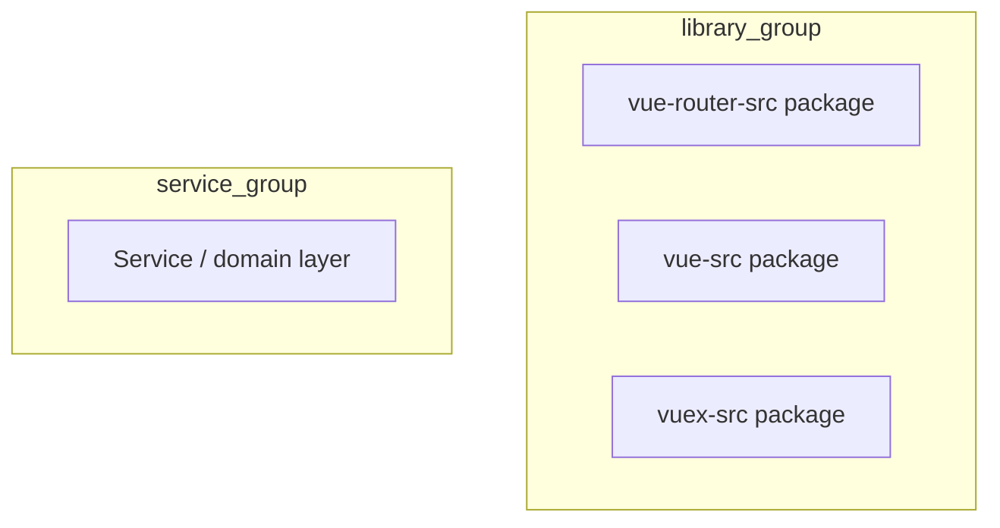

# Architecture report: answershuto/learnVue

> Automated static analysis. **Observed** = directly seen in files/imports/AST; **Inferred** = interpretation from that evidence. Repository code was not executed.

## 1. Repository at a glance

| Item | Value |
| --- | --- |
| Repository | answershuto/learnVue |
| Description | :octocat:Vue.js 源码解析 |
| Language | JavaScript |
| Stars | 12637 |
| Licence | Not detected |
| Analysed commit / branch | 1c0371909bbc1a4d9954470513c8ef6b408ef42f / master |
| Framework(s) | None detected |
| Files analysed | 201 |
| Components | 4 |

## 2. Architecture in one minute

answershuto/learnVue - :octocat:Vue.js 源码解析. This repository was analysed statically from 201 file(s) (0 Python). Detected technologies (observed from imports/manifests): no known frameworks/libraries. Files are grouped into 4 component(s): Service / domain layer, vue-router-src package, vue-src package, vuex-src package. Findings below distinguish observed facts from inferred interpretation.

## 3. High-level block diagram

## 4. Main components

### Service / domain layer (`service_layer`)

- **Kind:** service
- **Status:** Observed
- **Confidence:** 0.85
- **Responsibility:** Groups 52 file(s) under service / domain layer (observed from repository paths and static analysis).
- **Paths:** `vue-src/core/components/index.js`, `vue-src/core/components/keep-alive.js`, `vue-src/core/config.js`, `vue-src/core/global-api/assets.js`, `vue-src/core/global-api/extend.js`, `vue-src/core/global-api/index.js`, `vue-src/core/global-api/mixin.js`, `vue-src/core/global-api/use.js`, `vue-src/core/index.js`, `vue-src/core/instance/events.js`, `vue-src/core/instance/index.js`, `vue-src/core/instance/init.js`, `vue-src/core/instance/inject.js`, `vue-src/core/instance/lifecycle.js`, `vue-src/core/instance/proxy.js`, `vue-src/core/instance/render-helpers/bind-object-props.js`, `vue-src/core/instance/render-helpers/check-keycodes.js`, `vue-src/core/instance/render-helpers/render-list.js`, `vue-src/core/instance/render-helpers/render-slot.js`, `vue-src/core/instance/render-helpers/render-static.js`, `vue-src/core/instance/render-helpers/resolve-filter.js`, `vue-src/core/instance/render-helpers/resolve-slots.js`, `vue-src/core/instance/render.js`, `vue-src/core/instance/state.js`, `vue-src/core/observer/array.js`, `vue-src/core/observer/dep.js`, `vue-src/core/observer/index.js`, `vue-src/core/observer/scheduler.js`, `vue-src/core/observer/watcher.js`, `vue-src/core/util/debug.js`, `vue-src/core/util/env.js`, `vue-src/core/util/error.js`, `vue-src/core/util/index.js`, `vue-src/core/util/lang.js`, `vue-src/core/util/options.js`, `vue-src/core/util/perf.js`, `vue-src/core/util/props.js`, `vue-src/core/vdom/create-component.js`, `vue-src/core/vdom/create-element.js`, `vue-src/core/vdom/create-functional-component.js`, `vue-src/core/vdom/helpers/extract-props.js`, `vue-src/core/vdom/helpers/get-first-component-child.js`, `vue-src/core/vdom/helpers/index.js`, `vue-src/core/vdom/helpers/merge-hook.js`, `vue-src/core/vdom/helpers/normalize-children.js`, `vue-src/core/vdom/helpers/resolve-async-component.js`, `vue-src/core/vdom/helpers/update-listeners.js`, `vue-src/core/vdom/modules/directives.js`, `vue-src/core/vdom/modules/index.js`, `vue-src/core/vdom/modules/ref.js`, `vue-src/core/vdom/patch.js`, `vue-src/core/vdom/vnode.js`
- **Evidence:** [vue-src/core/components/index.js](https://github.com/answershuto/learnVue/blob/1c0371909bbc1a4d9954470513c8ef6b408ef42f/vue-src/core/components/index.js); [vue-src/core/components/keep-alive.js](https://github.com/answershuto/learnVue/blob/1c0371909bbc1a4d9954470513c8ef6b408ef42f/vue-src/core/components/keep-alive.js); [vue-src/core/config.js](https://github.com/answershuto/learnVue/blob/1c0371909bbc1a4d9954470513c8ef6b408ef42f/vue-src/core/config.js); [vue-src/core/global-api/assets.js](https://github.com/answershuto/learnVue/blob/1c0371909bbc1a4d9954470513c8ef6b408ef42f/vue-src/core/global-api/assets.js); [vue-src/core/global-api/extend.js](https://github.com/answershuto/learnVue/blob/1c0371909bbc1a4d9954470513c8ef6b408ef42f/vue-src/core/global-api/extend.js); [vue-src/core/global-api/index.js](https://github.com/answershuto/learnVue/blob/1c0371909bbc1a4d9954470513c8ef6b408ef42f/vue-src/core/global-api/index.js); [vue-src/core/global-api/mixin.js](https://github.com/answershuto/learnVue/blob/1c0371909bbc1a4d9954470513c8ef6b408ef42f/vue-src/core/global-api/mixin.js); [vue-src/core/global-api/use.js](https://github.com/answershuto/learnVue/blob/1c0371909bbc1a4d9954470513c8ef6b408ef42f/vue-src/core/global-api/use.js)

### vue-router-src package (`vue_router_src`)

- **Kind:** library
- **Status:** Observed
- **Confidence:** 0.85
- **Responsibility:** Groups 21 file(s) under vue-router-src package (observed from repository paths and static analysis).
- **Paths:** `vue-router-src/components/link.js`, `vue-router-src/components/view.js`, `vue-router-src/create-matcher.js`, `vue-router-src/create-route-map.js`, `vue-router-src/history/abstract.js`, `vue-router-src/history/base.js`, `vue-router-src/history/hash.js`, `vue-router-src/history/html5.js`, `vue-router-src/index.js`, `vue-router-src/install.js`, `vue-router-src/util/async.js`, `vue-router-src/util/dom.js`, `vue-router-src/util/location.js`, `vue-router-src/util/params.js`, `vue-router-src/util/path.js`, `vue-router-src/util/push-state.js`, `vue-router-src/util/query.js`, `vue-router-src/util/resolve-components.js`, `vue-router-src/util/route.js`, `vue-router-src/util/scroll.js`, `vue-router-src/util/warn.js`
- **Evidence:** [vue-router-src/components/link.js](https://github.com/answershuto/learnVue/blob/1c0371909bbc1a4d9954470513c8ef6b408ef42f/vue-router-src/components/link.js); [vue-router-src/components/view.js](https://github.com/answershuto/learnVue/blob/1c0371909bbc1a4d9954470513c8ef6b408ef42f/vue-router-src/components/view.js); [vue-router-src/create-matcher.js](https://github.com/answershuto/learnVue/blob/1c0371909bbc1a4d9954470513c8ef6b408ef42f/vue-router-src/create-matcher.js); [vue-router-src/create-route-map.js](https://github.com/answershuto/learnVue/blob/1c0371909bbc1a4d9954470513c8ef6b408ef42f/vue-router-src/create-route-map.js); [vue-router-src/history/abstract.js](https://github.com/answershuto/learnVue/blob/1c0371909bbc1a4d9954470513c8ef6b408ef42f/vue-router-src/history/abstract.js); [vue-router-src/history/base.js](https://github.com/answershuto/learnVue/blob/1c0371909bbc1a4d9954470513c8ef6b408ef42f/vue-router-src/history/base.js); [vue-router-src/history/hash.js](https://github.com/answershuto/learnVue/blob/1c0371909bbc1a4d9954470513c8ef6b408ef42f/vue-router-src/history/hash.js); [vue-router-src/history/html5.js](https://github.com/answershuto/learnVue/blob/1c0371909bbc1a4d9954470513c8ef6b408ef42f/vue-router-src/history/html5.js)

### vue-src package (`vue_src`)

- **Kind:** library
- **Status:** Observed
- **Confidence:** 0.85
- **Responsibility:** Groups 104 file(s) under vue-src package (observed from repository paths and static analysis).
- **Paths:** `vue-src/compiler/codegen/events.js`, `vue-src/compiler/codegen/index.js`, `vue-src/compiler/directives/bind.js`, `vue-src/compiler/directives/index.js`, `vue-src/compiler/directives/model.js`, `vue-src/compiler/error-detector.js`, `vue-src/compiler/helpers.js`, `vue-src/compiler/index.js`, `vue-src/compiler/optimizer.js`, `vue-src/compiler/parser/entity-decoder.js`, `vue-src/compiler/parser/filter-parser.js`, `vue-src/compiler/parser/html-parser.js`, `vue-src/compiler/parser/index.js`, `vue-src/compiler/parser/text-parser.js`, `vue-src/platforms/web/compiler.js`, `vue-src/platforms/web/compiler/directives/html.js`, `vue-src/platforms/web/compiler/directives/index.js`, `vue-src/platforms/web/compiler/directives/model.js`, `vue-src/platforms/web/compiler/directives/text.js`, `vue-src/platforms/web/compiler/index.js`, `vue-src/platforms/web/compiler/modules/class.js`, `vue-src/platforms/web/compiler/modules/index.js`, `vue-src/platforms/web/compiler/modules/style.js`, `vue-src/platforms/web/compiler/util.js`, `vue-src/platforms/web/runtime-with-compiler.js`, `vue-src/platforms/web/runtime.js`, `vue-src/platforms/web/runtime/class-util.js`, `vue-src/platforms/web/runtime/components/index.js`, `vue-src/platforms/web/runtime/components/transition-group.js`, `vue-src/platforms/web/runtime/components/transition.js`, `vue-src/platforms/web/runtime/directives/index.js`, `vue-src/platforms/web/runtime/directives/model.js`, `vue-src/platforms/web/runtime/directives/show.js`, `vue-src/platforms/web/runtime/index.js`, `vue-src/platforms/web/runtime/modules/attrs.js`, `vue-src/platforms/web/runtime/modules/class.js`, `vue-src/platforms/web/runtime/modules/dom-props.js`, `vue-src/platforms/web/runtime/modules/events.js`, `vue-src/platforms/web/runtime/modules/index.js`, `vue-src/platforms/web/runtime/modules/style.js`, `vue-src/platforms/web/runtime/modules/transition.js`, `vue-src/platforms/web/runtime/node-ops.js`, `vue-src/platforms/web/runtime/patch.js`, `vue-src/platforms/web/runtime/transition-util.js`, `vue-src/platforms/web/server-renderer.js`, `vue-src/platforms/web/server/directives/index.js`, `vue-src/platforms/web/server/directives/show.js`, `vue-src/platforms/web/server/modules/attrs.js`, `vue-src/platforms/web/server/modules/class.js`, `vue-src/platforms/web/server/modules/dom-props.js`, `vue-src/platforms/web/server/modules/index.js`, `vue-src/platforms/web/server/modules/style.js`, `vue-src/platforms/web/server/util.js`, `vue-src/platforms/web/util/attrs.js`, `vue-src/platforms/web/util/class.js`, `vue-src/platforms/web/util/compat.js`, `vue-src/platforms/web/util/element.js`, `vue-src/platforms/web/util/index.js`, `vue-src/platforms/web/util/style.js`, `vue-src/platforms/weex/compiler.js`, `vue-src/platforms/weex/compiler/directives/index.js`, `vue-src/platforms/weex/compiler/directives/model.js`, `vue-src/platforms/weex/compiler/index.js`, `vue-src/platforms/weex/compiler/modules/append.js`, `vue-src/platforms/weex/compiler/modules/class.js`, `vue-src/platforms/weex/compiler/modules/index.js`, `vue-src/platforms/weex/compiler/modules/props.js`, `vue-src/platforms/weex/compiler/modules/style.js`, `vue-src/platforms/weex/framework.js`, `vue-src/platforms/weex/runtime-factory.js`, `vue-src/platforms/weex/runtime/components/index.js`, `vue-src/platforms/weex/runtime/components/transition-group.js`, `vue-src/platforms/weex/runtime/components/transition.js`, `vue-src/platforms/weex/runtime/directives/index.js`, `vue-src/platforms/weex/runtime/index.js`, `vue-src/platforms/weex/runtime/modules/attrs.js`, `vue-src/platforms/weex/runtime/modules/class.js`, `vue-src/platforms/weex/runtime/modules/events.js`, `vue-src/platforms/weex/runtime/modules/index.js`, `vue-src/platforms/weex/runtime/modules/style.js`, `vue-src/platforms/weex/runtime/modules/transition.js`, `vue-src/platforms/weex/runtime/node-ops.js`, `vue-src/platforms/weex/runtime/patch.js`, `vue-src/platforms/weex/runtime/text-node.js`, `vue-src/platforms/weex/util/index.js`, `vue-src/server/bundle-renderer/create-bundle-renderer.js`, `vue-src/server/bundle-renderer/create-bundle-runner.js`, `vue-src/server/bundle-renderer/source-map-support.js`, `vue-src/server/create-renderer.js`, `vue-src/server/render-context.js`, `vue-src/server/render-stream.js`, `vue-src/server/render.js`, `vue-src/server/template-renderer/create-async-file-mapper.js`, `vue-src/server/template-renderer/index.js`, `vue-src/server/template-renderer/parse-template.js`, `vue-src/server/template-renderer/template-stream.js`, `vue-src/server/util.js`, `vue-src/server/webpack-plugin/client.js`, `vue-src/server/webpack-plugin/server.js`, `vue-src/server/webpack-plugin/util.js`, `vue-src/server/write.js`, `vue-src/sfc/parser.js`, `vue-src/shared/constants.js`, `vue-src/shared/util.js`
- **Evidence:** [vue-src/compiler/codegen/events.js](https://github.com/answershuto/learnVue/blob/1c0371909bbc1a4d9954470513c8ef6b408ef42f/vue-src/compiler/codegen/events.js); [vue-src/compiler/codegen/index.js](https://github.com/answershuto/learnVue/blob/1c0371909bbc1a4d9954470513c8ef6b408ef42f/vue-src/compiler/codegen/index.js); [vue-src/compiler/directives/bind.js](https://github.com/answershuto/learnVue/blob/1c0371909bbc1a4d9954470513c8ef6b408ef42f/vue-src/compiler/directives/bind.js); [vue-src/compiler/directives/index.js](https://github.com/answershuto/learnVue/blob/1c0371909bbc1a4d9954470513c8ef6b408ef42f/vue-src/compiler/directives/index.js); [vue-src/compiler/directives/model.js](https://github.com/answershuto/learnVue/blob/1c0371909bbc1a4d9954470513c8ef6b408ef42f/vue-src/compiler/directives/model.js); [vue-src/compiler/error-detector.js](https://github.com/answershuto/learnVue/blob/1c0371909bbc1a4d9954470513c8ef6b408ef42f/vue-src/compiler/error-detector.js); [vue-src/compiler/helpers.js](https://github.com/answershuto/learnVue/blob/1c0371909bbc1a4d9954470513c8ef6b408ef42f/vue-src/compiler/helpers.js); [vue-src/compiler/index.js](https://github.com/answershuto/learnVue/blob/1c0371909bbc1a4d9954470513c8ef6b408ef42f/vue-src/compiler/index.js)

### vuex-src package (`vuex_src`)

- **Kind:** library
- **Status:** Observed
- **Confidence:** 0.85
- **Responsibility:** Groups 10 file(s) under vuex-src package (observed from repository paths and static analysis).
- **Paths:** `vuex-src/helpers.js`, `vuex-src/index.esm.js`, `vuex-src/index.js`, `vuex-src/mixin.js`, `vuex-src/module/module-collection.js`, `vuex-src/module/module.js`, `vuex-src/plugins/devtool.js`, `vuex-src/plugins/logger.js`, `vuex-src/store.js`, `vuex-src/util.js`
- **Evidence:** [vuex-src/helpers.js](https://github.com/answershuto/learnVue/blob/1c0371909bbc1a4d9954470513c8ef6b408ef42f/vuex-src/helpers.js); [vuex-src/index.esm.js](https://github.com/answershuto/learnVue/blob/1c0371909bbc1a4d9954470513c8ef6b408ef42f/vuex-src/index.esm.js); [vuex-src/index.js](https://github.com/answershuto/learnVue/blob/1c0371909bbc1a4d9954470513c8ef6b408ef42f/vuex-src/index.js); [vuex-src/mixin.js](https://github.com/answershuto/learnVue/blob/1c0371909bbc1a4d9954470513c8ef6b408ef42f/vuex-src/mixin.js); [vuex-src/module/module-collection.js](https://github.com/answershuto/learnVue/blob/1c0371909bbc1a4d9954470513c8ef6b408ef42f/vuex-src/module/module-collection.js); [vuex-src/module/module.js](https://github.com/answershuto/learnVue/blob/1c0371909bbc1a4d9954470513c8ef6b408ef42f/vuex-src/module/module.js); [vuex-src/plugins/devtool.js](https://github.com/answershuto/learnVue/blob/1c0371909bbc1a4d9954470513c8ef6b408ef42f/vuex-src/plugins/devtool.js); [vuex-src/plugins/logger.js](https://github.com/answershuto/learnVue/blob/1c0371909bbc1a4d9954470513c8ef6b408ef42f/vuex-src/plugins/logger.js)

## 5. Execution flow

**Observed** entry point(s):

- [vue-router-src/index.js](https://github.com/answershuto/learnVue/blob/1c0371909bbc1a4d9954470513c8ef6b408ef42f/vue-router-src/index.js)
- [vue-src/compiler/codegen/index.js](https://github.com/answershuto/learnVue/blob/1c0371909bbc1a4d9954470513c8ef6b408ef42f/vue-src/compiler/codegen/index.js)
- [vue-src/compiler/directives/index.js](https://github.com/answershuto/learnVue/blob/1c0371909bbc1a4d9954470513c8ef6b408ef42f/vue-src/compiler/directives/index.js)
- [vue-src/compiler/index.js](https://github.com/answershuto/learnVue/blob/1c0371909bbc1a4d9954470513c8ef6b408ef42f/vue-src/compiler/index.js)
- [vue-src/compiler/parser/index.js](https://github.com/answershuto/learnVue/blob/1c0371909bbc1a4d9954470513c8ef6b408ef42f/vue-src/compiler/parser/index.js)
- [vue-src/core/components/index.js](https://github.com/answershuto/learnVue/blob/1c0371909bbc1a4d9954470513c8ef6b408ef42f/vue-src/core/components/index.js)
- [vue-src/core/global-api/index.js](https://github.com/answershuto/learnVue/blob/1c0371909bbc1a4d9954470513c8ef6b408ef42f/vue-src/core/global-api/index.js)
- [vue-src/core/index.js](https://github.com/answershuto/learnVue/blob/1c0371909bbc1a4d9954470513c8ef6b408ef42f/vue-src/core/index.js)
- [vue-src/core/instance/index.js](https://github.com/answershuto/learnVue/blob/1c0371909bbc1a4d9954470513c8ef6b408ef42f/vue-src/core/instance/index.js)
- [vue-src/core/observer/index.js](https://github.com/answershuto/learnVue/blob/1c0371909bbc1a4d9954470513c8ef6b408ef42f/vue-src/core/observer/index.js)
- [vue-src/core/util/index.js](https://github.com/answershuto/learnVue/blob/1c0371909bbc1a4d9954470513c8ef6b408ef42f/vue-src/core/util/index.js)
- [vue-src/server/template-renderer/index.js](https://github.com/answershuto/learnVue/blob/1c0371909bbc1a4d9954470513c8ef6b408ef42f/vue-src/server/template-renderer/index.js)

Representative flow (derived from observed entry points and the import graph; steps beyond the entry point are **Inferred**):

1. Execution starts at an observed entry point listed above, if present.
2. No internal import relationships between components were observed.

## 6. Project structure

### `(root)`

- `README.md` - docs (2623 bytes)

### `docs`

- `docs/VNode节点.MarkDown` - docs (13135 bytes)
- `docs/VirtualDOM与diff(Vue实现).MarkDown` - docs (27183 bytes)
- `docs/Vue.js异步更新DOM策略及nextTick.MarkDown` - docs (15541 bytes)
- `docs/Vuex源码解析.MarkDown` - docs (25733 bytes)
- `docs/Vue事件机制.MarkDown` - docs (4770 bytes)
- `docs/Vue组件间通信.MarkDown` - docs (5269 bytes)
- `docs/从template到DOM(Vue.js源码角度看内部运行机制).MarkDown` - docs (37511 bytes)
- `docs/从源码角度再看数据绑定.MarkDown` - docs (24839 bytes)
- `docs/依赖收集.MarkDown` - docs (3443 bytes)
- `docs/响应式原理.MarkDown` - docs (3084 bytes)
- `docs/聊聊Vue的template编译.MarkDown` - docs (18146 bytes)
- `docs/聊聊keep-alive组件的使用及其实现原理.MarkDown` - docs (7524 bytes)
- `docs/说说element组件库broadcast与dispatch.MarkDown` - docs (2664 bytes)

### `vue-router-src`

- `vue-router-src/components/link.js` - source, JavaScript (3803 bytes)
- `vue-router-src/components/view.js` - source, JavaScript (4618 bytes)
- `vue-router-src/create-matcher.js` - source, JavaScript (5703 bytes)
- `vue-router-src/create-route-map.js` - source, JavaScript (4847 bytes)
- `vue-router-src/history/abstract.js` - source, JavaScript (1260 bytes)
- `vue-router-src/history/base.js` - source, JavaScript (8568 bytes)
- `vue-router-src/history/hash.js` - source, JavaScript (3286 bytes)
- `vue-router-src/history/html5.js` - source, JavaScript (2422 bytes)
- `vue-router-src/index.js` - source, JavaScript (6027 bytes)
- `vue-router-src/install.js` - source, JavaScript (2452 bytes)
- `vue-router-src/util/async.js` - source, JavaScript (349 bytes)
- `vue-router-src/util/dom.js` - source, JavaScript (68 bytes)
- `vue-router-src/util/location.js` - source, JavaScript (1695 bytes)
- `vue-router-src/util/params.js` - source, JavaScript (599 bytes)
- `vue-router-src/util/path.js` - source, JavaScript (1428 bytes)
- `vue-router-src/util/push-state.js` - source, JavaScript (1415 bytes)
- `vue-router-src/util/query.js` - source, JavaScript (2167 bytes)
- `vue-router-src/util/resolve-components.js` - source, JavaScript (2990 bytes)
- `vue-router-src/util/route.js` - source, JavaScript (3225 bytes)
- `vue-router-src/util/scroll.js` - source, JavaScript (3224 bytes)
- `vue-router-src/util/warn.js` - source, JavaScript (464 bytes)

### `vue-src`

- `vue-src/compiler/codegen/events.js` - source, JavaScript (3610 bytes)
- `vue-src/compiler/codegen/index.js` - source, JavaScript (13450 bytes)
- `vue-src/compiler/directives/bind.js` - source, JavaScript (278 bytes)
- `vue-src/compiler/directives/index.js` - source, JavaScript (157 bytes)
- `vue-src/compiler/directives/model.js` - source, JavaScript (2894 bytes)
- `vue-src/compiler/error-detector.js` - source, JavaScript (3343 bytes)
- `vue-src/compiler/helpers.js` - source, JavaScript (3406 bytes)
- `vue-src/compiler/index.js` - source, JavaScript (6110 bytes)
- `vue-src/compiler/optimizer.js` - source, JavaScript (4896 bytes)
- `vue-src/compiler/parser/entity-decoder.js` - source, JavaScript (185 bytes)
- `vue-src/compiler/parser/filter-parser.js` - source, JavaScript (2804 bytes)
- `vue-src/compiler/parser/html-parser.js` - source, JavaScript (9224 bytes)
- `vue-src/compiler/parser/index.js` - source, JavaScript (22774 bytes)
- `vue-src/compiler/parser/text-parser.js` - source, JavaScript (1179 bytes)
- `vue-src/core/components/index.js` - source, JavaScript (69 bytes)
- `vue-src/core/components/keep-alive.js` - source, JavaScript (3574 bytes)
- `vue-src/core/config.js` - source, JavaScript (2366 bytes)
- `vue-src/core/global-api/assets.js` - source, JavaScript (1220 bytes)
- `vue-src/core/global-api/extend.js` - source, JavaScript (5167 bytes)
- `vue-src/core/global-api/index.js` - source, JavaScript (1601 bytes)
- `vue-src/core/global-api/mixin.js` - source, JavaScript (305 bytes)
- `vue-src/core/global-api/use.js` - source, JavaScript (698 bytes)
- `vue-src/core/index.js` - source, JavaScript (286 bytes)
- `vue-src/core/instance/events.js` - source, JavaScript (4905 bytes)
- `vue-src/core/instance/index.js` - source, JavaScript (603 bytes)
- `vue-src/core/instance/init.js` - source, JavaScript (5565 bytes)
- `vue-src/core/instance/inject.js` - source, JavaScript (1898 bytes)
- `vue-src/core/instance/lifecycle.js` - source, JavaScript (9740 bytes)
- `vue-src/core/instance/proxy.js` - source, JavaScript (2322 bytes)
- `vue-src/core/instance/render-helpers/bind-object-props.js` - source, JavaScript (1204 bytes)
- `vue-src/core/instance/render-helpers/check-keycodes.js` - source, JavaScript (484 bytes)
- `vue-src/core/instance/render-helpers/render-list.js` - source, JavaScript (824 bytes)
- `vue-src/core/instance/render-helpers/render-slot.js` - source, JavaScript (886 bytes)
- `vue-src/core/instance/render-helpers/render-static.js` - source, JavaScript (1836 bytes)
- `vue-src/core/instance/render-helpers/resolve-filter.js` - source, JavaScript (265 bytes)
- `vue-src/core/instance/render-helpers/resolve-slots.js` - source, JavaScript (1324 bytes)
- `vue-src/core/instance/render.js` - source, JavaScript (5526 bytes)
- `vue-src/core/instance/state.js` - source, JavaScript (13149 bytes)
- `vue-src/core/observer/array.js` - source, JavaScript (1816 bytes)
- `vue-src/core/observer/dep.js` - source, JavaScript (1564 bytes)
- `vue-src/core/observer/index.js` - source, JavaScript (10844 bytes)
- `vue-src/core/observer/scheduler.js` - source, JavaScript (5846 bytes)
- `vue-src/core/observer/watcher.js` - source, JavaScript (8567 bytes)
- `vue-src/core/util/debug.js` - source, JavaScript (2610 bytes)
- `vue-src/core/util/env.js` - source, JavaScript (7648 bytes)
- `vue-src/core/util/error.js` - source, JavaScript (529 bytes)
- `vue-src/core/util/index.js` - source, JavaScript (235 bytes)
- `vue-src/core/util/lang.js` - source, JavaScript (810 bytes)
- `vue-src/core/util/options.js` - source, JavaScript (9339 bytes)
- `vue-src/core/util/perf.js` - source, JavaScript (523 bytes)
- `vue-src/core/util/props.js` - source, JavaScript (5851 bytes)
- `vue-src/core/vdom/create-component.js` - source, JavaScript (7422 bytes)
- `vue-src/core/vdom/create-element.js` - source, JavaScript (4442 bytes)
- `vue-src/core/vdom/create-functional-component.js` - source, JavaScript (1569 bytes)
- `vue-src/core/vdom/helpers/extract-props.js` - source, JavaScript (1852 bytes)
- `vue-src/core/vdom/helpers/get-first-component-child.js` - source, JavaScript (353 bytes)
- `vue-src/core/vdom/helpers/index.js` - source, JavaScript (232 bytes)
- `vue-src/core/vdom/helpers/merge-hook.js` - source, JavaScript (901 bytes)
- `vue-src/core/vdom/helpers/normalize-children.js` - source, JavaScript (2629 bytes)
- `vue-src/core/vdom/helpers/resolve-async-component.js` - source, JavaScript (2964 bytes)
- `vue-src/core/vdom/helpers/update-listeners.js` - source, JavaScript (2327 bytes)
- `vue-src/core/vdom/modules/directives.js` - source, JavaScript (3103 bytes)
- `vue-src/core/vdom/modules/index.js` - source, JavaScript (102 bytes)
- `vue-src/core/vdom/modules/ref.js` - source, JavaScript (1370 bytes)
- `vue-src/core/vdom/patch.js` - source, JavaScript (29105 bytes)
- `vue-src/core/vdom/vnode.js` - source, JavaScript (3751 bytes)
- `vue-src/platforms/web/compiler.js` - source, JavaScript (120 bytes)
- `vue-src/platforms/web/compiler/directives/html.js` - source, JavaScript (239 bytes)
- `vue-src/platforms/web/compiler/directives/index.js` - source, JavaScript (124 bytes)
- `vue-src/platforms/web/compiler/directives/model.js` - source, JavaScript (5116 bytes)
- `vue-src/platforms/web/compiler/directives/text.js` - source, JavaScript (241 bytes)
- `vue-src/platforms/web/compiler/index.js` - source, JavaScript (746 bytes)
- `vue-src/platforms/web/compiler/modules/class.js` - source, JavaScript (1241 bytes)
- `vue-src/platforms/web/compiler/modules/index.js` - source, JavaScript (93 bytes)
- `vue-src/platforms/web/compiler/modules/style.js` - source, JavaScript (1344 bytes)
- `vue-src/platforms/web/compiler/util.js` - source, JavaScript (986 bytes)
- `vue-src/platforms/web/runtime-with-compiler.js` - source, JavaScript (3605 bytes)
- `vue-src/platforms/web/runtime.js` - source, JavaScript (108 bytes)
- `vue-src/platforms/web/runtime/class-util.js` - source, JavaScript (1282 bytes)
- `vue-src/platforms/web/runtime/components/index.js` - source, JavaScript (139 bytes)
- `vue-src/platforms/web/runtime/components/transition-group.js` - source, JavaScript (5543 bytes)
- `vue-src/platforms/web/runtime/components/transition.js` - source, JavaScript (5278 bytes)
- `vue-src/platforms/web/runtime/directives/index.js` - source, JavaScript (90 bytes)
- `vue-src/platforms/web/runtime/directives/model.js` - source, JavaScript (3688 bytes)
- `vue-src/platforms/web/runtime/directives/show.js` - source, JavaScript (1703 bytes)
- `vue-src/platforms/web/runtime/index.js` - source, JavaScript (2116 bytes)
- `vue-src/platforms/web/runtime/modules/attrs.js` - source, JavaScript (2377 bytes)
- `vue-src/platforms/web/runtime/modules/class.js` - source, JavaScript (913 bytes)
- `vue-src/platforms/web/runtime/modules/dom-props.js` - source, JavaScript (2470 bytes)
- `vue-src/platforms/web/runtime/modules/events.js` - source, JavaScript (2250 bytes)
- `vue-src/platforms/web/runtime/modules/index.js` - source, JavaScript (269 bytes)
- `vue-src/platforms/web/runtime/modules/style.js` - source, JavaScript (2686 bytes)
- `vue-src/platforms/web/runtime/modules/transition.js` - source, JavaScript (8130 bytes)
- `vue-src/platforms/web/runtime/node-ops.js` - source, JavaScript (1748 bytes)
- `vue-src/platforms/web/runtime/patch.js` - source, JavaScript (445 bytes)
- `vue-src/platforms/web/runtime/transition-util.js` - source, JavaScript (4940 bytes)
- `vue-src/platforms/web/server-renderer.js` - source, JavaScript (863 bytes)
- `vue-src/platforms/web/server/directives/index.js` - source, JavaScript (53 bytes)
- `vue-src/platforms/web/server/directives/show.js` - source, JavaScript (246 bytes)
- `vue-src/platforms/web/server/modules/attrs.js` - source, JavaScript (1152 bytes)
- `vue-src/platforms/web/server/modules/class.js` - source, JavaScript (279 bytes)
- `vue-src/platforms/web/server/modules/dom-props.js` - source, JavaScript (1209 bytes)
- `vue-src/platforms/web/server/modules/index.js` - source, JavaScript (177 bytes)
- `vue-src/platforms/web/server/modules/style.js` - source, JavaScript (773 bytes)
- `vue-src/platforms/web/server/util.js` - source, JavaScript (1400 bytes)
- `vue-src/platforms/web/util/attrs.js` - source, JavaScript (1564 bytes)
- `vue-src/platforms/web/util/class.js` - source, JavaScript (1872 bytes)
- `vue-src/platforms/web/util/compat.js` - source, JavaScript (497 bytes)
- `vue-src/platforms/web/util/element.js` - source, JavaScript (2423 bytes)
- `vue-src/platforms/web/util/index.js` - source, JavaScript (594 bytes)
- `vue-src/platforms/web/util/style.js` - source, JavaScript (1895 bytes)
- `vue-src/platforms/weex/compiler.js` - source, JavaScript (46 bytes)
- `vue-src/platforms/weex/compiler/directives/index.js` - source, JavaScript (56 bytes)
- `vue-src/platforms/weex/compiler/directives/model.js` - source, JavaScript (902 bytes)
- `vue-src/platforms/weex/compiler/index.js` - source, JavaScript (638 bytes)
- `vue-src/platforms/weex/compiler/modules/append.js` - source, JavaScript (512 bytes)
- `vue-src/platforms/weex/compiler/modules/class.js` - source, JavaScript (1923 bytes)
- `vue-src/platforms/weex/compiler/modules/index.js` - source, JavaScript (170 bytes)
- `vue-src/platforms/weex/compiler/modules/props.js` - source, JavaScript (793 bytes)
- `vue-src/platforms/weex/compiler/modules/style.js` - source, JavaScript (2249 bytes)
- `vue-src/platforms/weex/framework.js` - source, JavaScript (11916 bytes)
- `vue-src/platforms/weex/runtime-factory.js` - source, JavaScript (178 bytes)
- `vue-src/platforms/weex/runtime/components/index.js` - source, JavaScript (139 bytes)
- `vue-src/platforms/weex/runtime/components/transition-group.js` - source, JavaScript (3965 bytes)
- `vue-src/platforms/weex/runtime/components/transition.js` - source, JavaScript (232 bytes)
- `vue-src/platforms/weex/runtime/directives/index.js` - source, JavaScript (19 bytes)
- `vue-src/platforms/weex/runtime/index.js` - source, JavaScript (945 bytes)
- `vue-src/platforms/weex/runtime/modules/attrs.js` - source, JavaScript (744 bytes)
- `vue-src/platforms/weex/runtime/modules/class.js` - source, JavaScript (1687 bytes)
- `vue-src/platforms/weex/runtime/modules/events.js` - source, JavaScript (1165 bytes)
- `vue-src/platforms/weex/runtime/modules/index.js` - source, JavaScript (222 bytes)
- `vue-src/platforms/weex/runtime/modules/style.js` - source, JavaScript (1483 bytes)
- `vue-src/platforms/weex/runtime/modules/transition.js` - source, JavaScript (7394 bytes)
- `vue-src/platforms/weex/runtime/node-ops.js` - source, JavaScript (1917 bytes)
- `vue-src/platforms/weex/runtime/patch.js` - source, JavaScript (478 bytes)
- `vue-src/platforms/weex/runtime/text-node.js` - source, JavaScript (184 bytes)
- `vue-src/platforms/weex/util/index.js` - source, JavaScript (1374 bytes)
- `vue-src/server/bundle-renderer/create-bundle-renderer.js` - source, JavaScript (4039 bytes)
- `vue-src/server/bundle-renderer/create-bundle-runner.js` - source, JavaScript (3998 bytes)
- `vue-src/server/bundle-renderer/source-map-support.js` - source, JavaScript (1238 bytes)
- `vue-src/server/create-renderer.js` - source, JavaScript (2621 bytes)
- `vue-src/server/render-context.js` - source, JavaScript (3318 bytes)
- `vue-src/server/render-stream.js` - source, JavaScript (2132 bytes)
- `vue-src/server/render.js` - source, JavaScript (8085 bytes)
- `vue-src/server/template-renderer/create-async-file-mapper.js` - source, JavaScript (1469 bytes)
- `vue-src/server/template-renderer/index.js` - source, JavaScript (7552 bytes)
- `vue-src/server/template-renderer/parse-template.js` - source, JavaScript (951 bytes)
- `vue-src/server/template-renderer/template-stream.js` - source, JavaScript (1929 bytes)
- `vue-src/server/util.js` - source, JavaScript (168 bytes)
- `vue-src/server/webpack-plugin/client.js` - source, JavaScript (2215 bytes)
- `vue-src/server/webpack-plugin/server.js` - source, JavaScript (1775 bytes)
- `vue-src/server/webpack-plugin/util.js` - source, JavaScript (769 bytes)
- `vue-src/server/write.js` - source, JavaScript (789 bytes)
- `vue-src/sfc/parser.js` - source, JavaScript (2880 bytes)
- `vue-src/shared/constants.js` - source, JavaScript (403 bytes)
- `vue-src/shared/util.js` - source, JavaScript (6928 bytes)

### `vuex-src`

- `vuex-src/helpers.js` - source, JavaScript (4532 bytes)
- `vuex-src/index.esm.js` - source, JavaScript (403 bytes)
- `vuex-src/index.js` - source, JavaScript (289 bytes)
- `vuex-src/mixin.js` - source, JavaScript (1361 bytes)
- `vuex-src/module/module-collection.js` - source, JavaScript (3544 bytes)
- `vuex-src/module/module.js` - source, JavaScript (1648 bytes)
- `vuex-src/plugins/devtool.js` - source, JavaScript (788 bytes)
- `vuex-src/plugins/logger.js` - source, JavaScript (1740 bytes)
- `vuex-src/store.js` - source, JavaScript (17903 bytes)
- `vuex-src/util.js` - source, JavaScript (1475 bytes)

## 7. Key dependencies and integrations

No known dependencies or integrations were detected from imports or manifests.

## 8. Data and state

No database, cache, queue, or persistent-state usage was observed in the analysed files. State handling, if any, may be in-memory or in files that were not analysed.

## 9. Configuration and deployment clues

No configuration, manifest, CI, or container files were observed.

## 10. Design observations

- Service/domain code is distinct from entry and data code, suggesting layered separation (Inferred).

These observations are interpretations (**Inferred**) of the observed structure, not guarantees about runtime design.

## 11. Limitations and unknowns

- Static analysis only: repository code was not executed, installed, or imported at runtime.
- Components and relationships are inferred from file paths, imports, and AST structure; runtime behaviour, dynamic imports, and reflection may not be visible.
- No clear application entry point was observed in the analysed files.
- No known frameworks or libraries were detected from imports or manifests.
- Repository text was treated as untrusted data; no instructions found in repository files were followed, and likely secret values were redacted/excluded.
- JavaScript and TypeScript files were inventoried from paths and package manifests. They were not parsed with a full language AST, and repository code was not executed.

## 12. Source references

- [vue-router-src/components/link.js](https://github.com/answershuto/learnVue/blob/1c0371909bbc1a4d9954470513c8ef6b408ef42f/vue-router-src/components/link.js)
- [vue-router-src/components/view.js](https://github.com/answershuto/learnVue/blob/1c0371909bbc1a4d9954470513c8ef6b408ef42f/vue-router-src/components/view.js)
- [vue-router-src/create-matcher.js](https://github.com/answershuto/learnVue/blob/1c0371909bbc1a4d9954470513c8ef6b408ef42f/vue-router-src/create-matcher.js)
- [vue-router-src/create-route-map.js](https://github.com/answershuto/learnVue/blob/1c0371909bbc1a4d9954470513c8ef6b408ef42f/vue-router-src/create-route-map.js)
- [vue-router-src/history/abstract.js](https://github.com/answershuto/learnVue/blob/1c0371909bbc1a4d9954470513c8ef6b408ef42f/vue-router-src/history/abstract.js)
- [vue-router-src/history/base.js](https://github.com/answershuto/learnVue/blob/1c0371909bbc1a4d9954470513c8ef6b408ef42f/vue-router-src/history/base.js)
- [vue-router-src/history/hash.js](https://github.com/answershuto/learnVue/blob/1c0371909bbc1a4d9954470513c8ef6b408ef42f/vue-router-src/history/hash.js)
- [vue-router-src/history/html5.js](https://github.com/answershuto/learnVue/blob/1c0371909bbc1a4d9954470513c8ef6b408ef42f/vue-router-src/history/html5.js)
- [vue-router-src/index.js](https://github.com/answershuto/learnVue/blob/1c0371909bbc1a4d9954470513c8ef6b408ef42f/vue-router-src/index.js)
- [vue-src/compiler/codegen/events.js](https://github.com/answershuto/learnVue/blob/1c0371909bbc1a4d9954470513c8ef6b408ef42f/vue-src/compiler/codegen/events.js)
- [vue-src/compiler/codegen/index.js](https://github.com/answershuto/learnVue/blob/1c0371909bbc1a4d9954470513c8ef6b408ef42f/vue-src/compiler/codegen/index.js)
- [vue-src/compiler/directives/bind.js](https://github.com/answershuto/learnVue/blob/1c0371909bbc1a4d9954470513c8ef6b408ef42f/vue-src/compiler/directives/bind.js)
- [vue-src/compiler/directives/index.js](https://github.com/answershuto/learnVue/blob/1c0371909bbc1a4d9954470513c8ef6b408ef42f/vue-src/compiler/directives/index.js)
- [vue-src/compiler/directives/model.js](https://github.com/answershuto/learnVue/blob/1c0371909bbc1a4d9954470513c8ef6b408ef42f/vue-src/compiler/directives/model.js)
- [vue-src/compiler/error-detector.js](https://github.com/answershuto/learnVue/blob/1c0371909bbc1a4d9954470513c8ef6b408ef42f/vue-src/compiler/error-detector.js)
- [vue-src/compiler/helpers.js](https://github.com/answershuto/learnVue/blob/1c0371909bbc1a4d9954470513c8ef6b408ef42f/vue-src/compiler/helpers.js)
- [vue-src/compiler/index.js](https://github.com/answershuto/learnVue/blob/1c0371909bbc1a4d9954470513c8ef6b408ef42f/vue-src/compiler/index.js)
- [vue-src/compiler/parser/index.js](https://github.com/answershuto/learnVue/blob/1c0371909bbc1a4d9954470513c8ef6b408ef42f/vue-src/compiler/parser/index.js)
- [vue-src/core/components/index.js](https://github.com/answershuto/learnVue/blob/1c0371909bbc1a4d9954470513c8ef6b408ef42f/vue-src/core/components/index.js)
- [vue-src/core/components/keep-alive.js](https://github.com/answershuto/learnVue/blob/1c0371909bbc1a4d9954470513c8ef6b408ef42f/vue-src/core/components/keep-alive.js)
- [vue-src/core/config.js](https://github.com/answershuto/learnVue/blob/1c0371909bbc1a4d9954470513c8ef6b408ef42f/vue-src/core/config.js)
- [vue-src/core/global-api/assets.js](https://github.com/answershuto/learnVue/blob/1c0371909bbc1a4d9954470513c8ef6b408ef42f/vue-src/core/global-api/assets.js)
- [vue-src/core/global-api/extend.js](https://github.com/answershuto/learnVue/blob/1c0371909bbc1a4d9954470513c8ef6b408ef42f/vue-src/core/global-api/extend.js)
- [vue-src/core/global-api/index.js](https://github.com/answershuto/learnVue/blob/1c0371909bbc1a4d9954470513c8ef6b408ef42f/vue-src/core/global-api/index.js)
- [vue-src/core/global-api/mixin.js](https://github.com/answershuto/learnVue/blob/1c0371909bbc1a4d9954470513c8ef6b408ef42f/vue-src/core/global-api/mixin.js)
- [vue-src/core/global-api/use.js](https://github.com/answershuto/learnVue/blob/1c0371909bbc1a4d9954470513c8ef6b408ef42f/vue-src/core/global-api/use.js)
- [vue-src/core/index.js](https://github.com/answershuto/learnVue/blob/1c0371909bbc1a4d9954470513c8ef6b408ef42f/vue-src/core/index.js)
- [vue-src/core/instance/index.js](https://github.com/answershuto/learnVue/blob/1c0371909bbc1a4d9954470513c8ef6b408ef42f/vue-src/core/instance/index.js)
- [vue-src/core/observer/index.js](https://github.com/answershuto/learnVue/blob/1c0371909bbc1a4d9954470513c8ef6b408ef42f/vue-src/core/observer/index.js)
- [vue-src/core/util/index.js](https://github.com/answershuto/learnVue/blob/1c0371909bbc1a4d9954470513c8ef6b408ef42f/vue-src/core/util/index.js)
- [vue-src/server/template-renderer/index.js](https://github.com/answershuto/learnVue/blob/1c0371909bbc1a4d9954470513c8ef6b408ef42f/vue-src/server/template-renderer/index.js)
- [vuex-src/helpers.js](https://github.com/answershuto/learnVue/blob/1c0371909bbc1a4d9954470513c8ef6b408ef42f/vuex-src/helpers.js)
- [vuex-src/index.esm.js](https://github.com/answershuto/learnVue/blob/1c0371909bbc1a4d9954470513c8ef6b408ef42f/vuex-src/index.esm.js)
- [vuex-src/index.js](https://github.com/answershuto/learnVue/blob/1c0371909bbc1a4d9954470513c8ef6b408ef42f/vuex-src/index.js)
- [vuex-src/mixin.js](https://github.com/answershuto/learnVue/blob/1c0371909bbc1a4d9954470513c8ef6b408ef42f/vuex-src/mixin.js)
- [vuex-src/module/module-collection.js](https://github.com/answershuto/learnVue/blob/1c0371909bbc1a4d9954470513c8ef6b408ef42f/vuex-src/module/module-collection.js)
- [vuex-src/module/module.js](https://github.com/answershuto/learnVue/blob/1c0371909bbc1a4d9954470513c8ef6b408ef42f/vuex-src/module/module.js)
- [vuex-src/plugins/devtool.js](https://github.com/answershuto/learnVue/blob/1c0371909bbc1a4d9954470513c8ef6b408ef42f/vuex-src/plugins/devtool.js)
- [vuex-src/plugins/logger.js](https://github.com/answershuto/learnVue/blob/1c0371909bbc1a4d9954470513c8ef6b408ef42f/vuex-src/plugins/logger.js)
