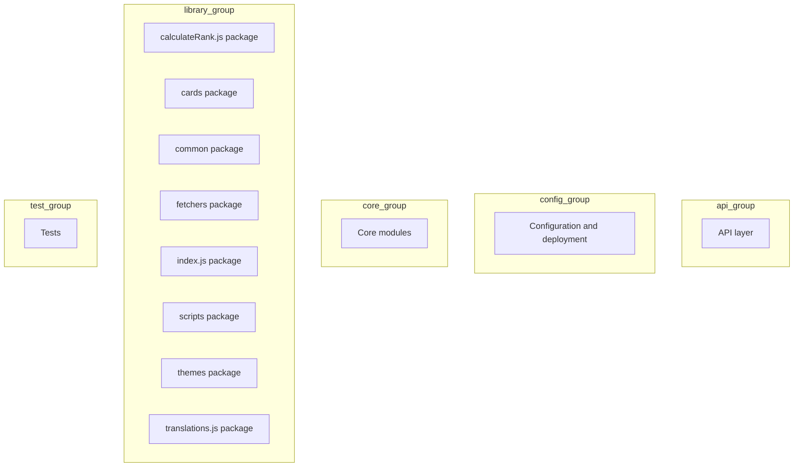

# Architecture report: anuraghazra/github-readme-stats

> Automated static analysis. **Observed** = directly seen in files/imports/AST; **Inferred** = interpretation from that evidence. Repository code was not executed.

## 1. Repository at a glance

| Item | Value |
| --- | --- |
| Repository | anuraghazra/github-readme-stats |
| Description | :zap: Dynamically generated stats for your github readmes |
| Language | JavaScript |
| Stars | 79842 |
| Licence | MIT |
| Analysed commit / branch | 54a7985aeefda00d5eadb55b80c17c7f976c37d2 / master |
| Framework(s) | Express |
| Files analysed | 131 |
| Components | 12 |

## 2. Architecture in one minute

anuraghazra/github-readme-stats - :zap: Dynamically generated stats for your github readmes. This repository was analysed statically from 131 file(s) (1 Python). Detected technologies (observed from imports/manifests): GitHub Actions, Express, axios, Jest. Files are grouped into 12 component(s): API layer, calculateRank.js package, cards package, common package, Configuration and deployment, Core modules, fetchers package, index.js package. Findings below distinguish observed facts from inferred interpretation.

## 3. High-level block diagram

## 4. Main components

### API layer (`api_layer`)

- **Kind:** api
- **Status:** Observed
- **Confidence:** 0.85
- **Responsibility:** Groups 7 file(s) under api layer (observed from repository paths and static analysis).
- **Paths:** `api/gist.js`, `api/index.js`, `api/pin.js`, `api/status/pat-info.js`, `api/status/up.js`, `api/top-langs.js`, `api/wakatime.js`
- **Evidence:** [api/gist.js](https://github.com/anuraghazra/github-readme-stats/blob/54a7985aeefda00d5eadb55b80c17c7f976c37d2/api/gist.js); [api/index.js](https://github.com/anuraghazra/github-readme-stats/blob/54a7985aeefda00d5eadb55b80c17c7f976c37d2/api/index.js); [api/pin.js](https://github.com/anuraghazra/github-readme-stats/blob/54a7985aeefda00d5eadb55b80c17c7f976c37d2/api/pin.js); [api/status/pat-info.js](https://github.com/anuraghazra/github-readme-stats/blob/54a7985aeefda00d5eadb55b80c17c7f976c37d2/api/status/pat-info.js); [api/status/up.js](https://github.com/anuraghazra/github-readme-stats/blob/54a7985aeefda00d5eadb55b80c17c7f976c37d2/api/status/up.js); [api/top-langs.js](https://github.com/anuraghazra/github-readme-stats/blob/54a7985aeefda00d5eadb55b80c17c7f976c37d2/api/top-langs.js); [api/wakatime.js](https://github.com/anuraghazra/github-readme-stats/blob/54a7985aeefda00d5eadb55b80c17c7f976c37d2/api/wakatime.js)

### calculateRank.js package (`calculaterank_js`)

- **Kind:** library
- **Status:** Observed
- **Confidence:** 0.85
- **Responsibility:** Groups 1 file(s) under calculaterank.js package (observed from repository paths and static analysis).
- **Paths:** `src/calculateRank.js`
- **Evidence:** [src/calculateRank.js](https://github.com/anuraghazra/github-readme-stats/blob/54a7985aeefda00d5eadb55b80c17c7f976c37d2/src/calculateRank.js)

### cards package (`cards`)

- **Kind:** library
- **Status:** Observed
- **Confidence:** 0.85
- **Responsibility:** Groups 7 file(s) under cards package (observed from repository paths and static analysis).
- **Paths:** `src/cards/gist.js`, `src/cards/index.js`, `src/cards/repo.js`, `src/cards/stats.js`, `src/cards/top-languages.js`, `src/cards/types.d.ts`, `src/cards/wakatime.js`
- **Evidence:** [src/cards/gist.js](https://github.com/anuraghazra/github-readme-stats/blob/54a7985aeefda00d5eadb55b80c17c7f976c37d2/src/cards/gist.js); [src/cards/index.js](https://github.com/anuraghazra/github-readme-stats/blob/54a7985aeefda00d5eadb55b80c17c7f976c37d2/src/cards/index.js); [src/cards/repo.js](https://github.com/anuraghazra/github-readme-stats/blob/54a7985aeefda00d5eadb55b80c17c7f976c37d2/src/cards/repo.js); [src/cards/stats.js](https://github.com/anuraghazra/github-readme-stats/blob/54a7985aeefda00d5eadb55b80c17c7f976c37d2/src/cards/stats.js); [src/cards/top-languages.js](https://github.com/anuraghazra/github-readme-stats/blob/54a7985aeefda00d5eadb55b80c17c7f976c37d2/src/cards/top-languages.js); [src/cards/types.d.ts](https://github.com/anuraghazra/github-readme-stats/blob/54a7985aeefda00d5eadb55b80c17c7f976c37d2/src/cards/types.d.ts); [src/cards/wakatime.js](https://github.com/anuraghazra/github-readme-stats/blob/54a7985aeefda00d5eadb55b80c17c7f976c37d2/src/cards/wakatime.js)

### common package (`common`)

- **Kind:** library
- **Status:** Observed
- **Confidence:** 0.85
- **Responsibility:** Groups 17 file(s) under common package (observed from repository paths and static analysis).
- **Paths:** `src/common/Card.js`, `src/common/I18n.js`, `src/common/access.js`, `src/common/blacklist.js`, `src/common/cache.js`, `src/common/color.js`, `src/common/envs.js`, `src/common/error.js`, `src/common/fmt.js`, `src/common/html.js`, `src/common/http.js`, `src/common/icons.js`, `src/common/index.js`, `src/common/log.js`, `src/common/ops.js`, `src/common/render.js`, `src/common/retryer.js`
- **Evidence:** [src/common/Card.js](https://github.com/anuraghazra/github-readme-stats/blob/54a7985aeefda00d5eadb55b80c17c7f976c37d2/src/common/Card.js); [src/common/I18n.js](https://github.com/anuraghazra/github-readme-stats/blob/54a7985aeefda00d5eadb55b80c17c7f976c37d2/src/common/I18n.js); [src/common/access.js](https://github.com/anuraghazra/github-readme-stats/blob/54a7985aeefda00d5eadb55b80c17c7f976c37d2/src/common/access.js); [src/common/blacklist.js](https://github.com/anuraghazra/github-readme-stats/blob/54a7985aeefda00d5eadb55b80c17c7f976c37d2/src/common/blacklist.js); [src/common/cache.js](https://github.com/anuraghazra/github-readme-stats/blob/54a7985aeefda00d5eadb55b80c17c7f976c37d2/src/common/cache.js); [src/common/color.js](https://github.com/anuraghazra/github-readme-stats/blob/54a7985aeefda00d5eadb55b80c17c7f976c37d2/src/common/color.js); [src/common/envs.js](https://github.com/anuraghazra/github-readme-stats/blob/54a7985aeefda00d5eadb55b80c17c7f976c37d2/src/common/envs.js); [src/common/error.js](https://github.com/anuraghazra/github-readme-stats/blob/54a7985aeefda00d5eadb55b80c17c7f976c37d2/src/common/error.js)

### Configuration and deployment (`config`)

- **Kind:** config
- **Status:** Observed
- **Confidence:** 0.85
- **Responsibility:** Groups 4 file(s) under configuration and deployment (observed from repository paths and static analysis).
- **Paths:** `codecov.yml`, `package.json`, `src/common/languageColors.json`, `vercel.json`
- **Evidence:** [codecov.yml](https://github.com/anuraghazra/github-readme-stats/blob/54a7985aeefda00d5eadb55b80c17c7f976c37d2/codecov.yml); [package.json](https://github.com/anuraghazra/github-readme-stats/blob/54a7985aeefda00d5eadb55b80c17c7f976c37d2/package.json); [src/common/languageColors.json](https://github.com/anuraghazra/github-readme-stats/blob/54a7985aeefda00d5eadb55b80c17c7f976c37d2/src/common/languageColors.json); [vercel.json](https://github.com/anuraghazra/github-readme-stats/blob/54a7985aeefda00d5eadb55b80c17c7f976c37d2/vercel.json)

### Core modules (`core`)

- **Kind:** core
- **Status:** Observed
- **Confidence:** 0.85
- **Responsibility:** Groups 5 file(s) under core modules (observed from repository paths and static analysis).
- **Paths:** `eslint.config.mjs`, `express.js`, `jest.bench.config.js`, `jest.config.js`, `jest.e2e.config.js`
- **Evidence:** [eslint.config.mjs](https://github.com/anuraghazra/github-readme-stats/blob/54a7985aeefda00d5eadb55b80c17c7f976c37d2/eslint.config.mjs); [express.js](https://github.com/anuraghazra/github-readme-stats/blob/54a7985aeefda00d5eadb55b80c17c7f976c37d2/express.js); [jest.bench.config.js](https://github.com/anuraghazra/github-readme-stats/blob/54a7985aeefda00d5eadb55b80c17c7f976c37d2/jest.bench.config.js); [jest.config.js](https://github.com/anuraghazra/github-readme-stats/blob/54a7985aeefda00d5eadb55b80c17c7f976c37d2/jest.config.js); [jest.e2e.config.js](https://github.com/anuraghazra/github-readme-stats/blob/54a7985aeefda00d5eadb55b80c17c7f976c37d2/jest.e2e.config.js)

### fetchers package (`fetchers`)

- **Kind:** library
- **Status:** Observed
- **Confidence:** 0.85
- **Responsibility:** Groups 6 file(s) under fetchers package (observed from repository paths and static analysis).
- **Paths:** `src/fetchers/gist.js`, `src/fetchers/repo.js`, `src/fetchers/stats.js`, `src/fetchers/top-languages.js`, `src/fetchers/types.d.ts`, `src/fetchers/wakatime.js`
- **Evidence:** [src/fetchers/gist.js](https://github.com/anuraghazra/github-readme-stats/blob/54a7985aeefda00d5eadb55b80c17c7f976c37d2/src/fetchers/gist.js); [src/fetchers/repo.js](https://github.com/anuraghazra/github-readme-stats/blob/54a7985aeefda00d5eadb55b80c17c7f976c37d2/src/fetchers/repo.js); [src/fetchers/stats.js](https://github.com/anuraghazra/github-readme-stats/blob/54a7985aeefda00d5eadb55b80c17c7f976c37d2/src/fetchers/stats.js); [src/fetchers/top-languages.js](https://github.com/anuraghazra/github-readme-stats/blob/54a7985aeefda00d5eadb55b80c17c7f976c37d2/src/fetchers/top-languages.js); [src/fetchers/types.d.ts](https://github.com/anuraghazra/github-readme-stats/blob/54a7985aeefda00d5eadb55b80c17c7f976c37d2/src/fetchers/types.d.ts); [src/fetchers/wakatime.js](https://github.com/anuraghazra/github-readme-stats/blob/54a7985aeefda00d5eadb55b80c17c7f976c37d2/src/fetchers/wakatime.js)

### index.js package (`index_js`)

- **Kind:** library
- **Status:** Observed
- **Confidence:** 0.85
- **Responsibility:** Groups 1 file(s) under index.js package (observed from repository paths and static analysis).
- **Paths:** `src/index.js`
- **Evidence:** [src/index.js](https://github.com/anuraghazra/github-readme-stats/blob/54a7985aeefda00d5eadb55b80c17c7f976c37d2/src/index.js)

### scripts package (`scripts`)

- **Kind:** library
- **Status:** Observed
- **Confidence:** 0.85
- **Responsibility:** Groups 6 file(s) under scripts package (observed from repository paths and static analysis).
- **Paths:** `scripts/close-stale-theme-prs.js`, `scripts/generate-langs-json.js`, `scripts/generate-theme-doc.js`, `scripts/helpers.js`, `scripts/preview-theme.js`, `scripts/push-theme-readme.sh`
- **Evidence:** [scripts/close-stale-theme-prs.js](https://github.com/anuraghazra/github-readme-stats/blob/54a7985aeefda00d5eadb55b80c17c7f976c37d2/scripts/close-stale-theme-prs.js); [scripts/generate-langs-json.js](https://github.com/anuraghazra/github-readme-stats/blob/54a7985aeefda00d5eadb55b80c17c7f976c37d2/scripts/generate-langs-json.js); [scripts/generate-theme-doc.js](https://github.com/anuraghazra/github-readme-stats/blob/54a7985aeefda00d5eadb55b80c17c7f976c37d2/scripts/generate-theme-doc.js); [scripts/helpers.js](https://github.com/anuraghazra/github-readme-stats/blob/54a7985aeefda00d5eadb55b80c17c7f976c37d2/scripts/helpers.js); [scripts/preview-theme.js](https://github.com/anuraghazra/github-readme-stats/blob/54a7985aeefda00d5eadb55b80c17c7f976c37d2/scripts/preview-theme.js); [scripts/push-theme-readme.sh](https://github.com/anuraghazra/github-readme-stats/blob/54a7985aeefda00d5eadb55b80c17c7f976c37d2/scripts/push-theme-readme.sh)

### Tests (`tests`)

- **Kind:** test
- **Status:** Observed
- **Confidence:** 0.85
- **Responsibility:** Groups 34 file(s) under tests (observed from repository paths and static analysis).
- **Paths:** `tests/__snapshots__/renderWakatimeCard.test.js.snap`, `tests/api.test.js`, `tests/bench/api.bench.js`, `tests/bench/calculateRank.bench.js`, `tests/bench/gist.bench.js`, `tests/bench/pin.bench.js`, `tests/bench/utils.js`, `tests/calculateRank.test.js`, `tests/card.test.js`, `tests/color.test.js`, `tests/e2e/e2e.test.js`, `tests/fetchGist.test.js`, `tests/fetchRepo.test.js`, `tests/fetchStats.test.js`, `tests/fetchTopLanguages.test.js`, `tests/fetchWakatime.test.js`, `tests/flexLayout.test.js`, `tests/fmt.test.js`, `tests/gist.test.js`, `tests/html.test.js`, `tests/i18n.test.js`, `tests/ops.test.js`, `tests/pat-info.test.js`, `tests/pin.test.js`, `tests/render.test.js`, `tests/renderGistCard.test.js`, `tests/renderRepoCard.test.js`, `tests/renderStatsCard.test.js`, `tests/renderTopLanguagesCard.test.js`, `tests/renderWakatimeCard.test.js`, `tests/retryer.test.js`, `tests/status.up.test.js`, `tests/top-langs.test.js`, `tests/wakatime.test.js`
- **Evidence:** [tests/__snapshots__/renderWakatimeCard.test.js.snap](https://github.com/anuraghazra/github-readme-stats/blob/54a7985aeefda00d5eadb55b80c17c7f976c37d2/tests/__snapshots__/renderWakatimeCard.test.js.snap); [tests/api.test.js](https://github.com/anuraghazra/github-readme-stats/blob/54a7985aeefda00d5eadb55b80c17c7f976c37d2/tests/api.test.js); [tests/bench/api.bench.js](https://github.com/anuraghazra/github-readme-stats/blob/54a7985aeefda00d5eadb55b80c17c7f976c37d2/tests/bench/api.bench.js); [tests/bench/calculateRank.bench.js](https://github.com/anuraghazra/github-readme-stats/blob/54a7985aeefda00d5eadb55b80c17c7f976c37d2/tests/bench/calculateRank.bench.js); [tests/bench/gist.bench.js](https://github.com/anuraghazra/github-readme-stats/blob/54a7985aeefda00d5eadb55b80c17c7f976c37d2/tests/bench/gist.bench.js); [tests/bench/pin.bench.js](https://github.com/anuraghazra/github-readme-stats/blob/54a7985aeefda00d5eadb55b80c17c7f976c37d2/tests/bench/pin.bench.js); [tests/bench/utils.js](https://github.com/anuraghazra/github-readme-stats/blob/54a7985aeefda00d5eadb55b80c17c7f976c37d2/tests/bench/utils.js); [tests/calculateRank.test.js](https://github.com/anuraghazra/github-readme-stats/blob/54a7985aeefda00d5eadb55b80c17c7f976c37d2/tests/calculateRank.test.js)

### themes package (`themes`)

- **Kind:** library
- **Status:** Observed
- **Confidence:** 0.85
- **Responsibility:** Groups 1 file(s) under themes package (observed from repository paths and static analysis).
- **Paths:** `themes/index.js`
- **Evidence:** [themes/index.js](https://github.com/anuraghazra/github-readme-stats/blob/54a7985aeefda00d5eadb55b80c17c7f976c37d2/themes/index.js)

### translations.js package (`translations_js`)

- **Kind:** library
- **Status:** Observed
- **Confidence:** 0.85
- **Responsibility:** Groups 1 file(s) under translations.js package (observed from repository paths and static analysis).
- **Paths:** `src/translations.js`
- **Evidence:** [src/translations.js](https://github.com/anuraghazra/github-readme-stats/blob/54a7985aeefda00d5eadb55b80c17c7f976c37d2/src/translations.js)

## 5. Execution flow

**Observed** entry point(s):

- [api/index.js](https://github.com/anuraghazra/github-readme-stats/blob/54a7985aeefda00d5eadb55b80c17c7f976c37d2/api/index.js)
- [src/cards/index.js](https://github.com/anuraghazra/github-readme-stats/blob/54a7985aeefda00d5eadb55b80c17c7f976c37d2/src/cards/index.js)
- [src/common/index.js](https://github.com/anuraghazra/github-readme-stats/blob/54a7985aeefda00d5eadb55b80c17c7f976c37d2/src/common/index.js)
- [src/index.js](https://github.com/anuraghazra/github-readme-stats/blob/54a7985aeefda00d5eadb55b80c17c7f976c37d2/src/index.js)
- [themes/index.js](https://github.com/anuraghazra/github-readme-stats/blob/54a7985aeefda00d5eadb55b80c17c7f976c37d2/themes/index.js)

Representative flow (derived from observed entry points and the import graph; steps beyond the entry point are **Inferred**):

1. Execution starts at an observed entry point listed above, if present.
2. No internal import relationships between components were observed.

## 6. Project structure

### `(root)`

- `.eslintrc.json` - config (8807 bytes)
- `.gitignore` - other (164 bytes)
- `.nvmrc` - other (2 bytes)
- `.prettierignore` - other (42 bytes)
- `.prettierrc.json` - config (96 bytes)
- `.vercelignore` - other (152 bytes)
- `CODE_OF_CONDUCT.md` - docs (3354 bytes)
- `CONTRIBUTING.md` - docs (5777 bytes)
- `LICENSE` - docs (1069 bytes)
- `SECURITY.md` - docs (1511 bytes)
- `codecov.yml` - config (172 bytes)
- `eslint.config.mjs` - source, JavaScript (2111 bytes)
- `express.js` - source, JavaScript (656 bytes)
- `jest.bench.config.js` - source, JavaScript (409 bytes)
- `jest.config.js` - source, JavaScript (367 bytes)
- `jest.e2e.config.js` - source, JavaScript (161 bytes)
- `package.json` - manifest (2616 bytes)
- `powered-by-vercel.svg` - other (5336 bytes)
- `readme.md` - docs (49853 bytes)
- `vercel.json` - config (222 bytes)

### `.devcontainer`

- `.devcontainer/devcontainer.json` - config (950 bytes)

### `.github`

- `.github/CODEOWNERS` - other (304 bytes)
- `.github/FUNDING.yml` - config (820 bytes)
- `.github/ISSUE_TEMPLATE/bug_report.yml` - config (2553 bytes)
- `.github/ISSUE_TEMPLATE/config.yml` - config (516 bytes)
- `.github/ISSUE_TEMPLATE/feature_request.yml` - config (916 bytes)
- `.github/dependabot.yml` - config (784 bytes)
- `.github/labeler.yml` - config (2144 bytes)
- `.github/stale.yml` - config (711 bytes)
- `.github/workflows/codeql-analysis.yml` - ci, YAML (1038 bytes)
- `.github/workflows/deploy-prep.py` - ci, YAML (188 bytes)
- `.github/workflows/deploy-prep.yml` - ci, YAML (572 bytes)
- `.github/workflows/e2e-test.yml` - ci, YAML (1146 bytes)
- `.github/workflows/empty-issues-closer.yml` - ci, YAML (1451 bytes)
- `.github/workflows/generate-theme-doc.yml` - ci, YAML (1452 bytes)
- `.github/workflows/label-pr.yml` - ci, YAML (589 bytes)
- `.github/workflows/ossf-analysis.yml` - ci, YAML (1493 bytes)
- `.github/workflows/preview-theme.yml` - ci, YAML (1217 bytes)
- `.github/workflows/prs-cache-clean.yml` - ci, YAML (1083 bytes)
- `.github/workflows/stale-theme-pr-closer.yml` - ci, YAML (1860 bytes)
- `.github/workflows/test.yml` - ci, YAML (941 bytes)
- `.github/workflows/theme-prs-closer.yml` - ci, YAML (1299 bytes)
- `.github/workflows/top-issues-dashboard.yml` - ci, YAML (1553 bytes)
- `.github/workflows/update-langs.yml` - ci, YAML (2289 bytes)

### `.husky`

- `.husky/.gitignore` - other (2 bytes)
- `.husky/pre-commit` - other (38 bytes)

### `.vscode`

- `.vscode/extensions.json` - config (223 bytes)
- `.vscode/settings.json` - config (195 bytes)

### `api`

- `api/gist.js` - source, JavaScript (2828 bytes)
- `api/index.js` - source, JavaScript (4072 bytes)
- `api/pin.js` - source, JavaScript (2929 bytes)
- `api/status/pat-info.js` - source, JavaScript (4559 bytes)
- `api/status/up.js` - source, JavaScript (2850 bytes)
- `api/top-langs.js` - source, JavaScript (4331 bytes)
- `api/wakatime.js` - source, JavaScript (3358 bytes)

### `scripts`

- `scripts/close-stale-theme-prs.js` - source, JavaScript (5527 bytes)
- `scripts/generate-langs-json.js` - source, JavaScript (793 bytes)
- `scripts/generate-theme-doc.js` - source, JavaScript (3141 bytes)
- `scripts/helpers.js` - source, JavaScript (894 bytes)
- `scripts/preview-theme.js` - source, JavaScript (21286 bytes)
- `scripts/push-theme-readme.sh` - source, Shell (573 bytes)

### `src`

- `src/calculateRank.js` - source, JavaScript (2402 bytes)
- `src/cards/gist.js` - source, JavaScript (4167 bytes)
- `src/cards/index.js` - source, JavaScript (199 bytes)
- `src/cards/repo.js` - source, JavaScript (5192 bytes)
- `src/cards/stats.js` - source, JavaScript (15825 bytes)
- `src/cards/top-languages.js` - source, JavaScript (27284 bytes)
- `src/cards/types.d.ts` - source, TypeScript (1616 bytes)
- `src/cards/wakatime.js` - source, JavaScript (14201 bytes)
- `src/common/Card.js` - source, JavaScript (6570 bytes)
- `src/common/I18n.js` - source, JavaScript (886 bytes)
- `src/common/access.js` - source, JavaScript (2166 bytes)
- `src/common/blacklist.js` - source, JavaScript (159 bytes)
- `src/common/cache.js` - source, JavaScript (3633 bytes)
- `src/common/color.js` - source, JavaScript (3922 bytes)
- `src/common/envs.js` - source, JavaScript (374 bytes)
- `src/common/error.js` - source, JavaScript (2395 bytes)
- `src/common/fmt.js` - source, JavaScript (2527 bytes)
- `src/common/html.js` - source, JavaScript (389 bytes)
- `src/common/http.js` - source, JavaScript (464 bytes)
- `src/common/icons.js` - source, JavaScript (7418 bytes)
- `src/common/index.js` - source, JavaScript (298 bytes)
- `src/common/languageColors.json` - config (17260 bytes)
- `src/common/log.js` - source, JavaScript (292 bytes)
- `src/common/ops.js` - source, JavaScript (2831 bytes)
- `src/common/render.js` - source, JavaScript (7884 bytes)
- `src/common/retryer.js` - source, JavaScript (3046 bytes)
- `src/fetchers/gist.js` - source, JavaScript (2750 bytes)
- `src/fetchers/repo.js` - source, JavaScript (2755 bytes)
- `src/fetchers/stats.js` - source, JavaScript (10024 bytes)
- `src/fetchers/top-languages.js` - source, JavaScript (4582 bytes)
- `src/fetchers/types.d.ts` - source, TypeScript (2545 bytes)
- `src/fetchers/wakatime.js` - source, JavaScript (987 bytes)
- `src/index.js` - source, JavaScript (69 bytes)
- `src/translations.js` - source, JavaScript (50827 bytes)

### `tests`

- `tests/__snapshots__/renderWakatimeCard.test.js.snap` - test (14571 bytes)
- `tests/api.test.js` - test, JavaScript (11030 bytes)
- `tests/bench/api.bench.js` - test, JavaScript (1920 bytes)
- `tests/bench/calculateRank.bench.js` - test, JavaScript (428 bytes)
- `tests/bench/gist.bench.js` - test, JavaScript (1345 bytes)
- `tests/bench/pin.bench.js` - test, JavaScript (1109 bytes)
- `tests/bench/utils.js` - test, JavaScript (3491 bytes)
- `tests/calculateRank.test.js` - test, JavaScript (2494 bytes)
- `tests/card.test.js` - test, JavaScript (5684 bytes)
- `tests/color.test.js` - test, JavaScript (1988 bytes)
- `tests/e2e/e2e.test.js` - test, JavaScript (6427 bytes)
- `tests/fetchGist.test.js` - test, JavaScript (3223 bytes)
- `tests/fetchRepo.test.js` - test, JavaScript (2903 bytes)
- `tests/fetchStats.test.js` - test, JavaScript (12577 bytes)
- `tests/fetchTopLanguages.test.js` - test, JavaScript (4486 bytes)
- `tests/fetchWakatime.test.js` - test, JavaScript (3491 bytes)
- `tests/flexLayout.test.js` - test, JavaScript (1317 bytes)
- `tests/fmt.test.js` - test, JavaScript (3984 bytes)
- `tests/gist.test.js` - test, JavaScript (5681 bytes)
- `tests/html.test.js` - test, JavaScript (315 bytes)
- `tests/i18n.test.js` - test, JavaScript (1117 bytes)
- `tests/ops.test.js` - test, JavaScript (2927 bytes)
- `tests/pat-info.test.js` - test, JavaScript (6155 bytes)
- `tests/pin.test.js` - test, JavaScript (6286 bytes)
- `tests/render.test.js` - test, JavaScript (900 bytes)
- `tests/renderGistCard.test.js` - test, JavaScript (8501 bytes)
- `tests/renderRepoCard.test.js` - test, JavaScript (12665 bytes)
- `tests/renderStatsCard.test.js` - test, JavaScript (17280 bytes)
- `tests/renderTopLanguagesCard.test.js` - test, JavaScript (29167 bytes)
- `tests/renderWakatimeCard.test.js` - test, JavaScript (3002 bytes)
- `tests/retryer.test.js` - test, JavaScript (2416 bytes)
- `tests/status.up.test.js` - test, JavaScript (6011 bytes)
- `tests/top-langs.test.js` - test, JavaScript (6104 bytes)
- `tests/wakatime.test.js` - test, JavaScript (3876 bytes)

### `themes`

- `themes/README.md` - docs (29140 bytes)
- `themes/index.js` - source, JavaScript (9722 bytes)

## 7. Key dependencies and integrations

| Name | Category | Status | Confidence | Evidence |
| --- | --- | --- | --- | --- |
| GitHub Actions | ci | Observed | 0.90 | [.github/workflows/codeql-analysis.yml](https://github.com/anuraghazra/github-readme-stats/blob/54a7985aeefda00d5eadb55b80c17c7f976c37d2/.github/workflows/codeql-analysis.yml); [.github/workflows/deploy-prep.py](https://github.com/anuraghazra/github-readme-stats/blob/54a7985aeefda00d5eadb55b80c17c7f976c37d2/.github/workflows/deploy-prep.py); [.github/workflows/deploy-prep.yml](https://github.com/anuraghazra/github-readme-stats/blob/54a7985aeefda00d5eadb55b80c17c7f976c37d2/.github/workflows/deploy-prep.yml); [.github/workflows/e2e-test.yml](https://github.com/anuraghazra/github-readme-stats/blob/54a7985aeefda00d5eadb55b80c17c7f976c37d2/.github/workflows/e2e-test.yml) |
| Express | framework | Observed | 0.85 | [package.json:51](https://github.com/anuraghazra/github-readme-stats/blob/54a7985aeefda00d5eadb55b80c17c7f976c37d2/package.json#L51) |
| axios | library | Observed | 0.85 | [package.json:46](https://github.com/anuraghazra/github-readme-stats/blob/54a7985aeefda00d5eadb55b80c17c7f976c37d2/package.json#L46) |
| Jest | tooling | Observed | 0.85 | [package.json:22](https://github.com/anuraghazra/github-readme-stats/blob/54a7985aeefda00d5eadb55b80c17c7f976c37d2/package.json#L22) |

## 8. Data and state

No database, cache, queue, or persistent-state usage was observed in the analysed files. State handling, if any, may be in-memory or in files that were not analysed.

## 9. Configuration and deployment clues

- `.devcontainer/devcontainer.json` (config)
- `.eslintrc.json` (config)
- `.github/FUNDING.yml` (config)
- `.github/ISSUE_TEMPLATE/bug_report.yml` (config)
- `.github/ISSUE_TEMPLATE/config.yml` (config)
- `.github/ISSUE_TEMPLATE/feature_request.yml` (config)
- `.github/dependabot.yml` (config)
- `.github/labeler.yml` (config)
- `.github/stale.yml` (config)
- `.github/workflows/codeql-analysis.yml` (ci)
- `.github/workflows/deploy-prep.py` (ci)
- `.github/workflows/deploy-prep.yml` (ci)
- `.github/workflows/e2e-test.yml` (ci)
- `.github/workflows/empty-issues-closer.yml` (ci)
- `.github/workflows/generate-theme-doc.yml` (ci)
- `.github/workflows/label-pr.yml` (ci)
- `.github/workflows/ossf-analysis.yml` (ci)
- `.github/workflows/preview-theme.yml` (ci)
- `.github/workflows/prs-cache-clean.yml` (ci)
- `.github/workflows/stale-theme-pr-closer.yml` (ci)
- `.github/workflows/test.yml` (ci)
- `.github/workflows/theme-prs-closer.yml` (ci)
- `.github/workflows/top-issues-dashboard.yml` (ci)
- `.github/workflows/update-langs.yml` (ci)
- `.prettierrc.json` (config)
- `.vscode/extensions.json` (config)
- `.vscode/settings.json` (config)
- `codecov.yml` (config)
- `package.json` (manifest)
- `src/common/languageColors.json` (config)
- `vercel.json` (config)

## 10. Design observations

- An entry/API layer is separated from other code (Inferred from paths and decorators).
- Tests are present alongside source code (Observed from test file paths).

These observations are interpretations (**Inferred**) of the observed structure, not guarantees about runtime design.

## 11. Limitations and unknowns

- Static analysis only: repository code was not executed, installed, or imported at runtime.
- Components and relationships are inferred from file paths, imports, and AST structure; runtime behaviour, dynamic imports, and reflection may not be visible.
- No clear application entry point was observed in the analysed files.
- Repository text was treated as untrusted data; no instructions found in repository files were followed, and likely secret values were redacted/excluded.

## 12. Source references

- [.github/workflows/codeql-analysis.yml](https://github.com/anuraghazra/github-readme-stats/blob/54a7985aeefda00d5eadb55b80c17c7f976c37d2/.github/workflows/codeql-analysis.yml)
- [.github/workflows/deploy-prep.py](https://github.com/anuraghazra/github-readme-stats/blob/54a7985aeefda00d5eadb55b80c17c7f976c37d2/.github/workflows/deploy-prep.py)
- [.github/workflows/deploy-prep.yml](https://github.com/anuraghazra/github-readme-stats/blob/54a7985aeefda00d5eadb55b80c17c7f976c37d2/.github/workflows/deploy-prep.yml)
- [.github/workflows/e2e-test.yml](https://github.com/anuraghazra/github-readme-stats/blob/54a7985aeefda00d5eadb55b80c17c7f976c37d2/.github/workflows/e2e-test.yml)
- [.github/workflows/empty-issues-closer.yml](https://github.com/anuraghazra/github-readme-stats/blob/54a7985aeefda00d5eadb55b80c17c7f976c37d2/.github/workflows/empty-issues-closer.yml)
- [.github/workflows/generate-theme-doc.yml](https://github.com/anuraghazra/github-readme-stats/blob/54a7985aeefda00d5eadb55b80c17c7f976c37d2/.github/workflows/generate-theme-doc.yml)
- [.github/workflows/label-pr.yml](https://github.com/anuraghazra/github-readme-stats/blob/54a7985aeefda00d5eadb55b80c17c7f976c37d2/.github/workflows/label-pr.yml)
- [.github/workflows/ossf-analysis.yml](https://github.com/anuraghazra/github-readme-stats/blob/54a7985aeefda00d5eadb55b80c17c7f976c37d2/.github/workflows/ossf-analysis.yml)
- [api/gist.js](https://github.com/anuraghazra/github-readme-stats/blob/54a7985aeefda00d5eadb55b80c17c7f976c37d2/api/gist.js)
- [api/index.js](https://github.com/anuraghazra/github-readme-stats/blob/54a7985aeefda00d5eadb55b80c17c7f976c37d2/api/index.js)
- [api/pin.js](https://github.com/anuraghazra/github-readme-stats/blob/54a7985aeefda00d5eadb55b80c17c7f976c37d2/api/pin.js)
- [api/status/pat-info.js](https://github.com/anuraghazra/github-readme-stats/blob/54a7985aeefda00d5eadb55b80c17c7f976c37d2/api/status/pat-info.js)
- [api/status/up.js](https://github.com/anuraghazra/github-readme-stats/blob/54a7985aeefda00d5eadb55b80c17c7f976c37d2/api/status/up.js)
- [api/top-langs.js](https://github.com/anuraghazra/github-readme-stats/blob/54a7985aeefda00d5eadb55b80c17c7f976c37d2/api/top-langs.js)
- [api/wakatime.js](https://github.com/anuraghazra/github-readme-stats/blob/54a7985aeefda00d5eadb55b80c17c7f976c37d2/api/wakatime.js)
- [codecov.yml](https://github.com/anuraghazra/github-readme-stats/blob/54a7985aeefda00d5eadb55b80c17c7f976c37d2/codecov.yml)
- [eslint.config.mjs](https://github.com/anuraghazra/github-readme-stats/blob/54a7985aeefda00d5eadb55b80c17c7f976c37d2/eslint.config.mjs)
- [express.js](https://github.com/anuraghazra/github-readme-stats/blob/54a7985aeefda00d5eadb55b80c17c7f976c37d2/express.js)
- [jest.bench.config.js](https://github.com/anuraghazra/github-readme-stats/blob/54a7985aeefda00d5eadb55b80c17c7f976c37d2/jest.bench.config.js)
- [jest.config.js](https://github.com/anuraghazra/github-readme-stats/blob/54a7985aeefda00d5eadb55b80c17c7f976c37d2/jest.config.js)
- [jest.e2e.config.js](https://github.com/anuraghazra/github-readme-stats/blob/54a7985aeefda00d5eadb55b80c17c7f976c37d2/jest.e2e.config.js)
- [package.json](https://github.com/anuraghazra/github-readme-stats/blob/54a7985aeefda00d5eadb55b80c17c7f976c37d2/package.json)
- [package.json:22](https://github.com/anuraghazra/github-readme-stats/blob/54a7985aeefda00d5eadb55b80c17c7f976c37d2/package.json#L22)
- [package.json:46](https://github.com/anuraghazra/github-readme-stats/blob/54a7985aeefda00d5eadb55b80c17c7f976c37d2/package.json#L46)
- [package.json:51](https://github.com/anuraghazra/github-readme-stats/blob/54a7985aeefda00d5eadb55b80c17c7f976c37d2/package.json#L51)
- [scripts/close-stale-theme-prs.js](https://github.com/anuraghazra/github-readme-stats/blob/54a7985aeefda00d5eadb55b80c17c7f976c37d2/scripts/close-stale-theme-prs.js)
- [scripts/generate-langs-json.js](https://github.com/anuraghazra/github-readme-stats/blob/54a7985aeefda00d5eadb55b80c17c7f976c37d2/scripts/generate-langs-json.js)
- [scripts/generate-theme-doc.js](https://github.com/anuraghazra/github-readme-stats/blob/54a7985aeefda00d5eadb55b80c17c7f976c37d2/scripts/generate-theme-doc.js)
- [scripts/helpers.js](https://github.com/anuraghazra/github-readme-stats/blob/54a7985aeefda00d5eadb55b80c17c7f976c37d2/scripts/helpers.js)
- [scripts/preview-theme.js](https://github.com/anuraghazra/github-readme-stats/blob/54a7985aeefda00d5eadb55b80c17c7f976c37d2/scripts/preview-theme.js)
- [scripts/push-theme-readme.sh](https://github.com/anuraghazra/github-readme-stats/blob/54a7985aeefda00d5eadb55b80c17c7f976c37d2/scripts/push-theme-readme.sh)
- [src/calculateRank.js](https://github.com/anuraghazra/github-readme-stats/blob/54a7985aeefda00d5eadb55b80c17c7f976c37d2/src/calculateRank.js)
- [src/cards/gist.js](https://github.com/anuraghazra/github-readme-stats/blob/54a7985aeefda00d5eadb55b80c17c7f976c37d2/src/cards/gist.js)
- [src/cards/index.js](https://github.com/anuraghazra/github-readme-stats/blob/54a7985aeefda00d5eadb55b80c17c7f976c37d2/src/cards/index.js)
- [src/cards/repo.js](https://github.com/anuraghazra/github-readme-stats/blob/54a7985aeefda00d5eadb55b80c17c7f976c37d2/src/cards/repo.js)
- [src/cards/stats.js](https://github.com/anuraghazra/github-readme-stats/blob/54a7985aeefda00d5eadb55b80c17c7f976c37d2/src/cards/stats.js)
- [src/cards/top-languages.js](https://github.com/anuraghazra/github-readme-stats/blob/54a7985aeefda00d5eadb55b80c17c7f976c37d2/src/cards/top-languages.js)
- [src/cards/types.d.ts](https://github.com/anuraghazra/github-readme-stats/blob/54a7985aeefda00d5eadb55b80c17c7f976c37d2/src/cards/types.d.ts)
- [src/cards/wakatime.js](https://github.com/anuraghazra/github-readme-stats/blob/54a7985aeefda00d5eadb55b80c17c7f976c37d2/src/cards/wakatime.js)
- [src/common/Card.js](https://github.com/anuraghazra/github-readme-stats/blob/54a7985aeefda00d5eadb55b80c17c7f976c37d2/src/common/Card.js)
- [src/common/I18n.js](https://github.com/anuraghazra/github-readme-stats/blob/54a7985aeefda00d5eadb55b80c17c7f976c37d2/src/common/I18n.js)
- [src/common/access.js](https://github.com/anuraghazra/github-readme-stats/blob/54a7985aeefda00d5eadb55b80c17c7f976c37d2/src/common/access.js)
- [src/common/blacklist.js](https://github.com/anuraghazra/github-readme-stats/blob/54a7985aeefda00d5eadb55b80c17c7f976c37d2/src/common/blacklist.js)
- [src/common/cache.js](https://github.com/anuraghazra/github-readme-stats/blob/54a7985aeefda00d5eadb55b80c17c7f976c37d2/src/common/cache.js)
- [src/common/color.js](https://github.com/anuraghazra/github-readme-stats/blob/54a7985aeefda00d5eadb55b80c17c7f976c37d2/src/common/color.js)
- [src/common/envs.js](https://github.com/anuraghazra/github-readme-stats/blob/54a7985aeefda00d5eadb55b80c17c7f976c37d2/src/common/envs.js)
- [src/common/error.js](https://github.com/anuraghazra/github-readme-stats/blob/54a7985aeefda00d5eadb55b80c17c7f976c37d2/src/common/error.js)
- [src/common/index.js](https://github.com/anuraghazra/github-readme-stats/blob/54a7985aeefda00d5eadb55b80c17c7f976c37d2/src/common/index.js)
- [src/common/languageColors.json](https://github.com/anuraghazra/github-readme-stats/blob/54a7985aeefda00d5eadb55b80c17c7f976c37d2/src/common/languageColors.json)
- [src/fetchers/gist.js](https://github.com/anuraghazra/github-readme-stats/blob/54a7985aeefda00d5eadb55b80c17c7f976c37d2/src/fetchers/gist.js)
- [src/fetchers/repo.js](https://github.com/anuraghazra/github-readme-stats/blob/54a7985aeefda00d5eadb55b80c17c7f976c37d2/src/fetchers/repo.js)
- [src/fetchers/stats.js](https://github.com/anuraghazra/github-readme-stats/blob/54a7985aeefda00d5eadb55b80c17c7f976c37d2/src/fetchers/stats.js)
- [src/fetchers/top-languages.js](https://github.com/anuraghazra/github-readme-stats/blob/54a7985aeefda00d5eadb55b80c17c7f976c37d2/src/fetchers/top-languages.js)
- [src/fetchers/types.d.ts](https://github.com/anuraghazra/github-readme-stats/blob/54a7985aeefda00d5eadb55b80c17c7f976c37d2/src/fetchers/types.d.ts)
- [src/fetchers/wakatime.js](https://github.com/anuraghazra/github-readme-stats/blob/54a7985aeefda00d5eadb55b80c17c7f976c37d2/src/fetchers/wakatime.js)
- [src/index.js](https://github.com/anuraghazra/github-readme-stats/blob/54a7985aeefda00d5eadb55b80c17c7f976c37d2/src/index.js)
- [src/translations.js](https://github.com/anuraghazra/github-readme-stats/blob/54a7985aeefda00d5eadb55b80c17c7f976c37d2/src/translations.js)
- [tests/__snapshots__/renderWakatimeCard.test.js.snap](https://github.com/anuraghazra/github-readme-stats/blob/54a7985aeefda00d5eadb55b80c17c7f976c37d2/tests/__snapshots__/renderWakatimeCard.test.js.snap)
- [tests/api.test.js](https://github.com/anuraghazra/github-readme-stats/blob/54a7985aeefda00d5eadb55b80c17c7f976c37d2/tests/api.test.js)
- [tests/bench/api.bench.js](https://github.com/anuraghazra/github-readme-stats/blob/54a7985aeefda00d5eadb55b80c17c7f976c37d2/tests/bench/api.bench.js)
- [tests/bench/calculateRank.bench.js](https://github.com/anuraghazra/github-readme-stats/blob/54a7985aeefda00d5eadb55b80c17c7f976c37d2/tests/bench/calculateRank.bench.js)
- [tests/bench/gist.bench.js](https://github.com/anuraghazra/github-readme-stats/blob/54a7985aeefda00d5eadb55b80c17c7f976c37d2/tests/bench/gist.bench.js)
- [tests/bench/pin.bench.js](https://github.com/anuraghazra/github-readme-stats/blob/54a7985aeefda00d5eadb55b80c17c7f976c37d2/tests/bench/pin.bench.js)
- [tests/bench/utils.js](https://github.com/anuraghazra/github-readme-stats/blob/54a7985aeefda00d5eadb55b80c17c7f976c37d2/tests/bench/utils.js)
- [tests/calculateRank.test.js](https://github.com/anuraghazra/github-readme-stats/blob/54a7985aeefda00d5eadb55b80c17c7f976c37d2/tests/calculateRank.test.js)
- [themes/index.js](https://github.com/anuraghazra/github-readme-stats/blob/54a7985aeefda00d5eadb55b80c17c7f976c37d2/themes/index.js)
- [vercel.json](https://github.com/anuraghazra/github-readme-stats/blob/54a7985aeefda00d5eadb55b80c17c7f976c37d2/vercel.json)
