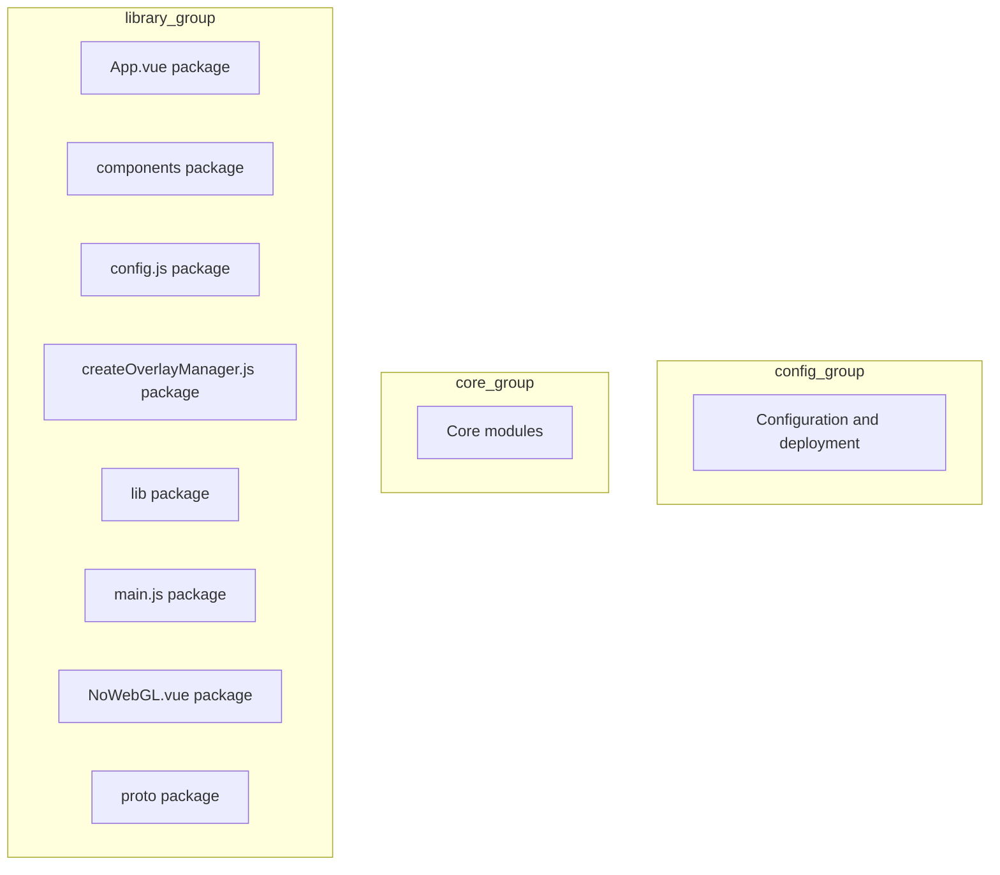

# Architecture report: anvaka/city-roads

> Automated static analysis. **Observed** = directly seen in files/imports/AST; **Inferred** = interpretation from that evidence. Repository code was not executed.

## 1. Repository at a glance

| Item | Value |
| --- | --- |
| Repository | anvaka/city-roads |
| Description | Visualization of all roads within any city |
| Language | JavaScript |
| Stars | 9821 |
| Licence | MIT |
| Analysed commit / branch | 4677b4e146190697c8d96d6ab901c7ac90fc633a / main |
| Framework(s) | Vue |
| Files analysed | 54 |
| Components | 10 |

## 2. Architecture in one minute

anvaka/city-roads - Visualization of all roads within any city. This repository was analysed statically from 54 file(s) (0 Python). Detected technologies (observed from imports/manifests): Vue, Vite. Files are grouped into 10 component(s): App.vue package, components package, Configuration and deployment, config.js package, Core modules, createOverlayManager.js package, lib package, main.js package. Findings below distinguish observed facts from inferred interpretation.

## 3. High-level block diagram

## 4. Main components

### App.vue package (`app_vue`)

- **Kind:** library
- **Status:** Observed
- **Confidence:** 0.85
- **Responsibility:** Groups 1 file(s) under app.vue package (observed from repository paths and static analysis).
- **Paths:** `src/App.vue`
- **Evidence:** [src/App.vue](https://github.com/anvaka/city-roads/blob/4677b4e146190697c8d96d6ab901c7ac90fc633a/src/App.vue)

### components package (`components`)

- **Kind:** library
- **Status:** Observed
- **Confidence:** 0.85
- **Responsibility:** Groups 12 file(s) under components package (observed from repository paths and static analysis).
- **Paths:** `src/components/ColorPicker.vue`, `src/components/EditableLabel.vue`, `src/components/FindPlace.vue`, `src/components/LoadingIcon.vue`, `src/components/clickOutside.js`, `src/components/vue3-color/Sketch.vue`, `src/components/vue3-color/common/Alpha.vue`, `src/components/vue3-color/common/Checkboard.vue`, `src/components/vue3-color/common/EditableInput.vue`, `src/components/vue3-color/common/Hue.vue`, `src/components/vue3-color/common/Saturation.vue`, `src/components/vue3-color/mixin/color.js`
- **Evidence:** [src/components/ColorPicker.vue](https://github.com/anvaka/city-roads/blob/4677b4e146190697c8d96d6ab901c7ac90fc633a/src/components/ColorPicker.vue); [src/components/EditableLabel.vue](https://github.com/anvaka/city-roads/blob/4677b4e146190697c8d96d6ab901c7ac90fc633a/src/components/EditableLabel.vue); [src/components/FindPlace.vue](https://github.com/anvaka/city-roads/blob/4677b4e146190697c8d96d6ab901c7ac90fc633a/src/components/FindPlace.vue); [src/components/LoadingIcon.vue](https://github.com/anvaka/city-roads/blob/4677b4e146190697c8d96d6ab901c7ac90fc633a/src/components/LoadingIcon.vue); [src/components/clickOutside.js](https://github.com/anvaka/city-roads/blob/4677b4e146190697c8d96d6ab901c7ac90fc633a/src/components/clickOutside.js); [src/components/vue3-color/Sketch.vue](https://github.com/anvaka/city-roads/blob/4677b4e146190697c8d96d6ab901c7ac90fc633a/src/components/vue3-color/Sketch.vue); [src/components/vue3-color/common/Alpha.vue](https://github.com/anvaka/city-roads/blob/4677b4e146190697c8d96d6ab901c7ac90fc633a/src/components/vue3-color/common/Alpha.vue); [src/components/vue3-color/common/Checkboard.vue](https://github.com/anvaka/city-roads/blob/4677b4e146190697c8d96d6ab901c7ac90fc633a/src/components/vue3-color/common/Checkboard.vue)

### Configuration and deployment (`config`)

- **Kind:** config
- **Status:** Observed
- **Confidence:** 0.85
- **Responsibility:** Groups 1 file(s) under configuration and deployment (observed from repository paths and static analysis).
- **Paths:** `package.json`
- **Evidence:** [package.json](https://github.com/anvaka/city-roads/blob/4677b4e146190697c8d96d6ab901c7ac90fc633a/package.json)

### config.js package (`config_js`)

- **Kind:** library
- **Status:** Observed
- **Confidence:** 0.85
- **Responsibility:** Groups 1 file(s) under config.js package (observed from repository paths and static analysis).
- **Paths:** `src/config.js`
- **Evidence:** [src/config.js](https://github.com/anvaka/city-roads/blob/4677b4e146190697c8d96d6ab901c7ac90fc633a/src/config.js)

### Core modules (`core`)

- **Kind:** core
- **Status:** Observed
- **Confidence:** 0.85
- **Responsibility:** Groups 3 file(s) under core modules (observed from repository paths and static analysis).
- **Paths:** `babel.config.js`, `deploy.sh`, `vite.config.js`
- **Evidence:** [babel.config.js](https://github.com/anvaka/city-roads/blob/4677b4e146190697c8d96d6ab901c7ac90fc633a/babel.config.js); [deploy.sh](https://github.com/anvaka/city-roads/blob/4677b4e146190697c8d96d6ab901c7ac90fc633a/deploy.sh); [vite.config.js](https://github.com/anvaka/city-roads/blob/4677b4e146190697c8d96d6ab901c7ac90fc633a/vite.config.js)

### createOverlayManager.js package (`createoverlaymanager_js`)

- **Kind:** library
- **Status:** Observed
- **Confidence:** 0.85
- **Responsibility:** Groups 1 file(s) under createoverlaymanager.js package (observed from repository paths and static analysis).
- **Paths:** `src/createOverlayManager.js`
- **Evidence:** [src/createOverlayManager.js](https://github.com/anvaka/city-roads/blob/4677b4e146190697c8d96d6ab901c7ac90fc633a/src/createOverlayManager.js)

### lib package (`lib`)

- **Kind:** library
- **Status:** Observed
- **Confidence:** 0.85
- **Responsibility:** Groups 17 file(s) under lib package (observed from repository paths and static analysis).
- **Paths:** `src/lib/BoundingBox.js`, `src/lib/Grid.js`, `src/lib/GridLayer.js`, `src/lib/LoadOptions.js`, `src/lib/Progress.js`, `src/lib/Query.js`, `src/lib/appState.js`, `src/lib/bus.js`, `src/lib/canvas2BlobPolyfill.js`, `src/lib/createScene.js`, `src/lib/findBoundaryByName.js`, `src/lib/getZazzleLink.js`, `src/lib/postData.js`, `src/lib/protobufExport.js`, `src/lib/request.js`, `src/lib/saveFile.js`, `src/lib/svgExport.js`
- **Evidence:** [src/lib/BoundingBox.js](https://github.com/anvaka/city-roads/blob/4677b4e146190697c8d96d6ab901c7ac90fc633a/src/lib/BoundingBox.js); [src/lib/Grid.js](https://github.com/anvaka/city-roads/blob/4677b4e146190697c8d96d6ab901c7ac90fc633a/src/lib/Grid.js); [src/lib/GridLayer.js](https://github.com/anvaka/city-roads/blob/4677b4e146190697c8d96d6ab901c7ac90fc633a/src/lib/GridLayer.js); [src/lib/LoadOptions.js](https://github.com/anvaka/city-roads/blob/4677b4e146190697c8d96d6ab901c7ac90fc633a/src/lib/LoadOptions.js); [src/lib/Progress.js](https://github.com/anvaka/city-roads/blob/4677b4e146190697c8d96d6ab901c7ac90fc633a/src/lib/Progress.js); [src/lib/Query.js](https://github.com/anvaka/city-roads/blob/4677b4e146190697c8d96d6ab901c7ac90fc633a/src/lib/Query.js); [src/lib/appState.js](https://github.com/anvaka/city-roads/blob/4677b4e146190697c8d96d6ab901c7ac90fc633a/src/lib/appState.js); [src/lib/bus.js](https://github.com/anvaka/city-roads/blob/4677b4e146190697c8d96d6ab901c7ac90fc633a/src/lib/bus.js)

### main.js package (`main_js`)

- **Kind:** library
- **Status:** Observed
- **Confidence:** 0.85
- **Responsibility:** Groups 1 file(s) under main.js package (observed from repository paths and static analysis).
- **Paths:** `src/main.js`
- **Evidence:** [src/main.js](https://github.com/anvaka/city-roads/blob/4677b4e146190697c8d96d6ab901c7ac90fc633a/src/main.js)

### NoWebGL.vue package (`nowebgl_vue`)

- **Kind:** library
- **Status:** Observed
- **Confidence:** 0.85
- **Responsibility:** Groups 1 file(s) under nowebgl.vue package (observed from repository paths and static analysis).
- **Paths:** `src/NoWebGL.vue`
- **Evidence:** [src/NoWebGL.vue](https://github.com/anvaka/city-roads/blob/4677b4e146190697c8d96d6ab901c7ac90fc633a/src/NoWebGL.vue)

### proto package (`proto`)

- **Kind:** library
- **Status:** Observed
- **Confidence:** 0.85
- **Responsibility:** Groups 3 file(s) under proto package (observed from repository paths and static analysis).
- **Paths:** `src/proto/decode.js`, `src/proto/encode.js`, `src/proto/place.js`
- **Evidence:** [src/proto/decode.js](https://github.com/anvaka/city-roads/blob/4677b4e146190697c8d96d6ab901c7ac90fc633a/src/proto/decode.js); [src/proto/encode.js](https://github.com/anvaka/city-roads/blob/4677b4e146190697c8d96d6ab901c7ac90fc633a/src/proto/encode.js); [src/proto/place.js](https://github.com/anvaka/city-roads/blob/4677b4e146190697c8d96d6ab901c7ac90fc633a/src/proto/place.js)

## 5. Execution flow

**Observed** entry point(s):

- [src/main.js](https://github.com/anvaka/city-roads/blob/4677b4e146190697c8d96d6ab901c7ac90fc633a/src/main.js)

Representative flow (derived from observed entry points and the import graph; steps beyond the entry point are **Inferred**):

1. Execution starts at an observed entry point listed above, if present.
2. No internal import relationships between components were observed.

## 6. Project structure

### `(root)`

- `.editorconfig` - config (147 bytes)
- `.eslintignore` - other (30 bytes)
- `.eslintrc.cjs` - source, JavaScript (374 bytes)
- `.gitignore` - other (164 bytes)
- `API.md` - docs (4829 bytes)
- `LICENSE` - docs (1076 bytes)
- `README.md` - docs (2565 bytes)
- `babel.config.js` - source, JavaScript (73 bytes)
- `deploy.sh` - source, Shell (230 bytes)
- `index.html` - other (2077 bytes)
- `package.json` - manifest (798 bytes)
- `vite.config.js` - source, JavaScript (440 bytes)

### `.github`

- `.github/FUNDING.yml` - config (122 bytes)

### `src`

- `src/App.vue` - source, Vue (12611 bytes)
- `src/NoWebGL.vue` - source, Vue (981 bytes)
- `src/components/ColorPicker.vue` - source, Vue (3783 bytes)
- `src/components/EditableLabel.vue` - source, Vue (1379 bytes)
- `src/components/FindPlace.vue` - source, Vue (14289 bytes)
- `src/components/LoadingIcon.vue` - source, Vue (480 bytes)
- `src/components/clickOutside.js` - source, JavaScript (1614 bytes)
- `src/components/vue3-color/LICENSE` - docs (68 bytes)
- `src/components/vue3-color/Sketch.vue` - source, Vue (6522 bytes)
- `src/components/vue3-color/common/Alpha.vue` - source, Vue (3037 bytes)
- `src/components/vue3-color/common/Checkboard.vue` - source, Vue (1791 bytes)
- `src/components/vue3-color/common/EditableInput.vue` - source, Vue (2327 bytes)
- `src/components/vue3-color/common/Hue.vue` - source, Vue (4746 bytes)
- `src/components/vue3-color/common/Saturation.vue` - source, Vue (3615 bytes)
- `src/components/vue3-color/mixin/color.js` - source, JavaScript (2840 bytes)
- `src/config.js` - source, JavaScript (632 bytes)
- `src/createOverlayManager.js` - source, JavaScript (6480 bytes)
- `src/lib/BoundingBox.js` - source, JavaScript (1583 bytes)
- `src/lib/Grid.js` - source, JavaScript (3450 bytes)
- `src/lib/GridLayer.js` - source, JavaScript (3566 bytes)
- `src/lib/LoadOptions.js` - source, JavaScript (3429 bytes)
- `src/lib/Progress.js` - source, JavaScript (463 bytes)
- `src/lib/Query.js` - source, JavaScript (3762 bytes)
- `src/lib/appState.js` - source, JavaScript (716 bytes)
- `src/lib/bus.js` - source, JavaScript (135 bytes)
- `src/lib/canvas2BlobPolyfill.js` - source, JavaScript (3703 bytes)
- `src/lib/createScene.js` - source, JavaScript (5498 bytes)
- `src/lib/findBoundaryByName.js` - source, JavaScript (1682 bytes)
- `src/lib/getZazzleLink.js` - source, JavaScript (1184 bytes)
- `src/lib/postData.js` - source, JavaScript (1286 bytes)
- `src/lib/protobufExport.js` - source, JavaScript (513 bytes)
- `src/lib/request.js` - source, JavaScript (2296 bytes)
- `src/lib/saveFile.js` - source, JavaScript (4825 bytes)
- `src/lib/svgExport.js` - source, JavaScript (2406 bytes)
- `src/main.js` - source, JavaScript (908 bytes)
- `src/proto/decode.js` - source, JavaScript (264 bytes)
- `src/proto/encode.js` - source, JavaScript (475 bytes)
- `src/proto/place.js` - source, JavaScript (2164 bytes)
- `src/proto/place.proto` - other (437 bytes)
- `src/vars.styl` - other (265 bytes)

### `static`

- `static/.gitkeep` - other (0 bytes)

## 7. Key dependencies and integrations

| Name | Category | Status | Confidence | Evidence |
| --- | --- | --- | --- | --- |
| Vue | framework | Observed | 0.85 | [package.json:11](https://github.com/anvaka/city-roads/blob/4677b4e146190697c8d96d6ab901c7ac90fc633a/package.json#L11) |
| Vite | tooling | Observed | 0.85 | [package.json:8](https://github.com/anvaka/city-roads/blob/4677b4e146190697c8d96d6ab901c7ac90fc633a/package.json#L8) |

## 8. Data and state

No database, cache, queue, or persistent-state usage was observed in the analysed files. State handling, if any, may be in-memory or in files that were not analysed.

## 9. Configuration and deployment clues

- `.editorconfig` (config)
- `.github/FUNDING.yml` (config)
- `package.json` (manifest)

## 10. Design observations

- No strong design patterns could be established from the available evidence.

These observations are interpretations (**Inferred**) of the observed structure, not guarantees about runtime design.

## 11. Limitations and unknowns

- Static analysis only: repository code was not executed, installed, or imported at runtime.
- Components and relationships are inferred from file paths, imports, and AST structure; runtime behaviour, dynamic imports, and reflection may not be visible.
- No clear application entry point was observed in the analysed files.
- Repository text was treated as untrusted data; no instructions found in repository files were followed, and likely secret values were redacted/excluded.
- JavaScript and TypeScript files were inventoried from paths and package manifests. They were not parsed with a full language AST, and repository code was not executed.

## 12. Source references

- [babel.config.js](https://github.com/anvaka/city-roads/blob/4677b4e146190697c8d96d6ab901c7ac90fc633a/babel.config.js)
- [deploy.sh](https://github.com/anvaka/city-roads/blob/4677b4e146190697c8d96d6ab901c7ac90fc633a/deploy.sh)
- [package.json](https://github.com/anvaka/city-roads/blob/4677b4e146190697c8d96d6ab901c7ac90fc633a/package.json)
- [package.json:8](https://github.com/anvaka/city-roads/blob/4677b4e146190697c8d96d6ab901c7ac90fc633a/package.json#L8)
- [package.json:11](https://github.com/anvaka/city-roads/blob/4677b4e146190697c8d96d6ab901c7ac90fc633a/package.json#L11)
- [src/App.vue](https://github.com/anvaka/city-roads/blob/4677b4e146190697c8d96d6ab901c7ac90fc633a/src/App.vue)
- [src/NoWebGL.vue](https://github.com/anvaka/city-roads/blob/4677b4e146190697c8d96d6ab901c7ac90fc633a/src/NoWebGL.vue)
- [src/components/ColorPicker.vue](https://github.com/anvaka/city-roads/blob/4677b4e146190697c8d96d6ab901c7ac90fc633a/src/components/ColorPicker.vue)
- [src/components/EditableLabel.vue](https://github.com/anvaka/city-roads/blob/4677b4e146190697c8d96d6ab901c7ac90fc633a/src/components/EditableLabel.vue)
- [src/components/FindPlace.vue](https://github.com/anvaka/city-roads/blob/4677b4e146190697c8d96d6ab901c7ac90fc633a/src/components/FindPlace.vue)
- [src/components/LoadingIcon.vue](https://github.com/anvaka/city-roads/blob/4677b4e146190697c8d96d6ab901c7ac90fc633a/src/components/LoadingIcon.vue)
- [src/components/clickOutside.js](https://github.com/anvaka/city-roads/blob/4677b4e146190697c8d96d6ab901c7ac90fc633a/src/components/clickOutside.js)
- [src/components/vue3-color/Sketch.vue](https://github.com/anvaka/city-roads/blob/4677b4e146190697c8d96d6ab901c7ac90fc633a/src/components/vue3-color/Sketch.vue)
- [src/components/vue3-color/common/Alpha.vue](https://github.com/anvaka/city-roads/blob/4677b4e146190697c8d96d6ab901c7ac90fc633a/src/components/vue3-color/common/Alpha.vue)
- [src/components/vue3-color/common/Checkboard.vue](https://github.com/anvaka/city-roads/blob/4677b4e146190697c8d96d6ab901c7ac90fc633a/src/components/vue3-color/common/Checkboard.vue)
- [src/config.js](https://github.com/anvaka/city-roads/blob/4677b4e146190697c8d96d6ab901c7ac90fc633a/src/config.js)
- [src/createOverlayManager.js](https://github.com/anvaka/city-roads/blob/4677b4e146190697c8d96d6ab901c7ac90fc633a/src/createOverlayManager.js)
- [src/lib/BoundingBox.js](https://github.com/anvaka/city-roads/blob/4677b4e146190697c8d96d6ab901c7ac90fc633a/src/lib/BoundingBox.js)
- [src/lib/Grid.js](https://github.com/anvaka/city-roads/blob/4677b4e146190697c8d96d6ab901c7ac90fc633a/src/lib/Grid.js)
- [src/lib/GridLayer.js](https://github.com/anvaka/city-roads/blob/4677b4e146190697c8d96d6ab901c7ac90fc633a/src/lib/GridLayer.js)
- [src/lib/LoadOptions.js](https://github.com/anvaka/city-roads/blob/4677b4e146190697c8d96d6ab901c7ac90fc633a/src/lib/LoadOptions.js)
- [src/lib/Progress.js](https://github.com/anvaka/city-roads/blob/4677b4e146190697c8d96d6ab901c7ac90fc633a/src/lib/Progress.js)
- [src/lib/Query.js](https://github.com/anvaka/city-roads/blob/4677b4e146190697c8d96d6ab901c7ac90fc633a/src/lib/Query.js)
- [src/lib/appState.js](https://github.com/anvaka/city-roads/blob/4677b4e146190697c8d96d6ab901c7ac90fc633a/src/lib/appState.js)
- [src/lib/bus.js](https://github.com/anvaka/city-roads/blob/4677b4e146190697c8d96d6ab901c7ac90fc633a/src/lib/bus.js)
- [src/main.js](https://github.com/anvaka/city-roads/blob/4677b4e146190697c8d96d6ab901c7ac90fc633a/src/main.js)
- [src/proto/decode.js](https://github.com/anvaka/city-roads/blob/4677b4e146190697c8d96d6ab901c7ac90fc633a/src/proto/decode.js)
- [src/proto/encode.js](https://github.com/anvaka/city-roads/blob/4677b4e146190697c8d96d6ab901c7ac90fc633a/src/proto/encode.js)
- [src/proto/place.js](https://github.com/anvaka/city-roads/blob/4677b4e146190697c8d96d6ab901c7ac90fc633a/src/proto/place.js)
- [vite.config.js](https://github.com/anvaka/city-roads/blob/4677b4e146190697c8d96d6ab901c7ac90fc633a/vite.config.js)
