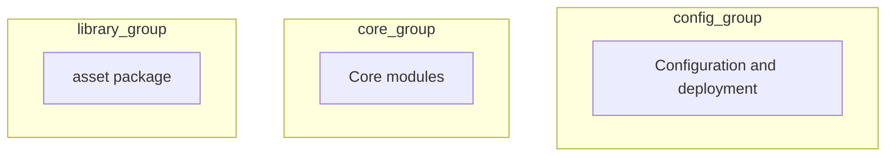

# Architecture report: apachecn/apachecn-algo-zh

> Automated static analysis. **Observed** = directly seen in files/imports/AST; **Inferred** = interpretation from that evidence. Repository code was not executed.

## 1. Repository at a glance

| Item | Value |
| --- | --- |
| Repository | apachecn/apachecn-algo-zh |
| Description | ApacheCN 数据结构与算法译文集 |
| Language | JavaScript |
| Stars | 11167 |
| Licence | Not detected |
| Analysed commit / branch | ca52c3b386331be95ac1f1313dcf0d484cf89c04 / master |
| Framework(s) | None detected |
| Files analysed | 703 |
| Components | 3 |

## 2. Architecture in one minute

apachecn/apachecn-algo-zh - ApacheCN 数据结构与算法译文集. This repository was analysed statically from 703 file(s) (0 Python). Detected technologies (observed from imports/manifests): Docker. Files are grouped into 3 component(s): asset package, Configuration and deployment, Core modules. Findings below distinguish observed facts from inferred interpretation.

## 3. High-level block diagram

## 4. Main components

### asset package (`asset`)

- **Kind:** library
- **Status:** Observed
- **Confidence:** 0.85
- **Responsibility:** Groups 10 file(s) under asset package (observed from repository paths and static analysis).
- **Paths:** `asset/back-to-top.js`, `asset/dark-mode.js`, `asset/docsify-apachecn-footer.js`, `asset/docsify-baidu-push.js`, `asset/docsify-baidu-stat.js`, `asset/docsify-clicker.js`, `asset/docsify-cnzz.js`, `asset/docsify-quick-page.js`, `asset/edit.js`, `asset/share.js`
- **Evidence:** [asset/back-to-top.js](https://github.com/apachecn/apachecn-algo-zh/blob/ca52c3b386331be95ac1f1313dcf0d484cf89c04/asset/back-to-top.js); [asset/dark-mode.js](https://github.com/apachecn/apachecn-algo-zh/blob/ca52c3b386331be95ac1f1313dcf0d484cf89c04/asset/dark-mode.js); [asset/docsify-apachecn-footer.js](https://github.com/apachecn/apachecn-algo-zh/blob/ca52c3b386331be95ac1f1313dcf0d484cf89c04/asset/docsify-apachecn-footer.js); [asset/docsify-baidu-push.js](https://github.com/apachecn/apachecn-algo-zh/blob/ca52c3b386331be95ac1f1313dcf0d484cf89c04/asset/docsify-baidu-push.js); [asset/docsify-baidu-stat.js](https://github.com/apachecn/apachecn-algo-zh/blob/ca52c3b386331be95ac1f1313dcf0d484cf89c04/asset/docsify-baidu-stat.js); [asset/docsify-clicker.js](https://github.com/apachecn/apachecn-algo-zh/blob/ca52c3b386331be95ac1f1313dcf0d484cf89c04/asset/docsify-clicker.js); [asset/docsify-cnzz.js](https://github.com/apachecn/apachecn-algo-zh/blob/ca52c3b386331be95ac1f1313dcf0d484cf89c04/asset/docsify-cnzz.js); [asset/docsify-quick-page.js](https://github.com/apachecn/apachecn-algo-zh/blob/ca52c3b386331be95ac1f1313dcf0d484cf89c04/asset/docsify-quick-page.js)

### Configuration and deployment (`config`)

- **Kind:** config
- **Status:** Observed
- **Confidence:** 0.85
- **Responsibility:** Groups 1 file(s) under configuration and deployment (observed from repository paths and static analysis).
- **Paths:** `Dockerfile`
- **Evidence:** [Dockerfile](https://github.com/apachecn/apachecn-algo-zh/blob/ca52c3b386331be95ac1f1313dcf0d484cf89c04/Dockerfile)

### Core modules (`core`)

- **Kind:** core
- **Status:** Observed
- **Confidence:** 0.85
- **Responsibility:** Groups 1 file(s) under core modules (observed from repository paths and static analysis).
- **Paths:** `update.sh`
- **Evidence:** [update.sh](https://github.com/apachecn/apachecn-algo-zh/blob/ca52c3b386331be95ac1f1313dcf0d484cf89c04/update.sh)

## 5. Execution flow

No entry point was observed; the startup flow below is therefore limited.

Representative flow (derived from observed entry points and the import graph; steps beyond the entry point are **Inferred**):

1. Execution starts at an observed entry point listed above, if present.
2. No internal import relationships between components were observed.

## 6. Project structure

### `(root)`

- `.gitignore` - other (1254 bytes)
- `.nojekyll` - other (0 bytes)
- `404.html` - other (74 bytes)
- `CNAME` - other (17 bytes)
- `Dockerfile` - container (49 bytes)
- `NAV.md` - docs (17139 bytes)
- `README.md` - docs (2061 bytes)
- `SUMMARY.md` - docs (56849 bytes)
- `index.html` - other (2777 bytes)
- `update.sh` - source, Shell (65 bytes)

### `asset`

- `asset/back-to-top.css` - other (421 bytes)
- `asset/back-to-top.js` - source, JavaScript (611 bytes)
- `asset/dark-mode.css` - other (422 bytes)
- `asset/dark-mode.js` - source, JavaScript (1056 bytes)
- `asset/docsify-apachecn-footer.js` - source, JavaScript (1888 bytes)
- `asset/docsify-baidu-push.js` - source, JavaScript (412 bytes)
- `asset/docsify-baidu-stat.js` - source, JavaScript (452 bytes)
- `asset/docsify-clicker.js` - source, JavaScript (17248 bytes)
- `asset/docsify-cnzz.js` - source, JavaScript (454 bytes)
- `asset/docsify-quick-page.css` - other (736 bytes)
- `asset/docsify-quick-page.js` - source, JavaScript (1170 bytes)
- `asset/edit.css` - other (328 bytes)
- `asset/edit.js` - source, JavaScript (437 bytes)
- `asset/edit.svg` - other (1109 bytes)
- `asset/left.svg` - other (818 bytes)
- `asset/moon.svg` - other (279 bytes)
- `asset/prism-darcula.css` - other (2748 bytes)
- `asset/right.svg` - other (803 bytes)
- `asset/share.css` - other (296 bytes)
- `asset/share.js` - source, JavaScript (17915 bytes)
- `asset/share.svg` - other (1779 bytes)
- `asset/style.css` - other (1891 bytes)
- `asset/sun.svg` - other (648 bytes)
- `asset/up.svg` - other (814 bytes)
- `asset/vue.css` - other (15537 bytes)

### `docs`

- `docs/jianzhioffer/java/03_01_DuplicationInArray.md` - docs (2642 bytes)
- `docs/jianzhioffer/java/03_02_DuplicationInArrayNoEdit.md` - docs (2900 bytes)
- `docs/jianzhioffer/java/04_FindInPartiallySortedMatrix.md` - docs (1926 bytes)
- `docs/jianzhioffer/java/05_ReplaceSpaces.md` - docs (3056 bytes)
- `docs/jianzhioffer/java/06_PrintListInReversedOrder.md` - docs (2463 bytes)
- `docs/jianzhioffer/java/07_ConstructBinaryTree.md` - docs (2652 bytes)
- `docs/jianzhioffer/java/08_NextNodeInBinaryTrees.md` - docs (2289 bytes)
- `docs/jianzhioffer/java/09_01_QueueWithTwoStacks.md` - docs (1112 bytes)
- `docs/jianzhioffer/java/09_02_StackWithTwoQueues.md` - docs (1339 bytes)
- `docs/jianzhioffer/java/10_01_Fibonacci.md` - docs (1651 bytes)
- `docs/jianzhioffer/java/10_02_JumpFloor.md` - docs (1065 bytes)
- `docs/jianzhioffer/java/10_03_JumpFloorII.md` - docs (1200 bytes)
- `docs/jianzhioffer/java/10_04_RectCover.md` - docs (1727 bytes)
- `docs/jianzhioffer/java/11_MinNumberInRotatedArray.md` - docs (3763 bytes)
- `docs/jianzhioffer/java/12_StringPathInMatrix.md` - docs (2892 bytes)
- `docs/jianzhioffer/java/13_RobotMove.md` - docs (2426 bytes)
- `docs/jianzhioffer/java/14_CuttingRope.md` - docs (3062 bytes)
- `docs/jianzhioffer/java/15_NumberOf1InBinary.md` - docs (1809 bytes)
- `docs/jianzhioffer/java/16_Power.md` - docs (857 bytes)
- `docs/jianzhioffer/java/17_Print1ToMaxOfNDigits.md` - docs (2157 bytes)
- `docs/jianzhioffer/java/18_01_DeleteNodeInList.md` - docs (1701 bytes)
- `docs/jianzhioffer/java/18_02_DeleteDuplicatedNode.md` - docs (2330 bytes)
- `docs/jianzhioffer/java/19_RegularExpressionsMatching.md` - docs (2595 bytes)
- `docs/jianzhioffer/java/20_NumericStrings.md` - docs (3068 bytes)
- `docs/jianzhioffer/java/21_ReorderArray.md` - docs (2009 bytes)
- `docs/jianzhioffer/java/22_KthNodeFromEnd.md` - docs (1553 bytes)
- `docs/jianzhioffer/java/23_EntryNodeInListLoop.md` - docs (2275 bytes)
- `docs/jianzhioffer/java/24_ReverseList.md` - docs (1730 bytes)
- `docs/jianzhioffer/java/25_MergeSortedLists.md` - docs (2460 bytes)
- `docs/jianzhioffer/java/26_SubstructureInTree.md` - docs (1704 bytes)
- `docs/jianzhioffer/java/27_MirrorOfBinaryTree.md` - docs (1273 bytes)
- `docs/jianzhioffer/java/28_SymmetricalBinaryTree.md` - docs (1519 bytes)
- `docs/jianzhioffer/java/29_PrintMatrix.md` - docs (2778 bytes)
- `docs/jianzhioffer/java/30_MinInStack.md` - docs (1430 bytes)
- `docs/jianzhioffer/java/31_StackPushPopOrder.md` - docs (1985 bytes)
- `docs/jianzhioffer/java/32_01_PrintTreeFromTopToBottom.md` - docs (1532 bytes)
- `docs/jianzhioffer/java/32_02_PrintTreesInLines.md` - docs (1766 bytes)
- `docs/jianzhioffer/java/32_03_PrintTreesInZigzag.md` - docs (2939 bytes)
- `docs/jianzhioffer/java/33_SquenceOfBST.md` - docs (1858 bytes)
- `docs/jianzhioffer/java/34_PathInTree.md` - docs (1747 bytes)
- `docs/jianzhioffer/java/35_CopyComplexList.md` - docs (2311 bytes)
- `docs/jianzhioffer/java/36_ConvertBinarySearchTree.md` - docs (1884 bytes)
- `docs/jianzhioffer/java/37_SerializeBinaryTrees.md` - docs (2321 bytes)
- `docs/jianzhioffer/java/38_StringPermutation.md` - docs (2640 bytes)
- `docs/jianzhioffer/java/39_MoreThanHalfNumber.md` - docs (4674 bytes)
- `docs/jianzhioffer/java/40_KLeastNumbers.md` - docs (4097 bytes)
- `docs/jianzhioffer/java/41_StreamMedian.md` - docs (1940 bytes)
- `docs/jianzhioffer/java/42_GreatestSumOfSubarrays.md` - docs (1280 bytes)
- `docs/jianzhioffer/java/43_NumberOf1.md` - docs (2769 bytes)
- `docs/jianzhioffer/java/44_DigitsInSequence.md` - docs (2039 bytes)
- `docs/jianzhioffer/java/45_SortArrayForMinNumber.md` - docs (1290 bytes)
- `docs/jianzhioffer/java/46_TranslateNumbersToStrings.md` - docs (1690 bytes)
- `docs/jianzhioffer/java/47_MaxValueOfGifts.md` - docs (1596 bytes)
- `docs/jianzhioffer/java/48_LongestSubstringWithoutDup.md` - docs (2069 bytes)
- `docs/jianzhioffer/java/49_UglyNumber.md` - docs (3171 bytes)
- `docs/jianzhioffer/java/50_01_FirstNotRepeatingChar.md` - docs (1412 bytes)
- `docs/jianzhioffer/java/50_02_FristCharacterInStream.md` - docs (1403 bytes)
- `docs/jianzhioffer/java/52_FirstCommonNodesInLists.md` - docs (2184 bytes)
- `docs/jianzhioffer/java/53_01_NumberOfK.md` - docs (2735 bytes)
- `docs/jianzhioffer/java/53_02_MissingNumber.md` - docs (1525 bytes)
- `docs/jianzhioffer/java/53_03_IntegerIdenticalToIndex.md` - docs (1650 bytes)
- `docs/jianzhioffer/java/54_KthNodeInBST.md` - docs (1359 bytes)
- `docs/jianzhioffer/java/55_01_TreeDepth.md` - docs (1241 bytes)
- `docs/jianzhioffer/java/55_02_BalancedBinaryTree.md` - docs (2739 bytes)
- `docs/jianzhioffer/java/56_01_NumbersAppearOnce.md` - docs (2034 bytes)
- `docs/jianzhioffer/java/56_02_NumberAppearingOnce.md` - docs (1583 bytes)
- `docs/jianzhioffer/java/57_01_TwoNumbersWithSum.md` - docs (1636 bytes)
- `docs/jianzhioffer/java/57_02_ContinuousSquenceWithSum.md` - docs (2291 bytes)
- `docs/jianzhioffer/java/58_01_ReverseWordsInSentence.md` - docs (1316 bytes)
- `docs/jianzhioffer/java/58_02_LeftRotateString.md` - docs (1564 bytes)
- `docs/jianzhioffer/java/59_01_MaxInSlidingWindow.md` - docs (2642 bytes)
- `docs/jianzhioffer/java/61_ContinousCards.md` - docs (1818 bytes)
- `docs/jianzhioffer/java/README.md` - docs (5246 bytes)
- `docs/jianzhioffer/java/SUMMARY.md` - docs (4235 bytes)
- `docs/leetcode/cpp/0001._Two_Sum.md` - docs (2273 bytes)
- `docs/leetcode/cpp/0002._Add_Two_Numbers.md` - docs (1344 bytes)
- `docs/leetcode/cpp/0003._Longest_Substring_Without_Repeating_Characters.md` - docs (2436 bytes)
- `docs/leetcode/cpp/0004._Median_of_Two_Sorted_Arrays.md` - docs (5318 bytes)
- `docs/leetcode/cpp/0005._Longest_Palindromic_Substring.md` - docs (1478 bytes)
- `docs/leetcode/cpp/0006._ZigZag_Conversion.md` - docs (2804 bytes)
- `docs/leetcode/cpp/0007._Reverse_Integer.md` - docs (1073 bytes)
- `docs/leetcode/cpp/0008._String_to_Integer_(atoi).md` - docs (3641 bytes)
- `docs/leetcode/cpp/0009._Palindrome_Number.md` - docs (2203 bytes)
- `docs/leetcode/cpp/0010._Regular_Expression_Matching.md` - docs (2734 bytes)
- `docs/leetcode/cpp/0011._Container_With_Most_Water.md` - docs (1348 bytes)
- `docs/leetcode/cpp/0012._Integer_to_Roman.md` - docs (4796 bytes)
- `docs/leetcode/cpp/0014._Longest_Common_Prefix.md` - docs (1417 bytes)
- `docs/leetcode/cpp/0015._3sum.md` - docs (1562 bytes)
- `docs/leetcode/cpp/0016._3Sum_Closest.md` - docs (1470 bytes)
- `docs/leetcode/cpp/0017._Letter_Combinations_of_a_Phone_Number.md` - docs (1843 bytes)
- `docs/leetcode/cpp/0018._4Sum.md` - docs (1630 bytes)
- `docs/leetcode/cpp/0019._Remove_Nth_Node_From_End_of_List.md` - docs (1744 bytes)
- `docs/leetcode/cpp/0020._Valid_Parentheses.md` - docs (1394 bytes)
- `docs/leetcode/cpp/0021._Merge_Two_Sorted_Lists.md` - docs (1861 bytes)
- `docs/leetcode/cpp/0022._Generate_Parentheses.md` - docs (897 bytes)
- `docs/leetcode/cpp/0023._Merge_K_Sorted_Lists.md` - docs (3027 bytes)
- `docs/leetcode/cpp/0024._Swap_Nodes_in_Pairs.md` - docs (1071 bytes)
- `docs/leetcode/cpp/0025._Reverse_Nodes_In_K_Group.md` - docs (1959 bytes)
- `docs/leetcode/cpp/0026._Remove_Duplicates_From_Sorted_Array.md` - docs (2295 bytes)
- `docs/leetcode/cpp/0027._Remove_Element.md` - docs (2248 bytes)
- `docs/leetcode/cpp/0028._Implement_Strstr.md` - docs (1501 bytes)
- `docs/leetcode/cpp/0029._Divide_Two_Integers.md` - docs (2437 bytes)
- `docs/leetcode/cpp/0030._Substring_With_Concatenation_Of_All_Words.md` - docs (1911 bytes)
- `docs/leetcode/cpp/0031._Next_Permutatio.md` - docs (1815 bytes)
- `docs/leetcode/cpp/0032._Longest_Valid_Parentheses.md` - docs (1923 bytes)
- `docs/leetcode/cpp/0033._Search_in_Rotated_Sorted_Array.md` - docs (1951 bytes)
- `docs/leetcode/cpp/0034._Find_First_and_Last_Position_of_Element_in_Sorted_Array.md` - docs (2761 bytes)
- `docs/leetcode/cpp/0035._Search_Insert_Position.md` - docs (1587 bytes)
- `docs/leetcode/cpp/0036._Valid_Sudoku.md` - docs (2996 bytes)
- `docs/leetcode/cpp/0038._Count_and_Say.md` - docs (1808 bytes)
- `docs/leetcode/cpp/0039._Combination_Sum.md` - docs (1370 bytes)
- `docs/leetcode/cpp/0040._Combination_Sum_II.md` - docs (1465 bytes)
- `docs/leetcode/cpp/0041._First_Missing_Positive.md` - docs (1466 bytes)
- `docs/leetcode/cpp/0042._Trapping_Rain_Water.md` - docs (1858 bytes)
- `docs/leetcode/cpp/0043._Multiply_Strings.md` - docs (2342 bytes)
- `docs/leetcode/cpp/0044._Wildcard_Matching.md` - docs (2850 bytes)
- `docs/leetcode/cpp/0045._Jump_Game_II.md` - docs (1578 bytes)
- `docs/leetcode/cpp/0046._Permutations.md` - docs (2391 bytes)
- `docs/leetcode/cpp/0047._Permutations_II.md` - docs (3294 bytes)
- `docs/leetcode/cpp/0048._Rotate_Image.md` - docs (1666 bytes)
- `docs/leetcode/cpp/0049._Group_Anagrams.md` - docs (1101 bytes)
- `docs/leetcode/cpp/0050._powx_n.md` - docs (1480 bytes)
- `docs/leetcode/cpp/0051._N-Queens.md` - docs (2428 bytes)
- `docs/leetcode/cpp/0052._N-Queens_II.md` - docs (1878 bytes)
- `docs/leetcode/cpp/0053._Maximum_Subarray.md` - docs (2394 bytes)
- `docs/leetcode/cpp/0054._Spiral_Matrix.md` - docs (1634 bytes)
- `docs/leetcode/cpp/0055._Jump_Game.md` - docs (1850 bytes)
- `docs/leetcode/cpp/0056._Merge_Intervals.md` - docs (1901 bytes)
- `docs/leetcode/cpp/0057._Insert_Interval.md` - docs (2951 bytes)
- `docs/leetcode/cpp/0058._Length_of_Last_Word.md` - docs (829 bytes)
- `docs/leetcode/cpp/0059._Spiral_Matrix_II.md` - docs (1514 bytes)
- `docs/leetcode/cpp/0060._Permutation_Sequence.md` - docs (1639 bytes)
- `docs/leetcode/cpp/0061._Rotate_List.md` - docs (1846 bytes)
- `docs/leetcode/cpp/0062._Unique_Paths.md` - docs (1316 bytes)
- `docs/leetcode/cpp/0063._Unique_Paths_II.md` - docs (2009 bytes)
- `docs/leetcode/cpp/0064._Minimum_Path_Sum.md` - docs (1170 bytes)
- `docs/leetcode/cpp/0065._Valid_Number.md` - docs (2875 bytes)
- `docs/leetcode/cpp/0066._Plus_One.md` - docs (1248 bytes)
- `docs/leetcode/cpp/0068._Text_Justification.md` - docs (4954 bytes)
- `docs/leetcode/cpp/0069._Sqr(x).md` - docs (1706 bytes)
- `docs/leetcode/cpp/0072._Edit_Distance.md` - docs (2369 bytes)
- `docs/leetcode/cpp/0075._Sort_Colors.md` - docs (1619 bytes)
- `docs/leetcode/cpp/0076._Minimum_Window_Substring.md` - docs (2508 bytes)
- `docs/leetcode/cpp/0077._combinations.md` - docs (849 bytes)
- `docs/leetcode/cpp/0078._subsets.md` - docs (959 bytes)
- `docs/leetcode/cpp/0081._Search_in_Rotated_Sorted_Array_II.md` - docs (2431 bytes)
- `docs/leetcode/cpp/0083._Remove_Duplicates_From_Sorted_Lists.md` - docs (1329 bytes)
- `docs/leetcode/cpp/0084._Largest_Rectangle_in_Histogram.md` - docs (3099 bytes)
- `docs/leetcode/cpp/0085._Maximal_Rectangle.md` - docs (3552 bytes)
- `docs/leetcode/cpp/0087._Scramble_String.md` - docs (3670 bytes)
- `docs/leetcode/cpp/0088._Merge_Sorted_Array.md` - docs (1662 bytes)
- `docs/leetcode/cpp/0090._Subsets_II.md` - docs (1060 bytes)
- `docs/leetcode/cpp/0094._binary_tree_inorder_traversal.md` - docs (738 bytes)
- `docs/leetcode/cpp/0096._Unique_Binary_Search_Trees.md` - docs (964 bytes)
- `docs/leetcode/cpp/0097._Interleaving_String.md` - docs (1748 bytes)
- `docs/leetcode/cpp/0099._Recover_Binary_Search_Tree.md` - docs (1739 bytes)
- `docs/leetcode/cpp/0100._same_tree.md` - docs (1446 bytes)
- `docs/leetcode/cpp/0101._Symmetric_Tree.md` - docs (1489 bytes)
- `docs/leetcode/cpp/0102._Binary_Tree_Level_Order_Traversal.md` - docs (1154 bytes)
- `docs/leetcode/cpp/0104._Maximum_Depth_of_Binary_Tree.md` - docs (1476 bytes)
- `docs/leetcode/cpp/0105._Construct_Binary_Tree_from_Preorder_and_Inorder_Traversal.md` - docs (1264 bytes)
- `docs/leetcode/cpp/0106._Construct_Binary_Tree_from_Inorder_and_Postorder_Traversal.md` - docs (1486 bytes)
- `docs/leetcode/cpp/0107._Binary_Tree_Level_Order_Traversal_II.md` - docs (2935 bytes)
- `docs/leetcode/cpp/0108._Convert_Sorted_Array_to_Binary_Search_Tree.md` - docs (1945 bytes)
- `docs/leetcode/cpp/0109._Convert_Sorted_List_to_Binary_Search_Tree.md` - docs (1426 bytes)
- `docs/leetcode/cpp/0110._Balanced_Binary_Tree.md` - docs (1600 bytes)
- `docs/leetcode/cpp/0111._Minimum_Depth_Of_Binary_Tree.md` - docs (889 bytes)
- `docs/leetcode/cpp/0112._Path_Sum.md` - docs (1361 bytes)
- `docs/leetcode/cpp/0114._Flatten_Binary_Tree_to_Linked_List.md` - docs (819 bytes)
- `docs/leetcode/cpp/0115._Distinct_Subsequences.md` - docs (2162 bytes)
- `docs/leetcode/cpp/0118._Pascals_Triangle.md` - docs (1327 bytes)
- `docs/leetcode/cpp/0119._Pascals_Triangle-II.md` - docs (1097 bytes)
- `docs/leetcode/cpp/0120._Triangle.md` - docs (906 bytes)
- `docs/leetcode/cpp/0121._Best_Tim_to_Buy_and_Sell_Stock.md` - docs (1121 bytes)
- `docs/leetcode/cpp/0122._Best_Time_to_Buy_and_Sell_Stock_II.md` - docs (1931 bytes)
- `docs/leetcode/cpp/0123._Best_Time_to_Buy_and_Sell_Stock_III.md` - docs (3464 bytes)
- `docs/leetcode/cpp/0124._Binary_Tree_Maximum_Path_Sum.md` - docs (1935 bytes)
- `docs/leetcode/cpp/0127._Word_Ladde.md` - docs (4757 bytes)
- `docs/leetcode/cpp/0128._Longest_Consecutive_Sequence.md` - docs (2433 bytes)
- `docs/leetcode/cpp/0129._Sum_Root_to_Leaf_Numbers.md` - docs (1578 bytes)
- `docs/leetcode/cpp/0131._Palindrome_Partitioning.md` - docs (1218 bytes)
- `docs/leetcode/cpp/0136._Single_Numbe.md` - docs (2020 bytes)
- `docs/leetcode/cpp/0137._Single_Number_II.md` - docs (1539 bytes)
- `docs/leetcode/cpp/0141._Linked_List_Cycle.md` - docs (1239 bytes)
- `docs/leetcode/cpp/0142._Linked_List_Cycle_II.md` - docs (1710 bytes)
- `docs/leetcode/cpp/0144._Binary_Tree_Preorder_Traversal.md` - docs (679 bytes)
- `docs/leetcode/cpp/0145._Binary_Tree_Postorder_Traversal.md` - docs (2860 bytes)
- `docs/leetcode/cpp/0147._Insert_on_Sort_List.md` - docs (2456 bytes)
- `docs/leetcode/cpp/0148._Sort_list.md` - docs (1367 bytes)
- `docs/leetcode/cpp/0151._Reverse_Words_in_a_String.md` - docs (1884 bytes)
- `docs/leetcode/cpp/0153._Find_Minimum_in_Rotated_Sorted_Array.md` - docs (1862 bytes)
- `docs/leetcode/cpp/0154._Find_Minimum_in_Rotated_Sorted_Array-II.md` - docs (2318 bytes)
- `docs/leetcode/cpp/0160._Intersection_Of_Two_Linked_Lists.md` - docs (1108 bytes)
- `docs/leetcode/cpp/0164._Maximum_Gap.md` - docs (3044 bytes)
- `docs/leetcode/cpp/0166._Fraction_to_Recurring_Decimal.md` - docs (2933 bytes)
- `docs/leetcode/cpp/0167._Two_Sum_II-Input_array_is_sorted.md` - docs (1291 bytes)
- `docs/leetcode/cpp/0199._Binary_Tree_Right_Side_View.md` - docs (1109 bytes)
- `docs/leetcode/cpp/0216._Combination_Sum_III.md` - docs (1062 bytes)
- `docs/leetcode/cpp/0230._Kth_Smallest_Element_in_a_BST.md` - docs (1158 bytes)
- `docs/leetcode/cpp/0260._Single_Number_III.md` - docs (2026 bytes)
- `docs/leetcode/cpp/0287._Find_the_Duplicate_Number.md` - docs (1038 bytes)
- `docs/leetcode/cpp/0326._Power_Of_Three.md` - docs (565 bytes)
- `docs/leetcode/cpp/0328._Odd_Even_Linked_List.md` - docs (1157 bytes)
- `docs/leetcode/cpp/0329._Longest_Increasing_Path_in_a_Matrix.md` - docs (2906 bytes)
- `docs/leetcode/cpp/0338._Counting_Bits.md` - docs (1054 bytes)
- `docs/leetcode/cpp/0413._Arithmetic_Slices.md` - docs (1444 bytes)
- `docs/leetcode/cpp/0442._Find_All_Duplicates_in_an_Array.md` - docs (967 bytes)
- `docs/leetcode/cpp/0513._Find_Bottom_Left_Tree_Value.md` - docs (1065 bytes)
- `docs/leetcode/cpp/0515._Find_Largest_Value_in_Each_Tree_Row.md` - docs (1094 bytes)
- `docs/leetcode/cpp/0540._Single_Element_in_a_Sorted_Array.md` - docs (890 bytes)
- `docs/leetcode/cpp/0581._Shortest_Unsorted_Continuous_Subarray.md` - docs (1223 bytes)
- `docs/leetcode/cpp/0629._K_Inverse_Pairs_Array.md` - docs (1622 bytes)
- `docs/leetcode/cpp/0632._Smallest_Range.md` - docs (1923 bytes)
- `docs/leetcode/cpp/0654._maximum_binary_tree.md` - docs (1309 bytes)
- `docs/leetcode/cpp/0668._Kth_Smallest_Number_in_Multiplication_Table.md` - docs (1346 bytes)
- `docs/leetcode/cpp/0701._Insert_into_a_Binary_Search_Tree.md` - docs (1465 bytes)
- `docs/leetcode/cpp/0715._Range_Module.md` - docs (4040 bytes)
- `docs/leetcode/cpp/0719._Find_K-th_Smallest_Pair_Distance.md` - docs (1741 bytes)
- `docs/leetcode/cpp/0739._Daily_Temperatures.md` - docs (1311 bytes)
- `docs/leetcode/cpp/0797._All_Paths_From_Source_To_Target.md` - docs (1517 bytes)
- `docs/leetcode/cpp/0814._Binary_Tree_Pruning.md` - docs (907 bytes)
- `docs/leetcode/cpp/0841._Keys_and_Rooms.md` - docs (2005 bytes)
- `docs/leetcode/cpp/0877._Stone_Game.md` - docs (1998 bytes)
- `docs/leetcode/cpp/0945._Minimum_Increment_to_Make_Array_Unique.md` - docs (1161 bytes)
- `docs/leetcode/cpp/0946._Validate_Stack_Sequences.md` - docs (926 bytes)
- `docs/leetcode/cpp/0947._Most_Stones_Removed_with_Same_Row_or_Column.md` - docs (1409 bytes)
- `docs/leetcode/cpp/0948._Bag_of_Tokens.md` - docs (2520 bytes)
- `docs/leetcode/cpp/0949._Largest_Time_for_Given_Digits.md` - docs (1254 bytes)
- `docs/leetcode/cpp/0950._Reveal_Cards_In_Increasing_Order.md` - docs (1468 bytes)
- `docs/leetcode/cpp/0951._Flip_Equivalent_Binary_Trees.md` - docs (1369 bytes)
- `docs/leetcode/cpp/0952._Largest_Component_Size_by_Common_Factor.md` - docs (3317 bytes)
- `docs/leetcode/cpp/README.md` - docs (22 bytes)
- `docs/leetcode/cpp/SUMMARY.md` - docs (10479 bytes)
- `docs/leetcode/java/0001._Two_Sum.md` - docs (1047 bytes)
- `docs/leetcode/java/0002._add_two_numbers.md` - docs (2222 bytes)
- `docs/leetcode/java/0003._Longest_Substring_Without_Repeating_Characters.md` - docs (1170 bytes)
- `docs/leetcode/java/0004._Median_of_Two_Sorted_Arrays.md` - docs (2500 bytes)
- `docs/leetcode/java/0005._Longest_Palindromic_Substring.md` - docs (2150 bytes)
- `docs/leetcode/java/0006._ZigZag_Conversion.md` - docs (2325 bytes)
- `docs/leetcode/java/0007._Reverse_Integer.md` - docs (857 bytes)
- `docs/leetcode/java/0023._Merge_K_Sorted_Lists.md` - docs (1636 bytes)
- `docs/leetcode/java/0141._linked_list_cycle.md` - docs (856 bytes)
- `docs/leetcode/java/0218._The_Skyline_Problem.md` - docs (5195 bytes)
- `docs/leetcode/java/0238._product_of_array_except_self.md` - docs (1624 bytes)
- `docs/leetcode/java/0342._Power_of_Four.md` - docs (744 bytes)
- `docs/leetcode/java/0403._Frog_Jump.md` - docs (3577 bytes)
- `docs/leetcode/java/0757._Set_Intersection_Size_At_Least_Two.md` - docs (2372 bytes)
- `docs/leetcode/java/0768._Max_Chunks_To_Make_Sorted_II.md` - docs (1151 bytes)
- `docs/leetcode/java/0780._Reaching_Points.md` - docs (1937 bytes)
- `docs/leetcode/java/0793._Preimage_Size_of_Factorial_Zeroes_Function.md` - docs (2067 bytes)
- `docs/leetcode/java/0827._Making_A_Large_Island.md` - docs (3697 bytes)
- `docs/leetcode/java/0828._Unique_Letter_String.md` - docs (5996 bytes)
- `docs/leetcode/java/0834._Sum_of_Distances_in_Tree.md` - docs (4323 bytes)
- `docs/leetcode/java/0843._Guess_the_Word.md` - docs (2532 bytes)
- `docs/leetcode/java/0847._Shortest_Path_Visiting_All_Nodes.md` - docs (3288 bytes)
- `docs/leetcode/java/0850._Rectangle_Area_II.md` - docs (2410 bytes)
- `docs/leetcode/java/0854._K-Similar_Strings.md` - docs (4093 bytes)
- `docs/leetcode/java/0857._Minimum_Cost_to_Hire_K_Workers.md` - docs (2170 bytes)
- `docs/leetcode/java/0862._Shortest_Subarray_with_Sum_at_Least_K.md` - docs (2635 bytes)
- `docs/leetcode/java/0864._Shortest_Path_to_Get_All_Keys.md` - docs (6649 bytes)
- `docs/leetcode/java/0871._Minimum_Number_of_Refueling_Stops.md` - docs (2569 bytes)
- `docs/leetcode/java/0878._Nth_Magical_Number.md` - docs (2555 bytes)
- `docs/leetcode/java/0879._Profitable_Schemes.md` - docs (2075 bytes)
- `docs/leetcode/java/0882._Reachable_Nodes_In_Subdivided_Graph.md` - docs (3456 bytes)
- `docs/leetcode/java/0887._Super_Egg_Drop.md` - docs (2348 bytes)
- `docs/leetcode/java/0891._Sum_of_Subsequence_Widths.md` - docs (2164 bytes)
- `docs/leetcode/java/0895._Maximum_Frequency_Stack.md` - docs (2622 bytes)
- `docs/leetcode/java/0899._Orderly_Queue.md` - docs (1858 bytes)
- `docs/leetcode/java/0902._Numbers_At_Most_N_Given_Digit_Set.md` - docs (1906 bytes)
- `docs/leetcode/java/0903._Valid_Permutations_for_DI_Sequence.md` - docs (2861 bytes)
- `docs/leetcode/java/0906._Super_Palindromes.md` - docs (3812 bytes)
- `docs/leetcode/java/0913._Cat_and_Mouse.md` - docs (5825 bytes)
- `docs/leetcode/java/0920._Number_of_Music_Playlists.md` - docs (2413 bytes)
- `docs/leetcode/java/README.md` - docs (22 bytes)
- `docs/leetcode/java/SUMMARY.md` - docs (2788 bytes)
- `docs/leetcode/javascript/0001._Two_Sum.md` - docs (1292 bytes)
- `docs/leetcode/javascript/0002._Add_Two_Numbers.md` - docs (1610 bytes)
- `docs/leetcode/javascript/0003._Longest_Substring_without_Repeating_Characters.md` - docs (1316 bytes)
- `docs/leetcode/javascript/0005._Longest_Palindromic_Substring.md` - docs (1584 bytes)
- `docs/leetcode/javascript/0007._Reverse_Integer.md` - docs (1132 bytes)
- `docs/leetcode/javascript/0008._String_to_Integer.md` - docs (2663 bytes)
- `docs/leetcode/javascript/0009._Palindrome_Number.md` - docs (1460 bytes)
- `docs/leetcode/javascript/0011._Container_With_Most_Water.md` - docs (1732 bytes)
- `docs/leetcode/javascript/0012._Integer_To_Roman.md` - docs (2830 bytes)
- `docs/leetcode/javascript/0013._Roman_To_Integer.md` - docs (2435 bytes)
- `docs/leetcode/javascript/0014._Longest_Common_Prefix.md` - docs (1195 bytes)
- `docs/leetcode/javascript/0015._Three_Sum.md` - docs (1586 bytes)
- `docs/leetcode/javascript/0016._3_Sum_Closest.md` - docs (1512 bytes)
- `docs/leetcode/javascript/0017._Letter_Combinations_Of_A_Phone_Number.md` - docs (2605 bytes)
- `docs/leetcode/javascript/0019._Remove_Nth_Node_From_End_Of_List.md` - docs (1983 bytes)
- `docs/leetcode/javascript/0020._Valid_Parentheses.md` - docs (1700 bytes)
- `docs/leetcode/javascript/0021._Merge_Two_Sorted_Lists.md` - docs (3204 bytes)
- `docs/leetcode/javascript/0022._Generate_Parentheses.md` - docs (1326 bytes)
- `docs/leetcode/javascript/0024._Swap_Nodes_In_Pairs.md` - docs (1757 bytes)
- `docs/leetcode/javascript/0027._Remove_Element.md` - docs (2368 bytes)
- `docs/leetcode/javascript/0031._Next_Permutation.md` - docs (2244 bytes)
- `docs/leetcode/javascript/0035._Search_Insert_Position.md` - docs (1075 bytes)
- `docs/leetcode/javascript/0053._Maximum_Subarray.md` - docs (1055 bytes)
- `docs/leetcode/javascript/0054._Spiral_Matrix.md` - docs (1506 bytes)
- `docs/leetcode/javascript/0055._Jump_Game.md` - docs (1867 bytes)
- `docs/leetcode/javascript/0056._Merge_Intervals.md` - docs (1269 bytes)
- `docs/leetcode/javascript/0058._Length_of_Last_Word.md` - docs (953 bytes)
- `docs/leetcode/javascript/0061._Rotate_List.md` - docs (1641 bytes)
- `docs/leetcode/javascript/0062._Unique_Paths.md` - docs (2845 bytes)
- `docs/leetcode/javascript/0064._Minimum_Path_Sum.md` - docs (1622 bytes)
- `docs/leetcode/javascript/0066._Plus_One.md` - docs (1268 bytes)
- `docs/leetcode/javascript/0067._Add_Binary.md` - docs (1286 bytes)
- `docs/leetcode/javascript/0074._Search_a_2D_Matrix.md` - docs (1314 bytes)
- `docs/leetcode/javascript/0077._Combinations.md` - docs (1392 bytes)
- `docs/leetcode/javascript/0079._Search_Word.md` - docs (2711 bytes)
- `docs/leetcode/javascript/0083._Remove_Duplicates_From_Sorted_List.md` - docs (2994 bytes)
- `docs/leetcode/javascript/0094._Binary_Tree_Inorder_Traversal.md` - docs (1924 bytes)
- `docs/leetcode/javascript/0098._Validate_Binary_Search_Tree.md` - docs (1716 bytes)
- `docs/leetcode/javascript/0100._Same_Tree.md` - docs (1448 bytes)
- `docs/leetcode/javascript/0101._Symmetric_Tree.md` - docs (1265 bytes)
- `docs/leetcode/javascript/0104._Maximum_Depth_of_Binary_Tree.md` - docs (1002 bytes)
- `docs/leetcode/javascript/0106._Construct_Binary_Tree_From_Inorder_And_Postorder_Traversal.md` - docs (1094 bytes)
- `docs/leetcode/javascript/0120._Triangle.md` - docs (1863 bytes)
- `docs/leetcode/javascript/0121._Best_Time_To_Buy_And_Sell_Stock.md` - docs (1882 bytes)
- `docs/leetcode/javascript/0141._Linked_List_Cycle.md` - docs (2396 bytes)
- `docs/leetcode/javascript/0146._LRU_Cache.md` - docs (3263 bytes)
- `docs/leetcode/javascript/0167._Two_Sum_II_-_Input_array_is_sorted.md` - docs (1478 bytes)
- `docs/leetcode/javascript/0167._Two_Sum_II_Input_Array_is_Sorted.md` - docs (1788 bytes)
- `docs/leetcode/javascript/0171._Excel_Sheet_Column_Number.md` - docs (1041 bytes)
- `docs/leetcode/javascript/0179._Largest_Number.md` - docs (922 bytes)
- `docs/leetcode/javascript/0198._House_Robber.md` - docs (1789 bytes)
- `docs/leetcode/javascript/0203._Remove_Linked_List_Elements.md` - docs (2803 bytes)
- `docs/leetcode/javascript/0206._Reverse_Linked_List.md` - docs (2338 bytes)
- `docs/leetcode/javascript/0209._Minimum_Size_Subarray_Sum.md` - docs (2130 bytes)
- `docs/leetcode/javascript/0258._Add_Digits.md` - docs (1799 bytes)
- `docs/leetcode/javascript/0320._Coin_Change.md` - docs (1671 bytes)
- `docs/leetcode/javascript/0347._Top_K_Frequent_Elements.md` - docs (2552 bytes)
- `docs/leetcode/javascript/0402._Remove_K_Digits.md` - docs (1851 bytes)
- `docs/leetcode/javascript/0406._Queue_Reconstruction_By_Height.md` - docs (1354 bytes)
- `docs/leetcode/javascript/0485._Max_Consecutive_Ones.md` - docs (1010 bytes)
- `docs/leetcode/javascript/0539._Minimum_Time_Difference.md` - docs (1628 bytes)
- `docs/leetcode/javascript/0581._Shortest_Unsorted_Continuous_Subarray.md` - docs (2269 bytes)
- `docs/leetcode/javascript/0881._Boats_to_Save_People.md` - docs (1428 bytes)
- `docs/leetcode/javascript/0997._Find_The_Town_Judge.md` - docs (2884 bytes)
- `docs/leetcode/javascript/1025._Divisor_Game.md` - docs (1205 bytes)
- `docs/leetcode/javascript/1130._Minimum_Cost_Tree_From_Leaf_Values.md` - docs (1925 bytes)
- `docs/leetcode/javascript/303._Range_Sum_Query_Immutable.md` - docs (1191 bytes)
- `docs/leetcode/javascript/README.md` - docs (69 bytes)
- `docs/leetcode/javascript/SUMMARY.md` - docs (3587 bytes)
- `docs/leetcode/javascript/book.json` - config (5113 bytes)
- `docs/leetcode/python/001._two_sum.md` - docs (1630 bytes)
- `docs/leetcode/python/002._add_two_numbers.md` - docs (2209 bytes)
- `docs/leetcode/python/003._longest_substring_without_repeating_characters.md` - docs (2429 bytes)
- `docs/leetcode/python/004._median_of_two_sorted_arrays.md` - docs (11717 bytes)
- `docs/leetcode/python/005._longest_palindromic_substring.md` - docs (8398 bytes)
- `docs/leetcode/python/006._ZigZag_Conversion.md` - docs (2448 bytes)
- `docs/leetcode/python/007._Reverse_Integer.md` - docs (2755 bytes)
- `docs/leetcode/python/008._string_to_integer_(atoi).md` - docs (1167 bytes)
- `docs/leetcode/python/009._Palindrome_Number.md` - docs (2045 bytes)
- `docs/leetcode/python/010._regular_expression_matching.md` - docs (6545 bytes)
- `docs/leetcode/python/011._container_with_most_water.md` - docs (2880 bytes)
- `docs/leetcode/python/012._Integer_to_Roman.md` - docs (1340 bytes)
- `docs/leetcode/python/013._Roman_to_Integer.md` - docs (2392 bytes)
- `docs/leetcode/python/014._longest_common_prefix.md` - docs (2048 bytes)
- `docs/leetcode/python/015._3sum.md` - docs (2747 bytes)
- `docs/leetcode/python/016._3sum_closest.md` - docs (1253 bytes)
- `docs/leetcode/python/017._letter_combinations_of_a_phone_number.md` - docs (1205 bytes)
- `docs/leetcode/python/018._4sum.md` - docs (4036 bytes)
- `docs/leetcode/python/019._remove_nth_node_from_end_of_list.md` - docs (955 bytes)
- `docs/leetcode/python/020._valid_parentheses.md` - docs (2574 bytes)
- `docs/leetcode/python/021._merge_two_sorted_lists.md` - docs (829 bytes)
- `docs/leetcode/python/022._generate_parentheses.md` - docs (2893 bytes)
- `docs/leetcode/python/023._merge_k_sorted_lists.md` - docs (1354 bytes)
- `docs/leetcode/python/024._swap_nodes_in_pairs.md` - docs (1324 bytes)
- `docs/leetcode/python/026._Remove_Duplicates_from_Sorted_Array.md` - docs (1900 bytes)
- `docs/leetcode/python/027._Remove_Element.md` - docs (1301 bytes)
- `docs/leetcode/python/028._implement_strstr.md` - docs (1086 bytes)
- `docs/leetcode/python/030._Substring_with_Concatenation_of_All_Words.md` - docs (1607 bytes)
- `docs/leetcode/python/031._next_permutation.md` - docs (4185 bytes)
- `docs/leetcode/python/032._longest_valid_parentheses.md` - docs (3179 bytes)
- `docs/leetcode/python/033._search_in_rotated_sorted_array.md` - docs (1133 bytes)
- `docs/leetcode/python/034._Search_for_a_Range.md` - docs (2124 bytes)
- `docs/leetcode/python/035._search_insert_position.md` - docs (1703 bytes)
- `docs/leetcode/python/038._Count_and_Say.md` - docs (2459 bytes)
- `docs/leetcode/python/039._combination_sum.md` - docs (1385 bytes)
- `docs/leetcode/python/040._combination_sum_ii.md` - docs (987 bytes)
- `docs/leetcode/python/041._First_Missing_Positive.md` - docs (2005 bytes)
- `docs/leetcode/python/042._trapping_rain_water.md` - docs (1466 bytes)
- `docs/leetcode/python/043._multiply_strings.md` - docs (1608 bytes)
- `docs/leetcode/python/044._wildcard_matching.md` - docs (999 bytes)
- `docs/leetcode/python/045._Jump_Game_II.md` - docs (1063 bytes)
- `docs/leetcode/python/046._permutations.md` - docs (1240 bytes)
- `docs/leetcode/python/047._permutations_ii.md` - docs (742 bytes)
- `docs/leetcode/python/048._rotate_image.md` - docs (1977 bytes)
- `docs/leetcode/python/049._group_anagrams_python.md` - docs (500 bytes)
- `docs/leetcode/python/050._pow(x,_n).md` - docs (748 bytes)
- `docs/leetcode/python/051._n-queens.md` - docs (1669 bytes)
- `docs/leetcode/python/052._n-queens_ii.md` - docs (1731 bytes)
- `docs/leetcode/python/053._maximum_subarray.md` - docs (3523 bytes)
- `docs/leetcode/python/054._spiral_matrix.md` - docs (3149 bytes)
- `docs/leetcode/python/055._jump_game.md` - docs (1050 bytes)
- `docs/leetcode/python/056._Merge_Intervals.md` - docs (704 bytes)
- `docs/leetcode/python/058._length_of_last_word.md` - docs (868 bytes)
- `docs/leetcode/python/059._spiral_matrix_ii.md` - docs (1858 bytes)
- `docs/leetcode/python/060._permutation_sequence.md` - docs (1714 bytes)
- `docs/leetcode/python/061._rotate_list.md` - docs (949 bytes)
- `docs/leetcode/python/062._unique_paths.md` - docs (2206 bytes)
- `docs/leetcode/python/064._minimum_path_sum.md` - docs (1475 bytes)
- `docs/leetcode/python/065.unique_paths_ii.md` - docs (1972 bytes)
- `docs/leetcode/python/066._plus_one.md` - docs (1376 bytes)
- `docs/leetcode/python/067._add_binary.md` - docs (810 bytes)
- `docs/leetcode/python/069._sqrt(x).md` - docs (1862 bytes)
- `docs/leetcode/python/070._Climbing_Stairs.md` - docs (2632 bytes)
- `docs/leetcode/python/072._edit_distance.md` - docs (3986 bytes)
- `docs/leetcode/python/073._Set_Matrix_Zeroes.md` - docs (1373 bytes)
- `docs/leetcode/python/074._search_a_2d_matrix.md` - docs (2055 bytes)
- `docs/leetcode/python/075._sort_colors.md` - docs (4315 bytes)
- `docs/leetcode/python/076._Minimum_Window_Substring.md` - docs (1079 bytes)
- `docs/leetcode/python/077._combinations.md` - docs (2490 bytes)
- `docs/leetcode/python/078._Subsets.md` - docs (1884 bytes)
- `docs/leetcode/python/079._word_search.md` - docs (1733 bytes)
- `docs/leetcode/python/082._remove_duplicates_from_sorted_list_ii.md` - docs (1108 bytes)
- `docs/leetcode/python/083._remove_duplicates_from_sorted_list.md` - docs (597 bytes)
- `docs/leetcode/python/086._partition_list.md` - docs (1226 bytes)
- `docs/leetcode/python/088._merge_sorted_array.md` - docs (1437 bytes)
- `docs/leetcode/python/089._gray_code.md` - docs (2126 bytes)
- `docs/leetcode/python/090._subsets_ii.md` - docs (4062 bytes)
- `docs/leetcode/python/091._decode_ways.md` - docs (1884 bytes)
- `docs/leetcode/python/092._reverse_linked_list_ii.md` - docs (1236 bytes)
- `docs/leetcode/python/093._restore_ip_addresses.md` - docs (1628 bytes)
- `docs/leetcode/python/094._binary_tree_inorder_traversal.md` - docs (2349 bytes)
- `docs/leetcode/python/096._unique_binary_search_trees.md` - docs (1693 bytes)
- `docs/leetcode/python/098._validate_binary_search_tree.md` - docs (1491 bytes)
- `docs/leetcode/python/100._same_tree.md` - docs (1007 bytes)
- `docs/leetcode/python/101._symmetric_tree.md` - docs (921 bytes)
- `docs/leetcode/python/102._binary_tree_level_order_traversal.md` - docs (1741 bytes)
- `docs/leetcode/python/103._binary_tree_zigzag_level_order_traversal.md` - docs (974 bytes)
- `docs/leetcode/python/104._maximum_depth_of_binary_tree.md` - docs (551 bytes)
- `docs/leetcode/python/105._construct_binary_tree_from_preorder_and_inorder_traversal.md` - docs (1479 bytes)
- `docs/leetcode/python/106._construct_binary_tree_from_inorder_and_postorder_traversal.md` - docs (1557 bytes)
- `docs/leetcode/python/107._binary_tree_level_order_traversal_ii.md` - docs (964 bytes)
- `docs/leetcode/python/108._convert_sorted_array_to_binary_search_tree.md` - docs (740 bytes)
- `docs/leetcode/python/109._convert_sorted_list_to_binary_search_tree.md` - docs (891 bytes)
- `docs/leetcode/python/110._balanced_binary_tree.md` - docs (1232 bytes)
- `docs/leetcode/python/111._minimum_depth_of_binary_tree.md` - docs (2191 bytes)
- `docs/leetcode/python/112._path_sum.md` - docs (513 bytes)
- `docs/leetcode/python/113._path_sum_ii.md` - docs (959 bytes)
- `docs/leetcode/python/114._flatten_binary_tree_to_linked_list.md` - docs (2009 bytes)
- `docs/leetcode/python/116._populating_next_right_pointers_in_each_node.md` - docs (2373 bytes)
- `docs/leetcode/python/117._Populating_Next_Right_Pointers_in_Each_Node_II.md` - docs (2192 bytes)
- `docs/leetcode/python/118._pascal's_triangle.md` - docs (1457 bytes)
- `docs/leetcode/python/119._Pascal's_Triangle_II.md` - docs (588 bytes)
- `docs/leetcode/python/120._Triangle.md` - docs (1465 bytes)
- `docs/leetcode/python/121._Best_Time_to_Buy_and_Sell_Stock.md` - docs (1989 bytes)
- `docs/leetcode/python/124._Binary_Tree_Maximum_Path_Sum.md` - docs (1856 bytes)
- `docs/leetcode/python/125._valid_palindrome.md` - docs (853 bytes)
- `docs/leetcode/python/126._Word_Ladder_II.md` - docs (2490 bytes)
- `docs/leetcode/python/127._word_ladder.md` - docs (1191 bytes)
- `docs/leetcode/python/128._Longest_Consecutive_Sequence.md` - docs (2648 bytes)
- `docs/leetcode/python/129._sum_root_to_leaf_numbers.md` - docs (862 bytes)
- `docs/leetcode/python/130._surrounded_regions.md` - docs (4522 bytes)
- `docs/leetcode/python/131._palindrome_partitioning.md` - docs (1238 bytes)
- `docs/leetcode/python/133._clone_graph.md` - docs (1746 bytes)
- `docs/leetcode/python/136._single_number.md` - docs (717 bytes)
- `docs/leetcode/python/139._word_break.md` - docs (2174 bytes)
- `docs/leetcode/python/140._word_break_ii.md` - docs (2629 bytes)
- `docs/leetcode/python/141._linked_list_cycle.md` - docs (2270 bytes)
- `docs/leetcode/python/142_Linked_List_Cycle_II.md` - docs (1805 bytes)
- `docs/leetcode/python/143._reorder_list.md` - docs (2232 bytes)
- `docs/leetcode/python/144._binary_tree_preorder_traversal.md` - docs (2039 bytes)
- `docs/leetcode/python/145._binary_tree_postorder_traversal.md` - docs (2404 bytes)
- `docs/leetcode/python/147._insertion_sort_list.md` - docs (1375 bytes)
- `docs/leetcode/python/148._sort_list.md` - docs (3123 bytes)
- `docs/leetcode/python/150._evaluate_reverse_polish_notation.md` - docs (2805 bytes)
- `docs/leetcode/python/151._reverse_words_in_a_string.md` - docs (592 bytes)
- `docs/leetcode/python/152._maximum_product_subarray.md` - docs (1028 bytes)
- `docs/leetcode/python/153._find_minimum_in_rotated_sorted_array.md` - docs (2330 bytes)
- `docs/leetcode/python/155._min_stack.md` - docs (2574 bytes)
- `docs/leetcode/python/157._Read_N_Characters_Given_Read4.md` - docs (3682 bytes)
- `docs/leetcode/python/158._Read_N_Characters_Given_Read4_II_-_Call_multiple_times.md` - docs (2249 bytes)
- `docs/leetcode/python/159._Longest_Substring_with_At_Most_Two_Distinct_Characters.md` - docs (941 bytes)
- `docs/leetcode/python/160._intersection_of_two_linked_lists.md` - docs (2009 bytes)
- `docs/leetcode/python/162._find_peak_element.md` - docs (1296 bytes)
- `docs/leetcode/python/165._compare_version_numbers.md` - docs (1035 bytes)
- `docs/leetcode/python/166._Fraction_to_Recurring_Decimal.md` - docs (1058 bytes)
- `docs/leetcode/python/167._two_sum_ii_-_input_array_is_sorted.md` - docs (605 bytes)
- `docs/leetcode/python/168._excel_sheet_column_title.md` - docs (481 bytes)
- `docs/leetcode/python/169._majority_element.md` - docs (1555 bytes)
- `docs/leetcode/python/171._excel_sheet_column_number.md` - docs (534 bytes)
- `docs/leetcode/python/173._binary_search_tree_iterator.md` - docs (1907 bytes)
- `docs/leetcode/python/179._Largest_Number.md` - docs (1126 bytes)
- `docs/leetcode/python/182._duplicate_emails.md` - docs (810 bytes)
- `docs/leetcode/python/189._rotate_array.md` - docs (983 bytes)
- `docs/leetcode/python/191._number_of_1_bits.md` - docs (1200 bytes)
- `docs/leetcode/python/198._house_robber.md` - docs (930 bytes)
- `docs/leetcode/python/199._binary_tree_right_side_view.md` - docs (761 bytes)
- `docs/leetcode/python/200._number_of_islands.md` - docs (3128 bytes)
- `docs/leetcode/python/203._remove_linked_list_elements.md` - docs (612 bytes)
- `docs/leetcode/python/204._count_primes.md` - docs (904 bytes)
- `docs/leetcode/python/205._isomorphic_strings.md` - docs (792 bytes)
- `docs/leetcode/python/206._reverse_linked_list.md` - docs (1378 bytes)
- `docs/leetcode/python/207._course_schedule.md` - docs (2487 bytes)
- `docs/leetcode/python/208._implement_trie_(prefix_tree).md` - docs (1853 bytes)
- `docs/leetcode/python/210._course_schedule_ii.md` - docs (1112 bytes)
- `docs/leetcode/python/211._Add_and_Search_Word_-_Data_structure_design.md` - docs (1743 bytes)
- `docs/leetcode/python/213._house_robber_ii.md` - docs (1318 bytes)
- `docs/leetcode/python/216._combination_sum_iii.md` - docs (880 bytes)
- `docs/leetcode/python/217._contains_duplicate.md` - docs (1141 bytes)
- `docs/leetcode/python/218._The_Skyline_Problem.md` - docs (5300 bytes)
- `docs/leetcode/python/219._contains_duplicate_ii.md` - docs (2687 bytes)
- `docs/leetcode/python/221._maximal_square.md` - docs (1642 bytes)
- `docs/leetcode/python/222._count_complete_tree_nodes.md` - docs (1447 bytes)
- `docs/leetcode/python/223._rectangle_area.md` - docs (1004 bytes)
- `docs/leetcode/python/224._Basic_Calculator.md` - docs (3369 bytes)
- `docs/leetcode/python/225._implement_stack_using_queues.md` - docs (765 bytes)
- `docs/leetcode/python/226._invert_binary_tree.md` - docs (466 bytes)
- `docs/leetcode/python/227._basic_calculator_ii.md` - docs (3328 bytes)
- `docs/leetcode/python/228._summary_ranges.md` - docs (1623 bytes)
- `docs/leetcode/python/229._majority_element_ii.md` - docs (1251 bytes)
- `docs/leetcode/python/230._kth_smallest_element_in_a_bst.md` - docs (1313 bytes)
- `docs/leetcode/python/231._Power_of_Two.md` - docs (1644 bytes)
- `docs/leetcode/python/232._implement_queue_using_stacks.md` - docs (879 bytes)
- `docs/leetcode/python/234._palindrome_linked_list.md` - docs (2436 bytes)
- `docs/leetcode/python/235._lowest_common_ancestor_of_a_binary_search_tree.md` - docs (1019 bytes)
- `docs/leetcode/python/236._lowest_common_ancestor_of_a_binary_tree.md` - docs (2429 bytes)
- `docs/leetcode/python/237._delete_node_in_a_linked_list.md` - docs (1667 bytes)
- `docs/leetcode/python/238._product_of_array_except_self.md` - docs (2239 bytes)
- `docs/leetcode/python/240._search_a_2d_matrix_ii.md` - docs (1263 bytes)
- `docs/leetcode/python/242._valid_anagram.md` - docs (1064 bytes)
- `docs/leetcode/python/249._Group_Shifted_Strings.md` - docs (1415 bytes)
- `docs/leetcode/python/252._Meeting_Rooms.md` - docs (788 bytes)
- `docs/leetcode/python/255._Verify_Preorder_Sequence_in_Binary_Search_Tree.md` - docs (3074 bytes)
- `docs/leetcode/python/256._Paint_House.md` - docs (1062 bytes)
- `docs/leetcode/python/257._binary_tree_paths.md` - docs (1399 bytes)
- `docs/leetcode/python/258._Add_Digits.md` - docs (476 bytes)
- `docs/leetcode/python/261._Graph_Valid_Tree.md` - docs (1043 bytes)
- `docs/leetcode/python/263._ugly_number.md` - docs (765 bytes)
- `docs/leetcode/python/264._ugly_number_ii.md` - docs (3014 bytes)
- `docs/leetcode/python/265._Paint_House_II.md` - docs (997 bytes)
- `docs/leetcode/python/266._Palindrome_Permutation.md` - docs (601 bytes)
- `docs/leetcode/python/267._Palindrome_Permutation_II.md` - docs (1609 bytes)
- `docs/leetcode/python/268._missing_number.md` - docs (752 bytes)
- `docs/leetcode/python/270._Closest_Binary_Search_Tree_Value.md` - docs (2320 bytes)
- `docs/leetcode/python/276._Paint_Fence.md` - docs (1321 bytes)
- `docs/leetcode/python/277._Find_the_Celebrity.md` - docs (1114 bytes)
- `docs/leetcode/python/278._First_Bad_Version.md` - docs (513 bytes)
- `docs/leetcode/python/279._perfect_squares.md` - docs (3602 bytes)
- `docs/leetcode/python/280._Wiggle_Sort.md` - docs (1722 bytes)
- `docs/leetcode/python/283._move_zeroes.md` - docs (2847 bytes)
- `docs/leetcode/python/285._inorder_successor_in_bst.md` - docs (2940 bytes)
- `docs/leetcode/python/286._Walls_and_Gates.md` - docs (2539 bytes)
- `docs/leetcode/python/287._Find_the_Duplicate_Number.md` - docs (5897 bytes)
- `docs/leetcode/python/289._game_of_life.md` - docs (3359 bytes)
- `docs/leetcode/python/290._word_pattern.md` - docs (1084 bytes)
- `docs/leetcode/python/292._nim_game.md` - docs (1076 bytes)
- `docs/leetcode/python/293._Flip_Game.md` - docs (571 bytes)
- `docs/leetcode/python/296._Best_Meeting_Point.md` - docs (1380 bytes)
- `docs/leetcode/python/298._Binary_Tree_Longest_Consecutive_Sequence.md` - docs (2608 bytes)
- `docs/leetcode/python/299._bulls_and_cows.md` - docs (2521 bytes)
- `docs/leetcode/python/300._longest_increasing_subsequence.md` - docs (740 bytes)
- `docs/leetcode/python/303._range_sum_query_-_immutable.md` - docs (834 bytes)
- `docs/leetcode/python/316._Remove_Duplicate_Letters.md` - docs (2964 bytes)
- `docs/leetcode/python/319._Bulb_Switcher.md` - docs (2316 bytes)
- `docs/leetcode/python/322._Coin_Change.md` - docs (821 bytes)
- `docs/leetcode/python/323._number_of_connected_components_in_an_undirected_graph.md` - docs (1672 bytes)
- `docs/leetcode/python/324._Wiggle_Sort_II.md` - docs (1010 bytes)
- `docs/leetcode/python/326._power_of_three.md` - docs (879 bytes)
- `docs/leetcode/python/328._odd_even_linked_list.md` - docs (2302 bytes)
- `docs/leetcode/python/334._increasing_triplet_subsequence.md` - docs (1746 bytes)
- `docs/leetcode/python/337._house_robber_iii.md` - docs (964 bytes)
- `docs/leetcode/python/338._Counting_Bits.md` - docs (582 bytes)
- `docs/leetcode/python/339._Nested_List_Weight_Sum.md` - docs (1066 bytes)
- `docs/leetcode/python/341._Flatten_Nested_List_Iterator.md` - docs (839 bytes)
- `docs/leetcode/python/342._Power_of_Four.md` - docs (448 bytes)
- `docs/leetcode/python/344._reverse_string.md` - docs (759 bytes)
- `docs/leetcode/python/345._Reverse_Vowels_of_a_String.md` - docs (992 bytes)
- `docs/leetcode/python/349._intersection_of_two_arrays.md` - docs (392 bytes)
- `docs/leetcode/python/350._intersection_of_two_arrays_ii.md` - docs (1130 bytes)
- `docs/leetcode/python/353._Design_Snake_Game.md` - docs (2198 bytes)
- `docs/leetcode/python/361._Bomb_Enemy.md` - docs (2308 bytes)
- `docs/leetcode/python/364._Nested_List_Weight_Sum_II.md` - docs (993 bytes)
- `docs/leetcode/python/366._Find_Leaves_of_Binary_Tree.md` - docs (1155 bytes)
- `docs/leetcode/python/367._valid_perfect_square.md` - docs (669 bytes)
- `docs/leetcode/python/369._Plus_One_Linked_List.md` - docs (910 bytes)
- `docs/leetcode/python/371._sum_of_two_integers.md` - docs (1028 bytes)
- `docs/leetcode/python/374._Guess_Number_Higher_or_Lower.md` - docs (525 bytes)
- `docs/leetcode/python/377._combination_sum_iv.md` - docs (1953 bytes)
- `docs/leetcode/python/378._kth_smallest_element_in_a_sorted_matrix.md` - docs (2328 bytes)
- `docs/leetcode/python/380._Insert_Delete_GetRandom_O(1).md` - docs (4159 bytes)
- `docs/leetcode/python/381._Insert_Delete_GetRandom_O(1)_-_Duplicates_allowed.md` - docs (2267 bytes)
- `docs/leetcode/python/382._linked_list_random_node.md` - docs (1817 bytes)
- `docs/leetcode/python/383._ransom_note.md` - docs (1240 bytes)
- `docs/leetcode/python/384._Shuffle_an_Array.md` - docs (1730 bytes)
- `docs/leetcode/python/386._Lexicographical_Numbers.md` - docs (2088 bytes)
- `docs/leetcode/python/387._first_unique_character_in_a_string.md` - docs (1066 bytes)
- `docs/leetcode/python/388._Longest_Absolute_File_Path.md` - docs (2552 bytes)
- `docs/leetcode/python/389._find_the_difference.md` - docs (976 bytes)
- `docs/leetcode/python/392._is_subsequence.md` - docs (1915 bytes)
- `docs/leetcode/python/394._decode_string.md` - docs (1192 bytes)
- `docs/leetcode/python/400._Nth_Digit.md` - docs (725 bytes)
- `docs/leetcode/python/401._binary_watch.md` - docs (1391 bytes)
- `docs/leetcode/python/404._sum_of_left_leaves.md` - docs (865 bytes)
- `docs/leetcode/python/405._Convert_a_Number_to_Hexadecimal.md` - docs (2208 bytes)
- `docs/leetcode/python/406._Queue_Reconstruction_by_Height.md` - docs (1889 bytes)
- `docs/leetcode/python/412._fizz_buzz.md` - docs (1862 bytes)
- `docs/leetcode/python/413._Arithmetic_Slices.md` - docs (1427 bytes)
- `docs/leetcode/python/414._third_maximum_number.md` - docs (907 bytes)
- `docs/leetcode/python/415._add_strings.md` - docs (1026 bytes)
- `docs/leetcode/python/416._Partition_Equal_Subset_Sum.md` - docs (1488 bytes)
- `docs/leetcode/python/421._Maximum_XOR_of_Two_Numbers_in_an_Array.md` - docs (2850 bytes)
- `docs/leetcode/python/422._Valid_Word_Square.md` - docs (604 bytes)
- `docs/leetcode/python/434._number_of_segments_in_a_string.md` - docs (464 bytes)
- `docs/leetcode/python/435._Non-overlapping_Intervals.md` - docs (2718 bytes)
- `docs/leetcode/python/437._path_sum_iii.md` - docs (873 bytes)
- `docs/leetcode/python/438._Find_All_Anagrams_in_a_String.md` - docs (2185 bytes)
- `docs/leetcode/python/439._Ternary_Expression_Parser.md` - docs (1257 bytes)
- `docs/leetcode/python/441._arranging_coins.md` - docs (368 bytes)
- `docs/leetcode/python/448._Find_All_Numbers_Disappeared_in_an_Array.md` - docs (378 bytes)
- `docs/leetcode/python/450._Delete_Node_in_a_BST.md` - docs (1380 bytes)
- `docs/leetcode/python/453._Minimum_Moves_to_Equal_Array_Elements.md` - docs (1575 bytes)
- `docs/leetcode/python/459._Repeated_Substring_Pattern.md` - docs (612 bytes)
- `docs/leetcode/python/461._Hamming_Distance.md` - docs (990 bytes)
- `docs/leetcode/python/463._Island_Perimeter.md` - docs (908 bytes)
- `docs/leetcode/python/467._Unique_Substrings_in_Wraparound_String.md` - docs (2224 bytes)
- `docs/leetcode/python/469._Convex_Polygon.md` - docs (2462 bytes)
- `docs/leetcode/python/476._Number_Complement.md` - docs (448 bytes)
- `docs/leetcode/python/477._Total_Hamming_Distance.md` - docs (2678 bytes)
- `docs/leetcode/python/485._Max_Consecutive_Ones.md` - docs (662 bytes)
- `docs/leetcode/python/494._Target_Sum.md` - docs (3211 bytes)
- `docs/leetcode/python/536._Construct_Binary_Tree_from_String.md` - docs (1967 bytes)
- `docs/leetcode/python/587._Erect_the_Fence.md` - docs (5306 bytes)
- `docs/leetcode/python/599._Minimum_Index_Sum_of_Two_Lists.md` - docs (1495 bytes)
- `docs/leetcode/python/606._Construct_String_from_Binary_Tree.md` - docs (1694 bytes)
- `docs/leetcode/python/611._Valid_Triangle_Number.md` - docs (3189 bytes)
- `docs/leetcode/python/646._Maximum_Length_of_Pair_Chain.md` - docs (3655 bytes)
- `docs/leetcode/python/647._Palindromic_Substrings.md` - docs (4039 bytes)
- `docs/leetcode/python/657._Judge_Route_Circle.md` - docs (345 bytes)
- `docs/leetcode/python/665._Non-decreasing_Array.md` - docs (1433 bytes)
- `docs/leetcode/python/672._Bulb_Switcher_II.md` - docs (1644 bytes)
- `docs/leetcode/python/681._Next_Closest_Time.md` - docs (1120 bytes)
- `docs/leetcode/python/682._Baseball_Game.md` - docs (639 bytes)
- `docs/leetcode/python/685._Redundant_Connection_II.md` - docs (3229 bytes)
- `docs/leetcode/python/687._Longest_Univalue_Path.md` - docs (1839 bytes)
- `docs/leetcode/python/693._Binary_Number_with_Alternating_Bits.md` - docs (1220 bytes)
- `docs/leetcode/python/701._Insert_into_a_Binary_Search_Tree.md` - docs (1456 bytes)
- `docs/leetcode/python/707._Design_Linked_List.md` - docs (3789 bytes)
- `docs/leetcode/python/740._delete_and_earn.md` - docs (435 bytes)
- `docs/leetcode/python/760._Find_Anagram_Mappings.md` - docs (428 bytes)
- `docs/leetcode/python/774._Minimize_Max_Distance_to_Gas_Station.md` - docs (1997 bytes)
- `docs/leetcode/python/777._Swap_Adjacent_in_LR_String.md` - docs (4084 bytes)
- `docs/leetcode/python/844._Backspace_String_Compare.md` - docs (699 bytes)
- `docs/leetcode/python/README.md` - docs (65 bytes)
- `docs/leetcode/python/SUMMARY.md` - docs (18508 bytes)
- `docs/think-dast-zh/0.md` - docs (6565 bytes)
- `docs/think-dast-zh/1.md` - docs (9843 bytes)
- `docs/think-dast-zh/10.md` - docs (10589 bytes)
- `docs/think-dast-zh/11.md` - docs (12570 bytes)
- `docs/think-dast-zh/12.md` - docs (10884 bytes)
- `docs/think-dast-zh/13.md` - docs (13536 bytes)
- `docs/think-dast-zh/14.md` - docs (17973 bytes)
- `docs/think-dast-zh/15.md` - docs (11577 bytes)
- `docs/think-dast-zh/16.md` - docs (13629 bytes)
- `docs/think-dast-zh/17.md` - docs (18043 bytes)
- `docs/think-dast-zh/2.md` - docs (12529 bytes)
- `docs/think-dast-zh/3.md` - docs (16302 bytes)
- `docs/think-dast-zh/4.md` - docs (12582 bytes)
- `docs/think-dast-zh/5.md` - docs (9394 bytes)
- `docs/think-dast-zh/6.md` - docs (14552 bytes)
- `docs/think-dast-zh/7.md` - docs (9206 bytes)
- `docs/think-dast-zh/8.md` - docs (11638 bytes)
- `docs/think-dast-zh/9.md` - docs (6992 bytes)
- `docs/think-dast-zh/README.md` - docs (1517 bytes)
- `docs/think-dast-zh/SUMMARY.md` - docs (661 bytes)

## 7. Key dependencies and integrations

| Name | Category | Status | Confidence | Evidence |
| --- | --- | --- | --- | --- |
| Docker | tooling | Observed | 0.85 | [Dockerfile](https://github.com/apachecn/apachecn-algo-zh/blob/ca52c3b386331be95ac1f1313dcf0d484cf89c04/Dockerfile) |

## 8. Data and state

No database, cache, queue, or persistent-state usage was observed in the analysed files. State handling, if any, may be in-memory or in files that were not analysed.

## 9. Configuration and deployment clues

- `Dockerfile` (container)
- `docs/leetcode/javascript/book.json` (config)

## 10. Design observations

- No strong design patterns could be established from the available evidence.

These observations are interpretations (**Inferred**) of the observed structure, not guarantees about runtime design.

## 11. Limitations and unknowns

- Static analysis only: repository code was not executed, installed, or imported at runtime.
- Components and relationships are inferred from file paths, imports, and AST structure; runtime behaviour, dynamic imports, and reflection may not be visible.
- 1 file(s) were skipped during inventory (1 x generated/minified file excluded).
- No clear application entry point was observed in the analysed files.
- Repository text was treated as untrusted data; no instructions found in repository files were followed, and likely secret values were redacted/excluded.
- JavaScript and TypeScript files were inventoried from paths and package manifests. They were not parsed with a full language AST, and repository code was not executed.

## 12. Source references

- [Dockerfile](https://github.com/apachecn/apachecn-algo-zh/blob/ca52c3b386331be95ac1f1313dcf0d484cf89c04/Dockerfile)
- [asset/back-to-top.js](https://github.com/apachecn/apachecn-algo-zh/blob/ca52c3b386331be95ac1f1313dcf0d484cf89c04/asset/back-to-top.js)
- [asset/dark-mode.js](https://github.com/apachecn/apachecn-algo-zh/blob/ca52c3b386331be95ac1f1313dcf0d484cf89c04/asset/dark-mode.js)
- [asset/docsify-apachecn-footer.js](https://github.com/apachecn/apachecn-algo-zh/blob/ca52c3b386331be95ac1f1313dcf0d484cf89c04/asset/docsify-apachecn-footer.js)
- [asset/docsify-baidu-push.js](https://github.com/apachecn/apachecn-algo-zh/blob/ca52c3b386331be95ac1f1313dcf0d484cf89c04/asset/docsify-baidu-push.js)
- [asset/docsify-baidu-stat.js](https://github.com/apachecn/apachecn-algo-zh/blob/ca52c3b386331be95ac1f1313dcf0d484cf89c04/asset/docsify-baidu-stat.js)
- [asset/docsify-clicker.js](https://github.com/apachecn/apachecn-algo-zh/blob/ca52c3b386331be95ac1f1313dcf0d484cf89c04/asset/docsify-clicker.js)
- [asset/docsify-cnzz.js](https://github.com/apachecn/apachecn-algo-zh/blob/ca52c3b386331be95ac1f1313dcf0d484cf89c04/asset/docsify-cnzz.js)
- [asset/docsify-quick-page.js](https://github.com/apachecn/apachecn-algo-zh/blob/ca52c3b386331be95ac1f1313dcf0d484cf89c04/asset/docsify-quick-page.js)
- [update.sh](https://github.com/apachecn/apachecn-algo-zh/blob/ca52c3b386331be95ac1f1313dcf0d484cf89c04/update.sh)
