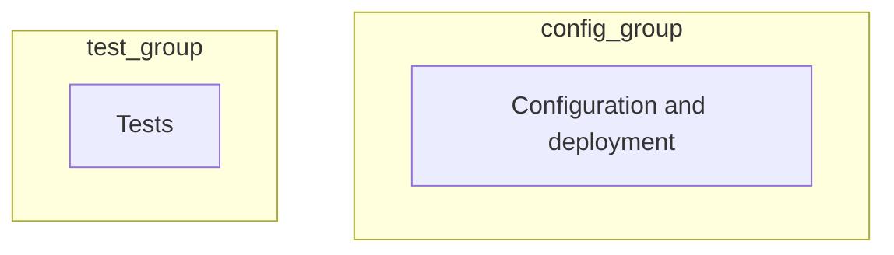

# Architecture report: apsdehal/awesome-ctf

> Automated static analysis. **Observed** = directly seen in files/imports/AST; **Inferred** = interpretation from that evidence. Repository code was not executed.

## 1. Repository at a glance

| Item | Value |
| --- | --- |
| Repository | apsdehal/awesome-ctf |
| Description | A curated list of CTF frameworks, libraries, resources and softwares |
| Language | JavaScript |
| Stars | 11998 |
| Licence | CC0-1.0 |
| Analysed commit / branch | eb504b242be3918cbd46e1a5a6274671f477071f / master |
| Framework(s) | None detected |
| Files analysed | 9 |
| Components | 2 |

## 2. Architecture in one minute

apsdehal/awesome-ctf - A curated list of CTF frameworks, libraries, resources and softwares. This repository was analysed statically from 9 file(s) (0 Python). Detected technologies (observed from imports/manifests): no known frameworks/libraries. Files are grouped into 2 component(s): Configuration and deployment, Tests. Findings below distinguish observed facts from inferred interpretation.

## 3. High-level block diagram

## 4. Main components

### Configuration and deployment (`config`)

- **Kind:** config
- **Status:** Observed
- **Confidence:** 0.85
- **Responsibility:** Groups 2 file(s) under configuration and deployment (observed from repository paths and static analysis).
- **Paths:** `_config.yml`, `package.json`
- **Evidence:** [_config.yml](https://github.com/apsdehal/awesome-ctf/blob/eb504b242be3918cbd46e1a5a6274671f477071f/_config.yml); [package.json](https://github.com/apsdehal/awesome-ctf/blob/eb504b242be3918cbd46e1a5a6274671f477071f/package.json)

### Tests (`tests`)

- **Kind:** test
- **Status:** Observed
- **Confidence:** 0.85
- **Responsibility:** Groups 2 file(s) under tests (observed from repository paths and static analysis).
- **Paths:** `tests/test.js`, `tests/utils.js`
- **Evidence:** [tests/test.js](https://github.com/apsdehal/awesome-ctf/blob/eb504b242be3918cbd46e1a5a6274671f477071f/tests/test.js); [tests/utils.js](https://github.com/apsdehal/awesome-ctf/blob/eb504b242be3918cbd46e1a5a6274671f477071f/tests/utils.js)

## 5. Execution flow

No entry point was observed; the startup flow below is therefore limited.

Representative flow (derived from observed entry points and the import graph; steps beyond the entry point are **Inferred**):

1. Execution starts at an observed entry point listed above, if present.
2. No internal import relationships between components were observed.

## 6. Project structure

### `(root)`

- `.gitignore` - other (13 bytes)
- `.travis.yml` - ci, YAML (37 bytes)
- `CONTRIBUTING.md` - docs (912 bytes)
- `LICENSE` - docs (6555 bytes)
- `README.md` - docs (26201 bytes)
- `_config.yml` - config (25 bytes)
- `package.json` - manifest (911 bytes)

### `tests`

- `tests/test.js` - test, JavaScript (645 bytes)
- `tests/utils.js` - test, JavaScript (805 bytes)

## 7. Key dependencies and integrations

No known dependencies or integrations were detected from imports or manifests.

## 8. Data and state

No database, cache, queue, or persistent-state usage was observed in the analysed files. State handling, if any, may be in-memory or in files that were not analysed.

## 9. Configuration and deployment clues

- `.travis.yml` (ci)
- `_config.yml` (config)
- `package.json` (manifest)

## 10. Design observations

- Tests are present alongside source code (Observed from test file paths).

These observations are interpretations (**Inferred**) of the observed structure, not guarantees about runtime design.

## 11. Limitations and unknowns

- Static analysis only: repository code was not executed, installed, or imported at runtime.
- Components and relationships are inferred from file paths, imports, and AST structure; runtime behaviour, dynamic imports, and reflection may not be visible.
- No clear application entry point was observed in the analysed files.
- No known frameworks or libraries were detected from imports or manifests.
- Repository text was treated as untrusted data; no instructions found in repository files were followed, and likely secret values were redacted/excluded.
- JavaScript and TypeScript files were inventoried from paths and package manifests. They were not parsed with a full language AST, and repository code was not executed.

## 12. Source references

- [_config.yml](https://github.com/apsdehal/awesome-ctf/blob/eb504b242be3918cbd46e1a5a6274671f477071f/_config.yml)
- [package.json](https://github.com/apsdehal/awesome-ctf/blob/eb504b242be3918cbd46e1a5a6274671f477071f/package.json)
- [tests/test.js](https://github.com/apsdehal/awesome-ctf/blob/eb504b242be3918cbd46e1a5a6274671f477071f/tests/test.js)
- [tests/utils.js](https://github.com/apsdehal/awesome-ctf/blob/eb504b242be3918cbd46e1a5a6274671f477071f/tests/utils.js)
